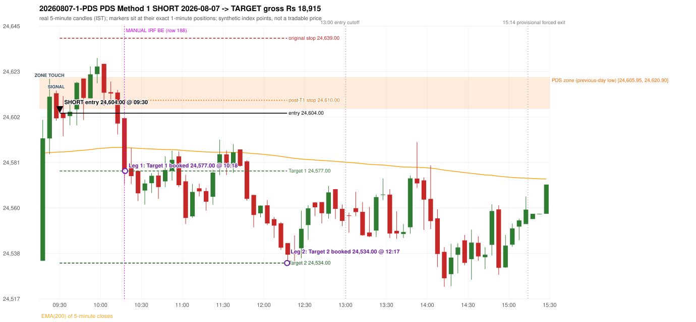

# Trading journal - 2026-08-07 (Friday)

> Automated reconstruction of the Phase 3.6 combined backtest: the Phase 3.0 controller, stops, targets and sizing with PDR = the body-based engine (wicks ignored; open strictly above the zone; numeric pattern thresholds and zone-lower-boundary conventions are provisional research assumptions, NOT approved by the strategy author). Synthetic NIFTY 50 index-point P&L (the index is not tradable). The owner's review status is intentionally blank.

## A. Trading day overview

| item | value |
|---|---|
| Date / weekday | 2026-08-07 / Friday |
| Session type | USABLE_WITH_FLAGS / VALID / CLOSING_AUCTION_REGIME |
| Original session open (first 1-minute open) | 24,535.05 |
| Previous session | 2026-08-06 |
| Previous-day high / low (wicks included) | 24,676.80 / 24,605.95 |
| Previous-day highest BODY high (the body-based PDR ceiling; wicks ignored) | 24,674.00 |
| Previous-day official close / last 5-minute close | 24,636.00 / 24,636.00 |
| Raw engine records / confirmed signals / fully valid signals | 9 / 5 / 5 |
| Setups that did not complete (invalidated / incomplete) | 4 |
| Executed trades | 1 20260807-1-PDS |
| Gross P&L (Rs, synthetic) | 18,915.00 |
| Illustrative net P&L (Rs; Rs 500/trade + 0.5 pt/fill) | 18,025.00 |
| Day-end portfolio status | DAY_FINISHED |
| Manual journal trades (matched / unmatched) | 1 (0 / 1) |
| Extra automated trades | 1 |

## B. Daily strategy signal timeline (confirmed signals, chronological)

| time | strategy | method | dir | entry-rule status | valid for execution | <= 13:00 | portfolio state | accepted / ignored | specific reason | competing (same minute) |
|---|---|---|---|---|---|---|---|---|---|---|
| 09:30 | PDS | Method 1 | SHORT | PROPOSAL_DEPENDENT | True | True | FIRST_TRADE_ACTIVE | ACCEPTED -> 20260807-1-PDS | first eligible signal of the day; trade 1: TARGET |  |
| 09:50 | IRF | Method 2B | SHORT | PROPOSAL_DEPENDENT | True | True | FIRST_TRADE_ACTIVE | IGNORED | POSITION_ACTIVE (signal kept for diagnostics only; never reused) [blocked by PDS#1] |  |
| 10:15 | IRF | Method 1 | SHORT | PROPOSAL_DEPENDENT | True | True | FIRST_TRADE_ACTIVE | IGNORED | POSITION_ACTIVE (signal kept for diagnostics only; never reused) [blocked by PDS#1] | IRF Method 2A SHORT; PDS Method 3 SHORT |
| 10:15 | IRF | Method 2A | SHORT | PROPOSAL_DEPENDENT | True | True | FIRST_TRADE_ACTIVE | IGNORED | POSITION_ACTIVE (signal kept for diagnostics only; never reused) [blocked by PDS#1] | IRF Method 1 SHORT; PDS Method 3 SHORT |
| 10:15 | PDS | Method 3 | SHORT | PROPOSAL_DEPENDENT | True | True | FIRST_TRADE_ACTIVE | IGNORED | POSITION_ACTIVE (signal kept for diagnostics only; never reused) [blocked by PDS#1] | IRF Method 1 SHORT; IRF Method 2A SHORT |

Engine setups that did not complete (4); the complete list with failed rule ids is in `rejected_signals.csv`:

| candle | strategy | method | dir | status | precise reason | failed rules |
|---|---|---|---|---|---|---|
| 09:15 | ORB | Method 1 | SHORT | INVALIDATED | TREND:EMA_PREV_SESSION_CLOSE wrong side | ORB-TREND-001;ORB-TREND-002 |
| 09:15 | ORB | Method 2 | SHORT | INVALIDATED | TREND:EMA_PREV_SESSION_CLOSE wrong side | ORB-TREND-001;ORB-TREND-002 |
| 09:15 | ORB | Gap/200DMA | SHORT | INVALIDATED | CLOSE_NOT_BEYOND_MA | ORB-GAP-SHORT-003 |
| 14:15 | RF | RF | LONG | INVALIDATED | GAP_NOT_UP(DOWN) | RF-003 |

## C. Detailed trade journals

### 20260807-1-PDS: PDS Method 1 SHORT (FIRST trade)

Chart: 

**Rule configuration:** CFG-phase36_body_based-866f954e55 - signal verification status **PROPOSAL_DEPENDENT** (never VERIFIED while a rule rests on a proposal).

#### 1. Setup identification

PDS Method 1 SHORT: the session opened 70.90 points below the previous-day-low zone [24,605.95, 24,620.90]; price rose to the zone at 09:20 and the first red candle at the zone (09:25, close 24,601.60) had a good body; confirmed 09:30.

#### 2. Candle and indicator calculations

| role | session | candle | O | H | L | C | range | body % | upper wick % | lower wick % | direction | EMA(200) | strong bull / bear | pin bull / bear | small (body<=30%) | used for |
|---|---|---|---|---|---|---|---|---|---|---|---|---|---|---|---|---|
| zone_source_candle | PREVIOUS | 10:05-10:10 | 24,614.05 | 24,621.50 | 24,605.95 | 24,620.90 | 15.55 | 44.05 | 3.86 | 52.09 | BULLISH | 24,536.56 | False / False | False / False | False | previous-day low candle that defines the zone (A_LOWEST_LOW) |
| zone_retest_candle | TODAY | 09:20-09:25 | 24,592.20 | 24,620.00 | 24,584.75 | 24,611.70 | 35.25 | 55.32 | 23.55 | 21.13 | BULLISH | 24,585.60 | False / False | False / False | False | first candle whose range reaches the zone from below |
| signal_candle | TODAY | 09:25-09:30 | 24,613.30 | 24,614.65 | 24,600.50 | 24,601.60 | 14.15 | 82.69 | 9.54 | 7.77 | BEARISH | 24,585.76 | False / True | False / False | False | trigger candle |

Every condition, with the rule, the calculation, the observed values and the result:

| # | group | rule | result | status / numeric definition | calculation | observed | required | available at | why it matters |
|---|---|---|---|---|---|---|---|---|---|
| 1 | SELECTION | SEL-FIRST-001 | PASS | USER_APPROVED / USER_APPROVED | earliest CONFIRMED signal of the day across IRF/ORB/PDR/PDS/RF that passed the controller's checks | 0 confirmed signal(s) earlier today; 5 confirmed signals in the day in total, this one at 09:30 | no earlier executable signal | 2026-08-07 09:30 | the shared controller trades only the first valid signal; the five strategies are not independent positions |
| 2 | SELECTION | SEL-TIE-001 | PASS | USER_APPROVED / USER_APPROVED | other CONFIRMED signals with exactly the same confirmation timestamp | none | no different-strategy / opposite-direction signal in the same minute (otherwise an unresolved conflict, no trade) | 2026-08-07 09:30 | an unresolved same-minute collision would have produced no trade at all |
| 3 | SELECTION | ENTRY-CUTOFF-001 | PASS | USER_APPROVED / USER_APPROVED | fill timestamp vs 13:00:00 IST | signal confirmed 09:30; fill 09:30 | fill at or before 13:00:00 IST | 2026-08-07 09:30 | no new position may be entered with a fill after 13:00 IST |
| 4 | SELECTION | EXE-FILL-001 | PASS | PROPOSED_FOR_REVIEW / PROPOSED_FOR_REVIEW | fill = open of the 1-minute bar that starts at the signal candle's end | bar 09:30 O 24,604.00 H 24,604.75 L 24,594.65 C 24,594.65; executable=True; entry 24,604.00 | fill bar exists, starts exactly at the signal end, is fillable; entry = its open | 2026-08-07 09:30 | a 5-minute signal is known only when its candle closes; the first price that can be traded is the next minute's open |
| 5 | SELECTION | DAY-MAX-001 | PASS | USER_APPROVED / USER_APPROVED | number of entries today | trade 1 of at most 2 | <= 2 entries per day | 2026-08-07 09:30 | daily trade cap |
| 6 | SETUP | PDS-003 | PASS | SOURCE_VERIFIED / EXPLICIT_WORDING_DETAIL_PROPOSED_FOR_REVIEW | gap = first 1-minute open of today - previous session's OFFICIAL close | today's open 24,535.05 (first 1-minute bar 09:15) - previous close 24,636.00 (DAILY_VENDOR, 2026-08-06) = -100.95 points -> gap DOWN | gap DOWN (more than 0 points) | 2026-08-07 09:15 | approved convention: the original first-minute open, never the vendor daily open |
| 7 | SETUP | PDS-006 | PASS | SOURCE_VERIFIED / QUALITATIVE_SOURCE_NUMERIC_DEFINITION_PROPOSED_FOR_REVIEW | gap-down open below the zone | today's open 24,535.05 vs zone low 24,605.95: 70.90 points below | open < zone low | 2026-08-07 09:15 | the guide: 'price is trading below the previous day's support zone' after the gap; a PROPOSED strict reading |
| 8 | SETUP | PDS-004 | PASS | SOURCE_VERIFIED / EXPLICIT_IN_SOURCE | PDS is not a breakdown strategy: the zone must be tested from below first | open 24,535.05 below the zone floor 24,605.95; the first candle to reach the zone is 09:20 | price rises to the zone before any short | 2026-08-07 09:15 | a short below the level without a retest is not this strategy |
| 9 | SETUP | PDS-005 | PASS | SOURCE_VERIFIED / QUALITATIVE_SOURCE_NUMERIC_DEFINITION_PROPOSED_FOR_REVIEW | price comes up to the zone: first candle whose [low, high] intersects it (+/- proximity) | 09:20-09:25 O 24,592.20 H 24,620.00 L 24,584.75 C 24,611.70; range 35.25, body 19.50 (55.32%), upper wick 8.30 (23.55%), lower wick 7.45 (21.13%), bullish; high 24,620.00 vs zone low 24,605.95 | range intersects the zone | 2026-08-07 09:25 | PDS is not a breakdown strategy: the zone must be tested from below first |
| 10 | ZONE | PDS-001 | PASS | SOURCE_VERIFIED / EXPLICIT_IN_SOURCE | direction | SHORT (PDS is short only) | short-only | 2026-08-07 09:30 | PDS sells a retest of previous-day support from below |
| 11 | ZONE | PDS-002 | PASS | SOURCE_VERIFIED / QUALITATIVE_SOURCE_NUMERIC_DEFINITION_PROPOSED_FOR_REVIEW | zone = [lowest low, body top] of the previous session's absolute-low candle (method A_LOWEST_LOW; the lower wick is part of the zone) | zone [24,605.95, 24,620.90] from the 10:05 candle of 2026-08-06 (10:05-10:10 O 24,614.05 H 24,621.50 L 24,605.95 C 24,620.90; range 15.55, body 6.85 (44.05%), upper wick 0.60 (3.86%), lower wick 8.10 (52.09%), bullish); engine recorded [24,605.95, 24,620.90] | previous trading day's low where price took support (body + lower wick) | 2026-08-06 10:10 | the reference level of the strategy; the exact candle(s) are a research choice (PDS-ZONE-002) |
| 12 | CONFIRMATION | PDS-M-001 | PASS | SOURCE_VERIFIED / QUALITATIVE_SOURCE_NUMERIC_DEFINITION_PROPOSED_FOR_REVIEW | Methods 1/2 apply to the FIRST red candle at the zone | first red candle at the zone: 09:25; signal candle 09:25 | the trigger is the first red candle at the zone | 2026-08-07 09:30 | a later red candle would only qualify through Method 3 |
| 13 | CONFIRMATION | PDS-M1-001 | PASS | SOURCE_VERIFIED / QUALITATIVE_SOURCE_NUMERIC_DEFINITION_PROPOSED_FOR_REVIEW | good red candle: bearish close, body >= 60% of range, lower wick <= 20% of range | 09:25-09:30 O 24,613.30 H 24,614.65 L 24,600.50 C 24,601.60; range 14.15, body 11.70 (82.69%), upper wick 1.35 (9.54%), lower wick 1.10 (7.77%), bearish -> body 82.69% / lower wick 7.77% | strong bearish candle (research thresholds) | 2026-08-07 09:30 | the guide: 'a red candle with a good body' - body size is explicitly not numerically defined |
| 14 | EXECUTION | EXE-STOP-001 | PASS | USER_APPROVED / USER_APPROVED | initial stop = entry + 35 points | entry 24,604.00 -> stop 24,639.00 | stop 35 index points (BASELINE) | 2026-08-07 09:30 | defines the loss if the setup fails before Target 1 |
| 15 | EXECUTION | EXE-T1-001 | PASS | SOURCE_VERIFIED / EXPLICIT_IN_SOURCE | Target 1 = entry +/- 27 points | T1 24,577.00 | 27 points | 2026-08-07 09:30 | Leg 1 (3 lots) is booked at Target 1 |
| 16 | EXECUTION | PDS-TGT-001 | PASS | SOURCE_VERIFIED / EXPLICIT_IN_SOURCE | Target 2 = entry +/- 70 points | T2 24,534.00 (the guide says 70; the report suggests 60 - CONFLICTING) | 70 points | 2026-08-07 09:30 | Leg 2 (3 lots) is booked at Target 2 |
| 17 | EXECUTION | POST-T1-STOP-006 | PASS | USER_APPROVED / USER_APPROVED | after T1 the Leg-2 stop = entry + 6 (no trailing) | post-T1 stop 24,610.00 | entry -6 (LONG) / +6 (SHORT) | 2026-08-07 09:30 | protects the remaining three lots once the first three are booked |
| 18 | EXECUTION | SIZE-LOT-001 | PASS | USER_APPROVED / USER_APPROVED | 6 lots x 65 = 390, Leg 1 = 3 lots = 195, Leg 2 = 195 | 6 lots, lot size 65, legs 3+3 | 6 lots in two equal legs | 2026-08-07 09:30 | position size for the synthetic P&L |
| 19 | NOTE | PDS-007 | NOT_APPLICABLE | PROPOSED_FOR_REVIEW / PROPOSED_FOR_REVIEW | repeated PDS signals today | 2 confirmed PDS signal(s) in the session | n/a (disclosure) | 2026-08-07 09:30 | the per-session cap is lifted for the controller runs; the controller trades only the first (or the permitted second) trade |
| 20 | NOTE | PDS-SL-001 | NOT_APPLICABLE | SOURCE_VERIFIED / QUALITATIVE_SOURCE_NUMERIC_DEFINITION_PROPOSED_FOR_REVIEW | the guide's 35-or-40 rule: 35 if the most recent green candle's high is within 35 points of entry, else 40 | most recent green candle high 24,620.00 is 16.00 points from the entry 24,604.00: the guide's rule would select 35 points; the baseline applies a fixed 35 (USER_APPROVED research baseline; the 35-vs-40 selection and the 40-point variant are separate labelled scenarios) | source selection rule | 2026-08-07 09:30 | the stop distance is a modelling choice and changes losses, not entries |
| 21 | NOTE | NOTE-UNRESOLVED-DEPENDENCIES | NOT_APPLICABLE | NOT_A_RULE / NOT_A_REGISTRY_RULE | rules the signal depends on that the sources leave unresolved | engine-recorded unresolved rule ids: none; verification status PROPOSAL_DEPENDENT | n/a (disclosure) | 2026-08-07 09:30 | the entry is only as verified as the rules it rests on |

#### 3. Entry decision and explanation

PDS Method 1 SHORT: the session opened 70.90 points below the previous-day-low zone [24,605.95, 24,620.90]; price rose to the zone at 09:20 and the first red candle at the zone (09:25, close 24,601.60) had a good body; confirmed 09:30.

**Why this trade ahead of the other strategies:** This PDS Method 1 signal was the earliest executable signal of the day: 0 confirmed signal(s) earlier, 0 other in the same minute. 4 later confirmed signal(s) (IRF x3, PDS x1) are logged as ignored or rejected. State of the other four engines at that moment: [IRF: no setup record before this time (a base condition was not met, or nothing triggered)] [ORB: Method 1 invalidated at 09:15: TREND:EMA_PREV_SESSION_CLOSE wrong side; Method 2 invalidated at 09:15: TREND:EMA_PREV_SESSION_CLOSE wrong side] [PDR: no setup record before this time (a base condition was not met, or nothing triggered)] [RF: no setup record before this time (a base condition was not met, or nothing triggered)]

#### 4. Actual entry execution

| item | value |
|---|---|
| Signal candle | 09:25-09:30 |
| Signal confirmed | 2026-08-07 09:30 |
| Fill timestamp | 2026-08-07 09:30 |
| Entry price | 24,604.00 |
| Source partition / 1-minute bar | data/processed/nifty50/year=2026/month=08/candles.parquet / 2026-08-07 09:30 |
| Source bar O / H / L / C | 24,604.00 / 24,604.75 / 24,594.65 / 24,594.65 |
| Fill assumption | open of the 1-minute bar starting at the signal candle's end (EXE-FILL-001, PROPOSED causal convention) |
| Initial stop / T1 / T2 / post-T1 stop | 24,639.00 / 24,577.00 / 24,534.00 / 24,610.00 |
| Position | 6 lots x 65 = 390 units (Leg 1 195, Leg 2 195) |

#### 5-8. Trade progress, Target 1, post-T1 stop and final exit

Between the 09:30 entry bar and the final exit (168 one-minute bars) the best excursion in favour was 71.10 points at 12:17 and the worst against was 25.80 points at 09:59. At 10:18 price reached Target 1 24,577.00 and three lots exited. At 10:18 the remaining three lots' protective stop was set to 24,610.00 (entry + 6; no trailing, no further change); the engine applies it from the Target-1 bar onward and tests it within that same bar. At 12:17 price reached Target 2 24,534.00 and the remaining three lots exited. No further trade that day (DAY-T2-001).

| leg | qty | exit time | exit price | reason | source 1-minute bar | O / H / L / C | gross points | gross Rs | slippage pts | flags |
|---|---|---|---|---|---|---|---|---|---|---|
| 1 | 195 | 10:18 | 24,577.00 | TARGET_1 | 10:18 | 24,593.05 / 24,593.05 / 24,573.40 / 24,574.85 | 27.00 | 5,265.00 | 0.00 |  |
| 2 | 195 | 12:17 | 24,534.00 | TARGET_2 | 12:17 | 24,536.05 / 24,538.00 / 24,532.90 / 24,535.00 | 70.00 | 13,650.00 | 0.00 |  |

Exit evidence per leg:

* Leg 1: 1-minute bar 10:18 O 24,593.05 H 24,593.05 L 24,573.40 C 24,574.85: low 24,573.40 reached Target 1 24,577.00; Leg 1 booked at the target level
* Leg 2: 1-minute bar 12:17 O 24,536.05 H 24,538.00 L 24,532.90 C 24,535.00: low 24,532.90 reached Target 2 24,534.00; Leg 2 booked at the target level

#### 9. Gross and illustrative net P&L

| item | value (Rs) |
|---|---|
| Leg 1 gross | 5,265.00 |
| Leg 2 gross | 13,650.00 |
| Trade gross (= Leg 1 + Leg 2) | 18,915.00 |
| Illustrative fixed cost | -500.00 |
| Illustrative slippage (0.5 pt on every fill, entry + exits, all units) | -390.00 |
| Illustrative net | 18,025.00 |

#### 10. Manual journal comparison

EXTRA_AUTOMATED_TRADE: the automated system took PDS Method 1 SHORT at 09:30 (manual traded only other strategies: IRF 10:15 BE). The setup rests on: no unresolved rule. The journal shows no corresponding entry.

## D. Manual journal comparison

| comparison | journal row | journal strategy | manual time | manual direction | manual outcome | match class | trade | auto entry | auto outcome | explanation |
|---|---|---|---|---|---|---|---|---|---|---|
| M188 | 188 | IRF | 10:15 | SHORT | BE | SIGNAL_REJECTED_BY_PORTFOLIO_CONTROLLER |  |  |  | SIGNAL_REJECTED_BY_PORTFOLIO_CONTROLLER: RAW_CONFIRMED_SIGNAL Method 1 10:15 -> IGNORED - POSITION_ACTIVE (signal kept for diagnostics only; never reused). Heuristic primary cause: PORTFOLIO_COMPETITION; blocked by: PDS#1 |
| E103 |  |  |  |  |  | EXTRA_AUTOMATED_TRADE | 20260807-1-PDS | 09:30 @ 24,604.00 | TARGET | EXTRA_AUTOMATED_TRADE: the automated system took PDS Method 1 SHORT at 09:30 (manual traded only other strategies: IRF 10:15 BE). The setup rests on: no unresolved rule. The journal shows no corresponding entry. |

The journal records no entry price and no exit price (NOT_RECORDED); matching uses date, strategy and candle start only - never P&L.

## E. Daily conclusion

* **Traded:** 20260807-1-PDS - PDS Method 1 SHORT at 09:30 (entry 24,604.00), outcome TARGET, gross Rs 18,915.00, illustrative net Rs 18,025.00. **Why:** This PDS Method 1 signal was the earliest executable signal of the day: 0 confirmed signal(s) earlier, 0 other in the same minute. 4 later confirmed signal(s) (IRF x3, PDS x1) are logged as ignored or rejected. State of the other four engines at that moment: [IRF: no setup record before this time (a base condition was not met, or nothing triggered)] [ORB: Method 1 invalidated at 09:15: TREND:EMA_PREV_SESSION_CLOSE wrong side; Method 2 invalidated at 09:15: TREND:EMA_PREV_SESSION_CLOSE wrong side] [PDR: no setup record before this time (a base condition was not met, or nothing triggered)] [RF: no setup record before this time (a base condition was not met, or nothing triggered)] **How it ended:** At 10:18 price reached Target 1 24,577.00 and three lots exited. At 10:18 the remaining three lots' protective stop was set to 24,610.00 (entry + 6; no trailing, no further change); the engine applies it from the Target-1 bar onward and tests it within that same bar. At 12:17 price reached Target 2 24,534.00 and the remaining three lots exited. No further trade that day (DAY-T2-001).
* **Ignored / rejected signals:** IRF IGNORED POSITION_ACTIVE x3; PDS IGNORED POSITION_ACTIVE x1
* **Unmatched manual trade (row 188, IRF 10:15 BE):** SIGNAL_REJECTED_BY_PORTFOLIO_CONTROLLER: RAW_CONFIRMED_SIGNAL Method 1 10:15 -> IGNORED - POSITION_ACTIVE (signal kept for diagnostics only; never reused). Heuristic primary cause: PORTFOLIO_COMPETITION; blocked by: PDS#1
* **Extra automated trade 20260807-1-PDS:** EXTRA_AUTOMATED_TRADE: the automated system took PDS Method 1 SHORT at 09:30 (manual traded only other strategies: IRF 10:15 BE). The setup rests on: no unresolved rule. The journal shows no corresponding entry.
* **Automated triage (not an approval; the owner's review status stays blank):** REVIEW: UNMATCHED_MANUAL+EXTRA_AUTOMATED
