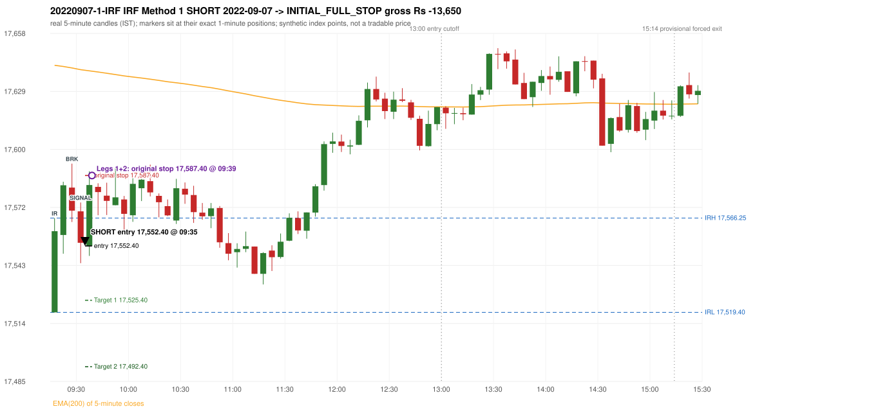
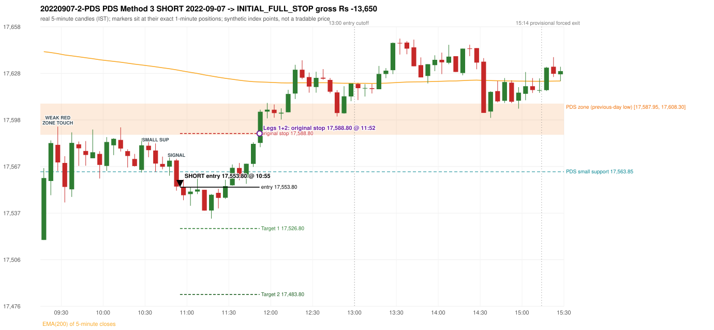

# Trading journal - 2022-09-07 (Wednesday)

> Phase 4 historical validation, window B (Window B 2022-09-01..2025-08-31 (5paisa minutes); status DATA_VALIDATED). The FROZEN Phase 3.6 configuration (IRF, ORB, PDR body-based, PDS, RF; shared controller) on a different data source. HISTORICAL RESEARCH ONLY: the strategy was developed using later data. same provider as the Phase 3.6 baseline; the vendor-overlap audit shows the minute bars differ from the secondary vendor Synthetic NIFTY 50 index-point P&L (the index is not tradable). The owner's review status is intentionally blank.

## A. Trading day overview

| item | value |
|---|---|
| Date / weekday | 2022-09-07 / Wednesday |
| Session type | USABLE_WITH_FLAGS / VALID |
| Original session open (first 1-minute open) | 17,519.40 |
| Previous session | 2022-09-06 |
| Previous-day high / low (wicks included) | 17,764.00 / 17,587.95 |
| Previous-day highest BODY high (the body-based PDR ceiling; wicks ignored) | 17,743.35 |
| Previous-day official close / last 5-minute close | 17,655.60 / 17,651.60 |
| Raw engine records / confirmed signals / fully valid signals | 15 / 10 / 10 |
| Setups that did not complete (invalidated / incomplete) | 5 |
| Executed trades | 2 20220907-1-IRF;20220907-2-PDS |
| Gross P&L (Rs, synthetic) | -27,300.00 |
| Illustrative net P&L (Rs; Rs 500/trade + 0.5 pt/fill) | -29,080.00 |
| Day-end portfolio status | DAY_FINISHED |
| Manual journal trades (matched / unmatched) | 0 (0 / 0) |
| Extra automated trades | 0 |

## B. Daily strategy signal timeline (confirmed signals, chronological)

| time | strategy | method | dir | entry-rule status | valid for execution | <= 13:00 | portfolio state | accepted / ignored | specific reason | competing (same minute) |
|---|---|---|---|---|---|---|---|---|---|---|
| 09:35 | IRF | Method 1 | SHORT | PROPOSAL_DEPENDENT | True | True | FIRST_TRADE_ACTIVE | ACCEPTED -> 20220907-1-IRF | first eligible signal of the day; trade 1: INITIAL_FULL_STOP |  |
| 10:55 | IRF | Method 1 | SHORT | PROPOSAL_DEPENDENT | True | True | SECOND_TRADE_ACTIVE | REJECTED | SECOND_TRADE_RESTRICTED_TO_PDR_PDS [blocked by IRF#1] | IRF Method 2A SHORT; PDS Method 3 SHORT |
| 10:55 | IRF | Method 2A | SHORT | PROPOSAL_DEPENDENT | True | True | SECOND_TRADE_ACTIVE | REJECTED | SECOND_TRADE_RESTRICTED_TO_PDR_PDS [blocked by IRF#1] | IRF Method 1 SHORT; PDS Method 3 SHORT |
| 10:55 | PDS | Method 3 | SHORT | PROPOSAL_DEPENDENT | True | True | SECOND_TRADE_ACTIVE | ACCEPTED -> 20220907-2-PDS | permitted second trade: newly confirmed PDR/PDS after the original full stop; trade 2: INITIAL_FULL_STOP | IRF Method 1 SHORT; IRF Method 2A SHORT |
| 11:40 | IRF | Method 1 | SHORT | PROPOSAL_DEPENDENT | True | True | SECOND_TRADE_ACTIVE | IGNORED | POSITION_ACTIVE (signal kept for diagnostics only; never reused) [blocked by PDS#2] |  |
| 12:50 | IRF | Method 2A | SHORT | PROPOSAL_DEPENDENT | True | True | DAY_FINISHED | IGNORED | DAY_FINISHED [blocked by PDS#2] | IRF Method 2B SHORT |
| 12:50 | IRF | Method 2B | SHORT | PROPOSAL_DEPENDENT | True | True | DAY_FINISHED | IGNORED | DAY_FINISHED [blocked by PDS#2] | IRF Method 2A SHORT |
| 14:35 | IRF | Method 2A | SHORT | PROPOSAL_DEPENDENT | True | False | DAY_FINISHED | IGNORED | DAY_FINISHED [blocked by PDS#2] | IRF Method 2B SHORT |
| 14:35 | IRF | Method 2B | SHORT | PROPOSAL_DEPENDENT | True | False | DAY_FINISHED | IGNORED | DAY_FINISHED [blocked by PDS#2] | IRF Method 2A SHORT |
| 15:10 | IRF | Method 2B | SHORT | PROPOSAL_DEPENDENT | True | False | DAY_FINISHED | IGNORED | DAY_FINISHED [blocked by PDS#2] |  |

Engine setups that did not complete (5); the complete list with failed rule ids is in `rejected_signals.csv`:

| candle | strategy | method | dir | status | precise reason | failed rules |
|---|---|---|---|---|---|---|
| 15:05 | IRF | Method 1/2 | SHORT | INCOMPLETE_AT_EOD | SESSION_ENDED_BEFORE_CONFIRMATION |  |
| 09:15 | ORB | Method 1 | SHORT | INVALIDATED | TREND:EMA_PREV_SESSION_CLOSE wrong side | ORB-TREND-001;ORB-TREND-002 |
| 09:15 | ORB | Method 2 | SHORT | INVALIDATED | TREND:EMA_PREV_SESSION_CLOSE wrong side | ORB-TREND-001;ORB-TREND-002 |
| 09:15 | ORB | Gap/200DMA | SHORT | INVALIDATED | CANDLE_QUALITY_OR_REJECTION_WICK | ORB-GAP-SHORT-003 |
| 11:50 | PDS | Method 1/2/3 | SHORT | INCOMPLETE_AT_EOD | NO_QUALIFYING_ENTRY_BEFORE_SESSION_END |  |

## C. Detailed trade journals

### 20220907-1-IRF: IRF Method 1 SHORT (FIRST trade)

Chart: 

**Rule configuration:** CFG-phase36_body_based-866f954e55 - signal verification status **PROPOSAL_DEPENDENT** (never VERIFIED while a rule rests on a proposal).

#### 1. Setup identification

IRF Method 1 SHORT: the completed 09:25 candle closed at 17,569.95, 3.70 points above the initial range high 17,566.25 (range [17,519.40, 17,566.25] from the 09:15 candle); the immediately following completed 09:30 candle closed at 17,553.95, back inside the range. The short signal was confirmed at 09:35 on that close. Entry reference close 17,553.95 is 12.30 points below IRH 17,566.25.

#### 2. Candle and indicator calculations

| role | session | candle | O | H | L | C | range | body % | upper wick % | lower wick % | direction | EMA(200) | strong bull / bear | pin bull / bear | small (body<=30%) | used for |
|---|---|---|---|---|---|---|---|---|---|---|---|---|---|---|---|---|
| initial_range_candle | TODAY | 09:15-09:20 | 17,519.40 | 17,566.25 | 17,519.40 | 17,559.75 | 46.85 | 86.13 | 13.87 | 0.00 | BULLISH | 17,642.18 | True / False | False / False | False | initial range = high/low of the 09:15 candle |
| signal_candle | TODAY | 09:30-09:35 | 17,569.60 | 17,574.00 | 17,543.85 | 17,553.95 | 30.15 | 51.91 | 14.59 | 33.50 | BEARISH | 17,640.01 | False / False | False / False | False | candle whose close completed the trigger |
| breakout_candle | TODAY | 09:25-09:30 | 17,581.40 | 17,593.30 | 17,564.30 | 17,569.95 | 29.00 | 39.48 | 41.03 | 19.48 | BEARISH | 17,640.87 | False / False | False / False | False | breakout candle: a completed candle closing above IRH |

Every condition, with the rule, the calculation, the observed values and the result:

| # | group | rule | result | status / numeric definition | calculation | observed | required | available at | why it matters |
|---|---|---|---|---|---|---|---|---|---|
| 1 | SELECTION | SEL-FIRST-001 | PASS | USER_APPROVED / USER_APPROVED | earliest CONFIRMED signal of the day across IRF/ORB/PDR/PDS/RF that passed the controller's checks | 0 confirmed signal(s) earlier today; 10 confirmed signals in the day in total, this one at 09:35 | no earlier executable signal | 2022-09-07 09:35 | the shared controller trades only the first valid signal; the five strategies are not independent positions |
| 2 | SELECTION | SEL-TIE-001 | PASS | USER_APPROVED / USER_APPROVED | other CONFIRMED signals with exactly the same confirmation timestamp | none | no different-strategy / opposite-direction signal in the same minute (otherwise an unresolved conflict, no trade) | 2022-09-07 09:35 | an unresolved same-minute collision would have produced no trade at all |
| 3 | SELECTION | ENTRY-CUTOFF-001 | PASS | USER_APPROVED / USER_APPROVED | fill timestamp vs 13:00:00 IST | signal confirmed 09:35; fill 09:35 | fill at or before 13:00:00 IST | 2022-09-07 09:35 | no new position may be entered with a fill after 13:00 IST |
| 4 | SELECTION | EXE-FILL-001 | PASS | PROPOSED_FOR_REVIEW / PROPOSED_FOR_REVIEW | fill = open of the 1-minute bar that starts at the signal candle's end | bar 09:35 O 17,552.40 H 17,563.60 L 17,552.40 C 17,563.15; executable=True; entry 17,552.40 | fill bar exists, starts exactly at the signal end, is fillable; entry = its open | 2022-09-07 09:35 | a 5-minute signal is known only when its candle closes; the first price that can be traded is the next minute's open |
| 5 | SELECTION | DAY-MAX-001 | PASS | USER_APPROVED / USER_APPROVED | number of entries today | trade 1 of at most 2 | <= 2 entries per day | 2022-09-07 09:35 | daily trade cap |
| 6 | SETUP | IRF-GLOBAL-001 | PASS | SOURCE_VERIFIED / EXPLICIT_IN_SOURCE | initial range = high and low (wicks included) of the first completed 5-minute candle | 09:15-09:20 IRH 17,566.25, IRL 17,519.40 (range 46.85; engine recorded IRH 17,566.25, IRL 17,519.40) | high/low of the 09:15-09:20 candle | 2022-09-07 09:20 | all three IRF methods measure price against this range |
| 7 | SETUP | IRF-GLOBAL-003 | PASS | SOURCE_VERIFIED / EXPLICIT_IN_SOURCE | closes confirm, wicks do not: every trigger is evaluated on a completed 5-minute candle | trigger candle 09:30-09:35 was complete when the signal was stamped 09:35; decision uses its close 17,553.95 | completed candle close, not an intra-candle wick | 2022-09-07 09:35 | an intra-candle wick can reverse before the candle closes |
| 8 | SETUP | IRF-GLOBAL-002 | PASS | SOURCE_VERIFIED / EXPLICIT_IN_SOURCE | direction | SHORT (IRF trades short only) | short only | 2022-09-07 09:35 | IRF fades failed upside breakouts |
| 9 | SETUP | IRF-M1-001 | PASS | SOURCE_VERIFIED / EXPLICIT_IN_SOURCE | breakout candle close vs IRH | 09:25-09:30 O 17,581.40 H 17,593.30 L 17,564.30 C 17,569.95; range 29.00, body 11.45 (39.48%), upper wick 11.90 (41.03%), lower wick 5.65 (19.48%), bearish; close 17,569.95 is 3.70 points above IRH 17,566.25 | close > IRH (a wick above IRH is not a breakout) | 2022-09-07 09:30 | starts every IRF setup |
| 10 | CONFIRMATION | IRF-M1-002 | PASS | SOURCE_VERIFIED / EXPLICIT_IN_SOURCE | candle after the breakout closes back inside [IRL, IRH) | 09:30-09:35 O 17,569.60 H 17,574.00 L 17,543.85 C 17,553.95; range 30.15, body 15.65 (51.91%), upper wick 4.40 (14.59%), lower wick 10.10 (33.50%), bearish; close 17,553.95 vs range [17,519.40, 17,566.25) | IRL <= close < IRH | 2022-09-07 09:35 | the failed breakout: price could not hold above the opening range |
| 11 | CONFIRMATION | IRF-M1-004 | PASS | SOURCE_VERIFIED / EXPLICIT_IN_SOURCE | failure candle is the candle immediately after the breakout (k = 1) | breakout 09:25, failure candle 09:30: k = 1 | k = 1 (pp.5, 6, 13); the p.14 'next or following' reading (IRF-M1-C001) is CONFLICTING and not used in the baseline | 2022-09-07 09:35 | the guide's worked example enters at the close of the very next candle; no support/resistance break is required |
| 12 | EXECUTION | EXE-STOP-001 | PASS | USER_APPROVED / USER_APPROVED | initial stop = entry + 35 points | entry 17,552.40 -> stop 17,587.40 | stop 35 index points (BASELINE) | 2022-09-07 09:35 | defines the loss if the setup fails before Target 1 |
| 13 | EXECUTION | EXE-T1-001 | PASS | SOURCE_VERIFIED / EXPLICIT_IN_SOURCE | Target 1 = entry +/- 27 points | T1 17,525.40 | 27 points | 2022-09-07 09:35 | Leg 1 (3 lots) is booked at Target 1 |
| 14 | EXECUTION | IRF-TGT-001 | PASS | SOURCE_VERIFIED / EXPLICIT_IN_SOURCE | Target 2 = entry +/- 60 points | T2 17,492.40 | 60 points | 2022-09-07 09:35 | Leg 2 (3 lots) is booked at Target 2 |
| 15 | EXECUTION | POST-T1-STOP-006 | PASS | USER_APPROVED / USER_APPROVED | after T1 the Leg-2 stop = entry + 6 (no trailing) | post-T1 stop 17,558.40 | entry -6 (LONG) / +6 (SHORT) | 2022-09-07 09:35 | protects the remaining three lots once the first three are booked |
| 16 | EXECUTION | SIZE-LOT-001 | PASS | USER_APPROVED / USER_APPROVED | 6 lots x 65 = 390, Leg 1 = 3 lots = 195, Leg 2 = 195 | 6 lots, lot size 65, legs 3+3 | 6 lots in two equal legs | 2022-09-07 09:35 | position size for the synthetic P&L |
| 17 | NOTE | IRF-GLOBAL-004 | UNRESOLVED | UNRESOLVED / UNRESOLVED | which close above IRH of the session produced this attempt; repeat setups | this breakout is upward crossing no. 1 of the session (a close above IRH after a close at/below it) | the source states no first-breakout-only, re-arming, expiry or trades-per-day rule | 2022-09-07 09:35 | IRF re-arms on every later breakout in the code, producing many raw setups; the controller keeps only the first |
| 18 | NOTE | NOTE-IRF-REPEATED-SETUPS | NOT_APPLICABLE | NOT_A_RULE / NOT_A_REGISTRY_RULE | other IRF signals later in the session (not traded) | 8 further confirmed IRF signal(s): Method 1@10:55, Method 2A@10:55, Method 1@11:40, Method 2A@12:50, Method 2B@12:50, Method 2A@14:35, Method 2B@14:35, Method 2B@15:10 | disclosure of repeated raw setups | 2022-09-07 09:35 | repeated raw IRF setups are not hidden; they are logged as ignored |
| 19 | NOTE | IRF-SL-001 | NOT_APPLICABLE | SOURCE_VERIFIED / QUALITATIVE_SOURCE_NUMERIC_DEFINITION_PROPOSED_FOR_REVIEW | the guide's 35-or-40 rule: 35 if the most recent green candle's high is within 35 points of entry, else 40 | most recent green candle high 17,584.30 is 31.90 points from the entry 17,552.40: the guide's rule would select 35 points; the baseline applies a fixed 35 (USER_APPROVED research baseline; the 35-vs-40 selection and the 40-point variant are separate labelled scenarios) | source selection rule | 2022-09-07 09:35 | the stop distance is a modelling choice and changes losses, not entries |
| 20 | NOTE | NOTE-UNRESOLVED-DEPENDENCIES | UNRESOLVED | NOT_A_RULE / NOT_A_REGISTRY_RULE | rules the signal depends on that the sources leave unresolved | engine-recorded unresolved rule ids: IRF-GLOBAL-004; verification status PROPOSAL_DEPENDENT | n/a (disclosure) | 2022-09-07 09:35 | the entry is only as verified as the rules it rests on |

#### 3. Entry decision and explanation

IRF Method 1 SHORT: the completed 09:25 candle closed at 17,569.95, 3.70 points above the initial range high 17,566.25 (range [17,519.40, 17,566.25] from the 09:15 candle); the immediately following completed 09:30 candle closed at 17,553.95, back inside the range. The short signal was confirmed at 09:35 on that close. Entry reference close 17,553.95 is 12.30 points below IRH 17,566.25.

**Why this trade ahead of the other strategies:** This IRF Method 1 signal was the earliest executable signal of the day: 0 confirmed signal(s) earlier, 0 other in the same minute. 9 later confirmed signal(s) (IRF x8, PDS x1) are logged as ignored or rejected. State of the other four engines at that moment: [ORB: Method 1 invalidated at 09:15: TREND:EMA_PREV_SESSION_CLOSE wrong side; Method 2 invalidated at 09:15: TREND:EMA_PREV_SESSION_CLOSE wrong side] [PDR: no setup record before this time (a base condition was not met, or nothing triggered)] [PDS: no setup record before this time (a base condition was not met, or nothing triggered)] [RF: no setup record before this time (a base condition was not met, or nothing triggered)]

#### 4. Actual entry execution

| item | value |
|---|---|
| Signal candle | 09:30-09:35 |
| Signal confirmed | 2022-09-07 09:35 |
| Fill timestamp | 2022-09-07 09:35 |
| Entry price | 17,552.40 |
| Source partition / 1-minute bar | data/phase4/processed/FIVEPAISA_1M_PHASE4/nifty50/year=2022/month=09/candles.parquet / 2022-09-07 09:35 |
| Source bar O / H / L / C | 17,552.40 / 17,563.60 / 17,552.40 / 17,563.15 |
| Fill assumption | open of the 1-minute bar starting at the signal candle's end (EXE-FILL-001, PROPOSED causal convention) |
| Initial stop / T1 / T2 / post-T1 stop | 17,587.40 / 17,525.40 / 17,492.40 / 17,558.40 |
| Position | 6 lots x 65 = 390 units (Leg 1 195, Leg 2 195) |

#### 5-8. Trade progress, Target 1, post-T1 stop and final exit

Between the 09:35 entry bar and the final exit (5 one-minute bars) the best excursion in favour was 4.95 points at 09:37 and the worst against was 37.15 points at 09:39. At 09:39 price reached the original stop 17,587.40 before Target 1 17,525.40, so all six lots exited together at 17,587.40. This is an INITIAL_FULL_STOP: one more trade is allowed that day, only a newly confirmed PDR/PDS signal.

| leg | qty | exit time | exit price | reason | source 1-minute bar | O / H / L / C | gross points | gross Rs | slippage pts | flags |
|---|---|---|---|---|---|---|---|---|---|---|
| 1 | 195 | 09:39 | 17,587.40 | ORIGINAL_STOP_BEFORE_T1 | 09:39 | 17,583.40 / 17,589.55 / 17,579.65 / 17,582.70 | -35.00 | -6,825.00 | 0.00 |  |
| 2 | 195 | 09:39 | 17,587.40 | ORIGINAL_STOP_BEFORE_T1 | 09:39 | 17,583.40 / 17,589.55 / 17,579.65 / 17,582.70 | -35.00 | -6,825.00 | 0.00 |  |

Exit evidence per leg:

* Leg 1: 1-minute bar 09:39 O 17,583.40 H 17,589.55 L 17,579.65 C 17,582.70: high 17,589.55 reached the original stop 17,587.40 before Target 1 17,525.40 was touched; both legs exit at the stop level 17,587.40
* Leg 2: 1-minute bar 09:39 O 17,583.40 H 17,589.55 L 17,579.65 C 17,582.70: high 17,589.55 reached the original stop 17,587.40 before Target 1 17,525.40 was touched; both legs exit at the stop level 17,587.40

#### 9. Gross and illustrative net P&L

| item | value (Rs) |
|---|---|
| Leg 1 gross | -6,825.00 |
| Leg 2 gross | -6,825.00 |
| Trade gross (= Leg 1 + Leg 2) | -13,650.00 |
| Illustrative fixed cost | -500.00 |
| Illustrative slippage (0.5 pt on every fill, entry + exits, all units) | -390.00 |
| Illustrative net | -14,540.00 |

#### 10. Manual journal comparison

No manual journal exists for this period; no comparison.

### 20220907-2-PDS: PDS Method 3 SHORT (SECOND trade)

Chart: 

**Rule configuration:** CFG-phase36_body_based-866f954e55 - signal verification status **PROPOSAL_DEPENDENT** (never VERIFIED while a rule rests on a proposal).

#### 1. Setup identification

PDS Method 3 SHORT: the session opened 68.55 points below the previous-day-low zone [17,587.95, 17,608.30]; the first red candle at the zone (09:25) was weak (body 39.48%), so the engine waited for a small support; the 10:35 candle's low 17,563.85 (24.10 points below the zone floor) was broken by the close of the 10:50 candle (17,554.20); confirmed 10:55.

#### 2. Candle and indicator calculations

| role | session | candle | O | H | L | C | range | body % | upper wick % | lower wick % | direction | EMA(200) | strong bull / bear | pin bull / bear | small (body<=30%) | used for |
|---|---|---|---|---|---|---|---|---|---|---|---|---|---|---|---|---|
| zone_source_candle | PREVIOUS | 10:35-10:40 | 17,590.10 | 17,609.35 | 17,587.95 | 17,608.30 | 21.40 | 85.05 | 4.91 | 10.05 | BULLISH | 17,616.35 | True / False | False / False | False | previous-day low candle that defines the zone (A_LOWEST_LOW) |
| zone_retest_candle | TODAY | 09:25-09:30 | 17,581.40 | 17,593.30 | 17,564.30 | 17,569.95 | 29.00 | 39.48 | 41.03 | 19.48 | BEARISH | 17,640.87 | False / False | False / False | False | first candle whose range reaches the zone from below |
| signal_candle | TODAY | 10:50-10:55 | 17,571.25 | 17,572.25 | 17,551.50 | 17,554.20 | 20.75 | 82.17 | 4.82 | 13.01 | BEARISH | 17,630.29 | False / True | False / False | False | trigger candle |
| weak_first_red_candle | TODAY | 09:25-09:30 | 17,581.40 | 17,593.30 | 17,564.30 | 17,569.95 | 29.00 | 39.48 | 41.03 | 19.48 | BEARISH | 17,640.87 | False / False | False / False | False | first red candle at the zone that failed the quality rule |
| small_support_pivot | TODAY | 10:35-10:40 | 17,577.70 | 17,582.30 | 17,563.85 | 17,569.20 | 18.45 | 46.07 | 24.93 | 29.00 | BEARISH | 17,632.30 | False / False | False / False | False | small support: latest 3-candle fractal low after the weak candle |

Every condition, with the rule, the calculation, the observed values and the result:

| # | group | rule | result | status / numeric definition | calculation | observed | required | available at | why it matters |
|---|---|---|---|---|---|---|---|---|---|
| 1 | SELECTION | DAY-SL-001 | PASS | USER_APPROVED / USER_APPROVED | first trade outcome, strategy of this signal, position-close time vs this signal's timestamp | first trade IRF Method 1 closed as INITIAL_FULL_STOP at 09:39; position free from 09:40; this PDS signal confirmed 10:55 | first trade INITIAL_FULL_STOP before Target 1, and a NEWLY confirmed PDR/PDS signal after the first position closed | 2022-09-07 10:55 | the only way a second trade is allowed |
| 2 | SELECTION | DAY-NOREUSE-001 | PASS | USER_APPROVED / USER_APPROVED | signals confirmed while the first position was open | 1 signal(s) were ignored during the first trade (never reused): IRF Method 1 SHORT @09:35 | this trade comes from a signal confirmed after the first exit, not from an ignored one | 2022-09-07 10:55 | an ignored signal can never become the second trade |
| 3 | SELECTION | ENTRY-CUTOFF-001 | PASS | USER_APPROVED / USER_APPROVED | fill timestamp vs 13:00:00 IST | signal confirmed 10:55; fill 10:55 | fill at or before 13:00:00 IST | 2022-09-07 10:55 | no new position may be entered with a fill after 13:00 IST |
| 4 | SELECTION | EXE-FILL-001 | PASS | PROPOSED_FOR_REVIEW / PROPOSED_FOR_REVIEW | fill = open of the 1-minute bar that starts at the signal candle's end | bar 10:55 O 17,553.80 H 17,557.10 L 17,552.65 C 17,556.05; executable=True; entry 17,553.80 | fill bar exists, starts exactly at the signal end, is fillable; entry = its open | 2022-09-07 10:55 | a 5-minute signal is known only when its candle closes; the first price that can be traded is the next minute's open |
| 5 | SELECTION | DAY-MAX-001 | PASS | USER_APPROVED / USER_APPROVED | number of entries today | trade 2 of at most 2 | <= 2 entries per day | 2022-09-07 10:55 | daily trade cap |
| 6 | SETUP | PDS-003 | PASS | SOURCE_VERIFIED / EXPLICIT_WORDING_DETAIL_PROPOSED_FOR_REVIEW | gap = first 1-minute open of today - previous session's OFFICIAL close | today's open 17,519.40 (first 1-minute bar 09:15) - previous close 17,655.60 (DAILY_VENDOR, 2022-09-06) = -136.20 points -> gap DOWN | gap DOWN (more than 0 points) | 2022-09-07 09:15 | approved convention: the original first-minute open, never the vendor daily open |
| 7 | SETUP | PDS-006 | PASS | SOURCE_VERIFIED / QUALITATIVE_SOURCE_NUMERIC_DEFINITION_PROPOSED_FOR_REVIEW | gap-down open below the zone | today's open 17,519.40 vs zone low 17,587.95: 68.55 points below | open < zone low | 2022-09-07 09:15 | the guide: 'price is trading below the previous day's support zone' after the gap; a PROPOSED strict reading |
| 8 | SETUP | PDS-004 | PASS | SOURCE_VERIFIED / EXPLICIT_IN_SOURCE | PDS is not a breakdown strategy: the zone must be tested from below first | open 17,519.40 below the zone floor 17,587.95; the first candle to reach the zone is 09:25 | price rises to the zone before any short | 2022-09-07 09:15 | a short below the level without a retest is not this strategy |
| 9 | SETUP | PDS-005 | PASS | SOURCE_VERIFIED / QUALITATIVE_SOURCE_NUMERIC_DEFINITION_PROPOSED_FOR_REVIEW | price comes up to the zone: first candle whose [low, high] intersects it (+/- proximity) | 09:25-09:30 O 17,581.40 H 17,593.30 L 17,564.30 C 17,569.95; range 29.00, body 11.45 (39.48%), upper wick 11.90 (41.03%), lower wick 5.65 (19.48%), bearish; high 17,593.30 vs zone low 17,587.95 | range intersects the zone | 2022-09-07 09:30 | PDS is not a breakdown strategy: the zone must be tested from below first |
| 10 | ZONE | PDS-001 | PASS | SOURCE_VERIFIED / EXPLICIT_IN_SOURCE | direction | SHORT (PDS is short only) | short-only | 2022-09-07 10:55 | PDS sells a retest of previous-day support from below |
| 11 | ZONE | PDS-002 | PASS | SOURCE_VERIFIED / QUALITATIVE_SOURCE_NUMERIC_DEFINITION_PROPOSED_FOR_REVIEW | zone = [lowest low, body top] of the previous session's absolute-low candle (method A_LOWEST_LOW; the lower wick is part of the zone) | zone [17,587.95, 17,608.30] from the 10:35 candle of 2022-09-06 (10:35-10:40 O 17,590.10 H 17,609.35 L 17,587.95 C 17,608.30; range 21.40, body 18.20 (85.05%), upper wick 1.05 (4.91%), lower wick 2.15 (10.05%), bullish); engine recorded [17,587.95, 17,608.30] | previous trading day's low where price took support (body + lower wick) | 2022-09-06 10:40 | the reference level of the strategy; the exact candle(s) are a research choice (PDS-ZONE-002) |
| 12 | CONFIRMATION | PDS-M-001 | PASS | SOURCE_VERIFIED / QUALITATIVE_SOURCE_NUMERIC_DEFINITION_PROPOSED_FOR_REVIEW | Method 3 is used when the first red candle at the zone is not satisfying | first red candle at the zone: 09:25-09:30 O 17,581.40 H 17,593.30 L 17,564.30 C 17,569.95; range 29.00, body 11.45 (39.48%), upper wick 11.90 (41.03%), lower wick 5.65 (19.48%), bearish; strong-bearish test body >= 60%, lower wick <= 20% -> not met; pin bar -> not met | first red candle is neither strong nor a pin bar | 2022-09-07 09:30 | the quality rule keeps weak candles out; Method 3 waits for a support break instead |
| 13 | CONFIRMATION | PDS-M3-001 | PASS | SOURCE_VERIFIED / QUALITATIVE_SOURCE_NUMERIC_DEFINITION_PROPOSED_FOR_REVIEW | small support = latest 3-candle fractal low (k=1) formed at/after the weak candle with low <= zone high (17,608.30); definition SWING_K1_NEAR_ZONE | support 17,563.85 from the 10:35 candle; engine recorded 17,563.85; distance below the zone floor 24.10 points (zone floor 17,587.95); the guide says 'near the zone' but defines no distance - the code has no lower bound | a small support near the zone | 2022-09-07 10:45 | 'near' and the size of the small support are undefined in the guide |
| 14 | CONFIRMATION | PDS-M3-001 | PASS | SOURCE_VERIFIED / QUALITATIVE_SOURCE_NUMERIC_DEFINITION_PROPOSED_FOR_REVIEW | trigger: candle closes below the small support (break basis CLOSE) | 10:50 close 17,554.20 vs support 17,563.85: 9.65 points below | close < support | 2022-09-07 10:55 | the guide does not say close or touch; the close is used |
| 15 | EXECUTION | EXE-STOP-001 | PASS | USER_APPROVED / USER_APPROVED | initial stop = entry + 35 points | entry 17,553.80 -> stop 17,588.80 | stop 35 index points (BASELINE) | 2022-09-07 10:55 | defines the loss if the setup fails before Target 1 |
| 16 | EXECUTION | EXE-T1-001 | PASS | SOURCE_VERIFIED / EXPLICIT_IN_SOURCE | Target 1 = entry +/- 27 points | T1 17,526.80 | 27 points | 2022-09-07 10:55 | Leg 1 (3 lots) is booked at Target 1 |
| 17 | EXECUTION | PDS-TGT-001 | PASS | SOURCE_VERIFIED / EXPLICIT_IN_SOURCE | Target 2 = entry +/- 70 points | T2 17,483.80 (the guide says 70; the report suggests 60 - CONFLICTING) | 70 points | 2022-09-07 10:55 | Leg 2 (3 lots) is booked at Target 2 |
| 18 | EXECUTION | POST-T1-STOP-006 | PASS | USER_APPROVED / USER_APPROVED | after T1 the Leg-2 stop = entry + 6 (no trailing) | post-T1 stop 17,559.80 | entry -6 (LONG) / +6 (SHORT) | 2022-09-07 10:55 | protects the remaining three lots once the first three are booked |
| 19 | EXECUTION | SIZE-LOT-001 | PASS | USER_APPROVED / USER_APPROVED | 6 lots x 65 = 390, Leg 1 = 3 lots = 195, Leg 2 = 195 | 6 lots, lot size 65, legs 3+3 | 6 lots in two equal legs | 2022-09-07 10:55 | position size for the synthetic P&L |
| 20 | NOTE | PDS-007 | NOT_APPLICABLE | PROPOSED_FOR_REVIEW / PROPOSED_FOR_REVIEW | repeated PDS signals today | 1 confirmed PDS signal(s) in the session | n/a (disclosure) | 2022-09-07 10:55 | the per-session cap is lifted for the controller runs; the controller trades only the first (or the permitted second) trade |
| 21 | NOTE | PDS-MISSING-001 | UNRESOLVED | UNRESOLVED / UNRESOLVED | entry timing | signal on the candle close; fill at the next minute's open | the guide does not say whether entry is intra-candle or after the close | 2022-09-07 10:55 | causal convention: nothing is entered before the trigger candle has closed |
| 22 | NOTE | PDS-SL-001 | NOT_APPLICABLE | SOURCE_VERIFIED / QUALITATIVE_SOURCE_NUMERIC_DEFINITION_PROPOSED_FOR_REVIEW | the guide's 35-or-40 rule: 35 if the most recent green candle's high is within 35 points of entry, else 40 | most recent green candle high 17,573.75 is 19.95 points from the entry 17,553.80: the guide's rule would select 35 points; the baseline applies a fixed 35 (USER_APPROVED research baseline; the 35-vs-40 selection and the 40-point variant are separate labelled scenarios) | source selection rule | 2022-09-07 10:55 | the stop distance is a modelling choice and changes losses, not entries |
| 23 | NOTE | NOTE-UNRESOLVED-DEPENDENCIES | NOT_APPLICABLE | NOT_A_RULE / NOT_A_REGISTRY_RULE | rules the signal depends on that the sources leave unresolved | engine-recorded unresolved rule ids: none; verification status PROPOSAL_DEPENDENT | n/a (disclosure) | 2022-09-07 10:55 | the entry is only as verified as the rules it rests on |

#### 3. Entry decision and explanation

PDS Method 3 SHORT: the session opened 68.55 points below the previous-day-low zone [17,587.95, 17,608.30]; the first red candle at the zone (09:25) was weak (body 39.48%), so the engine waited for a small support; the 10:35 candle's low 17,563.85 (24.10 points below the zone floor) was broken by the close of the 10:50 candle (17,554.20); confirmed 10:55.

**Why this trade ahead of the other strategies:** The first trade (IRF Method 1) was stopped out before Target 1 at 09:39; this newly confirmed PDS signal at 10:55 is the first PDR/PDS signal after that exit, so it is the day's permitted second trade. State of the other engines at that moment: [IRF: 3 confirmed signal(s) up to this time (Method 1@09:35, Method 1@10:55, Method 2A@10:55)] [ORB: Method 1 invalidated at 09:15: TREND:EMA_PREV_SESSION_CLOSE wrong side; Method 2 invalidated at 09:15: TREND:EMA_PREV_SESSION_CLOSE wrong side] [PDR: no setup record before this time (a base condition was not met, or nothing triggered)] [RF: no setup record before this time (a base condition was not met, or nothing triggered)]

#### 4. Actual entry execution

| item | value |
|---|---|
| Signal candle | 10:50-10:55 |
| Signal confirmed | 2022-09-07 10:55 |
| Fill timestamp | 2022-09-07 10:55 |
| Entry price | 17,553.80 |
| Source partition / 1-minute bar | data/phase4/processed/FIVEPAISA_1M_PHASE4/nifty50/year=2022/month=09/candles.parquet / 2022-09-07 10:55 |
| Source bar O / H / L / C | 17,553.80 / 17,557.10 / 17,552.65 / 17,556.05 |
| Fill assumption | open of the 1-minute bar starting at the signal candle's end (EXE-FILL-001, PROPOSED causal convention) |
| Initial stop / T1 / T2 / post-T1 stop | 17,588.80 / 17,526.80 / 17,483.80 / 17,559.80 |
| Position | 6 lots x 65 = 390 units (Leg 1 195, Leg 2 195) |

#### 5-8. Trade progress, Target 1, post-T1 stop and final exit

Between the 10:55 entry bar and the final exit (58 one-minute bars) the best excursion in favour was 20.50 points at 11:17 and the worst against was 42.70 points at 11:52. At 11:52 price reached the original stop 17,588.80 before Target 1 17,526.80, so all six lots exited together at 17,588.80. This is an INITIAL_FULL_STOP: one more trade is allowed that day, only a newly confirmed PDR/PDS signal.

| leg | qty | exit time | exit price | reason | source 1-minute bar | O / H / L / C | gross points | gross Rs | slippage pts | flags |
|---|---|---|---|---|---|---|---|---|---|---|
| 1 | 195 | 11:52 | 17,588.80 | ORIGINAL_STOP_BEFORE_T1 | 11:52 | 17,588.40 / 17,596.50 / 17,588.40 / 17,596.15 | -35.00 | -6,825.00 | 0.00 |  |
| 2 | 195 | 11:52 | 17,588.80 | ORIGINAL_STOP_BEFORE_T1 | 11:52 | 17,588.40 / 17,596.50 / 17,588.40 / 17,596.15 | -35.00 | -6,825.00 | 0.00 |  |

Exit evidence per leg:

* Leg 1: 1-minute bar 11:52 O 17,588.40 H 17,596.50 L 17,588.40 C 17,596.15: high 17,596.50 reached the original stop 17,588.80 before Target 1 17,526.80 was touched; both legs exit at the stop level 17,588.80
* Leg 2: 1-minute bar 11:52 O 17,588.40 H 17,596.50 L 17,588.40 C 17,596.15: high 17,596.50 reached the original stop 17,588.80 before Target 1 17,526.80 was touched; both legs exit at the stop level 17,588.80

#### 9. Gross and illustrative net P&L

| item | value (Rs) |
|---|---|
| Leg 1 gross | -6,825.00 |
| Leg 2 gross | -6,825.00 |
| Trade gross (= Leg 1 + Leg 2) | -13,650.00 |
| Illustrative fixed cost | -500.00 |
| Illustrative slippage (0.5 pt on every fill, entry + exits, all units) | -390.00 |
| Illustrative net | -14,540.00 |

#### 10. Manual journal comparison

No manual journal exists for this period; no comparison.

## D. Manual journal comparison

No manual journal exists for this period (the manual journal covers 2025-09-01 .. 2026-08-31 only); no comparison is made and no automated trade is labelled 'extra'.

## E. Daily conclusion

* **Traded:** 20220907-1-IRF - IRF Method 1 SHORT at 09:35 (entry 17,552.40), outcome INITIAL_FULL_STOP, gross Rs -13,650.00, illustrative net Rs -14,540.00. **Why:** This IRF Method 1 signal was the earliest executable signal of the day: 0 confirmed signal(s) earlier, 0 other in the same minute. 9 later confirmed signal(s) (IRF x8, PDS x1) are logged as ignored or rejected. State of the other four engines at that moment: [ORB: Method 1 invalidated at 09:15: TREND:EMA_PREV_SESSION_CLOSE wrong side; Method 2 invalidated at 09:15: TREND:EMA_PREV_SESSION_CLOSE wrong side] [PDR: no setup record before this time (a base condition was not met, or nothing triggered)] [PDS: no setup record before this time (a base condition was not met, or nothing triggered)] [RF: no setup record before this time (a base condition was not met, or nothing triggered)] **How it ended:** At 09:39 price reached the original stop 17,587.40 before Target 1 17,525.40, so all six lots exited together at 17,587.40. This is an INITIAL_FULL_STOP: one more trade is allowed that day, only a newly confirmed PDR/PDS signal.
* **Traded:** 20220907-2-PDS - PDS Method 3 SHORT at 10:55 (entry 17,553.80), outcome INITIAL_FULL_STOP, gross Rs -13,650.00, illustrative net Rs -14,540.00. **Why:** The first trade (IRF Method 1) was stopped out before Target 1 at 09:39; this newly confirmed PDS signal at 10:55 is the first PDR/PDS signal after that exit, so it is the day's permitted second trade. State of the other engines at that moment: [IRF: 3 confirmed signal(s) up to this time (Method 1@09:35, Method 1@10:55, Method 2A@10:55)] [ORB: Method 1 invalidated at 09:15: TREND:EMA_PREV_SESSION_CLOSE wrong side; Method 2 invalidated at 09:15: TREND:EMA_PREV_SESSION_CLOSE wrong side] [PDR: no setup record before this time (a base condition was not met, or nothing triggered)] [RF: no setup record before this time (a base condition was not met, or nothing triggered)] **How it ended:** At 11:52 price reached the original stop 17,588.80 before Target 1 17,526.80, so all six lots exited together at 17,588.80. This is an INITIAL_FULL_STOP: one more trade is allowed that day, only a newly confirmed PDR/PDS signal.
* **Ignored / rejected signals:** IRF IGNORED DAY_FINISHED x5; IRF REJECTED SECOND_TRADE_RESTRICTED_TO_PDR_PDS x2; IRF IGNORED POSITION_ACTIVE x1
* **Open strategy-definition issues that affected this day:** IRF-GLOBAL-004 (NOT STATED: how many IRF trades per day, a latest entry time, and whether a new breakout may re-arm a setup after a signal), NOTE-UNRESOLVED-DEPENDENCIES, PDS-MISSING-001 (Entry timing (during the candle or after it closes) is not specified)
* **Automated triage (not an approval; the owner's review status stays blank):** TRADED_NO_FLAGS
