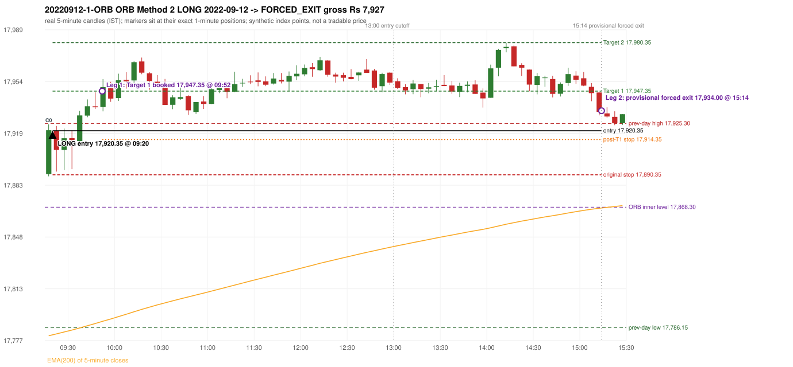

# Trading journal - 2022-09-12 (Monday)

> Phase 4 historical validation, window B (Window B 2022-09-01..2025-08-31 (5paisa minutes); status DATA_VALIDATED). The FROZEN Phase 3.6 configuration (IRF, ORB, PDR body-based, PDS, RF; shared controller) on a different data source. HISTORICAL RESEARCH ONLY: the strategy was developed using later data. same provider as the Phase 3.6 baseline; the vendor-overlap audit shows the minute bars differ from the secondary vendor Synthetic NIFTY 50 index-point P&L (the index is not tradable). The owner's review status is intentionally blank.

## A. Trading day overview

| item | value |
|---|---|
| Date / weekday | 2022-09-12 / Monday |
| Session type | USABLE_WITH_FLAGS / VALID |
| Original session open (first 1-minute open) | 17,890.85 |
| Previous session | 2022-09-09 |
| Previous-day high / low (wicks included) | 17,925.30 / 17,786.15 |
| Previous-day highest BODY high (the body-based PDR ceiling; wicks ignored) | 17,923.35 |
| Previous-day official close / last 5-minute close | 17,833.35 / 17,829.30 |
| Raw engine records / confirmed signals / fully valid signals | 9 / 7 / 7 |
| Setups that did not complete (invalidated / incomplete) | 2 |
| Executed trades | 1 20220912-1-ORB |
| Gross P&L (Rs, synthetic) | 7,926.75 |
| Illustrative net P&L (Rs; Rs 500/trade + 0.5 pt/fill) | 7,036.75 |
| Day-end portfolio status | DAY_FINISHED |
| Manual journal trades (matched / unmatched) | 0 (0 / 0) |
| Extra automated trades | 0 |

## B. Daily strategy signal timeline (confirmed signals, chronological)

| time | strategy | method | dir | entry-rule status | valid for execution | <= 13:00 | portfolio state | accepted / ignored | specific reason | competing (same minute) |
|---|---|---|---|---|---|---|---|---|---|---|
| 09:20 | ORB | Method 2 | LONG | RESEARCH_VARIANT | True | True | FIRST_TRADE_ACTIVE | ACCEPTED -> 20220912-1-ORB | first eligible signal of the day; trade 1: FORCED_EXIT |  |
| 10:10 | IRF | Method 2B | SHORT | PROPOSAL_DEPENDENT | True | True | FIRST_TRADE_ACTIVE | IGNORED | POSITION_ACTIVE (signal kept for diagnostics only; never reused) [blocked by ORB#1] |  |
| 10:35 | IRF | Method 2A | SHORT | PROPOSAL_DEPENDENT | True | True | FIRST_TRADE_ACTIVE | IGNORED | POSITION_ACTIVE (signal kept for diagnostics only; never reused) [blocked by ORB#1] |  |
| 11:15 | IRF | Method 2B | SHORT | PROPOSAL_DEPENDENT | True | True | FIRST_TRADE_ACTIVE | IGNORED | POSITION_ACTIVE (signal kept for diagnostics only; never reused) [blocked by ORB#1] |  |
| 12:20 | IRF | Method 2B | SHORT | PROPOSAL_DEPENDENT | True | True | FIRST_TRADE_ACTIVE | IGNORED | POSITION_ACTIVE (signal kept for diagnostics only; never reused) [blocked by ORB#1] |  |
| 12:45 | IRF | Method 2B | SHORT | PROPOSAL_DEPENDENT | True | True | FIRST_TRADE_ACTIVE | IGNORED | POSITION_ACTIVE (signal kept for diagnostics only; never reused) [blocked by ORB#1] |  |
| 14:20 | IRF | Method 2B | SHORT | PROPOSAL_DEPENDENT | True | False | FIRST_TRADE_ACTIVE | IGNORED | POSITION_ACTIVE (signal kept for diagnostics only; never reused) [blocked by ORB#1] |  |

Engine setups that did not complete (2); the complete list with failed rule ids is in `rejected_signals.csv`:

| candle | strategy | method | dir | status | precise reason | failed rules |
|---|---|---|---|---|---|---|
| 14:15 | IRF | Method 1/2 | SHORT | INCOMPLETE_AT_EOD | SESSION_ENDED_BEFORE_CONFIRMATION |  |
| 09:15 | PDR | PDR | LONG | INVALIDATED | OPEN_NOT_STRICTLY_ABOVE_ZONE |  |

## C. Detailed trade journals

### 20220912-1-ORB: ORB Method 2 LONG (FIRST trade)

Chart: 

**Rule configuration:** CFG-phase36_body_based-866f954e55 - signal verification status **RESEARCH_VARIANT** (never VERIFIED while a rule rests on a proposal).

#### 1. Setup identification

ORB Method 2 LONG (research variant): the first candle closed at 17,920.70, beyond the inner resistance 17,868.30 built from the previous session's latest fractal (14:50), with a supportive trendline (17,840.55); its body occupied 84.20% of its range and its upper wick 11.42% (thresholds 60% / 20%): the strong-bullish candle test passed. The source gives no construction for the inner level or the trendline.

#### 2. Candle and indicator calculations

| role | session | candle | O | H | L | C | range | body % | upper wick % | lower wick % | direction | EMA(200) | strong bull / bear | pin bull / bear | small (body<=30%) | used for |
|---|---|---|---|---|---|---|---|---|---|---|---|---|---|---|---|---|
| first_candle | TODAY | 09:15-09:20 | 17,890.85 | 17,924.75 | 17,889.30 | 17,920.70 | 35.45 | 84.20 | 11.42 | 4.37 | BULLISH | 17,780.69 | True / False | False / False | False | the 09:15 first five-minute candle - the ORB decision candle |
| inner_level_candle | PREVIOUS | 14:50-14:55 | 17,855.60 | 17,868.30 | 17,855.60 | 17,857.45 | 12.70 | 14.57 | 85.43 | 0.00 | BULLISH | 17,775.06 | False / False | False / True | True | inner level: latest 5-candle fractal extreme of the previous session inside its range |
| prev_session_last_candle | PREVIOUS | 15:25-15:30 | 17,812.40 | 17,833.20 | 17,810.40 | 17,829.30 | 22.80 | 74.12 | 17.11 | 8.77 | BULLISH | 17,779.28 | True / False | False / False | False | trend: previous session's last 5-minute close vs its EMA(200) |
| trendline_point_1 | PREVIOUS | 14:10-14:15 | 17,842.75 | 17,847.60 | 17,831.55 | 17,846.85 | 16.05 | 25.55 | 4.67 | 69.78 | BULLISH | 17,768.42 | False / False | True / False | True | first fractal point of the trendline |
| trendline_point_2 | PREVIOUS | 14:30-14:35 | 17,856.25 | 17,858.50 | 17,833.80 | 17,841.55 | 24.70 | 59.51 | 9.11 | 31.38 | BEARISH | 17,771.72 | False / False | False / False | False | second fractal point of the trendline |

Every condition, with the rule, the calculation, the observed values and the result:

| # | group | rule | result | status / numeric definition | calculation | observed | required | available at | why it matters |
|---|---|---|---|---|---|---|---|---|---|
| 1 | SELECTION | SEL-FIRST-001 | PASS | USER_APPROVED / USER_APPROVED | earliest CONFIRMED signal of the day across IRF/ORB/PDR/PDS/RF that passed the controller's checks | 0 confirmed signal(s) earlier today; 7 confirmed signals in the day in total, this one at 09:20 | no earlier executable signal | 2022-09-12 09:20 | the shared controller trades only the first valid signal; the five strategies are not independent positions |
| 2 | SELECTION | SEL-TIE-001 | PASS | USER_APPROVED / USER_APPROVED | other CONFIRMED signals with exactly the same confirmation timestamp | none | no different-strategy / opposite-direction signal in the same minute (otherwise an unresolved conflict, no trade) | 2022-09-12 09:20 | an unresolved same-minute collision would have produced no trade at all |
| 3 | SELECTION | ENTRY-CUTOFF-001 | PASS | USER_APPROVED / USER_APPROVED | fill timestamp vs 13:00:00 IST | signal confirmed 09:20; fill 09:20 | fill at or before 13:00:00 IST | 2022-09-12 09:20 | no new position may be entered with a fill after 13:00 IST |
| 4 | SELECTION | EXE-FILL-001 | PASS | PROPOSED_FOR_REVIEW / PROPOSED_FOR_REVIEW | fill = open of the 1-minute bar that starts at the signal candle's end | bar 09:20 O 17,920.35 H 17,923.60 L 17,908.95 C 17,912.85; executable=True; entry 17,920.35 | fill bar exists, starts exactly at the signal end, is fillable; entry = its open | 2022-09-12 09:20 | a 5-minute signal is known only when its candle closes; the first price that can be traded is the next minute's open |
| 5 | SELECTION | DAY-MAX-001 | PASS | USER_APPROVED / USER_APPROVED | number of entries today | trade 1 of at most 2 | <= 2 entries per day | 2022-09-12 09:20 | daily trade cap |
| 6 | SETUP | ORB-GLOBAL-001 | PASS | SOURCE_VERIFIED / EXPLICIT_IN_SOURCE | decision is taken once the first 5-minute candle (09:15-09:20) has closed | candle 09:15-09:20; signal confirmed 09:20 | decision at 09:20, never before the close | 2022-09-12 09:20 | the close of the first candle is unknown before 09:20 |
| 7 | SETUP | ORB-GLOBAL-002 | PASS | SOURCE_VERIFIED / EXPLICIT_IN_SOURCE | direction | LONG | same rules in both directions | 2022-09-12 09:20 | ORB trades the side of the break |
| 8 | SETUP | ORB-GLOBAL-004 | PASS | SOURCE_VERIFIED / QUALITATIVE_SOURCE_NUMERIC_DEFINITION_PROPOSED_FOR_REVIEW | entry at 09:20, after the first-candle close | signal confirmed 09:20; fill 09:20 at the open of that minute | 09:20 entry | 2022-09-12 09:20 | the guide enters at 9:20; the fill price convention (next minute open) is a proposal |
| 9 | SETUP | ORB-M2-LONG-001 | PASS | UNRESOLVED / UNRESOLVED | inner level = latest fractal (k=2) extreme of the previous session below the day's high / above the day's low | inner resistance 17,868.30 from the 14:50 candle of 2022-09-09 (previous range 17,786.15 - 17,925.30; engine recorded 17,868.30) | an inner level inside yesterday's range | 2022-09-09 15:05 | the source gives NO objective construction for the inner level: this is a research variant |
| 10 | SETUP | ORB-M2-LONG-002 | PASS | SOURCE_VERIFIED / EXPLICIT_IN_SOURCE | first candle breaks and closes beyond the inner level | close 17,920.70 vs inner level 17,868.30: 52.40 points beyond | high/low and close beyond the level | 2022-09-12 09:20 | the breakout itself |
| 11 | TREND | ORB-TREND-001 | PASS | SOURCE_VERIFIED / QUALITATIVE_SOURCE_NUMERIC_DEFINITION_PROPOSED_FOR_REVIEW | previous session's final completed 5-minute candle: close vs its EMA(200 of 5-minute closes) | previous session 2022-09-09 last candle 15:25-15:30 close 17,829.30 vs EMA(200) 17,779.28: 50.02 points above the EMA -> trend bullish (EMA_PREV_SESSION_CLOSE; research variant A, EMA-only) | close > EMA(200) | 2022-09-09 15:30 | the opening gap can never create the trend: only information that existed before today's open is used |
| 12 | TREND | ORB-TREND-002 | PASS | SOURCE_VERIFIED / QUALITATIVE_SOURCE_NUMERIC_DEFINITION_PROPOSED_FOR_REVIEW | price location versus the 200 EMA is the basic confirmation; structure is only 'supporting' | 50.02 points above the EMA(200) on the previous session's last 5-minute close; swing structure not used in variant A | price on the trend side of the 200 EMA | 2022-09-09 15:30 | the rulebook calls EMA position 'a basic confirmation, supported by bullish structure'; the structure part has no numeric definition |
| 13 | TREND | TREND-SWING-001 | NOT_APPLICABLE | PROPOSED_FOR_REVIEW / PROPOSED_FOR_REVIEW | confirmed swing structure | not required by the active trend variant (variant A is the EMA price location only) | n/a | 2022-09-09 15:30 | variant B would additionally require higher-high/higher-low swings; it is a separate labelled scenario |
| 14 | CONFIRMATION | ORB-M2-LONG-001 | PASS | UNRESOLVED / UNRESOLVED | trendline through the last two fractal lows (long) / highs (short) of the previous session | points 14:10 17,831.55 and 14:30 17,833.80 (4 candles apart): slope +0.5625 per candle; line value at the 09:15 candle 17,840.55; first-candle close 17,920.70 is on the supportive side (engine recorded 17,840.55) | rising (long) / falling (short) line with price on the trend side | 2022-09-09 14:35 | the guide requires a trendline but defines no construction or 'near' distance: research variant |
| 15 | CONFIRMATION | ORB-M2-LONG-003 | PASS | SOURCE_VERIFIED / QUALITATIVE_SOURCE_NUMERIC_DEFINITION_PROPOSED_FOR_REVIEW | candle quality: strong body and limited opposite wick (or pin bar) | 09:15-09:20 O 17,890.85 H 17,924.75 L 17,889.30 C 17,920.70; range 35.45, body 29.85 (84.20%), upper wick 4.05 (11.42%), lower wick 1.55 (4.37%), bullish. Strong-bullish test: bullish close, body >= 60% (observed 84.20%), upper wick <= 20% (observed 11.42%) -> PASS | strong candle or pin bar | 2022-09-12 09:20 | same proposed thresholds as Method 1 |
| 16 | CONFIRMATION | ORB-M2-LONG-004 | PASS | SOURCE_VERIFIED / QUALITATIVE_SOURCE_NUMERIC_DEFINITION_PROPOSED_FOR_REVIEW | if the close is near the 5-minute EMA(200) a convincing close beyond it is needed | EMA(200) at the 09:15 candle 17,780.69; close 17,920.70 is 140.01 points above it; 'near' band 15 points -> not near, test not applicable | outside the 15-point band, or beyond the EMA by >= 5 | 2022-09-12 09:20 | ORB p.5: 'if the breakout is near the EMA, wait for a convincing close' |
| 17 | EXECUTION | ORB-GLOBAL-003 | PASS | SOURCE_VERIFIED / EXPLICIT_IN_SOURCE | initial stop = entry - 30 points | entry 17,920.35 -> stop 17,890.35 | stop 30 index points (BASELINE) | 2022-09-12 09:20 | defines the loss if the setup fails before Target 1 |
| 18 | EXECUTION | EXE-T1-001 | PASS | SOURCE_VERIFIED / EXPLICIT_IN_SOURCE | Target 1 = entry +/- 27 points | T1 17,947.35 | 27 points | 2022-09-12 09:20 | Leg 1 (3 lots) is booked at Target 1 |
| 19 | EXECUTION | ORB-GLOBAL-003 | PASS | SOURCE_VERIFIED / EXPLICIT_IN_SOURCE | Target 2 = entry +/- 60 points | T2 17,980.35 | 60 points | 2022-09-12 09:20 | Leg 2 (3 lots) is booked at Target 2 |
| 20 | EXECUTION | POST-T1-STOP-006 | PASS | USER_APPROVED / USER_APPROVED | after T1 the Leg-2 stop = entry - 6 (no trailing) | post-T1 stop 17,914.35 | entry -6 (LONG) / +6 (SHORT) | 2022-09-12 09:20 | protects the remaining three lots once the first three are booked |
| 21 | EXECUTION | SIZE-LOT-001 | PASS | USER_APPROVED / USER_APPROVED | 6 lots x 65 = 390, Leg 1 = 3 lots = 195, Leg 2 = 195 | 6 lots, lot size 65, legs 3+3 | 6 lots in two equal legs | 2022-09-12 09:20 | position size for the synthetic P&L |
| 22 | NOTE | ORB-MA-001 | UNRESOLVED | CONFLICTING / CONFLICTING | which moving average the code uses | EMA(200) of 5-minute closes (the guide says '200 DMA' in some places and '200 EMA' in others); active ma_mode EMA200_5M | the source terminology conflicts | 2022-09-12 09:20 | a daily 200 DMA would give different values |
| 23 | NOTE | NOTE-UNRESOLVED-DEPENDENCIES | UNRESOLVED | NOT_A_RULE / NOT_A_REGISTRY_RULE | rules the signal depends on that the sources leave unresolved | engine-recorded unresolved rule ids: ORB-M2-LONG-001, ORB-MA-001; verification status RESEARCH_VARIANT | n/a (disclosure) | 2022-09-12 09:20 | the entry is only as verified as the rules it rests on |

#### 3. Entry decision and explanation

ORB Method 2 LONG (research variant): the first candle closed at 17,920.70, beyond the inner resistance 17,868.30 built from the previous session's latest fractal (14:50), with a supportive trendline (17,840.55); its body occupied 84.20% of its range and its upper wick 11.42% (thresholds 60% / 20%): the strong-bullish candle test passed. The source gives no construction for the inner level or the trendline.

**Why this trade ahead of the other strategies:** This ORB Method 2 signal was the earliest executable signal of the day: 0 confirmed signal(s) earlier, 0 other in the same minute. 6 later confirmed signal(s) (IRF x6) are logged as ignored or rejected. State of the other four engines at that moment: [IRF: no setup record before this time (a base condition was not met, or nothing triggered)] [PDR: PDR invalidated at 09:15: OPEN_NOT_STRICTLY_ABOVE_ZONE] [PDS: no setup record before this time (a base condition was not met, or nothing triggered)] [RF: no setup record before this time (a base condition was not met, or nothing triggered)]

#### 4. Actual entry execution

| item | value |
|---|---|
| Signal candle | 09:15-09:20 |
| Signal confirmed | 2022-09-12 09:20 |
| Fill timestamp | 2022-09-12 09:20 |
| Entry price | 17,920.35 |
| Source partition / 1-minute bar | data/phase4/processed/FIVEPAISA_1M_PHASE4/nifty50/year=2022/month=09/candles.parquet / 2022-09-12 09:20 |
| Source bar O / H / L / C | 17,920.35 / 17,923.60 / 17,908.95 / 17,912.85 |
| Fill assumption | open of the 1-minute bar starting at the signal candle's end (EXE-FILL-001, PROPOSED causal convention) |
| Initial stop / T1 / T2 / post-T1 stop | 17,890.35 / 17,947.35 / 17,980.35 / 17,914.35 |
| Position | 6 lots x 65 = 390 units (Leg 1 195, Leg 2 195) |

#### 5-8. Trade progress, Target 1, post-T1 stop and final exit

Between the 09:20 entry bar and the final exit (355 one-minute bars) the best excursion in favour was 59.85 points at 14:12 and the worst against was 27.80 points at 09:22. At 09:52 Target 1 booked three lots. At 09:52 the remaining three lots' protective stop was set to 17,914.35 (entry - 6; no trailing, no further change); the engine applies it from the Target-1 bar onward and tests it within that same bar. Neither the stop nor Target 2 was reached; at 15:14 the remaining lots were closed by the PROVISIONAL forced exit at the minute open 17,934.00.

| leg | qty | exit time | exit price | reason | source 1-minute bar | O / H / L / C | gross points | gross Rs | slippage pts | flags |
|---|---|---|---|---|---|---|---|---|---|---|
| 1 | 195 | 09:52 | 17,947.35 | TARGET_1 | 09:52 | 17,941.80 / 17,948.80 / 17,940.10 / 17,948.80 | 27.00 | 5,265.00 | 0.00 |  |
| 2 | 195 | 15:14 | 17,934.00 | FORCED_EXIT_1514_OPEN_PROVISIONAL | 15:14 | 17,934.00 / 17,935.30 / 17,931.65 / 17,933.25 | 13.65 | 2,661.75 | 0.00 | PROVISIONAL_FORCED_EXIT_15_14_OPEN |

Exit evidence per leg:

* Leg 1: 1-minute bar 09:52 O 17,941.80 H 17,948.80 L 17,940.10 C 17,948.80: high 17,948.80 reached Target 1 17,947.35; Leg 1 booked at the target level
* Leg 2: 1-minute bar 15:14 O 17,934.00 H 17,935.30 L 17,931.65 C 17,933.25: provisional forced exit at the OPEN of the 15:14 minute (17,934.00); neither Target 2 nor the stop was reached; sensitivity close of that minute 17,933.25 (not used)

#### 9. Gross and illustrative net P&L

| item | value (Rs) |
|---|---|
| Leg 1 gross | 5,265.00 |
| Leg 2 gross | 2,661.75 |
| Trade gross (= Leg 1 + Leg 2) | 7,926.75 |
| Illustrative fixed cost | -500.00 |
| Illustrative slippage (0.5 pt on every fill, entry + exits, all units) | -390.00 |
| Illustrative net | 7,036.75 |

#### 10. Manual journal comparison

No manual journal exists for this period; no comparison.

## D. Manual journal comparison

No manual journal exists for this period (the manual journal covers 2025-09-01 .. 2026-08-31 only); no comparison is made and no automated trade is labelled 'extra'.

## E. Daily conclusion

* **Traded:** 20220912-1-ORB - ORB Method 2 LONG at 09:20 (entry 17,920.35), outcome FORCED_EXIT, gross Rs 7,926.75, illustrative net Rs 7,036.75. **Why:** This ORB Method 2 signal was the earliest executable signal of the day: 0 confirmed signal(s) earlier, 0 other in the same minute. 6 later confirmed signal(s) (IRF x6) are logged as ignored or rejected. State of the other four engines at that moment: [IRF: no setup record before this time (a base condition was not met, or nothing triggered)] [PDR: PDR invalidated at 09:15: OPEN_NOT_STRICTLY_ABOVE_ZONE] [PDS: no setup record before this time (a base condition was not met, or nothing triggered)] [RF: no setup record before this time (a base condition was not met, or nothing triggered)] **How it ended:** At 09:52 Target 1 booked three lots. At 09:52 the remaining three lots' protective stop was set to 17,914.35 (entry - 6; no trailing, no further change); the engine applies it from the Target-1 bar onward and tests it within that same bar. Neither the stop nor Target 2 was reached; at 15:14 the remaining lots were closed by the PROVISIONAL forced exit at the minute open 17,934.00.
* **Ignored / rejected signals:** IRF IGNORED POSITION_ACTIVE x6
* **Open strategy-definition issues that affected this day:** NOTE-UNRESOLVED-DEPENDENCIES, ORB-MA-001 (Terminology conflict: '200 DMA / EMA' (p.2), '200 EMA' (pp.3,5,7), '200 DMA' (pp.1,8,9,12) for what the charts show as one curved line on a 5-minute chart)
* **Automated triage (not an approval; the owner's review status stays blank):** REVIEW: PROVISIONAL_FORCED_EXIT
