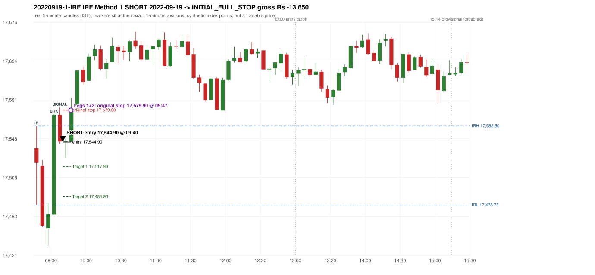

# Trading journal - 2022-09-19 (Monday)

> Phase 4 historical validation, window B (Window B 2022-09-01..2025-08-31 (5paisa minutes); status DATA_VALIDATED). The FROZEN Phase 3.6 configuration (IRF, ORB, PDR body-based, PDS, RF; shared controller) on a different data source. HISTORICAL RESEARCH ONLY: the strategy was developed using later data. same provider as the Phase 3.6 baseline; the vendor-overlap audit shows the minute bars differ from the secondary vendor Synthetic NIFTY 50 index-point P&L (the index is not tradable). The owner's review status is intentionally blank.

## A. Trading day overview

| item | value |
|---|---|
| Date / weekday | 2022-09-19 / Monday |
| Session type | USABLE_WITH_FLAGS / VALID |
| Original session open (first 1-minute open) | 17,538.15 |
| Previous session | 2022-09-16 |
| Previous-day high / low (wicks included) | 17,815.80 / 17,498.70 |
| Previous-day highest BODY high (the body-based PDR ceiling; wicks ignored) | 17,796.80 |
| Previous-day official close / last 5-minute close | 17,530.85 / 17,550.10 |
| Raw engine records / confirmed signals / fully valid signals | 7 / 3 / 3 |
| Setups that did not complete (invalidated / incomplete) | 4 |
| Executed trades | 1 20220919-1-IRF |
| Gross P&L (Rs, synthetic) | -13,650.00 |
| Illustrative net P&L (Rs; Rs 500/trade + 0.5 pt/fill) | -14,540.00 |
| Day-end portfolio status | SECOND_TRADE_ELIGIBLE |
| Manual journal trades (matched / unmatched) | 0 (0 / 0) |
| Extra automated trades | 0 |

## B. Daily strategy signal timeline (confirmed signals, chronological)

| time | strategy | method | dir | entry-rule status | valid for execution | <= 13:00 | portfolio state | accepted / ignored | specific reason | competing (same minute) |
|---|---|---|---|---|---|---|---|---|---|---|
| 09:40 | IRF | Method 1 | SHORT | PROPOSAL_DEPENDENT | True | True | FIRST_TRADE_ACTIVE | ACCEPTED -> 20220919-1-IRF | first eligible signal of the day; trade 1: INITIAL_FULL_STOP |  |
| 10:30 | IRF | Method 2B | SHORT | PROPOSAL_DEPENDENT | True | True | SECOND_TRADE_ELIGIBLE | REJECTED | SECOND_TRADE_RESTRICTED_TO_PDR_PDS [blocked by IRF#1] |  |
| 11:10 | IRF | Method 2A | SHORT | PROPOSAL_DEPENDENT | True | True | SECOND_TRADE_ELIGIBLE | REJECTED | SECOND_TRADE_RESTRICTED_TO_PDR_PDS [blocked by IRF#1] |  |

Engine setups that did not complete (4); the complete list with failed rule ids is in `rejected_signals.csv`:

| candle | strategy | method | dir | status | precise reason | failed rules |
|---|---|---|---|---|---|---|
| 11:05 | IRF | Method 1/2 | SHORT | INCOMPLETE_AT_EOD | SESSION_ENDED_BEFORE_CONFIRMATION |  |
| 09:15 | ORB | Method 2 | SHORT | INVALIDATED | TRENDLINE_NOT_SUPPORTIVE | ORB-M2-SHORT-001 |
| 09:15 | PDR | PDR | LONG | INVALIDATED | OPEN_NOT_STRICTLY_ABOVE_ZONE |  |
| 09:35 | RF | RF | LONG | INVALIDATED | TREND:EMA_PREV_SESSION_CLOSE wrong side | RF-001;RF-008 |

## C. Detailed trade journals

### 20220919-1-IRF: IRF Method 1 SHORT (FIRST trade)

Chart: 

**Rule configuration:** CFG-phase36_body_based-866f954e55 - signal verification status **PROPOSAL_DEPENDENT** (never VERIFIED while a rule rests on a proposal).

#### 1. Setup identification

IRF Method 1 SHORT: the completed 09:30 candle closed at 17,574.85, 12.35 points above the initial range high 17,562.50 (range [17,475.75, 17,562.50] from the 09:15 candle); the immediately following completed 09:35 candle closed at 17,545.60, back inside the range. The short signal was confirmed at 09:40 on that close. Entry reference close 17,545.60 is 16.90 points below IRH 17,562.50.

#### 2. Candle and indicator calculations

| role | session | candle | O | H | L | C | range | body % | upper wick % | lower wick % | direction | EMA(200) | strong bull / bear | pin bull / bear | small (body<=30%) | used for |
|---|---|---|---|---|---|---|---|---|---|---|---|---|---|---|---|---|
| initial_range_candle | TODAY | 09:15-09:20 | 17,538.15 | 17,562.50 | 17,475.75 | 17,522.15 | 86.75 | 18.44 | 28.07 | 53.49 | BEARISH | 17,780.66 | False / False | False / False | True | initial range = high/low of the 09:15 candle |
| signal_candle | TODAY | 09:35-09:40 | 17,574.80 | 17,583.00 | 17,543.00 | 17,545.60 | 40.00 | 73.00 | 20.50 | 6.50 | BEARISH | 17,770.05 | False / True | False / False | False | candle whose close completed the trigger |
| breakout_candle | TODAY | 09:30-09:35 | 17,465.25 | 17,575.40 | 17,465.25 | 17,574.85 | 110.15 | 99.50 | 0.50 | 0.00 | BULLISH | 17,772.31 | True / False | False / False | False | breakout candle: a completed candle closing above IRH |

Every condition, with the rule, the calculation, the observed values and the result:

| # | group | rule | result | status / numeric definition | calculation | observed | required | available at | why it matters |
|---|---|---|---|---|---|---|---|---|---|
| 1 | SELECTION | SEL-FIRST-001 | PASS | USER_APPROVED / USER_APPROVED | earliest CONFIRMED signal of the day across IRF/ORB/PDR/PDS/RF that passed the controller's checks | 0 confirmed signal(s) earlier today; 3 confirmed signals in the day in total, this one at 09:40 | no earlier executable signal | 2022-09-19 09:40 | the shared controller trades only the first valid signal; the five strategies are not independent positions |
| 2 | SELECTION | SEL-TIE-001 | PASS | USER_APPROVED / USER_APPROVED | other CONFIRMED signals with exactly the same confirmation timestamp | none | no different-strategy / opposite-direction signal in the same minute (otherwise an unresolved conflict, no trade) | 2022-09-19 09:40 | an unresolved same-minute collision would have produced no trade at all |
| 3 | SELECTION | ENTRY-CUTOFF-001 | PASS | USER_APPROVED / USER_APPROVED | fill timestamp vs 13:00:00 IST | signal confirmed 09:40; fill 09:40 | fill at or before 13:00:00 IST | 2022-09-19 09:40 | no new position may be entered with a fill after 13:00 IST |
| 4 | SELECTION | EXE-FILL-001 | PASS | PROPOSED_FOR_REVIEW / PROPOSED_FOR_REVIEW | fill = open of the 1-minute bar that starts at the signal candle's end | bar 09:40 O 17,544.90 H 17,547.75 L 17,532.00 C 17,540.25; executable=True; entry 17,544.90 | fill bar exists, starts exactly at the signal end, is fillable; entry = its open | 2022-09-19 09:40 | a 5-minute signal is known only when its candle closes; the first price that can be traded is the next minute's open |
| 5 | SELECTION | DAY-MAX-001 | PASS | USER_APPROVED / USER_APPROVED | number of entries today | trade 1 of at most 2 | <= 2 entries per day | 2022-09-19 09:40 | daily trade cap |
| 6 | SETUP | IRF-GLOBAL-001 | PASS | SOURCE_VERIFIED / EXPLICIT_IN_SOURCE | initial range = high and low (wicks included) of the first completed 5-minute candle | 09:15-09:20 IRH 17,562.50, IRL 17,475.75 (range 86.75; engine recorded IRH 17,562.50, IRL 17,475.75) | high/low of the 09:15-09:20 candle | 2022-09-19 09:20 | all three IRF methods measure price against this range |
| 7 | SETUP | IRF-GLOBAL-003 | PASS | SOURCE_VERIFIED / EXPLICIT_IN_SOURCE | closes confirm, wicks do not: every trigger is evaluated on a completed 5-minute candle | trigger candle 09:35-09:40 was complete when the signal was stamped 09:40; decision uses its close 17,545.60 | completed candle close, not an intra-candle wick | 2022-09-19 09:40 | an intra-candle wick can reverse before the candle closes |
| 8 | SETUP | IRF-GLOBAL-002 | PASS | SOURCE_VERIFIED / EXPLICIT_IN_SOURCE | direction | SHORT (IRF trades short only) | short only | 2022-09-19 09:40 | IRF fades failed upside breakouts |
| 9 | SETUP | IRF-M1-001 | PASS | SOURCE_VERIFIED / EXPLICIT_IN_SOURCE | breakout candle close vs IRH | 09:30-09:35 O 17,465.25 H 17,575.40 L 17,465.25 C 17,574.85; range 110.15, body 109.60 (99.50%), upper wick 0.55 (0.50%), lower wick 0.00 (0.00%), bullish; close 17,574.85 is 12.35 points above IRH 17,562.50 | close > IRH (a wick above IRH is not a breakout) | 2022-09-19 09:35 | starts every IRF setup |
| 10 | CONFIRMATION | IRF-M1-002 | PASS | SOURCE_VERIFIED / EXPLICIT_IN_SOURCE | candle after the breakout closes back inside [IRL, IRH) | 09:35-09:40 O 17,574.80 H 17,583.00 L 17,543.00 C 17,545.60; range 40.00, body 29.20 (73.00%), upper wick 8.20 (20.50%), lower wick 2.60 (6.50%), bearish; close 17,545.60 vs range [17,475.75, 17,562.50) | IRL <= close < IRH | 2022-09-19 09:40 | the failed breakout: price could not hold above the opening range |
| 11 | CONFIRMATION | IRF-M1-004 | PASS | SOURCE_VERIFIED / EXPLICIT_IN_SOURCE | failure candle is the candle immediately after the breakout (k = 1) | breakout 09:30, failure candle 09:35: k = 1 | k = 1 (pp.5, 6, 13); the p.14 'next or following' reading (IRF-M1-C001) is CONFLICTING and not used in the baseline | 2022-09-19 09:40 | the guide's worked example enters at the close of the very next candle; no support/resistance break is required |
| 12 | EXECUTION | EXE-STOP-001 | PASS | USER_APPROVED / USER_APPROVED | initial stop = entry + 35 points | entry 17,544.90 -> stop 17,579.90 | stop 35 index points (BASELINE) | 2022-09-19 09:40 | defines the loss if the setup fails before Target 1 |
| 13 | EXECUTION | EXE-T1-001 | PASS | SOURCE_VERIFIED / EXPLICIT_IN_SOURCE | Target 1 = entry +/- 27 points | T1 17,517.90 | 27 points | 2022-09-19 09:40 | Leg 1 (3 lots) is booked at Target 1 |
| 14 | EXECUTION | IRF-TGT-001 | PASS | SOURCE_VERIFIED / EXPLICIT_IN_SOURCE | Target 2 = entry +/- 60 points | T2 17,484.90 | 60 points | 2022-09-19 09:40 | Leg 2 (3 lots) is booked at Target 2 |
| 15 | EXECUTION | POST-T1-STOP-006 | PASS | USER_APPROVED / USER_APPROVED | after T1 the Leg-2 stop = entry + 6 (no trailing) | post-T1 stop 17,550.90 | entry -6 (LONG) / +6 (SHORT) | 2022-09-19 09:40 | protects the remaining three lots once the first three are booked |
| 16 | EXECUTION | SIZE-LOT-001 | PASS | USER_APPROVED / USER_APPROVED | 6 lots x 65 = 390, Leg 1 = 3 lots = 195, Leg 2 = 195 | 6 lots, lot size 65, legs 3+3 | 6 lots in two equal legs | 2022-09-19 09:40 | position size for the synthetic P&L |
| 17 | NOTE | IRF-GLOBAL-004 | UNRESOLVED | UNRESOLVED / UNRESOLVED | which close above IRH of the session produced this attempt; repeat setups | this breakout is upward crossing no. 1 of the session (a close above IRH after a close at/below it) | the source states no first-breakout-only, re-arming, expiry or trades-per-day rule | 2022-09-19 09:40 | IRF re-arms on every later breakout in the code, producing many raw setups; the controller keeps only the first |
| 18 | NOTE | NOTE-IRF-REPEATED-SETUPS | NOT_APPLICABLE | NOT_A_RULE / NOT_A_REGISTRY_RULE | other IRF signals later in the session (not traded) | 2 further confirmed IRF signal(s): Method 2B@10:30, Method 2A@11:10 | disclosure of repeated raw setups | 2022-09-19 09:40 | repeated raw IRF setups are not hidden; they are logged as ignored |
| 19 | NOTE | IRF-SL-001 | NOT_APPLICABLE | SOURCE_VERIFIED / QUALITATIVE_SOURCE_NUMERIC_DEFINITION_PROPOSED_FOR_REVIEW | the guide's 35-or-40 rule: 35 if the most recent green candle's high is within 35 points of entry, else 40 | most recent green candle high 17,575.40 is 30.50 points from the entry 17,544.90: the guide's rule would select 35 points; the baseline applies a fixed 35 (USER_APPROVED research baseline; the 35-vs-40 selection and the 40-point variant are separate labelled scenarios) | source selection rule | 2022-09-19 09:40 | the stop distance is a modelling choice and changes losses, not entries |
| 20 | NOTE | NOTE-UNRESOLVED-DEPENDENCIES | UNRESOLVED | NOT_A_RULE / NOT_A_REGISTRY_RULE | rules the signal depends on that the sources leave unresolved | engine-recorded unresolved rule ids: IRF-GLOBAL-004; verification status PROPOSAL_DEPENDENT | n/a (disclosure) | 2022-09-19 09:40 | the entry is only as verified as the rules it rests on |

#### 3. Entry decision and explanation

IRF Method 1 SHORT: the completed 09:30 candle closed at 17,574.85, 12.35 points above the initial range high 17,562.50 (range [17,475.75, 17,562.50] from the 09:15 candle); the immediately following completed 09:35 candle closed at 17,545.60, back inside the range. The short signal was confirmed at 09:40 on that close. Entry reference close 17,545.60 is 16.90 points below IRH 17,562.50.

**Why this trade ahead of the other strategies:** This IRF Method 1 signal was the earliest executable signal of the day: 0 confirmed signal(s) earlier, 0 other in the same minute. 2 later confirmed signal(s) (IRF x2) are logged as ignored or rejected. State of the other four engines at that moment: [ORB: Method 2 invalidated at 09:15: TRENDLINE_NOT_SUPPORTIVE] [PDR: PDR invalidated at 09:15: OPEN_NOT_STRICTLY_ABOVE_ZONE] [PDS: no setup record before this time (a base condition was not met, or nothing triggered)] [RF: RF invalidated at 09:35: TREND:EMA_PREV_SESSION_CLOSE wrong side]

#### 4. Actual entry execution

| item | value |
|---|---|
| Signal candle | 09:35-09:40 |
| Signal confirmed | 2022-09-19 09:40 |
| Fill timestamp | 2022-09-19 09:40 |
| Entry price | 17,544.90 |
| Source partition / 1-minute bar | data/phase4/processed/FIVEPAISA_1M_PHASE4/nifty50/year=2022/month=09/candles.parquet / 2022-09-19 09:40 |
| Source bar O / H / L / C | 17,544.90 / 17,547.75 / 17,532.00 / 17,540.25 |
| Fill assumption | open of the 1-minute bar starting at the signal candle's end (EXE-FILL-001, PROPOSED causal convention) |
| Initial stop / T1 / T2 / post-T1 stop | 17,579.90 / 17,517.90 / 17,484.90 / 17,550.90 |
| Position | 6 lots x 65 = 390 units (Leg 1 195, Leg 2 195) |

#### 5-8. Trade progress, Target 1, post-T1 stop and final exit

Between the 09:40 entry bar and the final exit (8 one-minute bars) the best excursion in favour was 17.45 points at 09:41 and the worst against was 40.00 points at 09:47. At 09:47 price reached the original stop 17,579.90 before Target 1 17,517.90, so all six lots exited together at 17,579.90. This is an INITIAL_FULL_STOP: one more trade is allowed that day, only a newly confirmed PDR/PDS signal.

| leg | qty | exit time | exit price | reason | source 1-minute bar | O / H / L / C | gross points | gross Rs | slippage pts | flags |
|---|---|---|---|---|---|---|---|---|---|---|
| 1 | 195 | 09:47 | 17,579.90 | ORIGINAL_STOP_BEFORE_T1 | 09:47 | 17,576.55 / 17,584.90 / 17,576.55 / 17,583.30 | -35.00 | -6,825.00 | 0.00 |  |
| 2 | 195 | 09:47 | 17,579.90 | ORIGINAL_STOP_BEFORE_T1 | 09:47 | 17,576.55 / 17,584.90 / 17,576.55 / 17,583.30 | -35.00 | -6,825.00 | 0.00 |  |

Exit evidence per leg:

* Leg 1: 1-minute bar 09:47 O 17,576.55 H 17,584.90 L 17,576.55 C 17,583.30: high 17,584.90 reached the original stop 17,579.90 before Target 1 17,517.90 was touched; both legs exit at the stop level 17,579.90
* Leg 2: 1-minute bar 09:47 O 17,576.55 H 17,584.90 L 17,576.55 C 17,583.30: high 17,584.90 reached the original stop 17,579.90 before Target 1 17,517.90 was touched; both legs exit at the stop level 17,579.90

#### 9. Gross and illustrative net P&L

| item | value (Rs) |
|---|---|
| Leg 1 gross | -6,825.00 |
| Leg 2 gross | -6,825.00 |
| Trade gross (= Leg 1 + Leg 2) | -13,650.00 |
| Illustrative fixed cost | -500.00 |
| Illustrative slippage (0.5 pt on every fill, entry + exits, all units) | -390.00 |
| Illustrative net | -14,540.00 |

#### 10. Manual journal comparison

No manual journal exists for this period; no comparison.

## D. Manual journal comparison

No manual journal exists for this period (the manual journal covers 2025-09-01 .. 2026-08-31 only); no comparison is made and no automated trade is labelled 'extra'.

## E. Daily conclusion

* **Traded:** 20220919-1-IRF - IRF Method 1 SHORT at 09:40 (entry 17,544.90), outcome INITIAL_FULL_STOP, gross Rs -13,650.00, illustrative net Rs -14,540.00. **Why:** This IRF Method 1 signal was the earliest executable signal of the day: 0 confirmed signal(s) earlier, 0 other in the same minute. 2 later confirmed signal(s) (IRF x2) are logged as ignored or rejected. State of the other four engines at that moment: [ORB: Method 2 invalidated at 09:15: TRENDLINE_NOT_SUPPORTIVE] [PDR: PDR invalidated at 09:15: OPEN_NOT_STRICTLY_ABOVE_ZONE] [PDS: no setup record before this time (a base condition was not met, or nothing triggered)] [RF: RF invalidated at 09:35: TREND:EMA_PREV_SESSION_CLOSE wrong side] **How it ended:** At 09:47 price reached the original stop 17,579.90 before Target 1 17,517.90, so all six lots exited together at 17,579.90. This is an INITIAL_FULL_STOP: one more trade is allowed that day, only a newly confirmed PDR/PDS signal.
* **Ignored / rejected signals:** IRF REJECTED SECOND_TRADE_RESTRICTED_TO_PDR_PDS x2
* **Open strategy-definition issues that affected this day:** IRF-GLOBAL-004 (NOT STATED: how many IRF trades per day, a latest entry time, and whether a new breakout may re-arm a setup after a signal), NOTE-UNRESOLVED-DEPENDENCIES
* **Automated triage (not an approval; the owner's review status stays blank):** TRADED_NO_FLAGS
