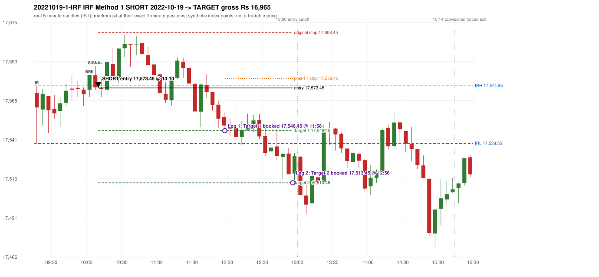

# Trading journal - 2022-10-19 (Wednesday)

> Phase 4 historical validation, window B (Window B 2022-09-01..2025-08-31 (5paisa minutes); status DATA_VALIDATED). The FROZEN Phase 3.6 configuration (IRF, ORB, PDR body-based, PDS, RF; shared controller) on a different data source. HISTORICAL RESEARCH ONLY: the strategy was developed using later data. same provider as the Phase 3.6 baseline; the vendor-overlap audit shows the minute bars differ from the secondary vendor Synthetic NIFTY 50 index-point P&L (the index is not tradable). The owner's review status is intentionally blank.

## A. Trading day overview

| item | value |
|---|---|
| Date / weekday | 2022-10-19 / Wednesday |
| Session type | USABLE_WITH_FLAGS / VALID |
| Original session open (first 1-minute open) | 17,570.20 |
| Previous session | 2022-10-18 |
| Previous-day high / low (wicks included) | 17,527.40 / 17,443.35 |
| Previous-day highest BODY high (the body-based PDR ceiling; wicks ignored) | 17,519.00 |
| Previous-day official close / last 5-minute close | 17,486.95 / 17,489.85 |
| Raw engine records / confirmed signals / fully valid signals | 13 / 8 / 8 |
| Setups that did not complete (invalidated / incomplete) | 5 |
| Executed trades | 1 20221019-1-IRF |
| Gross P&L (Rs, synthetic) | 16,965.00 |
| Illustrative net P&L (Rs; Rs 500/trade + 0.5 pt/fill) | 16,075.00 |
| Day-end portfolio status | DAY_FINISHED |
| Manual journal trades (matched / unmatched) | 0 (0 / 0) |
| Extra automated trades | 0 |

## B. Daily strategy signal timeline (confirmed signals, chronological)

| time | strategy | method | dir | entry-rule status | valid for execution | <= 13:00 | portfolio state | accepted / ignored | specific reason | competing (same minute) |
|---|---|---|---|---|---|---|---|---|---|---|
| 10:10 | IRF | Method 1 | SHORT | PROPOSAL_DEPENDENT | True | True | FIRST_TRADE_ACTIVE | ACCEPTED -> 20221019-1-IRF | first eligible signal of the day; trade 1: TARGET |  |
| 10:50 | IRF | Method 2B | SHORT | PROPOSAL_DEPENDENT | True | True | FIRST_TRADE_ACTIVE | IGNORED | POSITION_ACTIVE (signal kept for diagnostics only; never reused) [blocked by IRF#1] |  |
| 11:05 | IRF | Method 1 | SHORT | PROPOSAL_DEPENDENT | True | True | FIRST_TRADE_ACTIVE | IGNORED | POSITION_ACTIVE (signal kept for diagnostics only; never reused) [blocked by IRF#1] |  |
| 11:35 | IRF | Method 1 | SHORT | PROPOSAL_DEPENDENT | True | True | FIRST_TRADE_ACTIVE | IGNORED | POSITION_ACTIVE (signal kept for diagnostics only; never reused) [blocked by IRF#1] |  |
| 11:45 | IRF | Method 1 | SHORT | PROPOSAL_DEPENDENT | True | True | FIRST_TRADE_ACTIVE | IGNORED | POSITION_ACTIVE (signal kept for diagnostics only; never reused) [blocked by IRF#1] |  |
| 13:25 | PDR | PDR | LONG | RESEARCH_VARIANT | True | False | DAY_FINISHED | IGNORED | DAY_FINISHED [blocked by IRF#1] |  |
| 14:15 | PDR | PDR | LONG | RESEARCH_VARIANT | True | False | DAY_FINISHED | IGNORED | DAY_FINISHED [blocked by IRF#1] |  |
| 15:25 | PDR | PDR | LONG | RESEARCH_VARIANT | True | False | DAY_FINISHED | IGNORED | DAY_FINISHED [blocked by IRF#1] |  |

Engine setups that did not complete (5); the complete list with failed rule ids is in `rejected_signals.csv`:

| candle | strategy | method | dir | status | precise reason | failed rules |
|---|---|---|---|---|---|---|
| 10:45 | IRF | Method 1/2 | SHORT | INCOMPLETE_AT_EOD | SESSION_ENDED_BEFORE_CONFIRMATION |  |
| 09:15 | ORB | Method 1 | LONG | INVALIDATED | CANDLE_QUALITY(not a strong body / wick too large) | ORB-M1-LONG-003 |
| 09:15 | ORB | Method 2 | LONG | INVALIDATED | TRENDLINE_NOT_SUPPORTIVE | ORB-M2-LONG-001 |
| 15:25 | PDR | PDR | LONG | INCOMPLETE_AT_EOD | NO_QUALIFYING_CONFIRMATION_BEFORE_SESSION_END |  |
| 13:20 | RF | RF | LONG | INVALIDATED | GAP_UP_OUTSIDE_YESTERDAYS_RANGE | RF-004 |

## C. Detailed trade journals

### 20221019-1-IRF: IRF Method 1 SHORT (FIRST trade)

Chart: 

**Rule configuration:** CFG-phase36_body_based-866f954e55 - signal verification status **PROPOSAL_DEPENDENT** (never VERIFIED while a rule rests on a proposal).

#### 1. Setup identification

IRF Method 1 SHORT: the completed 10:00 candle closed at 17,581.70, 6.85 points above the initial range high 17,574.85 (range [17,538.35, 17,574.85] from the 09:15 candle); the immediately following completed 10:05 candle closed at 17,573.85, back inside the range. The short signal was confirmed at 10:10 on that close. Entry reference close 17,573.85 is 1.00 points below IRH 17,574.85.

#### 2. Candle and indicator calculations

| role | session | candle | O | H | L | C | range | body % | upper wick % | lower wick % | direction | EMA(200) | strong bull / bear | pin bull / bear | small (body<=30%) | used for |
|---|---|---|---|---|---|---|---|---|---|---|---|---|---|---|---|---|
| initial_range_candle | TODAY | 09:15-09:20 | 17,570.20 | 17,574.85 | 17,538.35 | 17,561.15 | 36.50 | 24.79 | 12.74 | 62.47 | BEARISH | 17,363.99 | False / False | False / False | True | initial range = high/low of the 09:15 candle |
| signal_candle | TODAY | 10:05-10:10 | 17,581.45 | 17,587.50 | 17,572.10 | 17,573.85 | 15.40 | 49.35 | 39.29 | 11.36 | BEARISH | 17,383.54 | False / False | False / False | False | candle whose close completed the trigger |
| breakout_candle | TODAY | 10:00-10:05 | 17,572.35 | 17,581.80 | 17,567.75 | 17,581.70 | 14.05 | 66.55 | 0.71 | 32.74 | BULLISH | 17,381.62 | True / False | False / False | False | breakout candle: a completed candle closing above IRH |

Every condition, with the rule, the calculation, the observed values and the result:

| # | group | rule | result | status / numeric definition | calculation | observed | required | available at | why it matters |
|---|---|---|---|---|---|---|---|---|---|
| 1 | SELECTION | SEL-FIRST-001 | PASS | USER_APPROVED / USER_APPROVED | earliest CONFIRMED signal of the day across IRF/ORB/PDR/PDS/RF that passed the controller's checks | 0 confirmed signal(s) earlier today; 8 confirmed signals in the day in total, this one at 10:10 | no earlier executable signal | 2022-10-19 10:10 | the shared controller trades only the first valid signal; the five strategies are not independent positions |
| 2 | SELECTION | SEL-TIE-001 | PASS | USER_APPROVED / USER_APPROVED | other CONFIRMED signals with exactly the same confirmation timestamp | none | no different-strategy / opposite-direction signal in the same minute (otherwise an unresolved conflict, no trade) | 2022-10-19 10:10 | an unresolved same-minute collision would have produced no trade at all |
| 3 | SELECTION | ENTRY-CUTOFF-001 | PASS | USER_APPROVED / USER_APPROVED | fill timestamp vs 13:00:00 IST | signal confirmed 10:10; fill 10:10 | fill at or before 13:00:00 IST | 2022-10-19 10:10 | no new position may be entered with a fill after 13:00 IST |
| 4 | SELECTION | EXE-FILL-001 | PASS | PROPOSED_FOR_REVIEW / PROPOSED_FOR_REVIEW | fill = open of the 1-minute bar that starts at the signal candle's end | bar 10:10 O 17,573.45 H 17,577.40 L 17,570.30 C 17,575.45; executable=True; entry 17,573.45 | fill bar exists, starts exactly at the signal end, is fillable; entry = its open | 2022-10-19 10:10 | a 5-minute signal is known only when its candle closes; the first price that can be traded is the next minute's open |
| 5 | SELECTION | DAY-MAX-001 | PASS | USER_APPROVED / USER_APPROVED | number of entries today | trade 1 of at most 2 | <= 2 entries per day | 2022-10-19 10:10 | daily trade cap |
| 6 | SETUP | IRF-GLOBAL-001 | PASS | SOURCE_VERIFIED / EXPLICIT_IN_SOURCE | initial range = high and low (wicks included) of the first completed 5-minute candle | 09:15-09:20 IRH 17,574.85, IRL 17,538.35 (range 36.50; engine recorded IRH 17,574.85, IRL 17,538.35) | high/low of the 09:15-09:20 candle | 2022-10-19 09:20 | all three IRF methods measure price against this range |
| 7 | SETUP | IRF-GLOBAL-003 | PASS | SOURCE_VERIFIED / EXPLICIT_IN_SOURCE | closes confirm, wicks do not: every trigger is evaluated on a completed 5-minute candle | trigger candle 10:05-10:10 was complete when the signal was stamped 10:10; decision uses its close 17,573.85 | completed candle close, not an intra-candle wick | 2022-10-19 10:10 | an intra-candle wick can reverse before the candle closes |
| 8 | SETUP | IRF-GLOBAL-002 | PASS | SOURCE_VERIFIED / EXPLICIT_IN_SOURCE | direction | SHORT (IRF trades short only) | short only | 2022-10-19 10:10 | IRF fades failed upside breakouts |
| 9 | SETUP | IRF-M1-001 | PASS | SOURCE_VERIFIED / EXPLICIT_IN_SOURCE | breakout candle close vs IRH | 10:00-10:05 O 17,572.35 H 17,581.80 L 17,567.75 C 17,581.70; range 14.05, body 9.35 (66.55%), upper wick 0.10 (0.71%), lower wick 4.60 (32.74%), bullish; close 17,581.70 is 6.85 points above IRH 17,574.85 | close > IRH (a wick above IRH is not a breakout) | 2022-10-19 10:05 | starts every IRF setup |
| 10 | CONFIRMATION | IRF-M1-002 | PASS | SOURCE_VERIFIED / EXPLICIT_IN_SOURCE | candle after the breakout closes back inside [IRL, IRH) | 10:05-10:10 O 17,581.45 H 17,587.50 L 17,572.10 C 17,573.85; range 15.40, body 7.60 (49.35%), upper wick 6.05 (39.29%), lower wick 1.75 (11.36%), bearish; close 17,573.85 vs range [17,538.35, 17,574.85) | IRL <= close < IRH | 2022-10-19 10:10 | the failed breakout: price could not hold above the opening range |
| 11 | CONFIRMATION | IRF-M1-004 | PASS | SOURCE_VERIFIED / EXPLICIT_IN_SOURCE | failure candle is the candle immediately after the breakout (k = 1) | breakout 10:00, failure candle 10:05: k = 1 | k = 1 (pp.5, 6, 13); the p.14 'next or following' reading (IRF-M1-C001) is CONFLICTING and not used in the baseline | 2022-10-19 10:10 | the guide's worked example enters at the close of the very next candle; no support/resistance break is required |
| 12 | EXECUTION | EXE-STOP-001 | PASS | USER_APPROVED / USER_APPROVED | initial stop = entry + 35 points | entry 17,573.45 -> stop 17,608.45 | stop 35 index points (BASELINE) | 2022-10-19 10:10 | defines the loss if the setup fails before Target 1 |
| 13 | EXECUTION | EXE-T1-001 | PASS | SOURCE_VERIFIED / EXPLICIT_IN_SOURCE | Target 1 = entry +/- 27 points | T1 17,546.45 | 27 points | 2022-10-19 10:10 | Leg 1 (3 lots) is booked at Target 1 |
| 14 | EXECUTION | IRF-TGT-001 | PASS | SOURCE_VERIFIED / EXPLICIT_IN_SOURCE | Target 2 = entry +/- 60 points | T2 17,513.45 | 60 points | 2022-10-19 10:10 | Leg 2 (3 lots) is booked at Target 2 |
| 15 | EXECUTION | POST-T1-STOP-006 | PASS | USER_APPROVED / USER_APPROVED | after T1 the Leg-2 stop = entry + 6 (no trailing) | post-T1 stop 17,579.45 | entry -6 (LONG) / +6 (SHORT) | 2022-10-19 10:10 | protects the remaining three lots once the first three are booked |
| 16 | EXECUTION | SIZE-LOT-001 | PASS | USER_APPROVED / USER_APPROVED | 6 lots x 65 = 390, Leg 1 = 3 lots = 195, Leg 2 = 195 | 6 lots, lot size 65, legs 3+3 | 6 lots in two equal legs | 2022-10-19 10:10 | position size for the synthetic P&L |
| 17 | NOTE | IRF-GLOBAL-004 | UNRESOLVED | UNRESOLVED / UNRESOLVED | which close above IRH of the session produced this attempt; repeat setups | this breakout is upward crossing no. 1 of the session (a close above IRH after a close at/below it) | the source states no first-breakout-only, re-arming, expiry or trades-per-day rule | 2022-10-19 10:10 | IRF re-arms on every later breakout in the code, producing many raw setups; the controller keeps only the first |
| 18 | NOTE | NOTE-IRF-REPEATED-SETUPS | NOT_APPLICABLE | NOT_A_RULE / NOT_A_REGISTRY_RULE | other IRF signals later in the session (not traded) | 4 further confirmed IRF signal(s): Method 2B@10:50, Method 1@11:05, Method 1@11:35, Method 1@11:45 | disclosure of repeated raw setups | 2022-10-19 10:10 | repeated raw IRF setups are not hidden; they are logged as ignored |
| 19 | NOTE | IRF-SL-001 | NOT_APPLICABLE | SOURCE_VERIFIED / QUALITATIVE_SOURCE_NUMERIC_DEFINITION_PROPOSED_FOR_REVIEW | the guide's 35-or-40 rule: 35 if the most recent green candle's high is within 35 points of entry, else 40 | most recent green candle high 17,581.80 is 8.35 points from the entry 17,573.45: the guide's rule would select 35 points; the baseline applies a fixed 35 (USER_APPROVED research baseline; the 35-vs-40 selection and the 40-point variant are separate labelled scenarios) | source selection rule | 2022-10-19 10:10 | the stop distance is a modelling choice and changes losses, not entries |
| 20 | NOTE | NOTE-UNRESOLVED-DEPENDENCIES | UNRESOLVED | NOT_A_RULE / NOT_A_REGISTRY_RULE | rules the signal depends on that the sources leave unresolved | engine-recorded unresolved rule ids: IRF-GLOBAL-004; verification status PROPOSAL_DEPENDENT | n/a (disclosure) | 2022-10-19 10:10 | the entry is only as verified as the rules it rests on |

#### 3. Entry decision and explanation

IRF Method 1 SHORT: the completed 10:00 candle closed at 17,581.70, 6.85 points above the initial range high 17,574.85 (range [17,538.35, 17,574.85] from the 09:15 candle); the immediately following completed 10:05 candle closed at 17,573.85, back inside the range. The short signal was confirmed at 10:10 on that close. Entry reference close 17,573.85 is 1.00 points below IRH 17,574.85.

**Why this trade ahead of the other strategies:** This IRF Method 1 signal was the earliest executable signal of the day: 0 confirmed signal(s) earlier, 0 other in the same minute. 7 later confirmed signal(s) (IRF x4, PDR x3) are logged as ignored or rejected. State of the other four engines at that moment: [ORB: Method 1 invalidated at 09:15: CANDLE_QUALITY(not a strong body / wick too large); Method 2 invalidated at 09:15: TRENDLINE_NOT_SUPPORTIVE] [PDR: no setup record before this time (a base condition was not met, or nothing triggered)] [PDS: no setup record before this time (a base condition was not met, or nothing triggered)] [RF: no setup record before this time (a base condition was not met, or nothing triggered)]

#### 4. Actual entry execution

| item | value |
|---|---|
| Signal candle | 10:05-10:10 |
| Signal confirmed | 2022-10-19 10:10 |
| Fill timestamp | 2022-10-19 10:10 |
| Entry price | 17,573.45 |
| Source partition / 1-minute bar | data/phase4/processed/FIVEPAISA_1M_PHASE4/nifty50/year=2022/month=10/candles.parquet / 2022-10-19 10:10 |
| Source bar O / H / L / C | 17,573.45 / 17,577.40 / 17,570.30 / 17,575.45 |
| Fill assumption | open of the 1-minute bar starting at the signal candle's end (EXE-FILL-001, PROPOSED causal convention) |
| Initial stop / T1 / T2 / post-T1 stop | 17,608.45 / 17,546.45 / 17,513.45 / 17,579.45 |
| Position | 6 lots x 65 = 390 units (Leg 1 195, Leg 2 195) |

#### 5-8. Trade progress, Target 1, post-T1 stop and final exit

Between the 10:10 entry bar and the final exit (167 one-minute bars) the best excursion in favour was 60.55 points at 12:56 and the worst against was 33.70 points at 10:31. At 11:58 price reached Target 1 17,546.45 and three lots exited. At 11:58 the remaining three lots' protective stop was set to 17,579.45 (entry + 6; no trailing, no further change); the engine applies it from the Target-1 bar onward and tests it within that same bar. At 12:56 price reached Target 2 17,513.45 and the remaining three lots exited. No further trade that day (DAY-T2-001).

| leg | qty | exit time | exit price | reason | source 1-minute bar | O / H / L / C | gross points | gross Rs | slippage pts | flags |
|---|---|---|---|---|---|---|---|---|---|---|
| 1 | 195 | 11:58 | 17,546.45 | TARGET_1 | 11:58 | 17,547.40 / 17,551.20 / 17,545.85 / 17,549.20 | 27.00 | 5,265.00 | 0.00 |  |
| 2 | 195 | 12:56 | 17,513.45 | TARGET_2 | 12:56 | 17,513.75 / 17,517.40 / 17,512.90 / 17,516.95 | 60.00 | 11,700.00 | 0.00 |  |

Exit evidence per leg:

* Leg 1: 1-minute bar 11:58 O 17,547.40 H 17,551.20 L 17,545.85 C 17,549.20: low 17,545.85 reached Target 1 17,546.45; Leg 1 booked at the target level
* Leg 2: 1-minute bar 12:56 O 17,513.75 H 17,517.40 L 17,512.90 C 17,516.95: low 17,512.90 reached Target 2 17,513.45; Leg 2 booked at the target level

#### 9. Gross and illustrative net P&L

| item | value (Rs) |
|---|---|
| Leg 1 gross | 5,265.00 |
| Leg 2 gross | 11,700.00 |
| Trade gross (= Leg 1 + Leg 2) | 16,965.00 |
| Illustrative fixed cost | -500.00 |
| Illustrative slippage (0.5 pt on every fill, entry + exits, all units) | -390.00 |
| Illustrative net | 16,075.00 |

#### 10. Manual journal comparison

No manual journal exists for this period; no comparison.

## D. Manual journal comparison

No manual journal exists for this period (the manual journal covers 2025-09-01 .. 2026-08-31 only); no comparison is made and no automated trade is labelled 'extra'.

## E. Daily conclusion

* **Traded:** 20221019-1-IRF - IRF Method 1 SHORT at 10:10 (entry 17,573.45), outcome TARGET, gross Rs 16,965.00, illustrative net Rs 16,075.00. **Why:** This IRF Method 1 signal was the earliest executable signal of the day: 0 confirmed signal(s) earlier, 0 other in the same minute. 7 later confirmed signal(s) (IRF x4, PDR x3) are logged as ignored or rejected. State of the other four engines at that moment: [ORB: Method 1 invalidated at 09:15: CANDLE_QUALITY(not a strong body / wick too large); Method 2 invalidated at 09:15: TRENDLINE_NOT_SUPPORTIVE] [PDR: no setup record before this time (a base condition was not met, or nothing triggered)] [PDS: no setup record before this time (a base condition was not met, or nothing triggered)] [RF: no setup record before this time (a base condition was not met, or nothing triggered)] **How it ended:** At 11:58 price reached Target 1 17,546.45 and three lots exited. At 11:58 the remaining three lots' protective stop was set to 17,579.45 (entry + 6; no trailing, no further change); the engine applies it from the Target-1 bar onward and tests it within that same bar. At 12:56 price reached Target 2 17,513.45 and the remaining three lots exited. No further trade that day (DAY-T2-001).
* **Ignored / rejected signals:** IRF IGNORED POSITION_ACTIVE x4; PDR IGNORED DAY_FINISHED x3
* **Open strategy-definition issues that affected this day:** IRF-GLOBAL-004 (NOT STATED: how many IRF trades per day, a latest entry time, and whether a new breakout may re-arm a setup after a signal), NOTE-UNRESOLVED-DEPENDENCIES
* **Automated triage (not an approval; the owner's review status stays blank):** TRADED_NO_FLAGS
