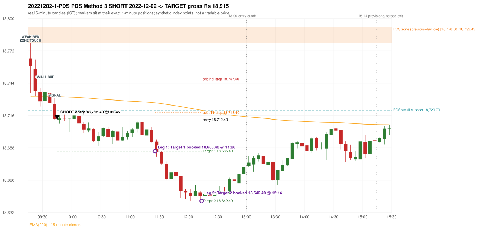

# Trading journal - 2022-12-02 (Friday)

> Phase 4 historical validation, window B (Window B 2022-09-01..2025-08-31 (5paisa minutes); status DATA_VALIDATED). The FROZEN Phase 3.6 configuration (IRF, ORB, PDR body-based, PDS, RF; shared controller) on a different data source. HISTORICAL RESEARCH ONLY: the strategy was developed using later data. same provider as the Phase 3.6 baseline; the vendor-overlap audit shows the minute bars differ from the secondary vendor Synthetic NIFTY 50 index-point P&L (the index is not tradable). The owner's review status is intentionally blank.

## A. Trading day overview

| item | value |
|---|---|
| Date / weekday | 2022-12-02 / Friday |
| Session type | USABLE_WITH_FLAGS / VALID |
| Original session open (first 1-minute open) | 18,765.15 |
| Previous session | 2022-12-01 |
| Previous-day high / low (wicks included) | 18,886.70 / 18,778.50 |
| Previous-day highest BODY high (the body-based PDR ceiling; wicks ignored) | 18,868.70 |
| Previous-day official close / last 5-minute close | 18,812.50 / 18,800.85 |
| Raw engine records / confirmed signals / fully valid signals | 4 / 1 / 1 |
| Setups that did not complete (invalidated / incomplete) | 3 |
| Executed trades | 1 20221202-1-PDS |
| Gross P&L (Rs, synthetic) | 18,915.00 |
| Illustrative net P&L (Rs; Rs 500/trade + 0.5 pt/fill) | 18,025.00 |
| Day-end portfolio status | DAY_FINISHED |
| Manual journal trades (matched / unmatched) | 0 (0 / 0) |
| Extra automated trades | 0 |

## B. Daily strategy signal timeline (confirmed signals, chronological)

| time | strategy | method | dir | entry-rule status | valid for execution | <= 13:00 | portfolio state | accepted / ignored | specific reason | competing (same minute) |
|---|---|---|---|---|---|---|---|---|---|---|
| 09:45 | PDS | Method 3 | SHORT | PROPOSAL_DEPENDENT | True | True | FIRST_TRADE_ACTIVE | ACCEPTED -> 20221202-1-PDS | first eligible signal of the day; trade 1: TARGET |  |

Engine setups that did not complete (3); the complete list with failed rule ids is in `rejected_signals.csv`:

| candle | strategy | method | dir | status | precise reason | failed rules |
|---|---|---|---|---|---|---|
| 09:15 | ORB | Method 1 | SHORT | INVALIDATED | TREND:EMA_PREV_SESSION_CLOSE wrong side | ORB-TREND-001;ORB-TREND-002 |
| 09:15 | ORB | Method 2 | SHORT | INVALIDATED | TREND:EMA_PREV_SESSION_CLOSE wrong side | ORB-TREND-001;ORB-TREND-002 |
| 09:30 | RF | RF | LONG | INVALIDATED | GAP_NOT_UP(DOWN) | RF-003 |

## C. Detailed trade journals

### 20221202-1-PDS: PDS Method 3 SHORT (FIRST trade)

Chart: 

**Rule configuration:** CFG-phase36_body_based-866f954e55 - signal verification status **PROPOSAL_DEPENDENT** (never VERIFIED while a rule rests on a proposal).

#### 1. Setup identification

PDS Method 3 SHORT: the session opened 13.35 points below the previous-day-low zone [18,778.50, 18,792.45]; the first red candle at the zone (09:15) was weak (body 14.80%), so the engine waited for a small support; the 09:30 candle's low 18,720.70 (57.80 points below the zone floor) was broken by the close of the 09:40 candle (18,713.15); confirmed 09:45.

#### 2. Candle and indicator calculations

| role | session | candle | O | H | L | C | range | body % | upper wick % | lower wick % | direction | EMA(200) | strong bull / bear | pin bull / bear | small (body<=30%) | used for |
|---|---|---|---|---|---|---|---|---|---|---|---|---|---|---|---|---|
| zone_source_candle | PREVIOUS | 13:55-14:00 | 18,789.15 | 18,792.75 | 18,778.50 | 18,792.45 | 14.25 | 23.16 | 2.11 | 74.74 | BULLISH | 18,715.14 | False / False | True / False | True | previous-day low candle that defines the zone (A_LOWEST_LOW) |
| zone_retest_candle | TODAY | 09:15-09:20 | 18,765.15 | 18,778.55 | 18,735.65 | 18,758.80 | 42.90 | 14.80 | 31.24 | 53.96 | BEARISH | 18,732.73 | False / False | False / False | True | first candle whose range reaches the zone from below |
| signal_candle | TODAY | 09:40-09:45 | 18,726.05 | 18,731.25 | 18,712.50 | 18,713.15 | 18.75 | 68.80 | 27.73 | 3.47 | BEARISH | 18,732.51 | False / True | False / False | False | trigger candle |
| weak_first_red_candle | TODAY | 09:15-09:20 | 18,765.15 | 18,778.55 | 18,735.65 | 18,758.80 | 42.90 | 14.80 | 31.24 | 53.96 | BEARISH | 18,732.73 | False / False | False / False | True | first red candle at the zone that failed the quality rule |
| small_support_pivot | TODAY | 09:30-09:35 | 18,728.90 | 18,747.10 | 18,720.70 | 18,736.20 | 26.40 | 27.65 | 41.29 | 31.06 | BULLISH | 18,732.76 | False / False | False / False | True | small support: latest 3-candle fractal low after the weak candle |

Every condition, with the rule, the calculation, the observed values and the result:

| # | group | rule | result | status / numeric definition | calculation | observed | required | available at | why it matters |
|---|---|---|---|---|---|---|---|---|---|
| 1 | SELECTION | SEL-FIRST-001 | PASS | USER_APPROVED / USER_APPROVED | earliest CONFIRMED signal of the day across IRF/ORB/PDR/PDS/RF that passed the controller's checks | 0 confirmed signal(s) earlier today; 1 confirmed signals in the day in total, this one at 09:45 | no earlier executable signal | 2022-12-02 09:45 | the shared controller trades only the first valid signal; the five strategies are not independent positions |
| 2 | SELECTION | SEL-TIE-001 | PASS | USER_APPROVED / USER_APPROVED | other CONFIRMED signals with exactly the same confirmation timestamp | none | no different-strategy / opposite-direction signal in the same minute (otherwise an unresolved conflict, no trade) | 2022-12-02 09:45 | an unresolved same-minute collision would have produced no trade at all |
| 3 | SELECTION | ENTRY-CUTOFF-001 | PASS | USER_APPROVED / USER_APPROVED | fill timestamp vs 13:00:00 IST | signal confirmed 09:45; fill 09:45 | fill at or before 13:00:00 IST | 2022-12-02 09:45 | no new position may be entered with a fill after 13:00 IST |
| 4 | SELECTION | EXE-FILL-001 | PASS | PROPOSED_FOR_REVIEW / PROPOSED_FOR_REVIEW | fill = open of the 1-minute bar that starts at the signal candle's end | bar 09:45 O 18,712.40 H 18,712.45 L 18,709.05 C 18,711.75; executable=True; entry 18,712.40 | fill bar exists, starts exactly at the signal end, is fillable; entry = its open | 2022-12-02 09:45 | a 5-minute signal is known only when its candle closes; the first price that can be traded is the next minute's open |
| 5 | SELECTION | DAY-MAX-001 | PASS | USER_APPROVED / USER_APPROVED | number of entries today | trade 1 of at most 2 | <= 2 entries per day | 2022-12-02 09:45 | daily trade cap |
| 6 | SETUP | PDS-003 | PASS | SOURCE_VERIFIED / EXPLICIT_WORDING_DETAIL_PROPOSED_FOR_REVIEW | gap = first 1-minute open of today - previous session's OFFICIAL close | today's open 18,765.15 (first 1-minute bar 09:15) - previous close 18,812.50 (DAILY_VENDOR, 2022-12-01) = -47.35 points -> gap DOWN | gap DOWN (more than 0 points) | 2022-12-02 09:15 | approved convention: the original first-minute open, never the vendor daily open |
| 7 | SETUP | PDS-006 | PASS | SOURCE_VERIFIED / QUALITATIVE_SOURCE_NUMERIC_DEFINITION_PROPOSED_FOR_REVIEW | gap-down open below the zone | today's open 18,765.15 vs zone low 18,778.50: 13.35 points below | open < zone low | 2022-12-02 09:15 | the guide: 'price is trading below the previous day's support zone' after the gap; a PROPOSED strict reading |
| 8 | SETUP | PDS-004 | PASS | SOURCE_VERIFIED / EXPLICIT_IN_SOURCE | PDS is not a breakdown strategy: the zone must be tested from below first | open 18,765.15 below the zone floor 18,778.50; the first candle to reach the zone is 09:15 | price rises to the zone before any short | 2022-12-02 09:15 | a short below the level without a retest is not this strategy |
| 9 | SETUP | PDS-005 | PASS | SOURCE_VERIFIED / QUALITATIVE_SOURCE_NUMERIC_DEFINITION_PROPOSED_FOR_REVIEW | price comes up to the zone: first candle whose [low, high] intersects it (+/- proximity) | 09:15-09:20 O 18,765.15 H 18,778.55 L 18,735.65 C 18,758.80; range 42.90, body 6.35 (14.80%), upper wick 13.40 (31.24%), lower wick 23.15 (53.96%), bearish; high 18,778.55 vs zone low 18,778.50 | range intersects the zone | 2022-12-02 09:20 | PDS is not a breakdown strategy: the zone must be tested from below first |
| 10 | ZONE | PDS-001 | PASS | SOURCE_VERIFIED / EXPLICIT_IN_SOURCE | direction | SHORT (PDS is short only) | short-only | 2022-12-02 09:45 | PDS sells a retest of previous-day support from below |
| 11 | ZONE | PDS-002 | PASS | SOURCE_VERIFIED / QUALITATIVE_SOURCE_NUMERIC_DEFINITION_PROPOSED_FOR_REVIEW | zone = [lowest low, body top] of the previous session's absolute-low candle (method A_LOWEST_LOW; the lower wick is part of the zone) | zone [18,778.50, 18,792.45] from the 13:55 candle of 2022-12-01 (13:55-14:00 O 18,789.15 H 18,792.75 L 18,778.50 C 18,792.45; range 14.25, body 3.30 (23.16%), upper wick 0.30 (2.11%), lower wick 10.65 (74.74%), bullish); engine recorded [18,778.50, 18,792.45] | previous trading day's low where price took support (body + lower wick) | 2022-12-01 14:00 | the reference level of the strategy; the exact candle(s) are a research choice (PDS-ZONE-002) |
| 12 | CONFIRMATION | PDS-M-001 | PASS | SOURCE_VERIFIED / QUALITATIVE_SOURCE_NUMERIC_DEFINITION_PROPOSED_FOR_REVIEW | Method 3 is used when the first red candle at the zone is not satisfying | first red candle at the zone: 09:15-09:20 O 18,765.15 H 18,778.55 L 18,735.65 C 18,758.80; range 42.90, body 6.35 (14.80%), upper wick 13.40 (31.24%), lower wick 23.15 (53.96%), bearish; strong-bearish test body >= 60%, lower wick <= 20% -> not met; pin bar -> not met | first red candle is neither strong nor a pin bar | 2022-12-02 09:20 | the quality rule keeps weak candles out; Method 3 waits for a support break instead |
| 13 | CONFIRMATION | PDS-M3-001 | PASS | SOURCE_VERIFIED / QUALITATIVE_SOURCE_NUMERIC_DEFINITION_PROPOSED_FOR_REVIEW | small support = latest 3-candle fractal low (k=1) formed at/after the weak candle with low <= zone high (18,792.45); definition SWING_K1_NEAR_ZONE | support 18,720.70 from the 09:30 candle; engine recorded 18,720.70; distance below the zone floor 57.80 points (zone floor 18,778.50); the guide says 'near the zone' but defines no distance - the code has no lower bound | a small support near the zone | 2022-12-02 09:40 | 'near' and the size of the small support are undefined in the guide |
| 14 | CONFIRMATION | PDS-M3-001 | PASS | SOURCE_VERIFIED / QUALITATIVE_SOURCE_NUMERIC_DEFINITION_PROPOSED_FOR_REVIEW | trigger: candle closes below the small support (break basis CLOSE) | 09:40 close 18,713.15 vs support 18,720.70: 7.55 points below | close < support | 2022-12-02 09:45 | the guide does not say close or touch; the close is used |
| 15 | EXECUTION | EXE-STOP-001 | PASS | USER_APPROVED / USER_APPROVED | initial stop = entry + 35 points | entry 18,712.40 -> stop 18,747.40 | stop 35 index points (BASELINE) | 2022-12-02 09:45 | defines the loss if the setup fails before Target 1 |
| 16 | EXECUTION | EXE-T1-001 | PASS | SOURCE_VERIFIED / EXPLICIT_IN_SOURCE | Target 1 = entry +/- 27 points | T1 18,685.40 | 27 points | 2022-12-02 09:45 | Leg 1 (3 lots) is booked at Target 1 |
| 17 | EXECUTION | PDS-TGT-001 | PASS | SOURCE_VERIFIED / EXPLICIT_IN_SOURCE | Target 2 = entry +/- 70 points | T2 18,642.40 (the guide says 70; the report suggests 60 - CONFLICTING) | 70 points | 2022-12-02 09:45 | Leg 2 (3 lots) is booked at Target 2 |
| 18 | EXECUTION | POST-T1-STOP-006 | PASS | USER_APPROVED / USER_APPROVED | after T1 the Leg-2 stop = entry + 6 (no trailing) | post-T1 stop 18,718.40 | entry -6 (LONG) / +6 (SHORT) | 2022-12-02 09:45 | protects the remaining three lots once the first three are booked |
| 19 | EXECUTION | SIZE-LOT-001 | PASS | USER_APPROVED / USER_APPROVED | 6 lots x 65 = 390, Leg 1 = 3 lots = 195, Leg 2 = 195 | 6 lots, lot size 65, legs 3+3 | 6 lots in two equal legs | 2022-12-02 09:45 | position size for the synthetic P&L |
| 20 | NOTE | PDS-007 | NOT_APPLICABLE | PROPOSED_FOR_REVIEW / PROPOSED_FOR_REVIEW | repeated PDS signals today | 1 confirmed PDS signal(s) in the session | n/a (disclosure) | 2022-12-02 09:45 | the per-session cap is lifted for the controller runs; the controller trades only the first (or the permitted second) trade |
| 21 | NOTE | PDS-MISSING-001 | UNRESOLVED | UNRESOLVED / UNRESOLVED | entry timing | signal on the candle close; fill at the next minute's open | the guide does not say whether entry is intra-candle or after the close | 2022-12-02 09:45 | causal convention: nothing is entered before the trigger candle has closed |
| 22 | NOTE | PDS-SL-001 | NOT_APPLICABLE | SOURCE_VERIFIED / QUALITATIVE_SOURCE_NUMERIC_DEFINITION_PROPOSED_FOR_REVIEW | the guide's 35-or-40 rule: 35 if the most recent green candle's high is within 35 points of entry, else 40 | most recent green candle high 18,747.10 is 34.70 points from the entry 18,712.40: the guide's rule would select 35 points; the baseline applies a fixed 35 (USER_APPROVED research baseline; the 35-vs-40 selection and the 40-point variant are separate labelled scenarios) | source selection rule | 2022-12-02 09:45 | the stop distance is a modelling choice and changes losses, not entries |
| 23 | NOTE | NOTE-UNRESOLVED-DEPENDENCIES | NOT_APPLICABLE | NOT_A_RULE / NOT_A_REGISTRY_RULE | rules the signal depends on that the sources leave unresolved | engine-recorded unresolved rule ids: none; verification status PROPOSAL_DEPENDENT | n/a (disclosure) | 2022-12-02 09:45 | the entry is only as verified as the rules it rests on |

#### 3. Entry decision and explanation

PDS Method 3 SHORT: the session opened 13.35 points below the previous-day-low zone [18,778.50, 18,792.45]; the first red candle at the zone (09:15) was weak (body 14.80%), so the engine waited for a small support; the 09:30 candle's low 18,720.70 (57.80 points below the zone floor) was broken by the close of the 09:40 candle (18,713.15); confirmed 09:45.

**Why this trade ahead of the other strategies:** This PDS Method 3 signal was the earliest executable signal of the day: 0 confirmed signal(s) earlier, 0 other in the same minute. No later signal was generated. State of the other four engines at that moment: [IRF: no setup record before this time (a base condition was not met, or nothing triggered)] [ORB: Method 1 invalidated at 09:15: TREND:EMA_PREV_SESSION_CLOSE wrong side; Method 2 invalidated at 09:15: TREND:EMA_PREV_SESSION_CLOSE wrong side] [PDR: no setup record before this time (a base condition was not met, or nothing triggered)] [RF: RF invalidated at 09:30: GAP_NOT_UP(DOWN)]

#### 4. Actual entry execution

| item | value |
|---|---|
| Signal candle | 09:40-09:45 |
| Signal confirmed | 2022-12-02 09:45 |
| Fill timestamp | 2022-12-02 09:45 |
| Entry price | 18,712.40 |
| Source partition / 1-minute bar | data/phase4/processed/FIVEPAISA_1M_PHASE4/nifty50/year=2022/month=12/candles.parquet / 2022-12-02 09:45 |
| Source bar O / H / L / C | 18,712.40 / 18,712.45 / 18,709.05 / 18,711.75 |
| Fill assumption | open of the 1-minute bar starting at the signal candle's end (EXE-FILL-001, PROPOSED causal convention) |
| Initial stop / T1 / T2 / post-T1 stop | 18,747.40 / 18,685.40 / 18,642.40 / 18,718.40 |
| Position | 6 lots x 65 = 390 units (Leg 1 195, Leg 2 195) |

#### 5-8. Trade progress, Target 1, post-T1 stop and final exit

Between the 09:45 entry bar and the final exit (150 one-minute bars) the best excursion in favour was 70.15 points at 12:14 and the worst against was 8.75 points at 10:03. At 11:26 price reached Target 1 18,685.40 and three lots exited. At 11:26 the remaining three lots' protective stop was set to 18,718.40 (entry + 6; no trailing, no further change); the engine applies it from the Target-1 bar onward and tests it within that same bar. At 12:14 price reached Target 2 18,642.40 and the remaining three lots exited. No further trade that day (DAY-T2-001).

| leg | qty | exit time | exit price | reason | source 1-minute bar | O / H / L / C | gross points | gross Rs | slippage pts | flags |
|---|---|---|---|---|---|---|---|---|---|---|
| 1 | 195 | 11:26 | 18,685.40 | TARGET_1 | 11:26 | 18,693.70 / 18,694.25 / 18,684.50 / 18,684.75 | 27.00 | 5,265.00 | 0.00 |  |
| 2 | 195 | 12:14 | 18,642.40 | TARGET_2 | 12:14 | 18,643.70 / 18,647.85 / 18,642.25 / 18,646.35 | 70.00 | 13,650.00 | 0.00 |  |

Exit evidence per leg:

* Leg 1: 1-minute bar 11:26 O 18,693.70 H 18,694.25 L 18,684.50 C 18,684.75: low 18,684.50 reached Target 1 18,685.40; Leg 1 booked at the target level
* Leg 2: 1-minute bar 12:14 O 18,643.70 H 18,647.85 L 18,642.25 C 18,646.35: low 18,642.25 reached Target 2 18,642.40; Leg 2 booked at the target level

#### 9. Gross and illustrative net P&L

| item | value (Rs) |
|---|---|
| Leg 1 gross | 5,265.00 |
| Leg 2 gross | 13,650.00 |
| Trade gross (= Leg 1 + Leg 2) | 18,915.00 |
| Illustrative fixed cost | -500.00 |
| Illustrative slippage (0.5 pt on every fill, entry + exits, all units) | -390.00 |
| Illustrative net | 18,025.00 |

#### 10. Manual journal comparison

No manual journal exists for this period; no comparison.

## D. Manual journal comparison

No manual journal exists for this period (the manual journal covers 2025-09-01 .. 2026-08-31 only); no comparison is made and no automated trade is labelled 'extra'.

## E. Daily conclusion

* **Traded:** 20221202-1-PDS - PDS Method 3 SHORT at 09:45 (entry 18,712.40), outcome TARGET, gross Rs 18,915.00, illustrative net Rs 18,025.00. **Why:** This PDS Method 3 signal was the earliest executable signal of the day: 0 confirmed signal(s) earlier, 0 other in the same minute. No later signal was generated. State of the other four engines at that moment: [IRF: no setup record before this time (a base condition was not met, or nothing triggered)] [ORB: Method 1 invalidated at 09:15: TREND:EMA_PREV_SESSION_CLOSE wrong side; Method 2 invalidated at 09:15: TREND:EMA_PREV_SESSION_CLOSE wrong side] [PDR: no setup record before this time (a base condition was not met, or nothing triggered)] [RF: RF invalidated at 09:30: GAP_NOT_UP(DOWN)] **How it ended:** At 11:26 price reached Target 1 18,685.40 and three lots exited. At 11:26 the remaining three lots' protective stop was set to 18,718.40 (entry + 6; no trailing, no further change); the engine applies it from the Target-1 bar onward and tests it within that same bar. At 12:14 price reached Target 2 18,642.40 and the remaining three lots exited. No further trade that day (DAY-T2-001).
* **Open strategy-definition issues that affected this day:** PDS-MISSING-001 (Entry timing (during the candle or after it closes) is not specified)
* **Automated triage (not an approval; the owner's review status stays blank):** TRADED_NO_FLAGS
