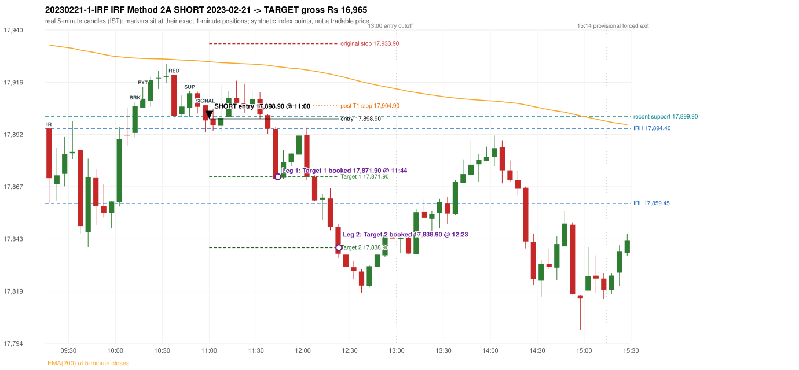

# Trading journal - 2023-02-21 (Tuesday)

> Phase 4 historical validation, window B (Window B 2022-09-01..2025-08-31 (5paisa minutes); status DATA_VALIDATED). The FROZEN Phase 3.6 configuration (IRF, ORB, PDR body-based, PDS, RF; shared controller) on a different data source. HISTORICAL RESEARCH ONLY: the strategy was developed using later data. same provider as the Phase 3.6 baseline; the vendor-overlap audit shows the minute bars differ from the secondary vendor Synthetic NIFTY 50 index-point P&L (the index is not tradable). The owner's review status is intentionally blank.

## A. Trading day overview

| item | value |
|---|---|
| Date / weekday | 2023-02-21 / Tuesday |
| Session type | USABLE_WITH_FLAGS / VALID |
| Original session open (first 1-minute open) | 17,894.40 |
| Previous session | 2023-02-20 |
| Previous-day high / low (wicks included) | 18,003.95 / 17,818.75 |
| Previous-day highest BODY high (the body-based PDR ceiling; wicks ignored) | 17,996.80 |
| Previous-day official close / last 5-minute close | 17,844.60 / 17,847.05 |
| Raw engine records / confirmed signals / fully valid signals | 8 / 3 / 3 |
| Setups that did not complete (invalidated / incomplete) | 5 |
| Executed trades | 1 20230221-1-IRF |
| Gross P&L (Rs, synthetic) | 16,965.00 |
| Illustrative net P&L (Rs; Rs 500/trade + 0.5 pt/fill) | 16,075.00 |
| Day-end portfolio status | DAY_FINISHED |
| Manual journal trades (matched / unmatched) | 0 (0 / 0) |
| Extra automated trades | 0 |

## B. Daily strategy signal timeline (confirmed signals, chronological)

| time | strategy | method | dir | entry-rule status | valid for execution | <= 13:00 | portfolio state | accepted / ignored | specific reason | competing (same minute) |
|---|---|---|---|---|---|---|---|---|---|---|
| 11:00 | IRF | Method 2A | SHORT | PROPOSAL_DEPENDENT | True | True | FIRST_TRADE_ACTIVE | ACCEPTED -> 20230221-1-IRF | first eligible signal of the day; trade 1: TARGET |  |
| 11:20 | IRF | Method 2B | SHORT | PROPOSAL_DEPENDENT | True | True | FIRST_TRADE_ACTIVE | IGNORED | POSITION_ACTIVE (signal kept for diagnostics only; never reused) [blocked by IRF#1] |  |
| 11:40 | IRF | Method 1 | SHORT | PROPOSAL_DEPENDENT | True | True | FIRST_TRADE_ACTIVE | IGNORED | POSITION_ACTIVE (signal kept for diagnostics only; never reused) [blocked by IRF#1] |  |

Engine setups that did not complete (5); the complete list with failed rule ids is in `rejected_signals.csv`:

| candle | strategy | method | dir | status | precise reason | failed rules |
|---|---|---|---|---|---|---|
| 12:00 | IRF | Method 3 | SHORT | INVALIDATED | WICK_SHARE_OUT_OF_BAND | IRF-M3-003 |
| 11:15 | IRF | Method 1/2 | SHORT | INCOMPLETE_AT_EOD | SESSION_ENDED_BEFORE_CONFIRMATION |  |
| 09:15 | ORB | Method 2 | LONG | INVALIDATED | TREND:EMA_PREV_SESSION_CLOSE wrong side | ORB-TREND-001;ORB-TREND-002 |
| 09:15 | PDR | PDR | LONG | INVALIDATED | OPEN_NOT_STRICTLY_ABOVE_ZONE |  |
| 09:40 | RF | RF | LONG | INVALIDATED | TREND:EMA_PREV_SESSION_CLOSE wrong side | RF-001;RF-008 |

## C. Detailed trade journals

### 20230221-1-IRF: IRF Method 2A SHORT (FIRST trade)

Chart: 

**Rule configuration:** CFG-phase36_body_based-866f954e55 - signal verification status **PROPOSAL_DEPENDENT** (never VERIFIED while a rule rests on a proposal).

#### 1. Setup identification

IRF Method 2A SHORT: the 10:10-10:15 candle closed at 17,904.80, above IRH 17,894.40, and the next candle did not close back inside the range, so the setup is Method 2 and price stayed above it until the trigger. Extension candle 10:15-10:20, red candle 10:35-10:40. The trigger came 9 candles after the breakout candle: a completed candle closed below the recent pullback-low support (10:55-11:00); confirmed at 11:00 with close 17,898.15. Entry reference close 17,898.15 is 3.75 points above IRH 17,894.40.

#### 2. Candle and indicator calculations

| role | session | candle | O | H | L | C | range | body % | upper wick % | lower wick % | direction | EMA(200) | strong bull / bear | pin bull / bear | small (body<=30%) | used for |
|---|---|---|---|---|---|---|---|---|---|---|---|---|---|---|---|---|
| initial_range_candle | TODAY | 09:15-09:20 | 17,894.40 | 17,894.40 | 17,859.45 | 17,871.25 | 34.95 | 66.24 | 0.00 | 33.76 | BEARISH | 17,933.33 | False / False | False / False | False | initial range = high/low of the 09:15 candle |
| signal_candle | TODAY | 10:55-11:00 | 17,905.20 | 17,905.35 | 17,892.60 | 17,898.15 | 12.75 | 55.29 | 1.18 | 43.53 | BEARISH | 17,925.63 | False / False | False / False | False | candle whose close completed the trigger |
| breakout_candle | TODAY | 10:10-10:15 | 17,892.35 | 17,906.80 | 17,890.30 | 17,904.80 | 16.50 | 75.45 | 12.12 | 12.42 | BULLISH | 17,927.21 | True / False | False / False | False | breakout candle: a completed candle closing above IRH |
| extension_candle | TODAY | 10:15-10:20 | 17,904.15 | 17,913.85 | 17,904.15 | 17,908.25 | 9.70 | 42.27 | 57.73 | 0.00 | BULLISH | 17,927.02 | False / False | False / False | False | extension: first later candle trading above the breakout candle's high |
| red_candle | TODAY | 10:35-10:40 | 17,919.40 | 17,919.40 | 17,899.05 | 17,900.30 | 20.35 | 93.86 | 0.00 | 6.14 | BEARISH | 17,926.49 | False / True | False / False | False | first red candle during the extension |
| support_pivot | TODAY | 10:45-10:50 | 17,904.00 | 17,911.80 | 17,899.90 | 17,910.80 | 11.90 | 57.14 | 8.40 | 34.45 | BULLISH | 17,926.12 | False / False | False / False | False | recent support: latest 3-candle fractal low formed after the breakout |

Every condition, with the rule, the calculation, the observed values and the result:

| # | group | rule | result | status / numeric definition | calculation | observed | required | available at | why it matters |
|---|---|---|---|---|---|---|---|---|---|
| 1 | SELECTION | SEL-FIRST-001 | PASS | USER_APPROVED / USER_APPROVED | earliest CONFIRMED signal of the day across IRF/ORB/PDR/PDS/RF that passed the controller's checks | 0 confirmed signal(s) earlier today; 3 confirmed signals in the day in total, this one at 11:00 | no earlier executable signal | 2023-02-21 11:00 | the shared controller trades only the first valid signal; the five strategies are not independent positions |
| 2 | SELECTION | SEL-TIE-001 | PASS | USER_APPROVED / USER_APPROVED | other CONFIRMED signals with exactly the same confirmation timestamp | none | no different-strategy / opposite-direction signal in the same minute (otherwise an unresolved conflict, no trade) | 2023-02-21 11:00 | an unresolved same-minute collision would have produced no trade at all |
| 3 | SELECTION | ENTRY-CUTOFF-001 | PASS | USER_APPROVED / USER_APPROVED | fill timestamp vs 13:00:00 IST | signal confirmed 11:00; fill 11:00 | fill at or before 13:00:00 IST | 2023-02-21 11:00 | no new position may be entered with a fill after 13:00 IST |
| 4 | SELECTION | EXE-FILL-001 | PASS | PROPOSED_FOR_REVIEW / PROPOSED_FOR_REVIEW | fill = open of the 1-minute bar that starts at the signal candle's end | bar 11:00 O 17,898.90 H 17,903.65 L 17,898.90 C 17,902.80; executable=True; entry 17,898.90 | fill bar exists, starts exactly at the signal end, is fillable; entry = its open | 2023-02-21 11:00 | a 5-minute signal is known only when its candle closes; the first price that can be traded is the next minute's open |
| 5 | SELECTION | DAY-MAX-001 | PASS | USER_APPROVED / USER_APPROVED | number of entries today | trade 1 of at most 2 | <= 2 entries per day | 2023-02-21 11:00 | daily trade cap |
| 6 | SETUP | IRF-GLOBAL-001 | PASS | SOURCE_VERIFIED / EXPLICIT_IN_SOURCE | initial range = high and low (wicks included) of the first completed 5-minute candle | 09:15-09:20 IRH 17,894.40, IRL 17,859.45 (range 34.95; engine recorded IRH 17,894.40, IRL 17,859.45) | high/low of the 09:15-09:20 candle | 2023-02-21 09:20 | all three IRF methods measure price against this range |
| 7 | SETUP | IRF-GLOBAL-003 | PASS | SOURCE_VERIFIED / EXPLICIT_IN_SOURCE | closes confirm, wicks do not: every trigger is evaluated on a completed 5-minute candle | trigger candle 10:55-11:00 was complete when the signal was stamped 11:00; decision uses its close 17,898.15 | completed candle close, not an intra-candle wick | 2023-02-21 11:00 | an intra-candle wick can reverse before the candle closes |
| 8 | SETUP | IRF-GLOBAL-002 | PASS | SOURCE_VERIFIED / EXPLICIT_IN_SOURCE | direction | SHORT (IRF trades short only) | short only | 2023-02-21 11:00 | IRF fades failed upside breakouts |
| 9 | SETUP | IRF-M2-001 | PASS | SOURCE_VERIFIED / EXPLICIT_IN_SOURCE | breakout candle close vs IRH | 10:10-10:15 O 17,892.35 H 17,906.80 L 17,890.30 C 17,904.80; range 16.50, body 12.45 (75.45%), upper wick 2.00 (12.12%), lower wick 2.05 (12.42%), bullish; close 17,904.80 is 10.40 points above IRH 17,894.40 | close > IRH (a wick above IRH is not a breakout) | 2023-02-21 10:15 | starts every IRF setup |
| 10 | SETUP | IRF-M2-004 | PASS | SOURCE_VERIFIED / EXPLICIT_IN_SOURCE | the candle after the breakout must NOT close back inside the range (else the setup is Method 1) | 10:15 close 17,908.25 vs [17,859.45, 17,894.40) | not (IRL <= close < IRH) | 2023-02-21 10:20 | separates Method 2 (price holds above) from Method 1 (immediate failure) |
| 11 | SETUP | IRF-M2-002 | PASS | SOURCE_VERIFIED / QUALITATIVE_SOURCE_NUMERIC_DEFINITION_PROPOSED_FOR_REVIEW | extension = a later candle whose high exceeds the breakout candle's high (research definition E1) | 10:15 high 17,913.85 vs breakout candle high 17,906.80 (+7.05) | high > breakout candle high | 2023-02-21 10:20 | the guide says price 'extends further upward'; the numeric test is a proposal |
| 12 | SETUP | IRF-M2-003 | PASS | SOURCE_VERIFIED / QUALITATIVE_SOURCE_NUMERIC_DEFINITION_PROPOSED_FOR_REVIEW | a red candle (close < open) forms after the extension | 10:35-10:40 O 17,919.40 H 17,919.40 L 17,899.05 C 17,900.30; range 20.35, body 19.10 (93.86%), upper wick 0.00 (0.00%), lower wick 1.25 (6.14%), bearish | close < open, at or after the candle following the extension | 2023-02-21 10:40 | the red candle shows the first pause/reversal inside the extension |
| 13 | CONFIRMATION | IRF-M2A-001 | PASS | SOURCE_VERIFIED / QUALITATIVE_SOURCE_NUMERIC_DEFINITION_PROPOSED_FOR_REVIEW | recent support = latest 3-candle fractal low (k=1) among candles b+1 ... i-2 | 10:45 low 17,899.90; neighbours' lows 17,900.05 (10:40) and 17,901.35 (10:50) are not lower; engine recorded support 17,899.90 | pivot low known before the trigger candle | 2023-02-21 10:55 | the support is the level whose break completes Method 2A (the exact 'pullback low' definition is a proposal) |
| 14 | CONFIRMATION | IRF-M2A-002 | PASS | SOURCE_VERIFIED / EXPLICIT_WORDING_DETAIL_PROPOSED_FOR_REVIEW | trigger candle closes below recent support | 10:55 close 17,898.15 vs support 17,899.90: 1.75 points below | close < support (close, not wick) | 2023-02-21 11:00 | completes Method 2A |
| 15 | CONFIRMATION | IRF-M2-005 | PASS | SOURCE_VERIFIED / EXPLICIT_IN_SOURCE | chronology: the red candle precedes the break candle | red candle 10:35, break candle 10:55 | red candle index < break candle index (m2a_break_may_be_red_candle = False) | 2023-02-21 11:00 | a red candle alone is not confirmation; a level break is required |
| 16 | EXECUTION | EXE-STOP-001 | PASS | USER_APPROVED / USER_APPROVED | initial stop = entry + 35 points | entry 17,898.90 -> stop 17,933.90 | stop 35 index points (BASELINE) | 2023-02-21 11:00 | defines the loss if the setup fails before Target 1 |
| 17 | EXECUTION | EXE-T1-001 | PASS | SOURCE_VERIFIED / EXPLICIT_IN_SOURCE | Target 1 = entry +/- 27 points | T1 17,871.90 | 27 points | 2023-02-21 11:00 | Leg 1 (3 lots) is booked at Target 1 |
| 18 | EXECUTION | IRF-TGT-001 | PASS | SOURCE_VERIFIED / EXPLICIT_IN_SOURCE | Target 2 = entry +/- 60 points | T2 17,838.90 | 60 points | 2023-02-21 11:00 | Leg 2 (3 lots) is booked at Target 2 |
| 19 | EXECUTION | POST-T1-STOP-006 | PASS | USER_APPROVED / USER_APPROVED | after T1 the Leg-2 stop = entry + 6 (no trailing) | post-T1 stop 17,904.90 | entry -6 (LONG) / +6 (SHORT) | 2023-02-21 11:00 | protects the remaining three lots once the first three are booked |
| 20 | EXECUTION | SIZE-LOT-001 | PASS | USER_APPROVED / USER_APPROVED | 6 lots x 65 = 390, Leg 1 = 3 lots = 195, Leg 2 = 195 | 6 lots, lot size 65, legs 3+3 | 6 lots in two equal legs | 2023-02-21 11:00 | position size for the synthetic P&L |
| 21 | NOTE | IRF-M2-006 | UNRESOLVED | UNRESOLVED / UNRESOLVED | delay between the breakout candle and this trigger; expiry rule | 9 candles after the breakout; expiry none configured | the source states no expiry | 2023-02-21 11:00 | an old breakout can still trigger hours later |
| 22 | NOTE | IRF-M2-006 | UNRESOLVED | UNRESOLVED / UNRESOLVED | did price stay above IRH between the breakout and the trigger? | 0 closes at or below IRH between 10:15 and 10:55; trigger close 17,898.15 above IRH 17,894.40 | the engine does not require price to stay above IRH | 2023-02-21 11:00 | the guide describes price 'holding above IRH and keeping rising'; the code only needs the level break |
| 23 | NOTE | IRF-GLOBAL-004 | UNRESOLVED | UNRESOLVED / UNRESOLVED | which close above IRH of the session produced this attempt; repeat setups | this breakout is upward crossing no. 1 of the session (a close above IRH after a close at/below it) | the source states no first-breakout-only, re-arming, expiry or trades-per-day rule | 2023-02-21 11:00 | IRF re-arms on every later breakout in the code, producing many raw setups; the controller keeps only the first |
| 24 | NOTE | NOTE-IRF-REPEATED-SETUPS | NOT_APPLICABLE | NOT_A_RULE / NOT_A_REGISTRY_RULE | other IRF signals later in the session (not traded) | 2 further confirmed IRF signal(s): Method 2B@11:20, Method 1@11:40 | disclosure of repeated raw setups | 2023-02-21 11:00 | repeated raw IRF setups are not hidden; they are logged as ignored |
| 25 | NOTE | IRF-SL-001 | NOT_APPLICABLE | SOURCE_VERIFIED / QUALITATIVE_SOURCE_NUMERIC_DEFINITION_PROPOSED_FOR_REVIEW | the guide's 35-or-40 rule: 35 if the most recent green candle's high is within 35 points of entry, else 40 | most recent green candle high 17,911.80 is 12.90 points from the entry 17,898.90: the guide's rule would select 35 points; the baseline applies a fixed 35 (USER_APPROVED research baseline; the 35-vs-40 selection and the 40-point variant are separate labelled scenarios) | source selection rule | 2023-02-21 11:00 | the stop distance is a modelling choice and changes losses, not entries |
| 26 | NOTE | NOTE-UNRESOLVED-DEPENDENCIES | UNRESOLVED | NOT_A_RULE / NOT_A_REGISTRY_RULE | rules the signal depends on that the sources leave unresolved | engine-recorded unresolved rule ids: IRF-GLOBAL-004; verification status PROPOSAL_DEPENDENT | n/a (disclosure) | 2023-02-21 11:00 | the entry is only as verified as the rules it rests on |

#### 3. Entry decision and explanation

IRF Method 2A SHORT: the 10:10-10:15 candle closed at 17,904.80, above IRH 17,894.40, and the next candle did not close back inside the range, so the setup is Method 2 and price stayed above it until the trigger. Extension candle 10:15-10:20, red candle 10:35-10:40. The trigger came 9 candles after the breakout candle: a completed candle closed below the recent pullback-low support (10:55-11:00); confirmed at 11:00 with close 17,898.15. Entry reference close 17,898.15 is 3.75 points above IRH 17,894.40.

**Why this trade ahead of the other strategies:** This IRF Method 2A signal was the earliest executable signal of the day: 0 confirmed signal(s) earlier, 0 other in the same minute. 2 later confirmed signal(s) (IRF x2) are logged as ignored or rejected. State of the other four engines at that moment: [ORB: Method 2 invalidated at 09:15: TREND:EMA_PREV_SESSION_CLOSE wrong side] [PDR: PDR invalidated at 09:15: OPEN_NOT_STRICTLY_ABOVE_ZONE] [PDS: no setup record before this time (a base condition was not met, or nothing triggered)] [RF: RF invalidated at 09:40: TREND:EMA_PREV_SESSION_CLOSE wrong side]

#### 4. Actual entry execution

| item | value |
|---|---|
| Signal candle | 10:55-11:00 |
| Signal confirmed | 2023-02-21 11:00 |
| Fill timestamp | 2023-02-21 11:00 |
| Entry price | 17,898.90 |
| Source partition / 1-minute bar | data/phase4/processed/FIVEPAISA_1M_PHASE4/nifty50/year=2023/month=02/candles.parquet / 2023-02-21 11:00 |
| Source bar O / H / L / C | 17,898.90 / 17,903.65 / 17,898.90 / 17,902.80 |
| Fill assumption | open of the 1-minute bar starting at the signal candle's end (EXE-FILL-001, PROPOSED causal convention) |
| Initial stop / T1 / T2 / post-T1 stop | 17,933.90 / 17,871.90 / 17,838.90 / 17,904.90 |
| Position | 6 lots x 65 = 390 units (Leg 1 195, Leg 2 195) |

#### 5-8. Trade progress, Target 1, post-T1 stop and final exit

Between the 11:00 entry bar and the final exit (84 one-minute bars) the best excursion in favour was 64.35 points at 12:23 and the worst against was 17.75 points at 11:16. At 11:44 price reached Target 1 17,871.90 and three lots exited. At 11:44 the remaining three lots' protective stop was set to 17,904.90 (entry + 6; no trailing, no further change); the engine applies it from the Target-1 bar onward and tests it within that same bar. At 12:23 price reached Target 2 17,838.90 and the remaining three lots exited. No further trade that day (DAY-T2-001).

| leg | qty | exit time | exit price | reason | source 1-minute bar | O / H / L / C | gross points | gross Rs | slippage pts | flags |
|---|---|---|---|---|---|---|---|---|---|---|
| 1 | 195 | 11:44 | 17,871.90 | TARGET_1 | 11:44 | 17,872.65 / 17,872.70 / 17,870.25 / 17,870.85 | 27.00 | 5,265.00 | 0.00 |  |
| 2 | 195 | 12:23 | 17,838.90 | TARGET_2 | 12:23 | 17,841.95 / 17,841.95 / 17,834.55 / 17,834.90 | 60.00 | 11,700.00 | 0.00 |  |

Exit evidence per leg:

* Leg 1: 1-minute bar 11:44 O 17,872.65 H 17,872.70 L 17,870.25 C 17,870.85: low 17,870.25 reached Target 1 17,871.90; Leg 1 booked at the target level
* Leg 2: 1-minute bar 12:23 O 17,841.95 H 17,841.95 L 17,834.55 C 17,834.90: low 17,834.55 reached Target 2 17,838.90; Leg 2 booked at the target level

#### 9. Gross and illustrative net P&L

| item | value (Rs) |
|---|---|
| Leg 1 gross | 5,265.00 |
| Leg 2 gross | 11,700.00 |
| Trade gross (= Leg 1 + Leg 2) | 16,965.00 |
| Illustrative fixed cost | -500.00 |
| Illustrative slippage (0.5 pt on every fill, entry + exits, all units) | -390.00 |
| Illustrative net | 16,075.00 |

#### 10. Manual journal comparison

No manual journal exists for this period; no comparison.

## D. Manual journal comparison

No manual journal exists for this period (the manual journal covers 2025-09-01 .. 2026-08-31 only); no comparison is made and no automated trade is labelled 'extra'.

## E. Daily conclusion

* **Traded:** 20230221-1-IRF - IRF Method 2A SHORT at 11:00 (entry 17,898.90), outcome TARGET, gross Rs 16,965.00, illustrative net Rs 16,075.00. **Why:** This IRF Method 2A signal was the earliest executable signal of the day: 0 confirmed signal(s) earlier, 0 other in the same minute. 2 later confirmed signal(s) (IRF x2) are logged as ignored or rejected. State of the other four engines at that moment: [ORB: Method 2 invalidated at 09:15: TREND:EMA_PREV_SESSION_CLOSE wrong side] [PDR: PDR invalidated at 09:15: OPEN_NOT_STRICTLY_ABOVE_ZONE] [PDS: no setup record before this time (a base condition was not met, or nothing triggered)] [RF: RF invalidated at 09:40: TREND:EMA_PREV_SESSION_CLOSE wrong side] **How it ended:** At 11:44 price reached Target 1 17,871.90 and three lots exited. At 11:44 the remaining three lots' protective stop was set to 17,904.90 (entry + 6; no trailing, no further change); the engine applies it from the Target-1 bar onward and tests it within that same bar. At 12:23 price reached Target 2 17,838.90 and the remaining three lots exited. No further trade that day (DAY-T2-001).
* **Ignored / rejected signals:** IRF IGNORED POSITION_ACTIVE x2
* **Open strategy-definition issues that affected this day:** IRF-GLOBAL-004 (NOT STATED: how many IRF trades per day, a latest entry time, and whether a new breakout may re-arm a setup after a signal), IRF-M2-006 (How long a Method 2 setup stays valid (expiry / invalidation before a level breaks) is not stated), NOTE-UNRESOLVED-DEPENDENCIES
* **Automated triage (not an approval; the owner's review status stays blank):** TRADED_NO_FLAGS
