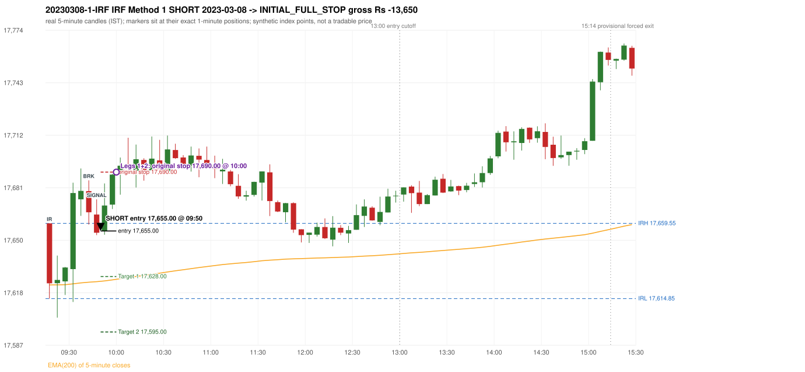
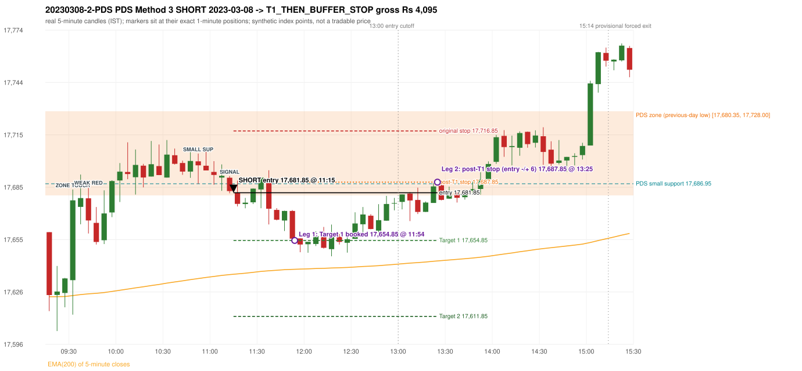

# Trading journal - 2023-03-08 (Wednesday)

> Phase 4 historical validation, window B (Window B 2022-09-01..2025-08-31 (5paisa minutes); status DATA_VALIDATED). The FROZEN Phase 3.6 configuration (IRF, ORB, PDR body-based, PDS, RF; shared controller) on a different data source. HISTORICAL RESEARCH ONLY: the strategy was developed using later data. same provider as the Phase 3.6 baseline; the vendor-overlap audit shows the minute bars differ from the secondary vendor Synthetic NIFTY 50 index-point P&L (the index is not tradable). The owner's review status is intentionally blank.

## A. Trading day overview

| item | value |
|---|---|
| Date / weekday | 2023-03-08 / Wednesday |
| Session type | USABLE_WITH_FLAGS / VALID |
| Original session open (first 1-minute open) | 17,659.55 |
| Previous session | 2023-03-06 |
| Previous-day high / low (wicks included) | 17,798.35 / 17,680.35 |
| Previous-day highest BODY high (the body-based PDR ceiling; wicks ignored) | 17,795.90 |
| Previous-day official close / last 5-minute close | 17,711.45 / 17,719.00 |
| Raw engine records / confirmed signals / fully valid signals | 11 / 7 / 7 |
| Setups that did not complete (invalidated / incomplete) | 4 |
| Executed trades | 2 20230308-1-IRF;20230308-2-PDS |
| Gross P&L (Rs, synthetic) | -9,555.00 |
| Illustrative net P&L (Rs; Rs 500/trade + 0.5 pt/fill) | -11,335.00 |
| Day-end portfolio status | DAY_FINISHED |
| Manual journal trades (matched / unmatched) | 0 (0 / 0) |
| Extra automated trades | 0 |

## B. Daily strategy signal timeline (confirmed signals, chronological)

| time | strategy | method | dir | entry-rule status | valid for execution | <= 13:00 | portfolio state | accepted / ignored | specific reason | competing (same minute) |
|---|---|---|---|---|---|---|---|---|---|---|
| 09:50 | IRF | Method 1 | SHORT | PROPOSAL_DEPENDENT | True | True | FIRST_TRADE_ACTIVE | ACCEPTED -> 20230308-1-IRF | first eligible signal of the day; trade 1: INITIAL_FULL_STOP |  |
| 10:20 | IRF | Method 2B | SHORT | PROPOSAL_DEPENDENT | True | True | SECOND_TRADE_ELIGIBLE | REJECTED | SECOND_TRADE_RESTRICTED_TO_PDR_PDS [blocked by IRF#1] |  |
| 10:40 | IRF | Method 2B | SHORT | PROPOSAL_DEPENDENT | True | True | SECOND_TRADE_ELIGIBLE | REJECTED | SECOND_TRADE_RESTRICTED_TO_PDR_PDS [blocked by IRF#1] |  |
| 11:15 | PDS | Method 3 | SHORT | PROPOSAL_DEPENDENT | True | True | SECOND_TRADE_ACTIVE | ACCEPTED -> 20230308-2-PDS | permitted second trade: newly confirmed PDR/PDS after the original full stop; trade 2: T1_THEN_BUFFER_STOP |  |
| 11:40 | PDS | Method 3 | SHORT | PROPOSAL_DEPENDENT | True | True | SECOND_TRADE_ACTIVE | IGNORED | POSITION_ACTIVE (signal kept for diagnostics only; never reused) [blocked by PDS#2] |  |
| 11:55 | IRF | Method 1 | SHORT | PROPOSAL_DEPENDENT | True | True | SECOND_TRADE_ACTIVE | IGNORED | POSITION_ACTIVE (signal kept for diagnostics only; never reused) [blocked by PDS#2] |  |
| 14:35 | IRF | Method 2B | SHORT | PROPOSAL_DEPENDENT | True | False | DAY_FINISHED | IGNORED | DAY_FINISHED [blocked by PDS#2] |  |

Engine setups that did not complete (4); the complete list with failed rule ids is in `rejected_signals.csv`:

| candle | strategy | method | dir | status | precise reason | failed rules |
|---|---|---|---|---|---|---|
| 14:30 | IRF | Method 1/2 | SHORT | INCOMPLETE_AT_EOD | SESSION_ENDED_BEFORE_CONFIRMATION |  |
| 09:15 | ORB | Method 1 | SHORT | INVALIDATED | TREND:EMA_PREV_SESSION_CLOSE wrong side | ORB-TREND-001;ORB-TREND-002 |
| 09:15 | ORB | Method 2 | SHORT | INVALIDATED | TREND:EMA_PREV_SESSION_CLOSE wrong side | ORB-TREND-001;ORB-TREND-002 |
| 13:00 | PDS | Method 1/2/3 | SHORT | INCOMPLETE_AT_EOD | NO_QUALIFYING_ENTRY_BEFORE_SESSION_END |  |

## C. Detailed trade journals

### 20230308-1-IRF: IRF Method 1 SHORT (FIRST trade)

Chart: 

**Rule configuration:** CFG-phase36_body_based-866f954e55 - signal verification status **PROPOSAL_DEPENDENT** (never VERIFIED while a rule rests on a proposal).

#### 1. Setup identification

IRF Method 1 SHORT: the completed 09:40 candle closed at 17,666.15, 6.60 points above the initial range high 17,659.55 (range [17,614.85, 17,659.55] from the 09:15 candle); the immediately following completed 09:45 candle closed at 17,654.00, back inside the range. The short signal was confirmed at 09:50 on that close. Entry reference close 17,654.00 is 5.55 points below IRH 17,659.55.

#### 2. Candle and indicator calculations

| role | session | candle | O | H | L | C | range | body % | upper wick % | lower wick % | direction | EMA(200) | strong bull / bear | pin bull / bear | small (body<=30%) | used for |
|---|---|---|---|---|---|---|---|---|---|---|---|---|---|---|---|---|
| initial_range_candle | TODAY | 09:15-09:20 | 17,659.55 | 17,659.55 | 17,614.85 | 17,623.95 | 44.70 | 79.64 | 0.00 | 20.36 | BEARISH | 17,622.97 | False / False | False / False | False | initial range = high/low of the 09:15 candle |
| signal_candle | TODAY | 09:45-09:50 | 17,664.80 | 17,673.80 | 17,652.55 | 17,654.00 | 21.25 | 50.82 | 42.35 | 6.82 | BEARISH | 17,624.91 | False / False | False / False | False | candle whose close completed the trigger |
| breakout_candle | TODAY | 09:40-09:45 | 17,678.70 | 17,685.10 | 17,658.80 | 17,666.15 | 26.30 | 47.72 | 24.33 | 27.95 | BEARISH | 17,624.61 | False / False | False / False | False | breakout candle: a completed candle closing above IRH |

Every condition, with the rule, the calculation, the observed values and the result:

| # | group | rule | result | status / numeric definition | calculation | observed | required | available at | why it matters |
|---|---|---|---|---|---|---|---|---|---|
| 1 | SELECTION | SEL-FIRST-001 | PASS | USER_APPROVED / USER_APPROVED | earliest CONFIRMED signal of the day across IRF/ORB/PDR/PDS/RF that passed the controller's checks | 0 confirmed signal(s) earlier today; 7 confirmed signals in the day in total, this one at 09:50 | no earlier executable signal | 2023-03-08 09:50 | the shared controller trades only the first valid signal; the five strategies are not independent positions |
| 2 | SELECTION | SEL-TIE-001 | PASS | USER_APPROVED / USER_APPROVED | other CONFIRMED signals with exactly the same confirmation timestamp | none | no different-strategy / opposite-direction signal in the same minute (otherwise an unresolved conflict, no trade) | 2023-03-08 09:50 | an unresolved same-minute collision would have produced no trade at all |
| 3 | SELECTION | ENTRY-CUTOFF-001 | PASS | USER_APPROVED / USER_APPROVED | fill timestamp vs 13:00:00 IST | signal confirmed 09:50; fill 09:50 | fill at or before 13:00:00 IST | 2023-03-08 09:50 | no new position may be entered with a fill after 13:00 IST |
| 4 | SELECTION | EXE-FILL-001 | PASS | PROPOSED_FOR_REVIEW / PROPOSED_FOR_REVIEW | fill = open of the 1-minute bar that starts at the signal candle's end | bar 09:50 O 17,655.00 H 17,659.65 L 17,652.80 C 17,659.15; executable=True; entry 17,655.00 | fill bar exists, starts exactly at the signal end, is fillable; entry = its open | 2023-03-08 09:50 | a 5-minute signal is known only when its candle closes; the first price that can be traded is the next minute's open |
| 5 | SELECTION | DAY-MAX-001 | PASS | USER_APPROVED / USER_APPROVED | number of entries today | trade 1 of at most 2 | <= 2 entries per day | 2023-03-08 09:50 | daily trade cap |
| 6 | SETUP | IRF-GLOBAL-001 | PASS | SOURCE_VERIFIED / EXPLICIT_IN_SOURCE | initial range = high and low (wicks included) of the first completed 5-minute candle | 09:15-09:20 IRH 17,659.55, IRL 17,614.85 (range 44.70; engine recorded IRH 17,659.55, IRL 17,614.85) | high/low of the 09:15-09:20 candle | 2023-03-08 09:20 | all three IRF methods measure price against this range |
| 7 | SETUP | IRF-GLOBAL-003 | PASS | SOURCE_VERIFIED / EXPLICIT_IN_SOURCE | closes confirm, wicks do not: every trigger is evaluated on a completed 5-minute candle | trigger candle 09:45-09:50 was complete when the signal was stamped 09:50; decision uses its close 17,654.00 | completed candle close, not an intra-candle wick | 2023-03-08 09:50 | an intra-candle wick can reverse before the candle closes |
| 8 | SETUP | IRF-GLOBAL-002 | PASS | SOURCE_VERIFIED / EXPLICIT_IN_SOURCE | direction | SHORT (IRF trades short only) | short only | 2023-03-08 09:50 | IRF fades failed upside breakouts |
| 9 | SETUP | IRF-M1-001 | PASS | SOURCE_VERIFIED / EXPLICIT_IN_SOURCE | breakout candle close vs IRH | 09:40-09:45 O 17,678.70 H 17,685.10 L 17,658.80 C 17,666.15; range 26.30, body 12.55 (47.72%), upper wick 6.40 (24.33%), lower wick 7.35 (27.95%), bearish; close 17,666.15 is 6.60 points above IRH 17,659.55 | close > IRH (a wick above IRH is not a breakout) | 2023-03-08 09:45 | starts every IRF setup |
| 10 | CONFIRMATION | IRF-M1-002 | PASS | SOURCE_VERIFIED / EXPLICIT_IN_SOURCE | candle after the breakout closes back inside [IRL, IRH) | 09:45-09:50 O 17,664.80 H 17,673.80 L 17,652.55 C 17,654.00; range 21.25, body 10.80 (50.82%), upper wick 9.00 (42.35%), lower wick 1.45 (6.82%), bearish; close 17,654.00 vs range [17,614.85, 17,659.55) | IRL <= close < IRH | 2023-03-08 09:50 | the failed breakout: price could not hold above the opening range |
| 11 | CONFIRMATION | IRF-M1-004 | PASS | SOURCE_VERIFIED / EXPLICIT_IN_SOURCE | failure candle is the candle immediately after the breakout (k = 1) | breakout 09:40, failure candle 09:45: k = 1 | k = 1 (pp.5, 6, 13); the p.14 'next or following' reading (IRF-M1-C001) is CONFLICTING and not used in the baseline | 2023-03-08 09:50 | the guide's worked example enters at the close of the very next candle; no support/resistance break is required |
| 12 | EXECUTION | EXE-STOP-001 | PASS | USER_APPROVED / USER_APPROVED | initial stop = entry + 35 points | entry 17,655.00 -> stop 17,690.00 | stop 35 index points (BASELINE) | 2023-03-08 09:50 | defines the loss if the setup fails before Target 1 |
| 13 | EXECUTION | EXE-T1-001 | PASS | SOURCE_VERIFIED / EXPLICIT_IN_SOURCE | Target 1 = entry +/- 27 points | T1 17,628.00 | 27 points | 2023-03-08 09:50 | Leg 1 (3 lots) is booked at Target 1 |
| 14 | EXECUTION | IRF-TGT-001 | PASS | SOURCE_VERIFIED / EXPLICIT_IN_SOURCE | Target 2 = entry +/- 60 points | T2 17,595.00 | 60 points | 2023-03-08 09:50 | Leg 2 (3 lots) is booked at Target 2 |
| 15 | EXECUTION | POST-T1-STOP-006 | PASS | USER_APPROVED / USER_APPROVED | after T1 the Leg-2 stop = entry + 6 (no trailing) | post-T1 stop 17,661.00 | entry -6 (LONG) / +6 (SHORT) | 2023-03-08 09:50 | protects the remaining three lots once the first three are booked |
| 16 | EXECUTION | SIZE-LOT-001 | PASS | USER_APPROVED / USER_APPROVED | 6 lots x 65 = 390, Leg 1 = 3 lots = 195, Leg 2 = 195 | 6 lots, lot size 65, legs 3+3 | 6 lots in two equal legs | 2023-03-08 09:50 | position size for the synthetic P&L |
| 17 | NOTE | IRF-GLOBAL-004 | UNRESOLVED | UNRESOLVED / UNRESOLVED | which close above IRH of the session produced this attempt; repeat setups | this breakout is upward crossing no. 1 of the session (a close above IRH after a close at/below it) | the source states no first-breakout-only, re-arming, expiry or trades-per-day rule | 2023-03-08 09:50 | IRF re-arms on every later breakout in the code, producing many raw setups; the controller keeps only the first |
| 18 | NOTE | NOTE-IRF-REPEATED-SETUPS | NOT_APPLICABLE | NOT_A_RULE / NOT_A_REGISTRY_RULE | other IRF signals later in the session (not traded) | 4 further confirmed IRF signal(s): Method 2B@10:20, Method 2B@10:40, Method 1@11:55, Method 2B@14:35 | disclosure of repeated raw setups | 2023-03-08 09:50 | repeated raw IRF setups are not hidden; they are logged as ignored |
| 19 | NOTE | IRF-SL-001 | NOT_APPLICABLE | SOURCE_VERIFIED / QUALITATIVE_SOURCE_NUMERIC_DEFINITION_PROPOSED_FOR_REVIEW | the guide's 35-or-40 rule: 35 if the most recent green candle's high is within 35 points of entry, else 40 | most recent green candle high 17,692.15 is 37.15 points from the entry 17,655.00: the guide's rule would select 40 points; the baseline applies a fixed 35 (USER_APPROVED research baseline; the 35-vs-40 selection and the 40-point variant are separate labelled scenarios) | source selection rule | 2023-03-08 09:50 | the stop distance is a modelling choice and changes losses, not entries |
| 20 | NOTE | NOTE-UNRESOLVED-DEPENDENCIES | UNRESOLVED | NOT_A_RULE / NOT_A_REGISTRY_RULE | rules the signal depends on that the sources leave unresolved | engine-recorded unresolved rule ids: IRF-GLOBAL-004; verification status PROPOSAL_DEPENDENT | n/a (disclosure) | 2023-03-08 09:50 | the entry is only as verified as the rules it rests on |

#### 3. Entry decision and explanation

IRF Method 1 SHORT: the completed 09:40 candle closed at 17,666.15, 6.60 points above the initial range high 17,659.55 (range [17,614.85, 17,659.55] from the 09:15 candle); the immediately following completed 09:45 candle closed at 17,654.00, back inside the range. The short signal was confirmed at 09:50 on that close. Entry reference close 17,654.00 is 5.55 points below IRH 17,659.55.

**Why this trade ahead of the other strategies:** This IRF Method 1 signal was the earliest executable signal of the day: 0 confirmed signal(s) earlier, 0 other in the same minute. 6 later confirmed signal(s) (IRF x4, PDS x2) are logged as ignored or rejected. State of the other four engines at that moment: [ORB: Method 1 invalidated at 09:15: TREND:EMA_PREV_SESSION_CLOSE wrong side; Method 2 invalidated at 09:15: TREND:EMA_PREV_SESSION_CLOSE wrong side] [PDR: no setup record before this time (a base condition was not met, or nothing triggered)] [PDS: no setup record before this time (a base condition was not met, or nothing triggered)] [RF: no setup record before this time (a base condition was not met, or nothing triggered)]

#### 4. Actual entry execution

| item | value |
|---|---|
| Signal candle | 09:45-09:50 |
| Signal confirmed | 2023-03-08 09:50 |
| Fill timestamp | 2023-03-08 09:50 |
| Entry price | 17,655.00 |
| Source partition / 1-minute bar | data/phase4/processed/FIVEPAISA_1M_PHASE4/nifty50/year=2023/month=03/candles.parquet / 2023-03-08 09:50 |
| Source bar O / H / L / C | 17,655.00 / 17,659.65 / 17,652.80 / 17,659.15 |
| Fill assumption | open of the 1-minute bar starting at the signal candle's end (EXE-FILL-001, PROPOSED causal convention) |
| Initial stop / T1 / T2 / post-T1 stop | 17,690.00 / 17,628.00 / 17,595.00 / 17,661.00 |
| Position | 6 lots x 65 = 390 units (Leg 1 195, Leg 2 195) |

#### 5-8. Trade progress, Target 1, post-T1 stop and final exit

Between the 09:50 entry bar and the final exit (11 one-minute bars) the best excursion in favour was 2.20 points at 09:50 and the worst against was 35.55 points at 10:00. At 10:00 price reached the original stop 17,690.00 before Target 1 17,628.00, so all six lots exited together at 17,690.00. This is an INITIAL_FULL_STOP: one more trade is allowed that day, only a newly confirmed PDR/PDS signal.

| leg | qty | exit time | exit price | reason | source 1-minute bar | O / H / L / C | gross points | gross Rs | slippage pts | flags |
|---|---|---|---|---|---|---|---|---|---|---|
| 1 | 195 | 10:00 | 17,690.00 | ORIGINAL_STOP_BEFORE_T1 | 10:00 | 17,688.80 / 17,690.55 / 17,687.50 / 17,687.85 | -35.00 | -6,825.00 | 0.00 |  |
| 2 | 195 | 10:00 | 17,690.00 | ORIGINAL_STOP_BEFORE_T1 | 10:00 | 17,688.80 / 17,690.55 / 17,687.50 / 17,687.85 | -35.00 | -6,825.00 | 0.00 |  |

Exit evidence per leg:

* Leg 1: 1-minute bar 10:00 O 17,688.80 H 17,690.55 L 17,687.50 C 17,687.85: high 17,690.55 reached the original stop 17,690.00 before Target 1 17,628.00 was touched; both legs exit at the stop level 17,690.00
* Leg 2: 1-minute bar 10:00 O 17,688.80 H 17,690.55 L 17,687.50 C 17,687.85: high 17,690.55 reached the original stop 17,690.00 before Target 1 17,628.00 was touched; both legs exit at the stop level 17,690.00

#### 9. Gross and illustrative net P&L

| item | value (Rs) |
|---|---|
| Leg 1 gross | -6,825.00 |
| Leg 2 gross | -6,825.00 |
| Trade gross (= Leg 1 + Leg 2) | -13,650.00 |
| Illustrative fixed cost | -500.00 |
| Illustrative slippage (0.5 pt on every fill, entry + exits, all units) | -390.00 |
| Illustrative net | -14,540.00 |

#### 10. Manual journal comparison

No manual journal exists for this period; no comparison.

### 20230308-2-PDS: PDS Method 3 SHORT (SECOND trade)

Chart: 

**Rule configuration:** CFG-phase36_body_based-866f954e55 - signal verification status **PROPOSAL_DEPENDENT** (never VERIFIED while a rule rests on a proposal).

#### 1. Setup identification

PDS Method 3 SHORT: the session opened 20.80 points below the previous-day-low zone [17,680.35, 17,728.00]; the first red candle at the zone (09:40) was weak (body 47.72%), so the engine waited for a small support; the 10:50 candle's low 17,686.95 (-6.60 points below the zone floor) was broken by the close of the 11:10 candle (17,682.80); confirmed 11:15.

#### 2. Candle and indicator calculations

| role | session | candle | O | H | L | C | range | body % | upper wick % | lower wick % | direction | EMA(200) | strong bull / bear | pin bull / bear | small (body<=30%) | used for |
|---|---|---|---|---|---|---|---|---|---|---|---|---|---|---|---|---|
| zone_source_candle | PREVIOUS | 09:15-09:20 | 17,680.35 | 17,731.90 | 17,680.35 | 17,728.00 | 51.55 | 92.43 | 7.57 | 0.00 | BULLISH | 17,482.09 | True / False | False / False | False | previous-day low candle that defines the zone (A_LOWEST_LOW) |
| zone_retest_candle | TODAY | 09:30-09:35 | 17,632.35 | 17,683.70 | 17,612.85 | 17,677.55 | 70.85 | 63.80 | 8.68 | 27.52 | BULLISH | 17,623.65 | True / False | False / False | False | first candle whose range reaches the zone from below |
| signal_candle | TODAY | 11:10-11:15 | 17,690.35 | 17,691.30 | 17,681.55 | 17,682.80 | 9.75 | 77.44 | 9.74 | 12.82 | BEARISH | 17,635.52 | False / True | False / False | False | trigger candle |
| weak_first_red_candle | TODAY | 09:40-09:45 | 17,678.70 | 17,685.10 | 17,658.80 | 17,666.15 | 26.30 | 47.72 | 24.33 | 27.95 | BEARISH | 17,624.61 | False / False | False / False | False | first red candle at the zone that failed the quality rule |
| small_support_pivot | TODAY | 10:50-10:55 | 17,699.65 | 17,704.05 | 17,686.95 | 17,697.40 | 17.10 | 13.16 | 25.73 | 61.11 | BEARISH | 17,633.29 | False / False | False / False | True | small support: latest 3-candle fractal low after the weak candle |

Every condition, with the rule, the calculation, the observed values and the result:

| # | group | rule | result | status / numeric definition | calculation | observed | required | available at | why it matters |
|---|---|---|---|---|---|---|---|---|---|
| 1 | SELECTION | DAY-SL-001 | PASS | USER_APPROVED / USER_APPROVED | first trade outcome, strategy of this signal, position-close time vs this signal's timestamp | first trade IRF Method 1 closed as INITIAL_FULL_STOP at 10:00; position free from 10:01; this PDS signal confirmed 11:15 | first trade INITIAL_FULL_STOP before Target 1, and a NEWLY confirmed PDR/PDS signal after the first position closed | 2023-03-08 11:15 | the only way a second trade is allowed |
| 2 | SELECTION | DAY-NOREUSE-001 | PASS | USER_APPROVED / USER_APPROVED | signals confirmed while the first position was open | 1 signal(s) were ignored during the first trade (never reused): IRF Method 1 SHORT @09:50 | this trade comes from a signal confirmed after the first exit, not from an ignored one | 2023-03-08 11:15 | an ignored signal can never become the second trade |
| 3 | SELECTION | ENTRY-CUTOFF-001 | PASS | USER_APPROVED / USER_APPROVED | fill timestamp vs 13:00:00 IST | signal confirmed 11:15; fill 11:15 | fill at or before 13:00:00 IST | 2023-03-08 11:15 | no new position may be entered with a fill after 13:00 IST |
| 4 | SELECTION | EXE-FILL-001 | PASS | PROPOSED_FOR_REVIEW / PROPOSED_FOR_REVIEW | fill = open of the 1-minute bar that starts at the signal candle's end | bar 11:15 O 17,681.85 H 17,682.20 L 17,678.35 C 17,679.75; executable=True; entry 17,681.85 | fill bar exists, starts exactly at the signal end, is fillable; entry = its open | 2023-03-08 11:15 | a 5-minute signal is known only when its candle closes; the first price that can be traded is the next minute's open |
| 5 | SELECTION | DAY-MAX-001 | PASS | USER_APPROVED / USER_APPROVED | number of entries today | trade 2 of at most 2 | <= 2 entries per day | 2023-03-08 11:15 | daily trade cap |
| 6 | SETUP | PDS-003 | PASS | SOURCE_VERIFIED / EXPLICIT_WORDING_DETAIL_PROPOSED_FOR_REVIEW | gap = first 1-minute open of today - previous session's OFFICIAL close | today's open 17,659.55 (first 1-minute bar 09:15) - previous close 17,711.45 (DAILY_VENDOR, 2023-03-06) = -51.90 points -> gap DOWN | gap DOWN (more than 0 points) | 2023-03-08 09:15 | approved convention: the original first-minute open, never the vendor daily open |
| 7 | SETUP | PDS-006 | PASS | SOURCE_VERIFIED / QUALITATIVE_SOURCE_NUMERIC_DEFINITION_PROPOSED_FOR_REVIEW | gap-down open below the zone | today's open 17,659.55 vs zone low 17,680.35: 20.80 points below | open < zone low | 2023-03-08 09:15 | the guide: 'price is trading below the previous day's support zone' after the gap; a PROPOSED strict reading |
| 8 | SETUP | PDS-004 | PASS | SOURCE_VERIFIED / EXPLICIT_IN_SOURCE | PDS is not a breakdown strategy: the zone must be tested from below first | open 17,659.55 below the zone floor 17,680.35; the first candle to reach the zone is 09:30 | price rises to the zone before any short | 2023-03-08 09:15 | a short below the level without a retest is not this strategy |
| 9 | SETUP | PDS-005 | PASS | SOURCE_VERIFIED / QUALITATIVE_SOURCE_NUMERIC_DEFINITION_PROPOSED_FOR_REVIEW | price comes up to the zone: first candle whose [low, high] intersects it (+/- proximity) | 09:30-09:35 O 17,632.35 H 17,683.70 L 17,612.85 C 17,677.55; range 70.85, body 45.20 (63.80%), upper wick 6.15 (8.68%), lower wick 19.50 (27.52%), bullish; high 17,683.70 vs zone low 17,680.35 | range intersects the zone | 2023-03-08 09:35 | PDS is not a breakdown strategy: the zone must be tested from below first |
| 10 | ZONE | PDS-001 | PASS | SOURCE_VERIFIED / EXPLICIT_IN_SOURCE | direction | SHORT (PDS is short only) | short-only | 2023-03-08 11:15 | PDS sells a retest of previous-day support from below |
| 11 | ZONE | PDS-002 | PASS | SOURCE_VERIFIED / QUALITATIVE_SOURCE_NUMERIC_DEFINITION_PROPOSED_FOR_REVIEW | zone = [lowest low, body top] of the previous session's absolute-low candle (method A_LOWEST_LOW; the lower wick is part of the zone) | zone [17,680.35, 17,728.00] from the 09:15 candle of 2023-03-06 (09:15-09:20 O 17,680.35 H 17,731.90 L 17,680.35 C 17,728.00; range 51.55, body 47.65 (92.43%), upper wick 3.90 (7.57%), lower wick 0.00 (0.00%), bullish); engine recorded [17,680.35, 17,728.00] | previous trading day's low where price took support (body + lower wick) | 2023-03-06 09:20 | the reference level of the strategy; the exact candle(s) are a research choice (PDS-ZONE-002) |
| 12 | CONFIRMATION | PDS-M-001 | PASS | SOURCE_VERIFIED / QUALITATIVE_SOURCE_NUMERIC_DEFINITION_PROPOSED_FOR_REVIEW | Method 3 is used when the first red candle at the zone is not satisfying | first red candle at the zone: 09:40-09:45 O 17,678.70 H 17,685.10 L 17,658.80 C 17,666.15; range 26.30, body 12.55 (47.72%), upper wick 6.40 (24.33%), lower wick 7.35 (27.95%), bearish; strong-bearish test body >= 60%, lower wick <= 20% -> not met; pin bar -> not met | first red candle is neither strong nor a pin bar | 2023-03-08 09:45 | the quality rule keeps weak candles out; Method 3 waits for a support break instead |
| 13 | CONFIRMATION | PDS-M3-001 | PASS | SOURCE_VERIFIED / QUALITATIVE_SOURCE_NUMERIC_DEFINITION_PROPOSED_FOR_REVIEW | small support = latest 3-candle fractal low (k=1) formed at/after the weak candle with low <= zone high (17,728.00); definition SWING_K1_NEAR_ZONE | support 17,686.95 from the 10:50 candle; engine recorded 17,686.95; distance below the zone floor -6.60 points (negative: the support lies ABOVE the floor) (zone floor 17,680.35); the guide says 'near the zone' but defines no distance - the code has no lower bound | a small support near the zone | 2023-03-08 11:00 | 'near' and the size of the small support are undefined in the guide |
| 14 | CONFIRMATION | PDS-M3-001 | PASS | SOURCE_VERIFIED / QUALITATIVE_SOURCE_NUMERIC_DEFINITION_PROPOSED_FOR_REVIEW | trigger: candle closes below the small support (break basis CLOSE) | 11:10 close 17,682.80 vs support 17,686.95: 4.15 points below | close < support | 2023-03-08 11:15 | the guide does not say close or touch; the close is used |
| 15 | EXECUTION | EXE-STOP-001 | PASS | USER_APPROVED / USER_APPROVED | initial stop = entry + 35 points | entry 17,681.85 -> stop 17,716.85 | stop 35 index points (BASELINE) | 2023-03-08 11:15 | defines the loss if the setup fails before Target 1 |
| 16 | EXECUTION | EXE-T1-001 | PASS | SOURCE_VERIFIED / EXPLICIT_IN_SOURCE | Target 1 = entry +/- 27 points | T1 17,654.85 | 27 points | 2023-03-08 11:15 | Leg 1 (3 lots) is booked at Target 1 |
| 17 | EXECUTION | PDS-TGT-001 | PASS | SOURCE_VERIFIED / EXPLICIT_IN_SOURCE | Target 2 = entry +/- 70 points | T2 17,611.85 (the guide says 70; the report suggests 60 - CONFLICTING) | 70 points | 2023-03-08 11:15 | Leg 2 (3 lots) is booked at Target 2 |
| 18 | EXECUTION | POST-T1-STOP-006 | PASS | USER_APPROVED / USER_APPROVED | after T1 the Leg-2 stop = entry + 6 (no trailing) | post-T1 stop 17,687.85 | entry -6 (LONG) / +6 (SHORT) | 2023-03-08 11:15 | protects the remaining three lots once the first three are booked |
| 19 | EXECUTION | SIZE-LOT-001 | PASS | USER_APPROVED / USER_APPROVED | 6 lots x 65 = 390, Leg 1 = 3 lots = 195, Leg 2 = 195 | 6 lots, lot size 65, legs 3+3 | 6 lots in two equal legs | 2023-03-08 11:15 | position size for the synthetic P&L |
| 20 | NOTE | PDS-007 | NOT_APPLICABLE | PROPOSED_FOR_REVIEW / PROPOSED_FOR_REVIEW | repeated PDS signals today | 2 confirmed PDS signal(s) in the session | n/a (disclosure) | 2023-03-08 11:15 | the per-session cap is lifted for the controller runs; the controller trades only the first (or the permitted second) trade |
| 21 | NOTE | PDS-MISSING-001 | UNRESOLVED | UNRESOLVED / UNRESOLVED | entry timing | signal on the candle close; fill at the next minute's open | the guide does not say whether entry is intra-candle or after the close | 2023-03-08 11:15 | causal convention: nothing is entered before the trigger candle has closed |
| 22 | NOTE | PDS-SL-001 | NOT_APPLICABLE | SOURCE_VERIFIED / QUALITATIVE_SOURCE_NUMERIC_DEFINITION_PROPOSED_FOR_REVIEW | the guide's 35-or-40 rule: 35 if the most recent green candle's high is within 35 points of entry, else 40 | most recent green candle high 17,697.90 is 16.05 points from the entry 17,681.85: the guide's rule would select 35 points; the baseline applies a fixed 35 (USER_APPROVED research baseline; the 35-vs-40 selection and the 40-point variant are separate labelled scenarios) | source selection rule | 2023-03-08 11:15 | the stop distance is a modelling choice and changes losses, not entries |
| 23 | NOTE | NOTE-UNRESOLVED-DEPENDENCIES | NOT_APPLICABLE | NOT_A_RULE / NOT_A_REGISTRY_RULE | rules the signal depends on that the sources leave unresolved | engine-recorded unresolved rule ids: none; verification status PROPOSAL_DEPENDENT | n/a (disclosure) | 2023-03-08 11:15 | the entry is only as verified as the rules it rests on |

#### 3. Entry decision and explanation

PDS Method 3 SHORT: the session opened 20.80 points below the previous-day-low zone [17,680.35, 17,728.00]; the first red candle at the zone (09:40) was weak (body 47.72%), so the engine waited for a small support; the 10:50 candle's low 17,686.95 (-6.60 points below the zone floor) was broken by the close of the 11:10 candle (17,682.80); confirmed 11:15.

**Why this trade ahead of the other strategies:** The first trade (IRF Method 1) was stopped out before Target 1 at 10:00; this newly confirmed PDS signal at 11:15 is the first PDR/PDS signal after that exit, so it is the day's permitted second trade. State of the other engines at that moment: [IRF: 3 confirmed signal(s) up to this time (Method 1@09:50, Method 2B@10:20, Method 2B@10:40)] [ORB: Method 1 invalidated at 09:15: TREND:EMA_PREV_SESSION_CLOSE wrong side; Method 2 invalidated at 09:15: TREND:EMA_PREV_SESSION_CLOSE wrong side] [PDR: no setup record before this time (a base condition was not met, or nothing triggered)] [RF: no setup record before this time (a base condition was not met, or nothing triggered)]

#### 4. Actual entry execution

| item | value |
|---|---|
| Signal candle | 11:10-11:15 |
| Signal confirmed | 2023-03-08 11:15 |
| Fill timestamp | 2023-03-08 11:15 |
| Entry price | 17,681.85 |
| Source partition / 1-minute bar | data/phase4/processed/FIVEPAISA_1M_PHASE4/nifty50/year=2023/month=03/candles.parquet / 2023-03-08 11:15 |
| Source bar O / H / L / C | 17,681.85 / 17,682.20 / 17,678.35 / 17,679.75 |
| Fill assumption | open of the 1-minute bar starting at the signal candle's end (EXE-FILL-001, PROPOSED causal convention) |
| Initial stop / T1 / T2 / post-T1 stop | 17,716.85 / 17,654.85 / 17,611.85 / 17,687.85 |
| Position | 6 lots x 65 = 390 units (Leg 1 195, Leg 2 195) |

#### 5-8. Trade progress, Target 1, post-T1 stop and final exit

Between the 11:15 entry bar and the final exit (131 one-minute bars) the best excursion in favour was 35.95 points at 12:15 and the worst against was 12.75 points at 11:35. At 11:54 price reached Target 1 17,654.85 and three lots exited. At 11:54 the remaining three lots' protective stop was set to 17,687.85 (entry + 6; no trailing, no further change); the engine applies it from the Target-1 bar onward and tests it within that same bar. At 13:25 the remaining three lots stopped out at 17,687.85. T1_THEN_BUFFER_STOP: no second trade that day (DAY-BUF-001).

| leg | qty | exit time | exit price | reason | source 1-minute bar | O / H / L / C | gross points | gross Rs | slippage pts | flags |
|---|---|---|---|---|---|---|---|---|---|---|
| 1 | 195 | 11:54 | 17,654.85 | TARGET_1 | 11:54 | 17,656.15 / 17,657.40 / 17,653.95 / 17,655.85 | 27.00 | 5,265.00 | 0.00 |  |
| 2 | 195 | 13:25 | 17,687.85 | POST_T1_STOP_ENTRY_MINUS_PLUS_6 | 13:25 | 17,686.05 / 17,688.85 / 17,684.75 / 17,684.75 | -6.00 | -1,170.00 | 0.00 |  |

Exit evidence per leg:

* Leg 1: 1-minute bar 11:54 O 17,656.15 H 17,657.40 L 17,653.95 C 17,655.85: low 17,653.95 reached Target 1 17,654.85; Leg 1 booked at the target level
* Leg 2: 1-minute bar 13:25 O 17,686.05 H 17,688.85 L 17,684.75 C 17,684.75: high 17,688.85 reached the post-T1 stop 17,687.85; Leg 2 exits at 17,687.85 at the stop level

#### 9. Gross and illustrative net P&L

| item | value (Rs) |
|---|---|
| Leg 1 gross | 5,265.00 |
| Leg 2 gross | -1,170.00 |
| Trade gross (= Leg 1 + Leg 2) | 4,095.00 |
| Illustrative fixed cost | -500.00 |
| Illustrative slippage (0.5 pt on every fill, entry + exits, all units) | -390.00 |
| Illustrative net | 3,205.00 |

#### 10. Manual journal comparison

No manual journal exists for this period; no comparison.

## D. Manual journal comparison

No manual journal exists for this period (the manual journal covers 2025-09-01 .. 2026-08-31 only); no comparison is made and no automated trade is labelled 'extra'.

## E. Daily conclusion

* **Traded:** 20230308-1-IRF - IRF Method 1 SHORT at 09:50 (entry 17,655.00), outcome INITIAL_FULL_STOP, gross Rs -13,650.00, illustrative net Rs -14,540.00. **Why:** This IRF Method 1 signal was the earliest executable signal of the day: 0 confirmed signal(s) earlier, 0 other in the same minute. 6 later confirmed signal(s) (IRF x4, PDS x2) are logged as ignored or rejected. State of the other four engines at that moment: [ORB: Method 1 invalidated at 09:15: TREND:EMA_PREV_SESSION_CLOSE wrong side; Method 2 invalidated at 09:15: TREND:EMA_PREV_SESSION_CLOSE wrong side] [PDR: no setup record before this time (a base condition was not met, or nothing triggered)] [PDS: no setup record before this time (a base condition was not met, or nothing triggered)] [RF: no setup record before this time (a base condition was not met, or nothing triggered)] **How it ended:** At 10:00 price reached the original stop 17,690.00 before Target 1 17,628.00, so all six lots exited together at 17,690.00. This is an INITIAL_FULL_STOP: one more trade is allowed that day, only a newly confirmed PDR/PDS signal.
* **Traded:** 20230308-2-PDS - PDS Method 3 SHORT at 11:15 (entry 17,681.85), outcome T1_THEN_BUFFER_STOP, gross Rs 4,095.00, illustrative net Rs 3,205.00. **Why:** The first trade (IRF Method 1) was stopped out before Target 1 at 10:00; this newly confirmed PDS signal at 11:15 is the first PDR/PDS signal after that exit, so it is the day's permitted second trade. State of the other engines at that moment: [IRF: 3 confirmed signal(s) up to this time (Method 1@09:50, Method 2B@10:20, Method 2B@10:40)] [ORB: Method 1 invalidated at 09:15: TREND:EMA_PREV_SESSION_CLOSE wrong side; Method 2 invalidated at 09:15: TREND:EMA_PREV_SESSION_CLOSE wrong side] [PDR: no setup record before this time (a base condition was not met, or nothing triggered)] [RF: no setup record before this time (a base condition was not met, or nothing triggered)] **How it ended:** At 11:54 price reached Target 1 17,654.85 and three lots exited. At 11:54 the remaining three lots' protective stop was set to 17,687.85 (entry + 6; no trailing, no further change); the engine applies it from the Target-1 bar onward and tests it within that same bar. At 13:25 the remaining three lots stopped out at 17,687.85. T1_THEN_BUFFER_STOP: no second trade that day (DAY-BUF-001).
* **Ignored / rejected signals:** IRF REJECTED SECOND_TRADE_RESTRICTED_TO_PDR_PDS x2; PDS IGNORED POSITION_ACTIVE x1; IRF IGNORED POSITION_ACTIVE x1; IRF IGNORED DAY_FINISHED x1
* **Open strategy-definition issues that affected this day:** IRF-GLOBAL-004 (NOT STATED: how many IRF trades per day, a latest entry time, and whether a new breakout may re-arm a setup after a signal), NOTE-UNRESOLVED-DEPENDENCIES, PDS-MISSING-001 (Entry timing (during the candle or after it closes) is not specified)
* **Automated triage (not an approval; the owner's review status stays blank):** TRADED_NO_FLAGS
