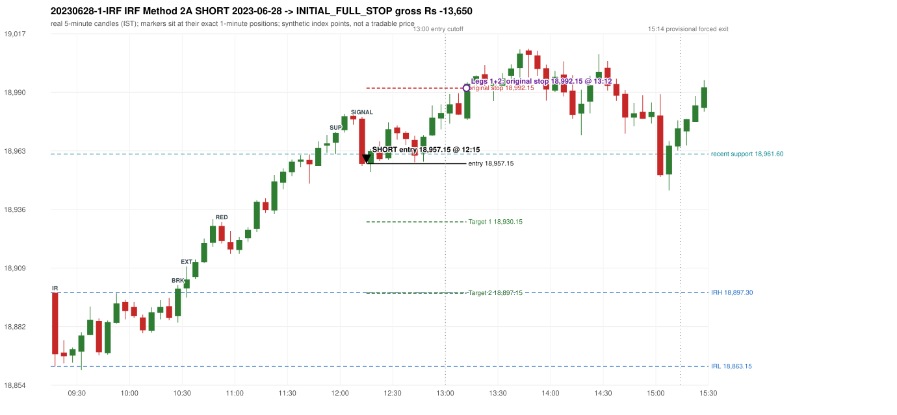

# Trading journal - 2023-06-28 (Wednesday)

> Phase 4 historical validation, window B (Window B 2022-09-01..2025-08-31 (5paisa minutes); status DATA_VALIDATED). The FROZEN Phase 3.6 configuration (IRF, ORB, PDR body-based, PDS, RF; shared controller) on a different data source. HISTORICAL RESEARCH ONLY: the strategy was developed using later data. same provider as the Phase 3.6 baseline; the vendor-overlap audit shows the minute bars differ from the secondary vendor Synthetic NIFTY 50 index-point P&L (the index is not tradable). The owner's review status is intentionally blank.

## A. Trading day overview

| item | value |
|---|---|
| Date / weekday | 2023-06-28 / Wednesday |
| Session type | USABLE_WITH_FLAGS / VALID |
| Original session open (first 1-minute open) | 18,897.30 |
| Previous session | 2023-06-27 |
| Previous-day high / low (wicks included) | 18,829.15 / 18,714.50 |
| Previous-day highest BODY high (the body-based PDR ceiling; wicks ignored) | 18,825.45 |
| Previous-day official close / last 5-minute close | 18,817.40 / 18,819.45 |
| Raw engine records / confirmed signals / fully valid signals | 6 / 3 / 3 |
| Setups that did not complete (invalidated / incomplete) | 3 |
| Executed trades | 1 20230628-1-IRF |
| Gross P&L (Rs, synthetic) | -13,650.00 |
| Illustrative net P&L (Rs; Rs 500/trade + 0.5 pt/fill) | -14,540.00 |
| Day-end portfolio status | SECOND_TRADE_ELIGIBLE |
| Manual journal trades (matched / unmatched) | 0 (0 / 0) |
| Extra automated trades | 0 |

## B. Daily strategy signal timeline (confirmed signals, chronological)

| time | strategy | method | dir | entry-rule status | valid for execution | <= 13:00 | portfolio state | accepted / ignored | specific reason | competing (same minute) |
|---|---|---|---|---|---|---|---|---|---|---|
| 12:15 | IRF | Method 2A | SHORT | PROPOSAL_DEPENDENT | True | True | FIRST_TRADE_ACTIVE | ACCEPTED -> 20230628-1-IRF | first eligible signal of the day; trade 1: INITIAL_FULL_STOP |  |
| 14:15 | IRF | Method 2A | SHORT | PROPOSAL_DEPENDENT | True | False | SECOND_TRADE_ELIGIBLE | REJECTED | SECOND_TRADE_RESTRICTED_TO_PDR_PDS [blocked by IRF#1] |  |
| 15:05 | IRF | Method 2A | SHORT | PROPOSAL_DEPENDENT | True | False | SECOND_TRADE_ELIGIBLE | REJECTED | SECOND_TRADE_RESTRICTED_TO_PDR_PDS [blocked by IRF#1] |  |

Engine setups that did not complete (3); the complete list with failed rule ids is in `rejected_signals.csv`:

| candle | strategy | method | dir | status | precise reason | failed rules |
|---|---|---|---|---|---|---|
| 15:00 | IRF | Method 1/2 | SHORT | INCOMPLETE_AT_EOD | SESSION_ENDED_BEFORE_CONFIRMATION |  |
| 09:15 | ORB | Method 1 | LONG | INVALIDATED | CANDLE_QUALITY(not a strong body / wick too large) | ORB-M1-LONG-003 |
| 09:15 | ORB | Method 2 | LONG | INVALIDATED | CANDLE_QUALITY | ORB-M2-LONG-003 |

## C. Detailed trade journals

### 20230628-1-IRF: IRF Method 2A SHORT (FIRST trade)

Chart: 

**Rule configuration:** CFG-phase36_body_based-866f954e55 - signal verification status **PROPOSAL_DEPENDENT** (never VERIFIED while a rule rests on a proposal).

#### 1. Setup identification

IRF Method 2A SHORT: the 10:25-10:30 candle closed at 18,899.20, above IRH 18,897.30, and the next candle did not close back inside the range, so the setup is Method 2 and price stayed above it until the trigger. Extension candle 10:30-10:35, red candle 10:50-10:55. The trigger came 21 candles after the breakout candle: a completed candle closed below the recent pullback-low support (12:10-12:15); confirmed at 12:15 with close 18,957.00. Entry reference close 18,957.00 is 59.70 points above IRH 18,897.30.

#### 2. Candle and indicator calculations

| role | session | candle | O | H | L | C | range | body % | upper wick % | lower wick % | direction | EMA(200) | strong bull / bear | pin bull / bear | small (body<=30%) | used for |
|---|---|---|---|---|---|---|---|---|---|---|---|---|---|---|---|---|
| initial_range_candle | TODAY | 09:15-09:20 | 18,897.30 | 18,897.30 | 18,863.15 | 18,868.80 | 34.15 | 83.46 | 0.00 | 16.54 | BEARISH | 18,737.03 | False / True | False / False | False | initial range = high/low of the 09:15 candle |
| signal_candle | TODAY | 12:10-12:15 | 18,978.00 | 18,978.85 | 18,956.10 | 18,957.00 | 22.75 | 92.31 | 3.74 | 3.96 | BEARISH | 18,791.95 | False / True | False / False | False | candle whose close completed the trigger |
| breakout_candle | TODAY | 10:25-10:30 | 18,886.55 | 18,900.85 | 18,883.50 | 18,899.20 | 17.35 | 72.91 | 9.51 | 17.58 | BULLISH | 18,756.18 | True / False | False / False | False | breakout candle: a completed candle closing above IRH |
| extension_candle | TODAY | 10:30-10:35 | 18,899.35 | 18,909.55 | 18,895.10 | 18,903.50 | 14.45 | 28.72 | 41.87 | 29.41 | BULLISH | 18,757.64 | False / False | False / False | True | extension: first later candle trading above the breakout candle's high |
| red_candle | TODAY | 10:50-10:55 | 18,928.25 | 18,930.15 | 18,920.15 | 18,921.25 | 10.00 | 70.00 | 19.00 | 11.00 | BEARISH | 18,764.03 | False / True | False / False | False | first red candle during the extension |
| support_pivot | TODAY | 11:55-12:00 | 18,966.85 | 18,971.70 | 18,961.60 | 18,971.40 | 10.10 | 45.05 | 2.97 | 51.98 | BULLISH | 18,786.49 | False / False | False / False | False | recent support: latest 3-candle fractal low formed after the breakout |

Every condition, with the rule, the calculation, the observed values and the result:

| # | group | rule | result | status / numeric definition | calculation | observed | required | available at | why it matters |
|---|---|---|---|---|---|---|---|---|---|
| 1 | SELECTION | SEL-FIRST-001 | PASS | USER_APPROVED / USER_APPROVED | earliest CONFIRMED signal of the day across IRF/ORB/PDR/PDS/RF that passed the controller's checks | 0 confirmed signal(s) earlier today; 3 confirmed signals in the day in total, this one at 12:15 | no earlier executable signal | 2023-06-28 12:15 | the shared controller trades only the first valid signal; the five strategies are not independent positions |
| 2 | SELECTION | SEL-TIE-001 | PASS | USER_APPROVED / USER_APPROVED | other CONFIRMED signals with exactly the same confirmation timestamp | none | no different-strategy / opposite-direction signal in the same minute (otherwise an unresolved conflict, no trade) | 2023-06-28 12:15 | an unresolved same-minute collision would have produced no trade at all |
| 3 | SELECTION | ENTRY-CUTOFF-001 | PASS | USER_APPROVED / USER_APPROVED | fill timestamp vs 13:00:00 IST | signal confirmed 12:15; fill 12:15 | fill at or before 13:00:00 IST | 2023-06-28 12:15 | no new position may be entered with a fill after 13:00 IST |
| 4 | SELECTION | EXE-FILL-001 | PASS | PROPOSED_FOR_REVIEW / PROPOSED_FOR_REVIEW | fill = open of the 1-minute bar that starts at the signal candle's end | bar 12:15 O 18,957.15 H 18,957.35 L 18,953.35 C 18,953.90; executable=True; entry 18,957.15 | fill bar exists, starts exactly at the signal end, is fillable; entry = its open | 2023-06-28 12:15 | a 5-minute signal is known only when its candle closes; the first price that can be traded is the next minute's open |
| 5 | SELECTION | DAY-MAX-001 | PASS | USER_APPROVED / USER_APPROVED | number of entries today | trade 1 of at most 2 | <= 2 entries per day | 2023-06-28 12:15 | daily trade cap |
| 6 | SETUP | IRF-GLOBAL-001 | PASS | SOURCE_VERIFIED / EXPLICIT_IN_SOURCE | initial range = high and low (wicks included) of the first completed 5-minute candle | 09:15-09:20 IRH 18,897.30, IRL 18,863.15 (range 34.15; engine recorded IRH 18,897.30, IRL 18,863.15) | high/low of the 09:15-09:20 candle | 2023-06-28 09:20 | all three IRF methods measure price against this range |
| 7 | SETUP | IRF-GLOBAL-003 | PASS | SOURCE_VERIFIED / EXPLICIT_IN_SOURCE | closes confirm, wicks do not: every trigger is evaluated on a completed 5-minute candle | trigger candle 12:10-12:15 was complete when the signal was stamped 12:15; decision uses its close 18,957.00 | completed candle close, not an intra-candle wick | 2023-06-28 12:15 | an intra-candle wick can reverse before the candle closes |
| 8 | SETUP | IRF-GLOBAL-002 | PASS | SOURCE_VERIFIED / EXPLICIT_IN_SOURCE | direction | SHORT (IRF trades short only) | short only | 2023-06-28 12:15 | IRF fades failed upside breakouts |
| 9 | SETUP | IRF-M2-001 | PASS | SOURCE_VERIFIED / EXPLICIT_IN_SOURCE | breakout candle close vs IRH | 10:25-10:30 O 18,886.55 H 18,900.85 L 18,883.50 C 18,899.20; range 17.35, body 12.65 (72.91%), upper wick 1.65 (9.51%), lower wick 3.05 (17.58%), bullish; close 18,899.20 is 1.90 points above IRH 18,897.30 | close > IRH (a wick above IRH is not a breakout) | 2023-06-28 10:30 | starts every IRF setup |
| 10 | SETUP | IRF-M2-004 | PASS | SOURCE_VERIFIED / EXPLICIT_IN_SOURCE | the candle after the breakout must NOT close back inside the range (else the setup is Method 1) | 10:30 close 18,903.50 vs [18,863.15, 18,897.30) | not (IRL <= close < IRH) | 2023-06-28 10:35 | separates Method 2 (price holds above) from Method 1 (immediate failure) |
| 11 | SETUP | IRF-M2-002 | PASS | SOURCE_VERIFIED / QUALITATIVE_SOURCE_NUMERIC_DEFINITION_PROPOSED_FOR_REVIEW | extension = a later candle whose high exceeds the breakout candle's high (research definition E1) | 10:30 high 18,909.55 vs breakout candle high 18,900.85 (+8.70) | high > breakout candle high | 2023-06-28 10:35 | the guide says price 'extends further upward'; the numeric test is a proposal |
| 12 | SETUP | IRF-M2-003 | PASS | SOURCE_VERIFIED / QUALITATIVE_SOURCE_NUMERIC_DEFINITION_PROPOSED_FOR_REVIEW | a red candle (close < open) forms after the extension | 10:50-10:55 O 18,928.25 H 18,930.15 L 18,920.15 C 18,921.25; range 10.00, body 7.00 (70.00%), upper wick 1.90 (19.00%), lower wick 1.10 (11.00%), bearish | close < open, at or after the candle following the extension | 2023-06-28 10:55 | the red candle shows the first pause/reversal inside the extension |
| 13 | CONFIRMATION | IRF-M2A-001 | PASS | SOURCE_VERIFIED / QUALITATIVE_SOURCE_NUMERIC_DEFINITION_PROPOSED_FOR_REVIEW | recent support = latest 3-candle fractal low (k=1) among candles b+1 ... i-2 | 11:55 low 18,961.60; neighbours' lows 18,962.15 (11:50) and 18,971.55 (12:00) are not lower; engine recorded support 18,961.60 | pivot low known before the trigger candle | 2023-06-28 12:05 | the support is the level whose break completes Method 2A (the exact 'pullback low' definition is a proposal) |
| 14 | CONFIRMATION | IRF-M2A-002 | PASS | SOURCE_VERIFIED / EXPLICIT_WORDING_DETAIL_PROPOSED_FOR_REVIEW | trigger candle closes below recent support | 12:10 close 18,957.00 vs support 18,961.60: 4.60 points below | close < support (close, not wick) | 2023-06-28 12:15 | completes Method 2A |
| 15 | CONFIRMATION | IRF-M2-005 | PASS | SOURCE_VERIFIED / EXPLICIT_IN_SOURCE | chronology: the red candle precedes the break candle | red candle 10:50, break candle 12:10 | red candle index < break candle index (m2a_break_may_be_red_candle = False) | 2023-06-28 12:15 | a red candle alone is not confirmation; a level break is required |
| 16 | EXECUTION | EXE-STOP-001 | PASS | USER_APPROVED / USER_APPROVED | initial stop = entry + 35 points | entry 18,957.15 -> stop 18,992.15 | stop 35 index points (BASELINE) | 2023-06-28 12:15 | defines the loss if the setup fails before Target 1 |
| 17 | EXECUTION | EXE-T1-001 | PASS | SOURCE_VERIFIED / EXPLICIT_IN_SOURCE | Target 1 = entry +/- 27 points | T1 18,930.15 | 27 points | 2023-06-28 12:15 | Leg 1 (3 lots) is booked at Target 1 |
| 18 | EXECUTION | IRF-TGT-001 | PASS | SOURCE_VERIFIED / EXPLICIT_IN_SOURCE | Target 2 = entry +/- 60 points | T2 18,897.15 | 60 points | 2023-06-28 12:15 | Leg 2 (3 lots) is booked at Target 2 |
| 19 | EXECUTION | POST-T1-STOP-006 | PASS | USER_APPROVED / USER_APPROVED | after T1 the Leg-2 stop = entry + 6 (no trailing) | post-T1 stop 18,963.15 | entry -6 (LONG) / +6 (SHORT) | 2023-06-28 12:15 | protects the remaining three lots once the first three are booked |
| 20 | EXECUTION | SIZE-LOT-001 | PASS | USER_APPROVED / USER_APPROVED | 6 lots x 65 = 390, Leg 1 = 3 lots = 195, Leg 2 = 195 | 6 lots, lot size 65, legs 3+3 | 6 lots in two equal legs | 2023-06-28 12:15 | position size for the synthetic P&L |
| 21 | NOTE | IRF-M2-006 | UNRESOLVED | UNRESOLVED / UNRESOLVED | delay between the breakout candle and this trigger; expiry rule | 21 candles after the breakout; expiry none configured | the source states no expiry | 2023-06-28 12:15 | an old breakout can still trigger hours later |
| 22 | NOTE | IRF-M2-006 | UNRESOLVED | UNRESOLVED / UNRESOLVED | did price stay above IRH between the breakout and the trigger? | 0 closes at or below IRH between 10:30 and 12:10; trigger close 18,957.00 above IRH 18,897.30 | the engine does not require price to stay above IRH | 2023-06-28 12:15 | the guide describes price 'holding above IRH and keeping rising'; the code only needs the level break |
| 23 | NOTE | IRF-GLOBAL-004 | UNRESOLVED | UNRESOLVED / UNRESOLVED | which close above IRH of the session produced this attempt; repeat setups | this breakout is upward crossing no. 1 of the session (a close above IRH after a close at/below it) | the source states no first-breakout-only, re-arming, expiry or trades-per-day rule | 2023-06-28 12:15 | IRF re-arms on every later breakout in the code, producing many raw setups; the controller keeps only the first |
| 24 | NOTE | NOTE-IRF-REPEATED-SETUPS | NOT_APPLICABLE | NOT_A_RULE / NOT_A_REGISTRY_RULE | other IRF signals later in the session (not traded) | 2 further confirmed IRF signal(s): Method 2A@14:15, Method 2A@15:05 | disclosure of repeated raw setups | 2023-06-28 12:15 | repeated raw IRF setups are not hidden; they are logged as ignored |
| 25 | NOTE | IRF-SL-001 | NOT_APPLICABLE | SOURCE_VERIFIED / QUALITATIVE_SOURCE_NUMERIC_DEFINITION_PROPOSED_FOR_REVIEW | the guide's 35-or-40 rule: 35 if the most recent green candle's high is within 35 points of entry, else 40 | most recent green candle high 18,980.15 is 23.00 points from the entry 18,957.15: the guide's rule would select 35 points; the baseline applies a fixed 35 (USER_APPROVED research baseline; the 35-vs-40 selection and the 40-point variant are separate labelled scenarios) | source selection rule | 2023-06-28 12:15 | the stop distance is a modelling choice and changes losses, not entries |
| 26 | NOTE | NOTE-UNRESOLVED-DEPENDENCIES | UNRESOLVED | NOT_A_RULE / NOT_A_REGISTRY_RULE | rules the signal depends on that the sources leave unresolved | engine-recorded unresolved rule ids: IRF-GLOBAL-004; verification status PROPOSAL_DEPENDENT | n/a (disclosure) | 2023-06-28 12:15 | the entry is only as verified as the rules it rests on |

#### 3. Entry decision and explanation

IRF Method 2A SHORT: the 10:25-10:30 candle closed at 18,899.20, above IRH 18,897.30, and the next candle did not close back inside the range, so the setup is Method 2 and price stayed above it until the trigger. Extension candle 10:30-10:35, red candle 10:50-10:55. The trigger came 21 candles after the breakout candle: a completed candle closed below the recent pullback-low support (12:10-12:15); confirmed at 12:15 with close 18,957.00. Entry reference close 18,957.00 is 59.70 points above IRH 18,897.30.

**Why this trade ahead of the other strategies:** This IRF Method 2A signal was the earliest executable signal of the day: 0 confirmed signal(s) earlier, 0 other in the same minute. 2 later confirmed signal(s) (IRF x2) are logged as ignored or rejected. State of the other four engines at that moment: [ORB: Method 1 invalidated at 09:15: CANDLE_QUALITY(not a strong body / wick too large); Method 2 invalidated at 09:15: CANDLE_QUALITY] [PDR: no setup record before this time (a base condition was not met, or nothing triggered)] [PDS: no setup record before this time (a base condition was not met, or nothing triggered)] [RF: no setup record before this time (a base condition was not met, or nothing triggered)]

#### 4. Actual entry execution

| item | value |
|---|---|
| Signal candle | 12:10-12:15 |
| Signal confirmed | 2023-06-28 12:15 |
| Fill timestamp | 2023-06-28 12:15 |
| Entry price | 18,957.15 |
| Source partition / 1-minute bar | data/phase4/processed/FIVEPAISA_1M_PHASE4/nifty50/year=2023/month=06/candles.parquet / 2023-06-28 12:15 |
| Source bar O / H / L / C | 18,957.15 / 18,957.35 / 18,953.35 / 18,953.90 |
| Fill assumption | open of the 1-minute bar starting at the signal candle's end (EXE-FILL-001, PROPOSED causal convention) |
| Initial stop / T1 / T2 / post-T1 stop | 18,992.15 / 18,930.15 / 18,897.15 / 18,963.15 |
| Position | 6 lots x 65 = 390 units (Leg 1 195, Leg 2 195) |

#### 5-8. Trade progress, Target 1, post-T1 stop and final exit

Between the 12:15 entry bar and the final exit (58 one-minute bars) the best excursion in favour was 3.80 points at 12:15 and the worst against was 35.30 points at 13:12. At 13:12 price reached the original stop 18,992.15 before Target 1 18,930.15, so all six lots exited together at 18,992.15. This is an INITIAL_FULL_STOP: one more trade is allowed that day, only a newly confirmed PDR/PDS signal.

| leg | qty | exit time | exit price | reason | source 1-minute bar | O / H / L / C | gross points | gross Rs | slippage pts | flags |
|---|---|---|---|---|---|---|---|---|---|---|
| 1 | 195 | 13:12 | 18,992.15 | ORIGINAL_STOP_BEFORE_T1 | 13:12 | 18,989.25 / 18,992.45 / 18,988.65 / 18,991.10 | -35.00 | -6,825.00 | 0.00 |  |
| 2 | 195 | 13:12 | 18,992.15 | ORIGINAL_STOP_BEFORE_T1 | 13:12 | 18,989.25 / 18,992.45 / 18,988.65 / 18,991.10 | -35.00 | -6,825.00 | 0.00 |  |

Exit evidence per leg:

* Leg 1: 1-minute bar 13:12 O 18,989.25 H 18,992.45 L 18,988.65 C 18,991.10: high 18,992.45 reached the original stop 18,992.15 before Target 1 18,930.15 was touched; both legs exit at the stop level 18,992.15
* Leg 2: 1-minute bar 13:12 O 18,989.25 H 18,992.45 L 18,988.65 C 18,991.10: high 18,992.45 reached the original stop 18,992.15 before Target 1 18,930.15 was touched; both legs exit at the stop level 18,992.15

#### 9. Gross and illustrative net P&L

| item | value (Rs) |
|---|---|
| Leg 1 gross | -6,825.00 |
| Leg 2 gross | -6,825.00 |
| Trade gross (= Leg 1 + Leg 2) | -13,650.00 |
| Illustrative fixed cost | -500.00 |
| Illustrative slippage (0.5 pt on every fill, entry + exits, all units) | -390.00 |
| Illustrative net | -14,540.00 |

#### 10. Manual journal comparison

No manual journal exists for this period; no comparison.

## D. Manual journal comparison

No manual journal exists for this period (the manual journal covers 2025-09-01 .. 2026-08-31 only); no comparison is made and no automated trade is labelled 'extra'.

## E. Daily conclusion

* **Traded:** 20230628-1-IRF - IRF Method 2A SHORT at 12:15 (entry 18,957.15), outcome INITIAL_FULL_STOP, gross Rs -13,650.00, illustrative net Rs -14,540.00. **Why:** This IRF Method 2A signal was the earliest executable signal of the day: 0 confirmed signal(s) earlier, 0 other in the same minute. 2 later confirmed signal(s) (IRF x2) are logged as ignored or rejected. State of the other four engines at that moment: [ORB: Method 1 invalidated at 09:15: CANDLE_QUALITY(not a strong body / wick too large); Method 2 invalidated at 09:15: CANDLE_QUALITY] [PDR: no setup record before this time (a base condition was not met, or nothing triggered)] [PDS: no setup record before this time (a base condition was not met, or nothing triggered)] [RF: no setup record before this time (a base condition was not met, or nothing triggered)] **How it ended:** At 13:12 price reached the original stop 18,992.15 before Target 1 18,930.15, so all six lots exited together at 18,992.15. This is an INITIAL_FULL_STOP: one more trade is allowed that day, only a newly confirmed PDR/PDS signal.
* **Ignored / rejected signals:** IRF REJECTED SECOND_TRADE_RESTRICTED_TO_PDR_PDS x2
* **Open strategy-definition issues that affected this day:** IRF-GLOBAL-004 (NOT STATED: how many IRF trades per day, a latest entry time, and whether a new breakout may re-arm a setup after a signal), IRF-M2-006 (How long a Method 2 setup stays valid (expiry / invalidation before a level breaks) is not stated), NOTE-UNRESOLVED-DEPENDENCIES
* **Automated triage (not an approval; the owner's review status stays blank):** TRADED_NO_FLAGS
