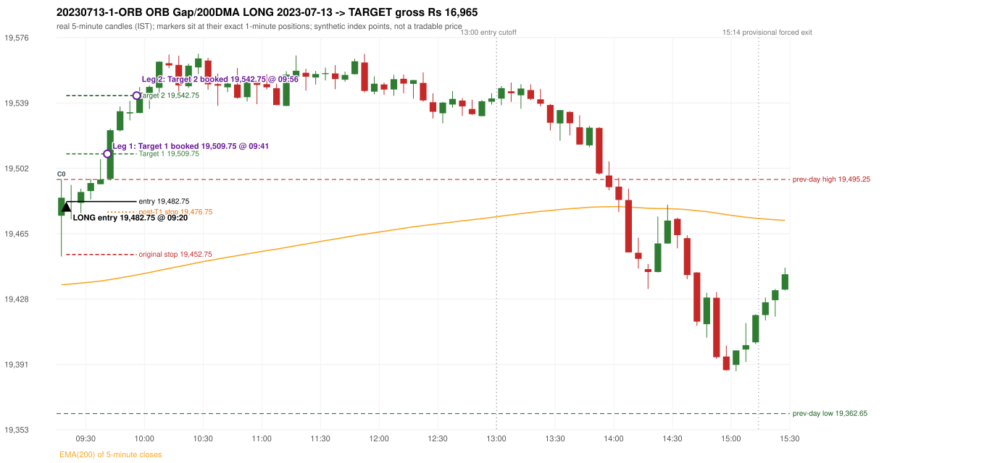

# Trading journal - 2023-07-13 (Thursday)

> Phase 4 historical validation, window B (Window B 2022-09-01..2025-08-31 (5paisa minutes); status DATA_VALIDATED). The FROZEN Phase 3.6 configuration (IRF, ORB, PDR body-based, PDS, RF; shared controller) on a different data source. HISTORICAL RESEARCH ONLY: the strategy was developed using later data. same provider as the Phase 3.6 baseline; the vendor-overlap audit shows the minute bars differ from the secondary vendor Synthetic NIFTY 50 index-point P&L (the index is not tradable). The owner's review status is intentionally blank.

## A. Trading day overview

| item | value |
|---|---|
| Date / weekday | 2023-07-13 / Thursday |
| Session type | USABLE_WITH_FLAGS / VALID |
| Original session open (first 1-minute open) | 19,474.70 |
| Previous session | 2023-07-12 |
| Previous-day high / low (wicks included) | 19,495.25 / 19,362.65 |
| Previous-day highest BODY high (the body-based PDR ceiling; wicks ignored) | 19,495.25 |
| Previous-day official close / last 5-minute close | 19,384.30 / 19,382.60 |
| Raw engine records / confirmed signals / fully valid signals | 10 / 6 / 6 |
| Setups that did not complete (invalidated / incomplete) | 4 |
| Executed trades | 1 20230713-1-ORB |
| Gross P&L (Rs, synthetic) | 16,965.00 |
| Illustrative net P&L (Rs; Rs 500/trade + 0.5 pt/fill) | 16,075.00 |
| Day-end portfolio status | DAY_FINISHED |
| Manual journal trades (matched / unmatched) | 0 (0 / 0) |
| Extra automated trades | 0 |

## B. Daily strategy signal timeline (confirmed signals, chronological)

| time | strategy | method | dir | entry-rule status | valid for execution | <= 13:00 | portfolio state | accepted / ignored | specific reason | competing (same minute) |
|---|---|---|---|---|---|---|---|---|---|---|
| 09:20 | ORB | Gap/200DMA | LONG | RESEARCH_VARIANT | True | True | FIRST_TRADE_ACTIVE | ACCEPTED -> 20230713-1-ORB | first eligible signal of the day; trade 1: TARGET |  |
| 10:35 | IRF | Method 2B | SHORT | PROPOSAL_DEPENDENT | True | True | DAY_FINISHED | IGNORED | DAY_FINISHED [blocked by ORB#1] |  |
| 11:25 | IRF | Method 2B | SHORT | PROPOSAL_DEPENDENT | True | True | DAY_FINISHED | IGNORED | DAY_FINISHED [blocked by ORB#1] |  |
| 11:55 | IRF | Method 2A | SHORT | PROPOSAL_DEPENDENT | True | True | DAY_FINISHED | IGNORED | DAY_FINISHED [blocked by ORB#1] | IRF Method 2B SHORT |
| 11:55 | IRF | Method 2B | SHORT | PROPOSAL_DEPENDENT | True | True | DAY_FINISHED | IGNORED | DAY_FINISHED [blocked by ORB#1] | IRF Method 2A SHORT |
| 14:00 | IRF | Method 1 | SHORT | PROPOSAL_DEPENDENT | True | False | DAY_FINISHED | IGNORED | DAY_FINISHED [blocked by ORB#1] |  |

Engine setups that did not complete (4); the complete list with failed rule ids is in `rejected_signals.csv`:

| candle | strategy | method | dir | status | precise reason | failed rules |
|---|---|---|---|---|---|---|
| 11:50 | IRF | Method 1/2 | SHORT | INCOMPLETE_AT_EOD | SESSION_ENDED_BEFORE_CONFIRMATION |  |
| 09:15 | ORB | Method 2 | LONG | INVALIDATED | TREND:EMA_PREV_SESSION_CLOSE wrong side | ORB-TREND-001;ORB-TREND-002 |
| 09:15 | PDR | PDR | LONG | INVALIDATED | OPEN_NOT_STRICTLY_ABOVE_ZONE |  |
| 14:20 | RF | RF | LONG | INVALIDATED | TREND:EMA_PREV_SESSION_CLOSE wrong side | RF-001;RF-008 |

## C. Detailed trade journals

### 20230713-1-ORB: ORB Gap/200DMA LONG (FIRST trade)

Chart: 

**Rule configuration:** CFG-phase36_body_based-866f954e55 - signal verification status **RESEARCH_VARIANT** (never VERIFIED while a rule rests on a proposal).

#### 1. Setup identification

ORB Gap/200 DMA LONG: the open 19,474.70 gapped +90.40 points from the previous close 19,384.30, through the EMA(200) (19,435.10 -> 19,435.59); the first candle closed at 19,484.90, beyond the average; its body occupied 23.26% of its range and its upper wick 24.06% (thresholds 60% / 20%): the strong-candle test FAILED; the candle was admitted through the conditional PIN-BAR alternative instead (the lower wick 23.10 points is 2.26 x the body, required 2x; the close is 24.06% of the range from the high, allowed 30%). The 'excessively extended' filter has no numeric definition and was not applied.

#### 2. Candle and indicator calculations

| role | session | candle | O | H | L | C | range | body % | upper wick % | lower wick % | direction | EMA(200) | strong bull / bear | pin bull / bear | small (body<=30%) | used for |
|---|---|---|---|---|---|---|---|---|---|---|---|---|---|---|---|---|
| first_candle | TODAY | 09:15-09:20 | 19,474.70 | 19,495.45 | 19,451.60 | 19,484.90 | 43.85 | 23.26 | 24.06 | 52.68 | BULLISH | 19,435.59 | False / False | True / False | True | the 09:15 first five-minute candle - the ORB decision candle |
| prev_session_last_candle | PREVIOUS | 15:25-15:30 | 19,372.65 | 19,386.50 | 19,362.65 | 19,382.60 | 23.85 | 41.72 | 16.35 | 41.93 | BULLISH | 19,435.10 | False / False | False / False | False | previous session's last candle: the EMA(200) before the gap |

Every condition, with the rule, the calculation, the observed values and the result:

| # | group | rule | result | status / numeric definition | calculation | observed | required | available at | why it matters |
|---|---|---|---|---|---|---|---|---|---|
| 1 | SELECTION | SEL-FIRST-001 | PASS | USER_APPROVED / USER_APPROVED | earliest CONFIRMED signal of the day across IRF/ORB/PDR/PDS/RF that passed the controller's checks | 0 confirmed signal(s) earlier today; 6 confirmed signals in the day in total, this one at 09:20 | no earlier executable signal | 2023-07-13 09:20 | the shared controller trades only the first valid signal; the five strategies are not independent positions |
| 2 | SELECTION | SEL-TIE-001 | PASS | USER_APPROVED / USER_APPROVED | other CONFIRMED signals with exactly the same confirmation timestamp | none | no different-strategy / opposite-direction signal in the same minute (otherwise an unresolved conflict, no trade) | 2023-07-13 09:20 | an unresolved same-minute collision would have produced no trade at all |
| 3 | SELECTION | ENTRY-CUTOFF-001 | PASS | USER_APPROVED / USER_APPROVED | fill timestamp vs 13:00:00 IST | signal confirmed 09:20; fill 09:20 | fill at or before 13:00:00 IST | 2023-07-13 09:20 | no new position may be entered with a fill after 13:00 IST |
| 4 | SELECTION | EXE-FILL-001 | PASS | PROPOSED_FOR_REVIEW / PROPOSED_FOR_REVIEW | fill = open of the 1-minute bar that starts at the signal candle's end | bar 09:20 O 19,482.75 H 19,484.15 L 19,472.75 C 19,475.65; executable=True; entry 19,482.75 | fill bar exists, starts exactly at the signal end, is fillable; entry = its open | 2023-07-13 09:20 | a 5-minute signal is known only when its candle closes; the first price that can be traded is the next minute's open |
| 5 | SELECTION | DAY-MAX-001 | PASS | USER_APPROVED / USER_APPROVED | number of entries today | trade 1 of at most 2 | <= 2 entries per day | 2023-07-13 09:20 | daily trade cap |
| 6 | SETUP | ORB-GLOBAL-001 | PASS | SOURCE_VERIFIED / EXPLICIT_IN_SOURCE | decision is taken once the first 5-minute candle (09:15-09:20) has closed | candle 09:15-09:20; signal confirmed 09:20 | decision at 09:20, never before the close | 2023-07-13 09:20 | the close of the first candle is unknown before 09:20 |
| 7 | SETUP | ORB-GLOBAL-002 | PASS | SOURCE_VERIFIED / EXPLICIT_IN_SOURCE | direction | LONG | same rules in both directions | 2023-07-13 09:20 | ORB trades the side of the break |
| 8 | SETUP | ORB-GLOBAL-004 | PASS | SOURCE_VERIFIED / QUALITATIVE_SOURCE_NUMERIC_DEFINITION_PROPOSED_FOR_REVIEW | entry at 09:20, after the first-candle close | signal confirmed 09:20; fill 09:20 at the open of that minute | 09:20 entry | 2023-07-13 09:20 | the guide enters at 9:20; the fill price convention (next minute open) is a proposal |
| 9 | SETUP | ORB-GAP-LONG-001 | PASS | SOURCE_VERIFIED / EXPLICIT_WORDING_DETAIL_PROPOSED_FOR_REVIEW | gap = first 1-minute open of today - previous session's OFFICIAL close | today's open 19,474.70 (first 1-minute bar 09:15) - previous close 19,384.30 (DAILY_VENDOR, 2023-07-12) = +90.40 points -> gap UP | gap UP (more than 0 points) | 2023-07-13 09:15 | approved convention: the original first-minute open, never the vendor daily open |
| 10 | SETUP | ORB-GAP-LONG-002 | PASS | SOURCE_VERIFIED / QUALITATIVE_SOURCE_NUMERIC_DEFINITION_PROPOSED_FOR_REVIEW | the gap carries the open through the moving average (EMA200_5M: EMA(200) of 5-minute closes) | previous close 19,384.30 < previous-session EMA 19,435.10; today's open 19,474.70 > today's first-candle EMA 19,435.59 (engine recorded 19,435.59 / 19,435.10) | previous close on one side, open on the other | 2023-07-13 09:20 | the Gap/200 DMA setup needs the gap to push price through the MA (the source text vs figures is a documented conflict: ORB-MA-001) |
| 11 | CONFIRMATION | ORB-GAP-LONG-003 | PASS | SOURCE_VERIFIED / EXPLICIT_IN_SOURCE | first candle closes beyond the moving average | close 19,484.90 vs EMA 19,435.59: 49.31 points above | close above (long) / below (short) the MA | 2023-07-13 09:20 | a candle that only crosses the line does not qualify |
| 12 | CONFIRMATION | ORB-GAP-LONG-004 | PASS | SOURCE_VERIFIED / QUALITATIVE_SOURCE_NUMERIC_DEFINITION_PROPOSED_FOR_REVIEW | candle quality (strong body or pin bar) and no strong rejection wick | 09:15-09:20 O 19,474.70 H 19,495.45 L 19,451.60 C 19,484.90; range 43.85, body 10.20 (23.26%), upper wick 10.55 (24.06%), lower wick 23.10 (52.68%), bullish. Strong-bullish test: bullish close, body >= 60% (observed 23.26%), upper wick <= 20% (observed 24.06%) -> not met; pin-bar alternative: wick >= 2 x body and close within the favourable 30% -> met; rejection wick 24.06% vs limit 33% | strong body or pin bar, and the rejection wick below the limit | 2023-07-13 09:20 | the thresholds are proposals |
| 13 | EXECUTION | ORB-GLOBAL-003 | PASS | SOURCE_VERIFIED / EXPLICIT_IN_SOURCE | initial stop = entry - 30 points | entry 19,482.75 -> stop 19,452.75 | stop 30 index points (BASELINE) | 2023-07-13 09:20 | defines the loss if the setup fails before Target 1 |
| 14 | EXECUTION | EXE-T1-001 | PASS | SOURCE_VERIFIED / EXPLICIT_IN_SOURCE | Target 1 = entry +/- 27 points | T1 19,509.75 | 27 points | 2023-07-13 09:20 | Leg 1 (3 lots) is booked at Target 1 |
| 15 | EXECUTION | ORB-GLOBAL-003 | PASS | SOURCE_VERIFIED / EXPLICIT_IN_SOURCE | Target 2 = entry +/- 60 points | T2 19,542.75 | 60 points | 2023-07-13 09:20 | Leg 2 (3 lots) is booked at Target 2 |
| 16 | EXECUTION | POST-T1-STOP-006 | PASS | USER_APPROVED / USER_APPROVED | after T1 the Leg-2 stop = entry - 6 (no trailing) | post-T1 stop 19,476.75 | entry -6 (LONG) / +6 (SHORT) | 2023-07-13 09:20 | protects the remaining three lots once the first three are booked |
| 17 | EXECUTION | SIZE-LOT-001 | PASS | USER_APPROVED / USER_APPROVED | 6 lots x 65 = 390, Leg 1 = 3 lots = 195, Leg 2 = 195 | 6 lots, lot size 65, legs 3+3 | 6 lots in two equal legs | 2023-07-13 09:20 | position size for the synthetic P&L |
| 18 | NOTE | ORB-MA-001 | UNRESOLVED | CONFLICTING / CONFLICTING | which moving average the code uses | EMA(200) of 5-minute closes (the guide says '200 DMA' in some places and '200 EMA' in others); active ma_mode EMA200_5M | the source terminology conflicts | 2023-07-13 09:20 | a daily 200 DMA would give different values |
| 19 | NOTE | ORB-GAP-LONG-005 | UNRESOLVED | UNRESOLVED / UNRESOLVED | 'excessively extended' opening move | gap +90.40 points; maximum gap configured: None | the source gives no number, so no limit is applied | 2023-07-13 09:20 | a very large gap would be rejected by a human; the engine has no defined limit |
| 20 | NOTE | NOTE-UNRESOLVED-DEPENDENCIES | UNRESOLVED | NOT_A_RULE / NOT_A_REGISTRY_RULE | rules the signal depends on that the sources leave unresolved | engine-recorded unresolved rule ids: ORB-MA-001, ORB-GAP-LONG-005; verification status RESEARCH_VARIANT | n/a (disclosure) | 2023-07-13 09:20 | the entry is only as verified as the rules it rests on |

#### 3. Entry decision and explanation

ORB Gap/200 DMA LONG: the open 19,474.70 gapped +90.40 points from the previous close 19,384.30, through the EMA(200) (19,435.10 -> 19,435.59); the first candle closed at 19,484.90, beyond the average; its body occupied 23.26% of its range and its upper wick 24.06% (thresholds 60% / 20%): the strong-candle test FAILED; the candle was admitted through the conditional PIN-BAR alternative instead (the lower wick 23.10 points is 2.26 x the body, required 2x; the close is 24.06% of the range from the high, allowed 30%). The 'excessively extended' filter has no numeric definition and was not applied.

**Why this trade ahead of the other strategies:** This ORB Gap/200DMA signal was the earliest executable signal of the day: 0 confirmed signal(s) earlier, 0 other in the same minute. 5 later confirmed signal(s) (IRF x5) are logged as ignored or rejected. State of the other four engines at that moment: [IRF: no setup record before this time (a base condition was not met, or nothing triggered)] [PDR: PDR invalidated at 09:15: OPEN_NOT_STRICTLY_ABOVE_ZONE] [PDS: no setup record before this time (a base condition was not met, or nothing triggered)] [RF: no setup record before this time (a base condition was not met, or nothing triggered)]

#### 4. Actual entry execution

| item | value |
|---|---|
| Signal candle | 09:15-09:20 |
| Signal confirmed | 2023-07-13 09:20 |
| Fill timestamp | 2023-07-13 09:20 |
| Entry price | 19,482.75 |
| Source partition / 1-minute bar | data/phase4/processed/FIVEPAISA_1M_PHASE4/nifty50/year=2023/month=07/candles.parquet / 2023-07-13 09:20 |
| Source bar O / H / L / C | 19,482.75 / 19,484.15 / 19,472.75 / 19,475.65 |
| Fill assumption | open of the 1-minute bar starting at the signal candle's end (EXE-FILL-001, PROPOSED causal convention) |
| Initial stop / T1 / T2 / post-T1 stop | 19,452.75 / 19,509.75 / 19,542.75 / 19,476.75 |
| Position | 6 lots x 65 = 390 units (Leg 1 195, Leg 2 195) |

#### 5-8. Trade progress, Target 1, post-T1 stop and final exit

Between the 09:20 entry bar and the final exit (37 one-minute bars) the best excursion in favour was 62.80 points at 09:56 and the worst against was 10.00 points at 09:20. At 09:41 price reached Target 1 19,509.75 and three lots exited. At 09:41 the remaining three lots' protective stop was set to 19,476.75 (entry - 6; no trailing, no further change); the engine applies it from the Target-1 bar onward and tests it within that same bar. At 09:56 price reached Target 2 19,542.75 and the remaining three lots exited. No further trade that day (DAY-T2-001).

| leg | qty | exit time | exit price | reason | source 1-minute bar | O / H / L / C | gross points | gross Rs | slippage pts | flags |
|---|---|---|---|---|---|---|---|---|---|---|
| 1 | 195 | 09:41 | 19,509.75 | TARGET_1 | 09:41 | 19,503.30 / 19,511.85 / 19,503.30 / 19,511.85 | 27.00 | 5,265.00 | 0.00 |  |
| 2 | 195 | 09:56 | 19,542.75 | TARGET_2 | 09:56 | 19,536.40 / 19,545.55 / 19,535.70 / 19,545.55 | 60.00 | 11,700.00 | 0.00 |  |

Exit evidence per leg:

* Leg 1: 1-minute bar 09:41 O 19,503.30 H 19,511.85 L 19,503.30 C 19,511.85: high 19,511.85 reached Target 1 19,509.75; Leg 1 booked at the target level
* Leg 2: 1-minute bar 09:56 O 19,536.40 H 19,545.55 L 19,535.70 C 19,545.55: high 19,545.55 reached Target 2 19,542.75; Leg 2 booked at the target level

#### 9. Gross and illustrative net P&L

| item | value (Rs) |
|---|---|
| Leg 1 gross | 5,265.00 |
| Leg 2 gross | 11,700.00 |
| Trade gross (= Leg 1 + Leg 2) | 16,965.00 |
| Illustrative fixed cost | -500.00 |
| Illustrative slippage (0.5 pt on every fill, entry + exits, all units) | -390.00 |
| Illustrative net | 16,075.00 |

#### 10. Manual journal comparison

No manual journal exists for this period; no comparison.

## D. Manual journal comparison

No manual journal exists for this period (the manual journal covers 2025-09-01 .. 2026-08-31 only); no comparison is made and no automated trade is labelled 'extra'.

## E. Daily conclusion

* **Traded:** 20230713-1-ORB - ORB Gap/200DMA LONG at 09:20 (entry 19,482.75), outcome TARGET, gross Rs 16,965.00, illustrative net Rs 16,075.00. **Why:** This ORB Gap/200DMA signal was the earliest executable signal of the day: 0 confirmed signal(s) earlier, 0 other in the same minute. 5 later confirmed signal(s) (IRF x5) are logged as ignored or rejected. State of the other four engines at that moment: [IRF: no setup record before this time (a base condition was not met, or nothing triggered)] [PDR: PDR invalidated at 09:15: OPEN_NOT_STRICTLY_ABOVE_ZONE] [PDS: no setup record before this time (a base condition was not met, or nothing triggered)] [RF: no setup record before this time (a base condition was not met, or nothing triggered)] **How it ended:** At 09:41 price reached Target 1 19,509.75 and three lots exited. At 09:41 the remaining three lots' protective stop was set to 19,476.75 (entry - 6; no trailing, no further change); the engine applies it from the Target-1 bar onward and tests it within that same bar. At 09:56 price reached Target 2 19,542.75 and the remaining three lots exited. No further trade that day (DAY-T2-001).
* **Ignored / rejected signals:** IRF IGNORED DAY_FINISHED x5
* **Open strategy-definition issues that affected this day:** NOTE-UNRESOLVED-DEPENDENCIES, ORB-GAP-LONG-005 (Reject if the opening move is excessively extended or the candle shows strong rejection wicks), ORB-MA-001 (Terminology conflict: '200 DMA / EMA' (p.2), '200 EMA' (pp.3,5,7), '200 DMA' (pp.1,8,9,12) for what the charts show as one curved line on a 5-minute chart)
* **Automated triage (not an approval; the owner's review status stays blank):** TRADED_NO_FLAGS
