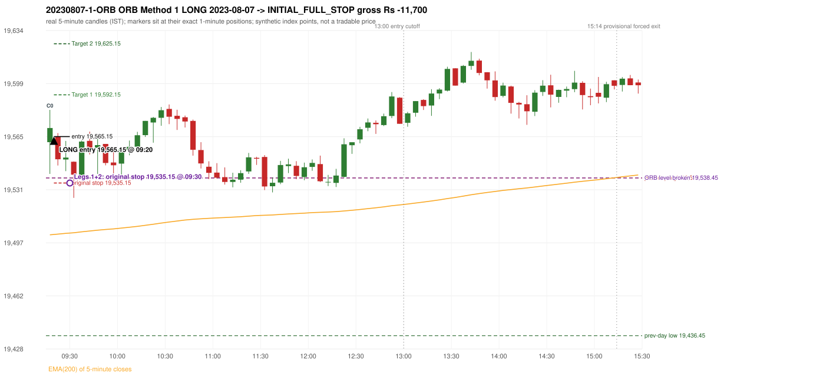
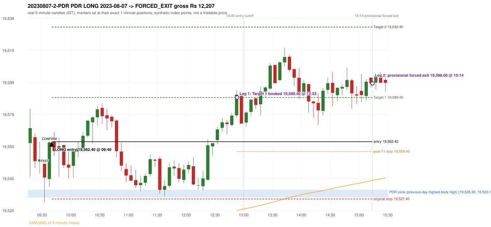

# Trading journal - 2023-08-07 (Monday)

> Phase 4 historical validation, window B (Window B 2022-09-01..2025-08-31 (5paisa minutes); status DATA_VALIDATED). The FROZEN Phase 3.6 configuration (IRF, ORB, PDR body-based, PDS, RF; shared controller) on a different data source. HISTORICAL RESEARCH ONLY: the strategy was developed using later data. same provider as the Phase 3.6 baseline; the vendor-overlap audit shows the minute bars differ from the secondary vendor Synthetic NIFTY 50 index-point P&L (the index is not tradable). The owner's review status is intentionally blank.

## A. Trading day overview

| item | value |
|---|---|
| Date / weekday | 2023-08-07 / Monday |
| Session type | USABLE_WITH_FLAGS / VALID |
| Original session open (first 1-minute open) | 19,561.55 |
| Previous session | 2023-08-04 |
| Previous-day high / low (wicks included) | 19,538.45 / 19,436.45 |
| Previous-day highest BODY high (the body-based PDR ceiling; wicks ignored) | 19,533.10 |
| Previous-day official close / last 5-minute close | 19,517.00 / 19,509.50 |
| Raw engine records / confirmed signals / fully valid signals | 12 / 10 / 10 |
| Setups that did not complete (invalidated / incomplete) | 2 |
| Executed trades | 2 20230807-1-ORB;20230807-2-PDR |
| Gross P&L (Rs, synthetic) | 507.00 |
| Illustrative net P&L (Rs; Rs 500/trade + 0.5 pt/fill) | -1,273.00 |
| Day-end portfolio status | DAY_FINISHED |
| Manual journal trades (matched / unmatched) | 0 (0 / 0) |
| Extra automated trades | 0 |

## B. Daily strategy signal timeline (confirmed signals, chronological)

| time | strategy | method | dir | entry-rule status | valid for execution | <= 13:00 | portfolio state | accepted / ignored | specific reason | competing (same minute) |
|---|---|---|---|---|---|---|---|---|---|---|
| 09:20 | ORB | Method 1 | LONG | PROPOSAL_DEPENDENT | True | True | FIRST_TRADE_ACTIVE | ACCEPTED -> 20230807-1-ORB | first eligible signal of the day; trade 1: INITIAL_FULL_STOP | ORB Method 2 LONG |
| 09:20 | ORB | Method 2 | LONG | RESEARCH_VARIANT | True | True | FIRST_TRADE_ACTIVE | MERGED_SAME_STRATEGY_METHOD | traded as another method of the same strategy/direction in the same minute | ORB Method 1 LONG |
| 09:40 | PDR | PDR | LONG | RESEARCH_VARIANT | True | True | SECOND_TRADE_ACTIVE | ACCEPTED -> 20230807-2-PDR | permitted second trade: newly confirmed PDR/PDS after the original full stop; trade 2: FORCED_EXIT |  |
| 11:45 | PDR | PDR | LONG | RESEARCH_VARIANT | True | True | SECOND_TRADE_ACTIVE | IGNORED | POSITION_ACTIVE (signal kept for diagnostics only; never reused) [blocked by PDR#2] |  |
| 12:25 | PDR | PDR | LONG | RESEARCH_VARIANT | True | True | SECOND_TRADE_ACTIVE | IGNORED | POSITION_ACTIVE (signal kept for diagnostics only; never reused) [blocked by PDR#2] |  |
| 13:00 | IRF | Method 1 | SHORT | PROPOSAL_DEPENDENT | True | True | SECOND_TRADE_ACTIVE | IGNORED | POSITION_ACTIVE (signal kept for diagnostics only; never reused) [blocked by PDR#2] |  |
| 13:50 | IRF | Method 2B | SHORT | PROPOSAL_DEPENDENT | True | False | SECOND_TRADE_ACTIVE | IGNORED | POSITION_ACTIVE (signal kept for diagnostics only; never reused) [blocked by PDR#2] |  |
| 14:20 | IRF | Method 1 | SHORT | PROPOSAL_DEPENDENT | True | False | SECOND_TRADE_ACTIVE | IGNORED | POSITION_ACTIVE (signal kept for diagnostics only; never reused) [blocked by PDR#2] |  |
| 14:55 | IRF | Method 2B | SHORT | PROPOSAL_DEPENDENT | True | False | SECOND_TRADE_ACTIVE | IGNORED | POSITION_ACTIVE (signal kept for diagnostics only; never reused) [blocked by PDR#2] |  |
| 15:25 | IRF | Method 2B | SHORT | PROPOSAL_DEPENDENT | True | False | DAY_FINISHED | IGNORED | DAY_FINISHED [blocked by PDR#2] |  |

Engine setups that did not complete (2); the complete list with failed rule ids is in `rejected_signals.csv`:

| candle | strategy | method | dir | status | precise reason | failed rules |
|---|---|---|---|---|---|---|
| 15:20 | IRF | Method 1/2 | SHORT | INCOMPLETE_AT_EOD | SESSION_ENDED_BEFORE_CONFIRMATION |  |
| 09:35 | RF | RF | LONG | INVALIDATED | GAP_UP_OUTSIDE_YESTERDAYS_RANGE | RF-004 |

## C. Detailed trade journals

### 20230807-1-ORB: ORB Method 1 LONG (FIRST trade)

Chart: 

**Rule configuration:** CFG-phase36_body_based-866f954e55 - signal verification status **PROPOSAL_DEPENDENT** (never VERIFIED while a rule rests on a proposal).

#### 1. Setup identification

ORB Method 1 LONG: the first completed 5-minute candle (09:15-09:20) closed at 19,570.70, 32.25 points above the previous-day high 19,538.45; its body occupied 22.10% of its range and its upper wick 28.38% (thresholds 60% / 20%): the strong-candle test FAILED; the candle was admitted through the conditional PIN-BAR alternative instead (the lower wick 20.50 points is 2.24 x the body, required 2x; the close is 28.38% of the range from the high, allowed 30%); the EMA-only trend filter passed. Entry decision at 09:20.

#### 2. Candle and indicator calculations

| role | session | candle | O | H | L | C | range | body % | upper wick % | lower wick % | direction | EMA(200) | strong bull / bear | pin bull / bear | small (body<=30%) | used for |
|---|---|---|---|---|---|---|---|---|---|---|---|---|---|---|---|---|
| first_candle | TODAY | 09:15-09:20 | 19,561.55 | 19,582.45 | 19,541.05 | 19,570.70 | 41.40 | 22.10 | 28.38 | 49.52 | BULLISH | 19,501.66 | False / False | True / False | True | the 09:15 first five-minute candle - the ORB decision candle |
| prev_day_extreme_candle | PREVIOUS | 12:20-12:25 | 19,532.45 | 19,538.45 | 19,529.60 | 19,531.00 | 8.85 | 16.38 | 67.80 | 15.82 | BEARISH | 19,500.49 | False / False | False / True | True | candle that made the previous session's high/low used as the level |
| prev_session_last_candle | PREVIOUS | 15:25-15:30 | 19,517.65 | 19,517.65 | 19,507.25 | 19,509.50 | 10.40 | 78.37 | 0.00 | 21.63 | BEARISH | 19,500.97 | False / False | False / False | False | trend: previous session's last 5-minute close vs its EMA(200) |

Every condition, with the rule, the calculation, the observed values and the result:

| # | group | rule | result | status / numeric definition | calculation | observed | required | available at | why it matters |
|---|---|---|---|---|---|---|---|---|---|
| 1 | SELECTION | SEL-FIRST-001 | PASS | USER_APPROVED / USER_APPROVED | earliest CONFIRMED signal of the day across IRF/ORB/PDR/PDS/RF that passed the controller's checks | 0 confirmed signal(s) earlier today; 10 confirmed signals in the day in total, this one at 09:20 | no earlier executable signal | 2023-08-07 09:20 | the shared controller trades only the first valid signal; the five strategies are not independent positions |
| 2 | SELECTION | SEL-TIE-001 | PASS | USER_APPROVED / USER_APPROVED | other CONFIRMED signals with exactly the same confirmation timestamp | ORB Method 2 LONG @09:20 [NOTE: SAME_STRATEGY_CONCURRENT_METHOD]; merged same-strategy methods: Method 2 | no different-strategy / opposite-direction signal in the same minute (otherwise an unresolved conflict, no trade) | 2023-08-07 09:20 | an unresolved same-minute collision would have produced no trade at all |
| 3 | SELECTION | ENTRY-CUTOFF-001 | PASS | USER_APPROVED / USER_APPROVED | fill timestamp vs 13:00:00 IST | signal confirmed 09:20; fill 09:20 | fill at or before 13:00:00 IST | 2023-08-07 09:20 | no new position may be entered with a fill after 13:00 IST |
| 4 | SELECTION | EXE-FILL-001 | PASS | PROPOSED_FOR_REVIEW / PROPOSED_FOR_REVIEW | fill = open of the 1-minute bar that starts at the signal candle's end | bar 09:20 O 19,565.15 H 19,567.45 L 19,557.90 C 19,561.50; executable=True; entry 19,565.15 | fill bar exists, starts exactly at the signal end, is fillable; entry = its open | 2023-08-07 09:20 | a 5-minute signal is known only when its candle closes; the first price that can be traded is the next minute's open |
| 5 | SELECTION | DAY-MAX-001 | PASS | USER_APPROVED / USER_APPROVED | number of entries today | trade 1 of at most 2 | <= 2 entries per day | 2023-08-07 09:20 | daily trade cap |
| 6 | SETUP | ORB-GLOBAL-001 | PASS | SOURCE_VERIFIED / EXPLICIT_IN_SOURCE | decision is taken once the first 5-minute candle (09:15-09:20) has closed | candle 09:15-09:20; signal confirmed 09:20 | decision at 09:20, never before the close | 2023-08-07 09:20 | the close of the first candle is unknown before 09:20 |
| 7 | SETUP | ORB-GLOBAL-002 | PASS | SOURCE_VERIFIED / EXPLICIT_IN_SOURCE | direction | LONG | same rules in both directions | 2023-08-07 09:20 | ORB trades the side of the break |
| 8 | SETUP | ORB-GLOBAL-004 | PASS | SOURCE_VERIFIED / QUALITATIVE_SOURCE_NUMERIC_DEFINITION_PROPOSED_FOR_REVIEW | entry at 09:20, after the first-candle close | signal confirmed 09:20; fill 09:20 at the open of that minute | 09:20 entry | 2023-08-07 09:20 | the guide enters at 9:20; the fill price convention (next minute open) is a proposal |
| 9 | SETUP | ORB-M1-LONG-001 | PASS | SOURCE_VERIFIED / QUALITATIVE_SOURCE_NUMERIC_DEFINITION_PROPOSED_FOR_REVIEW | prev_day_high = the highest high of all 5-minute candles of the previous session 2023-08-04 | previous-day high 19,538.45 (set by the 12:20 candle; previous session range 19,436.45 - 19,538.45; engine recorded 19,538.45) | previous-day resistance (long) / support (short) | 2023-08-04 12:25 | a mechanical proxy for the guide's hand-drawn previous-day level; the source charts show multi-session boxes (documented difference) |
| 10 | SETUP | ORB-M1-LONG-002 | PASS | SOURCE_VERIFIED / EXPLICIT_IN_SOURCE | the first candle breaks and closes beyond the level | high 19,582.45 / low 19,541.05, close 19,570.70: 32.25 points beyond 19,538.45 | high and close > level | 2023-08-07 09:20 | a wick alone is not a breakout; the close decides |
| 11 | TREND | ORB-TREND-001 | PASS | SOURCE_VERIFIED / QUALITATIVE_SOURCE_NUMERIC_DEFINITION_PROPOSED_FOR_REVIEW | previous session's final completed 5-minute candle: close vs its EMA(200 of 5-minute closes) | previous session 2023-08-04 last candle 15:25-15:30 close 19,509.50 vs EMA(200) 19,500.97: 8.53 points above the EMA -> trend bullish (EMA_PREV_SESSION_CLOSE; research variant A, EMA-only) | close > EMA(200) | 2023-08-04 15:30 | the opening gap can never create the trend: only information that existed before today's open is used |
| 12 | TREND | ORB-TREND-002 | PASS | SOURCE_VERIFIED / QUALITATIVE_SOURCE_NUMERIC_DEFINITION_PROPOSED_FOR_REVIEW | price location versus the 200 EMA is the basic confirmation; structure is only 'supporting' | 8.53 points above the EMA(200) on the previous session's last 5-minute close; swing structure not used in variant A | price on the trend side of the 200 EMA | 2023-08-04 15:30 | the rulebook calls EMA position 'a basic confirmation, supported by bullish structure'; the structure part has no numeric definition |
| 13 | TREND | TREND-SWING-001 | NOT_APPLICABLE | PROPOSED_FOR_REVIEW / PROPOSED_FOR_REVIEW | confirmed swing structure | not required by the active trend variant (variant A is the EMA price location only) | n/a | 2023-08-04 15:30 | variant B would additionally require higher-high/higher-low swings; it is a separate labelled scenario |
| 14 | CONFIRMATION | ORB-M1-LONG-003 | PASS | SOURCE_VERIFIED / QUALITATIVE_SOURCE_NUMERIC_DEFINITION_PROPOSED_FOR_REVIEW | candle quality: strong body and limited opposite wick (or the conditional pin bar) | 09:15-09:20 O 19,561.55 H 19,582.45 L 19,541.05 C 19,570.70; range 41.40, body 9.15 (22.10%), upper wick 11.75 (28.38%), lower wick 20.50 (49.52%), bullish. Strong-bullish test: bullish close, body >= 60% (observed 22.10%), upper wick <= 20% (observed 28.38%) -> not met; pin-bar alternative: wick >= 2 x body and close within the favourable 30% -> met | strong candle (research thresholds) or pin bar | 2023-08-07 09:20 | the guide asks for a 'strong body, small wick' but gives no numbers; the thresholds are proposals |
| 15 | EXECUTION | ORB-GLOBAL-003 | PASS | SOURCE_VERIFIED / EXPLICIT_IN_SOURCE | initial stop = entry - 30 points | entry 19,565.15 -> stop 19,535.15 | stop 30 index points (BASELINE) | 2023-08-07 09:20 | defines the loss if the setup fails before Target 1 |
| 16 | EXECUTION | EXE-T1-001 | PASS | SOURCE_VERIFIED / EXPLICIT_IN_SOURCE | Target 1 = entry +/- 27 points | T1 19,592.15 | 27 points | 2023-08-07 09:20 | Leg 1 (3 lots) is booked at Target 1 |
| 17 | EXECUTION | ORB-GLOBAL-003 | PASS | SOURCE_VERIFIED / EXPLICIT_IN_SOURCE | Target 2 = entry +/- 60 points | T2 19,625.15 | 60 points | 2023-08-07 09:20 | Leg 2 (3 lots) is booked at Target 2 |
| 18 | EXECUTION | POST-T1-STOP-006 | PASS | USER_APPROVED / USER_APPROVED | after T1 the Leg-2 stop = entry - 6 (no trailing) | post-T1 stop 19,559.15 | entry -6 (LONG) / +6 (SHORT) | 2023-08-07 09:20 | protects the remaining three lots once the first three are booked |
| 19 | EXECUTION | SIZE-LOT-001 | PASS | USER_APPROVED / USER_APPROVED | 6 lots x 65 = 390, Leg 1 = 3 lots = 195, Leg 2 = 195 | 6 lots, lot size 65, legs 3+3 | 6 lots in two equal legs | 2023-08-07 09:20 | position size for the synthetic P&L |
| 20 | NOTE | ORB-MA-001 | UNRESOLVED | CONFLICTING / CONFLICTING | which moving average the code uses | EMA(200) of 5-minute closes (the guide says '200 DMA' in some places and '200 EMA' in others); active ma_mode EMA200_5M | the source terminology conflicts | 2023-08-07 09:20 | a daily 200 DMA would give different values |
| 21 | NOTE | NOTE-UNRESOLVED-DEPENDENCIES | UNRESOLVED | NOT_A_RULE / NOT_A_REGISTRY_RULE | rules the signal depends on that the sources leave unresolved | engine-recorded unresolved rule ids: ORB-MA-001; verification status PROPOSAL_DEPENDENT | n/a (disclosure) | 2023-08-07 09:20 | the entry is only as verified as the rules it rests on |

#### 3. Entry decision and explanation

ORB Method 1 LONG: the first completed 5-minute candle (09:15-09:20) closed at 19,570.70, 32.25 points above the previous-day high 19,538.45; its body occupied 22.10% of its range and its upper wick 28.38% (thresholds 60% / 20%): the strong-candle test FAILED; the candle was admitted through the conditional PIN-BAR alternative instead (the lower wick 20.50 points is 2.24 x the body, required 2x; the close is 28.38% of the range from the high, allowed 30%); the EMA-only trend filter passed. Entry decision at 09:20.

**Why this trade ahead of the other strategies:** This ORB Method 1 signal was the earliest executable signal of the day: 0 confirmed signal(s) earlier, 1 other in the same minute. 8 later confirmed signal(s) (IRF x5, PDR x3) are logged as ignored or rejected. State of the other four engines at that moment: [IRF: no setup record before this time (a base condition was not met, or nothing triggered)] [PDR: no setup record before this time (a base condition was not met, or nothing triggered)] [PDS: no setup record before this time (a base condition was not met, or nothing triggered)] [RF: no setup record before this time (a base condition was not met, or nothing triggered)]

#### 4. Actual entry execution

| item | value |
|---|---|
| Signal candle | 09:15-09:20 |
| Signal confirmed | 2023-08-07 09:20 |
| Fill timestamp | 2023-08-07 09:20 |
| Entry price | 19,565.15 |
| Source partition / 1-minute bar | data/phase4/processed/FIVEPAISA_1M_PHASE4/nifty50/year=2023/month=08/candles.parquet / 2023-08-07 09:20 |
| Source bar O / H / L / C | 19,565.15 / 19,567.45 / 19,557.90 / 19,561.50 |
| Fill assumption | open of the 1-minute bar starting at the signal candle's end (EXE-FILL-001, PROPOSED causal convention) |
| Initial stop / T1 / T2 / post-T1 stop | 19,535.15 / 19,592.15 / 19,625.15 / 19,559.15 |
| Position | 6 lots x 65 = 390 units (Leg 1 195, Leg 2 195) |

#### 5-8. Trade progress, Target 1, post-T1 stop and final exit

Between the 09:20 entry bar and the final exit (11 one-minute bars) the best excursion in favour was 2.30 points at 09:20 and the worst against was 30.50 points at 09:30. At 09:30 price reached the original stop 19,535.15 before Target 1 19,592.15, so all six lots exited together at 19,535.15. This is an INITIAL_FULL_STOP: one more trade is allowed that day, only a newly confirmed PDR/PDS signal.

| leg | qty | exit time | exit price | reason | source 1-minute bar | O / H / L / C | gross points | gross Rs | slippage pts | flags |
|---|---|---|---|---|---|---|---|---|---|---|
| 1 | 195 | 09:30 | 19,535.15 | ORIGINAL_STOP_BEFORE_T1 | 09:30 | 19,548.90 / 19,549.10 / 19,534.65 / 19,535.55 | -30.00 | -5,850.00 | 0.00 |  |
| 2 | 195 | 09:30 | 19,535.15 | ORIGINAL_STOP_BEFORE_T1 | 09:30 | 19,548.90 / 19,549.10 / 19,534.65 / 19,535.55 | -30.00 | -5,850.00 | 0.00 |  |

Exit evidence per leg:

* Leg 1: 1-minute bar 09:30 O 19,548.90 H 19,549.10 L 19,534.65 C 19,535.55: low 19,534.65 reached the original stop 19,535.15 before Target 1 19,592.15 was touched; both legs exit at the stop level 19,535.15
* Leg 2: 1-minute bar 09:30 O 19,548.90 H 19,549.10 L 19,534.65 C 19,535.55: low 19,534.65 reached the original stop 19,535.15 before Target 1 19,592.15 was touched; both legs exit at the stop level 19,535.15

#### 9. Gross and illustrative net P&L

| item | value (Rs) |
|---|---|
| Leg 1 gross | -5,850.00 |
| Leg 2 gross | -5,850.00 |
| Trade gross (= Leg 1 + Leg 2) | -11,700.00 |
| Illustrative fixed cost | -500.00 |
| Illustrative slippage (0.5 pt on every fill, entry + exits, all units) | -390.00 |
| Illustrative net | -12,590.00 |

#### 10. Manual journal comparison

No manual journal exists for this period; no comparison.

### 20230807-2-PDR: PDR LONG (SECOND trade)

Chart: 

**Rule configuration:** CFG-phase36_body_based-866f954e55 - signal verification status **RESEARCH_VARIANT** (never VERIFIED while a rule rests on a proposal).

#### 1. Setup identification

PDR LONG (body-based engine, A_HIGHEST_BODY_HIGH): the session opened 44.55 points above the previous close and 28.45 points above the previous-day highest BODY high 19,533.10 (zone [19,528.30, 19,533.10] from the 12:15 candle of 2023-08-04; the highest wick 19,538.45 is ignored). The 09:30 candle (19,525.55 - 19,549.10) tested the zone; the 09:35 candle (green, O 19,539.60 H 19,562.60 L 19,534.90 C 19,561.95) passed GOOD_GREEN_BODY and closed 28.85 points above the zone ceiling, confirming the entry at 09:40. The pattern thresholds and the zone's lower boundary are provisional research assumptions, not approved by the strategy author.

#### 2. Candle and indicator calculations

| role | session | candle | O | H | L | C | range | body % | upper wick % | lower wick % | direction | EMA(200) | strong bull / bear | pin bull / bear | small (body<=30%) | used for |
|---|---|---|---|---|---|---|---|---|---|---|---|---|---|---|---|---|
| zone_source_candle | PREVIOUS | 12:15-12:20 | 19,528.30 | 19,538.30 | 19,526.45 | 19,533.10 | 11.85 | 40.51 | 43.88 | 15.61 | BULLISH | 19,500.18 | False / False | False / False | False | candle of the previous session's highest BODY high (A_HIGHEST_BODY_HIGH) |
| prev_day_wick_high_candle | PREVIOUS | 12:20-12:25 | 19,532.45 | 19,538.45 | 19,529.60 | 19,531.00 | 8.85 | 16.38 | 67.80 | 15.82 | BEARISH | 19,500.49 | False / False | False / True | True | candle of the previous session's highest WICK (ignored by the author's rule; shown for comparison) |
| interaction_candle | TODAY | 09:30-09:35 | 19,548.90 | 19,549.10 | 19,525.55 | 19,540.55 | 23.55 | 35.46 | 0.85 | 63.69 | BEARISH | 19,503.02 | False / False | False / False | False | first candle whose range overlaps the zone (the test) |
| confirmation_candle | TODAY | 09:35-09:40 | 19,539.60 | 19,562.60 | 19,534.90 | 19,561.95 | 27.70 | 80.69 | 2.35 | 16.97 | BULLISH | 19,503.61 | True / False | False / False | False | candle that satisfies one of the three patterns and closes above the zone ceiling |

Every condition, with the rule, the calculation, the observed values and the result:

| # | group | rule | result | status / numeric definition | calculation | observed | required | available at | why it matters |
|---|---|---|---|---|---|---|---|---|---|
| 1 | SELECTION | DAY-SL-001 | PASS | USER_APPROVED / USER_APPROVED | first trade outcome, strategy of this signal, position-close time vs this signal's timestamp | first trade ORB Method 1 closed as INITIAL_FULL_STOP at 09:30; position free from 09:31; this PDR signal confirmed 09:40 | first trade INITIAL_FULL_STOP before Target 1, and a NEWLY confirmed PDR/PDS signal after the first position closed | 2023-08-07 09:40 | the only way a second trade is allowed |
| 2 | SELECTION | DAY-NOREUSE-001 | PASS | USER_APPROVED / USER_APPROVED | signals confirmed while the first position was open | 2 signal(s) were ignored during the first trade (never reused): ORB Method 1 LONG @09:20; ORB Method 2 LONG @09:20 [NOTE: SAME_STRATEGY_CONCURRENT_METHOD] | this trade comes from a signal confirmed after the first exit, not from an ignored one | 2023-08-07 09:40 | an ignored signal can never become the second trade |
| 3 | SELECTION | ENTRY-CUTOFF-001 | PASS | USER_APPROVED / USER_APPROVED | fill timestamp vs 13:00:00 IST | signal confirmed 09:40; fill 09:40 | fill at or before 13:00:00 IST | 2023-08-07 09:40 | no new position may be entered with a fill after 13:00 IST |
| 4 | SELECTION | EXE-FILL-001 | PASS | PROPOSED_FOR_REVIEW / PROPOSED_FOR_REVIEW | fill = open of the 1-minute bar that starts at the signal candle's end | bar 09:40 O 19,562.40 H 19,564.20 L 19,554.05 C 19,561.45; executable=True; entry 19,562.40 | fill bar exists, starts exactly at the signal end, is fillable; entry = its open | 2023-08-07 09:40 | a 5-minute signal is known only when its candle closes; the first price that can be traded is the next minute's open |
| 5 | SELECTION | DAY-MAX-001 | PASS | USER_APPROVED / USER_APPROVED | number of entries today | trade 2 of at most 2 | <= 2 entries per day | 2023-08-07 09:40 | daily trade cap |
| 6 | SETUP | PDR-004 | PASS | SOURCE_VERIFIED / EXPLICIT_WORDING_DETAIL_PROPOSED_FOR_REVIEW | gap = first 1-minute open of today - previous session's OFFICIAL close | today's open 19,561.55 (first 1-minute bar 09:15) - previous close 19,517.00 (DAILY_VENDOR, 2023-08-04) = +44.55 points -> gap UP | gap UP (more than 0 points) | 2023-08-07 09:15 | approved convention: the original first-minute open, never the vendor daily open |
| 7 | SETUP | PDR-B03 | PASS | AUTHOR_APPROVED / AUTHOR_STATEMENT_NUMERIC_DETAILS_ARE_SEPARATE_PROPOSED_ROWS | the session opens strictly above the previous day's resistance zone (author-approved) | today's first 1-minute open 19,561.55 vs zone ceiling 19,533.10: 28.45 points above (open - ceiling = +28.45) | open > zone ceiling (equal or inside the zone rejects the setup) | 2023-08-07 09:15 | the original first-minute open is used, never a vendor daily open |
| 8 | ZONE | PDR-001 | PASS | SOURCE_VERIFIED / EXPLICIT_IN_SOURCE | direction | LONG (PDR is long only) | long-only | 2023-08-07 09:40 | PDR buys a retest of previous-day resistance after a gap up |
| 9 | ZONE | PDR-B01a | PASS | AUTHOR_APPROVED / AUTHOR_STATEMENT_NUMERIC_DETAILS_ARE_SEPARATE_PROPOSED_ROWS | wicks ignored, bodies considered: body_high = max(open, close) of every completed previous-session 5-minute candle; ceiling = the highest body_high; floor = body low of that candle | previous session 2023-08-04: highest body high 19,533.10 on the 12:15 candle (O 19,528.30 C 19,533.10; wick high of that candle 19,538.30, ignored); four highest body highs: 19,533.10 (12:15); 19,532.90 (12:25); 19,532.45 (12:20); 19,531.65 (15:10). Highest WICK of the session 19,538.45 (12:20 candle) is 5.35 points above the ceiling and plays no part. Zone [19,528.30 (body low), 19,533.10 (body high)]; engine recorded [19,528.30, 19,533.10] | ceiling = highest body high of the previous session (author: wick ignored, body considered) | 2023-08-04 15:30 | a wick-only price never becomes resistance; the zone is drawn from candle bodies |
| 10 | ZONE | PDR-B02 | UNRESOLVED | AUTHOR_APPROVED / AUTHOR_STATEMENT_NUMERIC_DETAILS_ARE_SEPARATE_PROPOSED_ROWS | multiple highs connected into one zone (author principle; candidate B) | candidate A (used): [19,528.30, 19,533.10]. Candidate B (multiple-body-high cluster, tolerance 5 points) would be [19,519.20, 19,533.10] (MULTIPLE_BODY_HIGH_CLUSTER, 4 touch(es), member body highs 19,533.10, 19,532.90, 19,528.15, 19,531.65, 19,531.65); ceiling difference 0.00 points | a zone that connects all relevant highs (numbers not given by the author) | 2023-08-04 15:30 | candidate B has the same ceiling by construction, so this signal is unaffected by the choice; the lower boundary and the cluster numbers are research parameters |
| 11 | ZONE | PDR-003 | PASS | SOURCE_VERIFIED / EXPLICIT_IN_SOURCE | the zone is an area, not a single price | zone height 4.80 points [19,528.30, 19,533.10] | a rectangle with positive height (a zero-height zone is left unresolved by the engine) | 2023-08-04 15:30 | price may touch any part of the area |
| 12 | CONFIRMATION | PDR-B03b | PASS | PRESERVED_FROM_PHASE2 / PRESERVED_FROM_PHASE2 | the first candle whose [low, high] overlaps the zone (+/- proximity) is the test; the confirmation must come strictly after it | 09:30-09:35 O 19,548.90 H 19,549.10 L 19,525.55 C 19,540.55; range 23.55, body 8.35 (35.46%), upper wick 0.20 (0.85%), lower wick 15.00 (63.69%), bearish; low 19,525.55 vs zone ceiling 19,533.10, high 19,549.10 vs zone floor 19,528.30; proximity 0; confirmation candle 09:35 is candle no. 5, the test candle no. 4 | range overlaps the zone; confirmation after the test | 2023-08-07 09:35 | the retest of the previous-day resistance |
| 13 | CONFIRMATION | PDR-B04c | PASS | PROPOSED_FOR_REVIEW / NUMERIC_DEFINITION_PROPOSED_FOR_REVIEW | Pattern 1: good green body on the 09:35-09:40 candle (O 19,539.60 H 19,562.60 L 19,534.90 C 19,561.95); the numeric thresholds are PROVISIONAL (RESEARCH_DEFAULT), not author-approved | colour green; body 80.69%; upper wick 2.35% -> PASSES | green, body >= 60% and upper wick <= 20% of the range | 2023-08-07 09:40 | one of the three patterns is enough (author: one good green body OR lower price rejection OR hammer); fixed thresholds are not required by the author, so the numbers are a research convention; a pattern that does not pass is not an error |
| 14 | CONFIRMATION | PDR-B04c | NOT_APPLICABLE | PROPOSED_FOR_REVIEW / NUMERIC_DEFINITION_PROPOSED_FOR_REVIEW | Pattern 2: lower-price rejection candle on the 09:35-09:40 candle (O 19,539.60 H 19,562.60 L 19,534.90 C 19,561.95); the numeric thresholds are PROVISIONAL (RESEARCH_DEFAULT), not author-approved | lower wick 4.70 = 0.21 x body 22.35; close 2.35% below the high; low 19,534.90; low did NOT reach the zone ceiling 19,533.10 -> does not pass | lower wick >= 2 x body, close within the top 30% of the range, low <= zone ceiling (colour not required) | 2023-08-07 09:40 | one of the three patterns is enough (author: one good green body OR lower price rejection OR hammer); fixed thresholds are not required by the author, so the numbers are a research convention; a pattern that does not pass is not an error |
| 15 | CONFIRMATION | PDR-B04c | NOT_APPLICABLE | PROPOSED_FOR_REVIEW / NUMERIC_DEFINITION_PROPOSED_FOR_REVIEW | Pattern 3: hammer candle on the 09:35-09:40 candle (O 19,539.60 H 19,562.60 L 19,534.90 C 19,561.95); the numeric thresholds are PROVISIONAL (RESEARCH_DEFAULT), not author-approved | lower wick 4.70 = 0.21 x body; upper wick 2.35%; body bottom at 16.97% of the range -> does not pass | lower wick >= 2 x body, upper wick <= 10%, body bottom >= 60% of the range (colour not required) | 2023-08-07 09:40 | one of the three patterns is enough (author: one good green body OR lower price rejection OR hammer); fixed thresholds are not required by the author, so the numbers are a research convention; a pattern that does not pass is not an error |
| 16 | CONFIRMATION | PDR-B04 | PASS | AUTHOR_APPROVED / AUTHOR_STATEMENT_NUMERIC_DETAILS_ARE_SEPARATE_PROPOSED_ROWS | at least one of the three patterns passes (OR logic; every passing pattern is recorded) | patterns passed: GOOD_GREEN_BODY (engine recorded: GOOD_GREEN_BODY) | at least one pattern | 2023-08-07 09:40 | the author's entry candle requirement |
| 17 | CONFIRMATION | PDR-B05 | PASS | AUTHOR_APPROVED / AUTHOR_STATEMENT_NUMERIC_DETAILS_ARE_SEPARATE_PROPOSED_ROWS | the confirmation candle must close above the zone | close 19,561.95 vs zone ceiling 19,533.10: +28.85 points (floor 19,528.30; low 19,534.90 stayed above the zone) | close > zone ceiling, strictly (lower wick may penetrate the zone) | 2023-08-07 09:40 | no pattern overrides the close rule |
| 18 | CONFIRMATION | PDR-B06 | PASS | USER_APPROVED / USER_APPROVED | no entry at the open and no look-ahead: the order is placed only after the confirmation candle has completed | test candle 09:30 (no. 4) precedes the confirmation candle 09:35-09:40; signal stamped 09:40; fill 09:40 at the open of that 1-minute bar = 19,562.40 | interaction before the confirmation; fill after the confirmation candle's end | 2023-08-07 09:40 | existing causal fill convention (EXE-FILL-001) |
| 19 | EXECUTION | EXE-STOP-001 | PASS | USER_APPROVED / USER_APPROVED | initial stop = entry - 35 points | entry 19,562.40 -> stop 19,527.40 | stop 35 index points (BASELINE) | 2023-08-07 09:40 | defines the loss if the setup fails before Target 1 |
| 20 | EXECUTION | EXE-T1-001 | PASS | SOURCE_VERIFIED / EXPLICIT_IN_SOURCE | Target 1 = entry +/- 27 points | T1 19,589.40 | 27 points | 2023-08-07 09:40 | Leg 1 (3 lots) is booked at Target 1 |
| 21 | EXECUTION | PDR-008 | PASS | SOURCE_VERIFIED / EXPLICIT_IN_SOURCE | Target 2 = entry +/- 70 points | T2 19,632.40 (the guide says 70; the performance report's winners suggest 60 - CONFLICTING, recorded) | 70 points | 2023-08-07 09:40 | Leg 2 (3 lots) is booked at Target 2 |
| 22 | EXECUTION | POST-T1-STOP-006 | PASS | USER_APPROVED / USER_APPROVED | after T1 the Leg-2 stop = entry - 6 (no trailing) | post-T1 stop 19,556.40 | entry -6 (LONG) / +6 (SHORT) | 2023-08-07 09:40 | protects the remaining three lots once the first three are booked |
| 23 | EXECUTION | SIZE-LOT-001 | PASS | USER_APPROVED / USER_APPROVED | 6 lots x 65 = 390, Leg 1 = 3 lots = 195, Leg 2 = 195 | 6 lots, lot size 65, legs 3+3 | 6 lots in two equal legs | 2023-08-07 09:40 | position size for the synthetic P&L |
| 24 | NOTE | PDR-B04x | UNRESOLVED | PROPOSED_FOR_REVIEW / NUMERIC_DEFINITION_PROPOSED_FOR_REVIEW | provisional parameters this signal rests on | pattern thresholds RESEARCH_DEFAULT: {'green_body_min': 0.6, 'green_upper_wick_max': 0.2, 'reject_wick_to_body_min': 2.0, 'reject_close_fraction_max': 0.3, 'hammer_wick_to_body_min': 2.0, 'hammer_upper_wick_max': 0.1, 'hammer_body_position_min': 0.6}; zone lower boundary = hull of the member bodies; zero-height policy UNRESOLVED_NO_SETUP; wait policy WAIT_FOR_QUALIFYING_CANDLE; cluster parameters (candidate B only) tolerance 5, touches 2, separation 2 | n/a (disclosure) | 2023-08-07 09:40 | the strategy author has NOT approved these numbers or conventions; the signal is a RESEARCH_VARIANT, never VERIFIED |
| 25 | NOTE | PDR-012 | NOT_APPLICABLE | PROPOSED_FOR_REVIEW / PROPOSED_FOR_REVIEW | repeated PDR signals today | 3 confirmed PDR signal(s) in the session | n/a (disclosure) | 2023-08-07 09:40 | this engine reports EVERY qualifying signal (the per-session cap is lifted); the controller trades only the first (and a PDR/PDS second trade after an initial full stop) |
| 26 | NOTE | PDR-B07 | NOT_APPLICABLE | PROPOSED_FOR_REVIEW / NUMERIC_DEFINITION_PROPOSED_FOR_REVIEW | state of the zone between the test and the confirmation (the author and the guide are silent on price crossing below the zone) | test candle 09:30 (no. 4), confirmation candle 09:35 (no. 5): 1 candle(s) later; no candle in between closed below the zone floor | n/a (disclosure; the wait policy is a research parameter) | 2023-08-07 09:40 | the engine keeps a tested setup armed until a candle qualifies; whether a zone that price has closed through should still count is an owner decision |
| 27 | NOTE | PDR-009 | UNRESOLVED | UNRESOLVED / UNRESOLVED | stop 35 or 40 'depending on the situation' | the guide gives no selection rule; baseline fixed 35 points | unresolved in the source | 2023-08-07 09:40 | PDR stop selection is left to the owner |
| 28 | NOTE | NOTE-UNRESOLVED-DEPENDENCIES | UNRESOLVED | NOT_A_RULE / NOT_A_REGISTRY_RULE | rules the signal depends on that the sources leave unresolved | engine-recorded unresolved rule ids: PDR-B01b, PDR-B02a, PDR-B02b, PDR-B02c, PDR-B02d, PDR-B02e, PDR-B02f, PDR-B02g, PDR-B02h, PDR-B04b, PDR-B04c, PDR-B05a, PDR-B07; verification status RESEARCH_VARIANT | n/a (disclosure) | 2023-08-07 09:40 | the entry is only as verified as the rules it rests on |

#### 3. Entry decision and explanation

PDR LONG (body-based engine, A_HIGHEST_BODY_HIGH): the session opened 44.55 points above the previous close and 28.45 points above the previous-day highest BODY high 19,533.10 (zone [19,528.30, 19,533.10] from the 12:15 candle of 2023-08-04; the highest wick 19,538.45 is ignored). The 09:30 candle (19,525.55 - 19,549.10) tested the zone; the 09:35 candle (green, O 19,539.60 H 19,562.60 L 19,534.90 C 19,561.95) passed GOOD_GREEN_BODY and closed 28.85 points above the zone ceiling, confirming the entry at 09:40. The pattern thresholds and the zone's lower boundary are provisional research assumptions, not approved by the strategy author.

**Why this trade ahead of the other strategies:** The first trade (ORB Method 1) was stopped out before Target 1 at 09:30; this newly confirmed PDR signal at 09:40 is the first PDR/PDS signal after that exit, so it is the day's permitted second trade. State of the other engines at that moment: [IRF: no setup record before this time (a base condition was not met, or nothing triggered)] [ORB: 2 confirmed signal(s) up to this time (Method 1@09:20, Method 2@09:20)] [PDS: no setup record before this time (a base condition was not met, or nothing triggered)] [RF: RF invalidated at 09:35: GAP_UP_OUTSIDE_YESTERDAYS_RANGE]

#### 4. Actual entry execution

| item | value |
|---|---|
| Signal candle | 09:35-09:40 |
| Signal confirmed | 2023-08-07 09:40 |
| Fill timestamp | 2023-08-07 09:40 |
| Entry price | 19,562.40 |
| Source partition / 1-minute bar | data/phase4/processed/FIVEPAISA_1M_PHASE4/nifty50/year=2023/month=08/candles.parquet / 2023-08-07 09:40 |
| Source bar O / H / L / C | 19,562.40 / 19,564.20 / 19,554.05 / 19,561.45 |
| Fill assumption | open of the 1-minute bar starting at the signal candle's end (EXE-FILL-001, PROPOSED causal convention) |
| Initial stop / T1 / T2 / post-T1 stop | 19,527.40 / 19,589.40 / 19,632.40 / 19,556.40 |
| Position | 6 lots x 65 = 390 units (Leg 1 195, Leg 2 195) |

#### 5-8. Trade progress, Target 1, post-T1 stop and final exit

Between the 09:40 entry bar and the final exit (335 one-minute bars) the best excursion in favour was 57.45 points at 13:41 and the worst against was 33.30 points at 11:36. At 12:53 Target 1 booked three lots. At 12:53 the remaining three lots' protective stop was set to 19,556.40 (entry - 6; no trailing, no further change); the engine applies it from the Target-1 bar onward and tests it within that same bar. Neither the stop nor Target 2 was reached; at 15:14 the remaining lots were closed by the PROVISIONAL forced exit at the minute open 19,598.00.

| leg | qty | exit time | exit price | reason | source 1-minute bar | O / H / L / C | gross points | gross Rs | slippage pts | flags |
|---|---|---|---|---|---|---|---|---|---|---|
| 1 | 195 | 12:53 | 19,589.40 | TARGET_1 | 12:53 | 19,585.35 / 19,593.95 / 19,584.60 / 19,592.80 | 27.00 | 5,265.00 | 0.00 |  |
| 2 | 195 | 15:14 | 19,598.00 | FORCED_EXIT_1514_OPEN_PROVISIONAL | 15:14 | 19,598.00 / 19,598.90 / 19,596.85 / 19,598.00 | 35.60 | 6,942.00 | 0.00 | PROVISIONAL_FORCED_EXIT_15_14_OPEN |

Exit evidence per leg:

* Leg 1: 1-minute bar 12:53 O 19,585.35 H 19,593.95 L 19,584.60 C 19,592.80: high 19,593.95 reached Target 1 19,589.40; Leg 1 booked at the target level
* Leg 2: 1-minute bar 15:14 O 19,598.00 H 19,598.90 L 19,596.85 C 19,598.00: provisional forced exit at the OPEN of the 15:14 minute (19,598.00); neither Target 2 nor the stop was reached; sensitivity close of that minute 19,598.00 (not used)

#### 9. Gross and illustrative net P&L

| item | value (Rs) |
|---|---|
| Leg 1 gross | 5,265.00 |
| Leg 2 gross | 6,942.00 |
| Trade gross (= Leg 1 + Leg 2) | 12,207.00 |
| Illustrative fixed cost | -500.00 |
| Illustrative slippage (0.5 pt on every fill, entry + exits, all units) | -390.00 |
| Illustrative net | 11,317.00 |

#### 10. Manual journal comparison

No manual journal exists for this period; no comparison.

## D. Manual journal comparison

No manual journal exists for this period (the manual journal covers 2025-09-01 .. 2026-08-31 only); no comparison is made and no automated trade is labelled 'extra'.

## E. Daily conclusion

* **Traded:** 20230807-1-ORB - ORB Method 1 LONG at 09:20 (entry 19,565.15), outcome INITIAL_FULL_STOP, gross Rs -11,700.00, illustrative net Rs -12,590.00. **Why:** This ORB Method 1 signal was the earliest executable signal of the day: 0 confirmed signal(s) earlier, 1 other in the same minute. 8 later confirmed signal(s) (IRF x5, PDR x3) are logged as ignored or rejected. State of the other four engines at that moment: [IRF: no setup record before this time (a base condition was not met, or nothing triggered)] [PDR: no setup record before this time (a base condition was not met, or nothing triggered)] [PDS: no setup record before this time (a base condition was not met, or nothing triggered)] [RF: no setup record before this time (a base condition was not met, or nothing triggered)] **How it ended:** At 09:30 price reached the original stop 19,535.15 before Target 1 19,592.15, so all six lots exited together at 19,535.15. This is an INITIAL_FULL_STOP: one more trade is allowed that day, only a newly confirmed PDR/PDS signal.
* **Traded:** 20230807-2-PDR - PDR PDR LONG at 09:40 (entry 19,562.40), outcome FORCED_EXIT, gross Rs 12,207.00, illustrative net Rs 11,317.00. **Why:** The first trade (ORB Method 1) was stopped out before Target 1 at 09:30; this newly confirmed PDR signal at 09:40 is the first PDR/PDS signal after that exit, so it is the day's permitted second trade. State of the other engines at that moment: [IRF: no setup record before this time (a base condition was not met, or nothing triggered)] [ORB: 2 confirmed signal(s) up to this time (Method 1@09:20, Method 2@09:20)] [PDS: no setup record before this time (a base condition was not met, or nothing triggered)] [RF: RF invalidated at 09:35: GAP_UP_OUTSIDE_YESTERDAYS_RANGE] **How it ended:** At 12:53 Target 1 booked three lots. At 12:53 the remaining three lots' protective stop was set to 19,556.40 (entry - 6; no trailing, no further change); the engine applies it from the Target-1 bar onward and tests it within that same bar. Neither the stop nor Target 2 was reached; at 15:14 the remaining lots were closed by the PROVISIONAL forced exit at the minute open 19,598.00.
* **Ignored / rejected signals:** IRF IGNORED POSITION_ACTIVE x4; PDR IGNORED POSITION_ACTIVE x2; ORB MERGED_SAME_STRATEGY_METHOD traded as another method of the same strategy/direction in the same minute x1; IRF IGNORED DAY_FINISHED x1
* **Open strategy-definition issues that affected this day:** NOTE-UNRESOLVED-DEPENDENCIES, ORB-MA-001 (Terminology conflict: '200 DMA / EMA' (p.2), '200 EMA' (pp.3,5,7), '200 DMA' (pp.1,8,9,12) for what the charts show as one curved line on a 5-minute chart), PDR-009 (Stop-loss 35 or 40 'depending on the situation'; choose before entering, do not move after entry), PDR-B02, PDR-B04x
* **Automated triage (not an approval; the owner's review status stays blank):** REVIEW: PROVISIONAL_FORCED_EXIT
