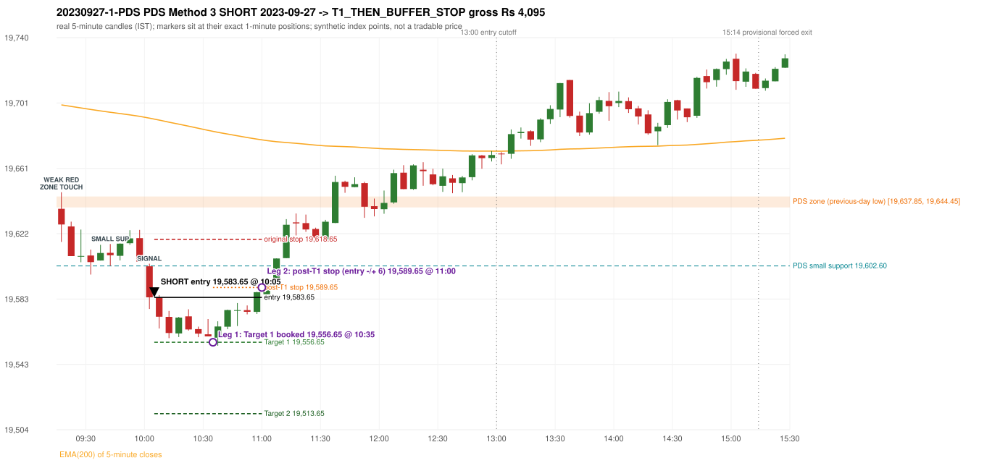

# Trading journal - 2023-09-27 (Wednesday)

> Phase 4 historical validation, window B (Window B 2022-09-01..2025-08-31 (5paisa minutes); status DATA_VALIDATED). The FROZEN Phase 3.6 configuration (IRF, ORB, PDR body-based, PDS, RF; shared controller) on a different data source. HISTORICAL RESEARCH ONLY: the strategy was developed using later data. same provider as the Phase 3.6 baseline; the vendor-overlap audit shows the minute bars differ from the secondary vendor Synthetic NIFTY 50 index-point P&L (the index is not tradable). The owner's review status is intentionally blank.

## A. Trading day overview

| item | value |
|---|---|
| Date / weekday | 2023-09-27 / Wednesday |
| Session type | USABLE_WITH_FLAGS / VALID |
| Original session open (first 1-minute open) | 19,637.05 |
| Previous session | 2023-09-26 |
| Previous-day high / low (wicks included) | 19,698.80 / 19,637.85 |
| Previous-day highest BODY high (the body-based PDR ceiling; wicks ignored) | 19,697.65 |
| Previous-day official close / last 5-minute close | 19,664.70 / 19,673.60 |
| Raw engine records / confirmed signals / fully valid signals | 9 / 4 / 4 |
| Setups that did not complete (invalidated / incomplete) | 5 |
| Executed trades | 1 20230927-1-PDS |
| Gross P&L (Rs, synthetic) | 4,095.00 |
| Illustrative net P&L (Rs; Rs 500/trade + 0.5 pt/fill) | 3,205.00 |
| Day-end portfolio status | DAY_FINISHED |
| Manual journal trades (matched / unmatched) | 0 (0 / 0) |
| Extra automated trades | 0 |

## B. Daily strategy signal timeline (confirmed signals, chronological)

| time | strategy | method | dir | entry-rule status | valid for execution | <= 13:00 | portfolio state | accepted / ignored | specific reason | competing (same minute) |
|---|---|---|---|---|---|---|---|---|---|---|
| 10:05 | PDS | Method 3 | SHORT | PROPOSAL_DEPENDENT | True | True | FIRST_TRADE_ACTIVE | ACCEPTED -> 20230927-1-PDS | first eligible signal of the day; trade 1: T1_THEN_BUFFER_STOP |  |
| 11:55 | IRF | Method 1 | SHORT | PROPOSAL_DEPENDENT | True | True | DAY_FINISHED | IGNORED | DAY_FINISHED [blocked by PDS#1] |  |
| 12:15 | IRF | Method 2B | SHORT | PROPOSAL_DEPENDENT | True | True | DAY_FINISHED | IGNORED | DAY_FINISHED [blocked by PDS#1] |  |
| 14:20 | IRF | Method 2A | SHORT | PROPOSAL_DEPENDENT | True | False | DAY_FINISHED | IGNORED | DAY_FINISHED [blocked by PDS#1] |  |

Engine setups that did not complete (5); the complete list with failed rule ids is in `rejected_signals.csv`:

| candle | strategy | method | dir | status | precise reason | failed rules |
|---|---|---|---|---|---|---|
| 14:15 | IRF | Method 1/2 | SHORT | INCOMPLETE_AT_EOD | SESSION_ENDED_BEFORE_CONFIRMATION |  |
| 09:15 | ORB | Method 1 | SHORT | INVALIDATED | CANDLE_QUALITY(not a strong body / wick too large) | ORB-M1-SHORT-003 |
| 09:15 | ORB | Method 2 | SHORT | INVALIDATED | CANDLE_QUALITY | ORB-M2-SHORT-003 |
| 11:35 | PDS | Method 1/2/3 | SHORT | INCOMPLETE_AT_EOD | NO_QUALIFYING_ENTRY_BEFORE_SESSION_END |  |
| 09:50 | RF | RF | LONG | INVALIDATED | TREND:EMA_PREV_SESSION_CLOSE wrong side | RF-001;RF-008 |

## C. Detailed trade journals

### 20230927-1-PDS: PDS Method 3 SHORT (FIRST trade)

Chart: 

**Rule configuration:** CFG-phase36_body_based-866f954e55 - signal verification status **PROPOSAL_DEPENDENT** (never VERIFIED while a rule rests on a proposal).

#### 1. Setup identification

PDS Method 3 SHORT: the session opened 0.80 points below the previous-day-low zone [19,637.85, 19,644.45]; the first red candle at the zone (09:15) was weak (body 31.61%), so the engine waited for a small support; the 09:40 candle's low 19,602.60 (35.25 points below the zone floor) was broken by the close of the 10:00 candle (19,583.70); confirmed 10:05.

#### 2. Candle and indicator calculations

| role | session | candle | O | H | L | C | range | body % | upper wick % | lower wick % | direction | EMA(200) | strong bull / bear | pin bull / bear | small (body<=30%) | used for |
|---|---|---|---|---|---|---|---|---|---|---|---|---|---|---|---|---|
| zone_source_candle | PREVIOUS | 13:00-13:05 | 19,642.65 | 19,645.30 | 19,637.85 | 19,644.45 | 7.45 | 24.16 | 11.41 | 64.43 | BULLISH | 19,710.45 | False / False | True / False | True | previous-day low candle that defines the zone (A_LOWEST_LOW) |
| zone_retest_candle | TODAY | 09:15-09:20 | 19,637.05 | 19,647.00 | 19,617.10 | 19,627.60 | 29.90 | 31.61 | 33.28 | 35.12 | BEARISH | 19,699.59 | False / False | False / False | False | first candle whose range reaches the zone from below |
| signal_candle | TODAY | 10:00-10:05 | 19,602.40 | 19,603.95 | 19,576.70 | 19,583.70 | 27.25 | 68.62 | 5.69 | 25.69 | BEARISH | 19,691.64 | False / False | False / False | False | trigger candle |
| weak_first_red_candle | TODAY | 09:15-09:20 | 19,637.05 | 19,647.00 | 19,617.10 | 19,627.60 | 29.90 | 31.61 | 33.28 | 35.12 | BEARISH | 19,699.59 | False / False | False / False | False | first red candle at the zone that failed the quality rule |
| small_support_pivot | TODAY | 09:40-09:45 | 19,610.50 | 19,615.80 | 19,602.60 | 19,609.05 | 13.20 | 10.98 | 40.15 | 48.86 | BEARISH | 19,695.14 | False / False | False / False | True | small support: latest 3-candle fractal low after the weak candle |

Every condition, with the rule, the calculation, the observed values and the result:

| # | group | rule | result | status / numeric definition | calculation | observed | required | available at | why it matters |
|---|---|---|---|---|---|---|---|---|---|
| 1 | SELECTION | SEL-FIRST-001 | PASS | USER_APPROVED / USER_APPROVED | earliest CONFIRMED signal of the day across IRF/ORB/PDR/PDS/RF that passed the controller's checks | 0 confirmed signal(s) earlier today; 4 confirmed signals in the day in total, this one at 10:05 | no earlier executable signal | 2023-09-27 10:05 | the shared controller trades only the first valid signal; the five strategies are not independent positions |
| 2 | SELECTION | SEL-TIE-001 | PASS | USER_APPROVED / USER_APPROVED | other CONFIRMED signals with exactly the same confirmation timestamp | none | no different-strategy / opposite-direction signal in the same minute (otherwise an unresolved conflict, no trade) | 2023-09-27 10:05 | an unresolved same-minute collision would have produced no trade at all |
| 3 | SELECTION | ENTRY-CUTOFF-001 | PASS | USER_APPROVED / USER_APPROVED | fill timestamp vs 13:00:00 IST | signal confirmed 10:05; fill 10:05 | fill at or before 13:00:00 IST | 2023-09-27 10:05 | no new position may be entered with a fill after 13:00 IST |
| 4 | SELECTION | EXE-FILL-001 | PASS | PROPOSED_FOR_REVIEW / PROPOSED_FOR_REVIEW | fill = open of the 1-minute bar that starts at the signal candle's end | bar 10:05 O 19,583.65 H 19,585.05 L 19,568.25 C 19,572.65; executable=True; entry 19,583.65 | fill bar exists, starts exactly at the signal end, is fillable; entry = its open | 2023-09-27 10:05 | a 5-minute signal is known only when its candle closes; the first price that can be traded is the next minute's open |
| 5 | SELECTION | DAY-MAX-001 | PASS | USER_APPROVED / USER_APPROVED | number of entries today | trade 1 of at most 2 | <= 2 entries per day | 2023-09-27 10:05 | daily trade cap |
| 6 | SETUP | PDS-003 | PASS | SOURCE_VERIFIED / EXPLICIT_WORDING_DETAIL_PROPOSED_FOR_REVIEW | gap = first 1-minute open of today - previous session's OFFICIAL close | today's open 19,637.05 (first 1-minute bar 09:15) - previous close 19,664.70 (DAILY_VENDOR, 2023-09-26) = -27.65 points -> gap DOWN | gap DOWN (more than 0 points) | 2023-09-27 09:15 | approved convention: the original first-minute open, never the vendor daily open |
| 7 | SETUP | PDS-006 | PASS | SOURCE_VERIFIED / QUALITATIVE_SOURCE_NUMERIC_DEFINITION_PROPOSED_FOR_REVIEW | gap-down open below the zone | today's open 19,637.05 vs zone low 19,637.85: 0.80 points below | open < zone low | 2023-09-27 09:15 | the guide: 'price is trading below the previous day's support zone' after the gap; a PROPOSED strict reading |
| 8 | SETUP | PDS-004 | PASS | SOURCE_VERIFIED / EXPLICIT_IN_SOURCE | PDS is not a breakdown strategy: the zone must be tested from below first | open 19,637.05 below the zone floor 19,637.85; the first candle to reach the zone is 09:15 | price rises to the zone before any short | 2023-09-27 09:15 | a short below the level without a retest is not this strategy |
| 9 | SETUP | PDS-005 | PASS | SOURCE_VERIFIED / QUALITATIVE_SOURCE_NUMERIC_DEFINITION_PROPOSED_FOR_REVIEW | price comes up to the zone: first candle whose [low, high] intersects it (+/- proximity) | 09:15-09:20 O 19,637.05 H 19,647.00 L 19,617.10 C 19,627.60; range 29.90, body 9.45 (31.61%), upper wick 9.95 (33.28%), lower wick 10.50 (35.12%), bearish; high 19,647.00 vs zone low 19,637.85 | range intersects the zone | 2023-09-27 09:20 | PDS is not a breakdown strategy: the zone must be tested from below first |
| 10 | ZONE | PDS-001 | PASS | SOURCE_VERIFIED / EXPLICIT_IN_SOURCE | direction | SHORT (PDS is short only) | short-only | 2023-09-27 10:05 | PDS sells a retest of previous-day support from below |
| 11 | ZONE | PDS-002 | PASS | SOURCE_VERIFIED / QUALITATIVE_SOURCE_NUMERIC_DEFINITION_PROPOSED_FOR_REVIEW | zone = [lowest low, body top] of the previous session's absolute-low candle (method A_LOWEST_LOW; the lower wick is part of the zone) | zone [19,637.85, 19,644.45] from the 13:00 candle of 2023-09-26 (13:00-13:05 O 19,642.65 H 19,645.30 L 19,637.85 C 19,644.45; range 7.45, body 1.80 (24.16%), upper wick 0.85 (11.41%), lower wick 4.80 (64.43%), bullish); engine recorded [19,637.85, 19,644.45] | previous trading day's low where price took support (body + lower wick) | 2023-09-26 13:05 | the reference level of the strategy; the exact candle(s) are a research choice (PDS-ZONE-002) |
| 12 | CONFIRMATION | PDS-M-001 | PASS | SOURCE_VERIFIED / QUALITATIVE_SOURCE_NUMERIC_DEFINITION_PROPOSED_FOR_REVIEW | Method 3 is used when the first red candle at the zone is not satisfying | first red candle at the zone: 09:15-09:20 O 19,637.05 H 19,647.00 L 19,617.10 C 19,627.60; range 29.90, body 9.45 (31.61%), upper wick 9.95 (33.28%), lower wick 10.50 (35.12%), bearish; strong-bearish test body >= 60%, lower wick <= 20% -> not met; pin bar -> not met | first red candle is neither strong nor a pin bar | 2023-09-27 09:20 | the quality rule keeps weak candles out; Method 3 waits for a support break instead |
| 13 | CONFIRMATION | PDS-M3-001 | PASS | SOURCE_VERIFIED / QUALITATIVE_SOURCE_NUMERIC_DEFINITION_PROPOSED_FOR_REVIEW | small support = latest 3-candle fractal low (k=1) formed at/after the weak candle with low <= zone high (19,644.45); definition SWING_K1_NEAR_ZONE | support 19,602.60 from the 09:40 candle; engine recorded 19,602.60; distance below the zone floor 35.25 points (zone floor 19,637.85); the guide says 'near the zone' but defines no distance - the code has no lower bound | a small support near the zone | 2023-09-27 09:50 | 'near' and the size of the small support are undefined in the guide |
| 14 | CONFIRMATION | PDS-M3-001 | PASS | SOURCE_VERIFIED / QUALITATIVE_SOURCE_NUMERIC_DEFINITION_PROPOSED_FOR_REVIEW | trigger: candle closes below the small support (break basis CLOSE) | 10:00 close 19,583.70 vs support 19,602.60: 18.90 points below | close < support | 2023-09-27 10:05 | the guide does not say close or touch; the close is used |
| 15 | EXECUTION | EXE-STOP-001 | PASS | USER_APPROVED / USER_APPROVED | initial stop = entry + 35 points | entry 19,583.65 -> stop 19,618.65 | stop 35 index points (BASELINE) | 2023-09-27 10:05 | defines the loss if the setup fails before Target 1 |
| 16 | EXECUTION | EXE-T1-001 | PASS | SOURCE_VERIFIED / EXPLICIT_IN_SOURCE | Target 1 = entry +/- 27 points | T1 19,556.65 | 27 points | 2023-09-27 10:05 | Leg 1 (3 lots) is booked at Target 1 |
| 17 | EXECUTION | PDS-TGT-001 | PASS | SOURCE_VERIFIED / EXPLICIT_IN_SOURCE | Target 2 = entry +/- 70 points | T2 19,513.65 (the guide says 70; the report suggests 60 - CONFLICTING) | 70 points | 2023-09-27 10:05 | Leg 2 (3 lots) is booked at Target 2 |
| 18 | EXECUTION | POST-T1-STOP-006 | PASS | USER_APPROVED / USER_APPROVED | after T1 the Leg-2 stop = entry + 6 (no trailing) | post-T1 stop 19,589.65 | entry -6 (LONG) / +6 (SHORT) | 2023-09-27 10:05 | protects the remaining three lots once the first three are booked |
| 19 | EXECUTION | SIZE-LOT-001 | PASS | USER_APPROVED / USER_APPROVED | 6 lots x 65 = 390, Leg 1 = 3 lots = 195, Leg 2 = 195 | 6 lots, lot size 65, legs 3+3 | 6 lots in two equal legs | 2023-09-27 10:05 | position size for the synthetic P&L |
| 20 | NOTE | PDS-007 | NOT_APPLICABLE | PROPOSED_FOR_REVIEW / PROPOSED_FOR_REVIEW | repeated PDS signals today | 1 confirmed PDS signal(s) in the session | n/a (disclosure) | 2023-09-27 10:05 | the per-session cap is lifted for the controller runs; the controller trades only the first (or the permitted second) trade |
| 21 | NOTE | PDS-MISSING-001 | UNRESOLVED | UNRESOLVED / UNRESOLVED | entry timing | signal on the candle close; fill at the next minute's open | the guide does not say whether entry is intra-candle or after the close | 2023-09-27 10:05 | causal convention: nothing is entered before the trigger candle has closed |
| 22 | NOTE | PDS-SL-001 | NOT_APPLICABLE | SOURCE_VERIFIED / QUALITATIVE_SOURCE_NUMERIC_DEFINITION_PROPOSED_FOR_REVIEW | the guide's 35-or-40 rule: 35 if the most recent green candle's high is within 35 points of entry, else 40 | most recent green candle high 19,624.15 is 40.50 points from the entry 19,583.65: the guide's rule would select 40 points; the baseline applies a fixed 35 (USER_APPROVED research baseline; the 35-vs-40 selection and the 40-point variant are separate labelled scenarios) | source selection rule | 2023-09-27 10:05 | the stop distance is a modelling choice and changes losses, not entries |
| 23 | NOTE | NOTE-UNRESOLVED-DEPENDENCIES | NOT_APPLICABLE | NOT_A_RULE / NOT_A_REGISTRY_RULE | rules the signal depends on that the sources leave unresolved | engine-recorded unresolved rule ids: none; verification status PROPOSAL_DEPENDENT | n/a (disclosure) | 2023-09-27 10:05 | the entry is only as verified as the rules it rests on |

#### 3. Entry decision and explanation

PDS Method 3 SHORT: the session opened 0.80 points below the previous-day-low zone [19,637.85, 19,644.45]; the first red candle at the zone (09:15) was weak (body 31.61%), so the engine waited for a small support; the 09:40 candle's low 19,602.60 (35.25 points below the zone floor) was broken by the close of the 10:00 candle (19,583.70); confirmed 10:05.

**Why this trade ahead of the other strategies:** This PDS Method 3 signal was the earliest executable signal of the day: 0 confirmed signal(s) earlier, 0 other in the same minute. 3 later confirmed signal(s) (IRF x3) are logged as ignored or rejected. State of the other four engines at that moment: [IRF: no setup record before this time (a base condition was not met, or nothing triggered)] [ORB: Method 1 invalidated at 09:15: CANDLE_QUALITY(not a strong body / wick too large); Method 2 invalidated at 09:15: CANDLE_QUALITY] [PDR: no setup record before this time (a base condition was not met, or nothing triggered)] [RF: RF invalidated at 09:50: TREND:EMA_PREV_SESSION_CLOSE wrong side]

#### 4. Actual entry execution

| item | value |
|---|---|
| Signal candle | 10:00-10:05 |
| Signal confirmed | 2023-09-27 10:05 |
| Fill timestamp | 2023-09-27 10:05 |
| Entry price | 19,583.65 |
| Source partition / 1-minute bar | data/phase4/processed/FIVEPAISA_1M_PHASE4/nifty50/year=2023/month=09/candles.parquet / 2023-09-27 10:05 |
| Source bar O / H / L / C | 19,583.65 / 19,585.05 / 19,568.25 / 19,572.65 |
| Fill assumption | open of the 1-minute bar starting at the signal candle's end (EXE-FILL-001, PROPOSED causal convention) |
| Initial stop / T1 / T2 / post-T1 stop | 19,618.65 / 19,556.65 / 19,513.65 / 19,589.65 |
| Position | 6 lots x 65 = 390 units (Leg 1 195, Leg 2 195) |

#### 5-8. Trade progress, Target 1, post-T1 stop and final exit

Between the 10:05 entry bar and the final exit (56 one-minute bars) the best excursion in favour was 29.10 points at 10:35 and the worst against was 8.55 points at 11:00. At 10:35 price reached Target 1 19,556.65 and three lots exited. At 10:35 the remaining three lots' protective stop was set to 19,589.65 (entry + 6; no trailing, no further change); the engine applies it from the Target-1 bar onward and tests it within that same bar. At 11:00 the remaining three lots stopped out at 19,589.65. T1_THEN_BUFFER_STOP: no second trade that day (DAY-BUF-001).

| leg | qty | exit time | exit price | reason | source 1-minute bar | O / H / L / C | gross points | gross Rs | slippage pts | flags |
|---|---|---|---|---|---|---|---|---|---|---|
| 1 | 195 | 10:35 | 19,556.65 | TARGET_1 | 10:35 | 19,559.40 / 19,564.00 / 19,554.55 / 19,562.65 | 27.00 | 5,265.00 | 0.00 |  |
| 2 | 195 | 11:00 | 19,589.65 | POST_T1_STOP_ENTRY_MINUS_PLUS_6 | 11:00 | 19,585.60 / 19,592.20 / 19,585.60 / 19,591.85 | -6.00 | -1,170.00 | 0.00 |  |

Exit evidence per leg:

* Leg 1: 1-minute bar 10:35 O 19,559.40 H 19,564.00 L 19,554.55 C 19,562.65: low 19,554.55 reached Target 1 19,556.65; Leg 1 booked at the target level
* Leg 2: 1-minute bar 11:00 O 19,585.60 H 19,592.20 L 19,585.60 C 19,591.85: high 19,592.20 reached the post-T1 stop 19,589.65; Leg 2 exits at 19,589.65 at the stop level

#### 9. Gross and illustrative net P&L

| item | value (Rs) |
|---|---|
| Leg 1 gross | 5,265.00 |
| Leg 2 gross | -1,170.00 |
| Trade gross (= Leg 1 + Leg 2) | 4,095.00 |
| Illustrative fixed cost | -500.00 |
| Illustrative slippage (0.5 pt on every fill, entry + exits, all units) | -390.00 |
| Illustrative net | 3,205.00 |

#### 10. Manual journal comparison

No manual journal exists for this period; no comparison.

## D. Manual journal comparison

No manual journal exists for this period (the manual journal covers 2025-09-01 .. 2026-08-31 only); no comparison is made and no automated trade is labelled 'extra'.

## E. Daily conclusion

* **Traded:** 20230927-1-PDS - PDS Method 3 SHORT at 10:05 (entry 19,583.65), outcome T1_THEN_BUFFER_STOP, gross Rs 4,095.00, illustrative net Rs 3,205.00. **Why:** This PDS Method 3 signal was the earliest executable signal of the day: 0 confirmed signal(s) earlier, 0 other in the same minute. 3 later confirmed signal(s) (IRF x3) are logged as ignored or rejected. State of the other four engines at that moment: [IRF: no setup record before this time (a base condition was not met, or nothing triggered)] [ORB: Method 1 invalidated at 09:15: CANDLE_QUALITY(not a strong body / wick too large); Method 2 invalidated at 09:15: CANDLE_QUALITY] [PDR: no setup record before this time (a base condition was not met, or nothing triggered)] [RF: RF invalidated at 09:50: TREND:EMA_PREV_SESSION_CLOSE wrong side] **How it ended:** At 10:35 price reached Target 1 19,556.65 and three lots exited. At 10:35 the remaining three lots' protective stop was set to 19,589.65 (entry + 6; no trailing, no further change); the engine applies it from the Target-1 bar onward and tests it within that same bar. At 11:00 the remaining three lots stopped out at 19,589.65. T1_THEN_BUFFER_STOP: no second trade that day (DAY-BUF-001).
* **Ignored / rejected signals:** IRF IGNORED DAY_FINISHED x3
* **Open strategy-definition issues that affected this day:** PDS-MISSING-001 (Entry timing (during the candle or after it closes) is not specified)
* **Automated triage (not an approval; the owner's review status stays blank):** TRADED_NO_FLAGS
