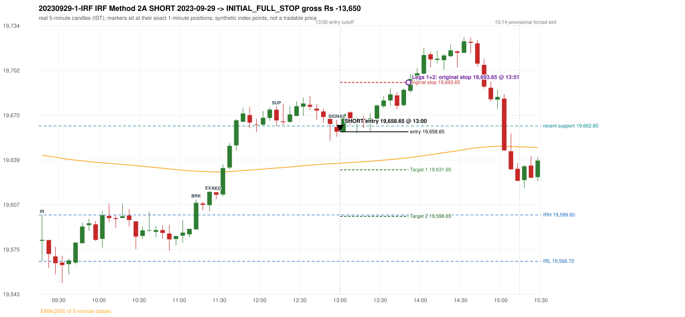

# Trading journal - 2023-09-29 (Friday)

> Phase 4 historical validation, window B (Window B 2022-09-01..2025-08-31 (5paisa minutes); status DATA_VALIDATED). The FROZEN Phase 3.6 configuration (IRF, ORB, PDR body-based, PDS, RF; shared controller) on a different data source. HISTORICAL RESEARCH ONLY: the strategy was developed using later data. same provider as the Phase 3.6 baseline; the vendor-overlap audit shows the minute bars differ from the secondary vendor Synthetic NIFTY 50 index-point P&L (the index is not tradable). The owner's review status is intentionally blank.

## A. Trading day overview

| item | value |
|---|---|
| Date / weekday | 2023-09-29 / Friday |
| Session type | USABLE_WITH_FLAGS / VALID |
| Original session open (first 1-minute open) | 19,581.20 |
| Previous session | 2023-09-28 |
| Previous-day high / low (wicks included) | 19,766.15 / 19,493.10 |
| Previous-day highest BODY high (the body-based PDR ceiling; wicks ignored) | 19,761.80 |
| Previous-day official close / last 5-minute close | 19,523.55 / 19,553.30 |
| Raw engine records / confirmed signals / fully valid signals | 6 / 2 / 2 |
| Setups that did not complete (invalidated / incomplete) | 4 |
| Executed trades | 1 20230929-1-IRF |
| Gross P&L (Rs, synthetic) | -13,650.00 |
| Illustrative net P&L (Rs; Rs 500/trade + 0.5 pt/fill) | -14,540.00 |
| Day-end portfolio status | SECOND_TRADE_ELIGIBLE |
| Manual journal trades (matched / unmatched) | 0 (0 / 0) |
| Extra automated trades | 0 |

## B. Daily strategy signal timeline (confirmed signals, chronological)

| time | strategy | method | dir | entry-rule status | valid for execution | <= 13:00 | portfolio state | accepted / ignored | specific reason | competing (same minute) |
|---|---|---|---|---|---|---|---|---|---|---|
| 13:00 | IRF | Method 2A | SHORT | PROPOSAL_DEPENDENT | True | True | FIRST_TRADE_ACTIVE | ACCEPTED -> 20230929-1-IRF | first eligible signal of the day; trade 1: INITIAL_FULL_STOP |  |
| 14:50 | IRF | Method 2A | SHORT | PROPOSAL_DEPENDENT | True | False | SECOND_TRADE_ELIGIBLE | REJECTED | SECOND_TRADE_RESTRICTED_TO_PDR_PDS [blocked by IRF#1] |  |

Engine setups that did not complete (4); the complete list with failed rule ids is in `rejected_signals.csv`:

| candle | strategy | method | dir | status | precise reason | failed rules |
|---|---|---|---|---|---|---|
| 14:45 | IRF | Method 1/2 | SHORT | INCOMPLETE_AT_EOD | SESSION_ENDED_BEFORE_CONFIRMATION |  |
| 09:15 | ORB | Method 2 | LONG | INVALIDATED | TREND:EMA_PREV_SESSION_CLOSE wrong side | ORB-TREND-001;ORB-TREND-002 |
| 09:15 | PDR | PDR | LONG | INVALIDATED | OPEN_NOT_STRICTLY_ABOVE_ZONE |  |
| 09:35 | RF | RF | LONG | INVALIDATED | TREND:EMA_PREV_SESSION_CLOSE wrong side | RF-001;RF-008 |

## C. Detailed trade journals

### 20230929-1-IRF: IRF Method 2A SHORT (FIRST trade)

Chart: 

**Rule configuration:** CFG-phase36_body_based-866f954e55 - signal verification status **PROPOSAL_DEPENDENT** (never VERIFIED while a rule rests on a proposal).

#### 1. Setup identification

IRF Method 2A SHORT: the 11:10-11:15 candle closed at 19,608.20, above IRH 19,599.60, and the next candle did not close back inside the range, so the setup is Method 2 and price stayed above it until the trigger. Extension candle 11:20-11:25, red candle 11:25-11:30. The trigger came 21 candles after the breakout candle: a completed candle closed below the recent pullback-low support (12:55-13:00); confirmed at 13:00 with close 19,658.75. Entry reference close 19,658.75 is 59.15 points above IRH 19,599.60.

#### 2. Candle and indicator calculations

| role | session | candle | O | H | L | C | range | body % | upper wick % | lower wick % | direction | EMA(200) | strong bull / bear | pin bull / bear | small (body<=30%) | used for |
|---|---|---|---|---|---|---|---|---|---|---|---|---|---|---|---|---|
| initial_range_candle | TODAY | 09:15-09:20 | 19,581.20 | 19,599.60 | 19,566.70 | 19,581.90 | 32.90 | 2.13 | 53.80 | 44.07 | BULLISH | 19,642.00 | False / False | False / False | True | initial range = high/low of the 09:15 candle |
| signal_candle | TODAY | 12:55-13:00 | 19,662.10 | 19,667.20 | 19,655.20 | 19,658.75 | 12.00 | 27.92 | 42.50 | 29.58 | BEARISH | 19,636.15 | False / False | False / False | True | candle whose close completed the trigger |
| breakout_candle | TODAY | 11:10-11:15 | 19,589.35 | 19,610.60 | 19,589.20 | 19,608.20 | 21.40 | 88.08 | 11.21 | 0.70 | BULLISH | 19,630.71 | True / False | False / False | False | breakout candle: a completed candle closing above IRH |
| extension_candle | TODAY | 11:20-11:25 | 19,606.60 | 19,616.25 | 19,602.20 | 19,616.05 | 14.05 | 67.26 | 1.42 | 31.32 | BULLISH | 19,630.32 | True / False | False / False | False | extension: first later candle trading above the breakout candle's high |
| red_candle | TODAY | 11:25-11:30 | 19,615.65 | 19,615.95 | 19,610.70 | 19,614.00 | 5.25 | 31.43 | 5.71 | 62.86 | BEARISH | 19,630.16 | False / False | False / False | False | first red candle during the extension |
| support_pivot | TODAY | 12:10-12:15 | 19,674.30 | 19,676.70 | 19,662.80 | 19,666.75 | 13.90 | 54.32 | 17.27 | 28.42 | BEARISH | 19,632.93 | False / False | False / False | False | recent support: latest 3-candle fractal low formed after the breakout |

Every condition, with the rule, the calculation, the observed values and the result:

| # | group | rule | result | status / numeric definition | calculation | observed | required | available at | why it matters |
|---|---|---|---|---|---|---|---|---|---|
| 1 | SELECTION | SEL-FIRST-001 | PASS | USER_APPROVED / USER_APPROVED | earliest CONFIRMED signal of the day across IRF/ORB/PDR/PDS/RF that passed the controller's checks | 0 confirmed signal(s) earlier today; 2 confirmed signals in the day in total, this one at 13:00 | no earlier executable signal | 2023-09-29 13:00 | the shared controller trades only the first valid signal; the five strategies are not independent positions |
| 2 | SELECTION | SEL-TIE-001 | PASS | USER_APPROVED / USER_APPROVED | other CONFIRMED signals with exactly the same confirmation timestamp | none | no different-strategy / opposite-direction signal in the same minute (otherwise an unresolved conflict, no trade) | 2023-09-29 13:00 | an unresolved same-minute collision would have produced no trade at all |
| 3 | SELECTION | ENTRY-CUTOFF-001 | PASS | USER_APPROVED / USER_APPROVED | fill timestamp vs 13:00:00 IST | signal confirmed 13:00; fill 13:00 | fill at or before 13:00:00 IST | 2023-09-29 13:00 | no new position may be entered with a fill after 13:00 IST |
| 4 | SELECTION | EXE-FILL-001 | PASS | PROPOSED_FOR_REVIEW / PROPOSED_FOR_REVIEW | fill = open of the 1-minute bar that starts at the signal candle's end | bar 13:00 O 19,658.65 H 19,667.45 L 19,658.25 C 19,666.60; executable=True; entry 19,658.65 | fill bar exists, starts exactly at the signal end, is fillable; entry = its open | 2023-09-29 13:00 | a 5-minute signal is known only when its candle closes; the first price that can be traded is the next minute's open |
| 5 | SELECTION | DAY-MAX-001 | PASS | USER_APPROVED / USER_APPROVED | number of entries today | trade 1 of at most 2 | <= 2 entries per day | 2023-09-29 13:00 | daily trade cap |
| 6 | SETUP | IRF-GLOBAL-001 | PASS | SOURCE_VERIFIED / EXPLICIT_IN_SOURCE | initial range = high and low (wicks included) of the first completed 5-minute candle | 09:15-09:20 IRH 19,599.60, IRL 19,566.70 (range 32.90; engine recorded IRH 19,599.60, IRL 19,566.70) | high/low of the 09:15-09:20 candle | 2023-09-29 09:20 | all three IRF methods measure price against this range |
| 7 | SETUP | IRF-GLOBAL-003 | PASS | SOURCE_VERIFIED / EXPLICIT_IN_SOURCE | closes confirm, wicks do not: every trigger is evaluated on a completed 5-minute candle | trigger candle 12:55-13:00 was complete when the signal was stamped 13:00; decision uses its close 19,658.75 | completed candle close, not an intra-candle wick | 2023-09-29 13:00 | an intra-candle wick can reverse before the candle closes |
| 8 | SETUP | IRF-GLOBAL-002 | PASS | SOURCE_VERIFIED / EXPLICIT_IN_SOURCE | direction | SHORT (IRF trades short only) | short only | 2023-09-29 13:00 | IRF fades failed upside breakouts |
| 9 | SETUP | IRF-M2-001 | PASS | SOURCE_VERIFIED / EXPLICIT_IN_SOURCE | breakout candle close vs IRH | 11:10-11:15 O 19,589.35 H 19,610.60 L 19,589.20 C 19,608.20; range 21.40, body 18.85 (88.08%), upper wick 2.40 (11.21%), lower wick 0.15 (0.70%), bullish; close 19,608.20 is 8.60 points above IRH 19,599.60 | close > IRH (a wick above IRH is not a breakout) | 2023-09-29 11:15 | starts every IRF setup |
| 10 | SETUP | IRF-M2-004 | PASS | SOURCE_VERIFIED / EXPLICIT_IN_SOURCE | the candle after the breakout must NOT close back inside the range (else the setup is Method 1) | 11:15 close 19,606.80 vs [19,566.70, 19,599.60) | not (IRL <= close < IRH) | 2023-09-29 11:20 | separates Method 2 (price holds above) from Method 1 (immediate failure) |
| 11 | SETUP | IRF-M2-002 | PASS | SOURCE_VERIFIED / QUALITATIVE_SOURCE_NUMERIC_DEFINITION_PROPOSED_FOR_REVIEW | extension = a later candle whose high exceeds the breakout candle's high (research definition E1) | 11:20 high 19,616.25 vs breakout candle high 19,610.60 (+5.65) | high > breakout candle high | 2023-09-29 11:25 | the guide says price 'extends further upward'; the numeric test is a proposal |
| 12 | SETUP | IRF-M2-003 | PASS | SOURCE_VERIFIED / QUALITATIVE_SOURCE_NUMERIC_DEFINITION_PROPOSED_FOR_REVIEW | a red candle (close < open) forms after the extension | 11:25-11:30 O 19,615.65 H 19,615.95 L 19,610.70 C 19,614.00; range 5.25, body 1.65 (31.43%), upper wick 0.30 (5.71%), lower wick 3.30 (62.86%), bearish | close < open, at or after the candle following the extension | 2023-09-29 11:30 | the red candle shows the first pause/reversal inside the extension |
| 13 | CONFIRMATION | IRF-M2A-001 | PASS | SOURCE_VERIFIED / QUALITATIVE_SOURCE_NUMERIC_DEFINITION_PROPOSED_FOR_REVIEW | recent support = latest 3-candle fractal low (k=1) among candles b+1 ... i-2 | 12:10 low 19,662.80; neighbours' lows 19,666.45 (12:05) and 19,663.65 (12:15) are not lower; engine recorded support 19,662.80 | pivot low known before the trigger candle | 2023-09-29 12:20 | the support is the level whose break completes Method 2A (the exact 'pullback low' definition is a proposal) |
| 14 | CONFIRMATION | IRF-M2A-002 | PASS | SOURCE_VERIFIED / EXPLICIT_WORDING_DETAIL_PROPOSED_FOR_REVIEW | trigger candle closes below recent support | 12:55 close 19,658.75 vs support 19,662.80: 4.05 points below | close < support (close, not wick) | 2023-09-29 13:00 | completes Method 2A |
| 15 | CONFIRMATION | IRF-M2-005 | PASS | SOURCE_VERIFIED / EXPLICIT_IN_SOURCE | chronology: the red candle precedes the break candle | red candle 11:25, break candle 12:55 | red candle index < break candle index (m2a_break_may_be_red_candle = False) | 2023-09-29 13:00 | a red candle alone is not confirmation; a level break is required |
| 16 | EXECUTION | EXE-STOP-001 | PASS | USER_APPROVED / USER_APPROVED | initial stop = entry + 35 points | entry 19,658.65 -> stop 19,693.65 | stop 35 index points (BASELINE) | 2023-09-29 13:00 | defines the loss if the setup fails before Target 1 |
| 17 | EXECUTION | EXE-T1-001 | PASS | SOURCE_VERIFIED / EXPLICIT_IN_SOURCE | Target 1 = entry +/- 27 points | T1 19,631.65 | 27 points | 2023-09-29 13:00 | Leg 1 (3 lots) is booked at Target 1 |
| 18 | EXECUTION | IRF-TGT-001 | PASS | SOURCE_VERIFIED / EXPLICIT_IN_SOURCE | Target 2 = entry +/- 60 points | T2 19,598.65 | 60 points | 2023-09-29 13:00 | Leg 2 (3 lots) is booked at Target 2 |
| 19 | EXECUTION | POST-T1-STOP-006 | PASS | USER_APPROVED / USER_APPROVED | after T1 the Leg-2 stop = entry + 6 (no trailing) | post-T1 stop 19,664.65 | entry -6 (LONG) / +6 (SHORT) | 2023-09-29 13:00 | protects the remaining three lots once the first three are booked |
| 20 | EXECUTION | SIZE-LOT-001 | PASS | USER_APPROVED / USER_APPROVED | 6 lots x 65 = 390, Leg 1 = 3 lots = 195, Leg 2 = 195 | 6 lots, lot size 65, legs 3+3 | 6 lots in two equal legs | 2023-09-29 13:00 | position size for the synthetic P&L |
| 21 | NOTE | IRF-M2-006 | UNRESOLVED | UNRESOLVED / UNRESOLVED | delay between the breakout candle and this trigger; expiry rule | 21 candles after the breakout; expiry none configured | the source states no expiry | 2023-09-29 13:00 | an old breakout can still trigger hours later |
| 22 | NOTE | IRF-M2-006 | UNRESOLVED | UNRESOLVED / UNRESOLVED | did price stay above IRH between the breakout and the trigger? | 0 closes at or below IRH between 11:15 and 12:55; trigger close 19,658.75 above IRH 19,599.60 | the engine does not require price to stay above IRH | 2023-09-29 13:00 | the guide describes price 'holding above IRH and keeping rising'; the code only needs the level break |
| 23 | NOTE | IRF-GLOBAL-004 | UNRESOLVED | UNRESOLVED / UNRESOLVED | which close above IRH of the session produced this attempt; repeat setups | this breakout is upward crossing no. 1 of the session (a close above IRH after a close at/below it) | the source states no first-breakout-only, re-arming, expiry or trades-per-day rule | 2023-09-29 13:00 | IRF re-arms on every later breakout in the code, producing many raw setups; the controller keeps only the first |
| 24 | NOTE | NOTE-IRF-REPEATED-SETUPS | NOT_APPLICABLE | NOT_A_RULE / NOT_A_REGISTRY_RULE | other IRF signals later in the session (not traded) | 1 further confirmed IRF signal(s): Method 2A@14:50 | disclosure of repeated raw setups | 2023-09-29 13:00 | repeated raw IRF setups are not hidden; they are logged as ignored |
| 25 | NOTE | IRF-SL-001 | NOT_APPLICABLE | SOURCE_VERIFIED / QUALITATIVE_SOURCE_NUMERIC_DEFINITION_PROPOSED_FOR_REVIEW | the guide's 35-or-40 rule: 35 if the most recent green candle's high is within 35 points of entry, else 40 | most recent green candle high 19,682.95 is 24.30 points from the entry 19,658.65: the guide's rule would select 35 points; the baseline applies a fixed 35 (USER_APPROVED research baseline; the 35-vs-40 selection and the 40-point variant are separate labelled scenarios) | source selection rule | 2023-09-29 13:00 | the stop distance is a modelling choice and changes losses, not entries |
| 26 | NOTE | NOTE-UNRESOLVED-DEPENDENCIES | UNRESOLVED | NOT_A_RULE / NOT_A_REGISTRY_RULE | rules the signal depends on that the sources leave unresolved | engine-recorded unresolved rule ids: IRF-GLOBAL-004; verification status PROPOSAL_DEPENDENT | n/a (disclosure) | 2023-09-29 13:00 | the entry is only as verified as the rules it rests on |

#### 3. Entry decision and explanation

IRF Method 2A SHORT: the 11:10-11:15 candle closed at 19,608.20, above IRH 19,599.60, and the next candle did not close back inside the range, so the setup is Method 2 and price stayed above it until the trigger. Extension candle 11:20-11:25, red candle 11:25-11:30. The trigger came 21 candles after the breakout candle: a completed candle closed below the recent pullback-low support (12:55-13:00); confirmed at 13:00 with close 19,658.75. Entry reference close 19,658.75 is 59.15 points above IRH 19,599.60.

**Why this trade ahead of the other strategies:** This IRF Method 2A signal was the earliest executable signal of the day: 0 confirmed signal(s) earlier, 0 other in the same minute. 1 later confirmed signal(s) (IRF x1) are logged as ignored or rejected. State of the other four engines at that moment: [ORB: Method 2 invalidated at 09:15: TREND:EMA_PREV_SESSION_CLOSE wrong side] [PDR: PDR invalidated at 09:15: OPEN_NOT_STRICTLY_ABOVE_ZONE] [PDS: no setup record before this time (a base condition was not met, or nothing triggered)] [RF: RF invalidated at 09:35: TREND:EMA_PREV_SESSION_CLOSE wrong side]

#### 4. Actual entry execution

| item | value |
|---|---|
| Signal candle | 12:55-13:00 |
| Signal confirmed | 2023-09-29 13:00 |
| Fill timestamp | 2023-09-29 13:00 |
| Entry price | 19,658.65 |
| Source partition / 1-minute bar | data/phase4/processed/FIVEPAISA_1M_PHASE4/nifty50/year=2023/month=09/candles.parquet / 2023-09-29 13:00 |
| Source bar O / H / L / C | 19,658.65 / 19,667.45 / 19,658.25 / 19,666.60 |
| Fill assumption | open of the 1-minute bar starting at the signal candle's end (EXE-FILL-001, PROPOSED causal convention) |
| Initial stop / T1 / T2 / post-T1 stop | 19,693.65 / 19,631.65 / 19,598.65 / 19,664.65 |
| Position | 6 lots x 65 = 390 units (Leg 1 195, Leg 2 195) |

#### 5-8. Trade progress, Target 1, post-T1 stop and final exit

Between the 13:00 entry bar and the final exit (52 one-minute bars) the best excursion in favour was 1.00 points at 13:13 and the worst against was 37.05 points at 13:51. At 13:51 price reached the original stop 19,693.65 before Target 1 19,631.65, so all six lots exited together at 19,693.65. This is an INITIAL_FULL_STOP: one more trade is allowed that day, only a newly confirmed PDR/PDS signal.

| leg | qty | exit time | exit price | reason | source 1-minute bar | O / H / L / C | gross points | gross Rs | slippage pts | flags |
|---|---|---|---|---|---|---|---|---|---|---|
| 1 | 195 | 13:51 | 19,693.65 | ORIGINAL_STOP_BEFORE_T1 | 13:51 | 19,691.95 / 19,695.70 / 19,690.75 / 19,693.25 | -35.00 | -6,825.00 | 0.00 |  |
| 2 | 195 | 13:51 | 19,693.65 | ORIGINAL_STOP_BEFORE_T1 | 13:51 | 19,691.95 / 19,695.70 / 19,690.75 / 19,693.25 | -35.00 | -6,825.00 | 0.00 |  |

Exit evidence per leg:

* Leg 1: 1-minute bar 13:51 O 19,691.95 H 19,695.70 L 19,690.75 C 19,693.25: high 19,695.70 reached the original stop 19,693.65 before Target 1 19,631.65 was touched; both legs exit at the stop level 19,693.65
* Leg 2: 1-minute bar 13:51 O 19,691.95 H 19,695.70 L 19,690.75 C 19,693.25: high 19,695.70 reached the original stop 19,693.65 before Target 1 19,631.65 was touched; both legs exit at the stop level 19,693.65

#### 9. Gross and illustrative net P&L

| item | value (Rs) |
|---|---|
| Leg 1 gross | -6,825.00 |
| Leg 2 gross | -6,825.00 |
| Trade gross (= Leg 1 + Leg 2) | -13,650.00 |
| Illustrative fixed cost | -500.00 |
| Illustrative slippage (0.5 pt on every fill, entry + exits, all units) | -390.00 |
| Illustrative net | -14,540.00 |

#### 10. Manual journal comparison

No manual journal exists for this period; no comparison.

## D. Manual journal comparison

No manual journal exists for this period (the manual journal covers 2025-09-01 .. 2026-08-31 only); no comparison is made and no automated trade is labelled 'extra'.

## E. Daily conclusion

* **Traded:** 20230929-1-IRF - IRF Method 2A SHORT at 13:00 (entry 19,658.65), outcome INITIAL_FULL_STOP, gross Rs -13,650.00, illustrative net Rs -14,540.00. **Why:** This IRF Method 2A signal was the earliest executable signal of the day: 0 confirmed signal(s) earlier, 0 other in the same minute. 1 later confirmed signal(s) (IRF x1) are logged as ignored or rejected. State of the other four engines at that moment: [ORB: Method 2 invalidated at 09:15: TREND:EMA_PREV_SESSION_CLOSE wrong side] [PDR: PDR invalidated at 09:15: OPEN_NOT_STRICTLY_ABOVE_ZONE] [PDS: no setup record before this time (a base condition was not met, or nothing triggered)] [RF: RF invalidated at 09:35: TREND:EMA_PREV_SESSION_CLOSE wrong side] **How it ended:** At 13:51 price reached the original stop 19,693.65 before Target 1 19,631.65, so all six lots exited together at 19,693.65. This is an INITIAL_FULL_STOP: one more trade is allowed that day, only a newly confirmed PDR/PDS signal.
* **Ignored / rejected signals:** IRF REJECTED SECOND_TRADE_RESTRICTED_TO_PDR_PDS x1
* **Open strategy-definition issues that affected this day:** IRF-GLOBAL-004 (NOT STATED: how many IRF trades per day, a latest entry time, and whether a new breakout may re-arm a setup after a signal), IRF-M2-006 (How long a Method 2 setup stays valid (expiry / invalidation before a level breaks) is not stated), NOTE-UNRESOLVED-DEPENDENCIES
* **Automated triage (not an approval; the owner's review status stays blank):** TRADED_NO_FLAGS
