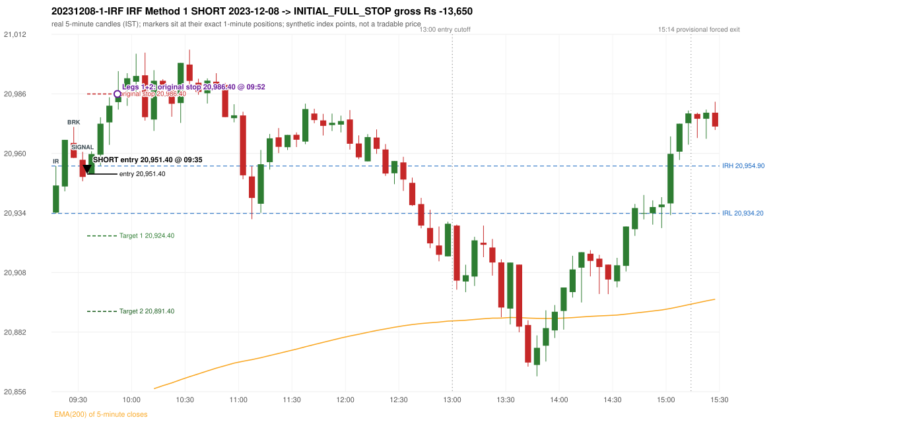
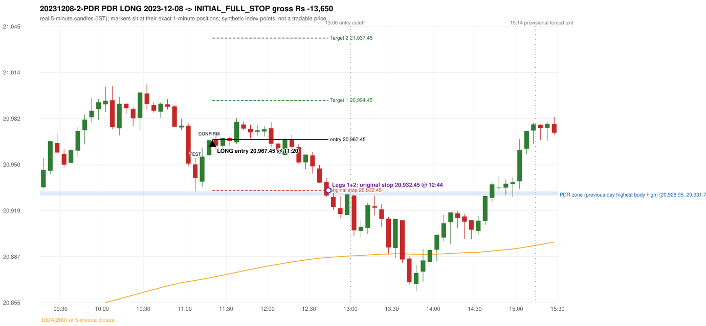

# Trading journal - 2023-12-08 (Friday)

> Phase 4 historical validation, window B (Window B 2022-09-01..2025-08-31 (5paisa minutes); status DATA_VALIDATED). The FROZEN Phase 3.6 configuration (IRF, ORB, PDR body-based, PDS, RF; shared controller) on a different data source. HISTORICAL RESEARCH ONLY: the strategy was developed using later data. same provider as the Phase 3.6 baseline; the vendor-overlap audit shows the minute bars differ from the secondary vendor Synthetic NIFTY 50 index-point P&L (the index is not tradable). The owner's review status is intentionally blank.

## A. Trading day overview

| item | value |
|---|---|
| Date / weekday | 2023-12-08 / Friday |
| Session type | USABLE_WITH_FLAGS / VALID |
| Original session open (first 1-minute open) | 20,934.55 |
| Previous session | 2023-12-07 |
| Previous-day high / low (wicks included) | 20,935.85 / 20,851.45 |
| Previous-day highest BODY high (the body-based PDR ceiling; wicks ignored) | 20,931.75 |
| Previous-day official close / last 5-minute close | 20,901.15 / 20,912.55 |
| Raw engine records / confirmed signals / fully valid signals | 14 / 11 / 10 |
| Setups that did not complete (invalidated / incomplete) | 3 |
| Executed trades | 2 20231208-1-IRF;20231208-2-PDR |
| Gross P&L (Rs, synthetic) | -27,300.00 |
| Illustrative net P&L (Rs; Rs 500/trade + 0.5 pt/fill) | -29,080.00 |
| Day-end portfolio status | DAY_FINISHED |
| Manual journal trades (matched / unmatched) | 0 (0 / 0) |
| Extra automated trades | 0 |

## B. Daily strategy signal timeline (confirmed signals, chronological)

| time | strategy | method | dir | entry-rule status | valid for execution | <= 13:00 | portfolio state | accepted / ignored | specific reason | competing (same minute) |
|---|---|---|---|---|---|---|---|---|---|---|
| 09:35 | IRF | Method 1 | SHORT | PROPOSAL_DEPENDENT | True | True | FIRST_TRADE_ACTIVE | ACCEPTED -> 20231208-1-IRF | first eligible signal of the day; trade 1: INITIAL_FULL_STOP |  |
| 10:55 | IRF | Method 2A | SHORT | PROPOSAL_DEPENDENT | True | True | SECOND_TRADE_ELIGIBLE | REJECTED | SECOND_TRADE_RESTRICTED_TO_PDR_PDS [blocked by IRF#1] |  |
| 11:05 | IRF | Method 1 | SHORT | PROPOSAL_DEPENDENT | True | True | SECOND_TRADE_ELIGIBLE | REJECTED | SECOND_TRADE_RESTRICTED_TO_PDR_PDS [blocked by IRF#1] |  |
| 11:20 | PDR | PDR | LONG | RESEARCH_VARIANT | True | True | SECOND_TRADE_ACTIVE | ACCEPTED -> 20231208-2-PDR | permitted second trade: newly confirmed PDR/PDS after the original full stop; trade 2: INITIAL_FULL_STOP |  |
| 12:05 | IRF | Method 2B | SHORT | PROPOSAL_DEPENDENT | True | True | SECOND_TRADE_ACTIVE | IGNORED | POSITION_ACTIVE (signal kept for diagnostics only; never reused) [blocked by PDR#2] |  |
| 12:25 | IRF | Method 1 | SHORT | PROPOSAL_DEPENDENT | True | True | SECOND_TRADE_ACTIVE | IGNORED | POSITION_ACTIVE (signal kept for diagnostics only; never reused) [blocked by PDR#2] |  |
| 12:35 | IRF | Method 1 | SHORT | PROPOSAL_DEPENDENT | True | True | SECOND_TRADE_ACTIVE | IGNORED | POSITION_ACTIVE (signal kept for diagnostics only; never reused) [blocked by PDR#2] |  |
| 14:45 | PDR | PDR | LONG | RESEARCH_VARIANT | True | False | DAY_FINISHED | IGNORED | DAY_FINISHED [blocked by PDR#2] | RF RF LONG |
| 14:45 | RF | RF | LONG | PROPOSAL_DEPENDENT | True | False | DAY_FINISHED | IGNORED | DAY_FINISHED [blocked by PDR#2] | PDR PDR LONG |
| 15:00 | PDR | PDR | LONG | RESEARCH_VARIANT | True | False | DAY_FINISHED | IGNORED | DAY_FINISHED [blocked by PDR#2] |  |
| 15:30 | IRF | Method 2B | SHORT | PROPOSAL_DEPENDENT | False | False | DAY_FINISHED | IGNORED | DAY_FINISHED [blocked by PDR#2] |  |

Engine setups that did not complete (3); the complete list with failed rule ids is in `rejected_signals.csv`:

| candle | strategy | method | dir | status | precise reason | failed rules |
|---|---|---|---|---|---|---|
| 15:25 | IRF | Method 1/2 | SHORT | INCOMPLETE_AT_EOD | SESSION_ENDED_BEFORE_CONFIRMATION |  |
| 09:15 | ORB | Method 1 | LONG | INVALIDATED | CANDLE_QUALITY(not a strong body / wick too large) | ORB-M1-LONG-003 |
| 09:15 | ORB | Method 2 | LONG | INVALIDATED | TRENDLINE_NOT_SUPPORTIVE | ORB-M2-LONG-001 |

## C. Detailed trade journals

### 20231208-1-IRF: IRF Method 1 SHORT (FIRST trade)

Chart: 

**Rule configuration:** CFG-phase36_body_based-866f954e55 - signal verification status **PROPOSAL_DEPENDENT** (never VERIFIED while a rule rests on a proposal).

#### 1. Setup identification

IRF Method 1 SHORT: the completed 09:25 candle closed at 20,958.50, 3.60 points above the initial range high 20,954.90 (range [20,934.20, 20,954.90] from the 09:15 candle); the immediately following completed 09:30 candle closed at 20,950.15, back inside the range. The short signal was confirmed at 09:35 on that close. Entry reference close 20,950.15 is 4.75 points below IRH 20,954.90.

#### 2. Candle and indicator calculations

| role | session | candle | O | H | L | C | range | body % | upper wick % | lower wick % | direction | EMA(200) | strong bull / bear | pin bull / bear | small (body<=30%) | used for |
|---|---|---|---|---|---|---|---|---|---|---|---|---|---|---|---|---|
| initial_range_candle | TODAY | 09:15-09:20 | 20,934.55 | 20,954.90 | 20,934.20 | 20,946.40 | 20.70 | 57.25 | 41.06 | 1.69 | BULLISH | 20,843.88 | False / False | False / False | False | initial range = high/low of the 09:15 candle |
| signal_candle | TODAY | 09:30-09:35 | 20,957.65 | 20,961.10 | 20,948.25 | 20,950.15 | 12.85 | 58.37 | 26.85 | 14.79 | BEARISH | 20,847.26 | False / False | False / False | False | candle whose close completed the trigger |
| breakout_candle | TODAY | 09:25-09:30 | 20,965.00 | 20,972.00 | 20,958.40 | 20,958.50 | 13.60 | 47.79 | 51.47 | 0.74 | BEARISH | 20,846.23 | False / False | False / False | False | breakout candle: a completed candle closing above IRH |

Every condition, with the rule, the calculation, the observed values and the result:

| # | group | rule | result | status / numeric definition | calculation | observed | required | available at | why it matters |
|---|---|---|---|---|---|---|---|---|---|
| 1 | SELECTION | SEL-FIRST-001 | PASS | USER_APPROVED / USER_APPROVED | earliest CONFIRMED signal of the day across IRF/ORB/PDR/PDS/RF that passed the controller's checks | 0 confirmed signal(s) earlier today; 11 confirmed signals in the day in total, this one at 09:35 | no earlier executable signal | 2023-12-08 09:35 | the shared controller trades only the first valid signal; the five strategies are not independent positions |
| 2 | SELECTION | SEL-TIE-001 | PASS | USER_APPROVED / USER_APPROVED | other CONFIRMED signals with exactly the same confirmation timestamp | none | no different-strategy / opposite-direction signal in the same minute (otherwise an unresolved conflict, no trade) | 2023-12-08 09:35 | an unresolved same-minute collision would have produced no trade at all |
| 3 | SELECTION | ENTRY-CUTOFF-001 | PASS | USER_APPROVED / USER_APPROVED | fill timestamp vs 13:00:00 IST | signal confirmed 09:35; fill 09:35 | fill at or before 13:00:00 IST | 2023-12-08 09:35 | no new position may be entered with a fill after 13:00 IST |
| 4 | SELECTION | EXE-FILL-001 | PASS | PROPOSED_FOR_REVIEW / PROPOSED_FOR_REVIEW | fill = open of the 1-minute bar that starts at the signal candle's end | bar 09:35 O 20,951.40 H 20,958.50 L 20,951.40 C 20,958.50; executable=True; entry 20,951.40 | fill bar exists, starts exactly at the signal end, is fillable; entry = its open | 2023-12-08 09:35 | a 5-minute signal is known only when its candle closes; the first price that can be traded is the next minute's open |
| 5 | SELECTION | DAY-MAX-001 | PASS | USER_APPROVED / USER_APPROVED | number of entries today | trade 1 of at most 2 | <= 2 entries per day | 2023-12-08 09:35 | daily trade cap |
| 6 | SETUP | IRF-GLOBAL-001 | PASS | SOURCE_VERIFIED / EXPLICIT_IN_SOURCE | initial range = high and low (wicks included) of the first completed 5-minute candle | 09:15-09:20 IRH 20,954.90, IRL 20,934.20 (range 20.70; engine recorded IRH 20,954.90, IRL 20,934.20) | high/low of the 09:15-09:20 candle | 2023-12-08 09:20 | all three IRF methods measure price against this range |
| 7 | SETUP | IRF-GLOBAL-003 | PASS | SOURCE_VERIFIED / EXPLICIT_IN_SOURCE | closes confirm, wicks do not: every trigger is evaluated on a completed 5-minute candle | trigger candle 09:30-09:35 was complete when the signal was stamped 09:35; decision uses its close 20,950.15 | completed candle close, not an intra-candle wick | 2023-12-08 09:35 | an intra-candle wick can reverse before the candle closes |
| 8 | SETUP | IRF-GLOBAL-002 | PASS | SOURCE_VERIFIED / EXPLICIT_IN_SOURCE | direction | SHORT (IRF trades short only) | short only | 2023-12-08 09:35 | IRF fades failed upside breakouts |
| 9 | SETUP | IRF-M1-001 | PASS | SOURCE_VERIFIED / EXPLICIT_IN_SOURCE | breakout candle close vs IRH | 09:25-09:30 O 20,965.00 H 20,972.00 L 20,958.40 C 20,958.50; range 13.60, body 6.50 (47.79%), upper wick 7.00 (51.47%), lower wick 0.10 (0.74%), bearish; close 20,958.50 is 3.60 points above IRH 20,954.90 | close > IRH (a wick above IRH is not a breakout) | 2023-12-08 09:30 | starts every IRF setup |
| 10 | CONFIRMATION | IRF-M1-002 | PASS | SOURCE_VERIFIED / EXPLICIT_IN_SOURCE | candle after the breakout closes back inside [IRL, IRH) | 09:30-09:35 O 20,957.65 H 20,961.10 L 20,948.25 C 20,950.15; range 12.85, body 7.50 (58.37%), upper wick 3.45 (26.85%), lower wick 1.90 (14.79%), bearish; close 20,950.15 vs range [20,934.20, 20,954.90) | IRL <= close < IRH | 2023-12-08 09:35 | the failed breakout: price could not hold above the opening range |
| 11 | CONFIRMATION | IRF-M1-004 | PASS | SOURCE_VERIFIED / EXPLICIT_IN_SOURCE | failure candle is the candle immediately after the breakout (k = 1) | breakout 09:25, failure candle 09:30: k = 1 | k = 1 (pp.5, 6, 13); the p.14 'next or following' reading (IRF-M1-C001) is CONFLICTING and not used in the baseline | 2023-12-08 09:35 | the guide's worked example enters at the close of the very next candle; no support/resistance break is required |
| 12 | EXECUTION | EXE-STOP-001 | PASS | USER_APPROVED / USER_APPROVED | initial stop = entry + 35 points | entry 20,951.40 -> stop 20,986.40 | stop 35 index points (BASELINE) | 2023-12-08 09:35 | defines the loss if the setup fails before Target 1 |
| 13 | EXECUTION | EXE-T1-001 | PASS | SOURCE_VERIFIED / EXPLICIT_IN_SOURCE | Target 1 = entry +/- 27 points | T1 20,924.40 | 27 points | 2023-12-08 09:35 | Leg 1 (3 lots) is booked at Target 1 |
| 14 | EXECUTION | IRF-TGT-001 | PASS | SOURCE_VERIFIED / EXPLICIT_IN_SOURCE | Target 2 = entry +/- 60 points | T2 20,891.40 | 60 points | 2023-12-08 09:35 | Leg 2 (3 lots) is booked at Target 2 |
| 15 | EXECUTION | POST-T1-STOP-006 | PASS | USER_APPROVED / USER_APPROVED | after T1 the Leg-2 stop = entry + 6 (no trailing) | post-T1 stop 20,957.40 | entry -6 (LONG) / +6 (SHORT) | 2023-12-08 09:35 | protects the remaining three lots once the first three are booked |
| 16 | EXECUTION | SIZE-LOT-001 | PASS | USER_APPROVED / USER_APPROVED | 6 lots x 65 = 390, Leg 1 = 3 lots = 195, Leg 2 = 195 | 6 lots, lot size 65, legs 3+3 | 6 lots in two equal legs | 2023-12-08 09:35 | position size for the synthetic P&L |
| 17 | NOTE | IRF-GLOBAL-004 | UNRESOLVED | UNRESOLVED / UNRESOLVED | which close above IRH of the session produced this attempt; repeat setups | this breakout is upward crossing no. 1 of the session (a close above IRH after a close at/below it) | the source states no first-breakout-only, re-arming, expiry or trades-per-day rule | 2023-12-08 09:35 | IRF re-arms on every later breakout in the code, producing many raw setups; the controller keeps only the first |
| 18 | NOTE | NOTE-IRF-REPEATED-SETUPS | NOT_APPLICABLE | NOT_A_RULE / NOT_A_REGISTRY_RULE | other IRF signals later in the session (not traded) | 6 further confirmed IRF signal(s): Method 2A@10:55, Method 1@11:05, Method 2B@12:05, Method 1@12:25, Method 1@12:35, Method 2B@15:30 | disclosure of repeated raw setups | 2023-12-08 09:35 | repeated raw IRF setups are not hidden; they are logged as ignored |
| 19 | NOTE | IRF-SL-001 | NOT_APPLICABLE | SOURCE_VERIFIED / QUALITATIVE_SOURCE_NUMERIC_DEFINITION_PROPOSED_FOR_REVIEW | the guide's 35-or-40 rule: 35 if the most recent green candle's high is within 35 points of entry, else 40 | most recent green candle high 20,966.35 is 14.95 points from the entry 20,951.40: the guide's rule would select 35 points; the baseline applies a fixed 35 (USER_APPROVED research baseline; the 35-vs-40 selection and the 40-point variant are separate labelled scenarios) | source selection rule | 2023-12-08 09:35 | the stop distance is a modelling choice and changes losses, not entries |
| 20 | NOTE | NOTE-UNRESOLVED-DEPENDENCIES | UNRESOLVED | NOT_A_RULE / NOT_A_REGISTRY_RULE | rules the signal depends on that the sources leave unresolved | engine-recorded unresolved rule ids: IRF-GLOBAL-004; verification status PROPOSAL_DEPENDENT | n/a (disclosure) | 2023-12-08 09:35 | the entry is only as verified as the rules it rests on |

#### 3. Entry decision and explanation

IRF Method 1 SHORT: the completed 09:25 candle closed at 20,958.50, 3.60 points above the initial range high 20,954.90 (range [20,934.20, 20,954.90] from the 09:15 candle); the immediately following completed 09:30 candle closed at 20,950.15, back inside the range. The short signal was confirmed at 09:35 on that close. Entry reference close 20,950.15 is 4.75 points below IRH 20,954.90.

**Why this trade ahead of the other strategies:** This IRF Method 1 signal was the earliest executable signal of the day: 0 confirmed signal(s) earlier, 0 other in the same minute. 10 later confirmed signal(s) (IRF x6, PDR x3, RF x1) are logged as ignored or rejected. State of the other four engines at that moment: [ORB: Method 1 invalidated at 09:15: CANDLE_QUALITY(not a strong body / wick too large); Method 2 invalidated at 09:15: TRENDLINE_NOT_SUPPORTIVE] [PDR: no setup record before this time (a base condition was not met, or nothing triggered)] [PDS: no setup record before this time (a base condition was not met, or nothing triggered)] [RF: no setup record before this time (a base condition was not met, or nothing triggered)]

#### 4. Actual entry execution

| item | value |
|---|---|
| Signal candle | 09:30-09:35 |
| Signal confirmed | 2023-12-08 09:35 |
| Fill timestamp | 2023-12-08 09:35 |
| Entry price | 20,951.40 |
| Source partition / 1-minute bar | data/phase4/processed/FIVEPAISA_1M_PHASE4/nifty50/year=2023/month=12/candles.parquet / 2023-12-08 09:35 |
| Source bar O / H / L / C | 20,951.40 / 20,958.50 / 20,951.40 / 20,958.50 |
| Fill assumption | open of the 1-minute bar starting at the signal candle's end (EXE-FILL-001, PROPOSED causal convention) |
| Initial stop / T1 / T2 / post-T1 stop | 20,986.40 / 20,924.40 / 20,891.40 / 20,957.40 |
| Position | 6 lots x 65 = 390 units (Leg 1 195, Leg 2 195) |

#### 5-8. Trade progress, Target 1, post-T1 stop and final exit

Between the 09:35 entry bar and the final exit (18 one-minute bars) the best excursion in favour was 0.00 points at 09:35 and the worst against was 35.40 points at 09:52. At 09:52 price reached the original stop 20,986.40 before Target 1 20,924.40, so all six lots exited together at 20,986.40. This is an INITIAL_FULL_STOP: one more trade is allowed that day, only a newly confirmed PDR/PDS signal.

| leg | qty | exit time | exit price | reason | source 1-minute bar | O / H / L / C | gross points | gross Rs | slippage pts | flags |
|---|---|---|---|---|---|---|---|---|---|---|
| 1 | 195 | 09:52 | 20,986.40 | ORIGINAL_STOP_BEFORE_T1 | 09:52 | 20,982.25 / 20,986.80 / 20,979.90 / 20,985.25 | -35.00 | -6,825.00 | 0.00 |  |
| 2 | 195 | 09:52 | 20,986.40 | ORIGINAL_STOP_BEFORE_T1 | 09:52 | 20,982.25 / 20,986.80 / 20,979.90 / 20,985.25 | -35.00 | -6,825.00 | 0.00 |  |

Exit evidence per leg:

* Leg 1: 1-minute bar 09:52 O 20,982.25 H 20,986.80 L 20,979.90 C 20,985.25: high 20,986.80 reached the original stop 20,986.40 before Target 1 20,924.40 was touched; both legs exit at the stop level 20,986.40
* Leg 2: 1-minute bar 09:52 O 20,982.25 H 20,986.80 L 20,979.90 C 20,985.25: high 20,986.80 reached the original stop 20,986.40 before Target 1 20,924.40 was touched; both legs exit at the stop level 20,986.40

#### 9. Gross and illustrative net P&L

| item | value (Rs) |
|---|---|
| Leg 1 gross | -6,825.00 |
| Leg 2 gross | -6,825.00 |
| Trade gross (= Leg 1 + Leg 2) | -13,650.00 |
| Illustrative fixed cost | -500.00 |
| Illustrative slippage (0.5 pt on every fill, entry + exits, all units) | -390.00 |
| Illustrative net | -14,540.00 |

#### 10. Manual journal comparison

No manual journal exists for this period; no comparison.

### 20231208-2-PDR: PDR LONG (SECOND trade)

Chart: 

**Rule configuration:** CFG-phase36_body_based-866f954e55 - signal verification status **RESEARCH_VARIANT** (never VERIFIED while a rule rests on a proposal).

#### 1. Setup identification

PDR LONG (body-based engine, A_HIGHEST_BODY_HIGH): the session opened 33.40 points above the previous close and 2.80 points above the previous-day highest BODY high 20,931.75 (zone [20,928.95, 20,931.75] from the 11:05 candle of 2023-12-07; the highest wick 20,935.85 is ignored). The 11:05 candle (20,931.70 - 20,954.85) tested the zone; the 11:15 candle (green, O 20,956.60 H 20,968.90 L 20,953.35 C 20,967.00) passed GOOD_GREEN_BODY and closed 35.25 points above the zone ceiling, confirming the entry at 11:20. The pattern thresholds and the zone's lower boundary are provisional research assumptions, not approved by the strategy author.

#### 2. Candle and indicator calculations

| role | session | candle | O | H | L | C | range | body % | upper wick % | lower wick % | direction | EMA(200) | strong bull / bear | pin bull / bear | small (body<=30%) | used for |
|---|---|---|---|---|---|---|---|---|---|---|---|---|---|---|---|---|
| zone_source_candle | PREVIOUS | 11:05-11:10 | 20,928.95 | 20,935.85 | 20,925.15 | 20,931.75 | 10.70 | 26.17 | 38.32 | 35.51 | BULLISH | 20,796.55 | False / False | False / False | True | candle of the previous session's highest BODY high (A_HIGHEST_BODY_HIGH) |
| prev_day_wick_high_candle | PREVIOUS | 11:05-11:10 | 20,928.95 | 20,935.85 | 20,925.15 | 20,931.75 | 10.70 | 26.17 | 38.32 | 35.51 | BULLISH | 20,796.55 | False / False | False / False | True | candle of the previous session's highest WICK (ignored by the author's rule; shown for comparison) |
| interaction_candle | TODAY | 11:05-11:10 | 20,950.35 | 20,954.85 | 20,931.70 | 20,940.95 | 23.15 | 40.60 | 19.44 | 39.96 | BEARISH | 20,870.33 | False / False | False / False | False | first candle whose range overlaps the zone (the test) |
| confirmation_candle | TODAY | 11:15-11:20 | 20,956.60 | 20,968.90 | 20,953.35 | 20,967.00 | 15.55 | 66.88 | 12.22 | 20.90 | BULLISH | 20,872.14 | True / False | False / False | False | candle that satisfies one of the three patterns and closes above the zone ceiling |

Every condition, with the rule, the calculation, the observed values and the result:

| # | group | rule | result | status / numeric definition | calculation | observed | required | available at | why it matters |
|---|---|---|---|---|---|---|---|---|---|
| 1 | SELECTION | DAY-SL-001 | PASS | USER_APPROVED / USER_APPROVED | first trade outcome, strategy of this signal, position-close time vs this signal's timestamp | first trade IRF Method 1 closed as INITIAL_FULL_STOP at 09:52; position free from 09:53; this PDR signal confirmed 11:20 | first trade INITIAL_FULL_STOP before Target 1, and a NEWLY confirmed PDR/PDS signal after the first position closed | 2023-12-08 11:20 | the only way a second trade is allowed |
| 2 | SELECTION | DAY-NOREUSE-001 | PASS | USER_APPROVED / USER_APPROVED | signals confirmed while the first position was open | 1 signal(s) were ignored during the first trade (never reused): IRF Method 1 SHORT @09:35 | this trade comes from a signal confirmed after the first exit, not from an ignored one | 2023-12-08 11:20 | an ignored signal can never become the second trade |
| 3 | SELECTION | ENTRY-CUTOFF-001 | PASS | USER_APPROVED / USER_APPROVED | fill timestamp vs 13:00:00 IST | signal confirmed 11:20; fill 11:20 | fill at or before 13:00:00 IST | 2023-12-08 11:20 | no new position may be entered with a fill after 13:00 IST |
| 4 | SELECTION | EXE-FILL-001 | PASS | PROPOSED_FOR_REVIEW / PROPOSED_FOR_REVIEW | fill = open of the 1-minute bar that starts at the signal candle's end | bar 11:20 O 20,967.45 H 20,971.45 L 20,964.65 C 20,964.65; executable=True; entry 20,967.45 | fill bar exists, starts exactly at the signal end, is fillable; entry = its open | 2023-12-08 11:20 | a 5-minute signal is known only when its candle closes; the first price that can be traded is the next minute's open |
| 5 | SELECTION | DAY-MAX-001 | PASS | USER_APPROVED / USER_APPROVED | number of entries today | trade 2 of at most 2 | <= 2 entries per day | 2023-12-08 11:20 | daily trade cap |
| 6 | SETUP | PDR-004 | PASS | SOURCE_VERIFIED / EXPLICIT_WORDING_DETAIL_PROPOSED_FOR_REVIEW | gap = first 1-minute open of today - previous session's OFFICIAL close | today's open 20,934.55 (first 1-minute bar 09:15) - previous close 20,901.15 (DAILY_VENDOR, 2023-12-07) = +33.40 points -> gap UP | gap UP (more than 0 points) | 2023-12-08 09:15 | approved convention: the original first-minute open, never the vendor daily open |
| 7 | SETUP | PDR-B03 | PASS | AUTHOR_APPROVED / AUTHOR_STATEMENT_NUMERIC_DETAILS_ARE_SEPARATE_PROPOSED_ROWS | the session opens strictly above the previous day's resistance zone (author-approved) | today's first 1-minute open 20,934.55 vs zone ceiling 20,931.75: 2.80 points above (open - ceiling = +2.80) | open > zone ceiling (equal or inside the zone rejects the setup) | 2023-12-08 09:15 | the original first-minute open is used, never a vendor daily open |
| 8 | ZONE | PDR-001 | PASS | SOURCE_VERIFIED / EXPLICIT_IN_SOURCE | direction | LONG (PDR is long only) | long-only | 2023-12-08 11:20 | PDR buys a retest of previous-day resistance after a gap up |
| 9 | ZONE | PDR-B01a | PASS | AUTHOR_APPROVED / AUTHOR_STATEMENT_NUMERIC_DETAILS_ARE_SEPARATE_PROPOSED_ROWS | wicks ignored, bodies considered: body_high = max(open, close) of every completed previous-session 5-minute candle; ceiling = the highest body_high; floor = body low of that candle | previous session 2023-12-07: highest body high 20,931.75 on the 11:05 candle (O 20,928.95 C 20,931.75; wick high of that candle 20,935.85, ignored); four highest body highs: 20,931.75 (11:05); 20,930.80 (11:10); 20,928.85 (11:00); 20,927.70 (11:15). Highest WICK of the session 20,935.85 (11:05 candle) is 4.10 points above the ceiling and plays no part. Zone [20,928.95 (body low), 20,931.75 (body high)]; engine recorded [20,928.95, 20,931.75] | ceiling = highest body high of the previous session (author: wick ignored, body considered) | 2023-12-07 15:30 | a wick-only price never becomes resistance; the zone is drawn from candle bodies |
| 10 | ZONE | PDR-B02 | UNRESOLVED | AUTHOR_APPROVED / AUTHOR_STATEMENT_NUMERIC_DETAILS_ARE_SEPARATE_PROPOSED_ROWS | multiple highs connected into one zone (author principle; candidate B) | candidate A (used): [20,928.95, 20,931.75]. Candidate B (multiple-body-high cluster, tolerance 5 points) would be [20,928.95, 20,931.75] (ISOLATED_BODY_HIGH, 1 touch(es), member body highs 20,931.75); ceiling difference 0.00 points | a zone that connects all relevant highs (numbers not given by the author) | 2023-12-07 15:30 | candidate B has the same ceiling by construction, so this signal is unaffected by the choice; the lower boundary and the cluster numbers are research parameters |
| 11 | ZONE | PDR-003 | PASS | SOURCE_VERIFIED / EXPLICIT_IN_SOURCE | the zone is an area, not a single price | zone height 2.80 points [20,928.95, 20,931.75] | a rectangle with positive height (a zero-height zone is left unresolved by the engine) | 2023-12-07 15:30 | price may touch any part of the area |
| 12 | CONFIRMATION | PDR-B03b | PASS | PRESERVED_FROM_PHASE2 / PRESERVED_FROM_PHASE2 | the first candle whose [low, high] overlaps the zone (+/- proximity) is the test; the confirmation must come strictly after it | 11:05-11:10 O 20,950.35 H 20,954.85 L 20,931.70 C 20,940.95; range 23.15, body 9.40 (40.60%), upper wick 4.50 (19.44%), lower wick 9.25 (39.96%), bearish; low 20,931.70 vs zone ceiling 20,931.75, high 20,954.85 vs zone floor 20,928.95; proximity 0; confirmation candle 11:15 is candle no. 25, the test candle no. 23 | range overlaps the zone; confirmation after the test | 2023-12-08 11:10 | the retest of the previous-day resistance |
| 13 | CONFIRMATION | PDR-B04c | PASS | PROPOSED_FOR_REVIEW / NUMERIC_DEFINITION_PROPOSED_FOR_REVIEW | Pattern 1: good green body on the 11:15-11:20 candle (O 20,956.60 H 20,968.90 L 20,953.35 C 20,967.00); the numeric thresholds are PROVISIONAL (RESEARCH_DEFAULT), not author-approved | colour green; body 66.88%; upper wick 12.22% -> PASSES | green, body >= 60% and upper wick <= 20% of the range | 2023-12-08 11:20 | one of the three patterns is enough (author: one good green body OR lower price rejection OR hammer); fixed thresholds are not required by the author, so the numbers are a research convention; a pattern that does not pass is not an error |
| 14 | CONFIRMATION | PDR-B04c | NOT_APPLICABLE | PROPOSED_FOR_REVIEW / NUMERIC_DEFINITION_PROPOSED_FOR_REVIEW | Pattern 2: lower-price rejection candle on the 11:15-11:20 candle (O 20,956.60 H 20,968.90 L 20,953.35 C 20,967.00); the numeric thresholds are PROVISIONAL (RESEARCH_DEFAULT), not author-approved | lower wick 3.25 = 0.31 x body 10.40; close 12.22% below the high; low 20,953.35; low did NOT reach the zone ceiling 20,931.75 -> does not pass | lower wick >= 2 x body, close within the top 30% of the range, low <= zone ceiling (colour not required) | 2023-12-08 11:20 | one of the three patterns is enough (author: one good green body OR lower price rejection OR hammer); fixed thresholds are not required by the author, so the numbers are a research convention; a pattern that does not pass is not an error |
| 15 | CONFIRMATION | PDR-B04c | NOT_APPLICABLE | PROPOSED_FOR_REVIEW / NUMERIC_DEFINITION_PROPOSED_FOR_REVIEW | Pattern 3: hammer candle on the 11:15-11:20 candle (O 20,956.60 H 20,968.90 L 20,953.35 C 20,967.00); the numeric thresholds are PROVISIONAL (RESEARCH_DEFAULT), not author-approved | lower wick 3.25 = 0.31 x body; upper wick 12.22%; body bottom at 20.90% of the range -> does not pass | lower wick >= 2 x body, upper wick <= 10%, body bottom >= 60% of the range (colour not required) | 2023-12-08 11:20 | one of the three patterns is enough (author: one good green body OR lower price rejection OR hammer); fixed thresholds are not required by the author, so the numbers are a research convention; a pattern that does not pass is not an error |
| 16 | CONFIRMATION | PDR-B04 | PASS | AUTHOR_APPROVED / AUTHOR_STATEMENT_NUMERIC_DETAILS_ARE_SEPARATE_PROPOSED_ROWS | at least one of the three patterns passes (OR logic; every passing pattern is recorded) | patterns passed: GOOD_GREEN_BODY (engine recorded: GOOD_GREEN_BODY) | at least one pattern | 2023-12-08 11:20 | the author's entry candle requirement |
| 17 | CONFIRMATION | PDR-B05 | PASS | AUTHOR_APPROVED / AUTHOR_STATEMENT_NUMERIC_DETAILS_ARE_SEPARATE_PROPOSED_ROWS | the confirmation candle must close above the zone | close 20,967.00 vs zone ceiling 20,931.75: +35.25 points (floor 20,928.95; low 20,953.35 stayed above the zone) | close > zone ceiling, strictly (lower wick may penetrate the zone) | 2023-12-08 11:20 | no pattern overrides the close rule |
| 18 | CONFIRMATION | PDR-B06 | PASS | USER_APPROVED / USER_APPROVED | no entry at the open and no look-ahead: the order is placed only after the confirmation candle has completed | test candle 11:05 (no. 23) precedes the confirmation candle 11:15-11:20; signal stamped 11:20; fill 11:20 at the open of that 1-minute bar = 20,967.45 | interaction before the confirmation; fill after the confirmation candle's end | 2023-12-08 11:20 | existing causal fill convention (EXE-FILL-001) |
| 19 | EXECUTION | EXE-STOP-001 | PASS | USER_APPROVED / USER_APPROVED | initial stop = entry - 35 points | entry 20,967.45 -> stop 20,932.45 | stop 35 index points (BASELINE) | 2023-12-08 11:20 | defines the loss if the setup fails before Target 1 |
| 20 | EXECUTION | EXE-T1-001 | PASS | SOURCE_VERIFIED / EXPLICIT_IN_SOURCE | Target 1 = entry +/- 27 points | T1 20,994.45 | 27 points | 2023-12-08 11:20 | Leg 1 (3 lots) is booked at Target 1 |
| 21 | EXECUTION | PDR-008 | PASS | SOURCE_VERIFIED / EXPLICIT_IN_SOURCE | Target 2 = entry +/- 70 points | T2 21,037.45 (the guide says 70; the performance report's winners suggest 60 - CONFLICTING, recorded) | 70 points | 2023-12-08 11:20 | Leg 2 (3 lots) is booked at Target 2 |
| 22 | EXECUTION | POST-T1-STOP-006 | PASS | USER_APPROVED / USER_APPROVED | after T1 the Leg-2 stop = entry - 6 (no trailing) | post-T1 stop 20,961.45 | entry -6 (LONG) / +6 (SHORT) | 2023-12-08 11:20 | protects the remaining three lots once the first three are booked |
| 23 | EXECUTION | SIZE-LOT-001 | PASS | USER_APPROVED / USER_APPROVED | 6 lots x 65 = 390, Leg 1 = 3 lots = 195, Leg 2 = 195 | 6 lots, lot size 65, legs 3+3 | 6 lots in two equal legs | 2023-12-08 11:20 | position size for the synthetic P&L |
| 24 | NOTE | PDR-B04x | UNRESOLVED | PROPOSED_FOR_REVIEW / NUMERIC_DEFINITION_PROPOSED_FOR_REVIEW | provisional parameters this signal rests on | pattern thresholds RESEARCH_DEFAULT: {'green_body_min': 0.6, 'green_upper_wick_max': 0.2, 'reject_wick_to_body_min': 2.0, 'reject_close_fraction_max': 0.3, 'hammer_wick_to_body_min': 2.0, 'hammer_upper_wick_max': 0.1, 'hammer_body_position_min': 0.6}; zone lower boundary = hull of the member bodies; zero-height policy UNRESOLVED_NO_SETUP; wait policy WAIT_FOR_QUALIFYING_CANDLE; cluster parameters (candidate B only) tolerance 5, touches 2, separation 2 | n/a (disclosure) | 2023-12-08 11:20 | the strategy author has NOT approved these numbers or conventions; the signal is a RESEARCH_VARIANT, never VERIFIED |
| 25 | NOTE | PDR-012 | NOT_APPLICABLE | PROPOSED_FOR_REVIEW / PROPOSED_FOR_REVIEW | repeated PDR signals today | 3 confirmed PDR signal(s) in the session | n/a (disclosure) | 2023-12-08 11:20 | this engine reports EVERY qualifying signal (the per-session cap is lifted); the controller trades only the first (and a PDR/PDS second trade after an initial full stop) |
| 26 | NOTE | PDR-B07 | NOT_APPLICABLE | PROPOSED_FOR_REVIEW / NUMERIC_DEFINITION_PROPOSED_FOR_REVIEW | state of the zone between the test and the confirmation (the author and the guide are silent on price crossing below the zone) | test candle 11:05 (no. 23), confirmation candle 11:15 (no. 25): 2 candle(s) later; no candle in between closed below the zone floor | n/a (disclosure; the wait policy is a research parameter) | 2023-12-08 11:20 | the engine keeps a tested setup armed until a candle qualifies; whether a zone that price has closed through should still count is an owner decision |
| 27 | NOTE | PDR-009 | UNRESOLVED | UNRESOLVED / UNRESOLVED | stop 35 or 40 'depending on the situation' | the guide gives no selection rule; baseline fixed 35 points | unresolved in the source | 2023-12-08 11:20 | PDR stop selection is left to the owner |
| 28 | NOTE | NOTE-UNRESOLVED-DEPENDENCIES | UNRESOLVED | NOT_A_RULE / NOT_A_REGISTRY_RULE | rules the signal depends on that the sources leave unresolved | engine-recorded unresolved rule ids: PDR-B01b, PDR-B02a, PDR-B02b, PDR-B02c, PDR-B02d, PDR-B02e, PDR-B02f, PDR-B02g, PDR-B02h, PDR-B04b, PDR-B04c, PDR-B05a, PDR-B07; verification status RESEARCH_VARIANT | n/a (disclosure) | 2023-12-08 11:20 | the entry is only as verified as the rules it rests on |

#### 3. Entry decision and explanation

PDR LONG (body-based engine, A_HIGHEST_BODY_HIGH): the session opened 33.40 points above the previous close and 2.80 points above the previous-day highest BODY high 20,931.75 (zone [20,928.95, 20,931.75] from the 11:05 candle of 2023-12-07; the highest wick 20,935.85 is ignored). The 11:05 candle (20,931.70 - 20,954.85) tested the zone; the 11:15 candle (green, O 20,956.60 H 20,968.90 L 20,953.35 C 20,967.00) passed GOOD_GREEN_BODY and closed 35.25 points above the zone ceiling, confirming the entry at 11:20. The pattern thresholds and the zone's lower boundary are provisional research assumptions, not approved by the strategy author.

**Why this trade ahead of the other strategies:** The first trade (IRF Method 1) was stopped out before Target 1 at 09:52; this newly confirmed PDR signal at 11:20 is the first PDR/PDS signal after that exit, so it is the day's permitted second trade. State of the other engines at that moment: [IRF: 3 confirmed signal(s) up to this time (Method 1@09:35, Method 2A@10:55, Method 1@11:05)] [ORB: Method 1 invalidated at 09:15: CANDLE_QUALITY(not a strong body / wick too large); Method 2 invalidated at 09:15: TRENDLINE_NOT_SUPPORTIVE] [PDS: no setup record before this time (a base condition was not met, or nothing triggered)] [RF: no setup record before this time (a base condition was not met, or nothing triggered)]

#### 4. Actual entry execution

| item | value |
|---|---|
| Signal candle | 11:15-11:20 |
| Signal confirmed | 2023-12-08 11:20 |
| Fill timestamp | 2023-12-08 11:20 |
| Entry price | 20,967.45 |
| Source partition / 1-minute bar | data/phase4/processed/FIVEPAISA_1M_PHASE4/nifty50/year=2023/month=12/candles.parquet / 2023-12-08 11:20 |
| Source bar O / H / L / C | 20,967.45 / 20,971.45 / 20,964.65 / 20,964.65 |
| Fill assumption | open of the 1-minute bar starting at the signal candle's end (EXE-FILL-001, PROPOSED causal convention) |
| Initial stop / T1 / T2 / post-T1 stop | 20,932.45 / 20,994.45 / 21,037.45 / 20,961.45 |
| Position | 6 lots x 65 = 390 units (Leg 1 195, Leg 2 195) |

#### 5-8. Trade progress, Target 1, post-T1 stop and final exit

Between the 11:20 entry bar and the final exit (85 one-minute bars) the best excursion in favour was 14.70 points at 11:37 and the worst against was 39.75 points at 12:44. At 12:44 price reached the original stop 20,932.45 before Target 1 20,994.45, so all six lots exited together at 20,932.45. This is an INITIAL_FULL_STOP: one more trade is allowed that day, only a newly confirmed PDR/PDS signal.

| leg | qty | exit time | exit price | reason | source 1-minute bar | O / H / L / C | gross points | gross Rs | slippage pts | flags |
|---|---|---|---|---|---|---|---|---|---|---|
| 1 | 195 | 12:44 | 20,932.45 | ORIGINAL_STOP_BEFORE_T1 | 12:44 | 20,939.25 / 20,939.45 / 20,927.70 / 20,928.90 | -35.00 | -6,825.00 | 0.00 |  |
| 2 | 195 | 12:44 | 20,932.45 | ORIGINAL_STOP_BEFORE_T1 | 12:44 | 20,939.25 / 20,939.45 / 20,927.70 / 20,928.90 | -35.00 | -6,825.00 | 0.00 |  |

Exit evidence per leg:

* Leg 1: 1-minute bar 12:44 O 20,939.25 H 20,939.45 L 20,927.70 C 20,928.90: low 20,927.70 reached the original stop 20,932.45 before Target 1 20,994.45 was touched; both legs exit at the stop level 20,932.45
* Leg 2: 1-minute bar 12:44 O 20,939.25 H 20,939.45 L 20,927.70 C 20,928.90: low 20,927.70 reached the original stop 20,932.45 before Target 1 20,994.45 was touched; both legs exit at the stop level 20,932.45

#### 9. Gross and illustrative net P&L

| item | value (Rs) |
|---|---|
| Leg 1 gross | -6,825.00 |
| Leg 2 gross | -6,825.00 |
| Trade gross (= Leg 1 + Leg 2) | -13,650.00 |
| Illustrative fixed cost | -500.00 |
| Illustrative slippage (0.5 pt on every fill, entry + exits, all units) | -390.00 |
| Illustrative net | -14,540.00 |

#### 10. Manual journal comparison

No manual journal exists for this period; no comparison.

## D. Manual journal comparison

No manual journal exists for this period (the manual journal covers 2025-09-01 .. 2026-08-31 only); no comparison is made and no automated trade is labelled 'extra'.

## E. Daily conclusion

* **Traded:** 20231208-1-IRF - IRF Method 1 SHORT at 09:35 (entry 20,951.40), outcome INITIAL_FULL_STOP, gross Rs -13,650.00, illustrative net Rs -14,540.00. **Why:** This IRF Method 1 signal was the earliest executable signal of the day: 0 confirmed signal(s) earlier, 0 other in the same minute. 10 later confirmed signal(s) (IRF x6, PDR x3, RF x1) are logged as ignored or rejected. State of the other four engines at that moment: [ORB: Method 1 invalidated at 09:15: CANDLE_QUALITY(not a strong body / wick too large); Method 2 invalidated at 09:15: TRENDLINE_NOT_SUPPORTIVE] [PDR: no setup record before this time (a base condition was not met, or nothing triggered)] [PDS: no setup record before this time (a base condition was not met, or nothing triggered)] [RF: no setup record before this time (a base condition was not met, or nothing triggered)] **How it ended:** At 09:52 price reached the original stop 20,986.40 before Target 1 20,924.40, so all six lots exited together at 20,986.40. This is an INITIAL_FULL_STOP: one more trade is allowed that day, only a newly confirmed PDR/PDS signal.
* **Traded:** 20231208-2-PDR - PDR PDR LONG at 11:20 (entry 20,967.45), outcome INITIAL_FULL_STOP, gross Rs -13,650.00, illustrative net Rs -14,540.00. **Why:** The first trade (IRF Method 1) was stopped out before Target 1 at 09:52; this newly confirmed PDR signal at 11:20 is the first PDR/PDS signal after that exit, so it is the day's permitted second trade. State of the other engines at that moment: [IRF: 3 confirmed signal(s) up to this time (Method 1@09:35, Method 2A@10:55, Method 1@11:05)] [ORB: Method 1 invalidated at 09:15: CANDLE_QUALITY(not a strong body / wick too large); Method 2 invalidated at 09:15: TRENDLINE_NOT_SUPPORTIVE] [PDS: no setup record before this time (a base condition was not met, or nothing triggered)] [RF: no setup record before this time (a base condition was not met, or nothing triggered)] **How it ended:** At 12:44 price reached the original stop 20,932.45 before Target 1 20,994.45, so all six lots exited together at 20,932.45. This is an INITIAL_FULL_STOP: one more trade is allowed that day, only a newly confirmed PDR/PDS signal.
* **Ignored / rejected signals:** IRF IGNORED POSITION_ACTIVE x3; IRF REJECTED SECOND_TRADE_RESTRICTED_TO_PDR_PDS x2; PDR IGNORED DAY_FINISHED x2; RF IGNORED DAY_FINISHED x1; IRF IGNORED DAY_FINISHED x1
* **Open strategy-definition issues that affected this day:** IRF-GLOBAL-004 (NOT STATED: how many IRF trades per day, a latest entry time, and whether a new breakout may re-arm a setup after a signal), NOTE-UNRESOLVED-DEPENDENCIES, PDR-009 (Stop-loss 35 or 40 'depending on the situation'; choose before entering, do not move after entry), PDR-B02, PDR-B04x
* **Automated triage (not an approval; the owner's review status stays blank):** TRADED_NO_FLAGS
