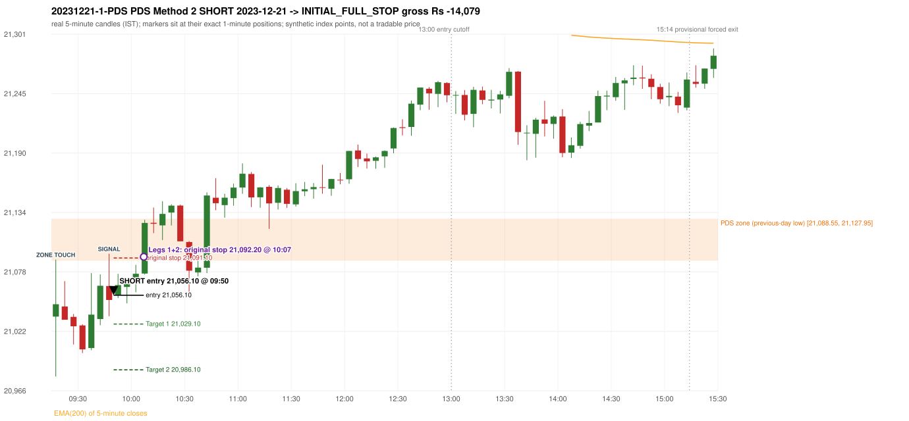
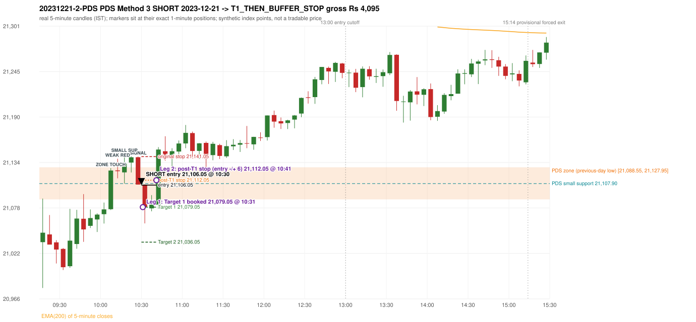

# Trading journal - 2023-12-21 (Thursday)

> Phase 4 historical validation, window B (Window B 2022-09-01..2025-08-31 (5paisa minutes); status DATA_VALIDATED). The FROZEN Phase 3.6 configuration (IRF, ORB, PDR body-based, PDS, RF; shared controller) on a different data source. HISTORICAL RESEARCH ONLY: the strategy was developed using later data. same provider as the Phase 3.6 baseline; the vendor-overlap audit shows the minute bars differ from the secondary vendor Synthetic NIFTY 50 index-point P&L (the index is not tradable). The owner's review status is intentionally blank.

## A. Trading day overview

| item | value |
|---|---|
| Date / weekday | 2023-12-21 / Thursday |
| Session type | USABLE_WITH_FLAGS / VALID |
| Original session open (first 1-minute open) | 21,036.10 |
| Previous session | 2023-12-20 |
| Previous-day high / low (wicks included) | 21,592.10 / 21,088.55 |
| Previous-day highest BODY high (the body-based PDR ceiling; wicks ignored) | 21,591.30 |
| Previous-day official close / last 5-minute close | 21,150.15 / 21,101.50 |
| Raw engine records / confirmed signals / fully valid signals | 13 / 8 / 8 |
| Setups that did not complete (invalidated / incomplete) | 5 |
| Executed trades | 2 20231221-1-PDS;20231221-2-PDS |
| Gross P&L (Rs, synthetic) | -9,984.00 |
| Illustrative net P&L (Rs; Rs 500/trade + 0.5 pt/fill) | -11,764.00 |
| Day-end portfolio status | DAY_FINISHED |
| Manual journal trades (matched / unmatched) | 0 (0 / 0) |
| Extra automated trades | 0 |

## B. Daily strategy signal timeline (confirmed signals, chronological)

| time | strategy | method | dir | entry-rule status | valid for execution | <= 13:00 | portfolio state | accepted / ignored | specific reason | competing (same minute) |
|---|---|---|---|---|---|---|---|---|---|---|
| 09:50 | PDS | Method 2 | SHORT | PROPOSAL_DEPENDENT | True | True | FIRST_TRADE_ACTIVE | ACCEPTED -> 20231221-1-PDS | first eligible signal of the day; trade 1: INITIAL_FULL_STOP |  |
| 10:30 | PDS | Method 3 | SHORT | PROPOSAL_DEPENDENT | True | True | SECOND_TRADE_ACTIVE | ACCEPTED -> 20231221-2-PDS | permitted second trade: newly confirmed PDR/PDS after the original full stop; trade 2: T1_THEN_BUFFER_STOP |  |
| 10:35 | IRF | Method 1 | SHORT | PROPOSAL_DEPENDENT | True | True | SECOND_TRADE_ACTIVE | IGNORED | POSITION_ACTIVE (signal kept for diagnostics only; never reused) [blocked by PDS#2] | IRF Method 2A SHORT |
| 10:35 | IRF | Method 2A | SHORT | PROPOSAL_DEPENDENT | True | True | SECOND_TRADE_ACTIVE | IGNORED | POSITION_ACTIVE (signal kept for diagnostics only; never reused) [blocked by PDS#2] | IRF Method 1 SHORT |
| 11:10 | IRF | Method 2B | SHORT | PROPOSAL_DEPENDENT | True | True | DAY_FINISHED | IGNORED | DAY_FINISHED [blocked by PDS#2] |  |
| 11:50 | IRF | Method 2B | SHORT | PROPOSAL_DEPENDENT | True | True | DAY_FINISHED | IGNORED | DAY_FINISHED [blocked by PDS#2] |  |
| 13:40 | IRF | Method 2A | SHORT | PROPOSAL_DEPENDENT | True | False | DAY_FINISHED | IGNORED | DAY_FINISHED [blocked by PDS#2] |  |
| 15:10 | IRF | Method 2B | SHORT | PROPOSAL_DEPENDENT | True | False | DAY_FINISHED | IGNORED | DAY_FINISHED [blocked by PDS#2] |  |

Engine setups that did not complete (5); the complete list with failed rule ids is in `rejected_signals.csv`:

| candle | strategy | method | dir | status | precise reason | failed rules |
|---|---|---|---|---|---|---|
| 09:45 | IRF | Method 3 | SHORT | INVALIDATED | WICK_SHARE_OUT_OF_BAND | IRF-M3-003 |
| 15:05 | IRF | Method 1/2 | SHORT | INCOMPLETE_AT_EOD | SESSION_ENDED_BEFORE_CONFIRMATION |  |
| 09:15 | ORB | Method 1 | SHORT | INVALIDATED | CANDLE_QUALITY(not a strong body / wick too large) | ORB-M1-SHORT-003 |
| 09:15 | ORB | Method 2 | SHORT | INVALIDATED | CANDLE_QUALITY | ORB-M2-SHORT-003 |
| 10:30 | PDS | Method 1/2/3 | SHORT | INCOMPLETE_AT_EOD | NO_QUALIFYING_ENTRY_BEFORE_SESSION_END |  |

## C. Detailed trade journals

### 20231221-1-PDS: PDS Method 2 SHORT (FIRST trade)

Chart: 

**Rule configuration:** CFG-phase36_body_based-866f954e55 - signal verification status **PROPOSAL_DEPENDENT** (never VERIFIED while a rule rests on a proposal).

#### 1. Setup identification

PDS Method 2 SHORT: the session opened 52.45 points below the previous-day-low zone [21,088.55, 21,127.95]; price rose to the zone at 09:15 and the first red candle at the zone (09:45, close 21,051.65) was a higher-price-rejection pin bar; confirmed 09:50.

#### 2. Candle and indicator calculations

| role | session | candle | O | H | L | C | range | body % | upper wick % | lower wick % | direction | EMA(200) | strong bull / bear | pin bull / bear | small (body<=30%) | used for |
|---|---|---|---|---|---|---|---|---|---|---|---|---|---|---|---|---|
| zone_source_candle | PREVIOUS | 15:25-15:30 | 21,127.95 | 21,128.85 | 21,088.55 | 21,101.50 | 40.30 | 65.63 | 2.23 | 32.13 | BEARISH | 21,403.86 | False / False | False / False | False | previous-day low candle that defines the zone (A_LOWEST_LOW) |
| zone_retest_candle | TODAY | 09:15-09:20 | 21,036.10 | 21,089.55 | 20,979.80 | 21,047.70 | 109.75 | 10.57 | 38.13 | 51.30 | BULLISH | 21,400.32 | False / False | False / False | True | first candle whose range reaches the zone from below |
| signal_candle | TODAY | 09:45-09:50 | 21,064.75 | 21,095.05 | 21,036.45 | 21,051.65 | 58.60 | 22.35 | 51.71 | 25.94 | BEARISH | 21,379.15 | False / False | False / True | True | trigger candle |

Every condition, with the rule, the calculation, the observed values and the result:

| # | group | rule | result | status / numeric definition | calculation | observed | required | available at | why it matters |
|---|---|---|---|---|---|---|---|---|---|
| 1 | SELECTION | SEL-FIRST-001 | PASS | USER_APPROVED / USER_APPROVED | earliest CONFIRMED signal of the day across IRF/ORB/PDR/PDS/RF that passed the controller's checks | 0 confirmed signal(s) earlier today; 8 confirmed signals in the day in total, this one at 09:50 | no earlier executable signal | 2023-12-21 09:50 | the shared controller trades only the first valid signal; the five strategies are not independent positions |
| 2 | SELECTION | SEL-TIE-001 | PASS | USER_APPROVED / USER_APPROVED | other CONFIRMED signals with exactly the same confirmation timestamp | none | no different-strategy / opposite-direction signal in the same minute (otherwise an unresolved conflict, no trade) | 2023-12-21 09:50 | an unresolved same-minute collision would have produced no trade at all |
| 3 | SELECTION | ENTRY-CUTOFF-001 | PASS | USER_APPROVED / USER_APPROVED | fill timestamp vs 13:00:00 IST | signal confirmed 09:50; fill 09:50 | fill at or before 13:00:00 IST | 2023-12-21 09:50 | no new position may be entered with a fill after 13:00 IST |
| 4 | SELECTION | EXE-FILL-001 | PASS | PROPOSED_FOR_REVIEW / PROPOSED_FOR_REVIEW | fill = open of the 1-minute bar that starts at the signal candle's end | bar 09:50 O 21,056.10 H 21,063.90 L 21,055.15 C 21,062.85; executable=True; entry 21,056.10 | fill bar exists, starts exactly at the signal end, is fillable; entry = its open | 2023-12-21 09:50 | a 5-minute signal is known only when its candle closes; the first price that can be traded is the next minute's open |
| 5 | SELECTION | DAY-MAX-001 | PASS | USER_APPROVED / USER_APPROVED | number of entries today | trade 1 of at most 2 | <= 2 entries per day | 2023-12-21 09:50 | daily trade cap |
| 6 | SETUP | PDS-003 | PASS | SOURCE_VERIFIED / EXPLICIT_WORDING_DETAIL_PROPOSED_FOR_REVIEW | gap = first 1-minute open of today - previous session's OFFICIAL close | today's open 21,036.10 (first 1-minute bar 09:15) - previous close 21,150.15 (DAILY_VENDOR, 2023-12-20) = -114.05 points -> gap DOWN | gap DOWN (more than 0 points) | 2023-12-21 09:15 | approved convention: the original first-minute open, never the vendor daily open |
| 7 | SETUP | PDS-006 | PASS | SOURCE_VERIFIED / QUALITATIVE_SOURCE_NUMERIC_DEFINITION_PROPOSED_FOR_REVIEW | gap-down open below the zone | today's open 21,036.10 vs zone low 21,088.55: 52.45 points below | open < zone low | 2023-12-21 09:15 | the guide: 'price is trading below the previous day's support zone' after the gap; a PROPOSED strict reading |
| 8 | SETUP | PDS-004 | PASS | SOURCE_VERIFIED / EXPLICIT_IN_SOURCE | PDS is not a breakdown strategy: the zone must be tested from below first | open 21,036.10 below the zone floor 21,088.55; the first candle to reach the zone is 09:15 | price rises to the zone before any short | 2023-12-21 09:15 | a short below the level without a retest is not this strategy |
| 9 | SETUP | PDS-005 | PASS | SOURCE_VERIFIED / QUALITATIVE_SOURCE_NUMERIC_DEFINITION_PROPOSED_FOR_REVIEW | price comes up to the zone: first candle whose [low, high] intersects it (+/- proximity) | 09:15-09:20 O 21,036.10 H 21,089.55 L 20,979.80 C 21,047.70; range 109.75, body 11.60 (10.57%), upper wick 41.85 (38.13%), lower wick 56.30 (51.30%), bullish; high 21,089.55 vs zone low 21,088.55 | range intersects the zone | 2023-12-21 09:20 | PDS is not a breakdown strategy: the zone must be tested from below first |
| 10 | ZONE | PDS-001 | PASS | SOURCE_VERIFIED / EXPLICIT_IN_SOURCE | direction | SHORT (PDS is short only) | short-only | 2023-12-21 09:50 | PDS sells a retest of previous-day support from below |
| 11 | ZONE | PDS-002 | PASS | SOURCE_VERIFIED / QUALITATIVE_SOURCE_NUMERIC_DEFINITION_PROPOSED_FOR_REVIEW | zone = [lowest low, body top] of the previous session's absolute-low candle (method A_LOWEST_LOW; the lower wick is part of the zone) | zone [21,088.55, 21,127.95] from the 15:25 candle of 2023-12-20 (15:25-15:30 O 21,127.95 H 21,128.85 L 21,088.55 C 21,101.50; range 40.30, body 26.45 (65.63%), upper wick 0.90 (2.23%), lower wick 12.95 (32.13%), bearish); engine recorded [21,088.55, 21,127.95] | previous trading day's low where price took support (body + lower wick) | 2023-12-20 15:30 | the reference level of the strategy; the exact candle(s) are a research choice (PDS-ZONE-002) |
| 12 | CONFIRMATION | PDS-M-001 | PASS | SOURCE_VERIFIED / QUALITATIVE_SOURCE_NUMERIC_DEFINITION_PROPOSED_FOR_REVIEW | Methods 1/2 apply to the FIRST red candle at the zone | first red candle at the zone: 09:45; signal candle 09:45 | the trigger is the first red candle at the zone | 2023-12-21 09:50 | a later red candle would only qualify through Method 3 |
| 13 | CONFIRMATION | PDS-M2-001 | PASS | SOURCE_VERIFIED / QUALITATIVE_SOURCE_NUMERIC_DEFINITION_PROPOSED_FOR_REVIEW | red higher-price-rejection pin bar: upper wick >= 2 x body, close within the lowest 30% of the range, high reaches the zone | 09:45-09:50 O 21,064.75 H 21,095.05 L 21,036.45 C 21,051.65; range 58.60, body 13.10 (22.35%), upper wick 30.30 (51.71%), lower wick 15.20 (25.94%), bearish; upper wick / body = 2.31; close position from the low 25.94% of range; high 21,095.05 vs zone low 21,088.55 | bearish pin bar and high >= zone low | 2023-12-21 09:50 | the guide: wick-to-body ratio 'not specified'; these thresholds are an owner recommendation (proposal) |
| 14 | EXECUTION | EXE-STOP-001 | PASS | USER_APPROVED / USER_APPROVED | initial stop = entry + 35 points | entry 21,056.10 -> stop 21,091.10 | stop 35 index points (BASELINE) | 2023-12-21 09:50 | defines the loss if the setup fails before Target 1 |
| 15 | EXECUTION | EXE-T1-001 | PASS | SOURCE_VERIFIED / EXPLICIT_IN_SOURCE | Target 1 = entry +/- 27 points | T1 21,029.10 | 27 points | 2023-12-21 09:50 | Leg 1 (3 lots) is booked at Target 1 |
| 16 | EXECUTION | PDS-TGT-001 | PASS | SOURCE_VERIFIED / EXPLICIT_IN_SOURCE | Target 2 = entry +/- 70 points | T2 20,986.10 (the guide says 70; the report suggests 60 - CONFLICTING) | 70 points | 2023-12-21 09:50 | Leg 2 (3 lots) is booked at Target 2 |
| 17 | EXECUTION | POST-T1-STOP-006 | PASS | USER_APPROVED / USER_APPROVED | after T1 the Leg-2 stop = entry + 6 (no trailing) | post-T1 stop 21,062.10 | entry -6 (LONG) / +6 (SHORT) | 2023-12-21 09:50 | protects the remaining three lots once the first three are booked |
| 18 | EXECUTION | SIZE-LOT-001 | PASS | USER_APPROVED / USER_APPROVED | 6 lots x 65 = 390, Leg 1 = 3 lots = 195, Leg 2 = 195 | 6 lots, lot size 65, legs 3+3 | 6 lots in two equal legs | 2023-12-21 09:50 | position size for the synthetic P&L |
| 19 | NOTE | PDS-007 | NOT_APPLICABLE | PROPOSED_FOR_REVIEW / PROPOSED_FOR_REVIEW | repeated PDS signals today | 2 confirmed PDS signal(s) in the session | n/a (disclosure) | 2023-12-21 09:50 | the per-session cap is lifted for the controller runs; the controller trades only the first (or the permitted second) trade |
| 20 | NOTE | PDS-SL-001 | NOT_APPLICABLE | SOURCE_VERIFIED / QUALITATIVE_SOURCE_NUMERIC_DEFINITION_PROPOSED_FOR_REVIEW | the guide's 35-or-40 rule: 35 if the most recent green candle's high is within 35 points of entry, else 40 | most recent green candle high 21,075.70 is 19.60 points from the entry 21,056.10: the guide's rule would select 35 points; the baseline applies a fixed 35 (USER_APPROVED research baseline; the 35-vs-40 selection and the 40-point variant are separate labelled scenarios) | source selection rule | 2023-12-21 09:50 | the stop distance is a modelling choice and changes losses, not entries |
| 21 | NOTE | NOTE-UNRESOLVED-DEPENDENCIES | NOT_APPLICABLE | NOT_A_RULE / NOT_A_REGISTRY_RULE | rules the signal depends on that the sources leave unresolved | engine-recorded unresolved rule ids: none; verification status PROPOSAL_DEPENDENT | n/a (disclosure) | 2023-12-21 09:50 | the entry is only as verified as the rules it rests on |

#### 3. Entry decision and explanation

PDS Method 2 SHORT: the session opened 52.45 points below the previous-day-low zone [21,088.55, 21,127.95]; price rose to the zone at 09:15 and the first red candle at the zone (09:45, close 21,051.65) was a higher-price-rejection pin bar; confirmed 09:50.

**Why this trade ahead of the other strategies:** This PDS Method 2 signal was the earliest executable signal of the day: 0 confirmed signal(s) earlier, 0 other in the same minute. 7 later confirmed signal(s) (IRF x6, PDS x1) are logged as ignored or rejected. State of the other four engines at that moment: [IRF: Method 3 invalidated at 09:45: WICK_SHARE_OUT_OF_BAND] [ORB: Method 1 invalidated at 09:15: CANDLE_QUALITY(not a strong body / wick too large); Method 2 invalidated at 09:15: CANDLE_QUALITY] [PDR: no setup record before this time (a base condition was not met, or nothing triggered)] [RF: no setup record before this time (a base condition was not met, or nothing triggered)]

#### 4. Actual entry execution

| item | value |
|---|---|
| Signal candle | 09:45-09:50 |
| Signal confirmed | 2023-12-21 09:50 |
| Fill timestamp | 2023-12-21 09:50 |
| Entry price | 21,056.10 |
| Source partition / 1-minute bar | data/phase4/processed/FIVEPAISA_1M_PHASE4/nifty50/year=2023/month=12/candles.parquet / 2023-12-21 09:50 |
| Source bar O / H / L / C | 21,056.10 / 21,063.90 / 21,055.15 / 21,062.85 |
| Fill assumption | open of the 1-minute bar starting at the signal candle's end (EXE-FILL-001, PROPOSED causal convention) |
| Initial stop / T1 / T2 / post-T1 stop | 21,091.10 / 21,029.10 / 20,986.10 / 21,062.10 |
| Position | 6 lots x 65 = 390 units (Leg 1 195, Leg 2 195) |

#### 5-8. Trade progress, Target 1, post-T1 stop and final exit

Between the 09:50 entry bar and the final exit (18 one-minute bars) the best excursion in favour was 7.55 points at 09:58 and the worst against was 39.50 points at 10:07. At 10:07 price reached the original stop 21,091.10 before Target 1 21,029.10, so all six lots exited together at 21,092.20 (gap through the stop, slippage 1.10 points). This is an INITIAL_FULL_STOP: one more trade is allowed that day, only a newly confirmed PDR/PDS signal.

| leg | qty | exit time | exit price | reason | source 1-minute bar | O / H / L / C | gross points | gross Rs | slippage pts | flags |
|---|---|---|---|---|---|---|---|---|---|---|
| 1 | 195 | 10:07 | 21,092.20 | ORIGINAL_STOP_BEFORE_T1 | 10:07 | 21,092.20 / 21,095.60 / 21,086.85 / 21,095.60 | -36.10 | -7,039.50 | 1.10 |  |
| 2 | 195 | 10:07 | 21,092.20 | ORIGINAL_STOP_BEFORE_T1 | 10:07 | 21,092.20 / 21,095.60 / 21,086.85 / 21,095.60 | -36.10 | -7,039.50 | 1.10 |  |

Exit evidence per leg:

* Leg 1: 1-minute bar 10:07 O 21,092.20 H 21,095.60 L 21,086.85 C 21,095.60: high 21,095.60 reached the original stop 21,091.10 before Target 1 21,029.10 was touched; both legs exit at 21,092.20 (gap through the stop: bar open 21,092.20 is worse than the stop; adverse slippage 1.10 points)
* Leg 2: 1-minute bar 10:07 O 21,092.20 H 21,095.60 L 21,086.85 C 21,095.60: high 21,095.60 reached the original stop 21,091.10 before Target 1 21,029.10 was touched; both legs exit at 21,092.20 (gap through the stop: bar open 21,092.20 is worse than the stop; adverse slippage 1.10 points)

#### 9. Gross and illustrative net P&L

| item | value (Rs) |
|---|---|
| Leg 1 gross | -7,039.50 |
| Leg 2 gross | -7,039.50 |
| Trade gross (= Leg 1 + Leg 2) | -14,079.00 |
| Illustrative fixed cost | -500.00 |
| Illustrative slippage (0.5 pt on every fill, entry + exits, all units) | -390.00 |
| Illustrative net | -14,969.00 |

#### 10. Manual journal comparison

No manual journal exists for this period; no comparison.

### 20231221-2-PDS: PDS Method 3 SHORT (SECOND trade)

Chart: 

**Rule configuration:** CFG-phase36_body_based-866f954e55 - signal verification status **PROPOSAL_DEPENDENT** (never VERIFIED while a rule rests on a proposal).

#### 1. Setup identification

PDS Method 3 SHORT: the session opened 52.45 points below the previous-day-low zone [21,088.55, 21,127.95]; the first red candle at the zone (10:10) was weak (body 3.75%), so the engine waited for a small support; the 10:15 candle's low 21,107.90 (-19.35 points below the zone floor) was broken by the close of the 10:25 candle (21,106.80); confirmed 10:30.

#### 2. Candle and indicator calculations

| role | session | candle | O | H | L | C | range | body % | upper wick % | lower wick % | direction | EMA(200) | strong bull / bear | pin bull / bear | small (body<=30%) | used for |
|---|---|---|---|---|---|---|---|---|---|---|---|---|---|---|---|---|
| zone_source_candle | PREVIOUS | 15:25-15:30 | 21,127.95 | 21,128.85 | 21,088.55 | 21,101.50 | 40.30 | 65.63 | 2.23 | 32.13 | BEARISH | 21,403.86 | False / False | False / False | False | previous-day low candle that defines the zone (A_LOWEST_LOW) |
| zone_retest_candle | TODAY | 10:05-10:10 | 21,076.50 | 21,126.95 | 21,075.50 | 21,124.00 | 51.45 | 92.32 | 5.73 | 1.94 | BULLISH | 21,367.59 | True / False | False / False | False | first candle whose range reaches the zone from below |
| signal_candle | TODAY | 10:25-10:30 | 21,140.30 | 21,141.15 | 21,106.80 | 21,106.80 | 34.35 | 97.53 | 2.47 | 0.00 | BEARISH | 21,358.10 | False / True | False / False | False | trigger candle |
| weak_first_red_candle | TODAY | 10:10-10:15 | 21,124.10 | 21,138.40 | 21,114.40 | 21,123.20 | 24.00 | 3.75 | 59.58 | 36.67 | BEARISH | 21,365.16 | False / False | False / False | True | first red candle at the zone that failed the quality rule |
| small_support_pivot | TODAY | 10:15-10:20 | 21,121.70 | 21,144.45 | 21,107.90 | 21,132.45 | 36.55 | 29.41 | 32.83 | 37.76 | BULLISH | 21,362.84 | False / False | False / False | True | small support: latest 3-candle fractal low after the weak candle |

Every condition, with the rule, the calculation, the observed values and the result:

| # | group | rule | result | status / numeric definition | calculation | observed | required | available at | why it matters |
|---|---|---|---|---|---|---|---|---|---|
| 1 | SELECTION | DAY-SL-001 | PASS | USER_APPROVED / USER_APPROVED | first trade outcome, strategy of this signal, position-close time vs this signal's timestamp | first trade PDS Method 2 closed as INITIAL_FULL_STOP at 10:07; position free from 10:08; this PDS signal confirmed 10:30 | first trade INITIAL_FULL_STOP before Target 1, and a NEWLY confirmed PDR/PDS signal after the first position closed | 2023-12-21 10:30 | the only way a second trade is allowed |
| 2 | SELECTION | DAY-NOREUSE-001 | PASS | USER_APPROVED / USER_APPROVED | signals confirmed while the first position was open | 1 signal(s) were ignored during the first trade (never reused): PDS Method 2 SHORT @09:50 | this trade comes from a signal confirmed after the first exit, not from an ignored one | 2023-12-21 10:30 | an ignored signal can never become the second trade |
| 3 | SELECTION | ENTRY-CUTOFF-001 | PASS | USER_APPROVED / USER_APPROVED | fill timestamp vs 13:00:00 IST | signal confirmed 10:30; fill 10:30 | fill at or before 13:00:00 IST | 2023-12-21 10:30 | no new position may be entered with a fill after 13:00 IST |
| 4 | SELECTION | EXE-FILL-001 | PASS | PROPOSED_FOR_REVIEW / PROPOSED_FOR_REVIEW | fill = open of the 1-minute bar that starts at the signal candle's end | bar 10:30 O 21,106.05 H 21,106.95 L 21,084.40 C 21,084.40; executable=True; entry 21,106.05 | fill bar exists, starts exactly at the signal end, is fillable; entry = its open | 2023-12-21 10:30 | a 5-minute signal is known only when its candle closes; the first price that can be traded is the next minute's open |
| 5 | SELECTION | DAY-MAX-001 | PASS | USER_APPROVED / USER_APPROVED | number of entries today | trade 2 of at most 2 | <= 2 entries per day | 2023-12-21 10:30 | daily trade cap |
| 6 | SETUP | PDS-003 | PASS | SOURCE_VERIFIED / EXPLICIT_WORDING_DETAIL_PROPOSED_FOR_REVIEW | gap = first 1-minute open of today - previous session's OFFICIAL close | today's open 21,036.10 (first 1-minute bar 09:15) - previous close 21,150.15 (DAILY_VENDOR, 2023-12-20) = -114.05 points -> gap DOWN | gap DOWN (more than 0 points) | 2023-12-21 09:15 | approved convention: the original first-minute open, never the vendor daily open |
| 7 | SETUP | PDS-006 | PASS | SOURCE_VERIFIED / QUALITATIVE_SOURCE_NUMERIC_DEFINITION_PROPOSED_FOR_REVIEW | gap-down open below the zone | today's open 21,036.10 vs zone low 21,088.55: 52.45 points below | open < zone low | 2023-12-21 09:15 | the guide: 'price is trading below the previous day's support zone' after the gap; a PROPOSED strict reading |
| 8 | SETUP | PDS-004 | PASS | SOURCE_VERIFIED / EXPLICIT_IN_SOURCE | PDS is not a breakdown strategy: the zone must be tested from below first | open 21,036.10 below the zone floor 21,088.55; the first candle to reach the zone is 10:05 | price rises to the zone before any short | 2023-12-21 09:15 | a short below the level without a retest is not this strategy |
| 9 | SETUP | PDS-005 | PASS | SOURCE_VERIFIED / QUALITATIVE_SOURCE_NUMERIC_DEFINITION_PROPOSED_FOR_REVIEW | price comes up to the zone: first candle whose [low, high] intersects it (+/- proximity) | 10:05-10:10 O 21,076.50 H 21,126.95 L 21,075.50 C 21,124.00; range 51.45, body 47.50 (92.32%), upper wick 2.95 (5.73%), lower wick 1.00 (1.94%), bullish; high 21,126.95 vs zone low 21,088.55 | range intersects the zone | 2023-12-21 10:10 | PDS is not a breakdown strategy: the zone must be tested from below first |
| 10 | ZONE | PDS-001 | PASS | SOURCE_VERIFIED / EXPLICIT_IN_SOURCE | direction | SHORT (PDS is short only) | short-only | 2023-12-21 10:30 | PDS sells a retest of previous-day support from below |
| 11 | ZONE | PDS-002 | PASS | SOURCE_VERIFIED / QUALITATIVE_SOURCE_NUMERIC_DEFINITION_PROPOSED_FOR_REVIEW | zone = [lowest low, body top] of the previous session's absolute-low candle (method A_LOWEST_LOW; the lower wick is part of the zone) | zone [21,088.55, 21,127.95] from the 15:25 candle of 2023-12-20 (15:25-15:30 O 21,127.95 H 21,128.85 L 21,088.55 C 21,101.50; range 40.30, body 26.45 (65.63%), upper wick 0.90 (2.23%), lower wick 12.95 (32.13%), bearish); engine recorded [21,088.55, 21,127.95] | previous trading day's low where price took support (body + lower wick) | 2023-12-20 15:30 | the reference level of the strategy; the exact candle(s) are a research choice (PDS-ZONE-002) |
| 12 | CONFIRMATION | PDS-M-001 | PASS | SOURCE_VERIFIED / QUALITATIVE_SOURCE_NUMERIC_DEFINITION_PROPOSED_FOR_REVIEW | Method 3 is used when the first red candle at the zone is not satisfying | first red candle at the zone: 10:10-10:15 O 21,124.10 H 21,138.40 L 21,114.40 C 21,123.20; range 24.00, body 0.90 (3.75%), upper wick 14.30 (59.58%), lower wick 8.80 (36.67%), bearish; strong-bearish test body >= 60%, lower wick <= 20% -> not met; pin bar -> not met | first red candle is neither strong nor a pin bar | 2023-12-21 10:15 | the quality rule keeps weak candles out; Method 3 waits for a support break instead |
| 13 | CONFIRMATION | PDS-M3-001 | PASS | SOURCE_VERIFIED / QUALITATIVE_SOURCE_NUMERIC_DEFINITION_PROPOSED_FOR_REVIEW | small support = latest 3-candle fractal low (k=1) formed at/after the weak candle with low <= zone high (21,127.95); definition SWING_K1_NEAR_ZONE | support 21,107.90 from the 10:15 candle; engine recorded 21,107.90; distance below the zone floor -19.35 points (negative: the support lies ABOVE the floor) (zone floor 21,088.55); the guide says 'near the zone' but defines no distance - the code has no lower bound | a small support near the zone | 2023-12-21 10:25 | 'near' and the size of the small support are undefined in the guide |
| 14 | CONFIRMATION | PDS-M3-001 | PASS | SOURCE_VERIFIED / QUALITATIVE_SOURCE_NUMERIC_DEFINITION_PROPOSED_FOR_REVIEW | trigger: candle closes below the small support (break basis CLOSE) | 10:25 close 21,106.80 vs support 21,107.90: 1.10 points below | close < support | 2023-12-21 10:30 | the guide does not say close or touch; the close is used |
| 15 | EXECUTION | EXE-STOP-001 | PASS | USER_APPROVED / USER_APPROVED | initial stop = entry + 35 points | entry 21,106.05 -> stop 21,141.05 | stop 35 index points (BASELINE) | 2023-12-21 10:30 | defines the loss if the setup fails before Target 1 |
| 16 | EXECUTION | EXE-T1-001 | PASS | SOURCE_VERIFIED / EXPLICIT_IN_SOURCE | Target 1 = entry +/- 27 points | T1 21,079.05 | 27 points | 2023-12-21 10:30 | Leg 1 (3 lots) is booked at Target 1 |
| 17 | EXECUTION | PDS-TGT-001 | PASS | SOURCE_VERIFIED / EXPLICIT_IN_SOURCE | Target 2 = entry +/- 70 points | T2 21,036.05 (the guide says 70; the report suggests 60 - CONFLICTING) | 70 points | 2023-12-21 10:30 | Leg 2 (3 lots) is booked at Target 2 |
| 18 | EXECUTION | POST-T1-STOP-006 | PASS | USER_APPROVED / USER_APPROVED | after T1 the Leg-2 stop = entry + 6 (no trailing) | post-T1 stop 21,112.05 | entry -6 (LONG) / +6 (SHORT) | 2023-12-21 10:30 | protects the remaining three lots once the first three are booked |
| 19 | EXECUTION | SIZE-LOT-001 | PASS | USER_APPROVED / USER_APPROVED | 6 lots x 65 = 390, Leg 1 = 3 lots = 195, Leg 2 = 195 | 6 lots, lot size 65, legs 3+3 | 6 lots in two equal legs | 2023-12-21 10:30 | position size for the synthetic P&L |
| 20 | NOTE | PDS-007 | NOT_APPLICABLE | PROPOSED_FOR_REVIEW / PROPOSED_FOR_REVIEW | repeated PDS signals today | 2 confirmed PDS signal(s) in the session | n/a (disclosure) | 2023-12-21 10:30 | the per-session cap is lifted for the controller runs; the controller trades only the first (or the permitted second) trade |
| 21 | NOTE | PDS-MISSING-001 | UNRESOLVED | UNRESOLVED / UNRESOLVED | entry timing | signal on the candle close; fill at the next minute's open | the guide does not say whether entry is intra-candle or after the close | 2023-12-21 10:30 | causal convention: nothing is entered before the trigger candle has closed |
| 22 | NOTE | PDS-SL-001 | NOT_APPLICABLE | SOURCE_VERIFIED / QUALITATIVE_SOURCE_NUMERIC_DEFINITION_PROPOSED_FOR_REVIEW | the guide's 35-or-40 rule: 35 if the most recent green candle's high is within 35 points of entry, else 40 | most recent green candle high 21,141.40 is 35.35 points from the entry 21,106.05: the guide's rule would select 40 points; the baseline applies a fixed 35 (USER_APPROVED research baseline; the 35-vs-40 selection and the 40-point variant are separate labelled scenarios) | source selection rule | 2023-12-21 10:30 | the stop distance is a modelling choice and changes losses, not entries |
| 23 | NOTE | NOTE-UNRESOLVED-DEPENDENCIES | NOT_APPLICABLE | NOT_A_RULE / NOT_A_REGISTRY_RULE | rules the signal depends on that the sources leave unresolved | engine-recorded unresolved rule ids: none; verification status PROPOSAL_DEPENDENT | n/a (disclosure) | 2023-12-21 10:30 | the entry is only as verified as the rules it rests on |

#### 3. Entry decision and explanation

PDS Method 3 SHORT: the session opened 52.45 points below the previous-day-low zone [21,088.55, 21,127.95]; the first red candle at the zone (10:10) was weak (body 3.75%), so the engine waited for a small support; the 10:15 candle's low 21,107.90 (-19.35 points below the zone floor) was broken by the close of the 10:25 candle (21,106.80); confirmed 10:30.

**Why this trade ahead of the other strategies:** The first trade (PDS Method 2) was stopped out before Target 1 at 10:07; this newly confirmed PDS signal at 10:30 is the first PDR/PDS signal after that exit, so it is the day's permitted second trade. State of the other engines at that moment: [IRF: Method 3 invalidated at 09:45: WICK_SHARE_OUT_OF_BAND] [ORB: Method 1 invalidated at 09:15: CANDLE_QUALITY(not a strong body / wick too large); Method 2 invalidated at 09:15: CANDLE_QUALITY] [PDR: no setup record before this time (a base condition was not met, or nothing triggered)] [RF: no setup record before this time (a base condition was not met, or nothing triggered)]

#### 4. Actual entry execution

| item | value |
|---|---|
| Signal candle | 10:25-10:30 |
| Signal confirmed | 2023-12-21 10:30 |
| Fill timestamp | 2023-12-21 10:30 |
| Entry price | 21,106.05 |
| Source partition / 1-minute bar | data/phase4/processed/FIVEPAISA_1M_PHASE4/nifty50/year=2023/month=12/candles.parquet / 2023-12-21 10:30 |
| Source bar O / H / L / C | 21,106.05 / 21,106.95 / 21,084.40 / 21,084.40 |
| Fill assumption | open of the 1-minute bar starting at the signal candle's end (EXE-FILL-001, PROPOSED causal convention) |
| Initial stop / T1 / T2 / post-T1 stop | 21,141.05 / 21,079.05 / 21,036.05 / 21,112.05 |
| Position | 6 lots x 65 = 390 units (Leg 1 195, Leg 2 195) |

#### 5-8. Trade progress, Target 1, post-T1 stop and final exit

Between the 10:30 entry bar and the final exit (12 one-minute bars) the best excursion in favour was 46.95 points at 10:31 and the worst against was 22.50 points at 10:41. At 10:31 price reached Target 1 21,079.05 and three lots exited. At 10:31 the remaining three lots' protective stop was set to 21,112.05 (entry + 6; no trailing, no further change); the engine applies it from the Target-1 bar onward and tests it within that same bar. At 10:41 the remaining three lots stopped out at 21,112.05. T1_THEN_BUFFER_STOP: no second trade that day (DAY-BUF-001).

| leg | qty | exit time | exit price | reason | source 1-minute bar | O / H / L / C | gross points | gross Rs | slippage pts | flags |
|---|---|---|---|---|---|---|---|---|---|---|
| 1 | 195 | 10:31 | 21,079.05 | TARGET_1 | 10:31 | 21,081.25 / 21,082.05 / 21,059.10 / 21,078.15 | 27.00 | 5,265.00 | 0.00 |  |
| 2 | 195 | 10:41 | 21,112.05 | POST_T1_STOP_ENTRY_MINUS_PLUS_6 | 10:41 | 21,082.30 / 21,128.55 / 21,082.30 / 21,126.55 | -6.00 | -1,170.00 | 0.00 |  |

Exit evidence per leg:

* Leg 1: 1-minute bar 10:31 O 21,081.25 H 21,082.05 L 21,059.10 C 21,078.15: low 21,059.10 reached Target 1 21,079.05; Leg 1 booked at the target level
* Leg 2: 1-minute bar 10:41 O 21,082.30 H 21,128.55 L 21,082.30 C 21,126.55: high 21,128.55 reached the post-T1 stop 21,112.05; Leg 2 exits at 21,112.05 at the stop level

#### 9. Gross and illustrative net P&L

| item | value (Rs) |
|---|---|
| Leg 1 gross | 5,265.00 |
| Leg 2 gross | -1,170.00 |
| Trade gross (= Leg 1 + Leg 2) | 4,095.00 |
| Illustrative fixed cost | -500.00 |
| Illustrative slippage (0.5 pt on every fill, entry + exits, all units) | -390.00 |
| Illustrative net | 3,205.00 |

#### 10. Manual journal comparison

No manual journal exists for this period; no comparison.

## D. Manual journal comparison

No manual journal exists for this period (the manual journal covers 2025-09-01 .. 2026-08-31 only); no comparison is made and no automated trade is labelled 'extra'.

## E. Daily conclusion

* **Traded:** 20231221-1-PDS - PDS Method 2 SHORT at 09:50 (entry 21,056.10), outcome INITIAL_FULL_STOP, gross Rs -14,079.00, illustrative net Rs -14,969.00. **Why:** This PDS Method 2 signal was the earliest executable signal of the day: 0 confirmed signal(s) earlier, 0 other in the same minute. 7 later confirmed signal(s) (IRF x6, PDS x1) are logged as ignored or rejected. State of the other four engines at that moment: [IRF: Method 3 invalidated at 09:45: WICK_SHARE_OUT_OF_BAND] [ORB: Method 1 invalidated at 09:15: CANDLE_QUALITY(not a strong body / wick too large); Method 2 invalidated at 09:15: CANDLE_QUALITY] [PDR: no setup record before this time (a base condition was not met, or nothing triggered)] [RF: no setup record before this time (a base condition was not met, or nothing triggered)] **How it ended:** At 10:07 price reached the original stop 21,091.10 before Target 1 21,029.10, so all six lots exited together at 21,092.20 (gap through the stop, slippage 1.10 points). This is an INITIAL_FULL_STOP: one more trade is allowed that day, only a newly confirmed PDR/PDS signal.
* **Traded:** 20231221-2-PDS - PDS Method 3 SHORT at 10:30 (entry 21,106.05), outcome T1_THEN_BUFFER_STOP, gross Rs 4,095.00, illustrative net Rs 3,205.00. **Why:** The first trade (PDS Method 2) was stopped out before Target 1 at 10:07; this newly confirmed PDS signal at 10:30 is the first PDR/PDS signal after that exit, so it is the day's permitted second trade. State of the other engines at that moment: [IRF: Method 3 invalidated at 09:45: WICK_SHARE_OUT_OF_BAND] [ORB: Method 1 invalidated at 09:15: CANDLE_QUALITY(not a strong body / wick too large); Method 2 invalidated at 09:15: CANDLE_QUALITY] [PDR: no setup record before this time (a base condition was not met, or nothing triggered)] [RF: no setup record before this time (a base condition was not met, or nothing triggered)] **How it ended:** At 10:31 price reached Target 1 21,079.05 and three lots exited. At 10:31 the remaining three lots' protective stop was set to 21,112.05 (entry + 6; no trailing, no further change); the engine applies it from the Target-1 bar onward and tests it within that same bar. At 10:41 the remaining three lots stopped out at 21,112.05. T1_THEN_BUFFER_STOP: no second trade that day (DAY-BUF-001).
* **Ignored / rejected signals:** IRF IGNORED DAY_FINISHED x4; IRF IGNORED POSITION_ACTIVE x2
* **Open strategy-definition issues that affected this day:** PDS-MISSING-001 (Entry timing (during the candle or after it closes) is not specified)
* **Automated triage (not an approval; the owner's review status stays blank):** TRADED_NO_FLAGS
