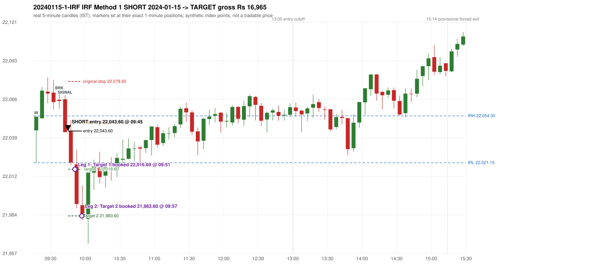

# Trading journal - 2024-01-15 (Monday)

> Phase 4 historical validation, window B (Window B 2022-09-01..2025-08-31 (5paisa minutes); status DATA_VALIDATED). The FROZEN Phase 3.6 configuration (IRF, ORB, PDR body-based, PDS, RF; shared controller) on a different data source. HISTORICAL RESEARCH ONLY: the strategy was developed using later data. same provider as the Phase 3.6 baseline; the vendor-overlap audit shows the minute bars differ from the secondary vendor Synthetic NIFTY 50 index-point P&L (the index is not tradable). The owner's review status is intentionally blank.

## A. Trading day overview

| item | value |
|---|---|
| Date / weekday | 2024-01-15 / Monday |
| Session type | USABLE_WITH_FLAGS / VALID |
| Original session open (first 1-minute open) | 22,044.05 |
| Previous session | 2024-01-12 |
| Previous-day high / low (wicks included) | 21,927.20 / 21,718.75 |
| Previous-day highest BODY high (the body-based PDR ceiling; wicks ignored) | 21,927.15 |
| Previous-day official close / last 5-minute close | 21,908.00 / 21,908.00 |
| Raw engine records / confirmed signals / fully valid signals | 17 / 12 / 12 |
| Setups that did not complete (invalidated / incomplete) | 1 |
| Executed trades | 1 20240115-1-IRF |
| Gross P&L (Rs, synthetic) | 16,965.00 |
| Illustrative net P&L (Rs; Rs 500/trade + 0.5 pt/fill) | 16,075.00 |
| Day-end portfolio status | DAY_FINISHED |
| Manual journal trades (matched / unmatched) | 0 (0 / 0) |
| Extra automated trades | 0 |

## B. Daily strategy signal timeline (confirmed signals, chronological)

| time | strategy | method | dir | entry-rule status | valid for execution | <= 13:00 | portfolio state | accepted / ignored | specific reason | competing (same minute) |
|---|---|---|---|---|---|---|---|---|---|---|
| 09:45 | IRF | Method 1 | SHORT | PROPOSAL_DEPENDENT | True | True | FIRST_TRADE_ACTIVE | ACCEPTED -> 20240115-1-IRF | first eligible signal of the day; trade 1: TARGET | IRF Method 2A SHORT |
| 09:45 | IRF | Method 2A | SHORT | PROPOSAL_DEPENDENT | True | True | FIRST_TRADE_ACTIVE | MERGED_SAME_STRATEGY_METHOD | traded as another method of the same strategy/direction in the same minute | IRF Method 1 SHORT |
| 11:35 | IRF | Method 1 | SHORT | PROPOSAL_DEPENDENT | True | True | DAY_FINISHED | IGNORED | DAY_FINISHED [blocked by IRF#1] |  |
| 12:00 | IRF | Method 1 | SHORT | PROPOSAL_DEPENDENT | True | True | DAY_FINISHED | IGNORED | DAY_FINISHED [blocked by IRF#1] |  |
| 12:15 | IRF | Method 1 | SHORT | PROPOSAL_DEPENDENT | True | True | DAY_FINISHED | IGNORED | DAY_FINISHED [blocked by IRF#1] |  |
| 12:30 | IRF | Method 2B | SHORT | PROPOSAL_DEPENDENT | True | True | DAY_FINISHED | IGNORED | DAY_FINISHED [blocked by IRF#1] |  |
| 12:35 | IRF | Method 1 | SHORT | PROPOSAL_DEPENDENT | True | True | DAY_FINISHED | IGNORED | DAY_FINISHED [blocked by IRF#1] |  |
| 13:05 | IRF | Method 2B | SHORT | PROPOSAL_DEPENDENT | True | False | DAY_FINISHED | IGNORED | DAY_FINISHED [blocked by IRF#1] |  |
| 13:25 | IRF | Method 2B | SHORT | PROPOSAL_DEPENDENT | True | False | DAY_FINISHED | IGNORED | DAY_FINISHED [blocked by IRF#1] |  |
| 13:35 | IRF | Method 1 | SHORT | PROPOSAL_DEPENDENT | True | False | DAY_FINISHED | IGNORED | DAY_FINISHED [blocked by IRF#1] |  |
| 14:35 | IRF | Method 2A | SHORT | PROPOSAL_DEPENDENT | True | False | DAY_FINISHED | IGNORED | DAY_FINISHED [blocked by IRF#1] | IRF Method 2B SHORT |
| 14:35 | IRF | Method 2B | SHORT | PROPOSAL_DEPENDENT | True | False | DAY_FINISHED | IGNORED | DAY_FINISHED [blocked by IRF#1] | IRF Method 2A SHORT |

Engine setups that did not complete (5); the complete list with failed rule ids is in `rejected_signals.csv`:

| candle | strategy | method | dir | status | precise reason | failed rules |
|---|---|---|---|---|---|---|
| 14:30 | IRF | Method 1/2 | SHORT | INCOMPLETE_AT_EOD | SESSION_ENDED_BEFORE_CONFIRMATION |  |
|  | ORB | ALL | BOTH | NOT_EVALUATED | PREV_SESSION_UNVERIFIED(PREV_CLOSE_DAY_DIFFERS_FROM_PREV_SESSION(2024-01-12); PREV_CLOSE_FALLBACK_TO_1530_PRINT(2024-01-12)) |  |
|  | PDR | ALL | LONG | NOT_EVALUATED | PREV_SESSION_UNVERIFIED(PREV_CLOSE_DAY_DIFFERS_FROM_PREV_SESSION(2024-01-12); PREV_CLOSE_FALLBACK_TO_1530_PRINT(2024-01-12)) |  |
|  | PDS | ALL | SHORT | NOT_EVALUATED | PREV_SESSION_UNVERIFIED(PREV_CLOSE_DAY_DIFFERS_FROM_PREV_SESSION(2024-01-12); PREV_CLOSE_FALLBACK_TO_1530_PRINT(2024-01-12)) |  |
|  | RF | ALL | LONG | NOT_EVALUATED | PREV_SESSION_UNVERIFIED(PREV_CLOSE_DAY_DIFFERS_FROM_PREV_SESSION(2024-01-12); PREV_CLOSE_FALLBACK_TO_1530_PRINT(2024-01-12)) |  |

## C. Detailed trade journals

### 20240115-1-IRF: IRF Method 1 SHORT (FIRST trade)

Chart: 

**Rule configuration:** CFG-phase36_body_based-866f954e55 - signal verification status **PROPOSAL_DEPENDENT** (never VERIFIED while a rule rests on a proposal).

#### 1. Setup identification

IRF Method 1 SHORT: the completed 09:35 candle closed at 22,064.80, 10.50 points above the initial range high 22,054.30 (range [22,021.15, 22,054.30] from the 09:15 candle); the immediately following completed 09:40 candle closed at 22,042.80, back inside the range. The short signal was confirmed at 09:45 on that close. Entry reference close 22,042.80 is 11.50 points below IRH 22,054.30.

#### 2. Candle and indicator calculations

| role | session | candle | O | H | L | C | range | body % | upper wick % | lower wick % | direction | EMA(200) | strong bull / bear | pin bull / bear | small (body<=30%) | used for |
|---|---|---|---|---|---|---|---|---|---|---|---|---|---|---|---|---|
| initial_range_candle | TODAY | 09:15-09:20 | 22,044.05 | 22,054.30 | 22,021.15 | 22,053.65 | 33.15 | 28.96 | 1.96 | 69.08 | BULLISH | 21,745.78 | False / False | True / False | True | initial range = high/low of the 09:15 candle |
| signal_candle | TODAY | 09:40-09:45 | 22,066.05 | 22,068.85 | 22,042.80 | 22,042.80 | 26.05 | 89.25 | 10.75 | 0.00 | BEARISH | 21,761.23 | False / True | False / False | False | candle whose close completed the trigger |
| breakout_candle | TODAY | 09:35-09:40 | 22,065.70 | 22,071.90 | 22,059.20 | 22,064.80 | 12.70 | 7.09 | 48.82 | 44.09 | BEARISH | 21,758.40 | False / False | False / False | True | breakout candle: a completed candle closing above IRH |

Every condition, with the rule, the calculation, the observed values and the result:

| # | group | rule | result | status / numeric definition | calculation | observed | required | available at | why it matters |
|---|---|---|---|---|---|---|---|---|---|
| 1 | SELECTION | SEL-FIRST-001 | PASS | USER_APPROVED / USER_APPROVED | earliest CONFIRMED signal of the day across IRF/ORB/PDR/PDS/RF that passed the controller's checks | 0 confirmed signal(s) earlier today; 12 confirmed signals in the day in total, this one at 09:45 | no earlier executable signal | 2024-01-15 09:45 | the shared controller trades only the first valid signal; the five strategies are not independent positions |
| 2 | SELECTION | SEL-TIE-001 | PASS | USER_APPROVED / USER_APPROVED | other CONFIRMED signals with exactly the same confirmation timestamp | IRF Method 2A SHORT @09:45 [NOTE: SAME_STRATEGY_CONCURRENT_METHOD]; merged same-strategy methods: Method 2A | no different-strategy / opposite-direction signal in the same minute (otherwise an unresolved conflict, no trade) | 2024-01-15 09:45 | an unresolved same-minute collision would have produced no trade at all |
| 3 | SELECTION | ENTRY-CUTOFF-001 | PASS | USER_APPROVED / USER_APPROVED | fill timestamp vs 13:00:00 IST | signal confirmed 09:45; fill 09:45 | fill at or before 13:00:00 IST | 2024-01-15 09:45 | no new position may be entered with a fill after 13:00 IST |
| 4 | SELECTION | EXE-FILL-001 | PASS | PROPOSED_FOR_REVIEW / PROPOSED_FOR_REVIEW | fill = open of the 1-minute bar that starts at the signal candle's end | bar 09:45 O 22,043.60 H 22,051.15 L 22,037.60 C 22,049.80; executable=True; entry 22,043.60 | fill bar exists, starts exactly at the signal end, is fillable; entry = its open | 2024-01-15 09:45 | a 5-minute signal is known only when its candle closes; the first price that can be traded is the next minute's open |
| 5 | SELECTION | DAY-MAX-001 | PASS | USER_APPROVED / USER_APPROVED | number of entries today | trade 1 of at most 2 | <= 2 entries per day | 2024-01-15 09:45 | daily trade cap |
| 6 | SETUP | IRF-GLOBAL-001 | PASS | SOURCE_VERIFIED / EXPLICIT_IN_SOURCE | initial range = high and low (wicks included) of the first completed 5-minute candle | 09:15-09:20 IRH 22,054.30, IRL 22,021.15 (range 33.15; engine recorded IRH 22,054.30, IRL 22,021.15) | high/low of the 09:15-09:20 candle | 2024-01-15 09:20 | all three IRF methods measure price against this range |
| 7 | SETUP | IRF-GLOBAL-003 | PASS | SOURCE_VERIFIED / EXPLICIT_IN_SOURCE | closes confirm, wicks do not: every trigger is evaluated on a completed 5-minute candle | trigger candle 09:40-09:45 was complete when the signal was stamped 09:45; decision uses its close 22,042.80 | completed candle close, not an intra-candle wick | 2024-01-15 09:45 | an intra-candle wick can reverse before the candle closes |
| 8 | SETUP | IRF-GLOBAL-002 | PASS | SOURCE_VERIFIED / EXPLICIT_IN_SOURCE | direction | SHORT (IRF trades short only) | short only | 2024-01-15 09:45 | IRF fades failed upside breakouts |
| 9 | SETUP | IRF-M1-001 | PASS | SOURCE_VERIFIED / EXPLICIT_IN_SOURCE | breakout candle close vs IRH | 09:35-09:40 O 22,065.70 H 22,071.90 L 22,059.20 C 22,064.80; range 12.70, body 0.90 (7.09%), upper wick 6.20 (48.82%), lower wick 5.60 (44.09%), bearish; close 22,064.80 is 10.50 points above IRH 22,054.30 | close > IRH (a wick above IRH is not a breakout) | 2024-01-15 09:40 | starts every IRF setup |
| 10 | CONFIRMATION | IRF-M1-002 | PASS | SOURCE_VERIFIED / EXPLICIT_IN_SOURCE | candle after the breakout closes back inside [IRL, IRH) | 09:40-09:45 O 22,066.05 H 22,068.85 L 22,042.80 C 22,042.80; range 26.05, body 23.25 (89.25%), upper wick 2.80 (10.75%), lower wick 0.00 (0.00%), bearish; close 22,042.80 vs range [22,021.15, 22,054.30) | IRL <= close < IRH | 2024-01-15 09:45 | the failed breakout: price could not hold above the opening range |
| 11 | CONFIRMATION | IRF-M1-004 | PASS | SOURCE_VERIFIED / EXPLICIT_IN_SOURCE | failure candle is the candle immediately after the breakout (k = 1) | breakout 09:35, failure candle 09:40: k = 1 | k = 1 (pp.5, 6, 13); the p.14 'next or following' reading (IRF-M1-C001) is CONFLICTING and not used in the baseline | 2024-01-15 09:45 | the guide's worked example enters at the close of the very next candle; no support/resistance break is required |
| 12 | EXECUTION | EXE-STOP-001 | PASS | USER_APPROVED / USER_APPROVED | initial stop = entry + 35 points | entry 22,043.60 -> stop 22,078.60 | stop 35 index points (BASELINE) | 2024-01-15 09:45 | defines the loss if the setup fails before Target 1 |
| 13 | EXECUTION | EXE-T1-001 | PASS | SOURCE_VERIFIED / EXPLICIT_IN_SOURCE | Target 1 = entry +/- 27 points | T1 22,016.60 | 27 points | 2024-01-15 09:45 | Leg 1 (3 lots) is booked at Target 1 |
| 14 | EXECUTION | IRF-TGT-001 | PASS | SOURCE_VERIFIED / EXPLICIT_IN_SOURCE | Target 2 = entry +/- 60 points | T2 21,983.60 | 60 points | 2024-01-15 09:45 | Leg 2 (3 lots) is booked at Target 2 |
| 15 | EXECUTION | POST-T1-STOP-006 | PASS | USER_APPROVED / USER_APPROVED | after T1 the Leg-2 stop = entry + 6 (no trailing) | post-T1 stop 22,049.60 | entry -6 (LONG) / +6 (SHORT) | 2024-01-15 09:45 | protects the remaining three lots once the first three are booked |
| 16 | EXECUTION | SIZE-LOT-001 | PASS | USER_APPROVED / USER_APPROVED | 6 lots x 65 = 390, Leg 1 = 3 lots = 195, Leg 2 = 195 | 6 lots, lot size 65, legs 3+3 | 6 lots in two equal legs | 2024-01-15 09:45 | position size for the synthetic P&L |
| 17 | NOTE | IRF-GLOBAL-004 | UNRESOLVED | UNRESOLVED / UNRESOLVED | which close above IRH of the session produced this attempt; repeat setups | this breakout is upward crossing no. 1 of the session (a close above IRH after a close at/below it) | the source states no first-breakout-only, re-arming, expiry or trades-per-day rule | 2024-01-15 09:45 | IRF re-arms on every later breakout in the code, producing many raw setups; the controller keeps only the first |
| 18 | NOTE | NOTE-IRF-REPEATED-SETUPS | NOT_APPLICABLE | NOT_A_RULE / NOT_A_REGISTRY_RULE | other IRF signals later in the session (not traded) | 10 further confirmed IRF signal(s): Method 1@11:35, Method 1@12:00, Method 1@12:15, Method 2B@12:30, Method 1@12:35, Method 2B@13:05, Method 2B@13:25, Method 1@13:35 ...; concurrent methods merged in this minute: Method 2A | disclosure of repeated raw setups | 2024-01-15 09:45 | repeated raw IRF setups are not hidden; they are logged as ignored |
| 19 | NOTE | IRF-SL-001 | NOT_APPLICABLE | SOURCE_VERIFIED / QUALITATIVE_SOURCE_NUMERIC_DEFINITION_PROPOSED_FOR_REVIEW | the guide's 35-or-40 rule: 35 if the most recent green candle's high is within 35 points of entry, else 40 | most recent green candle high 22,074.75 is 31.15 points from the entry 22,043.60: the guide's rule would select 35 points; the baseline applies a fixed 35 (USER_APPROVED research baseline; the 35-vs-40 selection and the 40-point variant are separate labelled scenarios) | source selection rule | 2024-01-15 09:45 | the stop distance is a modelling choice and changes losses, not entries |
| 20 | NOTE | NOTE-UNRESOLVED-DEPENDENCIES | UNRESOLVED | NOT_A_RULE / NOT_A_REGISTRY_RULE | rules the signal depends on that the sources leave unresolved | engine-recorded unresolved rule ids: IRF-GLOBAL-004; verification status PROPOSAL_DEPENDENT | n/a (disclosure) | 2024-01-15 09:45 | the entry is only as verified as the rules it rests on |

#### 3. Entry decision and explanation

IRF Method 1 SHORT: the completed 09:35 candle closed at 22,064.80, 10.50 points above the initial range high 22,054.30 (range [22,021.15, 22,054.30] from the 09:15 candle); the immediately following completed 09:40 candle closed at 22,042.80, back inside the range. The short signal was confirmed at 09:45 on that close. Entry reference close 22,042.80 is 11.50 points below IRH 22,054.30.

**Why this trade ahead of the other strategies:** This IRF Method 1 signal was the earliest executable signal of the day: 0 confirmed signal(s) earlier, 1 other in the same minute. 10 later confirmed signal(s) (IRF x10) are logged as ignored or rejected. State of the other four engines at that moment: [ORB: no setup record before this time (a base condition was not met, or nothing triggered)] [PDR: no setup record before this time (a base condition was not met, or nothing triggered)] [PDS: no setup record before this time (a base condition was not met, or nothing triggered)] [RF: no setup record before this time (a base condition was not met, or nothing triggered)]

#### 4. Actual entry execution

| item | value |
|---|---|
| Signal candle | 09:40-09:45 |
| Signal confirmed | 2024-01-15 09:45 |
| Fill timestamp | 2024-01-15 09:45 |
| Entry price | 22,043.60 |
| Source partition / 1-minute bar | data/phase4/processed/FIVEPAISA_1M_PHASE4/nifty50/year=2024/month=01/candles.parquet / 2024-01-15 09:45 |
| Source bar O / H / L / C | 22,043.60 / 22,051.15 / 22,037.60 / 22,049.80 |
| Fill assumption | open of the 1-minute bar starting at the signal candle's end (EXE-FILL-001, PROPOSED causal convention) |
| Initial stop / T1 / T2 / post-T1 stop | 22,078.60 / 22,016.60 / 21,983.60 / 22,049.60 |
| Position | 6 lots x 65 = 390 units (Leg 1 195, Leg 2 195) |

#### 5-8. Trade progress, Target 1, post-T1 stop and final exit

Between the 09:45 entry bar and the final exit (13 one-minute bars) the best excursion in favour was 63.20 points at 09:57 and the worst against was 7.55 points at 09:45. At 09:51 price reached Target 1 22,016.60 and three lots exited. At 09:51 the remaining three lots' protective stop was set to 22,049.60 (entry + 6; no trailing, no further change); the engine applies it from the Target-1 bar onward and tests it within that same bar. At 09:57 price reached Target 2 21,983.60 and the remaining three lots exited. No further trade that day (DAY-T2-001).

| leg | qty | exit time | exit price | reason | source 1-minute bar | O / H / L / C | gross points | gross Rs | slippage pts | flags |
|---|---|---|---|---|---|---|---|---|---|---|
| 1 | 195 | 09:51 | 22,016.60 | TARGET_1 | 09:51 | 22,021.95 / 22,023.55 / 22,000.65 / 22,000.65 | 27.00 | 5,265.00 | 0.00 |  |
| 2 | 195 | 09:57 | 21,983.60 | TARGET_2 | 09:57 | 22,000.90 / 22,000.90 / 21,980.40 / 21,981.10 | 60.00 | 11,700.00 | 0.00 |  |

Exit evidence per leg:

* Leg 1: 1-minute bar 09:51 O 22,021.95 H 22,023.55 L 22,000.65 C 22,000.65: low 22,000.65 reached Target 1 22,016.60; Leg 1 booked at the target level
* Leg 2: 1-minute bar 09:57 O 22,000.90 H 22,000.90 L 21,980.40 C 21,981.10: low 21,980.40 reached Target 2 21,983.60; Leg 2 booked at the target level

#### 9. Gross and illustrative net P&L

| item | value (Rs) |
|---|---|
| Leg 1 gross | 5,265.00 |
| Leg 2 gross | 11,700.00 |
| Trade gross (= Leg 1 + Leg 2) | 16,965.00 |
| Illustrative fixed cost | -500.00 |
| Illustrative slippage (0.5 pt on every fill, entry + exits, all units) | -390.00 |
| Illustrative net | 16,075.00 |

#### 10. Manual journal comparison

No manual journal exists for this period; no comparison.

## D. Manual journal comparison

No manual journal exists for this period (the manual journal covers 2025-09-01 .. 2026-08-31 only); no comparison is made and no automated trade is labelled 'extra'.

## E. Daily conclusion

* **Traded:** 20240115-1-IRF - IRF Method 1 SHORT at 09:45 (entry 22,043.60), outcome TARGET, gross Rs 16,965.00, illustrative net Rs 16,075.00. **Why:** This IRF Method 1 signal was the earliest executable signal of the day: 0 confirmed signal(s) earlier, 1 other in the same minute. 10 later confirmed signal(s) (IRF x10) are logged as ignored or rejected. State of the other four engines at that moment: [ORB: no setup record before this time (a base condition was not met, or nothing triggered)] [PDR: no setup record before this time (a base condition was not met, or nothing triggered)] [PDS: no setup record before this time (a base condition was not met, or nothing triggered)] [RF: no setup record before this time (a base condition was not met, or nothing triggered)] **How it ended:** At 09:51 price reached Target 1 22,016.60 and three lots exited. At 09:51 the remaining three lots' protective stop was set to 22,049.60 (entry + 6; no trailing, no further change); the engine applies it from the Target-1 bar onward and tests it within that same bar. At 09:57 price reached Target 2 21,983.60 and the remaining three lots exited. No further trade that day (DAY-T2-001).
* **Ignored / rejected signals:** IRF IGNORED DAY_FINISHED x10; IRF MERGED_SAME_STRATEGY_METHOD traded as another method of the same strategy/direction in the same minute x1
* **Partial strategy coverage:** some engines could not be evaluated on this day (ORB: PREV_SESSION_UNVERIFIED(PREV_CLOSE_DAY_DIFFERS_FROM_PREV_SESSION(2024-01-12); PREV_CLOSE_FALLBACK_TO_1530_PRINT(2024-01-12)) | PDR: PREV_SESSION_UNVERIFIED(PREV_CLOSE_DAY_DIFFERS_FROM_PREV_SESSION(2024-01-12); PREV_CLOSE_FALLBACK_TO_1530_PRINT(2024-01-12)) | PDS: PREV_SESSION_UNVERIFIED(PREV_CLOSE_DAY_DIFFERS_FROM_PREV_SESSION(2024-01-12); PREV_CLOSE_FALLBACK_TO_1530_PRINT(2024-01-12)) | RF: PREV_SESSION_UNVERIFIED(PREV_CLOSE_DAY_DIFFERS_FROM_PREV_SESSION(2024-01-12); PREV_CLOSE_FALLBACK_TO_1530_PRINT(2024-01-12))); no signal from them can exist, so a missing signal is not evidence of a non-setup.
* **Open strategy-definition issues that affected this day:** IRF-GLOBAL-004 (NOT STATED: how many IRF trades per day, a latest entry time, and whether a new breakout may re-arm a setup after a signal), NOTE-UNRESOLVED-DEPENDENCIES
* **Automated triage (not an approval; the owner's review status stays blank):** REVIEW: PARTIAL_STRATEGY_COVERAGE
