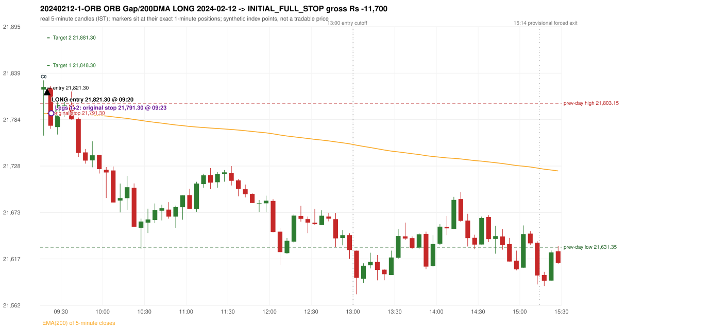
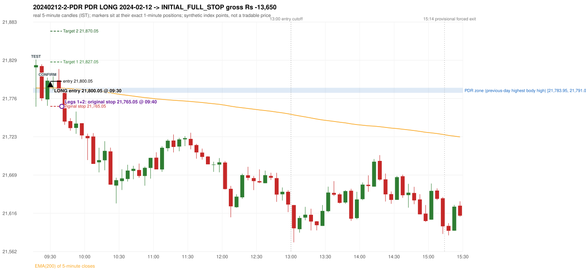

# Trading journal - 2024-02-12 (Monday)

> Phase 4 historical validation, window B (Window B 2022-09-01..2025-08-31 (5paisa minutes); status DATA_VALIDATED). The FROZEN Phase 3.6 configuration (IRF, ORB, PDR body-based, PDS, RF; shared controller) on a different data source. HISTORICAL RESEARCH ONLY: the strategy was developed using later data. same provider as the Phase 3.6 baseline; the vendor-overlap audit shows the minute bars differ from the secondary vendor Synthetic NIFTY 50 index-point P&L (the index is not tradable). The owner's review status is intentionally blank.

## A. Trading day overview

| item | value |
|---|---|
| Date / weekday | 2024-02-12 / Monday |
| Session type | USABLE_WITH_FLAGS / VALID |
| Original session open (first 1-minute open) | 21,819.50 |
| Previous session | 2024-02-09 |
| Previous-day high / low (wicks included) | 21,803.15 / 21,631.35 |
| Previous-day highest BODY high (the body-based PDR ceiling; wicks ignored) | 21,791.00 |
| Previous-day official close / last 5-minute close | 21,782.50 / 21,785.90 |
| Raw engine records / confirmed signals / fully valid signals | 6 / 2 / 2 |
| Setups that did not complete (invalidated / incomplete) | 4 |
| Executed trades | 2 20240212-1-ORB;20240212-2-PDR |
| Gross P&L (Rs, synthetic) | -25,350.00 |
| Illustrative net P&L (Rs; Rs 500/trade + 0.5 pt/fill) | -27,130.00 |
| Day-end portfolio status | DAY_FINISHED |
| Manual journal trades (matched / unmatched) | 0 (0 / 0) |
| Extra automated trades | 0 |

## B. Daily strategy signal timeline (confirmed signals, chronological)

| time | strategy | method | dir | entry-rule status | valid for execution | <= 13:00 | portfolio state | accepted / ignored | specific reason | competing (same minute) |
|---|---|---|---|---|---|---|---|---|---|---|
| 09:20 | ORB | Gap/200DMA | LONG | RESEARCH_VARIANT | True | True | FIRST_TRADE_ACTIVE | ACCEPTED -> 20240212-1-ORB | first eligible signal of the day; trade 1: INITIAL_FULL_STOP |  |
| 09:30 | PDR | PDR | LONG | RESEARCH_VARIANT | True | True | SECOND_TRADE_ACTIVE | ACCEPTED -> 20240212-2-PDR | permitted second trade: newly confirmed PDR/PDS after the original full stop; trade 2: INITIAL_FULL_STOP |  |

Engine setups that did not complete (4); the complete list with failed rule ids is in `rejected_signals.csv`:

| candle | strategy | method | dir | status | precise reason | failed rules |
|---|---|---|---|---|---|---|
| 09:15 | ORB | Method 1 | LONG | INVALIDATED | TREND:EMA_PREV_SESSION_CLOSE wrong side | ORB-TREND-001;ORB-TREND-002 |
| 09:15 | ORB | Method 2 | LONG | INVALIDATED | TREND:EMA_PREV_SESSION_CLOSE wrong side | ORB-TREND-001;ORB-TREND-002 |
| 09:30 | PDR | PDR | LONG | INCOMPLETE_AT_EOD | NO_QUALIFYING_CONFIRMATION_BEFORE_SESSION_END |  |
| 09:40 | RF | RF | LONG | INCOMPLETE_AT_EOD | NO_RETURN_INSIDE_BEFORE_SESSION_END |  |

## C. Detailed trade journals

### 20240212-1-ORB: ORB Gap/200DMA LONG (FIRST trade)

Chart: 

**Rule configuration:** CFG-phase36_body_based-866f954e55 - signal verification status **RESEARCH_VARIANT** (never VERIFIED while a rule rests on a proposal).

#### 1. Setup identification

ORB Gap/200 DMA LONG: the open 21,819.50 gapped +37.00 points from the previous close 21,782.50, through the EMA(200) (21,790.49 -> 21,790.81); the first candle closed at 21,822.60, beyond the average; its body occupied 4.70% of its range and its upper wick 12.05% (thresholds 60% / 20%): the strong-candle test FAILED; the candle was admitted through the conditional PIN-BAR alternative instead (the lower wick 54.90 points is 17.71 x the body, required 2x; the close is 12.05% of the range from the high, allowed 30%). The 'excessively extended' filter has no numeric definition and was not applied.

#### 2. Candle and indicator calculations

| role | session | candle | O | H | L | C | range | body % | upper wick % | lower wick % | direction | EMA(200) | strong bull / bear | pin bull / bear | small (body<=30%) | used for |
|---|---|---|---|---|---|---|---|---|---|---|---|---|---|---|---|---|
| first_candle | TODAY | 09:15-09:20 | 21,819.50 | 21,830.55 | 21,764.60 | 21,822.60 | 65.95 | 4.70 | 12.05 | 83.24 | BULLISH | 21,790.81 | False / False | True / False | True | the 09:15 first five-minute candle - the ORB decision candle |
| prev_session_last_candle | PREVIOUS | 15:25-15:30 | 21,781.60 | 21,787.25 | 21,773.75 | 21,785.90 | 13.50 | 31.85 | 10.00 | 58.15 | BULLISH | 21,790.49 | False / False | False / False | False | previous session's last candle: the EMA(200) before the gap |

Every condition, with the rule, the calculation, the observed values and the result:

| # | group | rule | result | status / numeric definition | calculation | observed | required | available at | why it matters |
|---|---|---|---|---|---|---|---|---|---|
| 1 | SELECTION | SEL-FIRST-001 | PASS | USER_APPROVED / USER_APPROVED | earliest CONFIRMED signal of the day across IRF/ORB/PDR/PDS/RF that passed the controller's checks | 0 confirmed signal(s) earlier today; 2 confirmed signals in the day in total, this one at 09:20 | no earlier executable signal | 2024-02-12 09:20 | the shared controller trades only the first valid signal; the five strategies are not independent positions |
| 2 | SELECTION | SEL-TIE-001 | PASS | USER_APPROVED / USER_APPROVED | other CONFIRMED signals with exactly the same confirmation timestamp | none | no different-strategy / opposite-direction signal in the same minute (otherwise an unresolved conflict, no trade) | 2024-02-12 09:20 | an unresolved same-minute collision would have produced no trade at all |
| 3 | SELECTION | ENTRY-CUTOFF-001 | PASS | USER_APPROVED / USER_APPROVED | fill timestamp vs 13:00:00 IST | signal confirmed 09:20; fill 09:20 | fill at or before 13:00:00 IST | 2024-02-12 09:20 | no new position may be entered with a fill after 13:00 IST |
| 4 | SELECTION | EXE-FILL-001 | PASS | PROPOSED_FOR_REVIEW / PROPOSED_FOR_REVIEW | fill = open of the 1-minute bar that starts at the signal candle's end | bar 09:20 O 21,821.30 H 21,823.90 L 21,809.80 C 21,811.05; executable=True; entry 21,821.30 | fill bar exists, starts exactly at the signal end, is fillable; entry = its open | 2024-02-12 09:20 | a 5-minute signal is known only when its candle closes; the first price that can be traded is the next minute's open |
| 5 | SELECTION | DAY-MAX-001 | PASS | USER_APPROVED / USER_APPROVED | number of entries today | trade 1 of at most 2 | <= 2 entries per day | 2024-02-12 09:20 | daily trade cap |
| 6 | SETUP | ORB-GLOBAL-001 | PASS | SOURCE_VERIFIED / EXPLICIT_IN_SOURCE | decision is taken once the first 5-minute candle (09:15-09:20) has closed | candle 09:15-09:20; signal confirmed 09:20 | decision at 09:20, never before the close | 2024-02-12 09:20 | the close of the first candle is unknown before 09:20 |
| 7 | SETUP | ORB-GLOBAL-002 | PASS | SOURCE_VERIFIED / EXPLICIT_IN_SOURCE | direction | LONG | same rules in both directions | 2024-02-12 09:20 | ORB trades the side of the break |
| 8 | SETUP | ORB-GLOBAL-004 | PASS | SOURCE_VERIFIED / QUALITATIVE_SOURCE_NUMERIC_DEFINITION_PROPOSED_FOR_REVIEW | entry at 09:20, after the first-candle close | signal confirmed 09:20; fill 09:20 at the open of that minute | 09:20 entry | 2024-02-12 09:20 | the guide enters at 9:20; the fill price convention (next minute open) is a proposal |
| 9 | SETUP | ORB-GAP-LONG-001 | PASS | SOURCE_VERIFIED / EXPLICIT_WORDING_DETAIL_PROPOSED_FOR_REVIEW | gap = first 1-minute open of today - previous session's OFFICIAL close | today's open 21,819.50 (first 1-minute bar 09:15) - previous close 21,782.50 (DAILY_VENDOR, 2024-02-09) = +37.00 points -> gap UP | gap UP (more than 0 points) | 2024-02-12 09:15 | approved convention: the original first-minute open, never the vendor daily open |
| 10 | SETUP | ORB-GAP-LONG-002 | PASS | SOURCE_VERIFIED / QUALITATIVE_SOURCE_NUMERIC_DEFINITION_PROPOSED_FOR_REVIEW | the gap carries the open through the moving average (EMA200_5M: EMA(200) of 5-minute closes) | previous close 21,782.50 < previous-session EMA 21,790.49; today's open 21,819.50 > today's first-candle EMA 21,790.81 (engine recorded 21,790.81 / 21,790.49) | previous close on one side, open on the other | 2024-02-12 09:20 | the Gap/200 DMA setup needs the gap to push price through the MA (the source text vs figures is a documented conflict: ORB-MA-001) |
| 11 | CONFIRMATION | ORB-GAP-LONG-003 | PASS | SOURCE_VERIFIED / EXPLICIT_IN_SOURCE | first candle closes beyond the moving average | close 21,822.60 vs EMA 21,790.81: 31.79 points above | close above (long) / below (short) the MA | 2024-02-12 09:20 | a candle that only crosses the line does not qualify |
| 12 | CONFIRMATION | ORB-GAP-LONG-004 | PASS | SOURCE_VERIFIED / QUALITATIVE_SOURCE_NUMERIC_DEFINITION_PROPOSED_FOR_REVIEW | candle quality (strong body or pin bar) and no strong rejection wick | 09:15-09:20 O 21,819.50 H 21,830.55 L 21,764.60 C 21,822.60; range 65.95, body 3.10 (4.70%), upper wick 7.95 (12.05%), lower wick 54.90 (83.24%), bullish. Strong-bullish test: bullish close, body >= 60% (observed 4.70%), upper wick <= 20% (observed 12.05%) -> not met; pin-bar alternative: wick >= 2 x body and close within the favourable 30% -> met; rejection wick 12.05% vs limit 33% | strong body or pin bar, and the rejection wick below the limit | 2024-02-12 09:20 | the thresholds are proposals |
| 13 | EXECUTION | ORB-GLOBAL-003 | PASS | SOURCE_VERIFIED / EXPLICIT_IN_SOURCE | initial stop = entry - 30 points | entry 21,821.30 -> stop 21,791.30 | stop 30 index points (BASELINE) | 2024-02-12 09:20 | defines the loss if the setup fails before Target 1 |
| 14 | EXECUTION | EXE-T1-001 | PASS | SOURCE_VERIFIED / EXPLICIT_IN_SOURCE | Target 1 = entry +/- 27 points | T1 21,848.30 | 27 points | 2024-02-12 09:20 | Leg 1 (3 lots) is booked at Target 1 |
| 15 | EXECUTION | ORB-GLOBAL-003 | PASS | SOURCE_VERIFIED / EXPLICIT_IN_SOURCE | Target 2 = entry +/- 60 points | T2 21,881.30 | 60 points | 2024-02-12 09:20 | Leg 2 (3 lots) is booked at Target 2 |
| 16 | EXECUTION | POST-T1-STOP-006 | PASS | USER_APPROVED / USER_APPROVED | after T1 the Leg-2 stop = entry - 6 (no trailing) | post-T1 stop 21,815.30 | entry -6 (LONG) / +6 (SHORT) | 2024-02-12 09:20 | protects the remaining three lots once the first three are booked |
| 17 | EXECUTION | SIZE-LOT-001 | PASS | USER_APPROVED / USER_APPROVED | 6 lots x 65 = 390, Leg 1 = 3 lots = 195, Leg 2 = 195 | 6 lots, lot size 65, legs 3+3 | 6 lots in two equal legs | 2024-02-12 09:20 | position size for the synthetic P&L |
| 18 | NOTE | ORB-MA-001 | UNRESOLVED | CONFLICTING / CONFLICTING | which moving average the code uses | EMA(200) of 5-minute closes (the guide says '200 DMA' in some places and '200 EMA' in others); active ma_mode EMA200_5M | the source terminology conflicts | 2024-02-12 09:20 | a daily 200 DMA would give different values |
| 19 | NOTE | ORB-GAP-LONG-005 | UNRESOLVED | UNRESOLVED / UNRESOLVED | 'excessively extended' opening move | gap +37.00 points; maximum gap configured: None | the source gives no number, so no limit is applied | 2024-02-12 09:20 | a very large gap would be rejected by a human; the engine has no defined limit |
| 20 | NOTE | NOTE-UNRESOLVED-DEPENDENCIES | UNRESOLVED | NOT_A_RULE / NOT_A_REGISTRY_RULE | rules the signal depends on that the sources leave unresolved | engine-recorded unresolved rule ids: ORB-MA-001, ORB-GAP-LONG-005; verification status RESEARCH_VARIANT | n/a (disclosure) | 2024-02-12 09:20 | the entry is only as verified as the rules it rests on |

#### 3. Entry decision and explanation

ORB Gap/200 DMA LONG: the open 21,819.50 gapped +37.00 points from the previous close 21,782.50, through the EMA(200) (21,790.49 -> 21,790.81); the first candle closed at 21,822.60, beyond the average; its body occupied 4.70% of its range and its upper wick 12.05% (thresholds 60% / 20%): the strong-candle test FAILED; the candle was admitted through the conditional PIN-BAR alternative instead (the lower wick 54.90 points is 17.71 x the body, required 2x; the close is 12.05% of the range from the high, allowed 30%). The 'excessively extended' filter has no numeric definition and was not applied.

**Why this trade ahead of the other strategies:** This ORB Gap/200DMA signal was the earliest executable signal of the day: 0 confirmed signal(s) earlier, 0 other in the same minute. 1 later confirmed signal(s) (PDR x1) are logged as ignored or rejected. State of the other four engines at that moment: [IRF: no setup record before this time (a base condition was not met, or nothing triggered)] [PDR: no setup record before this time (a base condition was not met, or nothing triggered)] [PDS: no setup record before this time (a base condition was not met, or nothing triggered)] [RF: no setup record before this time (a base condition was not met, or nothing triggered)]

#### 4. Actual entry execution

| item | value |
|---|---|
| Signal candle | 09:15-09:20 |
| Signal confirmed | 2024-02-12 09:20 |
| Fill timestamp | 2024-02-12 09:20 |
| Entry price | 21,821.30 |
| Source partition / 1-minute bar | data/phase4/processed/FIVEPAISA_1M_PHASE4/nifty50/year=2024/month=02/candles.parquet / 2024-02-12 09:20 |
| Source bar O / H / L / C | 21,821.30 / 21,823.90 / 21,809.80 / 21,811.05 |
| Fill assumption | open of the 1-minute bar starting at the signal candle's end (EXE-FILL-001, PROPOSED causal convention) |
| Initial stop / T1 / T2 / post-T1 stop | 21,791.30 / 21,848.30 / 21,881.30 / 21,815.30 |
| Position | 6 lots x 65 = 390 units (Leg 1 195, Leg 2 195) |

#### 5-8. Trade progress, Target 1, post-T1 stop and final exit

Between the 09:20 entry bar and the final exit (4 one-minute bars) the best excursion in favour was 2.60 points at 09:20 and the worst against was 48.65 points at 09:23. At 09:23 price reached the original stop 21,791.30 before Target 1 21,848.30, so all six lots exited together at 21,791.30. This is an INITIAL_FULL_STOP: one more trade is allowed that day, only a newly confirmed PDR/PDS signal.

| leg | qty | exit time | exit price | reason | source 1-minute bar | O / H / L / C | gross points | gross Rs | slippage pts | flags |
|---|---|---|---|---|---|---|---|---|---|---|
| 1 | 195 | 09:23 | 21,791.30 | ORIGINAL_STOP_BEFORE_T1 | 09:23 | 21,795.85 / 21,797.65 / 21,772.65 / 21,787.50 | -30.00 | -5,850.00 | 0.00 |  |
| 2 | 195 | 09:23 | 21,791.30 | ORIGINAL_STOP_BEFORE_T1 | 09:23 | 21,795.85 / 21,797.65 / 21,772.65 / 21,787.50 | -30.00 | -5,850.00 | 0.00 |  |

Exit evidence per leg:

* Leg 1: 1-minute bar 09:23 O 21,795.85 H 21,797.65 L 21,772.65 C 21,787.50: low 21,772.65 reached the original stop 21,791.30 before Target 1 21,848.30 was touched; both legs exit at the stop level 21,791.30
* Leg 2: 1-minute bar 09:23 O 21,795.85 H 21,797.65 L 21,772.65 C 21,787.50: low 21,772.65 reached the original stop 21,791.30 before Target 1 21,848.30 was touched; both legs exit at the stop level 21,791.30

#### 9. Gross and illustrative net P&L

| item | value (Rs) |
|---|---|
| Leg 1 gross | -5,850.00 |
| Leg 2 gross | -5,850.00 |
| Trade gross (= Leg 1 + Leg 2) | -11,700.00 |
| Illustrative fixed cost | -500.00 |
| Illustrative slippage (0.5 pt on every fill, entry + exits, all units) | -390.00 |
| Illustrative net | -12,590.00 |

#### 10. Manual journal comparison

No manual journal exists for this period; no comparison.

### 20240212-2-PDR: PDR LONG (SECOND trade)

Chart: 

**Rule configuration:** CFG-phase36_body_based-866f954e55 - signal verification status **RESEARCH_VARIANT** (never VERIFIED while a rule rests on a proposal).

#### 1. Setup identification

PDR LONG (body-based engine, A_HIGHEST_BODY_HIGH): the session opened 37.00 points above the previous close and 28.50 points above the previous-day highest BODY high 21,791.00 (zone [21,783.95, 21,791.00] from the 15:10 candle of 2024-02-09; the highest wick 21,803.15 is ignored). The 09:15 candle (21,764.60 - 21,830.55) tested the zone; the 09:25 candle (green, O 21,774.75 H 21,805.30 L 21,765.85 C 21,800.95) passed GOOD_GREEN_BODY and closed 9.95 points above the zone ceiling, confirming the entry at 09:30. The pattern thresholds and the zone's lower boundary are provisional research assumptions, not approved by the strategy author.

#### 2. Candle and indicator calculations

| role | session | candle | O | H | L | C | range | body % | upper wick % | lower wick % | direction | EMA(200) | strong bull / bear | pin bull / bear | small (body<=30%) | used for |
|---|---|---|---|---|---|---|---|---|---|---|---|---|---|---|---|---|
| zone_source_candle | PREVIOUS | 15:10-15:15 | 21,791.00 | 21,800.35 | 21,780.35 | 21,783.95 | 20.00 | 35.25 | 46.75 | 18.00 | BEARISH | 21,790.76 | False / False | False / False | False | candle of the previous session's highest BODY high (A_HIGHEST_BODY_HIGH) |
| prev_day_wick_high_candle | PREVIOUS | 15:00-15:05 | 21,760.90 | 21,803.15 | 21,755.20 | 21,780.80 | 47.95 | 41.50 | 46.61 | 11.89 | BULLISH | 21,790.83 | False / False | False / False | False | candle of the previous session's highest WICK (ignored by the author's rule; shown for comparison) |
| interaction_candle | TODAY | 09:15-09:20 | 21,819.50 | 21,830.55 | 21,764.60 | 21,822.60 | 65.95 | 4.70 | 12.05 | 83.24 | BULLISH | 21,790.81 | False / False | True / False | True | first candle whose range overlaps the zone (the test) |
| confirmation_candle | TODAY | 09:25-09:30 | 21,774.75 | 21,805.30 | 21,765.85 | 21,800.95 | 39.45 | 66.41 | 11.03 | 22.56 | BULLISH | 21,790.77 | True / False | False / False | False | candle that satisfies one of the three patterns and closes above the zone ceiling |

Every condition, with the rule, the calculation, the observed values and the result:

| # | group | rule | result | status / numeric definition | calculation | observed | required | available at | why it matters |
|---|---|---|---|---|---|---|---|---|---|
| 1 | SELECTION | DAY-SL-001 | PASS | USER_APPROVED / USER_APPROVED | first trade outcome, strategy of this signal, position-close time vs this signal's timestamp | first trade ORB Gap/200DMA closed as INITIAL_FULL_STOP at 09:23; position free from 09:24; this PDR signal confirmed 09:30 | first trade INITIAL_FULL_STOP before Target 1, and a NEWLY confirmed PDR/PDS signal after the first position closed | 2024-02-12 09:30 | the only way a second trade is allowed |
| 2 | SELECTION | DAY-NOREUSE-001 | PASS | USER_APPROVED / USER_APPROVED | signals confirmed while the first position was open | 1 signal(s) were ignored during the first trade (never reused): ORB Gap/200DMA LONG @09:20 | this trade comes from a signal confirmed after the first exit, not from an ignored one | 2024-02-12 09:30 | an ignored signal can never become the second trade |
| 3 | SELECTION | ENTRY-CUTOFF-001 | PASS | USER_APPROVED / USER_APPROVED | fill timestamp vs 13:00:00 IST | signal confirmed 09:30; fill 09:30 | fill at or before 13:00:00 IST | 2024-02-12 09:30 | no new position may be entered with a fill after 13:00 IST |
| 4 | SELECTION | EXE-FILL-001 | PASS | PROPOSED_FOR_REVIEW / PROPOSED_FOR_REVIEW | fill = open of the 1-minute bar that starts at the signal candle's end | bar 09:30 O 21,800.05 H 21,808.80 L 21,799.35 C 21,808.70; executable=True; entry 21,800.05 | fill bar exists, starts exactly at the signal end, is fillable; entry = its open | 2024-02-12 09:30 | a 5-minute signal is known only when its candle closes; the first price that can be traded is the next minute's open |
| 5 | SELECTION | DAY-MAX-001 | PASS | USER_APPROVED / USER_APPROVED | number of entries today | trade 2 of at most 2 | <= 2 entries per day | 2024-02-12 09:30 | daily trade cap |
| 6 | SETUP | PDR-004 | PASS | SOURCE_VERIFIED / EXPLICIT_WORDING_DETAIL_PROPOSED_FOR_REVIEW | gap = first 1-minute open of today - previous session's OFFICIAL close | today's open 21,819.50 (first 1-minute bar 09:15) - previous close 21,782.50 (DAILY_VENDOR, 2024-02-09) = +37.00 points -> gap UP | gap UP (more than 0 points) | 2024-02-12 09:15 | approved convention: the original first-minute open, never the vendor daily open |
| 7 | SETUP | PDR-B03 | PASS | AUTHOR_APPROVED / AUTHOR_STATEMENT_NUMERIC_DETAILS_ARE_SEPARATE_PROPOSED_ROWS | the session opens strictly above the previous day's resistance zone (author-approved) | today's first 1-minute open 21,819.50 vs zone ceiling 21,791.00: 28.50 points above (open - ceiling = +28.50) | open > zone ceiling (equal or inside the zone rejects the setup) | 2024-02-12 09:15 | the original first-minute open is used, never a vendor daily open |
| 8 | ZONE | PDR-001 | PASS | SOURCE_VERIFIED / EXPLICIT_IN_SOURCE | direction | LONG (PDR is long only) | long-only | 2024-02-12 09:30 | PDR buys a retest of previous-day resistance after a gap up |
| 9 | ZONE | PDR-B01a | PASS | AUTHOR_APPROVED / AUTHOR_STATEMENT_NUMERIC_DETAILS_ARE_SEPARATE_PROPOSED_ROWS | wicks ignored, bodies considered: body_high = max(open, close) of every completed previous-session 5-minute candle; ceiling = the highest body_high; floor = body low of that candle | previous session 2024-02-09: highest body high 21,791.00 on the 15:10 candle (O 21,791.00 C 21,783.95; wick high of that candle 21,800.35, ignored); four highest body highs: 21,791.00 (15:10); 21,790.15 (15:05); 21,785.90 (15:25); 21,785.20 (14:35). Highest WICK of the session 21,803.15 (15:00 candle) is 12.15 points above the ceiling and plays no part. Zone [21,783.95 (body low), 21,791.00 (body high)]; engine recorded [21,783.95, 21,791.00] | ceiling = highest body high of the previous session (author: wick ignored, body considered) | 2024-02-09 15:30 | a wick-only price never becomes resistance; the zone is drawn from candle bodies |
| 10 | ZONE | PDR-B02 | UNRESOLVED | AUTHOR_APPROVED / AUTHOR_STATEMENT_NUMERIC_DETAILS_ARE_SEPARATE_PROPOSED_ROWS | multiple highs connected into one zone (author principle; candidate B) | candidate A (used): [21,783.95, 21,791.00]. Candidate B (multiple-body-high cluster, tolerance 5 points) would be [21,783.95, 21,791.00] (ISOLATED_BODY_HIGH, 1 touch(es), member body highs 21,791.00); ceiling difference 0.00 points | a zone that connects all relevant highs (numbers not given by the author) | 2024-02-09 15:30 | candidate B has the same ceiling by construction, so this signal is unaffected by the choice; the lower boundary and the cluster numbers are research parameters |
| 11 | ZONE | PDR-003 | PASS | SOURCE_VERIFIED / EXPLICIT_IN_SOURCE | the zone is an area, not a single price | zone height 7.05 points [21,783.95, 21,791.00] | a rectangle with positive height (a zero-height zone is left unresolved by the engine) | 2024-02-09 15:30 | price may touch any part of the area |
| 12 | CONFIRMATION | PDR-B03b | PASS | PRESERVED_FROM_PHASE2 / PRESERVED_FROM_PHASE2 | the first candle whose [low, high] overlaps the zone (+/- proximity) is the test; the confirmation must come strictly after it | 09:15-09:20 O 21,819.50 H 21,830.55 L 21,764.60 C 21,822.60; range 65.95, body 3.10 (4.70%), upper wick 7.95 (12.05%), lower wick 54.90 (83.24%), bullish; low 21,764.60 vs zone ceiling 21,791.00, high 21,830.55 vs zone floor 21,783.95; proximity 0; confirmation candle 09:25 is candle no. 3, the test candle no. 1 | range overlaps the zone; confirmation after the test | 2024-02-12 09:20 | the retest of the previous-day resistance |
| 13 | CONFIRMATION | PDR-B04c | PASS | PROPOSED_FOR_REVIEW / NUMERIC_DEFINITION_PROPOSED_FOR_REVIEW | Pattern 1: good green body on the 09:25-09:30 candle (O 21,774.75 H 21,805.30 L 21,765.85 C 21,800.95); the numeric thresholds are PROVISIONAL (RESEARCH_DEFAULT), not author-approved | colour green; body 66.41%; upper wick 11.03% -> PASSES | green, body >= 60% and upper wick <= 20% of the range | 2024-02-12 09:30 | one of the three patterns is enough (author: one good green body OR lower price rejection OR hammer); fixed thresholds are not required by the author, so the numbers are a research convention; a pattern that does not pass is not an error |
| 14 | CONFIRMATION | PDR-B04c | NOT_APPLICABLE | PROPOSED_FOR_REVIEW / NUMERIC_DEFINITION_PROPOSED_FOR_REVIEW | Pattern 2: lower-price rejection candle on the 09:25-09:30 candle (O 21,774.75 H 21,805.30 L 21,765.85 C 21,800.95); the numeric thresholds are PROVISIONAL (RESEARCH_DEFAULT), not author-approved | lower wick 8.90 = 0.34 x body 26.20; close 11.03% below the high; low 21,765.85; low reached the zone ceiling 21,791.00 -> does not pass | lower wick >= 2 x body, close within the top 30% of the range, low <= zone ceiling (colour not required) | 2024-02-12 09:30 | one of the three patterns is enough (author: one good green body OR lower price rejection OR hammer); fixed thresholds are not required by the author, so the numbers are a research convention; a pattern that does not pass is not an error |
| 15 | CONFIRMATION | PDR-B04c | NOT_APPLICABLE | PROPOSED_FOR_REVIEW / NUMERIC_DEFINITION_PROPOSED_FOR_REVIEW | Pattern 3: hammer candle on the 09:25-09:30 candle (O 21,774.75 H 21,805.30 L 21,765.85 C 21,800.95); the numeric thresholds are PROVISIONAL (RESEARCH_DEFAULT), not author-approved | lower wick 8.90 = 0.34 x body; upper wick 11.03%; body bottom at 22.56% of the range -> does not pass | lower wick >= 2 x body, upper wick <= 10%, body bottom >= 60% of the range (colour not required) | 2024-02-12 09:30 | one of the three patterns is enough (author: one good green body OR lower price rejection OR hammer); fixed thresholds are not required by the author, so the numbers are a research convention; a pattern that does not pass is not an error |
| 16 | CONFIRMATION | PDR-B04 | PASS | AUTHOR_APPROVED / AUTHOR_STATEMENT_NUMERIC_DETAILS_ARE_SEPARATE_PROPOSED_ROWS | at least one of the three patterns passes (OR logic; every passing pattern is recorded) | patterns passed: GOOD_GREEN_BODY (engine recorded: GOOD_GREEN_BODY) | at least one pattern | 2024-02-12 09:30 | the author's entry candle requirement |
| 17 | CONFIRMATION | PDR-B05 | PASS | AUTHOR_APPROVED / AUTHOR_STATEMENT_NUMERIC_DETAILS_ARE_SEPARATE_PROPOSED_ROWS | the confirmation candle must close above the zone | close 21,800.95 vs zone ceiling 21,791.00: +9.95 points (floor 21,783.95; low 21,765.85 dipped into/below the zone) | close > zone ceiling, strictly (lower wick may penetrate the zone) | 2024-02-12 09:30 | no pattern overrides the close rule |
| 18 | CONFIRMATION | PDR-B06 | PASS | USER_APPROVED / USER_APPROVED | no entry at the open and no look-ahead: the order is placed only after the confirmation candle has completed | test candle 09:15 (no. 1) precedes the confirmation candle 09:25-09:30; signal stamped 09:30; fill 09:30 at the open of that 1-minute bar = 21,800.05 | interaction before the confirmation; fill after the confirmation candle's end | 2024-02-12 09:30 | existing causal fill convention (EXE-FILL-001) |
| 19 | EXECUTION | EXE-STOP-001 | PASS | USER_APPROVED / USER_APPROVED | initial stop = entry - 35 points | entry 21,800.05 -> stop 21,765.05 | stop 35 index points (BASELINE) | 2024-02-12 09:30 | defines the loss if the setup fails before Target 1 |
| 20 | EXECUTION | EXE-T1-001 | PASS | SOURCE_VERIFIED / EXPLICIT_IN_SOURCE | Target 1 = entry +/- 27 points | T1 21,827.05 | 27 points | 2024-02-12 09:30 | Leg 1 (3 lots) is booked at Target 1 |
| 21 | EXECUTION | PDR-008 | PASS | SOURCE_VERIFIED / EXPLICIT_IN_SOURCE | Target 2 = entry +/- 70 points | T2 21,870.05 (the guide says 70; the performance report's winners suggest 60 - CONFLICTING, recorded) | 70 points | 2024-02-12 09:30 | Leg 2 (3 lots) is booked at Target 2 |
| 22 | EXECUTION | POST-T1-STOP-006 | PASS | USER_APPROVED / USER_APPROVED | after T1 the Leg-2 stop = entry - 6 (no trailing) | post-T1 stop 21,794.05 | entry -6 (LONG) / +6 (SHORT) | 2024-02-12 09:30 | protects the remaining three lots once the first three are booked |
| 23 | EXECUTION | SIZE-LOT-001 | PASS | USER_APPROVED / USER_APPROVED | 6 lots x 65 = 390, Leg 1 = 3 lots = 195, Leg 2 = 195 | 6 lots, lot size 65, legs 3+3 | 6 lots in two equal legs | 2024-02-12 09:30 | position size for the synthetic P&L |
| 24 | NOTE | PDR-B04x | UNRESOLVED | PROPOSED_FOR_REVIEW / NUMERIC_DEFINITION_PROPOSED_FOR_REVIEW | provisional parameters this signal rests on | pattern thresholds RESEARCH_DEFAULT: {'green_body_min': 0.6, 'green_upper_wick_max': 0.2, 'reject_wick_to_body_min': 2.0, 'reject_close_fraction_max': 0.3, 'hammer_wick_to_body_min': 2.0, 'hammer_upper_wick_max': 0.1, 'hammer_body_position_min': 0.6}; zone lower boundary = hull of the member bodies; zero-height policy UNRESOLVED_NO_SETUP; wait policy WAIT_FOR_QUALIFYING_CANDLE; cluster parameters (candidate B only) tolerance 5, touches 2, separation 2 | n/a (disclosure) | 2024-02-12 09:30 | the strategy author has NOT approved these numbers or conventions; the signal is a RESEARCH_VARIANT, never VERIFIED |
| 25 | NOTE | PDR-012 | NOT_APPLICABLE | PROPOSED_FOR_REVIEW / PROPOSED_FOR_REVIEW | repeated PDR signals today | 1 confirmed PDR signal(s) in the session | n/a (disclosure) | 2024-02-12 09:30 | this engine reports EVERY qualifying signal (the per-session cap is lifted); the controller trades only the first (and a PDR/PDS second trade after an initial full stop) |
| 26 | NOTE | PDR-B07 | UNRESOLVED | PROPOSED_FOR_REVIEW / NUMERIC_DEFINITION_PROPOSED_FOR_REVIEW | state of the zone between the test and the confirmation (the author and the guide are silent on price crossing below the zone) | test candle 09:15 (no. 1), confirmation candle 09:25 (no. 3): 2 candle(s) later; 1 candle(s) in between CLOSED BELOW the zone floor 21,783.95 (lowest close 21,776.40) before price returned above the ceiling | n/a (disclosure; the wait policy is a research parameter) | 2024-02-12 09:30 | the engine keeps a tested setup armed until a candle qualifies; whether a zone that price has closed through should still count is an owner decision |
| 27 | NOTE | PDR-009 | UNRESOLVED | UNRESOLVED / UNRESOLVED | stop 35 or 40 'depending on the situation' | the guide gives no selection rule; baseline fixed 35 points | unresolved in the source | 2024-02-12 09:30 | PDR stop selection is left to the owner |
| 28 | NOTE | NOTE-UNRESOLVED-DEPENDENCIES | UNRESOLVED | NOT_A_RULE / NOT_A_REGISTRY_RULE | rules the signal depends on that the sources leave unresolved | engine-recorded unresolved rule ids: PDR-B01b, PDR-B02a, PDR-B02b, PDR-B02c, PDR-B02d, PDR-B02e, PDR-B02f, PDR-B02g, PDR-B02h, PDR-B04b, PDR-B04c, PDR-B05a, PDR-B07; verification status RESEARCH_VARIANT | n/a (disclosure) | 2024-02-12 09:30 | the entry is only as verified as the rules it rests on |

#### 3. Entry decision and explanation

PDR LONG (body-based engine, A_HIGHEST_BODY_HIGH): the session opened 37.00 points above the previous close and 28.50 points above the previous-day highest BODY high 21,791.00 (zone [21,783.95, 21,791.00] from the 15:10 candle of 2024-02-09; the highest wick 21,803.15 is ignored). The 09:15 candle (21,764.60 - 21,830.55) tested the zone; the 09:25 candle (green, O 21,774.75 H 21,805.30 L 21,765.85 C 21,800.95) passed GOOD_GREEN_BODY and closed 9.95 points above the zone ceiling, confirming the entry at 09:30. The pattern thresholds and the zone's lower boundary are provisional research assumptions, not approved by the strategy author.

**Why this trade ahead of the other strategies:** The first trade (ORB Gap/200DMA) was stopped out before Target 1 at 09:23; this newly confirmed PDR signal at 09:30 is the first PDR/PDS signal after that exit, so it is the day's permitted second trade. State of the other engines at that moment: [IRF: no setup record before this time (a base condition was not met, or nothing triggered)] [ORB: 1 confirmed signal(s) up to this time (Gap/200DMA@09:20)] [PDS: no setup record before this time (a base condition was not met, or nothing triggered)] [RF: no setup record before this time (a base condition was not met, or nothing triggered)]

#### 4. Actual entry execution

| item | value |
|---|---|
| Signal candle | 09:25-09:30 |
| Signal confirmed | 2024-02-12 09:30 |
| Fill timestamp | 2024-02-12 09:30 |
| Entry price | 21,800.05 |
| Source partition / 1-minute bar | data/phase4/processed/FIVEPAISA_1M_PHASE4/nifty50/year=2024/month=02/candles.parquet / 2024-02-12 09:30 |
| Source bar O / H / L / C | 21,800.05 / 21,808.80 / 21,799.35 / 21,808.70 |
| Fill assumption | open of the 1-minute bar starting at the signal candle's end (EXE-FILL-001, PROPOSED causal convention) |
| Initial stop / T1 / T2 / post-T1 stop | 21,765.05 / 21,827.05 / 21,870.05 / 21,794.05 |
| Position | 6 lots x 65 = 390 units (Leg 1 195, Leg 2 195) |

#### 5-8. Trade progress, Target 1, post-T1 stop and final exit

Between the 09:30 entry bar and the final exit (11 one-minute bars) the best excursion in favour was 17.20 points at 09:36 and the worst against was 58.95 points at 09:40. At 09:40 price reached the original stop 21,765.05 before Target 1 21,827.05, so all six lots exited together at 21,765.05. This is an INITIAL_FULL_STOP: one more trade is allowed that day, only a newly confirmed PDR/PDS signal.

| leg | qty | exit time | exit price | reason | source 1-minute bar | O / H / L / C | gross points | gross Rs | slippage pts | flags |
|---|---|---|---|---|---|---|---|---|---|---|
| 1 | 195 | 09:40 | 21,765.05 | ORIGINAL_STOP_BEFORE_T1 | 09:40 | 21,784.50 / 21,786.15 / 21,741.10 / 21,754.95 | -35.00 | -6,825.00 | 0.00 |  |
| 2 | 195 | 09:40 | 21,765.05 | ORIGINAL_STOP_BEFORE_T1 | 09:40 | 21,784.50 / 21,786.15 / 21,741.10 / 21,754.95 | -35.00 | -6,825.00 | 0.00 |  |

Exit evidence per leg:

* Leg 1: 1-minute bar 09:40 O 21,784.50 H 21,786.15 L 21,741.10 C 21,754.95: low 21,741.10 reached the original stop 21,765.05 before Target 1 21,827.05 was touched; both legs exit at the stop level 21,765.05
* Leg 2: 1-minute bar 09:40 O 21,784.50 H 21,786.15 L 21,741.10 C 21,754.95: low 21,741.10 reached the original stop 21,765.05 before Target 1 21,827.05 was touched; both legs exit at the stop level 21,765.05

#### 9. Gross and illustrative net P&L

| item | value (Rs) |
|---|---|
| Leg 1 gross | -6,825.00 |
| Leg 2 gross | -6,825.00 |
| Trade gross (= Leg 1 + Leg 2) | -13,650.00 |
| Illustrative fixed cost | -500.00 |
| Illustrative slippage (0.5 pt on every fill, entry + exits, all units) | -390.00 |
| Illustrative net | -14,540.00 |

#### 10. Manual journal comparison

No manual journal exists for this period; no comparison.

## D. Manual journal comparison

No manual journal exists for this period (the manual journal covers 2025-09-01 .. 2026-08-31 only); no comparison is made and no automated trade is labelled 'extra'.

## E. Daily conclusion

* **Traded:** 20240212-1-ORB - ORB Gap/200DMA LONG at 09:20 (entry 21,821.30), outcome INITIAL_FULL_STOP, gross Rs -11,700.00, illustrative net Rs -12,590.00. **Why:** This ORB Gap/200DMA signal was the earliest executable signal of the day: 0 confirmed signal(s) earlier, 0 other in the same minute. 1 later confirmed signal(s) (PDR x1) are logged as ignored or rejected. State of the other four engines at that moment: [IRF: no setup record before this time (a base condition was not met, or nothing triggered)] [PDR: no setup record before this time (a base condition was not met, or nothing triggered)] [PDS: no setup record before this time (a base condition was not met, or nothing triggered)] [RF: no setup record before this time (a base condition was not met, or nothing triggered)] **How it ended:** At 09:23 price reached the original stop 21,791.30 before Target 1 21,848.30, so all six lots exited together at 21,791.30. This is an INITIAL_FULL_STOP: one more trade is allowed that day, only a newly confirmed PDR/PDS signal.
* **Traded:** 20240212-2-PDR - PDR PDR LONG at 09:30 (entry 21,800.05), outcome INITIAL_FULL_STOP, gross Rs -13,650.00, illustrative net Rs -14,540.00. **Why:** The first trade (ORB Gap/200DMA) was stopped out before Target 1 at 09:23; this newly confirmed PDR signal at 09:30 is the first PDR/PDS signal after that exit, so it is the day's permitted second trade. State of the other engines at that moment: [IRF: no setup record before this time (a base condition was not met, or nothing triggered)] [ORB: 1 confirmed signal(s) up to this time (Gap/200DMA@09:20)] [PDS: no setup record before this time (a base condition was not met, or nothing triggered)] [RF: no setup record before this time (a base condition was not met, or nothing triggered)] **How it ended:** At 09:40 price reached the original stop 21,765.05 before Target 1 21,827.05, so all six lots exited together at 21,765.05. This is an INITIAL_FULL_STOP: one more trade is allowed that day, only a newly confirmed PDR/PDS signal.
* **Open strategy-definition issues that affected this day:** NOTE-UNRESOLVED-DEPENDENCIES, ORB-GAP-LONG-005 (Reject if the opening move is excessively extended or the candle shows strong rejection wicks), ORB-MA-001 (Terminology conflict: '200 DMA / EMA' (p.2), '200 EMA' (pp.3,5,7), '200 DMA' (pp.1,8,9,12) for what the charts show as one curved line on a 5-minute chart), PDR-009 (Stop-loss 35 or 40 'depending on the situation'; choose before entering, do not move after entry), PDR-B02, PDR-B04x, PDR-B07
* **Automated triage (not an approval; the owner's review status stays blank):** TRADED_NO_FLAGS
