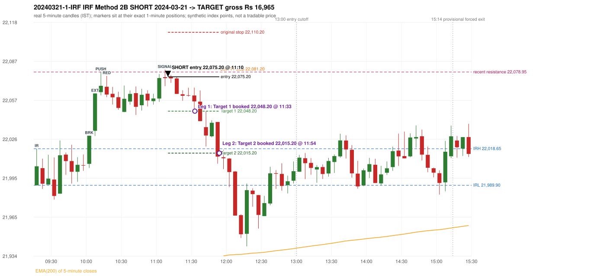

# Trading journal - 2024-03-21 (Thursday)

> Phase 4 historical validation, window B (Window B 2022-09-01..2025-08-31 (5paisa minutes); status DATA_VALIDATED). The FROZEN Phase 3.6 configuration (IRF, ORB, PDR body-based, PDS, RF; shared controller) on a different data source. HISTORICAL RESEARCH ONLY: the strategy was developed using later data. same provider as the Phase 3.6 baseline; the vendor-overlap audit shows the minute bars differ from the secondary vendor Synthetic NIFTY 50 index-point P&L (the index is not tradable). The owner's review status is intentionally blank.

## A. Trading day overview

| item | value |
|---|---|
| Date / weekday | 2024-03-21 / Thursday |
| Session type | USABLE_WITH_FLAGS / VALID |
| Original session open (first 1-minute open) | 21,989.90 |
| Previous session | 2024-03-20 |
| Previous-day high / low (wicks included) | 21,930.50 / 21,710.35 |
| Previous-day highest BODY high (the body-based PDR ceiling; wicks ignored) | 21,921.55 |
| Previous-day official close / last 5-minute close | 21,839.10 / 21,855.10 |
| Raw engine records / confirmed signals / fully valid signals | 10 / 5 / 4 |
| Setups that did not complete (invalidated / incomplete) | 5 |
| Executed trades | 1 20240321-1-IRF |
| Gross P&L (Rs, synthetic) | 16,965.00 |
| Illustrative net P&L (Rs; Rs 500/trade + 0.5 pt/fill) | 16,075.00 |
| Day-end portfolio status | DAY_FINISHED |
| Manual journal trades (matched / unmatched) | 0 (0 / 0) |
| Extra automated trades | 0 |

## B. Daily strategy signal timeline (confirmed signals, chronological)

| time | strategy | method | dir | entry-rule status | valid for execution | <= 13:00 | portfolio state | accepted / ignored | specific reason | competing (same minute) |
|---|---|---|---|---|---|---|---|---|---|---|
| 11:10 | IRF | Method 2B | SHORT | PROPOSAL_DEPENDENT | True | True | FIRST_TRADE_ACTIVE | ACCEPTED -> 20240321-1-IRF | first eligible signal of the day; trade 1: TARGET |  |
| 11:55 | IRF | Method 1 | SHORT | PROPOSAL_DEPENDENT | True | True | DAY_FINISHED | IGNORED | DAY_FINISHED [blocked by IRF#1] |  |
| 13:45 | IRF | Method 1 | SHORT | PROPOSAL_DEPENDENT | True | False | DAY_FINISHED | IGNORED | DAY_FINISHED [blocked by IRF#1] |  |
| 14:50 | IRF | Method 1 | SHORT | PROPOSAL_DEPENDENT | True | False | DAY_FINISHED | IGNORED | DAY_FINISHED [blocked by IRF#1] |  |
| 15:30 | IRF | Method 1 | SHORT | PROPOSAL_DEPENDENT | False | False | DAY_FINISHED | IGNORED | DAY_FINISHED [blocked by IRF#1] |  |

Engine setups that did not complete (5); the complete list with failed rule ids is in `rejected_signals.csv`:

| candle | strategy | method | dir | status | precise reason | failed rules |
|---|---|---|---|---|---|---|
| 11:05 | IRF | Method 1/2 | SHORT | INCOMPLETE_AT_EOD | SESSION_ENDED_BEFORE_CONFIRMATION |  |
| 09:15 | ORB | Method 1 | LONG | INVALIDATED | TREND:EMA_PREV_SESSION_CLOSE wrong side | ORB-TREND-001;ORB-TREND-002 |
| 09:15 | ORB | Method 2 | LONG | INVALIDATED | TREND:EMA_PREV_SESSION_CLOSE wrong side | ORB-TREND-001;ORB-TREND-002 |
| 09:15 | ORB | Gap/200DMA | LONG | INVALIDATED | CANDLE_QUALITY_OR_REJECTION_WICK | ORB-GAP-LONG-004 |
| 09:35 | RF | RF | LONG | INVALIDATED | TREND:EMA_PREV_SESSION_CLOSE wrong side | RF-001;RF-008 |

## C. Detailed trade journals

### 20240321-1-IRF: IRF Method 2B SHORT (FIRST trade)

Chart: 

**Rule configuration:** CFG-phase36_body_based-866f954e55 - signal verification status **PROPOSAL_DEPENDENT** (never VERIFIED while a rule rests on a proposal).

#### 1. Setup identification

IRF Method 2B SHORT: the 10:00-10:05 candle closed at 22,028.90, above IRH 22,018.65, and the next candle did not close back inside the range, so the setup is Method 2 and price stayed above it until the trigger. Extension candle 10:05-10:10, red candle 10:15-10:20. The trigger came 13 candles after the breakout candle: a red candle closed back below the first-push resistance after price had traded above it (11:05-11:10); confirmed at 11:10 with close 22,074.20. Entry reference close 22,074.20 is 55.55 points above IRH 22,018.65.

#### 2. Candle and indicator calculations

| role | session | candle | O | H | L | C | range | body % | upper wick % | lower wick % | direction | EMA(200) | strong bull / bear | pin bull / bear | small (body<=30%) | used for |
|---|---|---|---|---|---|---|---|---|---|---|---|---|---|---|---|---|
| initial_range_candle | TODAY | 09:15-09:20 | 21,989.90 | 22,018.65 | 21,989.90 | 22,004.85 | 28.75 | 52.00 | 48.00 | 0.00 | BULLISH | 21,894.36 | False / False | False / False | False | initial range = high/low of the 09:15 candle |
| signal_candle | TODAY | 11:05-11:10 | 22,074.90 | 22,080.80 | 22,067.85 | 22,074.20 | 12.95 | 5.41 | 45.56 | 49.03 | BEARISH | 21,922.98 | False / False | False / False | True | candle whose close completed the trigger |
| breakout_candle | TODAY | 10:00-10:05 | 22,006.80 | 22,028.90 | 22,003.55 | 22,028.90 | 25.35 | 87.18 | 0.00 | 12.82 | BULLISH | 21,903.77 | True / False | False / False | False | breakout candle: a completed candle closing above IRH |
| extension_candle | TODAY | 10:05-10:10 | 22,032.70 | 22,062.10 | 22,028.70 | 22,062.10 | 33.40 | 88.02 | 0.00 | 11.98 | BULLISH | 21,905.34 | True / False | False / False | False | extension: first later candle trading above the breakout candle's high |
| red_candle | TODAY | 10:15-10:20 | 22,067.35 | 22,075.95 | 22,059.15 | 22,061.25 | 16.80 | 36.31 | 51.19 | 12.50 | BEARISH | 21,908.50 | False / False | False / False | False | first red candle during the extension |
| first_push_top | TODAY | 10:10-10:15 | 22,063.15 | 22,078.95 | 22,060.65 | 22,068.10 | 18.30 | 27.05 | 59.29 | 13.66 | BULLISH | 21,906.96 | False / False | False / False | True | recent resistance = top of the first push after the breakout |

Every condition, with the rule, the calculation, the observed values and the result:

| # | group | rule | result | status / numeric definition | calculation | observed | required | available at | why it matters |
|---|---|---|---|---|---|---|---|---|---|
| 1 | SELECTION | SEL-FIRST-001 | PASS | USER_APPROVED / USER_APPROVED | earliest CONFIRMED signal of the day across IRF/ORB/PDR/PDS/RF that passed the controller's checks | 0 confirmed signal(s) earlier today; 5 confirmed signals in the day in total, this one at 11:10 | no earlier executable signal | 2024-03-21 11:10 | the shared controller trades only the first valid signal; the five strategies are not independent positions |
| 2 | SELECTION | SEL-TIE-001 | PASS | USER_APPROVED / USER_APPROVED | other CONFIRMED signals with exactly the same confirmation timestamp | none | no different-strategy / opposite-direction signal in the same minute (otherwise an unresolved conflict, no trade) | 2024-03-21 11:10 | an unresolved same-minute collision would have produced no trade at all |
| 3 | SELECTION | ENTRY-CUTOFF-001 | PASS | USER_APPROVED / USER_APPROVED | fill timestamp vs 13:00:00 IST | signal confirmed 11:10; fill 11:10 | fill at or before 13:00:00 IST | 2024-03-21 11:10 | no new position may be entered with a fill after 13:00 IST |
| 4 | SELECTION | EXE-FILL-001 | PASS | PROPOSED_FOR_REVIEW / PROPOSED_FOR_REVIEW | fill = open of the 1-minute bar that starts at the signal candle's end | bar 11:10 O 22,075.20 H 22,076.70 L 22,070.55 C 22,073.25; executable=True; entry 22,075.20 | fill bar exists, starts exactly at the signal end, is fillable; entry = its open | 2024-03-21 11:10 | a 5-minute signal is known only when its candle closes; the first price that can be traded is the next minute's open |
| 5 | SELECTION | DAY-MAX-001 | PASS | USER_APPROVED / USER_APPROVED | number of entries today | trade 1 of at most 2 | <= 2 entries per day | 2024-03-21 11:10 | daily trade cap |
| 6 | SETUP | IRF-GLOBAL-001 | PASS | SOURCE_VERIFIED / EXPLICIT_IN_SOURCE | initial range = high and low (wicks included) of the first completed 5-minute candle | 09:15-09:20 IRH 22,018.65, IRL 21,989.90 (range 28.75; engine recorded IRH 22,018.65, IRL 21,989.90) | high/low of the 09:15-09:20 candle | 2024-03-21 09:20 | all three IRF methods measure price against this range |
| 7 | SETUP | IRF-GLOBAL-003 | PASS | SOURCE_VERIFIED / EXPLICIT_IN_SOURCE | closes confirm, wicks do not: every trigger is evaluated on a completed 5-minute candle | trigger candle 11:05-11:10 was complete when the signal was stamped 11:10; decision uses its close 22,074.20 | completed candle close, not an intra-candle wick | 2024-03-21 11:10 | an intra-candle wick can reverse before the candle closes |
| 8 | SETUP | IRF-GLOBAL-002 | PASS | SOURCE_VERIFIED / EXPLICIT_IN_SOURCE | direction | SHORT (IRF trades short only) | short only | 2024-03-21 11:10 | IRF fades failed upside breakouts |
| 9 | SETUP | IRF-M2-001 | PASS | SOURCE_VERIFIED / EXPLICIT_IN_SOURCE | breakout candle close vs IRH | 10:00-10:05 O 22,006.80 H 22,028.90 L 22,003.55 C 22,028.90; range 25.35, body 22.10 (87.18%), upper wick 0.00 (0.00%), lower wick 3.25 (12.82%), bullish; close 22,028.90 is 10.25 points above IRH 22,018.65 | close > IRH (a wick above IRH is not a breakout) | 2024-03-21 10:05 | starts every IRF setup |
| 10 | SETUP | IRF-M2-004 | PASS | SOURCE_VERIFIED / EXPLICIT_IN_SOURCE | the candle after the breakout must NOT close back inside the range (else the setup is Method 1) | 10:05 close 22,062.10 vs [21,989.90, 22,018.65) | not (IRL <= close < IRH) | 2024-03-21 10:10 | separates Method 2 (price holds above) from Method 1 (immediate failure) |
| 11 | SETUP | IRF-M2-002 | PASS | SOURCE_VERIFIED / QUALITATIVE_SOURCE_NUMERIC_DEFINITION_PROPOSED_FOR_REVIEW | extension = a later candle whose high exceeds the breakout candle's high (research definition E1) | 10:05 high 22,062.10 vs breakout candle high 22,028.90 (+33.20) | high > breakout candle high | 2024-03-21 10:10 | the guide says price 'extends further upward'; the numeric test is a proposal |
| 12 | SETUP | IRF-M2-003 | PASS | SOURCE_VERIFIED / QUALITATIVE_SOURCE_NUMERIC_DEFINITION_PROPOSED_FOR_REVIEW | a red candle (close < open) forms after the extension | 10:15-10:20 O 22,067.35 H 22,075.95 L 22,059.15 C 22,061.25; range 16.80, body 6.10 (36.31%), upper wick 8.60 (51.19%), lower wick 2.10 (12.50%), bearish | close < open, at or after the candle following the extension | 2024-03-21 10:20 | the red candle shows the first pause/reversal inside the extension |
| 13 | CONFIRMATION | IRF-M2-005 | PASS | SOURCE_VERIFIED / EXPLICIT_IN_SOURCE | a red candle alone is not confirmation: a level break is required | red trigger candle 11:05 also closes below the resistance (see IRF-M2B-003) | a red candle plus a closing break of the level | 2024-03-21 11:10 | a red candle with no level break does not qualify |
| 14 | CONFIRMATION | IRF-M2B-001 | PASS | SOURCE_VERIFIED / QUALITATIVE_SOURCE_NUMERIC_DEFINITION_PROPOSED_FOR_REVIEW | recent resistance = first 3-candle fractal high (k=1) at/after the breakout candle (FIRST_PUSH_TOP) | 10:10 high 22,078.95; engine recorded 22,078.95 | first push top | 2024-03-21 10:20 | the level whose retake-and-fail completes Method 2B (definition is a proposal) |
| 15 | CONFIRMATION | IRF-M2B-002 | PASS | SOURCE_VERIFIED / QUALITATIVE_SOURCE_NUMERIC_DEFINITION_PROPOSED_FOR_REVIEW | price trades back above the resistance after the first push | first candle with high above 22,078.95: 11:05 high 22,080.80 - this IS the trigger candle itself (the push and the red close back below happen on the same candle) | some candle after the first push has high > resistance (the push may be the trigger candle: m2b_push_must_precede_red_candle = False) | 2024-03-21 11:10 | the guide's figure shows three separate candles; the engine also accepts a single candle |
| 16 | CONFIRMATION | IRF-M2B-003 | PASS | SOURCE_VERIFIED / EXPLICIT_IN_SOURCE | trigger = a red candle closing back below the resistance | 11:05-11:10 O 22,074.90 H 22,080.80 L 22,067.85 C 22,074.20; range 12.95, body 0.70 (5.41%), upper wick 5.90 (45.56%), lower wick 6.35 (49.03%), bearish; close 22,074.20 vs resistance 22,078.95 | red candle and close < resistance | 2024-03-21 11:10 | completes Method 2B |
| 17 | EXECUTION | EXE-STOP-001 | PASS | USER_APPROVED / USER_APPROVED | initial stop = entry + 35 points | entry 22,075.20 -> stop 22,110.20 | stop 35 index points (BASELINE) | 2024-03-21 11:10 | defines the loss if the setup fails before Target 1 |
| 18 | EXECUTION | EXE-T1-001 | PASS | SOURCE_VERIFIED / EXPLICIT_IN_SOURCE | Target 1 = entry +/- 27 points | T1 22,048.20 | 27 points | 2024-03-21 11:10 | Leg 1 (3 lots) is booked at Target 1 |
| 19 | EXECUTION | IRF-TGT-001 | PASS | SOURCE_VERIFIED / EXPLICIT_IN_SOURCE | Target 2 = entry +/- 60 points | T2 22,015.20 | 60 points | 2024-03-21 11:10 | Leg 2 (3 lots) is booked at Target 2 |
| 20 | EXECUTION | POST-T1-STOP-006 | PASS | USER_APPROVED / USER_APPROVED | after T1 the Leg-2 stop = entry + 6 (no trailing) | post-T1 stop 22,081.20 | entry -6 (LONG) / +6 (SHORT) | 2024-03-21 11:10 | protects the remaining three lots once the first three are booked |
| 21 | EXECUTION | SIZE-LOT-001 | PASS | USER_APPROVED / USER_APPROVED | 6 lots x 65 = 390, Leg 1 = 3 lots = 195, Leg 2 = 195 | 6 lots, lot size 65, legs 3+3 | 6 lots in two equal legs | 2024-03-21 11:10 | position size for the synthetic P&L |
| 22 | NOTE | IRF-M2-006 | UNRESOLVED | UNRESOLVED / UNRESOLVED | delay between the breakout candle and this trigger; expiry rule | 13 candles after the breakout; expiry none configured | the source states no expiry | 2024-03-21 11:10 | an old breakout can still trigger hours later |
| 23 | NOTE | IRF-M2-006 | UNRESOLVED | UNRESOLVED / UNRESOLVED | did price stay above IRH between the breakout and the trigger? | 0 closes at or below IRH between 10:05 and 11:05; trigger close 22,074.20 above IRH 22,018.65 | the engine does not require price to stay above IRH | 2024-03-21 11:10 | the guide describes price 'holding above IRH and keeping rising'; the code only needs the level break |
| 24 | NOTE | IRF-GLOBAL-004 | UNRESOLVED | UNRESOLVED / UNRESOLVED | which close above IRH of the session produced this attempt; repeat setups | this breakout is upward crossing no. 1 of the session (a close above IRH after a close at/below it) | the source states no first-breakout-only, re-arming, expiry or trades-per-day rule | 2024-03-21 11:10 | IRF re-arms on every later breakout in the code, producing many raw setups; the controller keeps only the first |
| 25 | NOTE | NOTE-IRF-REPEATED-SETUPS | NOT_APPLICABLE | NOT_A_RULE / NOT_A_REGISTRY_RULE | other IRF signals later in the session (not traded) | 4 further confirmed IRF signal(s): Method 1@11:55, Method 1@13:45, Method 1@14:50, Method 1@15:30 | disclosure of repeated raw setups | 2024-03-21 11:10 | repeated raw IRF setups are not hidden; they are logged as ignored |
| 26 | NOTE | IRF-SL-001 | NOT_APPLICABLE | SOURCE_VERIFIED / QUALITATIVE_SOURCE_NUMERIC_DEFINITION_PROPOSED_FOR_REVIEW | the guide's 35-or-40 rule: 35 if the most recent green candle's high is within 35 points of entry, else 40 | most recent green candle high 22,077.40 is 2.20 points from the entry 22,075.20: the guide's rule would select 35 points; the baseline applies a fixed 35 (USER_APPROVED research baseline; the 35-vs-40 selection and the 40-point variant are separate labelled scenarios) | source selection rule | 2024-03-21 11:10 | the stop distance is a modelling choice and changes losses, not entries |
| 27 | NOTE | NOTE-UNRESOLVED-DEPENDENCIES | UNRESOLVED | NOT_A_RULE / NOT_A_REGISTRY_RULE | rules the signal depends on that the sources leave unresolved | engine-recorded unresolved rule ids: IRF-GLOBAL-004; verification status PROPOSAL_DEPENDENT | n/a (disclosure) | 2024-03-21 11:10 | the entry is only as verified as the rules it rests on |

#### 3. Entry decision and explanation

IRF Method 2B SHORT: the 10:00-10:05 candle closed at 22,028.90, above IRH 22,018.65, and the next candle did not close back inside the range, so the setup is Method 2 and price stayed above it until the trigger. Extension candle 10:05-10:10, red candle 10:15-10:20. The trigger came 13 candles after the breakout candle: a red candle closed back below the first-push resistance after price had traded above it (11:05-11:10); confirmed at 11:10 with close 22,074.20. Entry reference close 22,074.20 is 55.55 points above IRH 22,018.65.

**Why this trade ahead of the other strategies:** This IRF Method 2B signal was the earliest executable signal of the day: 0 confirmed signal(s) earlier, 0 other in the same minute. 4 later confirmed signal(s) (IRF x4) are logged as ignored or rejected. State of the other four engines at that moment: [ORB: Method 1 invalidated at 09:15: TREND:EMA_PREV_SESSION_CLOSE wrong side; Method 2 invalidated at 09:15: TREND:EMA_PREV_SESSION_CLOSE wrong side] [PDR: no setup record before this time (a base condition was not met, or nothing triggered)] [PDS: no setup record before this time (a base condition was not met, or nothing triggered)] [RF: RF invalidated at 09:35: TREND:EMA_PREV_SESSION_CLOSE wrong side]

#### 4. Actual entry execution

| item | value |
|---|---|
| Signal candle | 11:05-11:10 |
| Signal confirmed | 2024-03-21 11:10 |
| Fill timestamp | 2024-03-21 11:10 |
| Entry price | 22,075.20 |
| Source partition / 1-minute bar | data/phase4/processed/FIVEPAISA_1M_PHASE4/nifty50/year=2024/month=03/candles.parquet / 2024-03-21 11:10 |
| Source bar O / H / L / C | 22,075.20 / 22,076.70 / 22,070.55 / 22,073.25 |
| Fill assumption | open of the 1-minute bar starting at the signal candle's end (EXE-FILL-001, PROPOSED causal convention) |
| Initial stop / T1 / T2 / post-T1 stop | 22,110.20 / 22,048.20 / 22,015.20 / 22,081.20 |
| Position | 6 lots x 65 = 390 units (Leg 1 195, Leg 2 195) |

#### 5-8. Trade progress, Target 1, post-T1 stop and final exit

Between the 11:10 entry bar and the final exit (45 one-minute bars) the best excursion in favour was 68.30 points at 11:54 and the worst against was 1.50 points at 11:10. At 11:33 price reached Target 1 22,048.20 and three lots exited. At 11:33 the remaining three lots' protective stop was set to 22,081.20 (entry + 6; no trailing, no further change); the engine applies it from the Target-1 bar onward and tests it within that same bar. At 11:54 price reached Target 2 22,015.20 and the remaining three lots exited. No further trade that day (DAY-T2-001).

| leg | qty | exit time | exit price | reason | source 1-minute bar | O / H / L / C | gross points | gross Rs | slippage pts | flags |
|---|---|---|---|---|---|---|---|---|---|---|
| 1 | 195 | 11:33 | 22,048.20 | TARGET_1 | 11:33 | 22,061.45 / 22,062.15 / 22,047.60 / 22,056.80 | 27.00 | 5,265.00 | 0.00 |  |
| 2 | 195 | 11:54 | 22,015.20 | TARGET_2 | 11:54 | 22,026.70 / 22,026.70 / 22,006.90 / 22,012.45 | 60.00 | 11,700.00 | 0.00 |  |

Exit evidence per leg:

* Leg 1: 1-minute bar 11:33 O 22,061.45 H 22,062.15 L 22,047.60 C 22,056.80: low 22,047.60 reached Target 1 22,048.20; Leg 1 booked at the target level
* Leg 2: 1-minute bar 11:54 O 22,026.70 H 22,026.70 L 22,006.90 C 22,012.45: low 22,006.90 reached Target 2 22,015.20; Leg 2 booked at the target level

#### 9. Gross and illustrative net P&L

| item | value (Rs) |
|---|---|
| Leg 1 gross | 5,265.00 |
| Leg 2 gross | 11,700.00 |
| Trade gross (= Leg 1 + Leg 2) | 16,965.00 |
| Illustrative fixed cost | -500.00 |
| Illustrative slippage (0.5 pt on every fill, entry + exits, all units) | -390.00 |
| Illustrative net | 16,075.00 |

#### 10. Manual journal comparison

No manual journal exists for this period; no comparison.

## D. Manual journal comparison

No manual journal exists for this period (the manual journal covers 2025-09-01 .. 2026-08-31 only); no comparison is made and no automated trade is labelled 'extra'.

## E. Daily conclusion

* **Traded:** 20240321-1-IRF - IRF Method 2B SHORT at 11:10 (entry 22,075.20), outcome TARGET, gross Rs 16,965.00, illustrative net Rs 16,075.00. **Why:** This IRF Method 2B signal was the earliest executable signal of the day: 0 confirmed signal(s) earlier, 0 other in the same minute. 4 later confirmed signal(s) (IRF x4) are logged as ignored or rejected. State of the other four engines at that moment: [ORB: Method 1 invalidated at 09:15: TREND:EMA_PREV_SESSION_CLOSE wrong side; Method 2 invalidated at 09:15: TREND:EMA_PREV_SESSION_CLOSE wrong side] [PDR: no setup record before this time (a base condition was not met, or nothing triggered)] [PDS: no setup record before this time (a base condition was not met, or nothing triggered)] [RF: RF invalidated at 09:35: TREND:EMA_PREV_SESSION_CLOSE wrong side] **How it ended:** At 11:33 price reached Target 1 22,048.20 and three lots exited. At 11:33 the remaining three lots' protective stop was set to 22,081.20 (entry + 6; no trailing, no further change); the engine applies it from the Target-1 bar onward and tests it within that same bar. At 11:54 price reached Target 2 22,015.20 and the remaining three lots exited. No further trade that day (DAY-T2-001).
* **Ignored / rejected signals:** IRF IGNORED DAY_FINISHED x4
* **Open strategy-definition issues that affected this day:** IRF-GLOBAL-004 (NOT STATED: how many IRF trades per day, a latest entry time, and whether a new breakout may re-arm a setup after a signal), IRF-M2-006 (How long a Method 2 setup stays valid (expiry / invalidation before a level breaks) is not stated), NOTE-UNRESOLVED-DEPENDENCIES
* **Automated triage (not an approval; the owner's review status stays blank):** TRADED_NO_FLAGS
