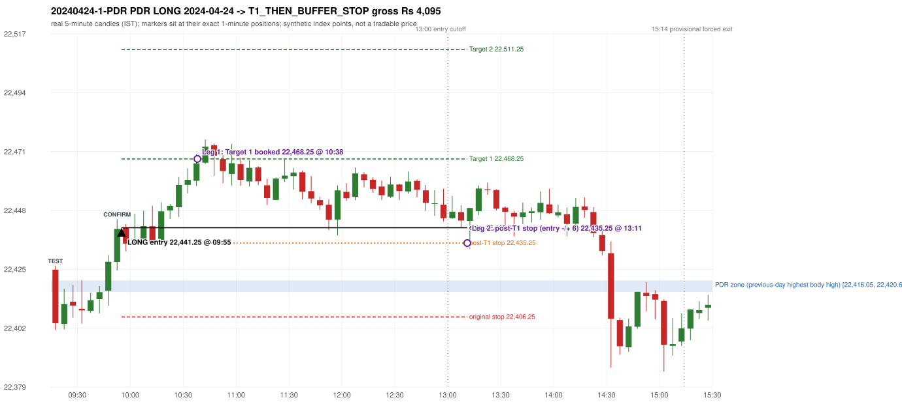

# Trading journal - 2024-04-24 (Wednesday)

> Phase 4 historical validation, window B (Window B 2022-09-01..2025-08-31 (5paisa minutes); status DATA_VALIDATED). The FROZEN Phase 3.6 configuration (IRF, ORB, PDR body-based, PDS, RF; shared controller) on a different data source. HISTORICAL RESEARCH ONLY: the strategy was developed using later data. same provider as the Phase 3.6 baseline; the vendor-overlap audit shows the minute bars differ from the secondary vendor Synthetic NIFTY 50 index-point P&L (the index is not tradable). The owner's review status is intentionally blank.

## A. Trading day overview

| item | value |
|---|---|
| Date / weekday | 2024-04-24 / Wednesday |
| Session type | USABLE_WITH_FLAGS / VALID |
| Original session open (first 1-minute open) | 22,424.75 |
| Previous session | 2024-04-23 |
| Previous-day high / low (wicks included) | 22,431.25 / 22,350.15 |
| Previous-day highest BODY high (the body-based PDR ceiling; wicks ignored) | 22,420.60 |
| Previous-day official close / last 5-minute close | 22,368.00 / 22,361.00 |
| Raw engine records / confirmed signals / fully valid signals | 9 / 7 / 7 |
| Setups that did not complete (invalidated / incomplete) | 2 |
| Executed trades | 1 20240424-1-PDR |
| Gross P&L (Rs, synthetic) | 4,095.00 |
| Illustrative net P&L (Rs; Rs 500/trade + 0.5 pt/fill) | 3,205.00 |
| Day-end portfolio status | DAY_FINISHED |
| Manual journal trades (matched / unmatched) | 0 (0 / 0) |
| Extra automated trades | 0 |

## B. Daily strategy signal timeline (confirmed signals, chronological)

| time | strategy | method | dir | entry-rule status | valid for execution | <= 13:00 | portfolio state | accepted / ignored | specific reason | competing (same minute) |
|---|---|---|---|---|---|---|---|---|---|---|
| 09:55 | PDR | PDR | LONG | RESEARCH_VARIANT | True | True | FIRST_TRADE_ACTIVE | ACCEPTED -> 20240424-1-PDR | first eligible signal of the day; trade 1: T1_THEN_BUFFER_STOP |  |
| 10:15 | IRF | Method 2B | SHORT | PROPOSAL_DEPENDENT | True | True | FIRST_TRADE_ACTIVE | IGNORED | POSITION_ACTIVE (signal kept for diagnostics only; never reused) [blocked by PDR#1] |  |
| 11:20 | IRF | Method 2A | SHORT | PROPOSAL_DEPENDENT | True | True | FIRST_TRADE_ACTIVE | IGNORED | POSITION_ACTIVE (signal kept for diagnostics only; never reused) [blocked by PDR#1] |  |
| 12:50 | IRF | Method 2A | SHORT | PROPOSAL_DEPENDENT | True | True | FIRST_TRADE_ACTIVE | IGNORED | POSITION_ACTIVE (signal kept for diagnostics only; never reused) [blocked by PDR#1] |  |
| 13:25 | IRF | Method 2B | SHORT | PROPOSAL_DEPENDENT | True | False | DAY_FINISHED | IGNORED | DAY_FINISHED [blocked by PDR#1] |  |
| 14:35 | IRF | Method 1 | SHORT | PROPOSAL_DEPENDENT | True | False | DAY_FINISHED | IGNORED | DAY_FINISHED [blocked by PDR#1] |  |
| 14:45 | RF | RF | LONG | PROPOSAL_DEPENDENT | True | False | DAY_FINISHED | IGNORED | DAY_FINISHED [blocked by PDR#1] |  |

Engine setups that did not complete (2); the complete list with failed rule ids is in `rejected_signals.csv`:

| candle | strategy | method | dir | status | precise reason | failed rules |
|---|---|---|---|---|---|---|
| 13:20 | IRF | Method 1/2 | SHORT | INCOMPLETE_AT_EOD | SESSION_ENDED_BEFORE_CONFIRMATION |  |
| 14:30 | PDR | PDR | LONG | INCOMPLETE_AT_EOD | NO_QUALIFYING_CONFIRMATION_BEFORE_SESSION_END |  |

## C. Detailed trade journals

### 20240424-1-PDR: PDR LONG (FIRST trade)

Chart: 

**Rule configuration:** CFG-phase36_body_based-866f954e55 - signal verification status **RESEARCH_VARIANT** (never VERIFIED while a rule rests on a proposal).

#### 1. Setup identification

PDR LONG (body-based engine, A_HIGHEST_BODY_HIGH): the session opened 56.75 points above the previous close and 4.15 points above the previous-day highest BODY high 22,420.60 (zone [22,416.05, 22,420.60] from the 12:15 candle of 2024-04-23; the highest wick 22,431.25 is ignored). The 09:15 candle (22,401.05 - 22,426.30) tested the zone; the 09:50 candle (green, O 22,427.85 H 22,444.60 L 22,424.45 C 22,440.80) passed GOOD_GREEN_BODY and closed 20.20 points above the zone ceiling, confirming the entry at 09:55. The pattern thresholds and the zone's lower boundary are provisional research assumptions, not approved by the strategy author.

#### 2. Candle and indicator calculations

| role | session | candle | O | H | L | C | range | body % | upper wick % | lower wick % | direction | EMA(200) | strong bull / bear | pin bull / bear | small (body<=30%) | used for |
|---|---|---|---|---|---|---|---|---|---|---|---|---|---|---|---|---|
| zone_source_candle | PREVIOUS | 12:15-12:20 | 22,420.60 | 22,423.60 | 22,414.55 | 22,416.05 | 9.05 | 50.28 | 33.15 | 16.57 | BEARISH | 22,266.00 | False / False | False / False | False | candle of the previous session's highest BODY high (A_HIGHEST_BODY_HIGH) |
| prev_day_wick_high_candle | PREVIOUS | 09:20-09:25 | 22,414.75 | 22,431.25 | 22,395.65 | 22,398.95 | 35.60 | 44.38 | 46.35 | 9.27 | BEARISH | 22,211.96 | False / False | False / False | False | candle of the previous session's highest WICK (ignored by the author's rule; shown for comparison) |
| interaction_candle | TODAY | 09:15-09:20 | 22,424.75 | 22,426.30 | 22,401.05 | 22,403.75 | 25.25 | 83.17 | 6.14 | 10.69 | BEARISH | 22,306.47 | False / True | False / False | False | first candle whose range overlaps the zone (the test) |
| confirmation_candle | TODAY | 09:50-09:55 | 22,427.85 | 22,444.60 | 22,424.45 | 22,440.80 | 20.15 | 64.27 | 18.86 | 16.87 | BULLISH | 22,314.04 | True / False | False / False | False | candle that satisfies one of the three patterns and closes above the zone ceiling |

Every condition, with the rule, the calculation, the observed values and the result:

| # | group | rule | result | status / numeric definition | calculation | observed | required | available at | why it matters |
|---|---|---|---|---|---|---|---|---|---|
| 1 | SELECTION | SEL-FIRST-001 | PASS | USER_APPROVED / USER_APPROVED | earliest CONFIRMED signal of the day across IRF/ORB/PDR/PDS/RF that passed the controller's checks | 0 confirmed signal(s) earlier today; 7 confirmed signals in the day in total, this one at 09:55 | no earlier executable signal | 2024-04-24 09:55 | the shared controller trades only the first valid signal; the five strategies are not independent positions |
| 2 | SELECTION | SEL-TIE-001 | PASS | USER_APPROVED / USER_APPROVED | other CONFIRMED signals with exactly the same confirmation timestamp | none | no different-strategy / opposite-direction signal in the same minute (otherwise an unresolved conflict, no trade) | 2024-04-24 09:55 | an unresolved same-minute collision would have produced no trade at all |
| 3 | SELECTION | ENTRY-CUTOFF-001 | PASS | USER_APPROVED / USER_APPROVED | fill timestamp vs 13:00:00 IST | signal confirmed 09:55; fill 09:55 | fill at or before 13:00:00 IST | 2024-04-24 09:55 | no new position may be entered with a fill after 13:00 IST |
| 4 | SELECTION | EXE-FILL-001 | PASS | PROPOSED_FOR_REVIEW / PROPOSED_FOR_REVIEW | fill = open of the 1-minute bar that starts at the signal candle's end | bar 09:55 O 22,441.25 H 22,442.70 L 22,436.20 C 22,438.95; executable=True; entry 22,441.25 | fill bar exists, starts exactly at the signal end, is fillable; entry = its open | 2024-04-24 09:55 | a 5-minute signal is known only when its candle closes; the first price that can be traded is the next minute's open |
| 5 | SELECTION | DAY-MAX-001 | PASS | USER_APPROVED / USER_APPROVED | number of entries today | trade 1 of at most 2 | <= 2 entries per day | 2024-04-24 09:55 | daily trade cap |
| 6 | SETUP | PDR-004 | PASS | SOURCE_VERIFIED / EXPLICIT_WORDING_DETAIL_PROPOSED_FOR_REVIEW | gap = first 1-minute open of today - previous session's OFFICIAL close | today's open 22,424.75 (first 1-minute bar 09:15) - previous close 22,368.00 (DAILY_VENDOR, 2024-04-23) = +56.75 points -> gap UP | gap UP (more than 0 points) | 2024-04-24 09:15 | approved convention: the original first-minute open, never the vendor daily open |
| 7 | SETUP | PDR-B03 | PASS | AUTHOR_APPROVED / AUTHOR_STATEMENT_NUMERIC_DETAILS_ARE_SEPARATE_PROPOSED_ROWS | the session opens strictly above the previous day's resistance zone (author-approved) | today's first 1-minute open 22,424.75 vs zone ceiling 22,420.60: 4.15 points above (open - ceiling = +4.15) | open > zone ceiling (equal or inside the zone rejects the setup) | 2024-04-24 09:15 | the original first-minute open is used, never a vendor daily open |
| 8 | ZONE | PDR-001 | PASS | SOURCE_VERIFIED / EXPLICIT_IN_SOURCE | direction | LONG (PDR is long only) | long-only | 2024-04-24 09:55 | PDR buys a retest of previous-day resistance after a gap up |
| 9 | ZONE | PDR-B01a | PASS | AUTHOR_APPROVED / AUTHOR_STATEMENT_NUMERIC_DETAILS_ARE_SEPARATE_PROPOSED_ROWS | wicks ignored, bodies considered: body_high = max(open, close) of every completed previous-session 5-minute candle; ceiling = the highest body_high; floor = body low of that candle | previous session 2024-04-23: highest body high 22,420.60 on the 12:15 candle (O 22,420.60 C 22,416.05; wick high of that candle 22,423.60, ignored); four highest body highs: 22,420.60 (12:15); 22,420.15 (12:10); 22,419.35 (09:15); 22,417.45 (10:15). Highest WICK of the session 22,431.25 (09:20 candle) is 10.65 points above the ceiling and plays no part. Zone [22,416.05 (body low), 22,420.60 (body high)]; engine recorded [22,416.05, 22,420.60] | ceiling = highest body high of the previous session (author: wick ignored, body considered) | 2024-04-23 15:30 | a wick-only price never becomes resistance; the zone is drawn from candle bodies |
| 10 | ZONE | PDR-B02 | UNRESOLVED | AUTHOR_APPROVED / AUTHOR_STATEMENT_NUMERIC_DETAILS_ARE_SEPARATE_PROPOSED_ROWS | multiple highs connected into one zone (author principle; candidate B) | candidate A (used): [22,416.05, 22,420.60]. Candidate B (multiple-body-high cluster, tolerance 5 points) would be [22,409.70, 22,420.60] (MULTIPLE_BODY_HIGH_CLUSTER, 3 touch(es), member body highs 22,419.35, 22,417.45, 22,420.60); ceiling difference 0.00 points | a zone that connects all relevant highs (numbers not given by the author) | 2024-04-23 15:30 | candidate B has the same ceiling by construction, so this signal is unaffected by the choice; the lower boundary and the cluster numbers are research parameters |
| 11 | ZONE | PDR-003 | PASS | SOURCE_VERIFIED / EXPLICIT_IN_SOURCE | the zone is an area, not a single price | zone height 4.55 points [22,416.05, 22,420.60] | a rectangle with positive height (a zero-height zone is left unresolved by the engine) | 2024-04-23 15:30 | price may touch any part of the area |
| 12 | CONFIRMATION | PDR-B03b | PASS | PRESERVED_FROM_PHASE2 / PRESERVED_FROM_PHASE2 | the first candle whose [low, high] overlaps the zone (+/- proximity) is the test; the confirmation must come strictly after it | 09:15-09:20 O 22,424.75 H 22,426.30 L 22,401.05 C 22,403.75; range 25.25, body 21.00 (83.17%), upper wick 1.55 (6.14%), lower wick 2.70 (10.69%), bearish; low 22,401.05 vs zone ceiling 22,420.60, high 22,426.30 vs zone floor 22,416.05; proximity 0; confirmation candle 09:50 is candle no. 8, the test candle no. 1 | range overlaps the zone; confirmation after the test | 2024-04-24 09:20 | the retest of the previous-day resistance |
| 13 | CONFIRMATION | PDR-B04c | PASS | PROPOSED_FOR_REVIEW / NUMERIC_DEFINITION_PROPOSED_FOR_REVIEW | Pattern 1: good green body on the 09:50-09:55 candle (O 22,427.85 H 22,444.60 L 22,424.45 C 22,440.80); the numeric thresholds are PROVISIONAL (RESEARCH_DEFAULT), not author-approved | colour green; body 64.27%; upper wick 18.86% -> PASSES | green, body >= 60% and upper wick <= 20% of the range | 2024-04-24 09:55 | one of the three patterns is enough (author: one good green body OR lower price rejection OR hammer); fixed thresholds are not required by the author, so the numbers are a research convention; a pattern that does not pass is not an error |
| 14 | CONFIRMATION | PDR-B04c | NOT_APPLICABLE | PROPOSED_FOR_REVIEW / NUMERIC_DEFINITION_PROPOSED_FOR_REVIEW | Pattern 2: lower-price rejection candle on the 09:50-09:55 candle (O 22,427.85 H 22,444.60 L 22,424.45 C 22,440.80); the numeric thresholds are PROVISIONAL (RESEARCH_DEFAULT), not author-approved | lower wick 3.40 = 0.26 x body 12.95; close 18.86% below the high; low 22,424.45; low did NOT reach the zone ceiling 22,420.60 -> does not pass | lower wick >= 2 x body, close within the top 30% of the range, low <= zone ceiling (colour not required) | 2024-04-24 09:55 | one of the three patterns is enough (author: one good green body OR lower price rejection OR hammer); fixed thresholds are not required by the author, so the numbers are a research convention; a pattern that does not pass is not an error |
| 15 | CONFIRMATION | PDR-B04c | NOT_APPLICABLE | PROPOSED_FOR_REVIEW / NUMERIC_DEFINITION_PROPOSED_FOR_REVIEW | Pattern 3: hammer candle on the 09:50-09:55 candle (O 22,427.85 H 22,444.60 L 22,424.45 C 22,440.80); the numeric thresholds are PROVISIONAL (RESEARCH_DEFAULT), not author-approved | lower wick 3.40 = 0.26 x body; upper wick 18.86%; body bottom at 16.87% of the range -> does not pass | lower wick >= 2 x body, upper wick <= 10%, body bottom >= 60% of the range (colour not required) | 2024-04-24 09:55 | one of the three patterns is enough (author: one good green body OR lower price rejection OR hammer); fixed thresholds are not required by the author, so the numbers are a research convention; a pattern that does not pass is not an error |
| 16 | CONFIRMATION | PDR-B04 | PASS | AUTHOR_APPROVED / AUTHOR_STATEMENT_NUMERIC_DETAILS_ARE_SEPARATE_PROPOSED_ROWS | at least one of the three patterns passes (OR logic; every passing pattern is recorded) | patterns passed: GOOD_GREEN_BODY (engine recorded: GOOD_GREEN_BODY) | at least one pattern | 2024-04-24 09:55 | the author's entry candle requirement |
| 17 | CONFIRMATION | PDR-B05 | PASS | AUTHOR_APPROVED / AUTHOR_STATEMENT_NUMERIC_DETAILS_ARE_SEPARATE_PROPOSED_ROWS | the confirmation candle must close above the zone | close 22,440.80 vs zone ceiling 22,420.60: +20.20 points (floor 22,416.05; low 22,424.45 stayed above the zone) | close > zone ceiling, strictly (lower wick may penetrate the zone) | 2024-04-24 09:55 | no pattern overrides the close rule |
| 18 | CONFIRMATION | PDR-B06 | PASS | USER_APPROVED / USER_APPROVED | no entry at the open and no look-ahead: the order is placed only after the confirmation candle has completed | test candle 09:15 (no. 1) precedes the confirmation candle 09:50-09:55; signal stamped 09:55; fill 09:55 at the open of that 1-minute bar = 22,441.25 | interaction before the confirmation; fill after the confirmation candle's end | 2024-04-24 09:55 | existing causal fill convention (EXE-FILL-001) |
| 19 | EXECUTION | EXE-STOP-001 | PASS | USER_APPROVED / USER_APPROVED | initial stop = entry - 35 points | entry 22,441.25 -> stop 22,406.25 | stop 35 index points (BASELINE) | 2024-04-24 09:55 | defines the loss if the setup fails before Target 1 |
| 20 | EXECUTION | EXE-T1-001 | PASS | SOURCE_VERIFIED / EXPLICIT_IN_SOURCE | Target 1 = entry +/- 27 points | T1 22,468.25 | 27 points | 2024-04-24 09:55 | Leg 1 (3 lots) is booked at Target 1 |
| 21 | EXECUTION | PDR-008 | PASS | SOURCE_VERIFIED / EXPLICIT_IN_SOURCE | Target 2 = entry +/- 70 points | T2 22,511.25 (the guide says 70; the performance report's winners suggest 60 - CONFLICTING, recorded) | 70 points | 2024-04-24 09:55 | Leg 2 (3 lots) is booked at Target 2 |
| 22 | EXECUTION | POST-T1-STOP-006 | PASS | USER_APPROVED / USER_APPROVED | after T1 the Leg-2 stop = entry - 6 (no trailing) | post-T1 stop 22,435.25 | entry -6 (LONG) / +6 (SHORT) | 2024-04-24 09:55 | protects the remaining three lots once the first three are booked |
| 23 | EXECUTION | SIZE-LOT-001 | PASS | USER_APPROVED / USER_APPROVED | 6 lots x 65 = 390, Leg 1 = 3 lots = 195, Leg 2 = 195 | 6 lots, lot size 65, legs 3+3 | 6 lots in two equal legs | 2024-04-24 09:55 | position size for the synthetic P&L |
| 24 | NOTE | PDR-B04x | UNRESOLVED | PROPOSED_FOR_REVIEW / NUMERIC_DEFINITION_PROPOSED_FOR_REVIEW | provisional parameters this signal rests on | pattern thresholds RESEARCH_DEFAULT: {'green_body_min': 0.6, 'green_upper_wick_max': 0.2, 'reject_wick_to_body_min': 2.0, 'reject_close_fraction_max': 0.3, 'hammer_wick_to_body_min': 2.0, 'hammer_upper_wick_max': 0.1, 'hammer_body_position_min': 0.6}; zone lower boundary = hull of the member bodies; zero-height policy UNRESOLVED_NO_SETUP; wait policy WAIT_FOR_QUALIFYING_CANDLE; cluster parameters (candidate B only) tolerance 5, touches 2, separation 2 | n/a (disclosure) | 2024-04-24 09:55 | the strategy author has NOT approved these numbers or conventions; the signal is a RESEARCH_VARIANT, never VERIFIED |
| 25 | NOTE | PDR-012 | NOT_APPLICABLE | PROPOSED_FOR_REVIEW / PROPOSED_FOR_REVIEW | repeated PDR signals today | 1 confirmed PDR signal(s) in the session | n/a (disclosure) | 2024-04-24 09:55 | this engine reports EVERY qualifying signal (the per-session cap is lifted); the controller trades only the first (and a PDR/PDS second trade after an initial full stop) |
| 26 | NOTE | PDR-B07 | UNRESOLVED | PROPOSED_FOR_REVIEW / NUMERIC_DEFINITION_PROPOSED_FOR_REVIEW | state of the zone between the test and the confirmation (the author and the guide are silent on price crossing below the zone) | test candle 09:15 (no. 1), confirmation candle 09:50 (no. 8): 7 candle(s) later; 6 candle(s) in between CLOSED BELOW the zone floor 22,416.05 (lowest close 22,403.75) before price returned above the ceiling | n/a (disclosure; the wait policy is a research parameter) | 2024-04-24 09:55 | the engine keeps a tested setup armed until a candle qualifies; whether a zone that price has closed through should still count is an owner decision |
| 27 | NOTE | PDR-009 | UNRESOLVED | UNRESOLVED / UNRESOLVED | stop 35 or 40 'depending on the situation' | the guide gives no selection rule; baseline fixed 35 points | unresolved in the source | 2024-04-24 09:55 | PDR stop selection is left to the owner |
| 28 | NOTE | NOTE-UNRESOLVED-DEPENDENCIES | UNRESOLVED | NOT_A_RULE / NOT_A_REGISTRY_RULE | rules the signal depends on that the sources leave unresolved | engine-recorded unresolved rule ids: PDR-B01b, PDR-B02a, PDR-B02b, PDR-B02c, PDR-B02d, PDR-B02e, PDR-B02f, PDR-B02g, PDR-B02h, PDR-B04b, PDR-B04c, PDR-B05a, PDR-B07; verification status RESEARCH_VARIANT | n/a (disclosure) | 2024-04-24 09:55 | the entry is only as verified as the rules it rests on |

#### 3. Entry decision and explanation

PDR LONG (body-based engine, A_HIGHEST_BODY_HIGH): the session opened 56.75 points above the previous close and 4.15 points above the previous-day highest BODY high 22,420.60 (zone [22,416.05, 22,420.60] from the 12:15 candle of 2024-04-23; the highest wick 22,431.25 is ignored). The 09:15 candle (22,401.05 - 22,426.30) tested the zone; the 09:50 candle (green, O 22,427.85 H 22,444.60 L 22,424.45 C 22,440.80) passed GOOD_GREEN_BODY and closed 20.20 points above the zone ceiling, confirming the entry at 09:55. The pattern thresholds and the zone's lower boundary are provisional research assumptions, not approved by the strategy author.

**Why this trade ahead of the other strategies:** This PDR signal was the earliest executable signal of the day: 0 confirmed signal(s) earlier, 0 other in the same minute. 6 later confirmed signal(s) (IRF x5, RF x1) are logged as ignored or rejected. State of the other four engines at that moment: [IRF: no setup record before this time (a base condition was not met, or nothing triggered)] [ORB: no setup record before this time (a base condition was not met, or nothing triggered)] [PDS: no setup record before this time (a base condition was not met, or nothing triggered)] [RF: no setup record before this time (a base condition was not met, or nothing triggered)]

#### 4. Actual entry execution

| item | value |
|---|---|
| Signal candle | 09:50-09:55 |
| Signal confirmed | 2024-04-24 09:55 |
| Fill timestamp | 2024-04-24 09:55 |
| Entry price | 22,441.25 |
| Source partition / 1-minute bar | data/phase4/processed/FIVEPAISA_1M_PHASE4/nifty50/year=2024/month=04/candles.parquet / 2024-04-24 09:55 |
| Source bar O / H / L / C | 22,441.25 / 22,442.70 / 22,436.20 / 22,438.95 |
| Fill assumption | open of the 1-minute bar starting at the signal candle's end (EXE-FILL-001, PROPOSED causal convention) |
| Initial stop / T1 / T2 / post-T1 stop | 22,406.25 / 22,468.25 / 22,511.25 / 22,435.25 |
| Position | 6 lots x 65 = 390 units (Leg 1 195, Leg 2 195) |

#### 5-8. Trade progress, Target 1, post-T1 stop and final exit

Between the 09:55 entry bar and the final exit (197 one-minute bars) the best excursion in favour was 34.65 points at 10:42 and the worst against was 9.25 points at 09:56. At 10:38 price reached Target 1 22,468.25 and three lots exited. At 10:38 the remaining three lots' protective stop was set to 22,435.25 (entry - 6; no trailing, no further change); the engine applies it from the Target-1 bar onward and tests it within that same bar. At 13:11 the remaining three lots stopped out at 22,435.25. T1_THEN_BUFFER_STOP: no second trade that day (DAY-BUF-001).

| leg | qty | exit time | exit price | reason | source 1-minute bar | O / H / L / C | gross points | gross Rs | slippage pts | flags |
|---|---|---|---|---|---|---|---|---|---|---|
| 1 | 195 | 10:38 | 22,468.25 | TARGET_1 | 10:38 | 22,466.35 / 22,470.00 / 22,464.40 / 22,466.30 | 27.00 | 5,265.00 | 0.00 |  |
| 2 | 195 | 13:11 | 22,435.25 | POST_T1_STOP_ENTRY_MINUS_PLUS_6 | 13:11 | 22,445.25 / 22,445.65 / 22,432.95 / 22,441.50 | -6.00 | -1,170.00 | 0.00 |  |

Exit evidence per leg:

* Leg 1: 1-minute bar 10:38 O 22,466.35 H 22,470.00 L 22,464.40 C 22,466.30: high 22,470.00 reached Target 1 22,468.25; Leg 1 booked at the target level
* Leg 2: 1-minute bar 13:11 O 22,445.25 H 22,445.65 L 22,432.95 C 22,441.50: low 22,432.95 reached the post-T1 stop 22,435.25; Leg 2 exits at 22,435.25 at the stop level

#### 9. Gross and illustrative net P&L

| item | value (Rs) |
|---|---|
| Leg 1 gross | 5,265.00 |
| Leg 2 gross | -1,170.00 |
| Trade gross (= Leg 1 + Leg 2) | 4,095.00 |
| Illustrative fixed cost | -500.00 |
| Illustrative slippage (0.5 pt on every fill, entry + exits, all units) | -390.00 |
| Illustrative net | 3,205.00 |

#### 10. Manual journal comparison

No manual journal exists for this period; no comparison.

## D. Manual journal comparison

No manual journal exists for this period (the manual journal covers 2025-09-01 .. 2026-08-31 only); no comparison is made and no automated trade is labelled 'extra'.

## E. Daily conclusion

* **Traded:** 20240424-1-PDR - PDR PDR LONG at 09:55 (entry 22,441.25), outcome T1_THEN_BUFFER_STOP, gross Rs 4,095.00, illustrative net Rs 3,205.00. **Why:** This PDR signal was the earliest executable signal of the day: 0 confirmed signal(s) earlier, 0 other in the same minute. 6 later confirmed signal(s) (IRF x5, RF x1) are logged as ignored or rejected. State of the other four engines at that moment: [IRF: no setup record before this time (a base condition was not met, or nothing triggered)] [ORB: no setup record before this time (a base condition was not met, or nothing triggered)] [PDS: no setup record before this time (a base condition was not met, or nothing triggered)] [RF: no setup record before this time (a base condition was not met, or nothing triggered)] **How it ended:** At 10:38 price reached Target 1 22,468.25 and three lots exited. At 10:38 the remaining three lots' protective stop was set to 22,435.25 (entry - 6; no trailing, no further change); the engine applies it from the Target-1 bar onward and tests it within that same bar. At 13:11 the remaining three lots stopped out at 22,435.25. T1_THEN_BUFFER_STOP: no second trade that day (DAY-BUF-001).
* **Ignored / rejected signals:** IRF IGNORED POSITION_ACTIVE x3; IRF IGNORED DAY_FINISHED x2; RF IGNORED DAY_FINISHED x1
* **Open strategy-definition issues that affected this day:** NOTE-UNRESOLVED-DEPENDENCIES, PDR-009 (Stop-loss 35 or 40 'depending on the situation'; choose before entering, do not move after entry), PDR-B02, PDR-B04x, PDR-B07
* **Automated triage (not an approval; the owner's review status stays blank):** TRADED_NO_FLAGS
