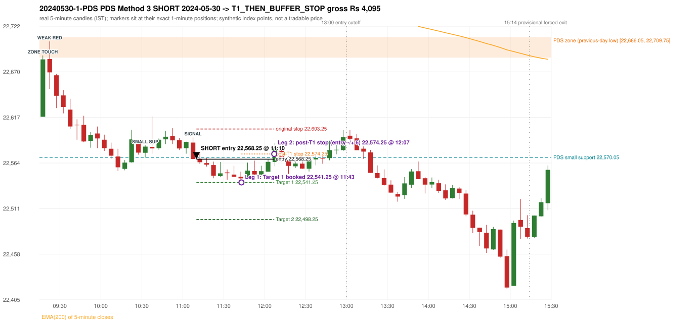

# Trading journal - 2024-05-30 (Thursday)

> Phase 4 historical validation, window B (Window B 2022-09-01..2025-08-31 (5paisa minutes); status DATA_VALIDATED). The FROZEN Phase 3.6 configuration (IRF, ORB, PDR body-based, PDS, RF; shared controller) on a different data source. HISTORICAL RESEARCH ONLY: the strategy was developed using later data. same provider as the Phase 3.6 baseline; the vendor-overlap audit shows the minute bars differ from the secondary vendor Synthetic NIFTY 50 index-point P&L (the index is not tradable). The owner's review status is intentionally blank.

## A. Trading day overview

| item | value |
|---|---|
| Date / weekday | 2024-05-30 / Thursday |
| Session type | USABLE_WITH_FLAGS / VALID |
| Original session open (first 1-minute open) | 22,617.45 |
| Previous session | 2024-05-29 |
| Previous-day high / low (wicks included) | 22,825.50 / 22,686.05 |
| Previous-day highest BODY high (the body-based PDR ceiling; wicks ignored) | 22,819.45 |
| Previous-day official close / last 5-minute close | 22,704.70 / 22,705.40 |
| Raw engine records / confirmed signals / fully valid signals | 4 / 1 / 1 |
| Setups that did not complete (invalidated / incomplete) | 3 |
| Executed trades | 1 20240530-1-PDS |
| Gross P&L (Rs, synthetic) | 4,095.00 |
| Illustrative net P&L (Rs; Rs 500/trade + 0.5 pt/fill) | 3,205.00 |
| Day-end portfolio status | DAY_FINISHED |
| Manual journal trades (matched / unmatched) | 0 (0 / 0) |
| Extra automated trades | 0 |

## B. Daily strategy signal timeline (confirmed signals, chronological)

| time | strategy | method | dir | entry-rule status | valid for execution | <= 13:00 | portfolio state | accepted / ignored | specific reason | competing (same minute) |
|---|---|---|---|---|---|---|---|---|---|---|
| 11:10 | PDS | Method 3 | SHORT | PROPOSAL_DEPENDENT | True | True | FIRST_TRADE_ACTIVE | ACCEPTED -> 20240530-1-PDS | first eligible signal of the day; trade 1: T1_THEN_BUFFER_STOP |  |

Engine setups that did not complete (3); the complete list with failed rule ids is in `rejected_signals.csv`:

| candle | strategy | method | dir | status | precise reason | failed rules |
|---|---|---|---|---|---|---|
| 09:15 | ORB | Method 1 | SHORT | INVALIDATED | CANDLE_QUALITY(not a strong body / wick too large) | ORB-M1-SHORT-003 |
| 09:15 | ORB | Method 2 | SHORT | INVALIDATED | TRENDLINE_NOT_SUPPORTIVE | ORB-M2-SHORT-001 |
| 09:35 | RF | RF | LONG | INCOMPLETE_AT_EOD | NO_RETURN_INSIDE_BEFORE_SESSION_END |  |

## C. Detailed trade journals

### 20240530-1-PDS: PDS Method 3 SHORT (FIRST trade)

Chart: 

**Rule configuration:** CFG-phase36_body_based-866f954e55 - signal verification status **PROPOSAL_DEPENDENT** (never VERIFIED while a rule rests on a proposal).

#### 1. Setup identification

PDS Method 3 SHORT: the session opened 68.60 points below the previous-day-low zone [22,686.05, 22,709.75]; the first red candle at the zone (09:20) was weak (body 28.03%), so the engine waited for a small support; the 10:30 candle's low 22,570.05 (116.00 points below the zone floor) was broken by the close of the 11:05 candle (22,568.45); confirmed 11:10.

#### 2. Candle and indicator calculations

| role | session | candle | O | H | L | C | range | body % | upper wick % | lower wick % | direction | EMA(200) | strong bull / bear | pin bull / bear | small (body<=30%) | used for |
|---|---|---|---|---|---|---|---|---|---|---|---|---|---|---|---|---|
| zone_source_candle | PREVIOUS | 15:05-15:10 | 22,709.55 | 22,716.90 | 22,686.05 | 22,709.75 | 30.85 | 0.65 | 23.18 | 76.17 | BULLISH | 22,840.44 | False / False | True / False | True | previous-day low candle that defines the zone (A_LOWEST_LOW) |
| zone_retest_candle | TODAY | 09:15-09:20 | 22,617.45 | 22,688.55 | 22,617.45 | 22,683.95 | 71.10 | 93.53 | 6.47 | 0.00 | BULLISH | 22,833.65 | True / False | False / False | False | first candle whose range reaches the zone from below |
| signal_candle | TODAY | 11:05-11:10 | 22,587.50 | 22,593.50 | 22,567.45 | 22,568.45 | 26.05 | 73.13 | 23.03 | 3.84 | BEARISH | 22,785.97 | False / True | False / False | False | trigger candle |
| weak_first_red_candle | TODAY | 09:20-09:25 | 22,684.45 | 22,704.85 | 22,649.55 | 22,668.95 | 55.30 | 28.03 | 36.89 | 35.08 | BEARISH | 22,832.01 | False / False | False / False | True | first red candle at the zone that failed the quality rule |
| small_support_pivot | TODAY | 10:30-10:35 | 22,575.65 | 22,584.30 | 22,570.05 | 22,582.80 | 14.25 | 50.18 | 10.53 | 39.30 | BULLISH | 22,800.56 | False / False | False / False | False | small support: latest 3-candle fractal low after the weak candle |

Every condition, with the rule, the calculation, the observed values and the result:

| # | group | rule | result | status / numeric definition | calculation | observed | required | available at | why it matters |
|---|---|---|---|---|---|---|---|---|---|
| 1 | SELECTION | SEL-FIRST-001 | PASS | USER_APPROVED / USER_APPROVED | earliest CONFIRMED signal of the day across IRF/ORB/PDR/PDS/RF that passed the controller's checks | 0 confirmed signal(s) earlier today; 1 confirmed signals in the day in total, this one at 11:10 | no earlier executable signal | 2024-05-30 11:10 | the shared controller trades only the first valid signal; the five strategies are not independent positions |
| 2 | SELECTION | SEL-TIE-001 | PASS | USER_APPROVED / USER_APPROVED | other CONFIRMED signals with exactly the same confirmation timestamp | none | no different-strategy / opposite-direction signal in the same minute (otherwise an unresolved conflict, no trade) | 2024-05-30 11:10 | an unresolved same-minute collision would have produced no trade at all |
| 3 | SELECTION | ENTRY-CUTOFF-001 | PASS | USER_APPROVED / USER_APPROVED | fill timestamp vs 13:00:00 IST | signal confirmed 11:10; fill 11:10 | fill at or before 13:00:00 IST | 2024-05-30 11:10 | no new position may be entered with a fill after 13:00 IST |
| 4 | SELECTION | EXE-FILL-001 | PASS | PROPOSED_FOR_REVIEW / PROPOSED_FOR_REVIEW | fill = open of the 1-minute bar that starts at the signal candle's end | bar 11:10 O 22,568.25 H 22,575.70 L 22,567.35 C 22,573.60; executable=True; entry 22,568.25 | fill bar exists, starts exactly at the signal end, is fillable; entry = its open | 2024-05-30 11:10 | a 5-minute signal is known only when its candle closes; the first price that can be traded is the next minute's open |
| 5 | SELECTION | DAY-MAX-001 | PASS | USER_APPROVED / USER_APPROVED | number of entries today | trade 1 of at most 2 | <= 2 entries per day | 2024-05-30 11:10 | daily trade cap |
| 6 | SETUP | PDS-003 | PASS | SOURCE_VERIFIED / EXPLICIT_WORDING_DETAIL_PROPOSED_FOR_REVIEW | gap = first 1-minute open of today - previous session's OFFICIAL close | today's open 22,617.45 (first 1-minute bar 09:15) - previous close 22,704.70 (DAILY_VENDOR, 2024-05-29) = -87.25 points -> gap DOWN | gap DOWN (more than 0 points) | 2024-05-30 09:15 | approved convention: the original first-minute open, never the vendor daily open |
| 7 | SETUP | PDS-006 | PASS | SOURCE_VERIFIED / QUALITATIVE_SOURCE_NUMERIC_DEFINITION_PROPOSED_FOR_REVIEW | gap-down open below the zone | today's open 22,617.45 vs zone low 22,686.05: 68.60 points below | open < zone low | 2024-05-30 09:15 | the guide: 'price is trading below the previous day's support zone' after the gap; a PROPOSED strict reading |
| 8 | SETUP | PDS-004 | PASS | SOURCE_VERIFIED / EXPLICIT_IN_SOURCE | PDS is not a breakdown strategy: the zone must be tested from below first | open 22,617.45 below the zone floor 22,686.05; the first candle to reach the zone is 09:15 | price rises to the zone before any short | 2024-05-30 09:15 | a short below the level without a retest is not this strategy |
| 9 | SETUP | PDS-005 | PASS | SOURCE_VERIFIED / QUALITATIVE_SOURCE_NUMERIC_DEFINITION_PROPOSED_FOR_REVIEW | price comes up to the zone: first candle whose [low, high] intersects it (+/- proximity) | 09:15-09:20 O 22,617.45 H 22,688.55 L 22,617.45 C 22,683.95; range 71.10, body 66.50 (93.53%), upper wick 4.60 (6.47%), lower wick 0.00 (0.00%), bullish; high 22,688.55 vs zone low 22,686.05 | range intersects the zone | 2024-05-30 09:20 | PDS is not a breakdown strategy: the zone must be tested from below first |
| 10 | ZONE | PDS-001 | PASS | SOURCE_VERIFIED / EXPLICIT_IN_SOURCE | direction | SHORT (PDS is short only) | short-only | 2024-05-30 11:10 | PDS sells a retest of previous-day support from below |
| 11 | ZONE | PDS-002 | PASS | SOURCE_VERIFIED / QUALITATIVE_SOURCE_NUMERIC_DEFINITION_PROPOSED_FOR_REVIEW | zone = [lowest low, body top] of the previous session's absolute-low candle (method A_LOWEST_LOW; the lower wick is part of the zone) | zone [22,686.05, 22,709.75] from the 15:05 candle of 2024-05-29 (15:05-15:10 O 22,709.55 H 22,716.90 L 22,686.05 C 22,709.75; range 30.85, body 0.20 (0.65%), upper wick 7.15 (23.18%), lower wick 23.50 (76.18%), bullish); engine recorded [22,686.05, 22,709.75] | previous trading day's low where price took support (body + lower wick) | 2024-05-29 15:10 | the reference level of the strategy; the exact candle(s) are a research choice (PDS-ZONE-002) |
| 12 | CONFIRMATION | PDS-M-001 | PASS | SOURCE_VERIFIED / QUALITATIVE_SOURCE_NUMERIC_DEFINITION_PROPOSED_FOR_REVIEW | Method 3 is used when the first red candle at the zone is not satisfying | first red candle at the zone: 09:20-09:25 O 22,684.45 H 22,704.85 L 22,649.55 C 22,668.95; range 55.30, body 15.50 (28.03%), upper wick 20.40 (36.89%), lower wick 19.40 (35.08%), bearish; strong-bearish test body >= 60%, lower wick <= 20% -> not met; pin bar -> not met | first red candle is neither strong nor a pin bar | 2024-05-30 09:25 | the quality rule keeps weak candles out; Method 3 waits for a support break instead |
| 13 | CONFIRMATION | PDS-M3-001 | PASS | SOURCE_VERIFIED / QUALITATIVE_SOURCE_NUMERIC_DEFINITION_PROPOSED_FOR_REVIEW | small support = latest 3-candle fractal low (k=1) formed at/after the weak candle with low <= zone high (22,709.75); definition SWING_K1_NEAR_ZONE | support 22,570.05 from the 10:30 candle; engine recorded 22,570.05; distance below the zone floor 116.00 points (zone floor 22,686.05); the guide says 'near the zone' but defines no distance - the code has no lower bound | a small support near the zone | 2024-05-30 10:40 | 'near' and the size of the small support are undefined in the guide |
| 14 | CONFIRMATION | PDS-M3-001 | PASS | SOURCE_VERIFIED / QUALITATIVE_SOURCE_NUMERIC_DEFINITION_PROPOSED_FOR_REVIEW | trigger: candle closes below the small support (break basis CLOSE) | 11:05 close 22,568.45 vs support 22,570.05: 1.60 points below | close < support | 2024-05-30 11:10 | the guide does not say close or touch; the close is used |
| 15 | EXECUTION | EXE-STOP-001 | PASS | USER_APPROVED / USER_APPROVED | initial stop = entry + 35 points | entry 22,568.25 -> stop 22,603.25 | stop 35 index points (BASELINE) | 2024-05-30 11:10 | defines the loss if the setup fails before Target 1 |
| 16 | EXECUTION | EXE-T1-001 | PASS | SOURCE_VERIFIED / EXPLICIT_IN_SOURCE | Target 1 = entry +/- 27 points | T1 22,541.25 | 27 points | 2024-05-30 11:10 | Leg 1 (3 lots) is booked at Target 1 |
| 17 | EXECUTION | PDS-TGT-001 | PASS | SOURCE_VERIFIED / EXPLICIT_IN_SOURCE | Target 2 = entry +/- 70 points | T2 22,498.25 (the guide says 70; the report suggests 60 - CONFLICTING) | 70 points | 2024-05-30 11:10 | Leg 2 (3 lots) is booked at Target 2 |
| 18 | EXECUTION | POST-T1-STOP-006 | PASS | USER_APPROVED / USER_APPROVED | after T1 the Leg-2 stop = entry + 6 (no trailing) | post-T1 stop 22,574.25 | entry -6 (LONG) / +6 (SHORT) | 2024-05-30 11:10 | protects the remaining three lots once the first three are booked |
| 19 | EXECUTION | SIZE-LOT-001 | PASS | USER_APPROVED / USER_APPROVED | 6 lots x 65 = 390, Leg 1 = 3 lots = 195, Leg 2 = 195 | 6 lots, lot size 65, legs 3+3 | 6 lots in two equal legs | 2024-05-30 11:10 | position size for the synthetic P&L |
| 20 | NOTE | PDS-007 | NOT_APPLICABLE | PROPOSED_FOR_REVIEW / PROPOSED_FOR_REVIEW | repeated PDS signals today | 1 confirmed PDS signal(s) in the session | n/a (disclosure) | 2024-05-30 11:10 | the per-session cap is lifted for the controller runs; the controller trades only the first (or the permitted second) trade |
| 21 | NOTE | PDS-MISSING-001 | UNRESOLVED | UNRESOLVED / UNRESOLVED | entry timing | signal on the candle close; fill at the next minute's open | the guide does not say whether entry is intra-candle or after the close | 2024-05-30 11:10 | causal convention: nothing is entered before the trigger candle has closed |
| 22 | NOTE | PDS-SL-001 | NOT_APPLICABLE | SOURCE_VERIFIED / QUALITATIVE_SOURCE_NUMERIC_DEFINITION_PROPOSED_FOR_REVIEW | the guide's 35-or-40 rule: 35 if the most recent green candle's high is within 35 points of entry, else 40 | most recent green candle high 22,588.55 is 20.30 points from the entry 22,568.25: the guide's rule would select 35 points; the baseline applies a fixed 35 (USER_APPROVED research baseline; the 35-vs-40 selection and the 40-point variant are separate labelled scenarios) | source selection rule | 2024-05-30 11:10 | the stop distance is a modelling choice and changes losses, not entries |
| 23 | NOTE | NOTE-UNRESOLVED-DEPENDENCIES | NOT_APPLICABLE | NOT_A_RULE / NOT_A_REGISTRY_RULE | rules the signal depends on that the sources leave unresolved | engine-recorded unresolved rule ids: none; verification status PROPOSAL_DEPENDENT | n/a (disclosure) | 2024-05-30 11:10 | the entry is only as verified as the rules it rests on |

#### 3. Entry decision and explanation

PDS Method 3 SHORT: the session opened 68.60 points below the previous-day-low zone [22,686.05, 22,709.75]; the first red candle at the zone (09:20) was weak (body 28.03%), so the engine waited for a small support; the 10:30 candle's low 22,570.05 (116.00 points below the zone floor) was broken by the close of the 11:05 candle (22,568.45); confirmed 11:10.

**Why this trade ahead of the other strategies:** This PDS Method 3 signal was the earliest executable signal of the day: 0 confirmed signal(s) earlier, 0 other in the same minute. No later signal was generated. State of the other four engines at that moment: [IRF: no setup record before this time (a base condition was not met, or nothing triggered)] [ORB: Method 1 invalidated at 09:15: CANDLE_QUALITY(not a strong body / wick too large); Method 2 invalidated at 09:15: TRENDLINE_NOT_SUPPORTIVE] [PDR: no setup record before this time (a base condition was not met, or nothing triggered)] [RF: no setup record before this time (a base condition was not met, or nothing triggered)]

#### 4. Actual entry execution

| item | value |
|---|---|
| Signal candle | 11:05-11:10 |
| Signal confirmed | 2024-05-30 11:10 |
| Fill timestamp | 2024-05-30 11:10 |
| Entry price | 22,568.25 |
| Source partition / 1-minute bar | data/phase4/processed/FIVEPAISA_1M_PHASE4/nifty50/year=2024/month=05/candles.parquet / 2024-05-30 11:10 |
| Source bar O / H / L / C | 22,568.25 / 22,575.70 / 22,567.35 / 22,573.60 |
| Fill assumption | open of the 1-minute bar starting at the signal candle's end (EXE-FILL-001, PROPOSED causal convention) |
| Initial stop / T1 / T2 / post-T1 stop | 22,603.25 / 22,541.25 / 22,498.25 / 22,574.25 |
| Position | 6 lots x 65 = 390 units (Leg 1 195, Leg 2 195) |

#### 5-8. Trade progress, Target 1, post-T1 stop and final exit

Between the 11:10 entry bar and the final exit (58 one-minute bars) the best excursion in favour was 27.25 points at 11:43 and the worst against was 9.55 points at 12:07. At 11:43 price reached Target 1 22,541.25 and three lots exited. At 11:43 the remaining three lots' protective stop was set to 22,574.25 (entry + 6; no trailing, no further change); the engine applies it from the Target-1 bar onward and tests it within that same bar. At 12:07 the remaining three lots stopped out at 22,574.25. T1_THEN_BUFFER_STOP: no second trade that day (DAY-BUF-001).

| leg | qty | exit time | exit price | reason | source 1-minute bar | O / H / L / C | gross points | gross Rs | slippage pts | flags |
|---|---|---|---|---|---|---|---|---|---|---|
| 1 | 195 | 11:43 | 22,541.25 | TARGET_1 | 11:43 | 22,546.70 / 22,547.40 / 22,541.00 / 22,542.00 | 27.00 | 5,265.00 | 0.00 |  |
| 2 | 195 | 12:07 | 22,574.25 | POST_T1_STOP_ENTRY_MINUS_PLUS_6 | 12:07 | 22,570.45 / 22,577.80 / 22,563.55 / 22,575.40 | -6.00 | -1,170.00 | 0.00 |  |

Exit evidence per leg:

* Leg 1: 1-minute bar 11:43 O 22,546.70 H 22,547.40 L 22,541.00 C 22,542.00: low 22,541.00 reached Target 1 22,541.25; Leg 1 booked at the target level
* Leg 2: 1-minute bar 12:07 O 22,570.45 H 22,577.80 L 22,563.55 C 22,575.40: high 22,577.80 reached the post-T1 stop 22,574.25; Leg 2 exits at 22,574.25 at the stop level

#### 9. Gross and illustrative net P&L

| item | value (Rs) |
|---|---|
| Leg 1 gross | 5,265.00 |
| Leg 2 gross | -1,170.00 |
| Trade gross (= Leg 1 + Leg 2) | 4,095.00 |
| Illustrative fixed cost | -500.00 |
| Illustrative slippage (0.5 pt on every fill, entry + exits, all units) | -390.00 |
| Illustrative net | 3,205.00 |

#### 10. Manual journal comparison

No manual journal exists for this period; no comparison.

## D. Manual journal comparison

No manual journal exists for this period (the manual journal covers 2025-09-01 .. 2026-08-31 only); no comparison is made and no automated trade is labelled 'extra'.

## E. Daily conclusion

* **Traded:** 20240530-1-PDS - PDS Method 3 SHORT at 11:10 (entry 22,568.25), outcome T1_THEN_BUFFER_STOP, gross Rs 4,095.00, illustrative net Rs 3,205.00. **Why:** This PDS Method 3 signal was the earliest executable signal of the day: 0 confirmed signal(s) earlier, 0 other in the same minute. No later signal was generated. State of the other four engines at that moment: [IRF: no setup record before this time (a base condition was not met, or nothing triggered)] [ORB: Method 1 invalidated at 09:15: CANDLE_QUALITY(not a strong body / wick too large); Method 2 invalidated at 09:15: TRENDLINE_NOT_SUPPORTIVE] [PDR: no setup record before this time (a base condition was not met, or nothing triggered)] [RF: no setup record before this time (a base condition was not met, or nothing triggered)] **How it ended:** At 11:43 price reached Target 1 22,541.25 and three lots exited. At 11:43 the remaining three lots' protective stop was set to 22,574.25 (entry + 6; no trailing, no further change); the engine applies it from the Target-1 bar onward and tests it within that same bar. At 12:07 the remaining three lots stopped out at 22,574.25. T1_THEN_BUFFER_STOP: no second trade that day (DAY-BUF-001).
* **Open strategy-definition issues that affected this day:** PDS-MISSING-001 (Entry timing (during the candle or after it closes) is not specified)
* **Automated triage (not an approval; the owner's review status stays blank):** TRADED_NO_FLAGS
