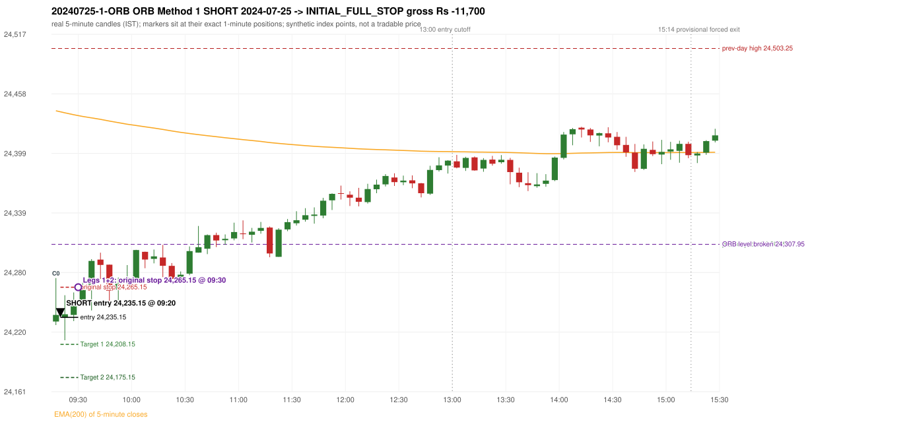
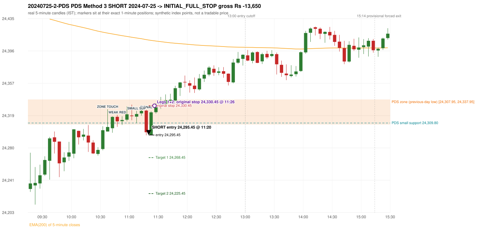

# Trading journal - 2024-07-25 (Thursday)

> Phase 4 historical validation, window B (Window B 2022-09-01..2025-08-31 (5paisa minutes); status DATA_VALIDATED). The FROZEN Phase 3.6 configuration (IRF, ORB, PDR body-based, PDS, RF; shared controller) on a different data source. HISTORICAL RESEARCH ONLY: the strategy was developed using later data. same provider as the Phase 3.6 baseline; the vendor-overlap audit shows the minute bars differ from the secondary vendor Synthetic NIFTY 50 index-point P&L (the index is not tradable). The owner's review status is intentionally blank.

## A. Trading day overview

| item | value |
|---|---|
| Date / weekday | 2024-07-25 / Thursday |
| Session type | USABLE_WITH_FLAGS / VALID |
| Original session open (first 1-minute open) | 24,230.95 |
| Previous session | 2024-07-24 |
| Previous-day high / low (wicks included) | 24,503.25 / 24,307.95 |
| Previous-day highest BODY high (the body-based PDR ceiling; wicks ignored) | 24,493.45 |
| Previous-day official close / last 5-minute close | 24,413.50 / 24,441.90 |
| Raw engine records / confirmed signals / fully valid signals | 13 / 10 / 10 |
| Setups that did not complete (invalidated / incomplete) | 3 |
| Executed trades | 2 20240725-1-ORB;20240725-2-PDS |
| Gross P&L (Rs, synthetic) | -25,350.00 |
| Illustrative net P&L (Rs; Rs 500/trade + 0.5 pt/fill) | -27,130.00 |
| Day-end portfolio status | DAY_FINISHED |
| Manual journal trades (matched / unmatched) | 0 (0 / 0) |
| Extra automated trades | 0 |

## B. Daily strategy signal timeline (confirmed signals, chronological)

| time | strategy | method | dir | entry-rule status | valid for execution | <= 13:00 | portfolio state | accepted / ignored | specific reason | competing (same minute) |
|---|---|---|---|---|---|---|---|---|---|---|
| 09:20 | ORB | Method 1 | SHORT | PROPOSAL_DEPENDENT | True | True | FIRST_TRADE_ACTIVE | ACCEPTED -> 20240725-1-ORB | first eligible signal of the day; trade 1: INITIAL_FULL_STOP |  |
| 09:50 | IRF | Method 1 | SHORT | PROPOSAL_DEPENDENT | True | True | SECOND_TRADE_ELIGIBLE | REJECTED | SECOND_TRADE_RESTRICTED_TO_PDR_PDS [blocked by ORB#1] |  |
| 10:10 | IRF | Method 2B | SHORT | PROPOSAL_DEPENDENT | True | True | SECOND_TRADE_ELIGIBLE | REJECTED | SECOND_TRADE_RESTRICTED_TO_PDR_PDS [blocked by ORB#1] |  |
| 10:25 | IRF | Method 1 | SHORT | PROPOSAL_DEPENDENT | True | True | SECOND_TRADE_ELIGIBLE | REJECTED | SECOND_TRADE_RESTRICTED_TO_PDR_PDS [blocked by ORB#1] |  |
| 11:20 | IRF | Method 2A | SHORT | PROPOSAL_DEPENDENT | True | True | SECOND_TRADE_ACTIVE | REJECTED | SECOND_TRADE_RESTRICTED_TO_PDR_PDS [blocked by ORB#1] | IRF Method 2B SHORT; PDS Method 3 SHORT |
| 11:20 | IRF | Method 2B | SHORT | PROPOSAL_DEPENDENT | True | True | SECOND_TRADE_ACTIVE | REJECTED | SECOND_TRADE_RESTRICTED_TO_PDR_PDS [blocked by ORB#1] | IRF Method 2A SHORT; PDS Method 3 SHORT |
| 11:20 | PDS | Method 3 | SHORT | PROPOSAL_DEPENDENT | True | True | SECOND_TRADE_ACTIVE | ACCEPTED -> 20240725-2-PDS | permitted second trade: newly confirmed PDR/PDS after the original full stop; trade 2: INITIAL_FULL_STOP | IRF Method 2A SHORT; IRF Method 2B SHORT |
| 12:45 | IRF | Method 2B | SHORT | PROPOSAL_DEPENDENT | True | True | DAY_FINISHED | IGNORED | DAY_FINISHED [blocked by PDS#2] |  |
| 13:05 | IRF | Method 2B | SHORT | PROPOSAL_DEPENDENT | True | False | DAY_FINISHED | IGNORED | DAY_FINISHED [blocked by PDS#2] |  |
| 14:40 | IRF | Method 2A | SHORT | PROPOSAL_DEPENDENT | True | False | DAY_FINISHED | IGNORED | DAY_FINISHED [blocked by PDS#2] |  |

Engine setups that did not complete (3); the complete list with failed rule ids is in `rejected_signals.csv`:

| candle | strategy | method | dir | status | precise reason | failed rules |
|---|---|---|---|---|---|---|
| 14:35 | IRF | Method 1/2 | SHORT | INCOMPLETE_AT_EOD | SESSION_ENDED_BEFORE_CONFIRMATION |  |
| 09:15 | ORB | Method 2 | SHORT | INVALIDATED | TRENDLINE_NOT_SUPPORTIVE | ORB-M2-SHORT-001 |
| 11:20 | PDS | Method 1/2/3 | SHORT | INCOMPLETE_AT_EOD | NO_QUALIFYING_ENTRY_BEFORE_SESSION_END |  |

## C. Detailed trade journals

### 20240725-1-ORB: ORB Method 1 SHORT (FIRST trade)

Chart: 

**Rule configuration:** CFG-phase36_body_based-866f954e55 - signal verification status **PROPOSAL_DEPENDENT** (never VERIFIED while a rule rests on a proposal).

#### 1. Setup identification

ORB Method 1 SHORT: the first completed 5-minute candle (09:15-09:20) closed at 24,237.55, 70.40 points below the previous-day low 24,307.95; its body occupied 14.09% of its range and its lower wick 7.47% (thresholds 60% / 20%): the strong-candle test FAILED; the candle was admitted through the conditional PIN-BAR alternative instead (the upper wick 36.75 points is 5.57 x the body, required 2x; the close is 21.56% of the range from the low, allowed 30%). Note: the candle is bullish, i.e. against the trade direction; the pin route accepts it because the level break and close beyond it carry the direction; the EMA-only trend filter passed. Entry decision at 09:20.

#### 2. Candle and indicator calculations

| role | session | candle | O | H | L | C | range | body % | upper wick % | lower wick % | direction | EMA(200) | strong bull / bear | pin bull / bear | small (body<=30%) | used for |
|---|---|---|---|---|---|---|---|---|---|---|---|---|---|---|---|---|
| first_candle | TODAY | 09:15-09:20 | 24,230.95 | 24,274.30 | 24,227.45 | 24,237.55 | 46.85 | 14.09 | 78.44 | 7.47 | BULLISH | 24,441.10 | False / False | False / True | True | the 09:15 first five-minute candle - the ORB decision candle |
| prev_day_extreme_candle | PREVIOUS | 12:20-12:25 | 24,326.35 | 24,340.35 | 24,307.95 | 24,337.95 | 32.40 | 35.80 | 7.41 | 56.79 | BULLISH | 24,474.54 | False / False | False / False | False | candle that made the previous session's high/low used as the level |
| prev_session_last_candle | PREVIOUS | 15:25-15:30 | 24,440.00 | 24,446.40 | 24,432.25 | 24,441.90 | 14.15 | 13.43 | 31.80 | 54.77 | BULLISH | 24,443.15 | False / False | False / False | True | trend: previous session's last 5-minute close vs its EMA(200) |

Every condition, with the rule, the calculation, the observed values and the result:

| # | group | rule | result | status / numeric definition | calculation | observed | required | available at | why it matters |
|---|---|---|---|---|---|---|---|---|---|
| 1 | SELECTION | SEL-FIRST-001 | PASS | USER_APPROVED / USER_APPROVED | earliest CONFIRMED signal of the day across IRF/ORB/PDR/PDS/RF that passed the controller's checks | 0 confirmed signal(s) earlier today; 10 confirmed signals in the day in total, this one at 09:20 | no earlier executable signal | 2024-07-25 09:20 | the shared controller trades only the first valid signal; the five strategies are not independent positions |
| 2 | SELECTION | SEL-TIE-001 | PASS | USER_APPROVED / USER_APPROVED | other CONFIRMED signals with exactly the same confirmation timestamp | none | no different-strategy / opposite-direction signal in the same minute (otherwise an unresolved conflict, no trade) | 2024-07-25 09:20 | an unresolved same-minute collision would have produced no trade at all |
| 3 | SELECTION | ENTRY-CUTOFF-001 | PASS | USER_APPROVED / USER_APPROVED | fill timestamp vs 13:00:00 IST | signal confirmed 09:20; fill 09:20 | fill at or before 13:00:00 IST | 2024-07-25 09:20 | no new position may be entered with a fill after 13:00 IST |
| 4 | SELECTION | EXE-FILL-001 | PASS | PROPOSED_FOR_REVIEW / PROPOSED_FOR_REVIEW | fill = open of the 1-minute bar that starts at the signal candle's end | bar 09:20 O 24,235.15 H 24,238.05 L 24,217.00 C 24,228.70; executable=True; entry 24,235.15 | fill bar exists, starts exactly at the signal end, is fillable; entry = its open | 2024-07-25 09:20 | a 5-minute signal is known only when its candle closes; the first price that can be traded is the next minute's open |
| 5 | SELECTION | DAY-MAX-001 | PASS | USER_APPROVED / USER_APPROVED | number of entries today | trade 1 of at most 2 | <= 2 entries per day | 2024-07-25 09:20 | daily trade cap |
| 6 | SETUP | ORB-GLOBAL-001 | PASS | SOURCE_VERIFIED / EXPLICIT_IN_SOURCE | decision is taken once the first 5-minute candle (09:15-09:20) has closed | candle 09:15-09:20; signal confirmed 09:20 | decision at 09:20, never before the close | 2024-07-25 09:20 | the close of the first candle is unknown before 09:20 |
| 7 | SETUP | ORB-GLOBAL-002 | PASS | SOURCE_VERIFIED / EXPLICIT_IN_SOURCE | direction | SHORT | same rules in both directions | 2024-07-25 09:20 | ORB trades the side of the break |
| 8 | SETUP | ORB-GLOBAL-004 | PASS | SOURCE_VERIFIED / QUALITATIVE_SOURCE_NUMERIC_DEFINITION_PROPOSED_FOR_REVIEW | entry at 09:20, after the first-candle close | signal confirmed 09:20; fill 09:20 at the open of that minute | 09:20 entry | 2024-07-25 09:20 | the guide enters at 9:20; the fill price convention (next minute open) is a proposal |
| 9 | SETUP | ORB-M1-SHORT-001 | PASS | SOURCE_VERIFIED / QUALITATIVE_SOURCE_NUMERIC_DEFINITION_PROPOSED_FOR_REVIEW | prev_day_low = the lowest low of all 5-minute candles of the previous session 2024-07-24 | previous-day low 24,307.95 (set by the 12:20 candle; previous session range 24,307.95 - 24,503.25; engine recorded 24,307.95) | previous-day resistance (long) / support (short) | 2024-07-24 12:25 | a mechanical proxy for the guide's hand-drawn previous-day level; the source charts show multi-session boxes (documented difference) |
| 10 | SETUP | ORB-M1-SHORT-002 | PASS | SOURCE_VERIFIED / EXPLICIT_IN_SOURCE | the first candle breaks and closes beyond the level | high 24,274.30 / low 24,227.45, close 24,237.55: 70.40 points beyond 24,307.95 | low and close < level | 2024-07-25 09:20 | a wick alone is not a breakout; the close decides |
| 11 | TREND | ORB-TREND-001 | PASS | SOURCE_VERIFIED / QUALITATIVE_SOURCE_NUMERIC_DEFINITION_PROPOSED_FOR_REVIEW | previous session's final completed 5-minute candle: close vs its EMA(200 of 5-minute closes) | previous session 2024-07-24 last candle 15:25-15:30 close 24,441.90 vs EMA(200) 24,443.15: 1.25 points below the EMA -> trend bearish (EMA_PREV_SESSION_CLOSE; research variant A, EMA-only) | close < EMA(200) | 2024-07-24 15:30 | the opening gap can never create the trend: only information that existed before today's open is used |
| 12 | TREND | ORB-TREND-002 | PASS | SOURCE_VERIFIED / QUALITATIVE_SOURCE_NUMERIC_DEFINITION_PROPOSED_FOR_REVIEW | price location versus the 200 EMA is the basic confirmation; structure is only 'supporting' | 1.25 points below the EMA(200) on the previous session's last 5-minute close; swing structure not used in variant A | price on the trend side of the 200 EMA | 2024-07-24 15:30 | the rulebook calls EMA position 'a basic confirmation, supported by bullish structure'; the structure part has no numeric definition |
| 13 | TREND | TREND-SWING-001 | NOT_APPLICABLE | PROPOSED_FOR_REVIEW / PROPOSED_FOR_REVIEW | confirmed swing structure | not required by the active trend variant (variant A is the EMA price location only) | n/a | 2024-07-24 15:30 | variant B would additionally require higher-high/higher-low swings; it is a separate labelled scenario |
| 14 | CONFIRMATION | ORB-M1-SHORT-003 | PASS | SOURCE_VERIFIED / QUALITATIVE_SOURCE_NUMERIC_DEFINITION_PROPOSED_FOR_REVIEW | candle quality: strong body and limited opposite wick (or the conditional pin bar) | 09:15-09:20 O 24,230.95 H 24,274.30 L 24,227.45 C 24,237.55; range 46.85, body 6.60 (14.09%), upper wick 36.75 (78.44%), lower wick 3.50 (7.47%), bullish. Strong-bearish test: bearish close, body >= 60% (observed 14.09%), lower wick <= 20% (observed 7.47%) -> not met; pin-bar alternative: wick >= 2 x body and close within the favourable 30% -> met | strong candle (research thresholds) or pin bar | 2024-07-25 09:20 | the guide asks for a 'strong body, small wick' but gives no numbers; the thresholds are proposals |
| 15 | EXECUTION | ORB-GLOBAL-003 | PASS | SOURCE_VERIFIED / EXPLICIT_IN_SOURCE | initial stop = entry + 30 points | entry 24,235.15 -> stop 24,265.15 | stop 30 index points (BASELINE) | 2024-07-25 09:20 | defines the loss if the setup fails before Target 1 |
| 16 | EXECUTION | EXE-T1-001 | PASS | SOURCE_VERIFIED / EXPLICIT_IN_SOURCE | Target 1 = entry +/- 27 points | T1 24,208.15 | 27 points | 2024-07-25 09:20 | Leg 1 (3 lots) is booked at Target 1 |
| 17 | EXECUTION | ORB-GLOBAL-003 | PASS | SOURCE_VERIFIED / EXPLICIT_IN_SOURCE | Target 2 = entry +/- 60 points | T2 24,175.15 | 60 points | 2024-07-25 09:20 | Leg 2 (3 lots) is booked at Target 2 |
| 18 | EXECUTION | POST-T1-STOP-006 | PASS | USER_APPROVED / USER_APPROVED | after T1 the Leg-2 stop = entry + 6 (no trailing) | post-T1 stop 24,241.15 | entry -6 (LONG) / +6 (SHORT) | 2024-07-25 09:20 | protects the remaining three lots once the first three are booked |
| 19 | EXECUTION | SIZE-LOT-001 | PASS | USER_APPROVED / USER_APPROVED | 6 lots x 65 = 390, Leg 1 = 3 lots = 195, Leg 2 = 195 | 6 lots, lot size 65, legs 3+3 | 6 lots in two equal legs | 2024-07-25 09:20 | position size for the synthetic P&L |
| 20 | NOTE | ORB-MA-001 | UNRESOLVED | CONFLICTING / CONFLICTING | which moving average the code uses | EMA(200) of 5-minute closes (the guide says '200 DMA' in some places and '200 EMA' in others); active ma_mode EMA200_5M | the source terminology conflicts | 2024-07-25 09:20 | a daily 200 DMA would give different values |
| 21 | NOTE | NOTE-UNRESOLVED-DEPENDENCIES | UNRESOLVED | NOT_A_RULE / NOT_A_REGISTRY_RULE | rules the signal depends on that the sources leave unresolved | engine-recorded unresolved rule ids: ORB-MA-001; verification status PROPOSAL_DEPENDENT | n/a (disclosure) | 2024-07-25 09:20 | the entry is only as verified as the rules it rests on |

#### 3. Entry decision and explanation

ORB Method 1 SHORT: the first completed 5-minute candle (09:15-09:20) closed at 24,237.55, 70.40 points below the previous-day low 24,307.95; its body occupied 14.09% of its range and its lower wick 7.47% (thresholds 60% / 20%): the strong-candle test FAILED; the candle was admitted through the conditional PIN-BAR alternative instead (the upper wick 36.75 points is 5.57 x the body, required 2x; the close is 21.56% of the range from the low, allowed 30%). Note: the candle is bullish, i.e. against the trade direction; the pin route accepts it because the level break and close beyond it carry the direction; the EMA-only trend filter passed. Entry decision at 09:20.

**Why this trade ahead of the other strategies:** This ORB Method 1 signal was the earliest executable signal of the day: 0 confirmed signal(s) earlier, 0 other in the same minute. 9 later confirmed signal(s) (IRF x8, PDS x1) are logged as ignored or rejected. State of the other four engines at that moment: [IRF: no setup record before this time (a base condition was not met, or nothing triggered)] [PDR: no setup record before this time (a base condition was not met, or nothing triggered)] [PDS: no setup record before this time (a base condition was not met, or nothing triggered)] [RF: no setup record before this time (a base condition was not met, or nothing triggered)]

#### 4. Actual entry execution

| item | value |
|---|---|
| Signal candle | 09:15-09:20 |
| Signal confirmed | 2024-07-25 09:20 |
| Fill timestamp | 2024-07-25 09:20 |
| Entry price | 24,235.15 |
| Source partition / 1-minute bar | data/phase4/processed/FIVEPAISA_1M_PHASE4/nifty50/year=2024/month=07/candles.parquet / 2024-07-25 09:20 |
| Source bar O / H / L / C | 24,235.15 / 24,238.05 / 24,217.00 / 24,228.70 |
| Fill assumption | open of the 1-minute bar starting at the signal candle's end (EXE-FILL-001, PROPOSED causal convention) |
| Initial stop / T1 / T2 / post-T1 stop | 24,265.15 / 24,208.15 / 24,175.15 / 24,241.15 |
| Position | 6 lots x 65 = 390 units (Leg 1 195, Leg 2 195) |

#### 5-8. Trade progress, Target 1, post-T1 stop and final exit

Between the 09:20 entry bar and the final exit (11 one-minute bars) the best excursion in favour was 22.85 points at 09:21 and the worst against was 32.65 points at 09:30. At 09:30 price reached the original stop 24,265.15 before Target 1 24,208.15, so all six lots exited together at 24,265.15. This is an INITIAL_FULL_STOP: one more trade is allowed that day, only a newly confirmed PDR/PDS signal.

| leg | qty | exit time | exit price | reason | source 1-minute bar | O / H / L / C | gross points | gross Rs | slippage pts | flags |
|---|---|---|---|---|---|---|---|---|---|---|
| 1 | 195 | 09:30 | 24,265.15 | ORIGINAL_STOP_BEFORE_T1 | 09:30 | 24,248.15 / 24,267.80 / 24,246.55 / 24,255.95 | -30.00 | -5,850.00 | 0.00 |  |
| 2 | 195 | 09:30 | 24,265.15 | ORIGINAL_STOP_BEFORE_T1 | 09:30 | 24,248.15 / 24,267.80 / 24,246.55 / 24,255.95 | -30.00 | -5,850.00 | 0.00 |  |

Exit evidence per leg:

* Leg 1: 1-minute bar 09:30 O 24,248.15 H 24,267.80 L 24,246.55 C 24,255.95: high 24,267.80 reached the original stop 24,265.15 before Target 1 24,208.15 was touched; both legs exit at the stop level 24,265.15
* Leg 2: 1-minute bar 09:30 O 24,248.15 H 24,267.80 L 24,246.55 C 24,255.95: high 24,267.80 reached the original stop 24,265.15 before Target 1 24,208.15 was touched; both legs exit at the stop level 24,265.15

#### 9. Gross and illustrative net P&L

| item | value (Rs) |
|---|---|
| Leg 1 gross | -5,850.00 |
| Leg 2 gross | -5,850.00 |
| Trade gross (= Leg 1 + Leg 2) | -11,700.00 |
| Illustrative fixed cost | -500.00 |
| Illustrative slippage (0.5 pt on every fill, entry + exits, all units) | -390.00 |
| Illustrative net | -12,590.00 |

#### 10. Manual journal comparison

No manual journal exists for this period; no comparison.

### 20240725-2-PDS: PDS Method 3 SHORT (SECOND trade)

Chart: 

**Rule configuration:** CFG-phase36_body_based-866f954e55 - signal verification status **PROPOSAL_DEPENDENT** (never VERIFIED while a rule rests on a proposal).

#### 1. Setup identification

PDS Method 3 SHORT: the session opened 77.00 points below the previous-day-low zone [24,307.95, 24,337.95]; the first red candle at the zone (10:45) was weak (body 37.63%), so the engine waited for a small support; the 11:05 candle's low 24,309.80 (-1.85 points below the zone floor) was broken by the close of the 11:15 candle (24,298.80); confirmed 11:20.

#### 2. Candle and indicator calculations

| role | session | candle | O | H | L | C | range | body % | upper wick % | lower wick % | direction | EMA(200) | strong bull / bear | pin bull / bear | small (body<=30%) | used for |
|---|---|---|---|---|---|---|---|---|---|---|---|---|---|---|---|---|
| zone_source_candle | PREVIOUS | 12:20-12:25 | 24,326.35 | 24,340.35 | 24,307.95 | 24,337.95 | 32.40 | 35.80 | 7.41 | 56.79 | BULLISH | 24,474.54 | False / False | False / False | False | previous-day low candle that defines the zone (A_LOWEST_LOW) |
| zone_retest_candle | TODAY | 10:35-10:40 | 24,299.65 | 24,326.25 | 24,299.65 | 24,305.05 | 26.60 | 20.30 | 79.70 | 0.00 | BULLISH | 24,417.28 | False / False | False / True | True | first candle whose range reaches the zone from below |
| signal_candle | TODAY | 11:15-11:20 | 24,324.65 | 24,325.70 | 24,295.10 | 24,298.80 | 30.60 | 84.48 | 3.43 | 12.09 | BEARISH | 24,409.45 | False / True | False / False | False | trigger candle |
| weak_first_red_candle | TODAY | 10:45-10:50 | 24,317.20 | 24,319.55 | 24,305.20 | 24,311.80 | 14.35 | 37.63 | 16.38 | 45.99 | BEARISH | 24,415.24 | False / False | False / False | False | first red candle at the zone that failed the quality rule |
| small_support_pivot | TODAY | 11:05-11:10 | 24,317.45 | 24,324.35 | 24,309.80 | 24,320.55 | 14.55 | 21.31 | 26.12 | 52.58 | BULLISH | 24,411.43 | False / False | True / False | True | small support: latest 3-candle fractal low after the weak candle |

Every condition, with the rule, the calculation, the observed values and the result:

| # | group | rule | result | status / numeric definition | calculation | observed | required | available at | why it matters |
|---|---|---|---|---|---|---|---|---|---|
| 1 | SELECTION | DAY-SL-001 | PASS | USER_APPROVED / USER_APPROVED | first trade outcome, strategy of this signal, position-close time vs this signal's timestamp | first trade ORB Method 1 closed as INITIAL_FULL_STOP at 09:30; position free from 09:31; this PDS signal confirmed 11:20 | first trade INITIAL_FULL_STOP before Target 1, and a NEWLY confirmed PDR/PDS signal after the first position closed | 2024-07-25 11:20 | the only way a second trade is allowed |
| 2 | SELECTION | DAY-NOREUSE-001 | PASS | USER_APPROVED / USER_APPROVED | signals confirmed while the first position was open | 1 signal(s) were ignored during the first trade (never reused): ORB Method 1 SHORT @09:20 | this trade comes from a signal confirmed after the first exit, not from an ignored one | 2024-07-25 11:20 | an ignored signal can never become the second trade |
| 3 | SELECTION | ENTRY-CUTOFF-001 | PASS | USER_APPROVED / USER_APPROVED | fill timestamp vs 13:00:00 IST | signal confirmed 11:20; fill 11:20 | fill at or before 13:00:00 IST | 2024-07-25 11:20 | no new position may be entered with a fill after 13:00 IST |
| 4 | SELECTION | EXE-FILL-001 | PASS | PROPOSED_FOR_REVIEW / PROPOSED_FOR_REVIEW | fill = open of the 1-minute bar that starts at the signal candle's end | bar 11:20 O 24,295.45 H 24,309.25 L 24,295.45 C 24,307.10; executable=True; entry 24,295.45 | fill bar exists, starts exactly at the signal end, is fillable; entry = its open | 2024-07-25 11:20 | a 5-minute signal is known only when its candle closes; the first price that can be traded is the next minute's open |
| 5 | SELECTION | DAY-MAX-001 | PASS | USER_APPROVED / USER_APPROVED | number of entries today | trade 2 of at most 2 | <= 2 entries per day | 2024-07-25 11:20 | daily trade cap |
| 6 | SETUP | PDS-003 | PASS | SOURCE_VERIFIED / EXPLICIT_WORDING_DETAIL_PROPOSED_FOR_REVIEW | gap = first 1-minute open of today - previous session's OFFICIAL close | today's open 24,230.95 (first 1-minute bar 09:15) - previous close 24,413.50 (DAILY_VENDOR, 2024-07-24) = -182.55 points -> gap DOWN | gap DOWN (more than 0 points) | 2024-07-25 09:15 | approved convention: the original first-minute open, never the vendor daily open |
| 7 | SETUP | PDS-006 | PASS | SOURCE_VERIFIED / QUALITATIVE_SOURCE_NUMERIC_DEFINITION_PROPOSED_FOR_REVIEW | gap-down open below the zone | today's open 24,230.95 vs zone low 24,307.95: 77.00 points below | open < zone low | 2024-07-25 09:15 | the guide: 'price is trading below the previous day's support zone' after the gap; a PROPOSED strict reading |
| 8 | SETUP | PDS-004 | PASS | SOURCE_VERIFIED / EXPLICIT_IN_SOURCE | PDS is not a breakdown strategy: the zone must be tested from below first | open 24,230.95 below the zone floor 24,307.95; the first candle to reach the zone is 10:35 | price rises to the zone before any short | 2024-07-25 09:15 | a short below the level without a retest is not this strategy |
| 9 | SETUP | PDS-005 | PASS | SOURCE_VERIFIED / QUALITATIVE_SOURCE_NUMERIC_DEFINITION_PROPOSED_FOR_REVIEW | price comes up to the zone: first candle whose [low, high] intersects it (+/- proximity) | 10:35-10:40 O 24,299.65 H 24,326.25 L 24,299.65 C 24,305.05; range 26.60, body 5.40 (20.30%), upper wick 21.20 (79.70%), lower wick 0.00 (0.00%), bullish; high 24,326.25 vs zone low 24,307.95 | range intersects the zone | 2024-07-25 10:40 | PDS is not a breakdown strategy: the zone must be tested from below first |
| 10 | ZONE | PDS-001 | PASS | SOURCE_VERIFIED / EXPLICIT_IN_SOURCE | direction | SHORT (PDS is short only) | short-only | 2024-07-25 11:20 | PDS sells a retest of previous-day support from below |
| 11 | ZONE | PDS-002 | PASS | SOURCE_VERIFIED / QUALITATIVE_SOURCE_NUMERIC_DEFINITION_PROPOSED_FOR_REVIEW | zone = [lowest low, body top] of the previous session's absolute-low candle (method A_LOWEST_LOW; the lower wick is part of the zone) | zone [24,307.95, 24,337.95] from the 12:20 candle of 2024-07-24 (12:20-12:25 O 24,326.35 H 24,340.35 L 24,307.95 C 24,337.95; range 32.40, body 11.60 (35.80%), upper wick 2.40 (7.41%), lower wick 18.40 (56.79%), bullish); engine recorded [24,307.95, 24,337.95] | previous trading day's low where price took support (body + lower wick) | 2024-07-24 12:25 | the reference level of the strategy; the exact candle(s) are a research choice (PDS-ZONE-002) |
| 12 | CONFIRMATION | PDS-M-001 | PASS | SOURCE_VERIFIED / QUALITATIVE_SOURCE_NUMERIC_DEFINITION_PROPOSED_FOR_REVIEW | Method 3 is used when the first red candle at the zone is not satisfying | first red candle at the zone: 10:45-10:50 O 24,317.20 H 24,319.55 L 24,305.20 C 24,311.80; range 14.35, body 5.40 (37.63%), upper wick 2.35 (16.38%), lower wick 6.60 (45.99%), bearish; strong-bearish test body >= 60%, lower wick <= 20% -> not met; pin bar -> not met | first red candle is neither strong nor a pin bar | 2024-07-25 10:50 | the quality rule keeps weak candles out; Method 3 waits for a support break instead |
| 13 | CONFIRMATION | PDS-M3-001 | PASS | SOURCE_VERIFIED / QUALITATIVE_SOURCE_NUMERIC_DEFINITION_PROPOSED_FOR_REVIEW | small support = latest 3-candle fractal low (k=1) formed at/after the weak candle with low <= zone high (24,337.95); definition SWING_K1_NEAR_ZONE | support 24,309.80 from the 11:05 candle; engine recorded 24,309.80; distance below the zone floor -1.85 points (negative: the support lies ABOVE the floor) (zone floor 24,307.95); the guide says 'near the zone' but defines no distance - the code has no lower bound | a small support near the zone | 2024-07-25 11:15 | 'near' and the size of the small support are undefined in the guide |
| 14 | CONFIRMATION | PDS-M3-001 | PASS | SOURCE_VERIFIED / QUALITATIVE_SOURCE_NUMERIC_DEFINITION_PROPOSED_FOR_REVIEW | trigger: candle closes below the small support (break basis CLOSE) | 11:15 close 24,298.80 vs support 24,309.80: 11.00 points below | close < support | 2024-07-25 11:20 | the guide does not say close or touch; the close is used |
| 15 | EXECUTION | EXE-STOP-001 | PASS | USER_APPROVED / USER_APPROVED | initial stop = entry + 35 points | entry 24,295.45 -> stop 24,330.45 | stop 35 index points (BASELINE) | 2024-07-25 11:20 | defines the loss if the setup fails before Target 1 |
| 16 | EXECUTION | EXE-T1-001 | PASS | SOURCE_VERIFIED / EXPLICIT_IN_SOURCE | Target 1 = entry +/- 27 points | T1 24,268.45 | 27 points | 2024-07-25 11:20 | Leg 1 (3 lots) is booked at Target 1 |
| 17 | EXECUTION | PDS-TGT-001 | PASS | SOURCE_VERIFIED / EXPLICIT_IN_SOURCE | Target 2 = entry +/- 70 points | T2 24,225.45 (the guide says 70; the report suggests 60 - CONFLICTING) | 70 points | 2024-07-25 11:20 | Leg 2 (3 lots) is booked at Target 2 |
| 18 | EXECUTION | POST-T1-STOP-006 | PASS | USER_APPROVED / USER_APPROVED | after T1 the Leg-2 stop = entry + 6 (no trailing) | post-T1 stop 24,301.45 | entry -6 (LONG) / +6 (SHORT) | 2024-07-25 11:20 | protects the remaining three lots once the first three are booked |
| 19 | EXECUTION | SIZE-LOT-001 | PASS | USER_APPROVED / USER_APPROVED | 6 lots x 65 = 390, Leg 1 = 3 lots = 195, Leg 2 = 195 | 6 lots, lot size 65, legs 3+3 | 6 lots in two equal legs | 2024-07-25 11:20 | position size for the synthetic P&L |
| 20 | NOTE | PDS-007 | NOT_APPLICABLE | PROPOSED_FOR_REVIEW / PROPOSED_FOR_REVIEW | repeated PDS signals today | 1 confirmed PDS signal(s) in the session | n/a (disclosure) | 2024-07-25 11:20 | the per-session cap is lifted for the controller runs; the controller trades only the first (or the permitted second) trade |
| 21 | NOTE | PDS-MISSING-001 | UNRESOLVED | UNRESOLVED / UNRESOLVED | entry timing | signal on the candle close; fill at the next minute's open | the guide does not say whether entry is intra-candle or after the close | 2024-07-25 11:20 | causal convention: nothing is entered before the trigger candle has closed |
| 22 | NOTE | PDS-SL-001 | NOT_APPLICABLE | SOURCE_VERIFIED / QUALITATIVE_SOURCE_NUMERIC_DEFINITION_PROPOSED_FOR_REVIEW | the guide's 35-or-40 rule: 35 if the most recent green candle's high is within 35 points of entry, else 40 | most recent green candle high 24,330.25 is 34.80 points from the entry 24,295.45: the guide's rule would select 35 points; the baseline applies a fixed 35 (USER_APPROVED research baseline; the 35-vs-40 selection and the 40-point variant are separate labelled scenarios) | source selection rule | 2024-07-25 11:20 | the stop distance is a modelling choice and changes losses, not entries |
| 23 | NOTE | NOTE-UNRESOLVED-DEPENDENCIES | NOT_APPLICABLE | NOT_A_RULE / NOT_A_REGISTRY_RULE | rules the signal depends on that the sources leave unresolved | engine-recorded unresolved rule ids: none; verification status PROPOSAL_DEPENDENT | n/a (disclosure) | 2024-07-25 11:20 | the entry is only as verified as the rules it rests on |

#### 3. Entry decision and explanation

PDS Method 3 SHORT: the session opened 77.00 points below the previous-day-low zone [24,307.95, 24,337.95]; the first red candle at the zone (10:45) was weak (body 37.63%), so the engine waited for a small support; the 11:05 candle's low 24,309.80 (-1.85 points below the zone floor) was broken by the close of the 11:15 candle (24,298.80); confirmed 11:20.

**Why this trade ahead of the other strategies:** The first trade (ORB Method 1) was stopped out before Target 1 at 09:30; this newly confirmed PDS signal at 11:20 is the first PDR/PDS signal after that exit, so it is the day's permitted second trade. State of the other engines at that moment: [IRF: 5 confirmed signal(s) up to this time (Method 1@09:50, Method 2B@10:10, Method 1@10:25, Method 2A@11:20, Method 2B@11:20)] [ORB: 1 confirmed signal(s) up to this time (Method 1@09:20)] [PDR: no setup record before this time (a base condition was not met, or nothing triggered)] [RF: no setup record before this time (a base condition was not met, or nothing triggered)]

#### 4. Actual entry execution

| item | value |
|---|---|
| Signal candle | 11:15-11:20 |
| Signal confirmed | 2024-07-25 11:20 |
| Fill timestamp | 2024-07-25 11:20 |
| Entry price | 24,295.45 |
| Source partition / 1-minute bar | data/phase4/processed/FIVEPAISA_1M_PHASE4/nifty50/year=2024/month=07/candles.parquet / 2024-07-25 11:20 |
| Source bar O / H / L / C | 24,295.45 / 24,309.25 / 24,295.45 / 24,307.10 |
| Fill assumption | open of the 1-minute bar starting at the signal candle's end (EXE-FILL-001, PROPOSED causal convention) |
| Initial stop / T1 / T2 / post-T1 stop | 24,330.45 / 24,268.45 / 24,225.45 / 24,301.45 |
| Position | 6 lots x 65 = 390 units (Leg 1 195, Leg 2 195) |

#### 5-8. Trade progress, Target 1, post-T1 stop and final exit

Between the 11:20 entry bar and the final exit (7 one-minute bars) the best excursion in favour was 0.00 points at 11:20 and the worst against was 35.15 points at 11:26. At 11:26 price reached the original stop 24,330.45 before Target 1 24,268.45, so all six lots exited together at 24,330.45. This is an INITIAL_FULL_STOP: one more trade is allowed that day, only a newly confirmed PDR/PDS signal.

| leg | qty | exit time | exit price | reason | source 1-minute bar | O / H / L / C | gross points | gross Rs | slippage pts | flags |
|---|---|---|---|---|---|---|---|---|---|---|
| 1 | 195 | 11:26 | 24,330.45 | ORIGINAL_STOP_BEFORE_T1 | 11:26 | 24,323.00 / 24,330.60 / 24,323.00 / 24,328.90 | -35.00 | -6,825.00 | 0.00 |  |
| 2 | 195 | 11:26 | 24,330.45 | ORIGINAL_STOP_BEFORE_T1 | 11:26 | 24,323.00 / 24,330.60 / 24,323.00 / 24,328.90 | -35.00 | -6,825.00 | 0.00 |  |

Exit evidence per leg:

* Leg 1: 1-minute bar 11:26 O 24,323.00 H 24,330.60 L 24,323.00 C 24,328.90: high 24,330.60 reached the original stop 24,330.45 before Target 1 24,268.45 was touched; both legs exit at the stop level 24,330.45
* Leg 2: 1-minute bar 11:26 O 24,323.00 H 24,330.60 L 24,323.00 C 24,328.90: high 24,330.60 reached the original stop 24,330.45 before Target 1 24,268.45 was touched; both legs exit at the stop level 24,330.45

#### 9. Gross and illustrative net P&L

| item | value (Rs) |
|---|---|
| Leg 1 gross | -6,825.00 |
| Leg 2 gross | -6,825.00 |
| Trade gross (= Leg 1 + Leg 2) | -13,650.00 |
| Illustrative fixed cost | -500.00 |
| Illustrative slippage (0.5 pt on every fill, entry + exits, all units) | -390.00 |
| Illustrative net | -14,540.00 |

#### 10. Manual journal comparison

No manual journal exists for this period; no comparison.

## D. Manual journal comparison

No manual journal exists for this period (the manual journal covers 2025-09-01 .. 2026-08-31 only); no comparison is made and no automated trade is labelled 'extra'.

## E. Daily conclusion

* **Traded:** 20240725-1-ORB - ORB Method 1 SHORT at 09:20 (entry 24,235.15), outcome INITIAL_FULL_STOP, gross Rs -11,700.00, illustrative net Rs -12,590.00. **Why:** This ORB Method 1 signal was the earliest executable signal of the day: 0 confirmed signal(s) earlier, 0 other in the same minute. 9 later confirmed signal(s) (IRF x8, PDS x1) are logged as ignored or rejected. State of the other four engines at that moment: [IRF: no setup record before this time (a base condition was not met, or nothing triggered)] [PDR: no setup record before this time (a base condition was not met, or nothing triggered)] [PDS: no setup record before this time (a base condition was not met, or nothing triggered)] [RF: no setup record before this time (a base condition was not met, or nothing triggered)] **How it ended:** At 09:30 price reached the original stop 24,265.15 before Target 1 24,208.15, so all six lots exited together at 24,265.15. This is an INITIAL_FULL_STOP: one more trade is allowed that day, only a newly confirmed PDR/PDS signal.
* **Traded:** 20240725-2-PDS - PDS Method 3 SHORT at 11:20 (entry 24,295.45), outcome INITIAL_FULL_STOP, gross Rs -13,650.00, illustrative net Rs -14,540.00. **Why:** The first trade (ORB Method 1) was stopped out before Target 1 at 09:30; this newly confirmed PDS signal at 11:20 is the first PDR/PDS signal after that exit, so it is the day's permitted second trade. State of the other engines at that moment: [IRF: 5 confirmed signal(s) up to this time (Method 1@09:50, Method 2B@10:10, Method 1@10:25, Method 2A@11:20, Method 2B@11:20)] [ORB: 1 confirmed signal(s) up to this time (Method 1@09:20)] [PDR: no setup record before this time (a base condition was not met, or nothing triggered)] [RF: no setup record before this time (a base condition was not met, or nothing triggered)] **How it ended:** At 11:26 price reached the original stop 24,330.45 before Target 1 24,268.45, so all six lots exited together at 24,330.45. This is an INITIAL_FULL_STOP: one more trade is allowed that day, only a newly confirmed PDR/PDS signal.
* **Ignored / rejected signals:** IRF REJECTED SECOND_TRADE_RESTRICTED_TO_PDR_PDS x5; IRF IGNORED DAY_FINISHED x3
* **Open strategy-definition issues that affected this day:** NOTE-UNRESOLVED-DEPENDENCIES, ORB-MA-001 (Terminology conflict: '200 DMA / EMA' (p.2), '200 EMA' (pp.3,5,7), '200 DMA' (pp.1,8,9,12) for what the charts show as one curved line on a 5-minute chart), PDS-MISSING-001 (Entry timing (during the candle or after it closes) is not specified)
* **Automated triage (not an approval; the owner's review status stays blank):** TRADED_NO_FLAGS
