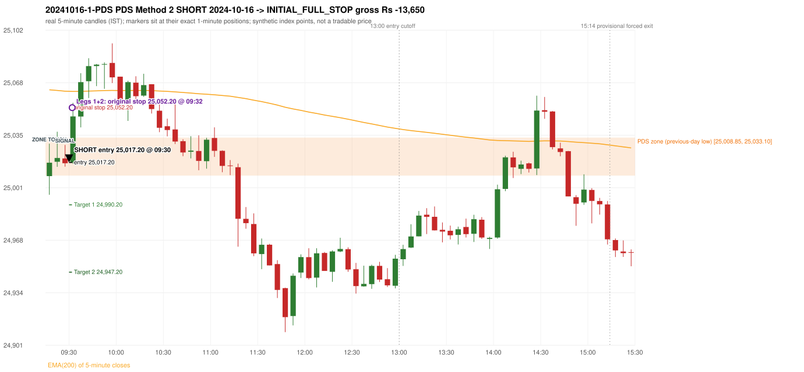
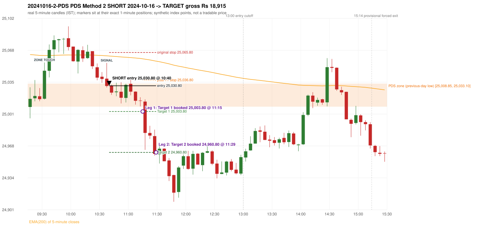

# Trading journal - 2024-10-16 (Wednesday)

> Phase 4 historical validation, window B (Window B 2022-09-01..2025-08-31 (5paisa minutes); status DATA_VALIDATED). The FROZEN Phase 3.6 configuration (IRF, ORB, PDR body-based, PDS, RF; shared controller) on a different data source. HISTORICAL RESEARCH ONLY: the strategy was developed using later data. same provider as the Phase 3.6 baseline; the vendor-overlap audit shows the minute bars differ from the secondary vendor Synthetic NIFTY 50 index-point P&L (the index is not tradable). The owner's review status is intentionally blank.

## A. Trading day overview

| item | value |
|---|---|
| Date / weekday | 2024-10-16 / Wednesday |
| Session type | USABLE_WITH_FLAGS / VALID |
| Original session open (first 1-minute open) | 25,008.55 |
| Previous session | 2024-10-15 |
| Previous-day high / low (wicks included) | 25,208.95 / 25,008.85 |
| Previous-day highest BODY high (the body-based PDR ceiling; wicks ignored) | 25,198.50 |
| Previous-day official close / last 5-minute close | 25,057.35 / 25,065.15 |
| Raw engine records / confirmed signals / fully valid signals | 12 / 8 / 8 |
| Setups that did not complete (invalidated / incomplete) | 4 |
| Executed trades | 2 20241016-1-PDS;20241016-2-PDS |
| Gross P&L (Rs, synthetic) | 5,265.00 |
| Illustrative net P&L (Rs; Rs 500/trade + 0.5 pt/fill) | 3,485.00 |
| Day-end portfolio status | DAY_FINISHED |
| Manual journal trades (matched / unmatched) | 0 (0 / 0) |
| Extra automated trades | 0 |

## B. Daily strategy signal timeline (confirmed signals, chronological)

| time | strategy | method | dir | entry-rule status | valid for execution | <= 13:00 | portfolio state | accepted / ignored | specific reason | competing (same minute) |
|---|---|---|---|---|---|---|---|---|---|---|
| 09:30 | PDS | Method 2 | SHORT | PROPOSAL_DEPENDENT | True | True | FIRST_TRADE_ACTIVE | ACCEPTED -> 20241016-1-PDS | first eligible signal of the day; trade 1: INITIAL_FULL_STOP |  |
| 10:00 | IRF | Method 2B | SHORT | PROPOSAL_DEPENDENT | True | True | SECOND_TRADE_ELIGIBLE | REJECTED | SECOND_TRADE_RESTRICTED_TO_PDR_PDS [blocked by PDS#1] |  |
| 10:40 | PDS | Method 2 | SHORT | PROPOSAL_DEPENDENT | True | True | SECOND_TRADE_ACTIVE | ACCEPTED -> 20241016-2-PDS | permitted second trade: newly confirmed PDR/PDS after the original full stop; trade 2: TARGET |  |
| 10:45 | IRF | Method 1 | SHORT | PROPOSAL_DEPENDENT | True | True | SECOND_TRADE_ACTIVE | IGNORED | POSITION_ACTIVE (signal kept for diagnostics only; never reused) [blocked by PDS#2] |  |
| 11:05 | IRF | Method 1 | SHORT | PROPOSAL_DEPENDENT | True | True | SECOND_TRADE_ACTIVE | IGNORED | POSITION_ACTIVE (signal kept for diagnostics only; never reused) [blocked by PDS#2] |  |
| 11:20 | PDS | Method 3 | SHORT | PROPOSAL_DEPENDENT | True | True | SECOND_TRADE_ACTIVE | IGNORED | POSITION_ACTIVE (signal kept for diagnostics only; never reused) [blocked by PDS#2] |  |
| 14:40 | IRF | Method 1 | SHORT | PROPOSAL_DEPENDENT | True | False | DAY_FINISHED | IGNORED | DAY_FINISHED [blocked by PDS#2] |  |
| 14:50 | PDS | Method 3 | SHORT | PROPOSAL_DEPENDENT | True | False | DAY_FINISHED | IGNORED | DAY_FINISHED [blocked by PDS#2] |  |

Engine setups that did not complete (4); the complete list with failed rule ids is in `rejected_signals.csv`:

| candle | strategy | method | dir | status | precise reason | failed rules |
|---|---|---|---|---|---|---|
| 09:55 | IRF | Method 1/2 | SHORT | INCOMPLETE_AT_EOD | SESSION_ENDED_BEFORE_CONFIRMATION |  |
| 09:15 | ORB | Method 2 | SHORT | INVALIDATED | TREND:EMA_PREV_SESSION_CLOSE wrong side | ORB-TREND-001;ORB-TREND-002 |
| 14:55 | PDS | Method 1/2/3 | SHORT | INCOMPLETE_AT_EOD | NO_QUALIFYING_ENTRY_BEFORE_SESSION_END |  |
| 14:00 | RF | RF | LONG | INVALIDATED | GAP_NOT_UP(DOWN) | RF-003 |

## C. Detailed trade journals

### 20241016-1-PDS: PDS Method 2 SHORT (FIRST trade)

Chart: 

**Rule configuration:** CFG-phase36_body_based-866f954e55 - signal verification status **PROPOSAL_DEPENDENT** (never VERIFIED while a rule rests on a proposal).

#### 1. Setup identification

PDS Method 2 SHORT: the session opened 0.30 points below the previous-day-low zone [25,008.85, 25,033.10]; price rose to the zone at 09:15 and the first red candle at the zone (09:25, close 25,016.75) was a higher-price-rejection pin bar; confirmed 09:30.

#### 2. Candle and indicator calculations

| role | session | candle | O | H | L | C | range | body % | upper wick % | lower wick % | direction | EMA(200) | strong bull / bear | pin bull / bear | small (body<=30%) | used for |
|---|---|---|---|---|---|---|---|---|---|---|---|---|---|---|---|---|
| zone_source_candle | PREVIOUS | 13:05-13:10 | 25,033.10 | 25,035.45 | 25,008.85 | 25,019.45 | 26.60 | 51.32 | 8.83 | 39.85 | BEARISH | 25,068.85 | False / False | False / False | False | previous-day low candle that defines the zone (A_LOWEST_LOW) |
| zone_retest_candle | TODAY | 09:15-09:20 | 25,008.55 | 25,029.20 | 24,996.60 | 25,017.10 | 32.60 | 26.23 | 37.12 | 36.66 | BULLISH | 25,063.61 | False / False | False / False | True | first candle whose range reaches the zone from below |
| signal_candle | TODAY | 09:25-09:30 | 25,019.80 | 25,028.40 | 25,014.55 | 25,016.75 | 13.85 | 22.02 | 62.09 | 15.88 | BEARISH | 25,062.72 | False / False | False / True | True | trigger candle |

Every condition, with the rule, the calculation, the observed values and the result:

| # | group | rule | result | status / numeric definition | calculation | observed | required | available at | why it matters |
|---|---|---|---|---|---|---|---|---|---|
| 1 | SELECTION | SEL-FIRST-001 | PASS | USER_APPROVED / USER_APPROVED | earliest CONFIRMED signal of the day across IRF/ORB/PDR/PDS/RF that passed the controller's checks | 0 confirmed signal(s) earlier today; 8 confirmed signals in the day in total, this one at 09:30 | no earlier executable signal | 2024-10-16 09:30 | the shared controller trades only the first valid signal; the five strategies are not independent positions |
| 2 | SELECTION | SEL-TIE-001 | PASS | USER_APPROVED / USER_APPROVED | other CONFIRMED signals with exactly the same confirmation timestamp | none | no different-strategy / opposite-direction signal in the same minute (otherwise an unresolved conflict, no trade) | 2024-10-16 09:30 | an unresolved same-minute collision would have produced no trade at all |
| 3 | SELECTION | ENTRY-CUTOFF-001 | PASS | USER_APPROVED / USER_APPROVED | fill timestamp vs 13:00:00 IST | signal confirmed 09:30; fill 09:30 | fill at or before 13:00:00 IST | 2024-10-16 09:30 | no new position may be entered with a fill after 13:00 IST |
| 4 | SELECTION | EXE-FILL-001 | PASS | PROPOSED_FOR_REVIEW / PROPOSED_FOR_REVIEW | fill = open of the 1-minute bar that starts at the signal candle's end | bar 09:30 O 25,017.20 H 25,028.95 L 25,016.40 C 25,027.50; executable=True; entry 25,017.20 | fill bar exists, starts exactly at the signal end, is fillable; entry = its open | 2024-10-16 09:30 | a 5-minute signal is known only when its candle closes; the first price that can be traded is the next minute's open |
| 5 | SELECTION | DAY-MAX-001 | PASS | USER_APPROVED / USER_APPROVED | number of entries today | trade 1 of at most 2 | <= 2 entries per day | 2024-10-16 09:30 | daily trade cap |
| 6 | SETUP | PDS-003 | PASS | SOURCE_VERIFIED / EXPLICIT_WORDING_DETAIL_PROPOSED_FOR_REVIEW | gap = first 1-minute open of today - previous session's OFFICIAL close | today's open 25,008.55 (first 1-minute bar 09:15) - previous close 25,057.35 (DAILY_VENDOR, 2024-10-15) = -48.80 points -> gap DOWN | gap DOWN (more than 0 points) | 2024-10-16 09:15 | approved convention: the original first-minute open, never the vendor daily open |
| 7 | SETUP | PDS-006 | PASS | SOURCE_VERIFIED / QUALITATIVE_SOURCE_NUMERIC_DEFINITION_PROPOSED_FOR_REVIEW | gap-down open below the zone | today's open 25,008.55 vs zone low 25,008.85: 0.30 points below | open < zone low | 2024-10-16 09:15 | the guide: 'price is trading below the previous day's support zone' after the gap; a PROPOSED strict reading |
| 8 | SETUP | PDS-004 | PASS | SOURCE_VERIFIED / EXPLICIT_IN_SOURCE | PDS is not a breakdown strategy: the zone must be tested from below first | open 25,008.55 below the zone floor 25,008.85; the first candle to reach the zone is 09:15 | price rises to the zone before any short | 2024-10-16 09:15 | a short below the level without a retest is not this strategy |
| 9 | SETUP | PDS-005 | PASS | SOURCE_VERIFIED / QUALITATIVE_SOURCE_NUMERIC_DEFINITION_PROPOSED_FOR_REVIEW | price comes up to the zone: first candle whose [low, high] intersects it (+/- proximity) | 09:15-09:20 O 25,008.55 H 25,029.20 L 24,996.60 C 25,017.10; range 32.60, body 8.55 (26.23%), upper wick 12.10 (37.12%), lower wick 11.95 (36.66%), bullish; high 25,029.20 vs zone low 25,008.85 | range intersects the zone | 2024-10-16 09:20 | PDS is not a breakdown strategy: the zone must be tested from below first |
| 10 | ZONE | PDS-001 | PASS | SOURCE_VERIFIED / EXPLICIT_IN_SOURCE | direction | SHORT (PDS is short only) | short-only | 2024-10-16 09:30 | PDS sells a retest of previous-day support from below |
| 11 | ZONE | PDS-002 | PASS | SOURCE_VERIFIED / QUALITATIVE_SOURCE_NUMERIC_DEFINITION_PROPOSED_FOR_REVIEW | zone = [lowest low, body top] of the previous session's absolute-low candle (method A_LOWEST_LOW; the lower wick is part of the zone) | zone [25,008.85, 25,033.10] from the 13:05 candle of 2024-10-15 (13:05-13:10 O 25,033.10 H 25,035.45 L 25,008.85 C 25,019.45; range 26.60, body 13.65 (51.32%), upper wick 2.35 (8.83%), lower wick 10.60 (39.85%), bearish); engine recorded [25,008.85, 25,033.10] | previous trading day's low where price took support (body + lower wick) | 2024-10-15 13:10 | the reference level of the strategy; the exact candle(s) are a research choice (PDS-ZONE-002) |
| 12 | CONFIRMATION | PDS-M-001 | PASS | SOURCE_VERIFIED / QUALITATIVE_SOURCE_NUMERIC_DEFINITION_PROPOSED_FOR_REVIEW | Methods 1/2 apply to the FIRST red candle at the zone | first red candle at the zone: 09:25; signal candle 09:25 | the trigger is the first red candle at the zone | 2024-10-16 09:30 | a later red candle would only qualify through Method 3 |
| 13 | CONFIRMATION | PDS-M2-001 | PASS | SOURCE_VERIFIED / QUALITATIVE_SOURCE_NUMERIC_DEFINITION_PROPOSED_FOR_REVIEW | red higher-price-rejection pin bar: upper wick >= 2 x body, close within the lowest 30% of the range, high reaches the zone | 09:25-09:30 O 25,019.80 H 25,028.40 L 25,014.55 C 25,016.75; range 13.85, body 3.05 (22.02%), upper wick 8.60 (62.09%), lower wick 2.20 (15.88%), bearish; upper wick / body = 2.82; close position from the low 15.88% of range; high 25,028.40 vs zone low 25,008.85 | bearish pin bar and high >= zone low | 2024-10-16 09:30 | the guide: wick-to-body ratio 'not specified'; these thresholds are an owner recommendation (proposal) |
| 14 | EXECUTION | EXE-STOP-001 | PASS | USER_APPROVED / USER_APPROVED | initial stop = entry + 35 points | entry 25,017.20 -> stop 25,052.20 | stop 35 index points (BASELINE) | 2024-10-16 09:30 | defines the loss if the setup fails before Target 1 |
| 15 | EXECUTION | EXE-T1-001 | PASS | SOURCE_VERIFIED / EXPLICIT_IN_SOURCE | Target 1 = entry +/- 27 points | T1 24,990.20 | 27 points | 2024-10-16 09:30 | Leg 1 (3 lots) is booked at Target 1 |
| 16 | EXECUTION | PDS-TGT-001 | PASS | SOURCE_VERIFIED / EXPLICIT_IN_SOURCE | Target 2 = entry +/- 70 points | T2 24,947.20 (the guide says 70; the report suggests 60 - CONFLICTING) | 70 points | 2024-10-16 09:30 | Leg 2 (3 lots) is booked at Target 2 |
| 17 | EXECUTION | POST-T1-STOP-006 | PASS | USER_APPROVED / USER_APPROVED | after T1 the Leg-2 stop = entry + 6 (no trailing) | post-T1 stop 25,023.20 | entry -6 (LONG) / +6 (SHORT) | 2024-10-16 09:30 | protects the remaining three lots once the first three are booked |
| 18 | EXECUTION | SIZE-LOT-001 | PASS | USER_APPROVED / USER_APPROVED | 6 lots x 65 = 390, Leg 1 = 3 lots = 195, Leg 2 = 195 | 6 lots, lot size 65, legs 3+3 | 6 lots in two equal legs | 2024-10-16 09:30 | position size for the synthetic P&L |
| 19 | NOTE | PDS-007 | NOT_APPLICABLE | PROPOSED_FOR_REVIEW / PROPOSED_FOR_REVIEW | repeated PDS signals today | 4 confirmed PDS signal(s) in the session | n/a (disclosure) | 2024-10-16 09:30 | the per-session cap is lifted for the controller runs; the controller trades only the first (or the permitted second) trade |
| 20 | NOTE | PDS-SL-001 | NOT_APPLICABLE | SOURCE_VERIFIED / QUALITATIVE_SOURCE_NUMERIC_DEFINITION_PROPOSED_FOR_REVIEW | the guide's 35-or-40 rule: 35 if the most recent green candle's high is within 35 points of entry, else 40 | most recent green candle high 25,036.85 is 19.65 points from the entry 25,017.20: the guide's rule would select 35 points; the baseline applies a fixed 35 (USER_APPROVED research baseline; the 35-vs-40 selection and the 40-point variant are separate labelled scenarios) | source selection rule | 2024-10-16 09:30 | the stop distance is a modelling choice and changes losses, not entries |
| 21 | NOTE | NOTE-UNRESOLVED-DEPENDENCIES | NOT_APPLICABLE | NOT_A_RULE / NOT_A_REGISTRY_RULE | rules the signal depends on that the sources leave unresolved | engine-recorded unresolved rule ids: none; verification status PROPOSAL_DEPENDENT | n/a (disclosure) | 2024-10-16 09:30 | the entry is only as verified as the rules it rests on |

#### 3. Entry decision and explanation

PDS Method 2 SHORT: the session opened 0.30 points below the previous-day-low zone [25,008.85, 25,033.10]; price rose to the zone at 09:15 and the first red candle at the zone (09:25, close 25,016.75) was a higher-price-rejection pin bar; confirmed 09:30.

**Why this trade ahead of the other strategies:** This PDS Method 2 signal was the earliest executable signal of the day: 0 confirmed signal(s) earlier, 0 other in the same minute. 7 later confirmed signal(s) (IRF x4, PDS x3) are logged as ignored or rejected. State of the other four engines at that moment: [IRF: no setup record before this time (a base condition was not met, or nothing triggered)] [ORB: Method 2 invalidated at 09:15: TREND:EMA_PREV_SESSION_CLOSE wrong side] [PDR: no setup record before this time (a base condition was not met, or nothing triggered)] [RF: no setup record before this time (a base condition was not met, or nothing triggered)]

#### 4. Actual entry execution

| item | value |
|---|---|
| Signal candle | 09:25-09:30 |
| Signal confirmed | 2024-10-16 09:30 |
| Fill timestamp | 2024-10-16 09:30 |
| Entry price | 25,017.20 |
| Source partition / 1-minute bar | data/phase4/processed/FIVEPAISA_1M_PHASE4/nifty50/year=2024/month=10/candles.parquet / 2024-10-16 09:30 |
| Source bar O / H / L / C | 25,017.20 / 25,028.95 / 25,016.40 / 25,027.50 |
| Fill assumption | open of the 1-minute bar starting at the signal candle's end (EXE-FILL-001, PROPOSED causal convention) |
| Initial stop / T1 / T2 / post-T1 stop | 25,052.20 / 24,990.20 / 24,947.20 / 25,023.20 |
| Position | 6 lots x 65 = 390 units (Leg 1 195, Leg 2 195) |

#### 5-8. Trade progress, Target 1, post-T1 stop and final exit

Between the 09:30 entry bar and the final exit (3 one-minute bars) the best excursion in favour was 0.80 points at 09:30 and the worst against was 38.10 points at 09:32. At 09:32 price reached the original stop 25,052.20 before Target 1 24,990.20, so all six lots exited together at 25,052.20. This is an INITIAL_FULL_STOP: one more trade is allowed that day, only a newly confirmed PDR/PDS signal.

| leg | qty | exit time | exit price | reason | source 1-minute bar | O / H / L / C | gross points | gross Rs | slippage pts | flags |
|---|---|---|---|---|---|---|---|---|---|---|
| 1 | 195 | 09:32 | 25,052.20 | ORIGINAL_STOP_BEFORE_T1 | 09:32 | 25,042.00 / 25,055.30 / 25,041.70 / 25,053.55 | -35.00 | -6,825.00 | 0.00 |  |
| 2 | 195 | 09:32 | 25,052.20 | ORIGINAL_STOP_BEFORE_T1 | 09:32 | 25,042.00 / 25,055.30 / 25,041.70 / 25,053.55 | -35.00 | -6,825.00 | 0.00 |  |

Exit evidence per leg:

* Leg 1: 1-minute bar 09:32 O 25,042.00 H 25,055.30 L 25,041.70 C 25,053.55: high 25,055.30 reached the original stop 25,052.20 before Target 1 24,990.20 was touched; both legs exit at the stop level 25,052.20
* Leg 2: 1-minute bar 09:32 O 25,042.00 H 25,055.30 L 25,041.70 C 25,053.55: high 25,055.30 reached the original stop 25,052.20 before Target 1 24,990.20 was touched; both legs exit at the stop level 25,052.20

#### 9. Gross and illustrative net P&L

| item | value (Rs) |
|---|---|
| Leg 1 gross | -6,825.00 |
| Leg 2 gross | -6,825.00 |
| Trade gross (= Leg 1 + Leg 2) | -13,650.00 |
| Illustrative fixed cost | -500.00 |
| Illustrative slippage (0.5 pt on every fill, entry + exits, all units) | -390.00 |
| Illustrative net | -14,540.00 |

#### 10. Manual journal comparison

No manual journal exists for this period; no comparison.

### 20241016-2-PDS: PDS Method 2 SHORT (SECOND trade)

Chart: 

**Rule configuration:** CFG-phase36_body_based-866f954e55 - signal verification status **PROPOSAL_DEPENDENT** (never VERIFIED while a rule rests on a proposal).

#### 1. Setup identification

PDS Method 2 SHORT: the session opened 0.30 points below the previous-day-low zone [25,008.85, 25,033.10]; price rose to the zone at 09:30 and the first red candle at the zone (10:35, close 25,030.60) was a higher-price-rejection pin bar; confirmed 10:40.

#### 2. Candle and indicator calculations

| role | session | candle | O | H | L | C | range | body % | upper wick % | lower wick % | direction | EMA(200) | strong bull / bear | pin bull / bear | small (body<=30%) | used for |
|---|---|---|---|---|---|---|---|---|---|---|---|---|---|---|---|---|
| zone_source_candle | PREVIOUS | 13:05-13:10 | 25,033.10 | 25,035.45 | 25,008.85 | 25,019.45 | 26.60 | 51.32 | 8.83 | 39.85 | BEARISH | 25,068.85 | False / False | False / False | False | previous-day low candle that defines the zone (A_LOWEST_LOW) |
| zone_retest_candle | TODAY | 09:30-09:35 | 25,017.20 | 25,055.30 | 25,016.40 | 25,046.60 | 38.90 | 75.58 | 22.36 | 2.06 | BULLISH | 25,062.56 | False / False | False / False | False | first candle whose range reaches the zone from below |
| signal_candle | TODAY | 10:35-10:40 | 25,038.30 | 25,054.85 | 25,029.00 | 25,030.60 | 25.85 | 29.79 | 64.02 | 6.19 | BEARISH | 25,062.26 | False / False | False / True | True | trigger candle |

Every condition, with the rule, the calculation, the observed values and the result:

| # | group | rule | result | status / numeric definition | calculation | observed | required | available at | why it matters |
|---|---|---|---|---|---|---|---|---|---|
| 1 | SELECTION | DAY-SL-001 | PASS | USER_APPROVED / USER_APPROVED | first trade outcome, strategy of this signal, position-close time vs this signal's timestamp | first trade PDS Method 2 closed as INITIAL_FULL_STOP at 09:32; position free from 09:33; this PDS signal confirmed 10:40 | first trade INITIAL_FULL_STOP before Target 1, and a NEWLY confirmed PDR/PDS signal after the first position closed | 2024-10-16 10:40 | the only way a second trade is allowed |
| 2 | SELECTION | DAY-NOREUSE-001 | PASS | USER_APPROVED / USER_APPROVED | signals confirmed while the first position was open | 1 signal(s) were ignored during the first trade (never reused): PDS Method 2 SHORT @09:30 | this trade comes from a signal confirmed after the first exit, not from an ignored one | 2024-10-16 10:40 | an ignored signal can never become the second trade |
| 3 | SELECTION | ENTRY-CUTOFF-001 | PASS | USER_APPROVED / USER_APPROVED | fill timestamp vs 13:00:00 IST | signal confirmed 10:40; fill 10:40 | fill at or before 13:00:00 IST | 2024-10-16 10:40 | no new position may be entered with a fill after 13:00 IST |
| 4 | SELECTION | EXE-FILL-001 | PASS | PROPOSED_FOR_REVIEW / PROPOSED_FOR_REVIEW | fill = open of the 1-minute bar that starts at the signal candle's end | bar 10:40 O 25,030.80 H 25,032.05 L 25,023.30 C 25,028.00; executable=True; entry 25,030.80 | fill bar exists, starts exactly at the signal end, is fillable; entry = its open | 2024-10-16 10:40 | a 5-minute signal is known only when its candle closes; the first price that can be traded is the next minute's open |
| 5 | SELECTION | DAY-MAX-001 | PASS | USER_APPROVED / USER_APPROVED | number of entries today | trade 2 of at most 2 | <= 2 entries per day | 2024-10-16 10:40 | daily trade cap |
| 6 | SETUP | PDS-003 | PASS | SOURCE_VERIFIED / EXPLICIT_WORDING_DETAIL_PROPOSED_FOR_REVIEW | gap = first 1-minute open of today - previous session's OFFICIAL close | today's open 25,008.55 (first 1-minute bar 09:15) - previous close 25,057.35 (DAILY_VENDOR, 2024-10-15) = -48.80 points -> gap DOWN | gap DOWN (more than 0 points) | 2024-10-16 09:15 | approved convention: the original first-minute open, never the vendor daily open |
| 7 | SETUP | PDS-006 | PASS | SOURCE_VERIFIED / QUALITATIVE_SOURCE_NUMERIC_DEFINITION_PROPOSED_FOR_REVIEW | gap-down open below the zone | today's open 25,008.55 vs zone low 25,008.85: 0.30 points below | open < zone low | 2024-10-16 09:15 | the guide: 'price is trading below the previous day's support zone' after the gap; a PROPOSED strict reading |
| 8 | SETUP | PDS-004 | PASS | SOURCE_VERIFIED / EXPLICIT_IN_SOURCE | PDS is not a breakdown strategy: the zone must be tested from below first | open 25,008.55 below the zone floor 25,008.85; the first candle to reach the zone is 09:30 | price rises to the zone before any short | 2024-10-16 09:15 | a short below the level without a retest is not this strategy |
| 9 | SETUP | PDS-005 | PASS | SOURCE_VERIFIED / QUALITATIVE_SOURCE_NUMERIC_DEFINITION_PROPOSED_FOR_REVIEW | price comes up to the zone: first candle whose [low, high] intersects it (+/- proximity) | 09:30-09:35 O 25,017.20 H 25,055.30 L 25,016.40 C 25,046.60; range 38.90, body 29.40 (75.58%), upper wick 8.70 (22.37%), lower wick 0.80 (2.06%), bullish; high 25,055.30 vs zone low 25,008.85 | range intersects the zone | 2024-10-16 09:35 | PDS is not a breakdown strategy: the zone must be tested from below first |
| 10 | ZONE | PDS-001 | PASS | SOURCE_VERIFIED / EXPLICIT_IN_SOURCE | direction | SHORT (PDS is short only) | short-only | 2024-10-16 10:40 | PDS sells a retest of previous-day support from below |
| 11 | ZONE | PDS-002 | PASS | SOURCE_VERIFIED / QUALITATIVE_SOURCE_NUMERIC_DEFINITION_PROPOSED_FOR_REVIEW | zone = [lowest low, body top] of the previous session's absolute-low candle (method A_LOWEST_LOW; the lower wick is part of the zone) | zone [25,008.85, 25,033.10] from the 13:05 candle of 2024-10-15 (13:05-13:10 O 25,033.10 H 25,035.45 L 25,008.85 C 25,019.45; range 26.60, body 13.65 (51.32%), upper wick 2.35 (8.83%), lower wick 10.60 (39.85%), bearish); engine recorded [25,008.85, 25,033.10] | previous trading day's low where price took support (body + lower wick) | 2024-10-15 13:10 | the reference level of the strategy; the exact candle(s) are a research choice (PDS-ZONE-002) |
| 12 | CONFIRMATION | PDS-M-001 | PASS | SOURCE_VERIFIED / QUALITATIVE_SOURCE_NUMERIC_DEFINITION_PROPOSED_FOR_REVIEW | Methods 1/2 apply to the FIRST red candle at the zone | first red candle at the zone: 10:35; signal candle 10:35 | the trigger is the first red candle at the zone | 2024-10-16 10:40 | a later red candle would only qualify through Method 3 |
| 13 | CONFIRMATION | PDS-M2-001 | PASS | SOURCE_VERIFIED / QUALITATIVE_SOURCE_NUMERIC_DEFINITION_PROPOSED_FOR_REVIEW | red higher-price-rejection pin bar: upper wick >= 2 x body, close within the lowest 30% of the range, high reaches the zone | 10:35-10:40 O 25,038.30 H 25,054.85 L 25,029.00 C 25,030.60; range 25.85, body 7.70 (29.79%), upper wick 16.55 (64.02%), lower wick 1.60 (6.19%), bearish; upper wick / body = 2.15; close position from the low 6.19% of range; high 25,054.85 vs zone low 25,008.85 | bearish pin bar and high >= zone low | 2024-10-16 10:40 | the guide: wick-to-body ratio 'not specified'; these thresholds are an owner recommendation (proposal) |
| 14 | EXECUTION | EXE-STOP-001 | PASS | USER_APPROVED / USER_APPROVED | initial stop = entry + 35 points | entry 25,030.80 -> stop 25,065.80 | stop 35 index points (BASELINE) | 2024-10-16 10:40 | defines the loss if the setup fails before Target 1 |
| 15 | EXECUTION | EXE-T1-001 | PASS | SOURCE_VERIFIED / EXPLICIT_IN_SOURCE | Target 1 = entry +/- 27 points | T1 25,003.80 | 27 points | 2024-10-16 10:40 | Leg 1 (3 lots) is booked at Target 1 |
| 16 | EXECUTION | PDS-TGT-001 | PASS | SOURCE_VERIFIED / EXPLICIT_IN_SOURCE | Target 2 = entry +/- 70 points | T2 24,960.80 (the guide says 70; the report suggests 60 - CONFLICTING) | 70 points | 2024-10-16 10:40 | Leg 2 (3 lots) is booked at Target 2 |
| 17 | EXECUTION | POST-T1-STOP-006 | PASS | USER_APPROVED / USER_APPROVED | after T1 the Leg-2 stop = entry + 6 (no trailing) | post-T1 stop 25,036.80 | entry -6 (LONG) / +6 (SHORT) | 2024-10-16 10:40 | protects the remaining three lots once the first three are booked |
| 18 | EXECUTION | SIZE-LOT-001 | PASS | USER_APPROVED / USER_APPROVED | 6 lots x 65 = 390, Leg 1 = 3 lots = 195, Leg 2 = 195 | 6 lots, lot size 65, legs 3+3 | 6 lots in two equal legs | 2024-10-16 10:40 | position size for the synthetic P&L |
| 19 | NOTE | PDS-007 | NOT_APPLICABLE | PROPOSED_FOR_REVIEW / PROPOSED_FOR_REVIEW | repeated PDS signals today | 4 confirmed PDS signal(s) in the session | n/a (disclosure) | 2024-10-16 10:40 | the per-session cap is lifted for the controller runs; the controller trades only the first (or the permitted second) trade |
| 20 | NOTE | PDS-SL-001 | NOT_APPLICABLE | SOURCE_VERIFIED / QUALITATIVE_SOURCE_NUMERIC_DEFINITION_PROPOSED_FOR_REVIEW | the guide's 35-or-40 rule: 35 if the most recent green candle's high is within 35 points of entry, else 40 | most recent green candle high 25,073.85 is 43.05 points from the entry 25,030.80: the guide's rule would select 40 points; the baseline applies a fixed 35 (USER_APPROVED research baseline; the 35-vs-40 selection and the 40-point variant are separate labelled scenarios) | source selection rule | 2024-10-16 10:40 | the stop distance is a modelling choice and changes losses, not entries |
| 21 | NOTE | NOTE-UNRESOLVED-DEPENDENCIES | NOT_APPLICABLE | NOT_A_RULE / NOT_A_REGISTRY_RULE | rules the signal depends on that the sources leave unresolved | engine-recorded unresolved rule ids: none; verification status PROPOSAL_DEPENDENT | n/a (disclosure) | 2024-10-16 10:40 | the entry is only as verified as the rules it rests on |

#### 3. Entry decision and explanation

PDS Method 2 SHORT: the session opened 0.30 points below the previous-day-low zone [25,008.85, 25,033.10]; price rose to the zone at 09:30 and the first red candle at the zone (10:35, close 25,030.60) was a higher-price-rejection pin bar; confirmed 10:40.

**Why this trade ahead of the other strategies:** The first trade (PDS Method 2) was stopped out before Target 1 at 09:32; this newly confirmed PDS signal at 10:40 is the first PDR/PDS signal after that exit, so it is the day's permitted second trade. State of the other engines at that moment: [IRF: 1 confirmed signal(s) up to this time (Method 2B@10:00)] [ORB: Method 2 invalidated at 09:15: TREND:EMA_PREV_SESSION_CLOSE wrong side] [PDR: no setup record before this time (a base condition was not met, or nothing triggered)] [RF: no setup record before this time (a base condition was not met, or nothing triggered)]

#### 4. Actual entry execution

| item | value |
|---|---|
| Signal candle | 10:35-10:40 |
| Signal confirmed | 2024-10-16 10:40 |
| Fill timestamp | 2024-10-16 10:40 |
| Entry price | 25,030.80 |
| Source partition / 1-minute bar | data/phase4/processed/FIVEPAISA_1M_PHASE4/nifty50/year=2024/month=10/candles.parquet / 2024-10-16 10:40 |
| Source bar O / H / L / C | 25,030.80 / 25,032.05 / 25,023.30 / 25,028.00 |
| Fill assumption | open of the 1-minute bar starting at the signal candle's end (EXE-FILL-001, PROPOSED causal convention) |
| Initial stop / T1 / T2 / post-T1 stop | 25,065.80 / 25,003.80 / 24,960.80 / 25,036.80 |
| Position | 6 lots x 65 = 390 units (Leg 1 195, Leg 2 195) |

#### 5-8. Trade progress, Target 1, post-T1 stop and final exit

Between the 10:40 entry bar and the final exit (50 one-minute bars) the best excursion in favour was 73.35 points at 11:29 and the worst against was 8.85 points at 11:01. At 11:15 price reached Target 1 25,003.80 and three lots exited. At 11:15 the remaining three lots' protective stop was set to 25,036.80 (entry + 6; no trailing, no further change); the engine applies it from the Target-1 bar onward and tests it within that same bar. At 11:29 price reached Target 2 24,960.80 and the remaining three lots exited. No further trade that day (DAY-T2-001).

| leg | qty | exit time | exit price | reason | source 1-minute bar | O / H / L / C | gross points | gross Rs | slippage pts | flags |
|---|---|---|---|---|---|---|---|---|---|---|
| 1 | 195 | 11:15 | 25,003.80 | TARGET_1 | 11:15 | 25,014.20 / 25,016.50 / 24,989.45 / 24,989.45 | 27.00 | 5,265.00 | 0.00 |  |
| 2 | 195 | 11:29 | 24,960.80 | TARGET_2 | 11:29 | 24,967.00 / 24,967.25 / 24,957.45 / 24,959.20 | 70.00 | 13,650.00 | 0.00 |  |

Exit evidence per leg:

* Leg 1: 1-minute bar 11:15 O 25,014.20 H 25,016.50 L 24,989.45 C 24,989.45: low 24,989.45 reached Target 1 25,003.80; Leg 1 booked at the target level
* Leg 2: 1-minute bar 11:29 O 24,967.00 H 24,967.25 L 24,957.45 C 24,959.20: low 24,957.45 reached Target 2 24,960.80; Leg 2 booked at the target level

#### 9. Gross and illustrative net P&L

| item | value (Rs) |
|---|---|
| Leg 1 gross | 5,265.00 |
| Leg 2 gross | 13,650.00 |
| Trade gross (= Leg 1 + Leg 2) | 18,915.00 |
| Illustrative fixed cost | -500.00 |
| Illustrative slippage (0.5 pt on every fill, entry + exits, all units) | -390.00 |
| Illustrative net | 18,025.00 |

#### 10. Manual journal comparison

No manual journal exists for this period; no comparison.

## D. Manual journal comparison

No manual journal exists for this period (the manual journal covers 2025-09-01 .. 2026-08-31 only); no comparison is made and no automated trade is labelled 'extra'.

## E. Daily conclusion

* **Traded:** 20241016-1-PDS - PDS Method 2 SHORT at 09:30 (entry 25,017.20), outcome INITIAL_FULL_STOP, gross Rs -13,650.00, illustrative net Rs -14,540.00. **Why:** This PDS Method 2 signal was the earliest executable signal of the day: 0 confirmed signal(s) earlier, 0 other in the same minute. 7 later confirmed signal(s) (IRF x4, PDS x3) are logged as ignored or rejected. State of the other four engines at that moment: [IRF: no setup record before this time (a base condition was not met, or nothing triggered)] [ORB: Method 2 invalidated at 09:15: TREND:EMA_PREV_SESSION_CLOSE wrong side] [PDR: no setup record before this time (a base condition was not met, or nothing triggered)] [RF: no setup record before this time (a base condition was not met, or nothing triggered)] **How it ended:** At 09:32 price reached the original stop 25,052.20 before Target 1 24,990.20, so all six lots exited together at 25,052.20. This is an INITIAL_FULL_STOP: one more trade is allowed that day, only a newly confirmed PDR/PDS signal.
* **Traded:** 20241016-2-PDS - PDS Method 2 SHORT at 10:40 (entry 25,030.80), outcome TARGET, gross Rs 18,915.00, illustrative net Rs 18,025.00. **Why:** The first trade (PDS Method 2) was stopped out before Target 1 at 09:32; this newly confirmed PDS signal at 10:40 is the first PDR/PDS signal after that exit, so it is the day's permitted second trade. State of the other engines at that moment: [IRF: 1 confirmed signal(s) up to this time (Method 2B@10:00)] [ORB: Method 2 invalidated at 09:15: TREND:EMA_PREV_SESSION_CLOSE wrong side] [PDR: no setup record before this time (a base condition was not met, or nothing triggered)] [RF: no setup record before this time (a base condition was not met, or nothing triggered)] **How it ended:** At 11:15 price reached Target 1 25,003.80 and three lots exited. At 11:15 the remaining three lots' protective stop was set to 25,036.80 (entry + 6; no trailing, no further change); the engine applies it from the Target-1 bar onward and tests it within that same bar. At 11:29 price reached Target 2 24,960.80 and the remaining three lots exited. No further trade that day (DAY-T2-001).
* **Ignored / rejected signals:** IRF IGNORED POSITION_ACTIVE x2; IRF REJECTED SECOND_TRADE_RESTRICTED_TO_PDR_PDS x1; PDS IGNORED POSITION_ACTIVE x1; IRF IGNORED DAY_FINISHED x1; PDS IGNORED DAY_FINISHED x1
* **Automated triage (not an approval; the owner's review status stays blank):** TRADED_NO_FLAGS
