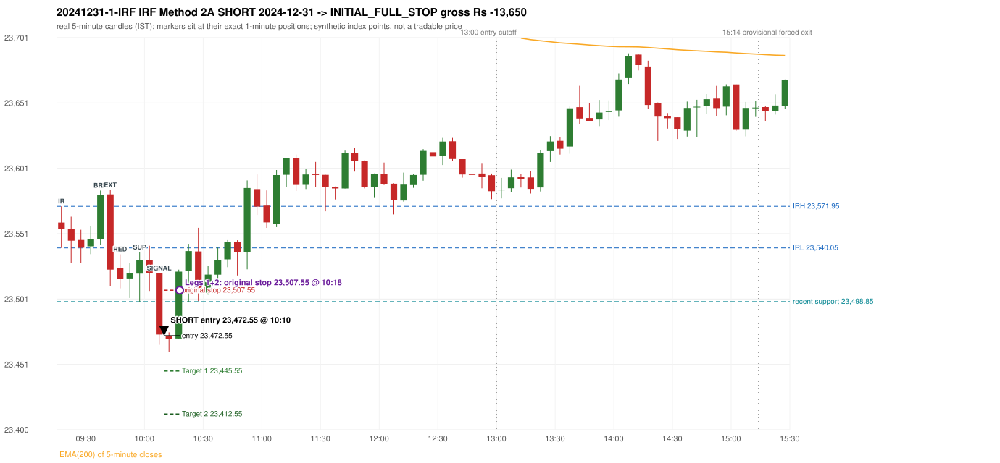
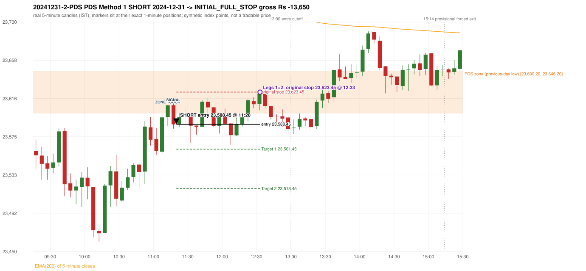

# Trading journal - 2024-12-31 (Tuesday)

> Phase 4 historical validation, window B (Window B 2022-09-01..2025-08-31 (5paisa minutes); status DATA_VALIDATED). The FROZEN Phase 3.6 configuration (IRF, ORB, PDR body-based, PDS, RF; shared controller) on a different data source. HISTORICAL RESEARCH ONLY: the strategy was developed using later data. same provider as the Phase 3.6 baseline; the vendor-overlap audit shows the minute bars differ from the secondary vendor Synthetic NIFTY 50 index-point P&L (the index is not tradable). The owner's review status is intentionally blank.

## A. Trading day overview

| item | value |
|---|---|
| Date / weekday | 2024-12-31 / Tuesday |
| Session type | USABLE_WITH_FLAGS / VALID |
| Original session open (first 1-minute open) | 23,559.50 |
| Previous session | 2024-12-30 |
| Previous-day high / low (wicks included) | 23,915.25 / 23,600.20 |
| Previous-day highest BODY high (the body-based PDR ceiling; wicks ignored) | 23,897.20 |
| Previous-day official close / last 5-minute close | 23,644.90 / 23,658.65 |
| Raw engine records / confirmed signals / fully valid signals | 15 / 10 / 10 |
| Setups that did not complete (invalidated / incomplete) | 5 |
| Executed trades | 2 20241231-1-IRF;20241231-2-PDS |
| Gross P&L (Rs, synthetic) | -27,300.00 |
| Illustrative net P&L (Rs; Rs 500/trade + 0.5 pt/fill) | -29,080.00 |
| Day-end portfolio status | DAY_FINISHED |
| Manual journal trades (matched / unmatched) | 0 (0 / 0) |
| Extra automated trades | 0 |

## B. Daily strategy signal timeline (confirmed signals, chronological)

| time | strategy | method | dir | entry-rule status | valid for execution | <= 13:00 | portfolio state | accepted / ignored | specific reason | competing (same minute) |
|---|---|---|---|---|---|---|---|---|---|---|
| 10:10 | IRF | Method 2A | SHORT | PROPOSAL_DEPENDENT | True | True | FIRST_TRADE_ACTIVE | ACCEPTED -> 20241231-1-IRF | first eligible signal of the day; trade 1: INITIAL_FULL_STOP |  |
| 11:00 | IRF | Method 1 | SHORT | PROPOSAL_DEPENDENT | True | True | SECOND_TRADE_ELIGIBLE | REJECTED | SECOND_TRADE_RESTRICTED_TO_PDR_PDS [blocked by IRF#1] |  |
| 11:20 | PDS | Method 1 | SHORT | PROPOSAL_DEPENDENT | True | True | SECOND_TRADE_ACTIVE | ACCEPTED -> 20241231-2-PDS | permitted second trade: newly confirmed PDR/PDS after the original full stop; trade 2: INITIAL_FULL_STOP |  |
| 11:50 | IRF | Method 2B | SHORT | PROPOSAL_DEPENDENT | True | True | SECOND_TRADE_ACTIVE | IGNORED | POSITION_ACTIVE (signal kept for diagnostics only; never reused) [blocked by PDS#2] |  |
| 12:10 | PDS | Method 3 | SHORT | PROPOSAL_DEPENDENT | True | True | SECOND_TRADE_ACTIVE | IGNORED | POSITION_ACTIVE (signal kept for diagnostics only; never reused) [blocked by PDS#2] |  |
| 12:30 | IRF | Method 2B | SHORT | PROPOSAL_DEPENDENT | True | True | SECOND_TRADE_ACTIVE | IGNORED | POSITION_ACTIVE (signal kept for diagnostics only; never reused) [blocked by PDS#2] |  |
| 12:45 | IRF | Method 2A | SHORT | PROPOSAL_DEPENDENT | True | True | DAY_FINISHED | IGNORED | DAY_FINISHED [blocked by PDS#2] | PDS Method 3 SHORT |
| 12:45 | PDS | Method 3 | SHORT | PROPOSAL_DEPENDENT | True | True | DAY_FINISHED | IGNORED | DAY_FINISHED [blocked by PDS#2] | IRF Method 2A SHORT |
| 15:05 | IRF | Method 2A | SHORT | PROPOSAL_DEPENDENT | True | False | DAY_FINISHED | IGNORED | DAY_FINISHED [blocked by PDS#2] | PDS Method 3 SHORT |
| 15:05 | PDS | Method 3 | SHORT | PROPOSAL_DEPENDENT | True | False | DAY_FINISHED | IGNORED | DAY_FINISHED [blocked by PDS#2] | IRF Method 2A SHORT |

Engine setups that did not complete (5); the complete list with failed rule ids is in `rejected_signals.csv`:

| candle | strategy | method | dir | status | precise reason | failed rules |
|---|---|---|---|---|---|---|
| 15:00 | IRF | Method 1/2 | SHORT | INCOMPLETE_AT_EOD | SESSION_ENDED_BEFORE_CONFIRMATION |  |
| 09:15 | ORB | Method 1 | SHORT | INVALIDATED | CANDLE_QUALITY(not a strong body / wick too large) | ORB-M1-SHORT-003 |
| 09:15 | ORB | Method 2 | SHORT | INVALIDATED | CANDLE_QUALITY | ORB-M2-SHORT-003 |
| 15:05 | PDS | Method 1/2/3 | SHORT | INCOMPLETE_AT_EOD | NO_QUALIFYING_ENTRY_BEFORE_SESSION_END |  |
| 10:40 | RF | RF | LONG | INVALIDATED | TREND:EMA_PREV_SESSION_CLOSE wrong side | RF-001;RF-008 |

## C. Detailed trade journals

### 20241231-1-IRF: IRF Method 2A SHORT (FIRST trade)

Chart: 

**Rule configuration:** CFG-phase36_body_based-866f954e55 - signal verification status **PROPOSAL_DEPENDENT** (never VERIFIED while a rule rests on a proposal).

#### 1. Setup identification

IRF Method 2A SHORT: the 09:35-09:40 candle closed at 23,580.70, above IRH 23,571.95, and the next candle did not close back inside the range, so the setup is Method 2 but price closed back at or below IRH 5 time(s) before the trigger (the engine does not require it to hold). Extension candle 09:40-09:45, red candle 09:45-09:50. The trigger came 6 candles after the breakout candle: a completed candle closed below the recent pullback-low support (10:05-10:10); confirmed at 10:10 with close 23,473.55. Entry reference close 23,473.55 is 98.40 points below IRH 23,571.95.

#### 2. Candle and indicator calculations

| role | session | candle | O | H | L | C | range | body % | upper wick % | lower wick % | direction | EMA(200) | strong bull / bear | pin bull / bear | small (body<=30%) | used for |
|---|---|---|---|---|---|---|---|---|---|---|---|---|---|---|---|---|
| initial_range_candle | TODAY | 09:15-09:20 | 23,559.50 | 23,571.95 | 23,540.05 | 23,554.75 | 31.90 | 14.89 | 39.03 | 46.08 | BEARISH | 23,778.68 | False / False | False / False | True | initial range = high/low of the 09:15 candle |
| signal_candle | TODAY | 10:05-10:10 | 23,520.60 | 23,520.60 | 23,465.65 | 23,473.55 | 54.95 | 85.62 | 0.00 | 14.38 | BEARISH | 23,754.96 | False / True | False / False | False | candle whose close completed the trigger |
| breakout_candle | TODAY | 09:35-09:40 | 23,547.05 | 23,584.10 | 23,542.60 | 23,580.70 | 41.50 | 81.08 | 8.19 | 10.72 | BULLISH | 23,769.85 | True / False | False / False | False | breakout candle: a completed candle closing above IRH |
| extension_candle | TODAY | 09:40-09:45 | 23,581.15 | 23,584.40 | 23,510.45 | 23,523.40 | 73.95 | 78.09 | 4.39 | 17.51 | BEARISH | 23,767.40 | False / True | False / False | False | extension: first later candle trading above the breakout candle's high |
| red_candle | TODAY | 09:45-09:50 | 23,524.30 | 23,535.15 | 23,509.00 | 23,516.55 | 26.15 | 29.64 | 41.49 | 28.87 | BEARISH | 23,764.90 | False / False | False / False | True | first red candle during the extension |
| support_pivot | TODAY | 09:55-10:00 | 23,520.35 | 23,536.65 | 23,498.85 | 23,530.55 | 37.80 | 26.98 | 16.14 | 56.88 | BULLISH | 23,760.17 | False / False | True / False | True | recent support: latest 3-candle fractal low formed after the breakout |

Every condition, with the rule, the calculation, the observed values and the result:

| # | group | rule | result | status / numeric definition | calculation | observed | required | available at | why it matters |
|---|---|---|---|---|---|---|---|---|---|
| 1 | SELECTION | SEL-FIRST-001 | PASS | USER_APPROVED / USER_APPROVED | earliest CONFIRMED signal of the day across IRF/ORB/PDR/PDS/RF that passed the controller's checks | 0 confirmed signal(s) earlier today; 10 confirmed signals in the day in total, this one at 10:10 | no earlier executable signal | 2024-12-31 10:10 | the shared controller trades only the first valid signal; the five strategies are not independent positions |
| 2 | SELECTION | SEL-TIE-001 | PASS | USER_APPROVED / USER_APPROVED | other CONFIRMED signals with exactly the same confirmation timestamp | none | no different-strategy / opposite-direction signal in the same minute (otherwise an unresolved conflict, no trade) | 2024-12-31 10:10 | an unresolved same-minute collision would have produced no trade at all |
| 3 | SELECTION | ENTRY-CUTOFF-001 | PASS | USER_APPROVED / USER_APPROVED | fill timestamp vs 13:00:00 IST | signal confirmed 10:10; fill 10:10 | fill at or before 13:00:00 IST | 2024-12-31 10:10 | no new position may be entered with a fill after 13:00 IST |
| 4 | SELECTION | EXE-FILL-001 | PASS | PROPOSED_FOR_REVIEW / PROPOSED_FOR_REVIEW | fill = open of the 1-minute bar that starts at the signal candle's end | bar 10:10 O 23,472.55 H 23,473.75 L 23,465.60 C 23,468.30; executable=True; entry 23,472.55 | fill bar exists, starts exactly at the signal end, is fillable; entry = its open | 2024-12-31 10:10 | a 5-minute signal is known only when its candle closes; the first price that can be traded is the next minute's open |
| 5 | SELECTION | DAY-MAX-001 | PASS | USER_APPROVED / USER_APPROVED | number of entries today | trade 1 of at most 2 | <= 2 entries per day | 2024-12-31 10:10 | daily trade cap |
| 6 | SETUP | IRF-GLOBAL-001 | PASS | SOURCE_VERIFIED / EXPLICIT_IN_SOURCE | initial range = high and low (wicks included) of the first completed 5-minute candle | 09:15-09:20 IRH 23,571.95, IRL 23,540.05 (range 31.90; engine recorded IRH 23,571.95, IRL 23,540.05) | high/low of the 09:15-09:20 candle | 2024-12-31 09:20 | all three IRF methods measure price against this range |
| 7 | SETUP | IRF-GLOBAL-003 | PASS | SOURCE_VERIFIED / EXPLICIT_IN_SOURCE | closes confirm, wicks do not: every trigger is evaluated on a completed 5-minute candle | trigger candle 10:05-10:10 was complete when the signal was stamped 10:10; decision uses its close 23,473.55 | completed candle close, not an intra-candle wick | 2024-12-31 10:10 | an intra-candle wick can reverse before the candle closes |
| 8 | SETUP | IRF-GLOBAL-002 | PASS | SOURCE_VERIFIED / EXPLICIT_IN_SOURCE | direction | SHORT (IRF trades short only) | short only | 2024-12-31 10:10 | IRF fades failed upside breakouts |
| 9 | SETUP | IRF-M2-001 | PASS | SOURCE_VERIFIED / EXPLICIT_IN_SOURCE | breakout candle close vs IRH | 09:35-09:40 O 23,547.05 H 23,584.10 L 23,542.60 C 23,580.70; range 41.50, body 33.65 (81.08%), upper wick 3.40 (8.19%), lower wick 4.45 (10.72%), bullish; close 23,580.70 is 8.75 points above IRH 23,571.95 | close > IRH (a wick above IRH is not a breakout) | 2024-12-31 09:40 | starts every IRF setup |
| 10 | SETUP | IRF-M2-004 | PASS | SOURCE_VERIFIED / EXPLICIT_IN_SOURCE | the candle after the breakout must NOT close back inside the range (else the setup is Method 1) | 09:40 close 23,523.40 vs [23,540.05, 23,571.95) | not (IRL <= close < IRH) | 2024-12-31 09:45 | separates Method 2 (price holds above) from Method 1 (immediate failure) |
| 11 | SETUP | IRF-M2-002 | PASS | SOURCE_VERIFIED / QUALITATIVE_SOURCE_NUMERIC_DEFINITION_PROPOSED_FOR_REVIEW | extension = a later candle whose high exceeds the breakout candle's high (research definition E1) | 09:40 high 23,584.40 vs breakout candle high 23,584.10 (+0.30) | high > breakout candle high | 2024-12-31 09:45 | the guide says price 'extends further upward'; the numeric test is a proposal |
| 12 | SETUP | IRF-M2-003 | PASS | SOURCE_VERIFIED / QUALITATIVE_SOURCE_NUMERIC_DEFINITION_PROPOSED_FOR_REVIEW | a red candle (close < open) forms after the extension | 09:45-09:50 O 23,524.30 H 23,535.15 L 23,509.00 C 23,516.55; range 26.15, body 7.75 (29.64%), upper wick 10.85 (41.49%), lower wick 7.55 (28.87%), bearish | close < open, at or after the candle following the extension | 2024-12-31 09:50 | the red candle shows the first pause/reversal inside the extension |
| 13 | CONFIRMATION | IRF-M2A-001 | PASS | SOURCE_VERIFIED / QUALITATIVE_SOURCE_NUMERIC_DEFINITION_PROPOSED_FOR_REVIEW | recent support = latest 3-candle fractal low (k=1) among candles b+1 ... i-2 | 09:55 low 23,498.85; neighbours' lows 23,501.60 (09:50) and 23,507.00 (10:00) are not lower; engine recorded support 23,498.85 | pivot low known before the trigger candle | 2024-12-31 10:05 | the support is the level whose break completes Method 2A (the exact 'pullback low' definition is a proposal) |
| 14 | CONFIRMATION | IRF-M2A-002 | PASS | SOURCE_VERIFIED / EXPLICIT_WORDING_DETAIL_PROPOSED_FOR_REVIEW | trigger candle closes below recent support | 10:05 close 23,473.55 vs support 23,498.85: 25.30 points below | close < support (close, not wick) | 2024-12-31 10:10 | completes Method 2A |
| 15 | CONFIRMATION | IRF-M2-005 | PASS | SOURCE_VERIFIED / EXPLICIT_IN_SOURCE | chronology: the red candle precedes the break candle | red candle 09:45, break candle 10:05 | red candle index < break candle index (m2a_break_may_be_red_candle = False) | 2024-12-31 10:10 | a red candle alone is not confirmation; a level break is required |
| 16 | EXECUTION | EXE-STOP-001 | PASS | USER_APPROVED / USER_APPROVED | initial stop = entry + 35 points | entry 23,472.55 -> stop 23,507.55 | stop 35 index points (BASELINE) | 2024-12-31 10:10 | defines the loss if the setup fails before Target 1 |
| 17 | EXECUTION | EXE-T1-001 | PASS | SOURCE_VERIFIED / EXPLICIT_IN_SOURCE | Target 1 = entry +/- 27 points | T1 23,445.55 | 27 points | 2024-12-31 10:10 | Leg 1 (3 lots) is booked at Target 1 |
| 18 | EXECUTION | IRF-TGT-001 | PASS | SOURCE_VERIFIED / EXPLICIT_IN_SOURCE | Target 2 = entry +/- 60 points | T2 23,412.55 | 60 points | 2024-12-31 10:10 | Leg 2 (3 lots) is booked at Target 2 |
| 19 | EXECUTION | POST-T1-STOP-006 | PASS | USER_APPROVED / USER_APPROVED | after T1 the Leg-2 stop = entry + 6 (no trailing) | post-T1 stop 23,478.55 | entry -6 (LONG) / +6 (SHORT) | 2024-12-31 10:10 | protects the remaining three lots once the first three are booked |
| 20 | EXECUTION | SIZE-LOT-001 | PASS | USER_APPROVED / USER_APPROVED | 6 lots x 65 = 390, Leg 1 = 3 lots = 195, Leg 2 = 195 | 6 lots, lot size 65, legs 3+3 | 6 lots in two equal legs | 2024-12-31 10:10 | position size for the synthetic P&L |
| 21 | NOTE | IRF-M2-006 | UNRESOLVED | UNRESOLVED / UNRESOLVED | delay between the breakout candle and this trigger; expiry rule | 6 candles after the breakout; expiry none configured | the source states no expiry | 2024-12-31 10:10 | an old breakout can still trigger hours later |
| 22 | NOTE | IRF-M2-006 | UNRESOLVED | UNRESOLVED / UNRESOLVED | did price stay above IRH between the breakout and the trigger? | 5 closes at or below IRH between 09:40 and 10:05; trigger close 23,473.55 at/below IRH 23,571.95 | the engine does not require price to stay above IRH | 2024-12-31 10:10 | the guide describes price 'holding above IRH and keeping rising'; the code only needs the level break |
| 23 | NOTE | IRF-GLOBAL-004 | UNRESOLVED | UNRESOLVED / UNRESOLVED | which close above IRH of the session produced this attempt; repeat setups | this breakout is upward crossing no. 1 of the session (a close above IRH after a close at/below it) | the source states no first-breakout-only, re-arming, expiry or trades-per-day rule | 2024-12-31 10:10 | IRF re-arms on every later breakout in the code, producing many raw setups; the controller keeps only the first |
| 24 | NOTE | NOTE-IRF-REPEATED-SETUPS | NOT_APPLICABLE | NOT_A_RULE / NOT_A_REGISTRY_RULE | other IRF signals later in the session (not traded) | 5 further confirmed IRF signal(s): Method 1@11:00, Method 2B@11:50, Method 2B@12:30, Method 2A@12:45, Method 2A@15:05 | disclosure of repeated raw setups | 2024-12-31 10:10 | repeated raw IRF setups are not hidden; they are logged as ignored |
| 25 | NOTE | IRF-SL-001 | NOT_APPLICABLE | SOURCE_VERIFIED / QUALITATIVE_SOURCE_NUMERIC_DEFINITION_PROPOSED_FOR_REVIEW | the guide's 35-or-40 rule: 35 if the most recent green candle's high is within 35 points of entry, else 40 | most recent green candle high 23,536.65 is 64.10 points from the entry 23,472.55: the guide's rule would select 40 points; the baseline applies a fixed 35 (USER_APPROVED research baseline; the 35-vs-40 selection and the 40-point variant are separate labelled scenarios) | source selection rule | 2024-12-31 10:10 | the stop distance is a modelling choice and changes losses, not entries |
| 26 | NOTE | NOTE-UNRESOLVED-DEPENDENCIES | UNRESOLVED | NOT_A_RULE / NOT_A_REGISTRY_RULE | rules the signal depends on that the sources leave unresolved | engine-recorded unresolved rule ids: IRF-GLOBAL-004; verification status PROPOSAL_DEPENDENT | n/a (disclosure) | 2024-12-31 10:10 | the entry is only as verified as the rules it rests on |

#### 3. Entry decision and explanation

IRF Method 2A SHORT: the 09:35-09:40 candle closed at 23,580.70, above IRH 23,571.95, and the next candle did not close back inside the range, so the setup is Method 2 but price closed back at or below IRH 5 time(s) before the trigger (the engine does not require it to hold). Extension candle 09:40-09:45, red candle 09:45-09:50. The trigger came 6 candles after the breakout candle: a completed candle closed below the recent pullback-low support (10:05-10:10); confirmed at 10:10 with close 23,473.55. Entry reference close 23,473.55 is 98.40 points below IRH 23,571.95.

**Why this trade ahead of the other strategies:** This IRF Method 2A signal was the earliest executable signal of the day: 0 confirmed signal(s) earlier, 0 other in the same minute. 9 later confirmed signal(s) (IRF x5, PDS x4) are logged as ignored or rejected. State of the other four engines at that moment: [ORB: Method 1 invalidated at 09:15: CANDLE_QUALITY(not a strong body / wick too large); Method 2 invalidated at 09:15: CANDLE_QUALITY] [PDR: no setup record before this time (a base condition was not met, or nothing triggered)] [PDS: no setup record before this time (a base condition was not met, or nothing triggered)] [RF: no setup record before this time (a base condition was not met, or nothing triggered)]

#### 4. Actual entry execution

| item | value |
|---|---|
| Signal candle | 10:05-10:10 |
| Signal confirmed | 2024-12-31 10:10 |
| Fill timestamp | 2024-12-31 10:10 |
| Entry price | 23,472.55 |
| Source partition / 1-minute bar | data/phase4/processed/FIVEPAISA_1M_PHASE4/nifty50/year=2024/month=12/candles.parquet / 2024-12-31 10:10 |
| Source bar O / H / L / C | 23,472.55 / 23,473.75 / 23,465.60 / 23,468.30 |
| Fill assumption | open of the 1-minute bar starting at the signal candle's end (EXE-FILL-001, PROPOSED causal convention) |
| Initial stop / T1 / T2 / post-T1 stop | 23,507.55 / 23,445.55 / 23,412.55 / 23,478.55 |
| Position | 6 lots x 65 = 390 units (Leg 1 195, Leg 2 195) |

#### 5-8. Trade progress, Target 1, post-T1 stop and final exit

Between the 10:10 entry bar and the final exit (9 one-minute bars) the best excursion in favour was 12.10 points at 10:12 and the worst against was 36.40 points at 10:18. At 10:18 price reached the original stop 23,507.55 before Target 1 23,445.55, so all six lots exited together at 23,507.55. This is an INITIAL_FULL_STOP: one more trade is allowed that day, only a newly confirmed PDR/PDS signal.

| leg | qty | exit time | exit price | reason | source 1-minute bar | O / H / L / C | gross points | gross Rs | slippage pts | flags |
|---|---|---|---|---|---|---|---|---|---|---|
| 1 | 195 | 10:18 | 23,507.55 | ORIGINAL_STOP_BEFORE_T1 | 10:18 | 23,487.35 / 23,508.95 / 23,486.90 / 23,506.35 | -35.00 | -6,825.00 | 0.00 |  |
| 2 | 195 | 10:18 | 23,507.55 | ORIGINAL_STOP_BEFORE_T1 | 10:18 | 23,487.35 / 23,508.95 / 23,486.90 / 23,506.35 | -35.00 | -6,825.00 | 0.00 |  |

Exit evidence per leg:

* Leg 1: 1-minute bar 10:18 O 23,487.35 H 23,508.95 L 23,486.90 C 23,506.35: high 23,508.95 reached the original stop 23,507.55 before Target 1 23,445.55 was touched; both legs exit at the stop level 23,507.55
* Leg 2: 1-minute bar 10:18 O 23,487.35 H 23,508.95 L 23,486.90 C 23,506.35: high 23,508.95 reached the original stop 23,507.55 before Target 1 23,445.55 was touched; both legs exit at the stop level 23,507.55

#### 9. Gross and illustrative net P&L

| item | value (Rs) |
|---|---|
| Leg 1 gross | -6,825.00 |
| Leg 2 gross | -6,825.00 |
| Trade gross (= Leg 1 + Leg 2) | -13,650.00 |
| Illustrative fixed cost | -500.00 |
| Illustrative slippage (0.5 pt on every fill, entry + exits, all units) | -390.00 |
| Illustrative net | -14,540.00 |

#### 10. Manual journal comparison

No manual journal exists for this period; no comparison.

### 20241231-2-PDS: PDS Method 1 SHORT (SECOND trade)

Chart: 

**Rule configuration:** CFG-phase36_body_based-866f954e55 - signal verification status **PROPOSAL_DEPENDENT** (never VERIFIED while a rule rests on a proposal).

#### 1. Setup identification

PDS Method 1 SHORT: the session opened 40.70 points below the previous-day-low zone [23,600.20, 23,646.20]; price rose to the zone at 11:10 and the first red candle at the zone (11:15, close 23,588.40) had a good body; confirmed 11:20.

#### 2. Candle and indicator calculations

| role | session | candle | O | H | L | C | range | body % | upper wick % | lower wick % | direction | EMA(200) | strong bull / bear | pin bull / bear | small (body<=30%) | used for |
|---|---|---|---|---|---|---|---|---|---|---|---|---|---|---|---|---|
| zone_source_candle | PREVIOUS | 15:10-15:15 | 23,646.20 | 23,647.65 | 23,600.20 | 23,617.50 | 47.45 | 60.48 | 3.06 | 36.46 | BEARISH | 23,784.74 | False / False | False / False | False | previous-day low candle that defines the zone (A_LOWEST_LOW) |
| zone_retest_candle | TODAY | 11:10-11:15 | 23,596.15 | 23,609.30 | 23,586.75 | 23,609.10 | 22.55 | 57.43 | 0.89 | 41.69 | BULLISH | 23,729.57 | False / False | False / False | False | first candle whose range reaches the zone from below |
| signal_candle | TODAY | 11:15-11:20 | 23,609.15 | 23,611.75 | 23,583.75 | 23,588.40 | 28.00 | 74.11 | 9.29 | 16.61 | BEARISH | 23,728.17 | False / True | False / False | False | trigger candle |

Every condition, with the rule, the calculation, the observed values and the result:

| # | group | rule | result | status / numeric definition | calculation | observed | required | available at | why it matters |
|---|---|---|---|---|---|---|---|---|---|
| 1 | SELECTION | DAY-SL-001 | PASS | USER_APPROVED / USER_APPROVED | first trade outcome, strategy of this signal, position-close time vs this signal's timestamp | first trade IRF Method 2A closed as INITIAL_FULL_STOP at 10:18; position free from 10:19; this PDS signal confirmed 11:20 | first trade INITIAL_FULL_STOP before Target 1, and a NEWLY confirmed PDR/PDS signal after the first position closed | 2024-12-31 11:20 | the only way a second trade is allowed |
| 2 | SELECTION | DAY-NOREUSE-001 | PASS | USER_APPROVED / USER_APPROVED | signals confirmed while the first position was open | 1 signal(s) were ignored during the first trade (never reused): IRF Method 2A SHORT @10:10 | this trade comes from a signal confirmed after the first exit, not from an ignored one | 2024-12-31 11:20 | an ignored signal can never become the second trade |
| 3 | SELECTION | ENTRY-CUTOFF-001 | PASS | USER_APPROVED / USER_APPROVED | fill timestamp vs 13:00:00 IST | signal confirmed 11:20; fill 11:20 | fill at or before 13:00:00 IST | 2024-12-31 11:20 | no new position may be entered with a fill after 13:00 IST |
| 4 | SELECTION | EXE-FILL-001 | PASS | PROPOSED_FOR_REVIEW / PROPOSED_FOR_REVIEW | fill = open of the 1-minute bar that starts at the signal candle's end | bar 11:20 O 23,588.45 H 23,592.00 L 23,586.75 C 23,591.35; executable=True; entry 23,588.45 | fill bar exists, starts exactly at the signal end, is fillable; entry = its open | 2024-12-31 11:20 | a 5-minute signal is known only when its candle closes; the first price that can be traded is the next minute's open |
| 5 | SELECTION | DAY-MAX-001 | PASS | USER_APPROVED / USER_APPROVED | number of entries today | trade 2 of at most 2 | <= 2 entries per day | 2024-12-31 11:20 | daily trade cap |
| 6 | SETUP | PDS-003 | PASS | SOURCE_VERIFIED / EXPLICIT_WORDING_DETAIL_PROPOSED_FOR_REVIEW | gap = first 1-minute open of today - previous session's OFFICIAL close | today's open 23,559.50 (first 1-minute bar 09:15) - previous close 23,644.90 (DAILY_VENDOR, 2024-12-30) = -85.40 points -> gap DOWN | gap DOWN (more than 0 points) | 2024-12-31 09:15 | approved convention: the original first-minute open, never the vendor daily open |
| 7 | SETUP | PDS-006 | PASS | SOURCE_VERIFIED / QUALITATIVE_SOURCE_NUMERIC_DEFINITION_PROPOSED_FOR_REVIEW | gap-down open below the zone | today's open 23,559.50 vs zone low 23,600.20: 40.70 points below | open < zone low | 2024-12-31 09:15 | the guide: 'price is trading below the previous day's support zone' after the gap; a PROPOSED strict reading |
| 8 | SETUP | PDS-004 | PASS | SOURCE_VERIFIED / EXPLICIT_IN_SOURCE | PDS is not a breakdown strategy: the zone must be tested from below first | open 23,559.50 below the zone floor 23,600.20; the first candle to reach the zone is 11:10 | price rises to the zone before any short | 2024-12-31 09:15 | a short below the level without a retest is not this strategy |
| 9 | SETUP | PDS-005 | PASS | SOURCE_VERIFIED / QUALITATIVE_SOURCE_NUMERIC_DEFINITION_PROPOSED_FOR_REVIEW | price comes up to the zone: first candle whose [low, high] intersects it (+/- proximity) | 11:10-11:15 O 23,596.15 H 23,609.30 L 23,586.75 C 23,609.10; range 22.55, body 12.95 (57.43%), upper wick 0.20 (0.89%), lower wick 9.40 (41.69%), bullish; high 23,609.30 vs zone low 23,600.20 | range intersects the zone | 2024-12-31 11:15 | PDS is not a breakdown strategy: the zone must be tested from below first |
| 10 | ZONE | PDS-001 | PASS | SOURCE_VERIFIED / EXPLICIT_IN_SOURCE | direction | SHORT (PDS is short only) | short-only | 2024-12-31 11:20 | PDS sells a retest of previous-day support from below |
| 11 | ZONE | PDS-002 | PASS | SOURCE_VERIFIED / QUALITATIVE_SOURCE_NUMERIC_DEFINITION_PROPOSED_FOR_REVIEW | zone = [lowest low, body top] of the previous session's absolute-low candle (method A_LOWEST_LOW; the lower wick is part of the zone) | zone [23,600.20, 23,646.20] from the 15:10 candle of 2024-12-30 (15:10-15:15 O 23,646.20 H 23,647.65 L 23,600.20 C 23,617.50; range 47.45, body 28.70 (60.48%), upper wick 1.45 (3.06%), lower wick 17.30 (36.46%), bearish); engine recorded [23,600.20, 23,646.20] | previous trading day's low where price took support (body + lower wick) | 2024-12-30 15:15 | the reference level of the strategy; the exact candle(s) are a research choice (PDS-ZONE-002) |
| 12 | CONFIRMATION | PDS-M-001 | PASS | SOURCE_VERIFIED / QUALITATIVE_SOURCE_NUMERIC_DEFINITION_PROPOSED_FOR_REVIEW | Methods 1/2 apply to the FIRST red candle at the zone | first red candle at the zone: 11:15; signal candle 11:15 | the trigger is the first red candle at the zone | 2024-12-31 11:20 | a later red candle would only qualify through Method 3 |
| 13 | CONFIRMATION | PDS-M1-001 | PASS | SOURCE_VERIFIED / QUALITATIVE_SOURCE_NUMERIC_DEFINITION_PROPOSED_FOR_REVIEW | good red candle: bearish close, body >= 60% of range, lower wick <= 20% of range | 11:15-11:20 O 23,609.15 H 23,611.75 L 23,583.75 C 23,588.40; range 28.00, body 20.75 (74.11%), upper wick 2.60 (9.29%), lower wick 4.65 (16.61%), bearish -> body 74.11% / lower wick 16.61% | strong bearish candle (research thresholds) | 2024-12-31 11:20 | the guide: 'a red candle with a good body' - body size is explicitly not numerically defined |
| 14 | EXECUTION | EXE-STOP-001 | PASS | USER_APPROVED / USER_APPROVED | initial stop = entry + 35 points | entry 23,588.45 -> stop 23,623.45 | stop 35 index points (BASELINE) | 2024-12-31 11:20 | defines the loss if the setup fails before Target 1 |
| 15 | EXECUTION | EXE-T1-001 | PASS | SOURCE_VERIFIED / EXPLICIT_IN_SOURCE | Target 1 = entry +/- 27 points | T1 23,561.45 | 27 points | 2024-12-31 11:20 | Leg 1 (3 lots) is booked at Target 1 |
| 16 | EXECUTION | PDS-TGT-001 | PASS | SOURCE_VERIFIED / EXPLICIT_IN_SOURCE | Target 2 = entry +/- 70 points | T2 23,518.45 (the guide says 70; the report suggests 60 - CONFLICTING) | 70 points | 2024-12-31 11:20 | Leg 2 (3 lots) is booked at Target 2 |
| 17 | EXECUTION | POST-T1-STOP-006 | PASS | USER_APPROVED / USER_APPROVED | after T1 the Leg-2 stop = entry + 6 (no trailing) | post-T1 stop 23,594.45 | entry -6 (LONG) / +6 (SHORT) | 2024-12-31 11:20 | protects the remaining three lots once the first three are booked |
| 18 | EXECUTION | SIZE-LOT-001 | PASS | USER_APPROVED / USER_APPROVED | 6 lots x 65 = 390, Leg 1 = 3 lots = 195, Leg 2 = 195 | 6 lots, lot size 65, legs 3+3 | 6 lots in two equal legs | 2024-12-31 11:20 | position size for the synthetic P&L |
| 19 | NOTE | PDS-007 | NOT_APPLICABLE | PROPOSED_FOR_REVIEW / PROPOSED_FOR_REVIEW | repeated PDS signals today | 4 confirmed PDS signal(s) in the session | n/a (disclosure) | 2024-12-31 11:20 | the per-session cap is lifted for the controller runs; the controller trades only the first (or the permitted second) trade |
| 20 | NOTE | PDS-SL-001 | NOT_APPLICABLE | SOURCE_VERIFIED / QUALITATIVE_SOURCE_NUMERIC_DEFINITION_PROPOSED_FOR_REVIEW | the guide's 35-or-40 rule: 35 if the most recent green candle's high is within 35 points of entry, else 40 | most recent green candle high 23,609.30 is 20.85 points from the entry 23,588.45: the guide's rule would select 35 points; the baseline applies a fixed 35 (USER_APPROVED research baseline; the 35-vs-40 selection and the 40-point variant are separate labelled scenarios) | source selection rule | 2024-12-31 11:20 | the stop distance is a modelling choice and changes losses, not entries |
| 21 | NOTE | NOTE-UNRESOLVED-DEPENDENCIES | NOT_APPLICABLE | NOT_A_RULE / NOT_A_REGISTRY_RULE | rules the signal depends on that the sources leave unresolved | engine-recorded unresolved rule ids: none; verification status PROPOSAL_DEPENDENT | n/a (disclosure) | 2024-12-31 11:20 | the entry is only as verified as the rules it rests on |

#### 3. Entry decision and explanation

PDS Method 1 SHORT: the session opened 40.70 points below the previous-day-low zone [23,600.20, 23,646.20]; price rose to the zone at 11:10 and the first red candle at the zone (11:15, close 23,588.40) had a good body; confirmed 11:20.

**Why this trade ahead of the other strategies:** The first trade (IRF Method 2A) was stopped out before Target 1 at 10:18; this newly confirmed PDS signal at 11:20 is the first PDR/PDS signal after that exit, so it is the day's permitted second trade. State of the other engines at that moment: [IRF: 2 confirmed signal(s) up to this time (Method 2A@10:10, Method 1@11:00)] [ORB: Method 1 invalidated at 09:15: CANDLE_QUALITY(not a strong body / wick too large); Method 2 invalidated at 09:15: CANDLE_QUALITY] [PDR: no setup record before this time (a base condition was not met, or nothing triggered)] [RF: RF invalidated at 10:40: TREND:EMA_PREV_SESSION_CLOSE wrong side]

#### 4. Actual entry execution

| item | value |
|---|---|
| Signal candle | 11:15-11:20 |
| Signal confirmed | 2024-12-31 11:20 |
| Fill timestamp | 2024-12-31 11:20 |
| Entry price | 23,588.45 |
| Source partition / 1-minute bar | data/phase4/processed/FIVEPAISA_1M_PHASE4/nifty50/year=2024/month=12/candles.parquet / 2024-12-31 11:20 |
| Source bar O / H / L / C | 23,588.45 / 23,592.00 / 23,586.75 / 23,591.35 |
| Fill assumption | open of the 1-minute bar starting at the signal candle's end (EXE-FILL-001, PROPOSED causal convention) |
| Initial stop / T1 / T2 / post-T1 stop | 23,623.45 / 23,561.45 / 23,518.45 / 23,594.45 |
| Position | 6 lots x 65 = 390 units (Leg 1 195, Leg 2 195) |

#### 5-8. Trade progress, Target 1, post-T1 stop and final exit

Between the 11:20 entry bar and the final exit (74 one-minute bars) the best excursion in favour was 22.70 points at 12:06 and the worst against was 36.05 points at 12:33. At 12:33 price reached the original stop 23,623.45 before Target 1 23,561.45, so all six lots exited together at 23,623.45. This is an INITIAL_FULL_STOP: one more trade is allowed that day, only a newly confirmed PDR/PDS signal.

| leg | qty | exit time | exit price | reason | source 1-minute bar | O / H / L / C | gross points | gross Rs | slippage pts | flags |
|---|---|---|---|---|---|---|---|---|---|---|
| 1 | 195 | 12:33 | 23,623.45 | ORIGINAL_STOP_BEFORE_T1 | 12:33 | 23,620.30 / 23,624.50 / 23,619.65 / 23,623.50 | -35.00 | -6,825.00 | 0.00 |  |
| 2 | 195 | 12:33 | 23,623.45 | ORIGINAL_STOP_BEFORE_T1 | 12:33 | 23,620.30 / 23,624.50 / 23,619.65 / 23,623.50 | -35.00 | -6,825.00 | 0.00 |  |

Exit evidence per leg:

* Leg 1: 1-minute bar 12:33 O 23,620.30 H 23,624.50 L 23,619.65 C 23,623.50: high 23,624.50 reached the original stop 23,623.45 before Target 1 23,561.45 was touched; both legs exit at the stop level 23,623.45
* Leg 2: 1-minute bar 12:33 O 23,620.30 H 23,624.50 L 23,619.65 C 23,623.50: high 23,624.50 reached the original stop 23,623.45 before Target 1 23,561.45 was touched; both legs exit at the stop level 23,623.45

#### 9. Gross and illustrative net P&L

| item | value (Rs) |
|---|---|
| Leg 1 gross | -6,825.00 |
| Leg 2 gross | -6,825.00 |
| Trade gross (= Leg 1 + Leg 2) | -13,650.00 |
| Illustrative fixed cost | -500.00 |
| Illustrative slippage (0.5 pt on every fill, entry + exits, all units) | -390.00 |
| Illustrative net | -14,540.00 |

#### 10. Manual journal comparison

No manual journal exists for this period; no comparison.

## D. Manual journal comparison

No manual journal exists for this period (the manual journal covers 2025-09-01 .. 2026-08-31 only); no comparison is made and no automated trade is labelled 'extra'.

## E. Daily conclusion

* **Traded:** 20241231-1-IRF - IRF Method 2A SHORT at 10:10 (entry 23,472.55), outcome INITIAL_FULL_STOP, gross Rs -13,650.00, illustrative net Rs -14,540.00. **Why:** This IRF Method 2A signal was the earliest executable signal of the day: 0 confirmed signal(s) earlier, 0 other in the same minute. 9 later confirmed signal(s) (IRF x5, PDS x4) are logged as ignored or rejected. State of the other four engines at that moment: [ORB: Method 1 invalidated at 09:15: CANDLE_QUALITY(not a strong body / wick too large); Method 2 invalidated at 09:15: CANDLE_QUALITY] [PDR: no setup record before this time (a base condition was not met, or nothing triggered)] [PDS: no setup record before this time (a base condition was not met, or nothing triggered)] [RF: no setup record before this time (a base condition was not met, or nothing triggered)] **How it ended:** At 10:18 price reached the original stop 23,507.55 before Target 1 23,445.55, so all six lots exited together at 23,507.55. This is an INITIAL_FULL_STOP: one more trade is allowed that day, only a newly confirmed PDR/PDS signal.
* **Traded:** 20241231-2-PDS - PDS Method 1 SHORT at 11:20 (entry 23,588.45), outcome INITIAL_FULL_STOP, gross Rs -13,650.00, illustrative net Rs -14,540.00. **Why:** The first trade (IRF Method 2A) was stopped out before Target 1 at 10:18; this newly confirmed PDS signal at 11:20 is the first PDR/PDS signal after that exit, so it is the day's permitted second trade. State of the other engines at that moment: [IRF: 2 confirmed signal(s) up to this time (Method 2A@10:10, Method 1@11:00)] [ORB: Method 1 invalidated at 09:15: CANDLE_QUALITY(not a strong body / wick too large); Method 2 invalidated at 09:15: CANDLE_QUALITY] [PDR: no setup record before this time (a base condition was not met, or nothing triggered)] [RF: RF invalidated at 10:40: TREND:EMA_PREV_SESSION_CLOSE wrong side] **How it ended:** At 12:33 price reached the original stop 23,623.45 before Target 1 23,561.45, so all six lots exited together at 23,623.45. This is an INITIAL_FULL_STOP: one more trade is allowed that day, only a newly confirmed PDR/PDS signal.
* **Ignored / rejected signals:** IRF IGNORED POSITION_ACTIVE x2; IRF IGNORED DAY_FINISHED x2; PDS IGNORED DAY_FINISHED x2; IRF REJECTED SECOND_TRADE_RESTRICTED_TO_PDR_PDS x1; PDS IGNORED POSITION_ACTIVE x1
* **Open strategy-definition issues that affected this day:** IRF-GLOBAL-004 (NOT STATED: how many IRF trades per day, a latest entry time, and whether a new breakout may re-arm a setup after a signal), IRF-M2-006 (How long a Method 2 setup stays valid (expiry / invalidation before a level breaks) is not stated), NOTE-UNRESOLVED-DEPENDENCIES
* **Automated triage (not an approval; the owner's review status stays blank):** TRADED_NO_FLAGS
