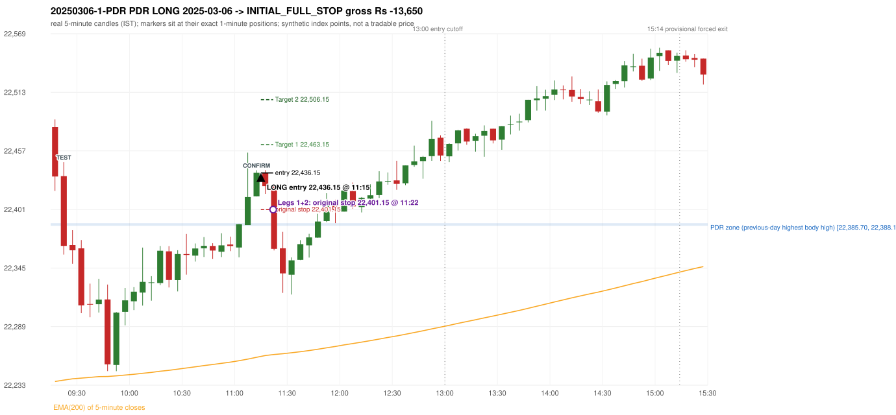
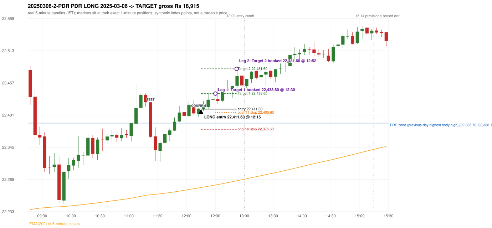

# Trading journal - 2025-03-06 (Thursday)

> Phase 4 historical validation, window B (Window B 2022-09-01..2025-08-31 (5paisa minutes); status DATA_VALIDATED). The FROZEN Phase 3.6 configuration (IRF, ORB, PDR body-based, PDS, RF; shared controller) on a different data source. HISTORICAL RESEARCH ONLY: the strategy was developed using later data. same provider as the Phase 3.6 baseline; the vendor-overlap audit shows the minute bars differ from the secondary vendor Synthetic NIFTY 50 index-point P&L (the index is not tradable). The owner's review status is intentionally blank.

## A. Trading day overview

| item | value |
|---|---|
| Date / weekday | 2025-03-06 / Thursday |
| Session type | USABLE_WITH_FLAGS / VALID |
| Original session open (first 1-minute open) | 22,479.95 |
| Previous session | 2025-03-05 |
| Previous-day high / low (wicks included) | 22,394.70 / 22,071.65 |
| Previous-day highest BODY high (the body-based PDR ceiling; wicks ignored) | 22,388.10 |
| Previous-day official close / last 5-minute close | 22,337.30 / 22,347.50 |
| Raw engine records / confirmed signals / fully valid signals | 9 / 5 / 4 |
| Setups that did not complete (invalidated / incomplete) | 4 |
| Executed trades | 2 20250306-1-PDR;20250306-2-PDR |
| Gross P&L (Rs, synthetic) | 5,265.00 |
| Illustrative net P&L (Rs; Rs 500/trade + 0.5 pt/fill) | 3,485.00 |
| Day-end portfolio status | DAY_FINISHED |
| Manual journal trades (matched / unmatched) | 0 (0 / 0) |
| Extra automated trades | 0 |

## B. Daily strategy signal timeline (confirmed signals, chronological)

| time | strategy | method | dir | entry-rule status | valid for execution | <= 13:00 | portfolio state | accepted / ignored | specific reason | competing (same minute) |
|---|---|---|---|---|---|---|---|---|---|---|
| 11:15 | PDR | PDR | LONG | RESEARCH_VARIANT | True | True | FIRST_TRADE_ACTIVE | ACCEPTED -> 20250306-1-PDR | first eligible signal of the day; trade 1: INITIAL_FULL_STOP |  |
| 12:15 | PDR | PDR | LONG | RESEARCH_VARIANT | True | True | SECOND_TRADE_ACTIVE | ACCEPTED -> 20250306-2-PDR | permitted second trade: newly confirmed PDR/PDS after the original full stop; trade 2: TARGET |  |
| 14:10 | IRF | Method 2B | SHORT | PROPOSAL_DEPENDENT | True | False | DAY_FINISHED | IGNORED | DAY_FINISHED [blocked by PDR#2] |  |
| 14:55 | IRF | Method 2B | SHORT | PROPOSAL_DEPENDENT | True | False | DAY_FINISHED | IGNORED | DAY_FINISHED [blocked by PDR#2] |  |
| 15:30 | IRF | Method 2A | SHORT | PROPOSAL_DEPENDENT | False | False | DAY_FINISHED | IGNORED | DAY_FINISHED [blocked by PDR#2] |  |

Engine setups that did not complete (4); the complete list with failed rule ids is in `rejected_signals.csv`:

| candle | strategy | method | dir | status | precise reason | failed rules |
|---|---|---|---|---|---|---|
| 15:25 | IRF | Method 1/2 | SHORT | INCOMPLETE_AT_EOD | SESSION_ENDED_BEFORE_CONFIRMATION |  |
| 09:15 | ORB | Method 1 | LONG | INVALIDATED | CANDLE_QUALITY(not a strong body / wick too large) | ORB-M1-LONG-003 |
| 09:15 | ORB | Method 2 | LONG | INVALIDATED | CANDLE_QUALITY | ORB-M2-LONG-003 |
| 11:10 | RF | RF | LONG | INVALIDATED | GAP_UP_OUTSIDE_YESTERDAYS_RANGE | RF-004 |

## C. Detailed trade journals

### 20250306-1-PDR: PDR LONG (FIRST trade)

Chart: 

**Rule configuration:** CFG-phase36_body_based-866f954e55 - signal verification status **RESEARCH_VARIANT** (never VERIFIED while a rule rests on a proposal).

#### 1. Setup identification

PDR LONG (body-based engine, A_HIGHEST_BODY_HIGH): the session opened 142.65 points above the previous close and 91.85 points above the previous-day highest BODY high 22,388.10 (zone [22,385.70, 22,388.10] from the 12:35 candle of 2025-03-05; the highest wick 22,394.70 is ignored). The 09:20 candle (22,358.15 - 22,446.45) tested the zone; the 11:10 candle (green, O 22,413.80 H 22,438.70 L 22,413.80 C 22,436.25) passed GOOD_GREEN_BODY and closed 48.15 points above the zone ceiling, confirming the entry at 11:15. The pattern thresholds and the zone's lower boundary are provisional research assumptions, not approved by the strategy author.

#### 2. Candle and indicator calculations

| role | session | candle | O | H | L | C | range | body % | upper wick % | lower wick % | direction | EMA(200) | strong bull / bear | pin bull / bear | small (body<=30%) | used for |
|---|---|---|---|---|---|---|---|---|---|---|---|---|---|---|---|---|
| zone_source_candle | PREVIOUS | 12:35-12:40 | 22,385.70 | 22,389.35 | 22,376.95 | 22,388.10 | 12.40 | 19.35 | 10.08 | 70.56 | BULLISH | 22,194.04 | False / False | True / False | True | candle of the previous session's highest BODY high (A_HIGHEST_BODY_HIGH) |
| prev_day_wick_high_candle | PREVIOUS | 12:30-12:35 | 22,369.45 | 22,394.70 | 22,369.45 | 22,385.55 | 25.25 | 63.76 | 36.24 | 0.00 | BULLISH | 22,192.09 | False / False | False / False | False | candle of the previous session's highest WICK (ignored by the author's rule; shown for comparison) |
| interaction_candle | TODAY | 09:20-09:25 | 22,433.10 | 22,446.45 | 22,358.15 | 22,366.45 | 88.30 | 75.48 | 15.12 | 9.40 | BEARISH | 22,238.17 | False / True | False / False | False | first candle whose range overlaps the zone (the test) |
| confirmation_candle | TODAY | 11:10-11:15 | 22,413.80 | 22,438.70 | 22,413.80 | 22,436.25 | 24.90 | 90.16 | 9.84 | 0.00 | BULLISH | 22,260.00 | True / False | False / False | False | candle that satisfies one of the three patterns and closes above the zone ceiling |

Every condition, with the rule, the calculation, the observed values and the result:

| # | group | rule | result | status / numeric definition | calculation | observed | required | available at | why it matters |
|---|---|---|---|---|---|---|---|---|---|
| 1 | SELECTION | SEL-FIRST-001 | PASS | USER_APPROVED / USER_APPROVED | earliest CONFIRMED signal of the day across IRF/ORB/PDR/PDS/RF that passed the controller's checks | 0 confirmed signal(s) earlier today; 5 confirmed signals in the day in total, this one at 11:15 | no earlier executable signal | 2025-03-06 11:15 | the shared controller trades only the first valid signal; the five strategies are not independent positions |
| 2 | SELECTION | SEL-TIE-001 | PASS | USER_APPROVED / USER_APPROVED | other CONFIRMED signals with exactly the same confirmation timestamp | none | no different-strategy / opposite-direction signal in the same minute (otherwise an unresolved conflict, no trade) | 2025-03-06 11:15 | an unresolved same-minute collision would have produced no trade at all |
| 3 | SELECTION | ENTRY-CUTOFF-001 | PASS | USER_APPROVED / USER_APPROVED | fill timestamp vs 13:00:00 IST | signal confirmed 11:15; fill 11:15 | fill at or before 13:00:00 IST | 2025-03-06 11:15 | no new position may be entered with a fill after 13:00 IST |
| 4 | SELECTION | EXE-FILL-001 | PASS | PROPOSED_FOR_REVIEW / PROPOSED_FOR_REVIEW | fill = open of the 1-minute bar that starts at the signal candle's end | bar 11:15 O 22,436.15 H 22,438.80 L 22,429.75 C 22,432.60; executable=True; entry 22,436.15 | fill bar exists, starts exactly at the signal end, is fillable; entry = its open | 2025-03-06 11:15 | a 5-minute signal is known only when its candle closes; the first price that can be traded is the next minute's open |
| 5 | SELECTION | DAY-MAX-001 | PASS | USER_APPROVED / USER_APPROVED | number of entries today | trade 1 of at most 2 | <= 2 entries per day | 2025-03-06 11:15 | daily trade cap |
| 6 | SETUP | PDR-004 | PASS | SOURCE_VERIFIED / EXPLICIT_WORDING_DETAIL_PROPOSED_FOR_REVIEW | gap = first 1-minute open of today - previous session's OFFICIAL close | today's open 22,479.95 (first 1-minute bar 09:15) - previous close 22,337.30 (DAILY_VENDOR, 2025-03-05) = +142.65 points -> gap UP | gap UP (more than 0 points) | 2025-03-06 09:15 | approved convention: the original first-minute open, never the vendor daily open |
| 7 | SETUP | PDR-B03 | PASS | AUTHOR_APPROVED / AUTHOR_STATEMENT_NUMERIC_DETAILS_ARE_SEPARATE_PROPOSED_ROWS | the session opens strictly above the previous day's resistance zone (author-approved) | today's first 1-minute open 22,479.95 vs zone ceiling 22,388.10: 91.85 points above (open - ceiling = +91.85) | open > zone ceiling (equal or inside the zone rejects the setup) | 2025-03-06 09:15 | the original first-minute open is used, never a vendor daily open |
| 8 | ZONE | PDR-001 | PASS | SOURCE_VERIFIED / EXPLICIT_IN_SOURCE | direction | LONG (PDR is long only) | long-only | 2025-03-06 11:15 | PDR buys a retest of previous-day resistance after a gap up |
| 9 | ZONE | PDR-B01a | PASS | AUTHOR_APPROVED / AUTHOR_STATEMENT_NUMERIC_DETAILS_ARE_SEPARATE_PROPOSED_ROWS | wicks ignored, bodies considered: body_high = max(open, close) of every completed previous-session 5-minute candle; ceiling = the highest body_high; floor = body low of that candle | previous session 2025-03-05: highest body high 22,388.10 on the 12:35 candle (O 22,385.70 C 22,388.10; wick high of that candle 22,389.35, ignored); four highest body highs: 22,388.10 (12:35); 22,387.90 (12:40); 22,385.55 (12:30); 22,372.00 (12:45). Highest WICK of the session 22,394.70 (12:30 candle) is 6.60 points above the ceiling and plays no part. Zone [22,385.70 (body low), 22,388.10 (body high)]; engine recorded [22,385.70, 22,388.10] | ceiling = highest body high of the previous session (author: wick ignored, body considered) | 2025-03-05 15:30 | a wick-only price never becomes resistance; the zone is drawn from candle bodies |
| 10 | ZONE | PDR-B02 | UNRESOLVED | AUTHOR_APPROVED / AUTHOR_STATEMENT_NUMERIC_DETAILS_ARE_SEPARATE_PROPOSED_ROWS | multiple highs connected into one zone (author principle; candidate B) | candidate A (used): [22,385.70, 22,388.10]. Candidate B (multiple-body-high cluster, tolerance 5 points) would be [22,385.70, 22,388.10] (ISOLATED_BODY_HIGH, 1 touch(es), member body highs 22,388.10); ceiling difference 0.00 points | a zone that connects all relevant highs (numbers not given by the author) | 2025-03-05 15:30 | candidate B has the same ceiling by construction, so this signal is unaffected by the choice; the lower boundary and the cluster numbers are research parameters |
| 11 | ZONE | PDR-003 | PASS | SOURCE_VERIFIED / EXPLICIT_IN_SOURCE | the zone is an area, not a single price | zone height 2.40 points [22,385.70, 22,388.10] | a rectangle with positive height (a zero-height zone is left unresolved by the engine) | 2025-03-05 15:30 | price may touch any part of the area |
| 12 | CONFIRMATION | PDR-B03b | PASS | PRESERVED_FROM_PHASE2 / PRESERVED_FROM_PHASE2 | the first candle whose [low, high] overlaps the zone (+/- proximity) is the test; the confirmation must come strictly after it | 09:20-09:25 O 22,433.10 H 22,446.45 L 22,358.15 C 22,366.45; range 88.30, body 66.65 (75.48%), upper wick 13.35 (15.12%), lower wick 8.30 (9.40%), bearish; low 22,358.15 vs zone ceiling 22,388.10, high 22,446.45 vs zone floor 22,385.70; proximity 0; confirmation candle 11:10 is candle no. 24, the test candle no. 2 | range overlaps the zone; confirmation after the test | 2025-03-06 09:25 | the retest of the previous-day resistance |
| 13 | CONFIRMATION | PDR-B04c | PASS | PROPOSED_FOR_REVIEW / NUMERIC_DEFINITION_PROPOSED_FOR_REVIEW | Pattern 1: good green body on the 11:10-11:15 candle (O 22,413.80 H 22,438.70 L 22,413.80 C 22,436.25); the numeric thresholds are PROVISIONAL (RESEARCH_DEFAULT), not author-approved | colour green; body 90.16%; upper wick 9.84% -> PASSES | green, body >= 60% and upper wick <= 20% of the range | 2025-03-06 11:15 | one of the three patterns is enough (author: one good green body OR lower price rejection OR hammer); fixed thresholds are not required by the author, so the numbers are a research convention; a pattern that does not pass is not an error |
| 14 | CONFIRMATION | PDR-B04c | NOT_APPLICABLE | PROPOSED_FOR_REVIEW / NUMERIC_DEFINITION_PROPOSED_FOR_REVIEW | Pattern 2: lower-price rejection candle on the 11:10-11:15 candle (O 22,413.80 H 22,438.70 L 22,413.80 C 22,436.25); the numeric thresholds are PROVISIONAL (RESEARCH_DEFAULT), not author-approved | lower wick 0.00 = 0.00 x body 22.45; close 9.84% below the high; low 22,413.80; low did NOT reach the zone ceiling 22,388.10 -> does not pass | lower wick >= 2 x body, close within the top 30% of the range, low <= zone ceiling (colour not required) | 2025-03-06 11:15 | one of the three patterns is enough (author: one good green body OR lower price rejection OR hammer); fixed thresholds are not required by the author, so the numbers are a research convention; a pattern that does not pass is not an error |
| 15 | CONFIRMATION | PDR-B04c | NOT_APPLICABLE | PROPOSED_FOR_REVIEW / NUMERIC_DEFINITION_PROPOSED_FOR_REVIEW | Pattern 3: hammer candle on the 11:10-11:15 candle (O 22,413.80 H 22,438.70 L 22,413.80 C 22,436.25); the numeric thresholds are PROVISIONAL (RESEARCH_DEFAULT), not author-approved | lower wick 0.00 = 0.00 x body; upper wick 9.84%; body bottom at 0.00% of the range -> does not pass | lower wick >= 2 x body, upper wick <= 10%, body bottom >= 60% of the range (colour not required) | 2025-03-06 11:15 | one of the three patterns is enough (author: one good green body OR lower price rejection OR hammer); fixed thresholds are not required by the author, so the numbers are a research convention; a pattern that does not pass is not an error |
| 16 | CONFIRMATION | PDR-B04 | PASS | AUTHOR_APPROVED / AUTHOR_STATEMENT_NUMERIC_DETAILS_ARE_SEPARATE_PROPOSED_ROWS | at least one of the three patterns passes (OR logic; every passing pattern is recorded) | patterns passed: GOOD_GREEN_BODY (engine recorded: GOOD_GREEN_BODY) | at least one pattern | 2025-03-06 11:15 | the author's entry candle requirement |
| 17 | CONFIRMATION | PDR-B05 | PASS | AUTHOR_APPROVED / AUTHOR_STATEMENT_NUMERIC_DETAILS_ARE_SEPARATE_PROPOSED_ROWS | the confirmation candle must close above the zone | close 22,436.25 vs zone ceiling 22,388.10: +48.15 points (floor 22,385.70; low 22,413.80 stayed above the zone) | close > zone ceiling, strictly (lower wick may penetrate the zone) | 2025-03-06 11:15 | no pattern overrides the close rule |
| 18 | CONFIRMATION | PDR-B06 | PASS | USER_APPROVED / USER_APPROVED | no entry at the open and no look-ahead: the order is placed only after the confirmation candle has completed | test candle 09:20 (no. 2) precedes the confirmation candle 11:10-11:15; signal stamped 11:15; fill 11:15 at the open of that 1-minute bar = 22,436.15 | interaction before the confirmation; fill after the confirmation candle's end | 2025-03-06 11:15 | existing causal fill convention (EXE-FILL-001) |
| 19 | EXECUTION | EXE-STOP-001 | PASS | USER_APPROVED / USER_APPROVED | initial stop = entry - 35 points | entry 22,436.15 -> stop 22,401.15 | stop 35 index points (BASELINE) | 2025-03-06 11:15 | defines the loss if the setup fails before Target 1 |
| 20 | EXECUTION | EXE-T1-001 | PASS | SOURCE_VERIFIED / EXPLICIT_IN_SOURCE | Target 1 = entry +/- 27 points | T1 22,463.15 | 27 points | 2025-03-06 11:15 | Leg 1 (3 lots) is booked at Target 1 |
| 21 | EXECUTION | PDR-008 | PASS | SOURCE_VERIFIED / EXPLICIT_IN_SOURCE | Target 2 = entry +/- 70 points | T2 22,506.15 (the guide says 70; the performance report's winners suggest 60 - CONFLICTING, recorded) | 70 points | 2025-03-06 11:15 | Leg 2 (3 lots) is booked at Target 2 |
| 22 | EXECUTION | POST-T1-STOP-006 | PASS | USER_APPROVED / USER_APPROVED | after T1 the Leg-2 stop = entry - 6 (no trailing) | post-T1 stop 22,430.15 | entry -6 (LONG) / +6 (SHORT) | 2025-03-06 11:15 | protects the remaining three lots once the first three are booked |
| 23 | EXECUTION | SIZE-LOT-001 | PASS | USER_APPROVED / USER_APPROVED | 6 lots x 65 = 390, Leg 1 = 3 lots = 195, Leg 2 = 195 | 6 lots, lot size 65, legs 3+3 | 6 lots in two equal legs | 2025-03-06 11:15 | position size for the synthetic P&L |
| 24 | NOTE | PDR-B04x | UNRESOLVED | PROPOSED_FOR_REVIEW / NUMERIC_DEFINITION_PROPOSED_FOR_REVIEW | provisional parameters this signal rests on | pattern thresholds RESEARCH_DEFAULT: {'green_body_min': 0.6, 'green_upper_wick_max': 0.2, 'reject_wick_to_body_min': 2.0, 'reject_close_fraction_max': 0.3, 'hammer_wick_to_body_min': 2.0, 'hammer_upper_wick_max': 0.1, 'hammer_body_position_min': 0.6}; zone lower boundary = hull of the member bodies; zero-height policy UNRESOLVED_NO_SETUP; wait policy WAIT_FOR_QUALIFYING_CANDLE; cluster parameters (candidate B only) tolerance 5, touches 2, separation 2 | n/a (disclosure) | 2025-03-06 11:15 | the strategy author has NOT approved these numbers or conventions; the signal is a RESEARCH_VARIANT, never VERIFIED |
| 25 | NOTE | PDR-012 | NOT_APPLICABLE | PROPOSED_FOR_REVIEW / PROPOSED_FOR_REVIEW | repeated PDR signals today | 2 confirmed PDR signal(s) in the session | n/a (disclosure) | 2025-03-06 11:15 | this engine reports EVERY qualifying signal (the per-session cap is lifted); the controller trades only the first (and a PDR/PDS second trade after an initial full stop) |
| 26 | NOTE | PDR-B07 | UNRESOLVED | PROPOSED_FOR_REVIEW / NUMERIC_DEFINITION_PROPOSED_FOR_REVIEW | state of the zone between the test and the confirmation (the author and the guide are silent on price crossing below the zone) | test candle 09:20 (no. 2), confirmation candle 11:10 (no. 24): 22 candle(s) later; 20 candle(s) in between CLOSED BELOW the zone floor 22,385.70 (lowest close 22,253.25) before price returned above the ceiling | n/a (disclosure; the wait policy is a research parameter) | 2025-03-06 11:15 | the engine keeps a tested setup armed until a candle qualifies; whether a zone that price has closed through should still count is an owner decision |
| 27 | NOTE | PDR-009 | UNRESOLVED | UNRESOLVED / UNRESOLVED | stop 35 or 40 'depending on the situation' | the guide gives no selection rule; baseline fixed 35 points | unresolved in the source | 2025-03-06 11:15 | PDR stop selection is left to the owner |
| 28 | NOTE | NOTE-UNRESOLVED-DEPENDENCIES | UNRESOLVED | NOT_A_RULE / NOT_A_REGISTRY_RULE | rules the signal depends on that the sources leave unresolved | engine-recorded unresolved rule ids: PDR-B01b, PDR-B02a, PDR-B02b, PDR-B02c, PDR-B02d, PDR-B02e, PDR-B02f, PDR-B02g, PDR-B02h, PDR-B04b, PDR-B04c, PDR-B05a, PDR-B07; verification status RESEARCH_VARIANT | n/a (disclosure) | 2025-03-06 11:15 | the entry is only as verified as the rules it rests on |

#### 3. Entry decision and explanation

PDR LONG (body-based engine, A_HIGHEST_BODY_HIGH): the session opened 142.65 points above the previous close and 91.85 points above the previous-day highest BODY high 22,388.10 (zone [22,385.70, 22,388.10] from the 12:35 candle of 2025-03-05; the highest wick 22,394.70 is ignored). The 09:20 candle (22,358.15 - 22,446.45) tested the zone; the 11:10 candle (green, O 22,413.80 H 22,438.70 L 22,413.80 C 22,436.25) passed GOOD_GREEN_BODY and closed 48.15 points above the zone ceiling, confirming the entry at 11:15. The pattern thresholds and the zone's lower boundary are provisional research assumptions, not approved by the strategy author.

**Why this trade ahead of the other strategies:** This PDR signal was the earliest executable signal of the day: 0 confirmed signal(s) earlier, 0 other in the same minute. 4 later confirmed signal(s) (IRF x3, PDR x1) are logged as ignored or rejected. State of the other four engines at that moment: [IRF: no setup record before this time (a base condition was not met, or nothing triggered)] [ORB: Method 1 invalidated at 09:15: CANDLE_QUALITY(not a strong body / wick too large); Method 2 invalidated at 09:15: CANDLE_QUALITY] [PDS: no setup record before this time (a base condition was not met, or nothing triggered)] [RF: RF invalidated at 11:10: GAP_UP_OUTSIDE_YESTERDAYS_RANGE]

#### 4. Actual entry execution

| item | value |
|---|---|
| Signal candle | 11:10-11:15 |
| Signal confirmed | 2025-03-06 11:15 |
| Fill timestamp | 2025-03-06 11:15 |
| Entry price | 22,436.15 |
| Source partition / 1-minute bar | data/phase4/processed/FIVEPAISA_1M_PHASE4/nifty50/year=2025/month=03/candles.parquet / 2025-03-06 11:15 |
| Source bar O / H / L / C | 22,436.15 / 22,438.80 / 22,429.75 / 22,432.60 |
| Fill assumption | open of the 1-minute bar starting at the signal candle's end (EXE-FILL-001, PROPOSED causal convention) |
| Initial stop / T1 / T2 / post-T1 stop | 22,401.15 / 22,463.15 / 22,506.15 / 22,430.15 |
| Position | 6 lots x 65 = 390 units (Leg 1 195, Leg 2 195) |

#### 5-8. Trade progress, Target 1, post-T1 stop and final exit

Between the 11:15 entry bar and the final exit (8 one-minute bars) the best excursion in favour was 2.65 points at 11:15 and the worst against was 72.80 points at 11:22. At 11:22 price reached the original stop 22,401.15 before Target 1 22,463.15, so all six lots exited together at 22,401.15. This is an INITIAL_FULL_STOP: one more trade is allowed that day, only a newly confirmed PDR/PDS signal.

| leg | qty | exit time | exit price | reason | source 1-minute bar | O / H / L / C | gross points | gross Rs | slippage pts | flags |
|---|---|---|---|---|---|---|---|---|---|---|
| 1 | 195 | 11:22 | 22,401.15 | ORIGINAL_STOP_BEFORE_T1 | 11:22 | 22,419.60 / 22,419.60 / 22,363.35 / 22,381.60 | -35.00 | -6,825.00 | 0.00 |  |
| 2 | 195 | 11:22 | 22,401.15 | ORIGINAL_STOP_BEFORE_T1 | 11:22 | 22,419.60 / 22,419.60 / 22,363.35 / 22,381.60 | -35.00 | -6,825.00 | 0.00 |  |

Exit evidence per leg:

* Leg 1: 1-minute bar 11:22 O 22,419.60 H 22,419.60 L 22,363.35 C 22,381.60: low 22,363.35 reached the original stop 22,401.15 before Target 1 22,463.15 was touched; both legs exit at the stop level 22,401.15
* Leg 2: 1-minute bar 11:22 O 22,419.60 H 22,419.60 L 22,363.35 C 22,381.60: low 22,363.35 reached the original stop 22,401.15 before Target 1 22,463.15 was touched; both legs exit at the stop level 22,401.15

#### 9. Gross and illustrative net P&L

| item | value (Rs) |
|---|---|
| Leg 1 gross | -6,825.00 |
| Leg 2 gross | -6,825.00 |
| Trade gross (= Leg 1 + Leg 2) | -13,650.00 |
| Illustrative fixed cost | -500.00 |
| Illustrative slippage (0.5 pt on every fill, entry + exits, all units) | -390.00 |
| Illustrative net | -14,540.00 |

#### 10. Manual journal comparison

No manual journal exists for this period; no comparison.

### 20250306-2-PDR: PDR LONG (SECOND trade)

Chart: 

**Rule configuration:** CFG-phase36_body_based-866f954e55 - signal verification status **RESEARCH_VARIANT** (never VERIFIED while a rule rests on a proposal).

#### 1. Setup identification

PDR LONG (body-based engine, A_HIGHEST_BODY_HIGH): the session opened 142.65 points above the previous close and 91.85 points above the previous-day highest BODY high 22,388.10 (zone [22,385.70, 22,388.10] from the 12:35 candle of 2025-03-05; the highest wick 22,394.70 is ignored). The 11:20 candle (22,362.10 - 22,423.80) tested the zone; the 12:10 candle (green, O 22,403.55 H 22,413.10 L 22,398.40 C 22,412.45) passed GOOD_GREEN_BODY and closed 24.35 points above the zone ceiling, confirming the entry at 12:15. The pattern thresholds and the zone's lower boundary are provisional research assumptions, not approved by the strategy author.

#### 2. Candle and indicator calculations

| role | session | candle | O | H | L | C | range | body % | upper wick % | lower wick % | direction | EMA(200) | strong bull / bear | pin bull / bear | small (body<=30%) | used for |
|---|---|---|---|---|---|---|---|---|---|---|---|---|---|---|---|---|
| zone_source_candle | PREVIOUS | 12:35-12:40 | 22,385.70 | 22,389.35 | 22,376.95 | 22,388.10 | 12.40 | 19.35 | 10.08 | 70.56 | BULLISH | 22,194.04 | False / False | True / False | True | candle of the previous session's highest BODY high (A_HIGHEST_BODY_HIGH) |
| prev_day_wick_high_candle | PREVIOUS | 12:30-12:35 | 22,369.45 | 22,394.70 | 22,369.45 | 22,385.55 | 25.25 | 63.76 | 36.24 | 0.00 | BULLISH | 22,192.09 | False / False | False / False | False | candle of the previous session's highest WICK (ignored by the author's rule; shown for comparison) |
| interaction_candle | TODAY | 11:20-11:25 | 22,423.45 | 22,423.80 | 22,362.10 | 22,363.60 | 61.70 | 97.00 | 0.57 | 2.43 | BEARISH | 22,262.64 | False / True | False / False | False | first candle whose range overlaps the zone (the test) |
| confirmation_candle | TODAY | 12:10-12:15 | 22,403.55 | 22,413.10 | 22,398.40 | 22,412.45 | 14.70 | 60.54 | 4.42 | 35.03 | BULLISH | 22,274.51 | True / False | False / False | False | candle that satisfies one of the three patterns and closes above the zone ceiling |

Every condition, with the rule, the calculation, the observed values and the result:

| # | group | rule | result | status / numeric definition | calculation | observed | required | available at | why it matters |
|---|---|---|---|---|---|---|---|---|---|
| 1 | SELECTION | DAY-SL-001 | PASS | USER_APPROVED / USER_APPROVED | first trade outcome, strategy of this signal, position-close time vs this signal's timestamp | first trade PDR PDR closed as INITIAL_FULL_STOP at 11:22; position free from 11:23; this PDR signal confirmed 12:15 | first trade INITIAL_FULL_STOP before Target 1, and a NEWLY confirmed PDR/PDS signal after the first position closed | 2025-03-06 12:15 | the only way a second trade is allowed |
| 2 | SELECTION | DAY-NOREUSE-001 | PASS | USER_APPROVED / USER_APPROVED | signals confirmed while the first position was open | 1 signal(s) were ignored during the first trade (never reused): PDR PDR LONG @11:15 | this trade comes from a signal confirmed after the first exit, not from an ignored one | 2025-03-06 12:15 | an ignored signal can never become the second trade |
| 3 | SELECTION | ENTRY-CUTOFF-001 | PASS | USER_APPROVED / USER_APPROVED | fill timestamp vs 13:00:00 IST | signal confirmed 12:15; fill 12:15 | fill at or before 13:00:00 IST | 2025-03-06 12:15 | no new position may be entered with a fill after 13:00 IST |
| 4 | SELECTION | EXE-FILL-001 | PASS | PROPOSED_FOR_REVIEW / PROPOSED_FOR_REVIEW | fill = open of the 1-minute bar that starts at the signal candle's end | bar 12:15 O 22,411.60 H 22,418.25 L 22,408.10 C 22,418.25; executable=True; entry 22,411.60 | fill bar exists, starts exactly at the signal end, is fillable; entry = its open | 2025-03-06 12:15 | a 5-minute signal is known only when its candle closes; the first price that can be traded is the next minute's open |
| 5 | SELECTION | DAY-MAX-001 | PASS | USER_APPROVED / USER_APPROVED | number of entries today | trade 2 of at most 2 | <= 2 entries per day | 2025-03-06 12:15 | daily trade cap |
| 6 | SETUP | PDR-004 | PASS | SOURCE_VERIFIED / EXPLICIT_WORDING_DETAIL_PROPOSED_FOR_REVIEW | gap = first 1-minute open of today - previous session's OFFICIAL close | today's open 22,479.95 (first 1-minute bar 09:15) - previous close 22,337.30 (DAILY_VENDOR, 2025-03-05) = +142.65 points -> gap UP | gap UP (more than 0 points) | 2025-03-06 09:15 | approved convention: the original first-minute open, never the vendor daily open |
| 7 | SETUP | PDR-B03 | PASS | AUTHOR_APPROVED / AUTHOR_STATEMENT_NUMERIC_DETAILS_ARE_SEPARATE_PROPOSED_ROWS | the session opens strictly above the previous day's resistance zone (author-approved) | today's first 1-minute open 22,479.95 vs zone ceiling 22,388.10: 91.85 points above (open - ceiling = +91.85) | open > zone ceiling (equal or inside the zone rejects the setup) | 2025-03-06 09:15 | the original first-minute open is used, never a vendor daily open |
| 8 | ZONE | PDR-001 | PASS | SOURCE_VERIFIED / EXPLICIT_IN_SOURCE | direction | LONG (PDR is long only) | long-only | 2025-03-06 12:15 | PDR buys a retest of previous-day resistance after a gap up |
| 9 | ZONE | PDR-B01a | PASS | AUTHOR_APPROVED / AUTHOR_STATEMENT_NUMERIC_DETAILS_ARE_SEPARATE_PROPOSED_ROWS | wicks ignored, bodies considered: body_high = max(open, close) of every completed previous-session 5-minute candle; ceiling = the highest body_high; floor = body low of that candle | previous session 2025-03-05: highest body high 22,388.10 on the 12:35 candle (O 22,385.70 C 22,388.10; wick high of that candle 22,389.35, ignored); four highest body highs: 22,388.10 (12:35); 22,387.90 (12:40); 22,385.55 (12:30); 22,372.00 (12:45). Highest WICK of the session 22,394.70 (12:30 candle) is 6.60 points above the ceiling and plays no part. Zone [22,385.70 (body low), 22,388.10 (body high)]; engine recorded [22,385.70, 22,388.10] | ceiling = highest body high of the previous session (author: wick ignored, body considered) | 2025-03-05 15:30 | a wick-only price never becomes resistance; the zone is drawn from candle bodies |
| 10 | ZONE | PDR-B02 | UNRESOLVED | AUTHOR_APPROVED / AUTHOR_STATEMENT_NUMERIC_DETAILS_ARE_SEPARATE_PROPOSED_ROWS | multiple highs connected into one zone (author principle; candidate B) | candidate A (used): [22,385.70, 22,388.10]. Candidate B (multiple-body-high cluster, tolerance 5 points) would be [22,385.70, 22,388.10] (ISOLATED_BODY_HIGH, 1 touch(es), member body highs 22,388.10); ceiling difference 0.00 points | a zone that connects all relevant highs (numbers not given by the author) | 2025-03-05 15:30 | candidate B has the same ceiling by construction, so this signal is unaffected by the choice; the lower boundary and the cluster numbers are research parameters |
| 11 | ZONE | PDR-003 | PASS | SOURCE_VERIFIED / EXPLICIT_IN_SOURCE | the zone is an area, not a single price | zone height 2.40 points [22,385.70, 22,388.10] | a rectangle with positive height (a zero-height zone is left unresolved by the engine) | 2025-03-05 15:30 | price may touch any part of the area |
| 12 | CONFIRMATION | PDR-B03b | PASS | PRESERVED_FROM_PHASE2 / PRESERVED_FROM_PHASE2 | the first candle whose [low, high] overlaps the zone (+/- proximity) is the test; the confirmation must come strictly after it | 11:20-11:25 O 22,423.45 H 22,423.80 L 22,362.10 C 22,363.60; range 61.70, body 59.85 (97.00%), upper wick 0.35 (0.57%), lower wick 1.50 (2.43%), bearish; low 22,362.10 vs zone ceiling 22,388.10, high 22,423.80 vs zone floor 22,385.70; proximity 0; confirmation candle 12:10 is candle no. 36, the test candle no. 26 | range overlaps the zone; confirmation after the test | 2025-03-06 11:25 | the retest of the previous-day resistance (re-armed after the earlier signal: scanning restarted after the 11:10 candle) |
| 13 | CONFIRMATION | PDR-B04c | PASS | PROPOSED_FOR_REVIEW / NUMERIC_DEFINITION_PROPOSED_FOR_REVIEW | Pattern 1: good green body on the 12:10-12:15 candle (O 22,403.55 H 22,413.10 L 22,398.40 C 22,412.45); the numeric thresholds are PROVISIONAL (RESEARCH_DEFAULT), not author-approved | colour green; body 60.54%; upper wick 4.42% -> PASSES | green, body >= 60% and upper wick <= 20% of the range | 2025-03-06 12:15 | one of the three patterns is enough (author: one good green body OR lower price rejection OR hammer); fixed thresholds are not required by the author, so the numbers are a research convention; a pattern that does not pass is not an error |
| 14 | CONFIRMATION | PDR-B04c | NOT_APPLICABLE | PROPOSED_FOR_REVIEW / NUMERIC_DEFINITION_PROPOSED_FOR_REVIEW | Pattern 2: lower-price rejection candle on the 12:10-12:15 candle (O 22,403.55 H 22,413.10 L 22,398.40 C 22,412.45); the numeric thresholds are PROVISIONAL (RESEARCH_DEFAULT), not author-approved | lower wick 5.15 = 0.58 x body 8.90; close 4.42% below the high; low 22,398.40; low did NOT reach the zone ceiling 22,388.10 -> does not pass | lower wick >= 2 x body, close within the top 30% of the range, low <= zone ceiling (colour not required) | 2025-03-06 12:15 | one of the three patterns is enough (author: one good green body OR lower price rejection OR hammer); fixed thresholds are not required by the author, so the numbers are a research convention; a pattern that does not pass is not an error |
| 15 | CONFIRMATION | PDR-B04c | NOT_APPLICABLE | PROPOSED_FOR_REVIEW / NUMERIC_DEFINITION_PROPOSED_FOR_REVIEW | Pattern 3: hammer candle on the 12:10-12:15 candle (O 22,403.55 H 22,413.10 L 22,398.40 C 22,412.45); the numeric thresholds are PROVISIONAL (RESEARCH_DEFAULT), not author-approved | lower wick 5.15 = 0.58 x body; upper wick 4.42%; body bottom at 35.03% of the range -> does not pass | lower wick >= 2 x body, upper wick <= 10%, body bottom >= 60% of the range (colour not required) | 2025-03-06 12:15 | one of the three patterns is enough (author: one good green body OR lower price rejection OR hammer); fixed thresholds are not required by the author, so the numbers are a research convention; a pattern that does not pass is not an error |
| 16 | CONFIRMATION | PDR-B04 | PASS | AUTHOR_APPROVED / AUTHOR_STATEMENT_NUMERIC_DETAILS_ARE_SEPARATE_PROPOSED_ROWS | at least one of the three patterns passes (OR logic; every passing pattern is recorded) | patterns passed: GOOD_GREEN_BODY (engine recorded: GOOD_GREEN_BODY) | at least one pattern | 2025-03-06 12:15 | the author's entry candle requirement |
| 17 | CONFIRMATION | PDR-B05 | PASS | AUTHOR_APPROVED / AUTHOR_STATEMENT_NUMERIC_DETAILS_ARE_SEPARATE_PROPOSED_ROWS | the confirmation candle must close above the zone | close 22,412.45 vs zone ceiling 22,388.10: +24.35 points (floor 22,385.70; low 22,398.40 stayed above the zone) | close > zone ceiling, strictly (lower wick may penetrate the zone) | 2025-03-06 12:15 | no pattern overrides the close rule |
| 18 | CONFIRMATION | PDR-B06 | PASS | USER_APPROVED / USER_APPROVED | no entry at the open and no look-ahead: the order is placed only after the confirmation candle has completed | test candle 11:20 (no. 26) precedes the confirmation candle 12:10-12:15; signal stamped 12:15; fill 12:15 at the open of that 1-minute bar = 22,411.60 | interaction before the confirmation; fill after the confirmation candle's end | 2025-03-06 12:15 | existing causal fill convention (EXE-FILL-001) |
| 19 | EXECUTION | EXE-STOP-001 | PASS | USER_APPROVED / USER_APPROVED | initial stop = entry - 35 points | entry 22,411.60 -> stop 22,376.60 | stop 35 index points (BASELINE) | 2025-03-06 12:15 | defines the loss if the setup fails before Target 1 |
| 20 | EXECUTION | EXE-T1-001 | PASS | SOURCE_VERIFIED / EXPLICIT_IN_SOURCE | Target 1 = entry +/- 27 points | T1 22,438.60 | 27 points | 2025-03-06 12:15 | Leg 1 (3 lots) is booked at Target 1 |
| 21 | EXECUTION | PDR-008 | PASS | SOURCE_VERIFIED / EXPLICIT_IN_SOURCE | Target 2 = entry +/- 70 points | T2 22,481.60 (the guide says 70; the performance report's winners suggest 60 - CONFLICTING, recorded) | 70 points | 2025-03-06 12:15 | Leg 2 (3 lots) is booked at Target 2 |
| 22 | EXECUTION | POST-T1-STOP-006 | PASS | USER_APPROVED / USER_APPROVED | after T1 the Leg-2 stop = entry - 6 (no trailing) | post-T1 stop 22,405.60 | entry -6 (LONG) / +6 (SHORT) | 2025-03-06 12:15 | protects the remaining three lots once the first three are booked |
| 23 | EXECUTION | SIZE-LOT-001 | PASS | USER_APPROVED / USER_APPROVED | 6 lots x 65 = 390, Leg 1 = 3 lots = 195, Leg 2 = 195 | 6 lots, lot size 65, legs 3+3 | 6 lots in two equal legs | 2025-03-06 12:15 | position size for the synthetic P&L |
| 24 | NOTE | PDR-B04x | UNRESOLVED | PROPOSED_FOR_REVIEW / NUMERIC_DEFINITION_PROPOSED_FOR_REVIEW | provisional parameters this signal rests on | pattern thresholds RESEARCH_DEFAULT: {'green_body_min': 0.6, 'green_upper_wick_max': 0.2, 'reject_wick_to_body_min': 2.0, 'reject_close_fraction_max': 0.3, 'hammer_wick_to_body_min': 2.0, 'hammer_upper_wick_max': 0.1, 'hammer_body_position_min': 0.6}; zone lower boundary = hull of the member bodies; zero-height policy UNRESOLVED_NO_SETUP; wait policy WAIT_FOR_QUALIFYING_CANDLE; cluster parameters (candidate B only) tolerance 5, touches 2, separation 2 | n/a (disclosure) | 2025-03-06 12:15 | the strategy author has NOT approved these numbers or conventions; the signal is a RESEARCH_VARIANT, never VERIFIED |
| 25 | NOTE | PDR-012 | NOT_APPLICABLE | PROPOSED_FOR_REVIEW / PROPOSED_FOR_REVIEW | repeated PDR signals today | 2 confirmed PDR signal(s) in the session | n/a (disclosure) | 2025-03-06 12:15 | this engine reports EVERY qualifying signal (the per-session cap is lifted); the controller trades only the first (and a PDR/PDS second trade after an initial full stop) |
| 26 | NOTE | PDR-B07 | UNRESOLVED | PROPOSED_FOR_REVIEW / NUMERIC_DEFINITION_PROPOSED_FOR_REVIEW | state of the zone between the test and the confirmation (the author and the guide are silent on price crossing below the zone) | test candle 11:20 (no. 26), confirmation candle 12:10 (no. 36): 10 candle(s) later; 5 candle(s) in between CLOSED BELOW the zone floor 22,385.70 (lowest close 22,340.20) before price returned above the ceiling | n/a (disclosure; the wait policy is a research parameter) | 2025-03-06 12:15 | the engine keeps a tested setup armed until a candle qualifies; whether a zone that price has closed through should still count is an owner decision |
| 27 | NOTE | PDR-009 | UNRESOLVED | UNRESOLVED / UNRESOLVED | stop 35 or 40 'depending on the situation' | the guide gives no selection rule; baseline fixed 35 points | unresolved in the source | 2025-03-06 12:15 | PDR stop selection is left to the owner |
| 28 | NOTE | NOTE-UNRESOLVED-DEPENDENCIES | UNRESOLVED | NOT_A_RULE / NOT_A_REGISTRY_RULE | rules the signal depends on that the sources leave unresolved | engine-recorded unresolved rule ids: PDR-B01b, PDR-B02a, PDR-B02b, PDR-B02c, PDR-B02d, PDR-B02e, PDR-B02f, PDR-B02g, PDR-B02h, PDR-B04b, PDR-B04c, PDR-B05a, PDR-B07; verification status RESEARCH_VARIANT | n/a (disclosure) | 2025-03-06 12:15 | the entry is only as verified as the rules it rests on |

#### 3. Entry decision and explanation

PDR LONG (body-based engine, A_HIGHEST_BODY_HIGH): the session opened 142.65 points above the previous close and 91.85 points above the previous-day highest BODY high 22,388.10 (zone [22,385.70, 22,388.10] from the 12:35 candle of 2025-03-05; the highest wick 22,394.70 is ignored). The 11:20 candle (22,362.10 - 22,423.80) tested the zone; the 12:10 candle (green, O 22,403.55 H 22,413.10 L 22,398.40 C 22,412.45) passed GOOD_GREEN_BODY and closed 24.35 points above the zone ceiling, confirming the entry at 12:15. The pattern thresholds and the zone's lower boundary are provisional research assumptions, not approved by the strategy author.

**Why this trade ahead of the other strategies:** The first trade (PDR PDR) was stopped out before Target 1 at 11:22; this newly confirmed PDR signal at 12:15 is the first PDR/PDS signal after that exit, so it is the day's permitted second trade. State of the other engines at that moment: [IRF: no setup record before this time (a base condition was not met, or nothing triggered)] [ORB: Method 1 invalidated at 09:15: CANDLE_QUALITY(not a strong body / wick too large); Method 2 invalidated at 09:15: CANDLE_QUALITY] [PDS: no setup record before this time (a base condition was not met, or nothing triggered)] [RF: RF invalidated at 11:10: GAP_UP_OUTSIDE_YESTERDAYS_RANGE]

#### 4. Actual entry execution

| item | value |
|---|---|
| Signal candle | 12:10-12:15 |
| Signal confirmed | 2025-03-06 12:15 |
| Fill timestamp | 2025-03-06 12:15 |
| Entry price | 22,411.60 |
| Source partition / 1-minute bar | data/phase4/processed/FIVEPAISA_1M_PHASE4/nifty50/year=2025/month=03/candles.parquet / 2025-03-06 12:15 |
| Source bar O / H / L / C | 22,411.60 / 22,418.25 / 22,408.10 / 22,418.25 |
| Fill assumption | open of the 1-minute bar starting at the signal candle's end (EXE-FILL-001, PROPOSED causal convention) |
| Initial stop / T1 / T2 / post-T1 stop | 22,376.60 / 22,438.60 / 22,481.60 / 22,405.60 |
| Position | 6 lots x 65 = 390 units (Leg 1 195, Leg 2 195) |

#### 5-8. Trade progress, Target 1, post-T1 stop and final exit

Between the 12:15 entry bar and the final exit (38 one-minute bars) the best excursion in favour was 74.10 points at 12:52 and the worst against was 3.50 points at 12:15. At 12:30 price reached Target 1 22,438.60 and three lots exited. At 12:30 the remaining three lots' protective stop was set to 22,405.60 (entry - 6; no trailing, no further change); the engine applies it from the Target-1 bar onward and tests it within that same bar. At 12:52 price reached Target 2 22,481.60 and the remaining three lots exited. No further trade that day (DAY-T2-001).

| leg | qty | exit time | exit price | reason | source 1-minute bar | O / H / L / C | gross points | gross Rs | slippage pts | flags |
|---|---|---|---|---|---|---|---|---|---|---|
| 1 | 195 | 12:30 | 22,438.60 | TARGET_1 | 12:30 | 22,429.00 / 22,447.80 / 22,427.90 / 22,442.10 | 27.00 | 5,265.00 | 0.00 |  |
| 2 | 195 | 12:52 | 22,481.60 | TARGET_2 | 12:52 | 22,477.65 / 22,485.70 / 22,474.85 / 22,484.95 | 70.00 | 13,650.00 | 0.00 |  |

Exit evidence per leg:

* Leg 1: 1-minute bar 12:30 O 22,429.00 H 22,447.80 L 22,427.90 C 22,442.10: high 22,447.80 reached Target 1 22,438.60; Leg 1 booked at the target level
* Leg 2: 1-minute bar 12:52 O 22,477.65 H 22,485.70 L 22,474.85 C 22,484.95: high 22,485.70 reached Target 2 22,481.60; Leg 2 booked at the target level

#### 9. Gross and illustrative net P&L

| item | value (Rs) |
|---|---|
| Leg 1 gross | 5,265.00 |
| Leg 2 gross | 13,650.00 |
| Trade gross (= Leg 1 + Leg 2) | 18,915.00 |
| Illustrative fixed cost | -500.00 |
| Illustrative slippage (0.5 pt on every fill, entry + exits, all units) | -390.00 |
| Illustrative net | 18,025.00 |

#### 10. Manual journal comparison

No manual journal exists for this period; no comparison.

## D. Manual journal comparison

No manual journal exists for this period (the manual journal covers 2025-09-01 .. 2026-08-31 only); no comparison is made and no automated trade is labelled 'extra'.

## E. Daily conclusion

* **Traded:** 20250306-1-PDR - PDR PDR LONG at 11:15 (entry 22,436.15), outcome INITIAL_FULL_STOP, gross Rs -13,650.00, illustrative net Rs -14,540.00. **Why:** This PDR signal was the earliest executable signal of the day: 0 confirmed signal(s) earlier, 0 other in the same minute. 4 later confirmed signal(s) (IRF x3, PDR x1) are logged as ignored or rejected. State of the other four engines at that moment: [IRF: no setup record before this time (a base condition was not met, or nothing triggered)] [ORB: Method 1 invalidated at 09:15: CANDLE_QUALITY(not a strong body / wick too large); Method 2 invalidated at 09:15: CANDLE_QUALITY] [PDS: no setup record before this time (a base condition was not met, or nothing triggered)] [RF: RF invalidated at 11:10: GAP_UP_OUTSIDE_YESTERDAYS_RANGE] **How it ended:** At 11:22 price reached the original stop 22,401.15 before Target 1 22,463.15, so all six lots exited together at 22,401.15. This is an INITIAL_FULL_STOP: one more trade is allowed that day, only a newly confirmed PDR/PDS signal.
* **Traded:** 20250306-2-PDR - PDR PDR LONG at 12:15 (entry 22,411.60), outcome TARGET, gross Rs 18,915.00, illustrative net Rs 18,025.00. **Why:** The first trade (PDR PDR) was stopped out before Target 1 at 11:22; this newly confirmed PDR signal at 12:15 is the first PDR/PDS signal after that exit, so it is the day's permitted second trade. State of the other engines at that moment: [IRF: no setup record before this time (a base condition was not met, or nothing triggered)] [ORB: Method 1 invalidated at 09:15: CANDLE_QUALITY(not a strong body / wick too large); Method 2 invalidated at 09:15: CANDLE_QUALITY] [PDS: no setup record before this time (a base condition was not met, or nothing triggered)] [RF: RF invalidated at 11:10: GAP_UP_OUTSIDE_YESTERDAYS_RANGE] **How it ended:** At 12:30 price reached Target 1 22,438.60 and three lots exited. At 12:30 the remaining three lots' protective stop was set to 22,405.60 (entry - 6; no trailing, no further change); the engine applies it from the Target-1 bar onward and tests it within that same bar. At 12:52 price reached Target 2 22,481.60 and the remaining three lots exited. No further trade that day (DAY-T2-001).
* **Ignored / rejected signals:** IRF IGNORED DAY_FINISHED x3
* **Open strategy-definition issues that affected this day:** NOTE-UNRESOLVED-DEPENDENCIES, PDR-009 (Stop-loss 35 or 40 'depending on the situation'; choose before entering, do not move after entry), PDR-B02, PDR-B04x, PDR-B07
* **Automated triage (not an approval; the owner's review status stays blank):** TRADED_NO_FLAGS
