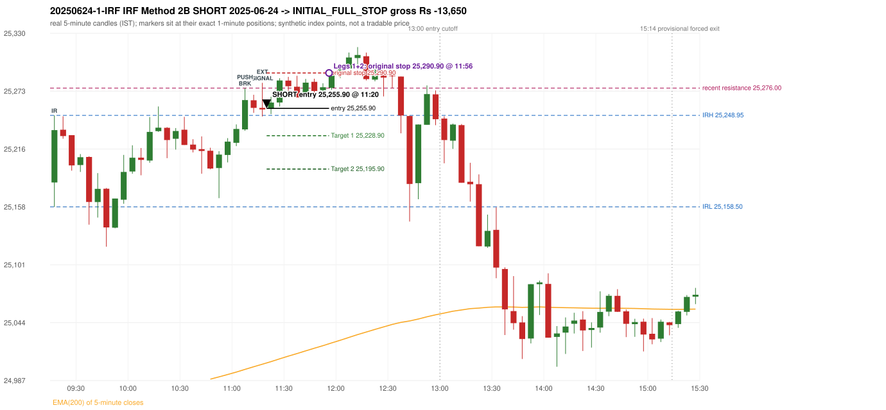

# Trading journal - 2025-06-24 (Tuesday)

> Phase 4 historical validation, window B (Window B 2022-09-01..2025-08-31 (5paisa minutes); status DATA_VALIDATED). The FROZEN Phase 3.6 configuration (IRF, ORB, PDR body-based, PDS, RF; shared controller) on a different data source. HISTORICAL RESEARCH ONLY: the strategy was developed using later data. same provider as the Phase 3.6 baseline; the vendor-overlap audit shows the minute bars differ from the secondary vendor Synthetic NIFTY 50 index-point P&L (the index is not tradable). The owner's review status is intentionally blank.

## A. Trading day overview

| item | value |
|---|---|
| Date / weekday | 2025-06-24 / Tuesday |
| Session type | USABLE / VALID |
| Original session open (first 1-minute open) | 25,182.60 |
| Previous session | 2025-06-23 |
| Previous-day high / low (wicks included) | 25,056.55 / 24,824.90 |
| Previous-day highest BODY high (the body-based PDR ceiling; wicks ignored) | 25,048.75 |
| Previous-day official close / last 5-minute close | 24,971.90 / 24,958.20 |
| Raw engine records / confirmed signals / fully valid signals | 12 / 8 / 8 |
| Setups that did not complete (invalidated / incomplete) | 4 |
| Executed trades | 1 20250624-1-IRF |
| Gross P&L (Rs, synthetic) | -13,650.00 |
| Illustrative net P&L (Rs; Rs 500/trade + 0.5 pt/fill) | -14,540.00 |
| Day-end portfolio status | SECOND_TRADE_ELIGIBLE |
| Manual journal trades (matched / unmatched) | 0 (0 / 0) |
| Extra automated trades | 0 |

## B. Daily strategy signal timeline (confirmed signals, chronological)

| time | strategy | method | dir | entry-rule status | valid for execution | <= 13:00 | portfolio state | accepted / ignored | specific reason | competing (same minute) |
|---|---|---|---|---|---|---|---|---|---|---|
| 11:20 | IRF | Method 2B | SHORT | PROPOSAL_DEPENDENT | True | True | FIRST_TRADE_ACTIVE | ACCEPTED -> 20250624-1-IRF | first eligible signal of the day; trade 1: INITIAL_FULL_STOP |  |
| 11:35 | IRF | Method 2B | SHORT | PROPOSAL_DEPENDENT | True | True | FIRST_TRADE_ACTIVE | IGNORED | POSITION_ACTIVE (signal kept for diagnostics only; never reused) [blocked by IRF#1] |  |
| 12:20 | IRF | Method 2B | SHORT | PROPOSAL_DEPENDENT | True | True | SECOND_TRADE_ELIGIBLE | REJECTED | SECOND_TRADE_RESTRICTED_TO_PDR_PDS [blocked by IRF#1] |  |
| 12:40 | IRF | Method 1 | SHORT | PROPOSAL_DEPENDENT | True | True | SECOND_TRADE_ELIGIBLE | REJECTED | SECOND_TRADE_RESTRICTED_TO_PDR_PDS [blocked by IRF#1] |  |
| 13:00 | IRF | Method 1 | SHORT | PROPOSAL_DEPENDENT | True | True | SECOND_TRADE_ELIGIBLE | REJECTED | SECOND_TRADE_RESTRICTED_TO_PDR_PDS [blocked by IRF#1] |  |
| 13:55 | PDR | PDR | LONG | RESEARCH_VARIANT | True | False | SECOND_TRADE_ELIGIBLE | REJECTED | ENTRY_CUTOFF_EXCEEDED(fill 13:55 IST > 13:00) [blocked by CUTOFF_13_00] |  |
| 14:40 | PDR | PDR | LONG | RESEARCH_VARIANT | True | False | SECOND_TRADE_ELIGIBLE | REJECTED | ENTRY_CUTOFF_EXCEEDED(fill 14:40 IST > 13:00) [blocked by CUTOFF_13_00] |  |
| 15:20 | PDR | PDR | LONG | RESEARCH_VARIANT | True | False | SECOND_TRADE_ELIGIBLE | REJECTED | ENTRY_CUTOFF_EXCEEDED(fill 15:20 IST > 13:00) [blocked by CUTOFF_13_00] |  |

Engine setups that did not complete (4); the complete list with failed rule ids is in `rejected_signals.csv`:

| candle | strategy | method | dir | status | precise reason | failed rules |
|---|---|---|---|---|---|---|
| 12:15 | IRF | Method 1/2 | SHORT | INCOMPLETE_AT_EOD | SESSION_ENDED_BEFORE_CONFIRMATION |  |
| 09:15 | ORB | Method 1 | LONG | INVALIDATED | CANDLE_QUALITY(not a strong body / wick too large) | ORB-M1-LONG-003 |
| 09:15 | ORB | Method 2 | LONG | INVALIDATED | TRENDLINE_NOT_SUPPORTIVE | ORB-M2-LONG-001 |
| 09:50 | RF | RF | LONG | INVALIDATED | GAP_UP_OUTSIDE_YESTERDAYS_RANGE | RF-004 |

## C. Detailed trade journals

### 20250624-1-IRF: IRF Method 2B SHORT (FIRST trade)

Chart: 

**Rule configuration:** CFG-phase36_body_based-866f954e55 - signal verification status **PROPOSAL_DEPENDENT** (never VERIFIED while a rule rests on a proposal).

#### 1. Setup identification

IRF Method 2B SHORT: the 11:05-11:10 candle closed at 25,264.15, above IRH 25,248.95, and the next candle did not close back inside the range, so the setup is Method 2 and price stayed above it until the trigger. Extension candle 11:15-11:20, red candle n/a. The trigger came 2 candles after the breakout candle: a red candle closed back below the first-push resistance after price had traded above it (11:15-11:20); confirmed at 11:20 with close 25,254.85. Entry reference close 25,254.85 is 5.90 points above IRH 25,248.95.

#### 2. Candle and indicator calculations

| role | session | candle | O | H | L | C | range | body % | upper wick % | lower wick % | direction | EMA(200) | strong bull / bear | pin bull / bear | small (body<=30%) | used for |
|---|---|---|---|---|---|---|---|---|---|---|---|---|---|---|---|---|
| initial_range_candle | TODAY | 09:15-09:20 | 25,182.60 | 25,248.95 | 25,158.50 | 25,234.40 | 90.45 | 57.27 | 16.09 | 26.64 | BULLISH | 24,945.58 | False / False | False / False | False | initial range = high/low of the 09:15 candle |
| signal_candle | TODAY | 11:15-11:20 | 25,256.40 | 25,281.15 | 25,247.90 | 25,254.85 | 33.25 | 4.66 | 74.44 | 20.90 | BEARISH | 25,002.83 | False / False | False / True | True | candle whose close completed the trigger |
| breakout_candle | TODAY | 11:05-11:10 | 25,235.15 | 25,276.00 | 25,233.70 | 25,264.15 | 42.30 | 68.56 | 28.01 | 3.43 | BULLISH | 24,997.72 | False / False | False / False | False | breakout candle: a completed candle closing above IRH |
| extension_candle | TODAY | 11:15-11:20 | 25,256.40 | 25,281.15 | 25,247.90 | 25,254.85 | 33.25 | 4.66 | 74.44 | 20.90 | BEARISH | 25,002.83 | False / False | False / True | True | extension: first later candle trading above the breakout candle's high |
| first_push_top | TODAY | 11:05-11:10 | 25,235.15 | 25,276.00 | 25,233.70 | 25,264.15 | 42.30 | 68.56 | 28.01 | 3.43 | BULLISH | 24,997.72 | False / False | False / False | False | recent resistance = top of the first push after the breakout |

Every condition, with the rule, the calculation, the observed values and the result:

| # | group | rule | result | status / numeric definition | calculation | observed | required | available at | why it matters |
|---|---|---|---|---|---|---|---|---|---|
| 1 | SELECTION | SEL-FIRST-001 | PASS | USER_APPROVED / USER_APPROVED | earliest CONFIRMED signal of the day across IRF/ORB/PDR/PDS/RF that passed the controller's checks | 0 confirmed signal(s) earlier today; 8 confirmed signals in the day in total, this one at 11:20 | no earlier executable signal | 2025-06-24 11:20 | the shared controller trades only the first valid signal; the five strategies are not independent positions |
| 2 | SELECTION | SEL-TIE-001 | PASS | USER_APPROVED / USER_APPROVED | other CONFIRMED signals with exactly the same confirmation timestamp | none | no different-strategy / opposite-direction signal in the same minute (otherwise an unresolved conflict, no trade) | 2025-06-24 11:20 | an unresolved same-minute collision would have produced no trade at all |
| 3 | SELECTION | ENTRY-CUTOFF-001 | PASS | USER_APPROVED / USER_APPROVED | fill timestamp vs 13:00:00 IST | signal confirmed 11:20; fill 11:20 | fill at or before 13:00:00 IST | 2025-06-24 11:20 | no new position may be entered with a fill after 13:00 IST |
| 4 | SELECTION | EXE-FILL-001 | PASS | PROPOSED_FOR_REVIEW / PROPOSED_FOR_REVIEW | fill = open of the 1-minute bar that starts at the signal candle's end | bar 11:20 O 25,255.90 H 25,256.40 L 25,252.05 C 25,254.35; executable=True; entry 25,255.90 | fill bar exists, starts exactly at the signal end, is fillable; entry = its open | 2025-06-24 11:20 | a 5-minute signal is known only when its candle closes; the first price that can be traded is the next minute's open |
| 5 | SELECTION | DAY-MAX-001 | PASS | USER_APPROVED / USER_APPROVED | number of entries today | trade 1 of at most 2 | <= 2 entries per day | 2025-06-24 11:20 | daily trade cap |
| 6 | SETUP | IRF-GLOBAL-001 | PASS | SOURCE_VERIFIED / EXPLICIT_IN_SOURCE | initial range = high and low (wicks included) of the first completed 5-minute candle | 09:15-09:20 IRH 25,248.95, IRL 25,158.50 (range 90.45; engine recorded IRH 25,248.95, IRL 25,158.50) | high/low of the 09:15-09:20 candle | 2025-06-24 09:20 | all three IRF methods measure price against this range |
| 7 | SETUP | IRF-GLOBAL-003 | PASS | SOURCE_VERIFIED / EXPLICIT_IN_SOURCE | closes confirm, wicks do not: every trigger is evaluated on a completed 5-minute candle | trigger candle 11:15-11:20 was complete when the signal was stamped 11:20; decision uses its close 25,254.85 | completed candle close, not an intra-candle wick | 2025-06-24 11:20 | an intra-candle wick can reverse before the candle closes |
| 8 | SETUP | IRF-GLOBAL-002 | PASS | SOURCE_VERIFIED / EXPLICIT_IN_SOURCE | direction | SHORT (IRF trades short only) | short only | 2025-06-24 11:20 | IRF fades failed upside breakouts |
| 9 | SETUP | IRF-M2-001 | PASS | SOURCE_VERIFIED / EXPLICIT_IN_SOURCE | breakout candle close vs IRH | 11:05-11:10 O 25,235.15 H 25,276.00 L 25,233.70 C 25,264.15; range 42.30, body 29.00 (68.56%), upper wick 11.85 (28.01%), lower wick 1.45 (3.43%), bullish; close 25,264.15 is 15.20 points above IRH 25,248.95 | close > IRH (a wick above IRH is not a breakout) | 2025-06-24 11:10 | starts every IRF setup |
| 10 | SETUP | IRF-M2-004 | PASS | SOURCE_VERIFIED / EXPLICIT_IN_SOURCE | the candle after the breakout must NOT close back inside the range (else the setup is Method 1) | 11:10 close 25,256.40 vs [25,158.50, 25,248.95) | not (IRL <= close < IRH) | 2025-06-24 11:15 | separates Method 2 (price holds above) from Method 1 (immediate failure) |
| 11 | SETUP | IRF-M2-002 | PASS | SOURCE_VERIFIED / QUALITATIVE_SOURCE_NUMERIC_DEFINITION_PROPOSED_FOR_REVIEW | extension = a later candle whose high exceeds the breakout candle's high (research definition E1) | 11:15 high 25,281.15 vs breakout candle high 25,276.00 (+5.15) | high > breakout candle high | 2025-06-24 11:20 | the guide says price 'extends further upward'; the numeric test is a proposal |
| 12 | CONFIRMATION | IRF-M2-005 | PASS | SOURCE_VERIFIED / EXPLICIT_IN_SOURCE | a red candle alone is not confirmation: a level break is required | red trigger candle 11:15 also closes below the resistance (see IRF-M2B-003) | a red candle plus a closing break of the level | 2025-06-24 11:20 | a red candle with no level break does not qualify |
| 13 | CONFIRMATION | IRF-M2B-001 | PASS | SOURCE_VERIFIED / QUALITATIVE_SOURCE_NUMERIC_DEFINITION_PROPOSED_FOR_REVIEW | recent resistance = first 3-candle fractal high (k=1) at/after the breakout candle (FIRST_PUSH_TOP) | 11:05 high 25,276.00; engine recorded 25,276.00 (the first push top IS the breakout candle itself) | first push top | 2025-06-24 11:15 | the level whose retake-and-fail completes Method 2B (definition is a proposal) |
| 14 | CONFIRMATION | IRF-M2B-002 | PASS | SOURCE_VERIFIED / QUALITATIVE_SOURCE_NUMERIC_DEFINITION_PROPOSED_FOR_REVIEW | price trades back above the resistance after the first push | first candle with high above 25,276.00: 11:15 high 25,281.15 - this IS the trigger candle itself (the push and the red close back below happen on the same candle) | some candle after the first push has high > resistance (the push may be the trigger candle: m2b_push_must_precede_red_candle = False) | 2025-06-24 11:20 | the guide's figure shows three separate candles; the engine also accepts a single candle |
| 15 | CONFIRMATION | IRF-M2B-003 | PASS | SOURCE_VERIFIED / EXPLICIT_IN_SOURCE | trigger = a red candle closing back below the resistance | 11:15-11:20 O 25,256.40 H 25,281.15 L 25,247.90 C 25,254.85; range 33.25, body 1.55 (4.66%), upper wick 24.75 (74.44%), lower wick 6.95 (20.90%), bearish; close 25,254.85 vs resistance 25,276.00 | red candle and close < resistance | 2025-06-24 11:20 | completes Method 2B |
| 16 | EXECUTION | EXE-STOP-001 | PASS | USER_APPROVED / USER_APPROVED | initial stop = entry + 35 points | entry 25,255.90 -> stop 25,290.90 | stop 35 index points (BASELINE) | 2025-06-24 11:20 | defines the loss if the setup fails before Target 1 |
| 17 | EXECUTION | EXE-T1-001 | PASS | SOURCE_VERIFIED / EXPLICIT_IN_SOURCE | Target 1 = entry +/- 27 points | T1 25,228.90 | 27 points | 2025-06-24 11:20 | Leg 1 (3 lots) is booked at Target 1 |
| 18 | EXECUTION | IRF-TGT-001 | PASS | SOURCE_VERIFIED / EXPLICIT_IN_SOURCE | Target 2 = entry +/- 60 points | T2 25,195.90 | 60 points | 2025-06-24 11:20 | Leg 2 (3 lots) is booked at Target 2 |
| 19 | EXECUTION | POST-T1-STOP-006 | PASS | USER_APPROVED / USER_APPROVED | after T1 the Leg-2 stop = entry + 6 (no trailing) | post-T1 stop 25,261.90 | entry -6 (LONG) / +6 (SHORT) | 2025-06-24 11:20 | protects the remaining three lots once the first three are booked |
| 20 | EXECUTION | SIZE-LOT-001 | PASS | USER_APPROVED / USER_APPROVED | 6 lots x 65 = 390, Leg 1 = 3 lots = 195, Leg 2 = 195 | 6 lots, lot size 65, legs 3+3 | 6 lots in two equal legs | 2025-06-24 11:20 | position size for the synthetic P&L |
| 21 | NOTE | IRF-M2-006 | UNRESOLVED | UNRESOLVED / UNRESOLVED | delay between the breakout candle and this trigger; expiry rule | 2 candles after the breakout; expiry none configured | the source states no expiry | 2025-06-24 11:20 | an old breakout can still trigger hours later |
| 22 | NOTE | IRF-M2-006 | UNRESOLVED | UNRESOLVED / UNRESOLVED | did price stay above IRH between the breakout and the trigger? | 0 closes at or below IRH between 11:10 and 11:15; trigger close 25,254.85 above IRH 25,248.95 | the engine does not require price to stay above IRH | 2025-06-24 11:20 | the guide describes price 'holding above IRH and keeping rising'; the code only needs the level break |
| 23 | NOTE | IRF-GLOBAL-004 | UNRESOLVED | UNRESOLVED / UNRESOLVED | which close above IRH of the session produced this attempt; repeat setups | this breakout is upward crossing no. 1 of the session (a close above IRH after a close at/below it) | the source states no first-breakout-only, re-arming, expiry or trades-per-day rule | 2025-06-24 11:20 | IRF re-arms on every later breakout in the code, producing many raw setups; the controller keeps only the first |
| 24 | NOTE | NOTE-IRF-REPEATED-SETUPS | NOT_APPLICABLE | NOT_A_RULE / NOT_A_REGISTRY_RULE | other IRF signals later in the session (not traded) | 4 further confirmed IRF signal(s): Method 2B@11:35, Method 2B@12:20, Method 1@12:40, Method 1@13:00 | disclosure of repeated raw setups | 2025-06-24 11:20 | repeated raw IRF setups are not hidden; they are logged as ignored |
| 25 | NOTE | IRF-SL-001 | NOT_APPLICABLE | SOURCE_VERIFIED / QUALITATIVE_SOURCE_NUMERIC_DEFINITION_PROPOSED_FOR_REVIEW | the guide's 35-or-40 rule: 35 if the most recent green candle's high is within 35 points of entry, else 40 | most recent green candle high 25,276.00 is 20.10 points from the entry 25,255.90: the guide's rule would select 35 points; the baseline applies a fixed 35 (USER_APPROVED research baseline; the 35-vs-40 selection and the 40-point variant are separate labelled scenarios) | source selection rule | 2025-06-24 11:20 | the stop distance is a modelling choice and changes losses, not entries |
| 26 | NOTE | NOTE-UNRESOLVED-DEPENDENCIES | UNRESOLVED | NOT_A_RULE / NOT_A_REGISTRY_RULE | rules the signal depends on that the sources leave unresolved | engine-recorded unresolved rule ids: IRF-GLOBAL-004; verification status PROPOSAL_DEPENDENT | n/a (disclosure) | 2025-06-24 11:20 | the entry is only as verified as the rules it rests on |

#### 3. Entry decision and explanation

IRF Method 2B SHORT: the 11:05-11:10 candle closed at 25,264.15, above IRH 25,248.95, and the next candle did not close back inside the range, so the setup is Method 2 and price stayed above it until the trigger. Extension candle 11:15-11:20, red candle n/a. The trigger came 2 candles after the breakout candle: a red candle closed back below the first-push resistance after price had traded above it (11:15-11:20); confirmed at 11:20 with close 25,254.85. Entry reference close 25,254.85 is 5.90 points above IRH 25,248.95.

**Why this trade ahead of the other strategies:** This IRF Method 2B signal was the earliest executable signal of the day: 0 confirmed signal(s) earlier, 0 other in the same minute. 7 later confirmed signal(s) (IRF x4, PDR x3) are logged as ignored or rejected. State of the other four engines at that moment: [ORB: Method 1 invalidated at 09:15: CANDLE_QUALITY(not a strong body / wick too large); Method 2 invalidated at 09:15: TRENDLINE_NOT_SUPPORTIVE] [PDR: no setup record before this time (a base condition was not met, or nothing triggered)] [PDS: no setup record before this time (a base condition was not met, or nothing triggered)] [RF: RF invalidated at 09:50: GAP_UP_OUTSIDE_YESTERDAYS_RANGE]

#### 4. Actual entry execution

| item | value |
|---|---|
| Signal candle | 11:15-11:20 |
| Signal confirmed | 2025-06-24 11:20 |
| Fill timestamp | 2025-06-24 11:20 |
| Entry price | 25,255.90 |
| Source partition / 1-minute bar | data/phase4/processed/FIVEPAISA_1M_PHASE4/nifty50/year=2025/month=06/candles.parquet / 2025-06-24 11:20 |
| Source bar O / H / L / C | 25,255.90 / 25,256.40 / 25,252.05 / 25,254.35 |
| Fill assumption | open of the 1-minute bar starting at the signal candle's end (EXE-FILL-001, PROPOSED causal convention) |
| Initial stop / T1 / T2 / post-T1 stop | 25,290.90 / 25,228.90 / 25,195.90 / 25,261.90 |
| Position | 6 lots x 65 = 390 units (Leg 1 195, Leg 2 195) |

#### 5-8. Trade progress, Target 1, post-T1 stop and final exit

Between the 11:20 entry bar and the final exit (37 one-minute bars) the best excursion in favour was 5.65 points at 11:22 and the worst against was 36.95 points at 11:56. At 11:56 price reached the original stop 25,290.90 before Target 1 25,228.90, so all six lots exited together at 25,290.90. This is an INITIAL_FULL_STOP: one more trade is allowed that day, only a newly confirmed PDR/PDS signal.

| leg | qty | exit time | exit price | reason | source 1-minute bar | O / H / L / C | gross points | gross Rs | slippage pts | flags |
|---|---|---|---|---|---|---|---|---|---|---|
| 1 | 195 | 11:56 | 25,290.90 | ORIGINAL_STOP_BEFORE_T1 | 11:56 | 25,280.95 / 25,292.85 / 25,279.75 / 25,292.20 | -35.00 | -6,825.00 | 0.00 |  |
| 2 | 195 | 11:56 | 25,290.90 | ORIGINAL_STOP_BEFORE_T1 | 11:56 | 25,280.95 / 25,292.85 / 25,279.75 / 25,292.20 | -35.00 | -6,825.00 | 0.00 |  |

Exit evidence per leg:

* Leg 1: 1-minute bar 11:56 O 25,280.95 H 25,292.85 L 25,279.75 C 25,292.20: high 25,292.85 reached the original stop 25,290.90 before Target 1 25,228.90 was touched; both legs exit at the stop level 25,290.90
* Leg 2: 1-minute bar 11:56 O 25,280.95 H 25,292.85 L 25,279.75 C 25,292.20: high 25,292.85 reached the original stop 25,290.90 before Target 1 25,228.90 was touched; both legs exit at the stop level 25,290.90

#### 9. Gross and illustrative net P&L

| item | value (Rs) |
|---|---|
| Leg 1 gross | -6,825.00 |
| Leg 2 gross | -6,825.00 |
| Trade gross (= Leg 1 + Leg 2) | -13,650.00 |
| Illustrative fixed cost | -500.00 |
| Illustrative slippage (0.5 pt on every fill, entry + exits, all units) | -390.00 |
| Illustrative net | -14,540.00 |

#### 10. Manual journal comparison

No manual journal exists for this period; no comparison.

## D. Manual journal comparison

No manual journal exists for this period (the manual journal covers 2025-09-01 .. 2026-08-31 only); no comparison is made and no automated trade is labelled 'extra'.

## E. Daily conclusion

* **Traded:** 20250624-1-IRF - IRF Method 2B SHORT at 11:20 (entry 25,255.90), outcome INITIAL_FULL_STOP, gross Rs -13,650.00, illustrative net Rs -14,540.00. **Why:** This IRF Method 2B signal was the earliest executable signal of the day: 0 confirmed signal(s) earlier, 0 other in the same minute. 7 later confirmed signal(s) (IRF x4, PDR x3) are logged as ignored or rejected. State of the other four engines at that moment: [ORB: Method 1 invalidated at 09:15: CANDLE_QUALITY(not a strong body / wick too large); Method 2 invalidated at 09:15: TRENDLINE_NOT_SUPPORTIVE] [PDR: no setup record before this time (a base condition was not met, or nothing triggered)] [PDS: no setup record before this time (a base condition was not met, or nothing triggered)] [RF: RF invalidated at 09:50: GAP_UP_OUTSIDE_YESTERDAYS_RANGE] **How it ended:** At 11:56 price reached the original stop 25,290.90 before Target 1 25,228.90, so all six lots exited together at 25,290.90. This is an INITIAL_FULL_STOP: one more trade is allowed that day, only a newly confirmed PDR/PDS signal.
* **Ignored / rejected signals:** IRF REJECTED SECOND_TRADE_RESTRICTED_TO_PDR_PDS x3; PDR REJECTED ENTRY_CUTOFF_EXCEEDED x3; IRF IGNORED POSITION_ACTIVE x1
* **Open strategy-definition issues that affected this day:** IRF-GLOBAL-004 (NOT STATED: how many IRF trades per day, a latest entry time, and whether a new breakout may re-arm a setup after a signal), IRF-M2-006 (How long a Method 2 setup stays valid (expiry / invalidation before a level breaks) is not stated), NOTE-UNRESOLVED-DEPENDENCIES
* **Automated triage (not an approval; the owner's review status stays blank):** TRADED_NO_FLAGS
