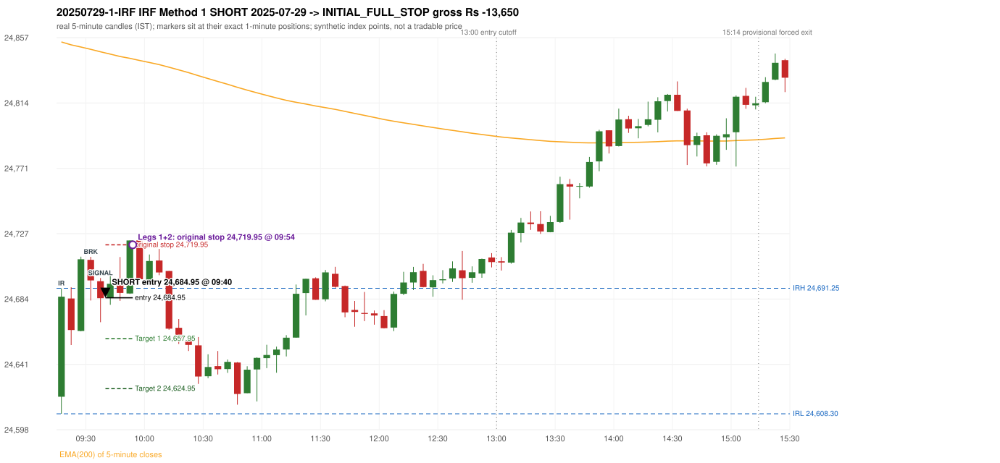
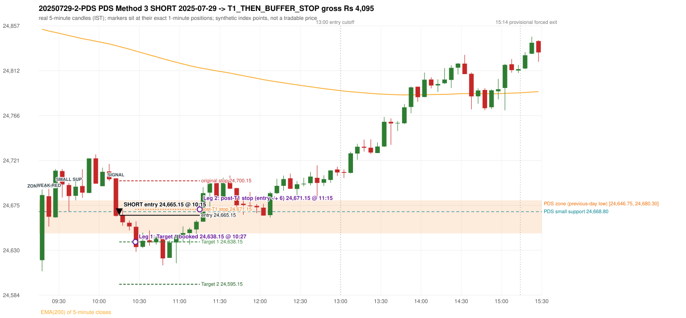

# Trading journal - 2025-07-29 (Tuesday)

> Phase 4 historical validation, window B (Window B 2022-09-01..2025-08-31 (5paisa minutes); status DATA_VALIDATED). The FROZEN Phase 3.6 configuration (IRF, ORB, PDR body-based, PDS, RF; shared controller) on a different data source. HISTORICAL RESEARCH ONLY: the strategy was developed using later data. same provider as the Phase 3.6 baseline; the vendor-overlap audit shows the minute bars differ from the secondary vendor Synthetic NIFTY 50 index-point P&L (the index is not tradable). The owner's review status is intentionally blank.

## A. Trading day overview

| item | value |
|---|---|
| Date / weekday | 2025-07-29 / Tuesday |
| Session type | USABLE / VALID |
| Original session open (first 1-minute open) | 24,619.60 |
| Previous session | 2025-07-28 |
| Previous-day high / low (wicks included) | 24,888.00 / 24,646.75 |
| Previous-day highest BODY high (the body-based PDR ceiling; wicks ignored) | 24,876.40 |
| Previous-day official close / last 5-minute close | 24,680.90 / 24,673.95 |
| Raw engine records / confirmed signals / fully valid signals | 13 / 11 / 11 |
| Setups that did not complete (invalidated / incomplete) | 2 |
| Executed trades | 2 20250729-1-IRF;20250729-2-PDS |
| Gross P&L (Rs, synthetic) | -9,555.00 |
| Illustrative net P&L (Rs; Rs 500/trade + 0.5 pt/fill) | -11,335.00 |
| Day-end portfolio status | DAY_FINISHED |
| Manual journal trades (matched / unmatched) | 0 (0 / 0) |
| Extra automated trades | 0 |

## B. Daily strategy signal timeline (confirmed signals, chronological)

| time | strategy | method | dir | entry-rule status | valid for execution | <= 13:00 | portfolio state | accepted / ignored | specific reason | competing (same minute) |
|---|---|---|---|---|---|---|---|---|---|---|
| 09:40 | IRF | Method 1 | SHORT | PROPOSAL_DEPENDENT | True | True | FIRST_TRADE_ACTIVE | ACCEPTED -> 20250729-1-IRF | first eligible signal of the day; trade 1: INITIAL_FULL_STOP |  |
| 09:50 | IRF | Method 1 | SHORT | PROPOSAL_DEPENDENT | True | True | FIRST_TRADE_ACTIVE | IGNORED | POSITION_ACTIVE (signal kept for diagnostics only; never reused) [blocked by IRF#1] |  |
| 10:00 | IRF | Method 2B | SHORT | PROPOSAL_DEPENDENT | True | True | SECOND_TRADE_ELIGIBLE | REJECTED | SECOND_TRADE_RESTRICTED_TO_PDR_PDS [blocked by IRF#1] |  |
| 10:15 | IRF | Method 1 | SHORT | PROPOSAL_DEPENDENT | True | True | SECOND_TRADE_ACTIVE | REJECTED | SECOND_TRADE_RESTRICTED_TO_PDR_PDS [blocked by IRF#1] | PDS Method 3 SHORT |
| 10:15 | PDS | Method 3 | SHORT | PROPOSAL_DEPENDENT | True | True | SECOND_TRADE_ACTIVE | ACCEPTED -> 20250729-2-PDS | permitted second trade: newly confirmed PDR/PDS after the original full stop; trade 2: T1_THEN_BUFFER_STOP | IRF Method 1 SHORT |
| 10:50 | PDS | Method 3 | SHORT | PROPOSAL_DEPENDENT | True | True | SECOND_TRADE_ACTIVE | IGNORED | POSITION_ACTIVE (signal kept for diagnostics only; never reused) [blocked by PDS#2] |  |
| 11:30 | IRF | Method 1 | SHORT | PROPOSAL_DEPENDENT | True | True | DAY_FINISHED | IGNORED | DAY_FINISHED [blocked by PDS#2] |  |
| 11:45 | IRF | Method 1 | SHORT | PROPOSAL_DEPENDENT | True | True | DAY_FINISHED | IGNORED | DAY_FINISHED [blocked by PDS#2] | PDS Method 1 SHORT |
| 11:45 | PDS | Method 1 | SHORT | PROPOSAL_DEPENDENT | True | True | DAY_FINISHED | IGNORED | DAY_FINISHED [blocked by PDS#2] | IRF Method 1 SHORT |
| 12:05 | PDS | Method 3 | SHORT | PROPOSAL_DEPENDENT | True | True | DAY_FINISHED | IGNORED | DAY_FINISHED [blocked by PDS#2] |  |
| 14:40 | IRF | Method 2A | SHORT | PROPOSAL_DEPENDENT | True | False | DAY_FINISHED | IGNORED | DAY_FINISHED [blocked by PDS#2] |  |

Engine setups that did not complete (2); the complete list with failed rule ids is in `rejected_signals.csv`:

| candle | strategy | method | dir | status | precise reason | failed rules |
|---|---|---|---|---|---|---|
| 14:35 | IRF | Method 1/2 | SHORT | INCOMPLETE_AT_EOD | SESSION_ENDED_BEFORE_CONFIRMATION |  |
| 12:05 | PDS | Method 1/2/3 | SHORT | INCOMPLETE_AT_EOD | NO_QUALIFYING_ENTRY_BEFORE_SESSION_END |  |

## C. Detailed trade journals

### 20250729-1-IRF: IRF Method 1 SHORT (FIRST trade)

Chart: 

**Rule configuration:** CFG-phase36_body_based-866f954e55 - signal verification status **PROPOSAL_DEPENDENT** (never VERIFIED while a rule rests on a proposal).

#### 1. Setup identification

IRF Method 1 SHORT: the completed 09:30 candle closed at 24,696.40, 5.15 points above the initial range high 24,691.25 (range [24,608.30, 24,691.25] from the 09:15 candle); the immediately following completed 09:35 candle closed at 24,684.65, back inside the range. The short signal was confirmed at 09:40 on that close. Entry reference close 24,684.65 is 6.60 points below IRH 24,691.25.

#### 2. Candle and indicator calculations

| role | session | candle | O | H | L | C | range | body % | upper wick % | lower wick % | direction | EMA(200) | strong bull / bear | pin bull / bear | small (body<=30%) | used for |
|---|---|---|---|---|---|---|---|---|---|---|---|---|---|---|---|---|
| initial_range_candle | TODAY | 09:15-09:20 | 24,619.60 | 24,691.25 | 24,608.30 | 24,685.70 | 82.95 | 79.69 | 6.69 | 13.62 | BULLISH | 24,853.98 | True / False | False / False | False | initial range = high/low of the 09:15 candle |
| signal_candle | TODAY | 09:35-09:40 | 24,695.90 | 24,698.00 | 24,668.80 | 24,684.65 | 29.20 | 38.53 | 7.19 | 54.28 | BEARISH | 24,847.51 | False / False | False / False | False | candle whose close completed the trigger |
| breakout_candle | TODAY | 09:30-09:35 | 24,710.00 | 24,712.05 | 24,683.15 | 24,696.40 | 28.90 | 47.06 | 7.09 | 45.85 | BEARISH | 24,849.15 | False / False | False / False | False | breakout candle: a completed candle closing above IRH |

Every condition, with the rule, the calculation, the observed values and the result:

| # | group | rule | result | status / numeric definition | calculation | observed | required | available at | why it matters |
|---|---|---|---|---|---|---|---|---|---|
| 1 | SELECTION | SEL-FIRST-001 | PASS | USER_APPROVED / USER_APPROVED | earliest CONFIRMED signal of the day across IRF/ORB/PDR/PDS/RF that passed the controller's checks | 0 confirmed signal(s) earlier today; 11 confirmed signals in the day in total, this one at 09:40 | no earlier executable signal | 2025-07-29 09:40 | the shared controller trades only the first valid signal; the five strategies are not independent positions |
| 2 | SELECTION | SEL-TIE-001 | PASS | USER_APPROVED / USER_APPROVED | other CONFIRMED signals with exactly the same confirmation timestamp | none | no different-strategy / opposite-direction signal in the same minute (otherwise an unresolved conflict, no trade) | 2025-07-29 09:40 | an unresolved same-minute collision would have produced no trade at all |
| 3 | SELECTION | ENTRY-CUTOFF-001 | PASS | USER_APPROVED / USER_APPROVED | fill timestamp vs 13:00:00 IST | signal confirmed 09:40; fill 09:40 | fill at or before 13:00:00 IST | 2025-07-29 09:40 | no new position may be entered with a fill after 13:00 IST |
| 4 | SELECTION | EXE-FILL-001 | PASS | PROPOSED_FOR_REVIEW / PROPOSED_FOR_REVIEW | fill = open of the 1-minute bar that starts at the signal candle's end | bar 09:40 O 24,684.95 H 24,694.85 L 24,683.00 C 24,689.10; executable=True; entry 24,684.95 | fill bar exists, starts exactly at the signal end, is fillable; entry = its open | 2025-07-29 09:40 | a 5-minute signal is known only when its candle closes; the first price that can be traded is the next minute's open |
| 5 | SELECTION | DAY-MAX-001 | PASS | USER_APPROVED / USER_APPROVED | number of entries today | trade 1 of at most 2 | <= 2 entries per day | 2025-07-29 09:40 | daily trade cap |
| 6 | SETUP | IRF-GLOBAL-001 | PASS | SOURCE_VERIFIED / EXPLICIT_IN_SOURCE | initial range = high and low (wicks included) of the first completed 5-minute candle | 09:15-09:20 IRH 24,691.25, IRL 24,608.30 (range 82.95; engine recorded IRH 24,691.25, IRL 24,608.30) | high/low of the 09:15-09:20 candle | 2025-07-29 09:20 | all three IRF methods measure price against this range |
| 7 | SETUP | IRF-GLOBAL-003 | PASS | SOURCE_VERIFIED / EXPLICIT_IN_SOURCE | closes confirm, wicks do not: every trigger is evaluated on a completed 5-minute candle | trigger candle 09:35-09:40 was complete when the signal was stamped 09:40; decision uses its close 24,684.65 | completed candle close, not an intra-candle wick | 2025-07-29 09:40 | an intra-candle wick can reverse before the candle closes |
| 8 | SETUP | IRF-GLOBAL-002 | PASS | SOURCE_VERIFIED / EXPLICIT_IN_SOURCE | direction | SHORT (IRF trades short only) | short only | 2025-07-29 09:40 | IRF fades failed upside breakouts |
| 9 | SETUP | IRF-M1-001 | PASS | SOURCE_VERIFIED / EXPLICIT_IN_SOURCE | breakout candle close vs IRH | 09:30-09:35 O 24,710.00 H 24,712.05 L 24,683.15 C 24,696.40; range 28.90, body 13.60 (47.06%), upper wick 2.05 (7.09%), lower wick 13.25 (45.85%), bearish; close 24,696.40 is 5.15 points above IRH 24,691.25 | close > IRH (a wick above IRH is not a breakout) | 2025-07-29 09:35 | starts every IRF setup |
| 10 | CONFIRMATION | IRF-M1-002 | PASS | SOURCE_VERIFIED / EXPLICIT_IN_SOURCE | candle after the breakout closes back inside [IRL, IRH) | 09:35-09:40 O 24,695.90 H 24,698.00 L 24,668.80 C 24,684.65; range 29.20, body 11.25 (38.53%), upper wick 2.10 (7.19%), lower wick 15.85 (54.28%), bearish; close 24,684.65 vs range [24,608.30, 24,691.25) | IRL <= close < IRH | 2025-07-29 09:40 | the failed breakout: price could not hold above the opening range |
| 11 | CONFIRMATION | IRF-M1-004 | PASS | SOURCE_VERIFIED / EXPLICIT_IN_SOURCE | failure candle is the candle immediately after the breakout (k = 1) | breakout 09:30, failure candle 09:35: k = 1 | k = 1 (pp.5, 6, 13); the p.14 'next or following' reading (IRF-M1-C001) is CONFLICTING and not used in the baseline | 2025-07-29 09:40 | the guide's worked example enters at the close of the very next candle; no support/resistance break is required |
| 12 | EXECUTION | EXE-STOP-001 | PASS | USER_APPROVED / USER_APPROVED | initial stop = entry + 35 points | entry 24,684.95 -> stop 24,719.95 | stop 35 index points (BASELINE) | 2025-07-29 09:40 | defines the loss if the setup fails before Target 1 |
| 13 | EXECUTION | EXE-T1-001 | PASS | SOURCE_VERIFIED / EXPLICIT_IN_SOURCE | Target 1 = entry +/- 27 points | T1 24,657.95 | 27 points | 2025-07-29 09:40 | Leg 1 (3 lots) is booked at Target 1 |
| 14 | EXECUTION | IRF-TGT-001 | PASS | SOURCE_VERIFIED / EXPLICIT_IN_SOURCE | Target 2 = entry +/- 60 points | T2 24,624.95 | 60 points | 2025-07-29 09:40 | Leg 2 (3 lots) is booked at Target 2 |
| 15 | EXECUTION | POST-T1-STOP-006 | PASS | USER_APPROVED / USER_APPROVED | after T1 the Leg-2 stop = entry + 6 (no trailing) | post-T1 stop 24,690.95 | entry -6 (LONG) / +6 (SHORT) | 2025-07-29 09:40 | protects the remaining three lots once the first three are booked |
| 16 | EXECUTION | SIZE-LOT-001 | PASS | USER_APPROVED / USER_APPROVED | 6 lots x 65 = 390, Leg 1 = 3 lots = 195, Leg 2 = 195 | 6 lots, lot size 65, legs 3+3 | 6 lots in two equal legs | 2025-07-29 09:40 | position size for the synthetic P&L |
| 17 | NOTE | IRF-GLOBAL-004 | UNRESOLVED | UNRESOLVED / UNRESOLVED | which close above IRH of the session produced this attempt; repeat setups | this breakout is upward crossing no. 1 of the session (a close above IRH after a close at/below it) | the source states no first-breakout-only, re-arming, expiry or trades-per-day rule | 2025-07-29 09:40 | IRF re-arms on every later breakout in the code, producing many raw setups; the controller keeps only the first |
| 18 | NOTE | NOTE-IRF-REPEATED-SETUPS | NOT_APPLICABLE | NOT_A_RULE / NOT_A_REGISTRY_RULE | other IRF signals later in the session (not traded) | 6 further confirmed IRF signal(s): Method 1@09:50, Method 2B@10:00, Method 1@10:15, Method 1@11:30, Method 1@11:45, Method 2A@14:40 | disclosure of repeated raw setups | 2025-07-29 09:40 | repeated raw IRF setups are not hidden; they are logged as ignored |
| 19 | NOTE | IRF-SL-001 | NOT_APPLICABLE | SOURCE_VERIFIED / QUALITATIVE_SOURCE_NUMERIC_DEFINITION_PROPOSED_FOR_REVIEW | the guide's 35-or-40 rule: 35 if the most recent green candle's high is within 35 points of entry, else 40 | most recent green candle high 24,712.10 is 27.15 points from the entry 24,684.95: the guide's rule would select 35 points; the baseline applies a fixed 35 (USER_APPROVED research baseline; the 35-vs-40 selection and the 40-point variant are separate labelled scenarios) | source selection rule | 2025-07-29 09:40 | the stop distance is a modelling choice and changes losses, not entries |
| 20 | NOTE | NOTE-UNRESOLVED-DEPENDENCIES | UNRESOLVED | NOT_A_RULE / NOT_A_REGISTRY_RULE | rules the signal depends on that the sources leave unresolved | engine-recorded unresolved rule ids: IRF-GLOBAL-004; verification status PROPOSAL_DEPENDENT | n/a (disclosure) | 2025-07-29 09:40 | the entry is only as verified as the rules it rests on |

#### 3. Entry decision and explanation

IRF Method 1 SHORT: the completed 09:30 candle closed at 24,696.40, 5.15 points above the initial range high 24,691.25 (range [24,608.30, 24,691.25] from the 09:15 candle); the immediately following completed 09:35 candle closed at 24,684.65, back inside the range. The short signal was confirmed at 09:40 on that close. Entry reference close 24,684.65 is 6.60 points below IRH 24,691.25.

**Why this trade ahead of the other strategies:** This IRF Method 1 signal was the earliest executable signal of the day: 0 confirmed signal(s) earlier, 0 other in the same minute. 10 later confirmed signal(s) (IRF x6, PDS x4) are logged as ignored or rejected. State of the other four engines at that moment: [ORB: no setup record before this time (a base condition was not met, or nothing triggered)] [PDR: no setup record before this time (a base condition was not met, or nothing triggered)] [PDS: no setup record before this time (a base condition was not met, or nothing triggered)] [RF: no setup record before this time (a base condition was not met, or nothing triggered)]

#### 4. Actual entry execution

| item | value |
|---|---|
| Signal candle | 09:35-09:40 |
| Signal confirmed | 2025-07-29 09:40 |
| Fill timestamp | 2025-07-29 09:40 |
| Entry price | 24,684.95 |
| Source partition / 1-minute bar | data/phase4/processed/FIVEPAISA_1M_PHASE4/nifty50/year=2025/month=07/candles.parquet / 2025-07-29 09:40 |
| Source bar O / H / L / C | 24,684.95 / 24,694.85 / 24,683.00 / 24,689.10 |
| Fill assumption | open of the 1-minute bar starting at the signal candle's end (EXE-FILL-001, PROPOSED causal convention) |
| Initial stop / T1 / T2 / post-T1 stop | 24,719.95 / 24,657.95 / 24,624.95 / 24,690.95 |
| Position | 6 lots x 65 = 390 units (Leg 1 195, Leg 2 195) |

#### 5-8. Trade progress, Target 1, post-T1 stop and final exit

Between the 09:40 entry bar and the final exit (15 one-minute bars) the best excursion in favour was 4.60 points at 09:43 and the worst against was 37.90 points at 09:54. At 09:54 price reached the original stop 24,719.95 before Target 1 24,657.95, so all six lots exited together at 24,719.95. This is an INITIAL_FULL_STOP: one more trade is allowed that day, only a newly confirmed PDR/PDS signal.

| leg | qty | exit time | exit price | reason | source 1-minute bar | O / H / L / C | gross points | gross Rs | slippage pts | flags |
|---|---|---|---|---|---|---|---|---|---|---|
| 1 | 195 | 09:54 | 24,719.95 | ORIGINAL_STOP_BEFORE_T1 | 09:54 | 24,707.15 / 24,722.85 / 24,705.90 / 24,722.85 | -35.00 | -6,825.00 | 0.00 |  |
| 2 | 195 | 09:54 | 24,719.95 | ORIGINAL_STOP_BEFORE_T1 | 09:54 | 24,707.15 / 24,722.85 / 24,705.90 / 24,722.85 | -35.00 | -6,825.00 | 0.00 |  |

Exit evidence per leg:

* Leg 1: 1-minute bar 09:54 O 24,707.15 H 24,722.85 L 24,705.90 C 24,722.85: high 24,722.85 reached the original stop 24,719.95 before Target 1 24,657.95 was touched; both legs exit at the stop level 24,719.95
* Leg 2: 1-minute bar 09:54 O 24,707.15 H 24,722.85 L 24,705.90 C 24,722.85: high 24,722.85 reached the original stop 24,719.95 before Target 1 24,657.95 was touched; both legs exit at the stop level 24,719.95

#### 9. Gross and illustrative net P&L

| item | value (Rs) |
|---|---|
| Leg 1 gross | -6,825.00 |
| Leg 2 gross | -6,825.00 |
| Trade gross (= Leg 1 + Leg 2) | -13,650.00 |
| Illustrative fixed cost | -500.00 |
| Illustrative slippage (0.5 pt on every fill, entry + exits, all units) | -390.00 |
| Illustrative net | -14,540.00 |

#### 10. Manual journal comparison

No manual journal exists for this period; no comparison.

### 20250729-2-PDS: PDS Method 3 SHORT (SECOND trade)

Chart: 

**Rule configuration:** CFG-phase36_body_based-866f954e55 - signal verification status **PROPOSAL_DEPENDENT** (never VERIFIED while a rule rests on a proposal).

#### 1. Setup identification

PDS Method 3 SHORT: the session opened 27.15 points below the previous-day-low zone [24,646.75, 24,680.30]; the first red candle at the zone (09:20) was weak (body 54.58%), so the engine waited for a small support; the 09:35 candle's low 24,668.80 (-22.05 points below the zone floor) was broken by the close of the 10:10 candle (24,664.55); confirmed 10:15.

#### 2. Candle and indicator calculations

| role | session | candle | O | H | L | C | range | body % | upper wick % | lower wick % | direction | EMA(200) | strong bull / bear | pin bull / bear | small (body<=30%) | used for |
|---|---|---|---|---|---|---|---|---|---|---|---|---|---|---|---|---|
| zone_source_candle | PREVIOUS | 14:10-14:15 | 24,680.30 | 24,687.40 | 24,646.75 | 24,675.05 | 40.65 | 12.92 | 17.47 | 69.62 | BEARISH | 24,883.24 | False / False | False / False | True | previous-day low candle that defines the zone (A_LOWEST_LOW) |
| zone_retest_candle | TODAY | 09:15-09:20 | 24,619.60 | 24,691.25 | 24,608.30 | 24,685.70 | 82.95 | 79.69 | 6.69 | 13.62 | BULLISH | 24,853.98 | True / False | False / False | False | first candle whose range reaches the zone from below |
| signal_candle | TODAY | 10:10-10:15 | 24,702.65 | 24,702.65 | 24,663.85 | 24,664.55 | 38.80 | 98.20 | 0.00 | 1.80 | BEARISH | 24,837.32 | False / True | False / False | False | trigger candle |
| weak_first_red_candle | TODAY | 09:20-09:25 | 24,684.50 | 24,691.90 | 24,653.70 | 24,663.65 | 38.20 | 54.58 | 19.37 | 26.05 | BEARISH | 24,852.09 | False / False | False / False | False | first red candle at the zone that failed the quality rule |
| small_support_pivot | TODAY | 09:35-09:40 | 24,695.90 | 24,698.00 | 24,668.80 | 24,684.65 | 29.20 | 38.53 | 7.19 | 54.28 | BEARISH | 24,847.51 | False / False | False / False | False | small support: latest 3-candle fractal low after the weak candle |

Every condition, with the rule, the calculation, the observed values and the result:

| # | group | rule | result | status / numeric definition | calculation | observed | required | available at | why it matters |
|---|---|---|---|---|---|---|---|---|---|
| 1 | SELECTION | DAY-SL-001 | PASS | USER_APPROVED / USER_APPROVED | first trade outcome, strategy of this signal, position-close time vs this signal's timestamp | first trade IRF Method 1 closed as INITIAL_FULL_STOP at 09:54; position free from 09:55; this PDS signal confirmed 10:15 | first trade INITIAL_FULL_STOP before Target 1, and a NEWLY confirmed PDR/PDS signal after the first position closed | 2025-07-29 10:15 | the only way a second trade is allowed |
| 2 | SELECTION | DAY-NOREUSE-001 | PASS | USER_APPROVED / USER_APPROVED | signals confirmed while the first position was open | 2 signal(s) were ignored during the first trade (never reused): IRF Method 1 SHORT @09:40; IRF Method 1 SHORT @09:50 [IGNORED: POSITION_ACTIVE] | this trade comes from a signal confirmed after the first exit, not from an ignored one | 2025-07-29 10:15 | an ignored signal can never become the second trade |
| 3 | SELECTION | ENTRY-CUTOFF-001 | PASS | USER_APPROVED / USER_APPROVED | fill timestamp vs 13:00:00 IST | signal confirmed 10:15; fill 10:15 | fill at or before 13:00:00 IST | 2025-07-29 10:15 | no new position may be entered with a fill after 13:00 IST |
| 4 | SELECTION | EXE-FILL-001 | PASS | PROPOSED_FOR_REVIEW / PROPOSED_FOR_REVIEW | fill = open of the 1-minute bar that starts at the signal candle's end | bar 10:15 O 24,665.15 H 24,666.35 L 24,660.20 C 24,663.00; executable=True; entry 24,665.15 | fill bar exists, starts exactly at the signal end, is fillable; entry = its open | 2025-07-29 10:15 | a 5-minute signal is known only when its candle closes; the first price that can be traded is the next minute's open |
| 5 | SELECTION | DAY-MAX-001 | PASS | USER_APPROVED / USER_APPROVED | number of entries today | trade 2 of at most 2 | <= 2 entries per day | 2025-07-29 10:15 | daily trade cap |
| 6 | SETUP | PDS-003 | PASS | SOURCE_VERIFIED / EXPLICIT_WORDING_DETAIL_PROPOSED_FOR_REVIEW | gap = first 1-minute open of today - previous session's OFFICIAL close | today's open 24,619.60 (first 1-minute bar 09:15) - previous close 24,680.90 (DAILY_VENDOR, 2025-07-28) = -61.30 points -> gap DOWN | gap DOWN (more than 0 points) | 2025-07-29 09:15 | approved convention: the original first-minute open, never the vendor daily open |
| 7 | SETUP | PDS-006 | PASS | SOURCE_VERIFIED / QUALITATIVE_SOURCE_NUMERIC_DEFINITION_PROPOSED_FOR_REVIEW | gap-down open below the zone | today's open 24,619.60 vs zone low 24,646.75: 27.15 points below | open < zone low | 2025-07-29 09:15 | the guide: 'price is trading below the previous day's support zone' after the gap; a PROPOSED strict reading |
| 8 | SETUP | PDS-004 | PASS | SOURCE_VERIFIED / EXPLICIT_IN_SOURCE | PDS is not a breakdown strategy: the zone must be tested from below first | open 24,619.60 below the zone floor 24,646.75; the first candle to reach the zone is 09:15 | price rises to the zone before any short | 2025-07-29 09:15 | a short below the level without a retest is not this strategy |
| 9 | SETUP | PDS-005 | PASS | SOURCE_VERIFIED / QUALITATIVE_SOURCE_NUMERIC_DEFINITION_PROPOSED_FOR_REVIEW | price comes up to the zone: first candle whose [low, high] intersects it (+/- proximity) | 09:15-09:20 O 24,619.60 H 24,691.25 L 24,608.30 C 24,685.70; range 82.95, body 66.10 (79.69%), upper wick 5.55 (6.69%), lower wick 11.30 (13.62%), bullish; high 24,691.25 vs zone low 24,646.75 | range intersects the zone | 2025-07-29 09:20 | PDS is not a breakdown strategy: the zone must be tested from below first |
| 10 | ZONE | PDS-001 | PASS | SOURCE_VERIFIED / EXPLICIT_IN_SOURCE | direction | SHORT (PDS is short only) | short-only | 2025-07-29 10:15 | PDS sells a retest of previous-day support from below |
| 11 | ZONE | PDS-002 | PASS | SOURCE_VERIFIED / QUALITATIVE_SOURCE_NUMERIC_DEFINITION_PROPOSED_FOR_REVIEW | zone = [lowest low, body top] of the previous session's absolute-low candle (method A_LOWEST_LOW; the lower wick is part of the zone) | zone [24,646.75, 24,680.30] from the 14:10 candle of 2025-07-28 (14:10-14:15 O 24,680.30 H 24,687.40 L 24,646.75 C 24,675.05; range 40.65, body 5.25 (12.92%), upper wick 7.10 (17.47%), lower wick 28.30 (69.62%), bearish); engine recorded [24,646.75, 24,680.30] | previous trading day's low where price took support (body + lower wick) | 2025-07-28 14:15 | the reference level of the strategy; the exact candle(s) are a research choice (PDS-ZONE-002) |
| 12 | CONFIRMATION | PDS-M-001 | PASS | SOURCE_VERIFIED / QUALITATIVE_SOURCE_NUMERIC_DEFINITION_PROPOSED_FOR_REVIEW | Method 3 is used when the first red candle at the zone is not satisfying | first red candle at the zone: 09:20-09:25 O 24,684.50 H 24,691.90 L 24,653.70 C 24,663.65; range 38.20, body 20.85 (54.58%), upper wick 7.40 (19.37%), lower wick 9.95 (26.05%), bearish; strong-bearish test body >= 60%, lower wick <= 20% -> not met; pin bar -> not met | first red candle is neither strong nor a pin bar | 2025-07-29 09:25 | the quality rule keeps weak candles out; Method 3 waits for a support break instead |
| 13 | CONFIRMATION | PDS-M3-001 | PASS | SOURCE_VERIFIED / QUALITATIVE_SOURCE_NUMERIC_DEFINITION_PROPOSED_FOR_REVIEW | small support = latest 3-candle fractal low (k=1) formed at/after the weak candle with low <= zone high (24,680.30); definition SWING_K1_NEAR_ZONE | support 24,668.80 from the 09:35 candle; engine recorded 24,668.80; distance below the zone floor -22.05 points (negative: the support lies ABOVE the floor) (zone floor 24,646.75); the guide says 'near the zone' but defines no distance - the code has no lower bound | a small support near the zone | 2025-07-29 09:45 | 'near' and the size of the small support are undefined in the guide |
| 14 | CONFIRMATION | PDS-M3-001 | PASS | SOURCE_VERIFIED / QUALITATIVE_SOURCE_NUMERIC_DEFINITION_PROPOSED_FOR_REVIEW | trigger: candle closes below the small support (break basis CLOSE) | 10:10 close 24,664.55 vs support 24,668.80: 4.25 points below | close < support | 2025-07-29 10:15 | the guide does not say close or touch; the close is used |
| 15 | EXECUTION | EXE-STOP-001 | PASS | USER_APPROVED / USER_APPROVED | initial stop = entry + 35 points | entry 24,665.15 -> stop 24,700.15 | stop 35 index points (BASELINE) | 2025-07-29 10:15 | defines the loss if the setup fails before Target 1 |
| 16 | EXECUTION | EXE-T1-001 | PASS | SOURCE_VERIFIED / EXPLICIT_IN_SOURCE | Target 1 = entry +/- 27 points | T1 24,638.15 | 27 points | 2025-07-29 10:15 | Leg 1 (3 lots) is booked at Target 1 |
| 17 | EXECUTION | PDS-TGT-001 | PASS | SOURCE_VERIFIED / EXPLICIT_IN_SOURCE | Target 2 = entry +/- 70 points | T2 24,595.15 (the guide says 70; the report suggests 60 - CONFLICTING) | 70 points | 2025-07-29 10:15 | Leg 2 (3 lots) is booked at Target 2 |
| 18 | EXECUTION | POST-T1-STOP-006 | PASS | USER_APPROVED / USER_APPROVED | after T1 the Leg-2 stop = entry + 6 (no trailing) | post-T1 stop 24,671.15 | entry -6 (LONG) / +6 (SHORT) | 2025-07-29 10:15 | protects the remaining three lots once the first three are booked |
| 19 | EXECUTION | SIZE-LOT-001 | PASS | USER_APPROVED / USER_APPROVED | 6 lots x 65 = 390, Leg 1 = 3 lots = 195, Leg 2 = 195 | 6 lots, lot size 65, legs 3+3 | 6 lots in two equal legs | 2025-07-29 10:15 | position size for the synthetic P&L |
| 20 | NOTE | PDS-007 | NOT_APPLICABLE | PROPOSED_FOR_REVIEW / PROPOSED_FOR_REVIEW | repeated PDS signals today | 4 confirmed PDS signal(s) in the session | n/a (disclosure) | 2025-07-29 10:15 | the per-session cap is lifted for the controller runs; the controller trades only the first (or the permitted second) trade |
| 21 | NOTE | PDS-MISSING-001 | UNRESOLVED | UNRESOLVED / UNRESOLVED | entry timing | signal on the candle close; fill at the next minute's open | the guide does not say whether entry is intra-candle or after the close | 2025-07-29 10:15 | causal convention: nothing is entered before the trigger candle has closed |
| 22 | NOTE | PDS-SL-001 | NOT_APPLICABLE | SOURCE_VERIFIED / QUALITATIVE_SOURCE_NUMERIC_DEFINITION_PROPOSED_FOR_REVIEW | the guide's 35-or-40 rule: 35 if the most recent green candle's high is within 35 points of entry, else 40 | most recent green candle high 24,713.55 is 48.40 points from the entry 24,665.15: the guide's rule would select 40 points; the baseline applies a fixed 35 (USER_APPROVED research baseline; the 35-vs-40 selection and the 40-point variant are separate labelled scenarios) | source selection rule | 2025-07-29 10:15 | the stop distance is a modelling choice and changes losses, not entries |
| 23 | NOTE | NOTE-UNRESOLVED-DEPENDENCIES | NOT_APPLICABLE | NOT_A_RULE / NOT_A_REGISTRY_RULE | rules the signal depends on that the sources leave unresolved | engine-recorded unresolved rule ids: none; verification status PROPOSAL_DEPENDENT | n/a (disclosure) | 2025-07-29 10:15 | the entry is only as verified as the rules it rests on |

#### 3. Entry decision and explanation

PDS Method 3 SHORT: the session opened 27.15 points below the previous-day-low zone [24,646.75, 24,680.30]; the first red candle at the zone (09:20) was weak (body 54.58%), so the engine waited for a small support; the 09:35 candle's low 24,668.80 (-22.05 points below the zone floor) was broken by the close of the 10:10 candle (24,664.55); confirmed 10:15.

**Why this trade ahead of the other strategies:** The first trade (IRF Method 1) was stopped out before Target 1 at 09:54; this newly confirmed PDS signal at 10:15 is the first PDR/PDS signal after that exit, so it is the day's permitted second trade. State of the other engines at that moment: [IRF: 4 confirmed signal(s) up to this time (Method 1@09:40, Method 1@09:50, Method 2B@10:00, Method 1@10:15)] [ORB: no setup record before this time (a base condition was not met, or nothing triggered)] [PDR: no setup record before this time (a base condition was not met, or nothing triggered)] [RF: no setup record before this time (a base condition was not met, or nothing triggered)]

#### 4. Actual entry execution

| item | value |
|---|---|
| Signal candle | 10:10-10:15 |
| Signal confirmed | 2025-07-29 10:15 |
| Fill timestamp | 2025-07-29 10:15 |
| Entry price | 24,665.15 |
| Source partition / 1-minute bar | data/phase4/processed/FIVEPAISA_1M_PHASE4/nifty50/year=2025/month=07/candles.parquet / 2025-07-29 10:15 |
| Source bar O / H / L / C | 24,665.15 / 24,666.35 / 24,660.20 / 24,663.00 |
| Fill assumption | open of the 1-minute bar starting at the signal candle's end (EXE-FILL-001, PROPOSED causal convention) |
| Initial stop / T1 / T2 / post-T1 stop | 24,700.15 / 24,638.15 / 24,595.15 / 24,671.15 |
| Position | 6 lots x 65 = 390 units (Leg 1 195, Leg 2 195) |

#### 5-8. Trade progress, Target 1, post-T1 stop and final exit

Between the 10:15 entry bar and the final exit (61 one-minute bars) the best excursion in favour was 50.85 points at 10:48 and the worst against was 9.95 points at 11:15. At 10:27 price reached Target 1 24,638.15 and three lots exited. At 10:27 the remaining three lots' protective stop was set to 24,671.15 (entry + 6; no trailing, no further change); the engine applies it from the Target-1 bar onward and tests it within that same bar. At 11:15 the remaining three lots stopped out at 24,671.15. T1_THEN_BUFFER_STOP: no second trade that day (DAY-BUF-001).

| leg | qty | exit time | exit price | reason | source 1-minute bar | O / H / L / C | gross points | gross Rs | slippage pts | flags |
|---|---|---|---|---|---|---|---|---|---|---|
| 1 | 195 | 10:27 | 24,638.15 | TARGET_1 | 10:27 | 24,644.70 / 24,647.10 / 24,633.50 / 24,635.00 | 27.00 | 5,265.00 | 0.00 |  |
| 2 | 195 | 11:15 | 24,671.15 | POST_T1_STOP_ENTRY_MINUS_PLUS_6 | 11:15 | 24,658.65 / 24,675.10 / 24,658.65 / 24,674.15 | -6.00 | -1,170.00 | 0.00 |  |

Exit evidence per leg:

* Leg 1: 1-minute bar 10:27 O 24,644.70 H 24,647.10 L 24,633.50 C 24,635.00: low 24,633.50 reached Target 1 24,638.15; Leg 1 booked at the target level
* Leg 2: 1-minute bar 11:15 O 24,658.65 H 24,675.10 L 24,658.65 C 24,674.15: high 24,675.10 reached the post-T1 stop 24,671.15; Leg 2 exits at 24,671.15 at the stop level

#### 9. Gross and illustrative net P&L

| item | value (Rs) |
|---|---|
| Leg 1 gross | 5,265.00 |
| Leg 2 gross | -1,170.00 |
| Trade gross (= Leg 1 + Leg 2) | 4,095.00 |
| Illustrative fixed cost | -500.00 |
| Illustrative slippage (0.5 pt on every fill, entry + exits, all units) | -390.00 |
| Illustrative net | 3,205.00 |

#### 10. Manual journal comparison

No manual journal exists for this period; no comparison.

## D. Manual journal comparison

No manual journal exists for this period (the manual journal covers 2025-09-01 .. 2026-08-31 only); no comparison is made and no automated trade is labelled 'extra'.

## E. Daily conclusion

* **Traded:** 20250729-1-IRF - IRF Method 1 SHORT at 09:40 (entry 24,684.95), outcome INITIAL_FULL_STOP, gross Rs -13,650.00, illustrative net Rs -14,540.00. **Why:** This IRF Method 1 signal was the earliest executable signal of the day: 0 confirmed signal(s) earlier, 0 other in the same minute. 10 later confirmed signal(s) (IRF x6, PDS x4) are logged as ignored or rejected. State of the other four engines at that moment: [ORB: no setup record before this time (a base condition was not met, or nothing triggered)] [PDR: no setup record before this time (a base condition was not met, or nothing triggered)] [PDS: no setup record before this time (a base condition was not met, or nothing triggered)] [RF: no setup record before this time (a base condition was not met, or nothing triggered)] **How it ended:** At 09:54 price reached the original stop 24,719.95 before Target 1 24,657.95, so all six lots exited together at 24,719.95. This is an INITIAL_FULL_STOP: one more trade is allowed that day, only a newly confirmed PDR/PDS signal.
* **Traded:** 20250729-2-PDS - PDS Method 3 SHORT at 10:15 (entry 24,665.15), outcome T1_THEN_BUFFER_STOP, gross Rs 4,095.00, illustrative net Rs 3,205.00. **Why:** The first trade (IRF Method 1) was stopped out before Target 1 at 09:54; this newly confirmed PDS signal at 10:15 is the first PDR/PDS signal after that exit, so it is the day's permitted second trade. State of the other engines at that moment: [IRF: 4 confirmed signal(s) up to this time (Method 1@09:40, Method 1@09:50, Method 2B@10:00, Method 1@10:15)] [ORB: no setup record before this time (a base condition was not met, or nothing triggered)] [PDR: no setup record before this time (a base condition was not met, or nothing triggered)] [RF: no setup record before this time (a base condition was not met, or nothing triggered)] **How it ended:** At 10:27 price reached Target 1 24,638.15 and three lots exited. At 10:27 the remaining three lots' protective stop was set to 24,671.15 (entry + 6; no trailing, no further change); the engine applies it from the Target-1 bar onward and tests it within that same bar. At 11:15 the remaining three lots stopped out at 24,671.15. T1_THEN_BUFFER_STOP: no second trade that day (DAY-BUF-001).
* **Ignored / rejected signals:** IRF IGNORED DAY_FINISHED x3; IRF REJECTED SECOND_TRADE_RESTRICTED_TO_PDR_PDS x2; PDS IGNORED DAY_FINISHED x2; IRF IGNORED POSITION_ACTIVE x1; PDS IGNORED POSITION_ACTIVE x1
* **Open strategy-definition issues that affected this day:** IRF-GLOBAL-004 (NOT STATED: how many IRF trades per day, a latest entry time, and whether a new breakout may re-arm a setup after a signal), NOTE-UNRESOLVED-DEPENDENCIES, PDS-MISSING-001 (Entry timing (during the candle or after it closes) is not specified)
* **Automated triage (not an approval; the owner's review status stays blank):** TRADED_NO_FLAGS
