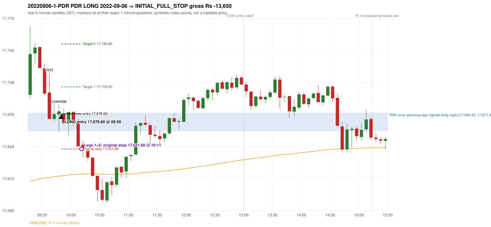
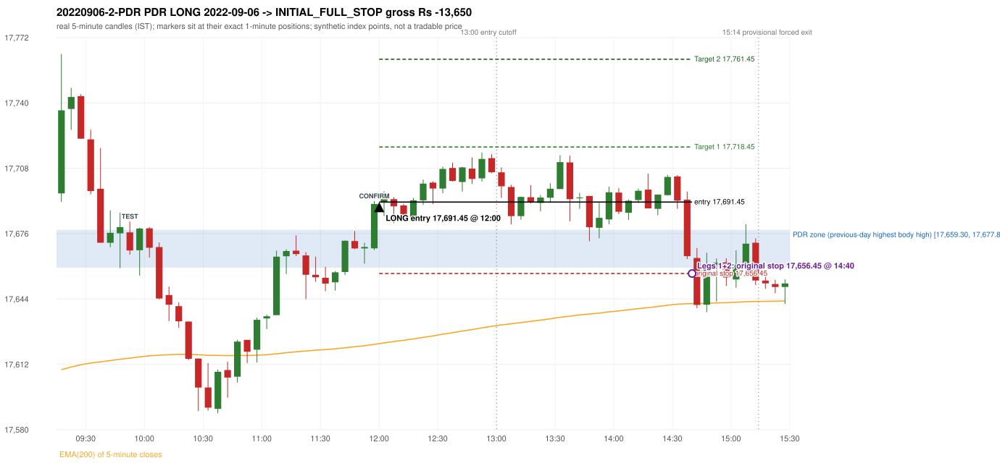

# Trading journal - 2022-09-06 (Tuesday)

> Phase 4 historical validation, window B_TV (Window B 2022-09-01..2025-08-31 (secondary vendor minutes); status VENDOR_SENSITIVITY). The FROZEN Phase 3.6 configuration (IRF, ORB, PDR body-based, PDS, RF; shared controller) on a different data source. HISTORICAL RESEARCH ONLY: the strategy was developed using later data. the same window with the secondary vendor's minute bars (daily series still 5paisa): quantifies sensitivity to the data source; not a second independent result Synthetic NIFTY 50 index-point P&L (the index is not tradable). The owner's review status is intentionally blank.

## A. Trading day overview

| item | value |
|---|---|
| Date / weekday | 2022-09-06 / Tuesday |
| Session type | USABLE_WITH_FLAGS / VALID |
| Original session open (first 1-minute open) | 17,695.70 |
| Previous session | 2022-09-05 |
| Previous-day high / low (wicks included) | 17,682.95 / 17,541.05 |
| Previous-day highest BODY high (the body-based PDR ceiling; wicks ignored) | 17,677.85 |
| Previous-day official close / last 5-minute close | 17,665.80 / 17,653.90 |
| Raw engine records / confirmed signals / fully valid signals | 7 / 3 / 3 |
| Setups that did not complete (invalidated / incomplete) | 4 |
| Executed trades | 2 20220906-1-PDR;20220906-2-PDR |
| Gross P&L (Rs, synthetic) | -27,300.00 |
| Illustrative net P&L (Rs; Rs 500/trade + 0.5 pt/fill) | -29,080.00 |
| Day-end portfolio status | DAY_FINISHED |
| Manual journal trades (matched / unmatched) | 0 (0 / 0) |
| Extra automated trades | 0 |

## B. Daily strategy signal timeline (confirmed signals, chronological)

| time | strategy | method | dir | entry-rule status | valid for execution | <= 13:00 | portfolio state | accepted / ignored | specific reason | competing (same minute) |
|---|---|---|---|---|---|---|---|---|---|---|
| 09:50 | PDR | PDR | LONG | RESEARCH_VARIANT | True | True | FIRST_TRADE_ACTIVE | ACCEPTED -> 20220906-1-PDR | first eligible signal of the day; trade 1: INITIAL_FULL_STOP |  |
| 12:00 | PDR | PDR | LONG | RESEARCH_VARIANT | True | True | SECOND_TRADE_ACTIVE | ACCEPTED -> 20220906-2-PDR | permitted second trade: newly confirmed PDR/PDS after the original full stop; trade 2: INITIAL_FULL_STOP |  |
| 14:00 | PDR | PDR | LONG | RESEARCH_VARIANT | True | False | SECOND_TRADE_ACTIVE | IGNORED | POSITION_ACTIVE (signal kept for diagnostics only; never reused) [blocked by PDR#2] |  |

Engine setups that did not complete (4); the complete list with failed rule ids is in `rejected_signals.csv`:

| candle | strategy | method | dir | status | precise reason | failed rules |
|---|---|---|---|---|---|---|
| 09:15 | ORB | Method 1 | LONG | INVALIDATED | CANDLE_QUALITY(not a strong body / wick too large) | ORB-M1-LONG-003 |
| 09:15 | ORB | Method 2 | LONG | INVALIDATED | TRENDLINE_NOT_SUPPORTIVE | ORB-M2-LONG-001 |
| 14:35 | PDR | PDR | LONG | INCOMPLETE_AT_EOD | NO_QUALIFYING_CONFIRMATION_BEFORE_SESSION_END |  |
| 12:00 | RF | RF | LONG | INVALIDATED | GAP_UP_OUTSIDE_YESTERDAYS_RANGE | RF-004 |

## C. Detailed trade journals

### 20220906-1-PDR: PDR LONG (FIRST trade)

Chart: 

**Rule configuration:** CFG-phase36_body_based-866f954e55 - signal verification status **RESEARCH_VARIANT** (never VERIFIED while a rule rests on a proposal).

#### 1. Setup identification

PDR LONG (body-based engine, A_HIGHEST_BODY_HIGH): the session opened 29.90 points above the previous close and 17.85 points above the previous-day highest BODY high 17,677.85 (zone [17,659.30, 17,677.85] from the 14:35 candle of 2022-09-05; the highest wick 17,682.95 is ignored). The 09:35 candle (17,671.55 - 17,717.90) tested the zone; the 09:45 candle (green, O 17,676.15 H 17,686.30 L 17,659.10 C 17,679.20) passed LOWER_PRICE_REJECTION and closed 1.35 points above the zone ceiling, confirming the entry at 09:50. The pattern thresholds and the zone's lower boundary are provisional research assumptions, not approved by the strategy author.

#### 2. Candle and indicator calculations

| role | session | candle | O | H | L | C | range | body % | upper wick % | lower wick % | direction | EMA(200) | strong bull / bear | pin bull / bear | small (body<=30%) | used for |
|---|---|---|---|---|---|---|---|---|---|---|---|---|---|---|---|---|
| zone_source_candle | PREVIOUS | 14:35-14:40 | 17,677.85 | 17,679.30 | 17,659.30 | 17,659.30 | 20.00 | 92.75 | 7.25 | 0.00 | BEARISH | 17,602.04 | False / True | False / False | False | candle of the previous session's highest BODY high (A_HIGHEST_BODY_HIGH) |
| prev_day_wick_high_candle | PREVIOUS | 14:30-14:35 | 17,674.85 | 17,682.95 | 17,674.55 | 17,677.10 | 8.40 | 26.79 | 69.64 | 3.57 | BULLISH | 17,601.46 | False / False | False / False | True | candle of the previous session's highest WICK (ignored by the author's rule; shown for comparison) |
| interaction_candle | TODAY | 09:35-09:40 | 17,697.95 | 17,717.90 | 17,671.55 | 17,671.55 | 46.35 | 56.96 | 43.04 | 0.00 | BEARISH | 17,613.17 | False / False | False / False | False | first candle whose range overlaps the zone (the test) |
| confirmation_candle | TODAY | 09:45-09:50 | 17,676.15 | 17,686.30 | 17,659.10 | 17,679.20 | 27.20 | 11.21 | 26.10 | 62.68 | BULLISH | 17,614.45 | False / False | True / False | True | candle that satisfies one of the three patterns and closes above the zone ceiling |

Every condition, with the rule, the calculation, the observed values and the result:

| # | group | rule | result | status / numeric definition | calculation | observed | required | available at | why it matters |
|---|---|---|---|---|---|---|---|---|---|
| 1 | SELECTION | SEL-FIRST-001 | PASS | USER_APPROVED / USER_APPROVED | earliest CONFIRMED signal of the day across IRF/ORB/PDR/PDS/RF that passed the controller's checks | 0 confirmed signal(s) earlier today; 3 confirmed signals in the day in total, this one at 09:50 | no earlier executable signal | 2022-09-06 09:50 | the shared controller trades only the first valid signal; the five strategies are not independent positions |
| 2 | SELECTION | SEL-TIE-001 | PASS | USER_APPROVED / USER_APPROVED | other CONFIRMED signals with exactly the same confirmation timestamp | none | no different-strategy / opposite-direction signal in the same minute (otherwise an unresolved conflict, no trade) | 2022-09-06 09:50 | an unresolved same-minute collision would have produced no trade at all |
| 3 | SELECTION | ENTRY-CUTOFF-001 | PASS | USER_APPROVED / USER_APPROVED | fill timestamp vs 13:00:00 IST | signal confirmed 09:50; fill 09:50 | fill at or before 13:00:00 IST | 2022-09-06 09:50 | no new position may be entered with a fill after 13:00 IST |
| 4 | SELECTION | EXE-FILL-001 | PASS | PROPOSED_FOR_REVIEW / PROPOSED_FOR_REVIEW | fill = open of the 1-minute bar that starts at the signal candle's end | bar 09:50 O 17,676.60 H 17,681.90 L 17,675.70 C 17,675.70; executable=True; entry 17,676.60 | fill bar exists, starts exactly at the signal end, is fillable; entry = its open | 2022-09-06 09:50 | a 5-minute signal is known only when its candle closes; the first price that can be traded is the next minute's open |
| 5 | SELECTION | DAY-MAX-001 | PASS | USER_APPROVED / USER_APPROVED | number of entries today | trade 1 of at most 2 | <= 2 entries per day | 2022-09-06 09:50 | daily trade cap |
| 6 | SETUP | PDR-004 | PASS | SOURCE_VERIFIED / EXPLICIT_WORDING_DETAIL_PROPOSED_FOR_REVIEW | gap = first 1-minute open of today - previous session's OFFICIAL close | today's open 17,695.70 (first 1-minute bar 09:15) - previous close 17,665.80 (DAILY_VENDOR, 2022-09-05) = +29.90 points -> gap UP | gap UP (more than 0 points) | 2022-09-06 09:15 | approved convention: the original first-minute open, never the vendor daily open |
| 7 | SETUP | PDR-B03 | PASS | AUTHOR_APPROVED / AUTHOR_STATEMENT_NUMERIC_DETAILS_ARE_SEPARATE_PROPOSED_ROWS | the session opens strictly above the previous day's resistance zone (author-approved) | today's first 1-minute open 17,695.70 vs zone ceiling 17,677.85: 17.85 points above (open - ceiling = +17.85) | open > zone ceiling (equal or inside the zone rejects the setup) | 2022-09-06 09:15 | the original first-minute open is used, never a vendor daily open |
| 8 | ZONE | PDR-001 | PASS | SOURCE_VERIFIED / EXPLICIT_IN_SOURCE | direction | LONG (PDR is long only) | long-only | 2022-09-06 09:50 | PDR buys a retest of previous-day resistance after a gap up |
| 9 | ZONE | PDR-B01a | PASS | AUTHOR_APPROVED / AUTHOR_STATEMENT_NUMERIC_DETAILS_ARE_SEPARATE_PROPOSED_ROWS | wicks ignored, bodies considered: body_high = max(open, close) of every completed previous-session 5-minute candle; ceiling = the highest body_high; floor = body low of that candle | previous session 2022-09-05: highest body high 17,677.85 on the 14:35 candle (O 17,677.85 C 17,659.30; wick high of that candle 17,679.30, ignored); four highest body highs: 17,677.85 (14:35); 17,677.40 (12:45); 17,677.15 (12:50); 17,677.10 (14:30). Highest WICK of the session 17,682.95 (14:30 candle) is 5.10 points above the ceiling and plays no part. Zone [17,659.30 (body low), 17,677.85 (body high)]; engine recorded [17,659.30, 17,677.85] | ceiling = highest body high of the previous session (author: wick ignored, body considered) | 2022-09-05 15:30 | a wick-only price never becomes resistance; the zone is drawn from candle bodies |
| 10 | ZONE | PDR-B02 | UNRESOLVED | AUTHOR_APPROVED / AUTHOR_STATEMENT_NUMERIC_DETAILS_ARE_SEPARATE_PROPOSED_ROWS | multiple highs connected into one zone (author principle; candidate B) | candidate A (used): [17,659.30, 17,677.85]. Candidate B (multiple-body-high cluster, tolerance 5 points) would be [17,654.45, 17,677.85] (MULTIPLE_BODY_HIGH_CLUSTER, 4 touch(es), member body highs 17,673.90, 17,677.40, 17,677.85, 17,676.75, 17,676.75); ceiling difference 0.00 points | a zone that connects all relevant highs (numbers not given by the author) | 2022-09-05 15:30 | candidate B has the same ceiling by construction, so this signal is unaffected by the choice; the lower boundary and the cluster numbers are research parameters |
| 11 | ZONE | PDR-003 | PASS | SOURCE_VERIFIED / EXPLICIT_IN_SOURCE | the zone is an area, not a single price | zone height 18.55 points [17,659.30, 17,677.85] | a rectangle with positive height (a zero-height zone is left unresolved by the engine) | 2022-09-05 15:30 | price may touch any part of the area |
| 12 | CONFIRMATION | PDR-B03b | PASS | PRESERVED_FROM_PHASE2 / PRESERVED_FROM_PHASE2 | the first candle whose [low, high] overlaps the zone (+/- proximity) is the test; the confirmation must come strictly after it | 09:35-09:40 O 17,697.95 H 17,717.90 L 17,671.55 C 17,671.55; range 46.35, body 26.40 (56.96%), upper wick 19.95 (43.04%), lower wick 0.00 (0.00%), bearish; low 17,671.55 vs zone ceiling 17,677.85, high 17,717.90 vs zone floor 17,659.30; proximity 0; confirmation candle 09:45 is candle no. 7, the test candle no. 5 | range overlaps the zone; confirmation after the test | 2022-09-06 09:40 | the retest of the previous-day resistance |
| 13 | CONFIRMATION | PDR-B04c | NOT_APPLICABLE | PROPOSED_FOR_REVIEW / NUMERIC_DEFINITION_PROPOSED_FOR_REVIEW | Pattern 1: good green body on the 09:45-09:50 candle (O 17,676.15 H 17,686.30 L 17,659.10 C 17,679.20); the numeric thresholds are PROVISIONAL (RESEARCH_DEFAULT), not author-approved | colour green; body 11.21%; upper wick 26.10% -> does not pass | green, body >= 60% and upper wick <= 20% of the range | 2022-09-06 09:50 | one of the three patterns is enough (author: one good green body OR lower price rejection OR hammer); fixed thresholds are not required by the author, so the numbers are a research convention; a pattern that does not pass is not an error |
| 14 | CONFIRMATION | PDR-B04c | PASS | PROPOSED_FOR_REVIEW / NUMERIC_DEFINITION_PROPOSED_FOR_REVIEW | Pattern 2: lower-price rejection candle on the 09:45-09:50 candle (O 17,676.15 H 17,686.30 L 17,659.10 C 17,679.20); the numeric thresholds are PROVISIONAL (RESEARCH_DEFAULT), not author-approved | lower wick 17.05 = 5.59 x body 3.05; close 26.10% below the high; low 17,659.10; low reached the zone ceiling 17,677.85 -> PASSES | lower wick >= 2 x body, close within the top 30% of the range, low <= zone ceiling (colour not required) | 2022-09-06 09:50 | one of the three patterns is enough (author: one good green body OR lower price rejection OR hammer); fixed thresholds are not required by the author, so the numbers are a research convention; a pattern that does not pass is not an error |
| 15 | CONFIRMATION | PDR-B04c | NOT_APPLICABLE | PROPOSED_FOR_REVIEW / NUMERIC_DEFINITION_PROPOSED_FOR_REVIEW | Pattern 3: hammer candle on the 09:45-09:50 candle (O 17,676.15 H 17,686.30 L 17,659.10 C 17,679.20); the numeric thresholds are PROVISIONAL (RESEARCH_DEFAULT), not author-approved | lower wick 17.05 = 5.59 x body; upper wick 26.10%; body bottom at 62.68% of the range -> does not pass | lower wick >= 2 x body, upper wick <= 10%, body bottom >= 60% of the range (colour not required) | 2022-09-06 09:50 | one of the three patterns is enough (author: one good green body OR lower price rejection OR hammer); fixed thresholds are not required by the author, so the numbers are a research convention; a pattern that does not pass is not an error |
| 16 | CONFIRMATION | PDR-B04 | PASS | AUTHOR_APPROVED / AUTHOR_STATEMENT_NUMERIC_DETAILS_ARE_SEPARATE_PROPOSED_ROWS | at least one of the three patterns passes (OR logic; every passing pattern is recorded) | patterns passed: LOWER_PRICE_REJECTION (engine recorded: LOWER_PRICE_REJECTION) | at least one pattern | 2022-09-06 09:50 | the author's entry candle requirement |
| 17 | CONFIRMATION | PDR-B05 | PASS | AUTHOR_APPROVED / AUTHOR_STATEMENT_NUMERIC_DETAILS_ARE_SEPARATE_PROPOSED_ROWS | the confirmation candle must close above the zone | close 17,679.20 vs zone ceiling 17,677.85: +1.35 points (floor 17,659.30; low 17,659.10 dipped into/below the zone) | close > zone ceiling, strictly (lower wick may penetrate the zone) | 2022-09-06 09:50 | no pattern overrides the close rule |
| 18 | CONFIRMATION | PDR-B06 | PASS | USER_APPROVED / USER_APPROVED | no entry at the open and no look-ahead: the order is placed only after the confirmation candle has completed | test candle 09:35 (no. 5) precedes the confirmation candle 09:45-09:50; signal stamped 09:50; fill 09:50 at the open of that 1-minute bar = 17,676.60 | interaction before the confirmation; fill after the confirmation candle's end | 2022-09-06 09:50 | existing causal fill convention (EXE-FILL-001) |
| 19 | EXECUTION | EXE-STOP-001 | PASS | USER_APPROVED / USER_APPROVED | initial stop = entry - 35 points | entry 17,676.60 -> stop 17,641.60 | stop 35 index points (BASELINE) | 2022-09-06 09:50 | defines the loss if the setup fails before Target 1 |
| 20 | EXECUTION | EXE-T1-001 | PASS | SOURCE_VERIFIED / EXPLICIT_IN_SOURCE | Target 1 = entry +/- 27 points | T1 17,703.60 | 27 points | 2022-09-06 09:50 | Leg 1 (3 lots) is booked at Target 1 |
| 21 | EXECUTION | PDR-008 | PASS | SOURCE_VERIFIED / EXPLICIT_IN_SOURCE | Target 2 = entry +/- 70 points | T2 17,746.60 (the guide says 70; the performance report's winners suggest 60 - CONFLICTING, recorded) | 70 points | 2022-09-06 09:50 | Leg 2 (3 lots) is booked at Target 2 |
| 22 | EXECUTION | POST-T1-STOP-006 | PASS | USER_APPROVED / USER_APPROVED | after T1 the Leg-2 stop = entry - 6 (no trailing) | post-T1 stop 17,670.60 | entry -6 (LONG) / +6 (SHORT) | 2022-09-06 09:50 | protects the remaining three lots once the first three are booked |
| 23 | EXECUTION | SIZE-LOT-001 | PASS | USER_APPROVED / USER_APPROVED | 6 lots x 65 = 390, Leg 1 = 3 lots = 195, Leg 2 = 195 | 6 lots, lot size 65, legs 3+3 | 6 lots in two equal legs | 2022-09-06 09:50 | position size for the synthetic P&L |
| 24 | NOTE | PDR-B04x | UNRESOLVED | PROPOSED_FOR_REVIEW / NUMERIC_DEFINITION_PROPOSED_FOR_REVIEW | provisional parameters this signal rests on | pattern thresholds RESEARCH_DEFAULT: {'green_body_min': 0.6, 'green_upper_wick_max': 0.2, 'reject_wick_to_body_min': 2.0, 'reject_close_fraction_max': 0.3, 'hammer_wick_to_body_min': 2.0, 'hammer_upper_wick_max': 0.1, 'hammer_body_position_min': 0.6}; zone lower boundary = hull of the member bodies; zero-height policy UNRESOLVED_NO_SETUP; wait policy WAIT_FOR_QUALIFYING_CANDLE; cluster parameters (candidate B only) tolerance 5, touches 2, separation 2 | n/a (disclosure) | 2022-09-06 09:50 | the strategy author has NOT approved these numbers or conventions; the signal is a RESEARCH_VARIANT, never VERIFIED |
| 25 | NOTE | PDR-012 | NOT_APPLICABLE | PROPOSED_FOR_REVIEW / PROPOSED_FOR_REVIEW | repeated PDR signals today | 3 confirmed PDR signal(s) in the session | n/a (disclosure) | 2022-09-06 09:50 | this engine reports EVERY qualifying signal (the per-session cap is lifted); the controller trades only the first (and a PDR/PDS second trade after an initial full stop) |
| 26 | NOTE | PDR-B07 | NOT_APPLICABLE | PROPOSED_FOR_REVIEW / NUMERIC_DEFINITION_PROPOSED_FOR_REVIEW | state of the zone between the test and the confirmation (the author and the guide are silent on price crossing below the zone) | test candle 09:35 (no. 5), confirmation candle 09:45 (no. 7): 2 candle(s) later; no candle in between closed below the zone floor | n/a (disclosure; the wait policy is a research parameter) | 2022-09-06 09:50 | the engine keeps a tested setup armed until a candle qualifies; whether a zone that price has closed through should still count is an owner decision |
| 27 | NOTE | PDR-009 | UNRESOLVED | UNRESOLVED / UNRESOLVED | stop 35 or 40 'depending on the situation' | the guide gives no selection rule; baseline fixed 35 points | unresolved in the source | 2022-09-06 09:50 | PDR stop selection is left to the owner |
| 28 | NOTE | NOTE-UNRESOLVED-DEPENDENCIES | UNRESOLVED | NOT_A_RULE / NOT_A_REGISTRY_RULE | rules the signal depends on that the sources leave unresolved | engine-recorded unresolved rule ids: PDR-B01b, PDR-B02a, PDR-B02b, PDR-B02c, PDR-B02d, PDR-B02e, PDR-B02f, PDR-B02g, PDR-B02h, PDR-B04b, PDR-B04c, PDR-B05a, PDR-B07; verification status RESEARCH_VARIANT | n/a (disclosure) | 2022-09-06 09:50 | the entry is only as verified as the rules it rests on |

#### 3. Entry decision and explanation

PDR LONG (body-based engine, A_HIGHEST_BODY_HIGH): the session opened 29.90 points above the previous close and 17.85 points above the previous-day highest BODY high 17,677.85 (zone [17,659.30, 17,677.85] from the 14:35 candle of 2022-09-05; the highest wick 17,682.95 is ignored). The 09:35 candle (17,671.55 - 17,717.90) tested the zone; the 09:45 candle (green, O 17,676.15 H 17,686.30 L 17,659.10 C 17,679.20) passed LOWER_PRICE_REJECTION and closed 1.35 points above the zone ceiling, confirming the entry at 09:50. The pattern thresholds and the zone's lower boundary are provisional research assumptions, not approved by the strategy author.

**Why this trade ahead of the other strategies:** This PDR signal was the earliest executable signal of the day: 0 confirmed signal(s) earlier, 0 other in the same minute. 2 later confirmed signal(s) (PDR x2) are logged as ignored or rejected. State of the other four engines at that moment: [IRF: no setup record before this time (a base condition was not met, or nothing triggered)] [ORB: Method 1 invalidated at 09:15: CANDLE_QUALITY(not a strong body / wick too large); Method 2 invalidated at 09:15: TRENDLINE_NOT_SUPPORTIVE] [PDS: no setup record before this time (a base condition was not met, or nothing triggered)] [RF: no setup record before this time (a base condition was not met, or nothing triggered)]

#### 4. Actual entry execution

| item | value |
|---|---|
| Signal candle | 09:45-09:50 |
| Signal confirmed | 2022-09-06 09:50 |
| Fill timestamp | 2022-09-06 09:50 |
| Entry price | 17,676.60 |
| Source partition / 1-minute bar | data/phase4/processed/TECHNOVUS_1M/nifty50/year=2022/month=09/candles.parquet / 2022-09-06 09:50 |
| Source bar O / H / L / C | 17,676.60 / 17,681.90 / 17,675.70 / 17,675.70 |
| Fill assumption | open of the 1-minute bar starting at the signal candle's end (EXE-FILL-001, PROPOSED causal convention) |
| Initial stop / T1 / T2 / post-T1 stop | 17,641.60 / 17,703.60 / 17,746.60 / 17,670.60 |
| Position | 6 lots x 65 = 390 units (Leg 1 195, Leg 2 195) |

#### 5-8. Trade progress, Target 1, post-T1 stop and final exit

Between the 09:50 entry bar and the final exit (22 one-minute bars) the best excursion in favour was 5.30 points at 09:50 and the worst against was 39.30 points at 10:11. At 10:11 price reached the original stop 17,641.60 before Target 1 17,703.60, so all six lots exited together at 17,641.60. This is an INITIAL_FULL_STOP: one more trade is allowed that day, only a newly confirmed PDR/PDS signal.

| leg | qty | exit time | exit price | reason | source 1-minute bar | O / H / L / C | gross points | gross Rs | slippage pts | flags |
|---|---|---|---|---|---|---|---|---|---|---|
| 1 | 195 | 10:11 | 17,641.60 | ORIGINAL_STOP_BEFORE_T1 | 10:11 | 17,644.50 / 17,644.50 / 17,637.30 / 17,639.40 | -35.00 | -6,825.00 | 0.00 |  |
| 2 | 195 | 10:11 | 17,641.60 | ORIGINAL_STOP_BEFORE_T1 | 10:11 | 17,644.50 / 17,644.50 / 17,637.30 / 17,639.40 | -35.00 | -6,825.00 | 0.00 |  |

Exit evidence per leg:

* Leg 1: 1-minute bar 10:11 O 17,644.50 H 17,644.50 L 17,637.30 C 17,639.40: low 17,637.30 reached the original stop 17,641.60 before Target 1 17,703.60 was touched; both legs exit at the stop level 17,641.60
* Leg 2: 1-minute bar 10:11 O 17,644.50 H 17,644.50 L 17,637.30 C 17,639.40: low 17,637.30 reached the original stop 17,641.60 before Target 1 17,703.60 was touched; both legs exit at the stop level 17,641.60

#### 9. Gross and illustrative net P&L

| item | value (Rs) |
|---|---|
| Leg 1 gross | -6,825.00 |
| Leg 2 gross | -6,825.00 |
| Trade gross (= Leg 1 + Leg 2) | -13,650.00 |
| Illustrative fixed cost | -500.00 |
| Illustrative slippage (0.5 pt on every fill, entry + exits, all units) | -390.00 |
| Illustrative net | -14,540.00 |

#### 10. Manual journal comparison

No manual journal exists for this period; no comparison.

### 20220906-2-PDR: PDR LONG (SECOND trade)

Chart: 

**Rule configuration:** CFG-phase36_body_based-866f954e55 - signal verification status **RESEARCH_VARIANT** (never VERIFIED while a rule rests on a proposal).

#### 1. Setup identification

PDR LONG (body-based engine, A_HIGHEST_BODY_HIGH): the session opened 29.90 points above the previous close and 17.85 points above the previous-day highest BODY high 17,677.85 (zone [17,659.30, 17,677.85] from the 14:35 candle of 2022-09-05; the highest wick 17,682.95 is ignored). The 09:50 candle (17,665.65 - 17,681.90) tested the zone; the 11:55 candle (green, O 17,668.80 H 17,691.90 L 17,667.95 C 17,690.55) passed GOOD_GREEN_BODY and closed 12.70 points above the zone ceiling, confirming the entry at 12:00. The pattern thresholds and the zone's lower boundary are provisional research assumptions, not approved by the strategy author.

#### 2. Candle and indicator calculations

| role | session | candle | O | H | L | C | range | body % | upper wick % | lower wick % | direction | EMA(200) | strong bull / bear | pin bull / bear | small (body<=30%) | used for |
|---|---|---|---|---|---|---|---|---|---|---|---|---|---|---|---|---|
| zone_source_candle | PREVIOUS | 14:35-14:40 | 17,677.85 | 17,679.30 | 17,659.30 | 17,659.30 | 20.00 | 92.75 | 7.25 | 0.00 | BEARISH | 17,602.04 | False / True | False / False | False | candle of the previous session's highest BODY high (A_HIGHEST_BODY_HIGH) |
| prev_day_wick_high_candle | PREVIOUS | 14:30-14:35 | 17,674.85 | 17,682.95 | 17,674.55 | 17,677.10 | 8.40 | 26.79 | 69.64 | 3.57 | BULLISH | 17,601.46 | False / False | False / False | True | candle of the previous session's highest WICK (ignored by the author's rule; shown for comparison) |
| interaction_candle | TODAY | 09:50-09:55 | 17,676.60 | 17,681.90 | 17,665.65 | 17,667.75 | 16.25 | 54.46 | 32.62 | 12.92 | BEARISH | 17,614.98 | False / False | False / False | False | first candle whose range overlaps the zone (the test) |
| confirmation_candle | TODAY | 11:55-12:00 | 17,668.80 | 17,691.90 | 17,667.95 | 17,690.55 | 23.95 | 90.81 | 5.64 | 3.55 | BULLISH | 17,621.74 | True / False | False / False | False | candle that satisfies one of the three patterns and closes above the zone ceiling |

Every condition, with the rule, the calculation, the observed values and the result:

| # | group | rule | result | status / numeric definition | calculation | observed | required | available at | why it matters |
|---|---|---|---|---|---|---|---|---|---|
| 1 | SELECTION | DAY-SL-001 | PASS | USER_APPROVED / USER_APPROVED | first trade outcome, strategy of this signal, position-close time vs this signal's timestamp | first trade PDR PDR closed as INITIAL_FULL_STOP at 10:11; position free from 10:12; this PDR signal confirmed 12:00 | first trade INITIAL_FULL_STOP before Target 1, and a NEWLY confirmed PDR/PDS signal after the first position closed | 2022-09-06 12:00 | the only way a second trade is allowed |
| 2 | SELECTION | DAY-NOREUSE-001 | PASS | USER_APPROVED / USER_APPROVED | signals confirmed while the first position was open | 1 signal(s) were ignored during the first trade (never reused): PDR PDR LONG @09:50 | this trade comes from a signal confirmed after the first exit, not from an ignored one | 2022-09-06 12:00 | an ignored signal can never become the second trade |
| 3 | SELECTION | ENTRY-CUTOFF-001 | PASS | USER_APPROVED / USER_APPROVED | fill timestamp vs 13:00:00 IST | signal confirmed 12:00; fill 12:00 | fill at or before 13:00:00 IST | 2022-09-06 12:00 | no new position may be entered with a fill after 13:00 IST |
| 4 | SELECTION | EXE-FILL-001 | PASS | PROPOSED_FOR_REVIEW / PROPOSED_FOR_REVIEW | fill = open of the 1-minute bar that starts at the signal candle's end | bar 12:00 O 17,691.45 H 17,693.15 L 17,689.25 C 17,692.00; executable=True; entry 17,691.45 | fill bar exists, starts exactly at the signal end, is fillable; entry = its open | 2022-09-06 12:00 | a 5-minute signal is known only when its candle closes; the first price that can be traded is the next minute's open |
| 5 | SELECTION | DAY-MAX-001 | PASS | USER_APPROVED / USER_APPROVED | number of entries today | trade 2 of at most 2 | <= 2 entries per day | 2022-09-06 12:00 | daily trade cap |
| 6 | SETUP | PDR-004 | PASS | SOURCE_VERIFIED / EXPLICIT_WORDING_DETAIL_PROPOSED_FOR_REVIEW | gap = first 1-minute open of today - previous session's OFFICIAL close | today's open 17,695.70 (first 1-minute bar 09:15) - previous close 17,665.80 (DAILY_VENDOR, 2022-09-05) = +29.90 points -> gap UP | gap UP (more than 0 points) | 2022-09-06 09:15 | approved convention: the original first-minute open, never the vendor daily open |
| 7 | SETUP | PDR-B03 | PASS | AUTHOR_APPROVED / AUTHOR_STATEMENT_NUMERIC_DETAILS_ARE_SEPARATE_PROPOSED_ROWS | the session opens strictly above the previous day's resistance zone (author-approved) | today's first 1-minute open 17,695.70 vs zone ceiling 17,677.85: 17.85 points above (open - ceiling = +17.85) | open > zone ceiling (equal or inside the zone rejects the setup) | 2022-09-06 09:15 | the original first-minute open is used, never a vendor daily open |
| 8 | ZONE | PDR-001 | PASS | SOURCE_VERIFIED / EXPLICIT_IN_SOURCE | direction | LONG (PDR is long only) | long-only | 2022-09-06 12:00 | PDR buys a retest of previous-day resistance after a gap up |
| 9 | ZONE | PDR-B01a | PASS | AUTHOR_APPROVED / AUTHOR_STATEMENT_NUMERIC_DETAILS_ARE_SEPARATE_PROPOSED_ROWS | wicks ignored, bodies considered: body_high = max(open, close) of every completed previous-session 5-minute candle; ceiling = the highest body_high; floor = body low of that candle | previous session 2022-09-05: highest body high 17,677.85 on the 14:35 candle (O 17,677.85 C 17,659.30; wick high of that candle 17,679.30, ignored); four highest body highs: 17,677.85 (14:35); 17,677.40 (12:45); 17,677.15 (12:50); 17,677.10 (14:30). Highest WICK of the session 17,682.95 (14:30 candle) is 5.10 points above the ceiling and plays no part. Zone [17,659.30 (body low), 17,677.85 (body high)]; engine recorded [17,659.30, 17,677.85] | ceiling = highest body high of the previous session (author: wick ignored, body considered) | 2022-09-05 15:30 | a wick-only price never becomes resistance; the zone is drawn from candle bodies |
| 10 | ZONE | PDR-B02 | UNRESOLVED | AUTHOR_APPROVED / AUTHOR_STATEMENT_NUMERIC_DETAILS_ARE_SEPARATE_PROPOSED_ROWS | multiple highs connected into one zone (author principle; candidate B) | candidate A (used): [17,659.30, 17,677.85]. Candidate B (multiple-body-high cluster, tolerance 5 points) would be [17,654.45, 17,677.85] (MULTIPLE_BODY_HIGH_CLUSTER, 4 touch(es), member body highs 17,673.90, 17,677.40, 17,677.85, 17,676.75, 17,676.75); ceiling difference 0.00 points | a zone that connects all relevant highs (numbers not given by the author) | 2022-09-05 15:30 | candidate B has the same ceiling by construction, so this signal is unaffected by the choice; the lower boundary and the cluster numbers are research parameters |
| 11 | ZONE | PDR-003 | PASS | SOURCE_VERIFIED / EXPLICIT_IN_SOURCE | the zone is an area, not a single price | zone height 18.55 points [17,659.30, 17,677.85] | a rectangle with positive height (a zero-height zone is left unresolved by the engine) | 2022-09-05 15:30 | price may touch any part of the area |
| 12 | CONFIRMATION | PDR-B03b | PASS | PRESERVED_FROM_PHASE2 / PRESERVED_FROM_PHASE2 | the first candle whose [low, high] overlaps the zone (+/- proximity) is the test; the confirmation must come strictly after it | 09:50-09:55 O 17,676.60 H 17,681.90 L 17,665.65 C 17,667.75; range 16.25, body 8.85 (54.46%), upper wick 5.30 (32.62%), lower wick 2.10 (12.92%), bearish; low 17,665.65 vs zone ceiling 17,677.85, high 17,681.90 vs zone floor 17,659.30; proximity 0; confirmation candle 11:55 is candle no. 33, the test candle no. 8 | range overlaps the zone; confirmation after the test | 2022-09-06 09:55 | the retest of the previous-day resistance (re-armed after the earlier signal: scanning restarted after the 09:45 candle) |
| 13 | CONFIRMATION | PDR-B04c | PASS | PROPOSED_FOR_REVIEW / NUMERIC_DEFINITION_PROPOSED_FOR_REVIEW | Pattern 1: good green body on the 11:55-12:00 candle (O 17,668.80 H 17,691.90 L 17,667.95 C 17,690.55); the numeric thresholds are PROVISIONAL (RESEARCH_DEFAULT), not author-approved | colour green; body 90.81%; upper wick 5.64% -> PASSES | green, body >= 60% and upper wick <= 20% of the range | 2022-09-06 12:00 | one of the three patterns is enough (author: one good green body OR lower price rejection OR hammer); fixed thresholds are not required by the author, so the numbers are a research convention; a pattern that does not pass is not an error |
| 14 | CONFIRMATION | PDR-B04c | NOT_APPLICABLE | PROPOSED_FOR_REVIEW / NUMERIC_DEFINITION_PROPOSED_FOR_REVIEW | Pattern 2: lower-price rejection candle on the 11:55-12:00 candle (O 17,668.80 H 17,691.90 L 17,667.95 C 17,690.55); the numeric thresholds are PROVISIONAL (RESEARCH_DEFAULT), not author-approved | lower wick 0.85 = 0.04 x body 21.75; close 5.64% below the high; low 17,667.95; low reached the zone ceiling 17,677.85 -> does not pass | lower wick >= 2 x body, close within the top 30% of the range, low <= zone ceiling (colour not required) | 2022-09-06 12:00 | one of the three patterns is enough (author: one good green body OR lower price rejection OR hammer); fixed thresholds are not required by the author, so the numbers are a research convention; a pattern that does not pass is not an error |
| 15 | CONFIRMATION | PDR-B04c | NOT_APPLICABLE | PROPOSED_FOR_REVIEW / NUMERIC_DEFINITION_PROPOSED_FOR_REVIEW | Pattern 3: hammer candle on the 11:55-12:00 candle (O 17,668.80 H 17,691.90 L 17,667.95 C 17,690.55); the numeric thresholds are PROVISIONAL (RESEARCH_DEFAULT), not author-approved | lower wick 0.85 = 0.04 x body; upper wick 5.64%; body bottom at 3.55% of the range -> does not pass | lower wick >= 2 x body, upper wick <= 10%, body bottom >= 60% of the range (colour not required) | 2022-09-06 12:00 | one of the three patterns is enough (author: one good green body OR lower price rejection OR hammer); fixed thresholds are not required by the author, so the numbers are a research convention; a pattern that does not pass is not an error |
| 16 | CONFIRMATION | PDR-B04 | PASS | AUTHOR_APPROVED / AUTHOR_STATEMENT_NUMERIC_DETAILS_ARE_SEPARATE_PROPOSED_ROWS | at least one of the three patterns passes (OR logic; every passing pattern is recorded) | patterns passed: GOOD_GREEN_BODY (engine recorded: GOOD_GREEN_BODY) | at least one pattern | 2022-09-06 12:00 | the author's entry candle requirement |
| 17 | CONFIRMATION | PDR-B05 | PASS | AUTHOR_APPROVED / AUTHOR_STATEMENT_NUMERIC_DETAILS_ARE_SEPARATE_PROPOSED_ROWS | the confirmation candle must close above the zone | close 17,690.55 vs zone ceiling 17,677.85: +12.70 points (floor 17,659.30; low 17,667.95 dipped into/below the zone) | close > zone ceiling, strictly (lower wick may penetrate the zone) | 2022-09-06 12:00 | no pattern overrides the close rule |
| 18 | CONFIRMATION | PDR-B06 | PASS | USER_APPROVED / USER_APPROVED | no entry at the open and no look-ahead: the order is placed only after the confirmation candle has completed | test candle 09:50 (no. 8) precedes the confirmation candle 11:55-12:00; signal stamped 12:00; fill 12:00 at the open of that 1-minute bar = 17,691.45 | interaction before the confirmation; fill after the confirmation candle's end | 2022-09-06 12:00 | existing causal fill convention (EXE-FILL-001) |
| 19 | EXECUTION | EXE-STOP-001 | PASS | USER_APPROVED / USER_APPROVED | initial stop = entry - 35 points | entry 17,691.45 -> stop 17,656.45 | stop 35 index points (BASELINE) | 2022-09-06 12:00 | defines the loss if the setup fails before Target 1 |
| 20 | EXECUTION | EXE-T1-001 | PASS | SOURCE_VERIFIED / EXPLICIT_IN_SOURCE | Target 1 = entry +/- 27 points | T1 17,718.45 | 27 points | 2022-09-06 12:00 | Leg 1 (3 lots) is booked at Target 1 |
| 21 | EXECUTION | PDR-008 | PASS | SOURCE_VERIFIED / EXPLICIT_IN_SOURCE | Target 2 = entry +/- 70 points | T2 17,761.45 (the guide says 70; the performance report's winners suggest 60 - CONFLICTING, recorded) | 70 points | 2022-09-06 12:00 | Leg 2 (3 lots) is booked at Target 2 |
| 22 | EXECUTION | POST-T1-STOP-006 | PASS | USER_APPROVED / USER_APPROVED | after T1 the Leg-2 stop = entry - 6 (no trailing) | post-T1 stop 17,685.45 | entry -6 (LONG) / +6 (SHORT) | 2022-09-06 12:00 | protects the remaining three lots once the first three are booked |
| 23 | EXECUTION | SIZE-LOT-001 | PASS | USER_APPROVED / USER_APPROVED | 6 lots x 65 = 390, Leg 1 = 3 lots = 195, Leg 2 = 195 | 6 lots, lot size 65, legs 3+3 | 6 lots in two equal legs | 2022-09-06 12:00 | position size for the synthetic P&L |
| 24 | NOTE | PDR-B04x | UNRESOLVED | PROPOSED_FOR_REVIEW / NUMERIC_DEFINITION_PROPOSED_FOR_REVIEW | provisional parameters this signal rests on | pattern thresholds RESEARCH_DEFAULT: {'green_body_min': 0.6, 'green_upper_wick_max': 0.2, 'reject_wick_to_body_min': 2.0, 'reject_close_fraction_max': 0.3, 'hammer_wick_to_body_min': 2.0, 'hammer_upper_wick_max': 0.1, 'hammer_body_position_min': 0.6}; zone lower boundary = hull of the member bodies; zero-height policy UNRESOLVED_NO_SETUP; wait policy WAIT_FOR_QUALIFYING_CANDLE; cluster parameters (candidate B only) tolerance 5, touches 2, separation 2 | n/a (disclosure) | 2022-09-06 12:00 | the strategy author has NOT approved these numbers or conventions; the signal is a RESEARCH_VARIANT, never VERIFIED |
| 25 | NOTE | PDR-012 | NOT_APPLICABLE | PROPOSED_FOR_REVIEW / PROPOSED_FOR_REVIEW | repeated PDR signals today | 3 confirmed PDR signal(s) in the session | n/a (disclosure) | 2022-09-06 12:00 | this engine reports EVERY qualifying signal (the per-session cap is lifted); the controller trades only the first (and a PDR/PDS second trade after an initial full stop) |
| 26 | NOTE | PDR-B07 | UNRESOLVED | PROPOSED_FOR_REVIEW / NUMERIC_DEFINITION_PROPOSED_FOR_REVIEW | state of the zone between the test and the confirmation (the author and the guide are silent on price crossing below the zone) | test candle 09:50 (no. 8), confirmation candle 11:55 (no. 33): 25 candle(s) later; 16 candle(s) in between CLOSED BELOW the zone floor 17,659.30 (lowest close 17,590.70) before price returned above the ceiling | n/a (disclosure; the wait policy is a research parameter) | 2022-09-06 12:00 | the engine keeps a tested setup armed until a candle qualifies; whether a zone that price has closed through should still count is an owner decision |
| 27 | NOTE | PDR-009 | UNRESOLVED | UNRESOLVED / UNRESOLVED | stop 35 or 40 'depending on the situation' | the guide gives no selection rule; baseline fixed 35 points | unresolved in the source | 2022-09-06 12:00 | PDR stop selection is left to the owner |
| 28 | NOTE | NOTE-UNRESOLVED-DEPENDENCIES | UNRESOLVED | NOT_A_RULE / NOT_A_REGISTRY_RULE | rules the signal depends on that the sources leave unresolved | engine-recorded unresolved rule ids: PDR-B01b, PDR-B02a, PDR-B02b, PDR-B02c, PDR-B02d, PDR-B02e, PDR-B02f, PDR-B02g, PDR-B02h, PDR-B04b, PDR-B04c, PDR-B05a, PDR-B07; verification status RESEARCH_VARIANT | n/a (disclosure) | 2022-09-06 12:00 | the entry is only as verified as the rules it rests on |

#### 3. Entry decision and explanation

PDR LONG (body-based engine, A_HIGHEST_BODY_HIGH): the session opened 29.90 points above the previous close and 17.85 points above the previous-day highest BODY high 17,677.85 (zone [17,659.30, 17,677.85] from the 14:35 candle of 2022-09-05; the highest wick 17,682.95 is ignored). The 09:50 candle (17,665.65 - 17,681.90) tested the zone; the 11:55 candle (green, O 17,668.80 H 17,691.90 L 17,667.95 C 17,690.55) passed GOOD_GREEN_BODY and closed 12.70 points above the zone ceiling, confirming the entry at 12:00. The pattern thresholds and the zone's lower boundary are provisional research assumptions, not approved by the strategy author.

**Why this trade ahead of the other strategies:** The first trade (PDR PDR) was stopped out before Target 1 at 10:11; this newly confirmed PDR signal at 12:00 is the first PDR/PDS signal after that exit, so it is the day's permitted second trade. State of the other engines at that moment: [IRF: no setup record before this time (a base condition was not met, or nothing triggered)] [ORB: Method 1 invalidated at 09:15: CANDLE_QUALITY(not a strong body / wick too large); Method 2 invalidated at 09:15: TRENDLINE_NOT_SUPPORTIVE] [PDS: no setup record before this time (a base condition was not met, or nothing triggered)] [RF: no setup record before this time (a base condition was not met, or nothing triggered)]

#### 4. Actual entry execution

| item | value |
|---|---|
| Signal candle | 11:55-12:00 |
| Signal confirmed | 2022-09-06 12:00 |
| Fill timestamp | 2022-09-06 12:00 |
| Entry price | 17,691.45 |
| Source partition / 1-minute bar | data/phase4/processed/TECHNOVUS_1M/nifty50/year=2022/month=09/candles.parquet / 2022-09-06 12:00 |
| Source bar O / H / L / C | 17,691.45 / 17,693.15 / 17,689.25 / 17,692.00 |
| Fill assumption | open of the 1-minute bar starting at the signal candle's end (EXE-FILL-001, PROPOSED causal convention) |
| Initial stop / T1 / T2 / post-T1 stop | 17,656.45 / 17,718.45 / 17,761.45 / 17,685.45 |
| Position | 6 lots x 65 = 390 units (Leg 1 195, Leg 2 195) |

#### 5-8. Trade progress, Target 1, post-T1 stop and final exit

Between the 12:00 entry bar and the final exit (161 one-minute bars) the best excursion in favour was 24.25 points at 12:54 and the worst against was 38.55 points at 14:40. At 14:40 price reached the original stop 17,656.45 before Target 1 17,718.45, so all six lots exited together at 17,656.45. This is an INITIAL_FULL_STOP: one more trade is allowed that day, only a newly confirmed PDR/PDS signal.

| leg | qty | exit time | exit price | reason | source 1-minute bar | O / H / L / C | gross points | gross Rs | slippage pts | flags |
|---|---|---|---|---|---|---|---|---|---|---|
| 1 | 195 | 14:40 | 17,656.45 | ORIGINAL_STOP_BEFORE_T1 | 14:40 | 17,664.05 / 17,668.95 / 17,652.90 / 17,652.90 | -35.00 | -6,825.00 | 0.00 |  |
| 2 | 195 | 14:40 | 17,656.45 | ORIGINAL_STOP_BEFORE_T1 | 14:40 | 17,664.05 / 17,668.95 / 17,652.90 / 17,652.90 | -35.00 | -6,825.00 | 0.00 |  |

Exit evidence per leg:

* Leg 1: 1-minute bar 14:40 O 17,664.05 H 17,668.95 L 17,652.90 C 17,652.90: low 17,652.90 reached the original stop 17,656.45 before Target 1 17,718.45 was touched; both legs exit at the stop level 17,656.45
* Leg 2: 1-minute bar 14:40 O 17,664.05 H 17,668.95 L 17,652.90 C 17,652.90: low 17,652.90 reached the original stop 17,656.45 before Target 1 17,718.45 was touched; both legs exit at the stop level 17,656.45

#### 9. Gross and illustrative net P&L

| item | value (Rs) |
|---|---|
| Leg 1 gross | -6,825.00 |
| Leg 2 gross | -6,825.00 |
| Trade gross (= Leg 1 + Leg 2) | -13,650.00 |
| Illustrative fixed cost | -500.00 |
| Illustrative slippage (0.5 pt on every fill, entry + exits, all units) | -390.00 |
| Illustrative net | -14,540.00 |

#### 10. Manual journal comparison

No manual journal exists for this period; no comparison.

## D. Manual journal comparison

No manual journal exists for this period (the manual journal covers 2025-09-01 .. 2026-08-31 only); no comparison is made and no automated trade is labelled 'extra'.

## E. Daily conclusion

* **Traded:** 20220906-1-PDR - PDR PDR LONG at 09:50 (entry 17,676.60), outcome INITIAL_FULL_STOP, gross Rs -13,650.00, illustrative net Rs -14,540.00. **Why:** This PDR signal was the earliest executable signal of the day: 0 confirmed signal(s) earlier, 0 other in the same minute. 2 later confirmed signal(s) (PDR x2) are logged as ignored or rejected. State of the other four engines at that moment: [IRF: no setup record before this time (a base condition was not met, or nothing triggered)] [ORB: Method 1 invalidated at 09:15: CANDLE_QUALITY(not a strong body / wick too large); Method 2 invalidated at 09:15: TRENDLINE_NOT_SUPPORTIVE] [PDS: no setup record before this time (a base condition was not met, or nothing triggered)] [RF: no setup record before this time (a base condition was not met, or nothing triggered)] **How it ended:** At 10:11 price reached the original stop 17,641.60 before Target 1 17,703.60, so all six lots exited together at 17,641.60. This is an INITIAL_FULL_STOP: one more trade is allowed that day, only a newly confirmed PDR/PDS signal.
* **Traded:** 20220906-2-PDR - PDR PDR LONG at 12:00 (entry 17,691.45), outcome INITIAL_FULL_STOP, gross Rs -13,650.00, illustrative net Rs -14,540.00. **Why:** The first trade (PDR PDR) was stopped out before Target 1 at 10:11; this newly confirmed PDR signal at 12:00 is the first PDR/PDS signal after that exit, so it is the day's permitted second trade. State of the other engines at that moment: [IRF: no setup record before this time (a base condition was not met, or nothing triggered)] [ORB: Method 1 invalidated at 09:15: CANDLE_QUALITY(not a strong body / wick too large); Method 2 invalidated at 09:15: TRENDLINE_NOT_SUPPORTIVE] [PDS: no setup record before this time (a base condition was not met, or nothing triggered)] [RF: no setup record before this time (a base condition was not met, or nothing triggered)] **How it ended:** At 14:40 price reached the original stop 17,656.45 before Target 1 17,718.45, so all six lots exited together at 17,656.45. This is an INITIAL_FULL_STOP: one more trade is allowed that day, only a newly confirmed PDR/PDS signal.
* **Ignored / rejected signals:** PDR IGNORED POSITION_ACTIVE x1
* **Open strategy-definition issues that affected this day:** NOTE-UNRESOLVED-DEPENDENCIES, PDR-009 (Stop-loss 35 or 40 'depending on the situation'; choose before entering, do not move after entry), PDR-B02, PDR-B04x, PDR-B07
* **Automated triage (not an approval; the owner's review status stays blank):** TRADED_NO_FLAGS
