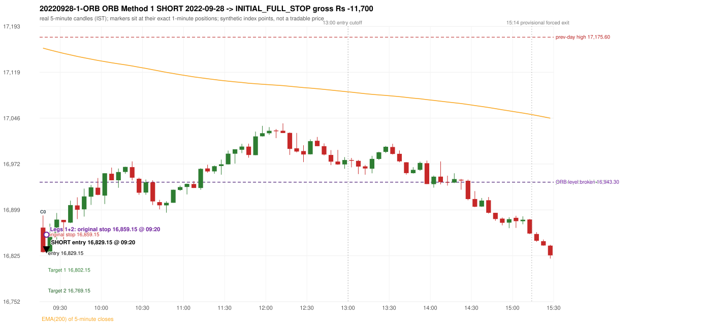
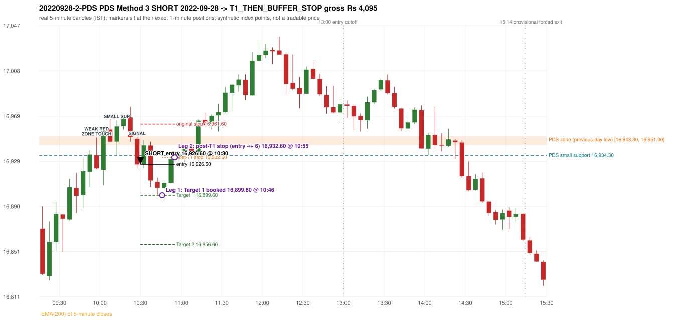

# Trading journal - 2022-09-28 (Wednesday)

> Phase 4 historical validation, window B_TV (Window B 2022-09-01..2025-08-31 (secondary vendor minutes); status VENDOR_SENSITIVITY). The FROZEN Phase 3.6 configuration (IRF, ORB, PDR body-based, PDS, RF; shared controller) on a different data source. HISTORICAL RESEARCH ONLY: the strategy was developed using later data. the same window with the secondary vendor's minute bars (daily series still 5paisa): quantifies sensitivity to the data source; not a second independent result Synthetic NIFTY 50 index-point P&L (the index is not tradable). The owner's review status is intentionally blank.

## A. Trading day overview

| item | value |
|---|---|
| Date / weekday | 2022-09-28 / Wednesday |
| Session type | USABLE_WITH_FLAGS / VALID |
| Original session open (first 1-minute open) | 16,870.55 |
| Previous session | 2022-09-27 |
| Previous-day high / low (wicks included) | 17,175.60 / 16,943.30 |
| Previous-day highest BODY high (the body-based PDR ceiling; wicks ignored) | 17,170.60 |
| Previous-day official close / last 5-minute close | 17,007.40 / 17,043.45 |
| Raw engine records / confirmed signals / fully valid signals | 10 / 8 / 8 |
| Setups that did not complete (invalidated / incomplete) | 2 |
| Executed trades | 2 20220928-1-ORB;20220928-2-PDS |
| Gross P&L (Rs, synthetic) | -7,605.00 |
| Illustrative net P&L (Rs; Rs 500/trade + 0.5 pt/fill) | -9,385.00 |
| Day-end portfolio status | DAY_FINISHED |
| Manual journal trades (matched / unmatched) | 0 (0 / 0) |
| Extra automated trades | 0 |

## B. Daily strategy signal timeline (confirmed signals, chronological)

| time | strategy | method | dir | entry-rule status | valid for execution | <= 13:00 | portfolio state | accepted / ignored | specific reason | competing (same minute) |
|---|---|---|---|---|---|---|---|---|---|---|
| 09:20 | ORB | Method 1 | SHORT | PROPOSAL_DEPENDENT | True | True | FIRST_TRADE_ACTIVE | ACCEPTED -> 20220928-1-ORB | first eligible signal of the day; trade 1: INITIAL_FULL_STOP | ORB Method 2 SHORT |
| 09:20 | ORB | Method 2 | SHORT | RESEARCH_VARIANT | True | True | FIRST_TRADE_ACTIVE | MERGED_SAME_STRATEGY_METHOD | traded as another method of the same strategy/direction in the same minute | ORB Method 1 SHORT |
| 10:25 | IRF | Method 2B | SHORT | PROPOSAL_DEPENDENT | True | True | SECOND_TRADE_ELIGIBLE | REJECTED | SECOND_TRADE_RESTRICTED_TO_PDR_PDS [blocked by ORB#1] |  |
| 10:30 | PDS | Method 3 | SHORT | PROPOSAL_DEPENDENT | True | True | SECOND_TRADE_ACTIVE | ACCEPTED -> 20220928-2-PDS | permitted second trade: newly confirmed PDR/PDS after the original full stop; trade 2: T1_THEN_BUFFER_STOP |  |
| 10:40 | PDS | Method 1 | SHORT | PROPOSAL_DEPENDENT | True | True | SECOND_TRADE_ACTIVE | IGNORED | POSITION_ACTIVE (signal kept for diagnostics only; never reused) [blocked by PDS#2] |  |
| 12:20 | IRF | Method 2A | SHORT | PROPOSAL_DEPENDENT | True | True | DAY_FINISHED | IGNORED | DAY_FINISHED [blocked by PDS#2] |  |
| 14:30 | PDS | Method 3 | SHORT | PROPOSAL_DEPENDENT | True | False | DAY_FINISHED | IGNORED | DAY_FINISHED [blocked by PDS#2] |  |
| 14:50 | IRF | Method 1 | SHORT | PROPOSAL_DEPENDENT | True | False | DAY_FINISHED | IGNORED | DAY_FINISHED [blocked by PDS#2] |  |

Engine setups that did not complete (2); the complete list with failed rule ids is in `rejected_signals.csv`:

| candle | strategy | method | dir | status | precise reason | failed rules |
|---|---|---|---|---|---|---|
| 12:15 | IRF | Method 1/2 | SHORT | INCOMPLETE_AT_EOD | SESSION_ENDED_BEFORE_CONFIRMATION |  |
| 15:25 | RF | RF | LONG | INCOMPLETE_AT_EOD | NO_RETURN_INSIDE_BEFORE_SESSION_END |  |

## C. Detailed trade journals

### 20220928-1-ORB: ORB Method 1 SHORT (FIRST trade)

Chart: 

**Rule configuration:** CFG-phase36_body_based-866f954e55 - signal verification status **PROPOSAL_DEPENDENT** (never VERIFIED while a rule rests on a proposal).

#### 1. Setup identification

ORB Method 1 SHORT: the first completed 5-minute candle (09:15-09:20) closed at 16,831.30, 112.00 points below the previous-day low 16,943.30; its body occupied 65.91% of its range and its lower wick 1.43% (thresholds 60% / 20%): the strong-bearish candle test passed; the EMA-only trend filter passed. Entry decision at 09:20.

#### 2. Candle and indicator calculations

| role | session | candle | O | H | L | C | range | body % | upper wick % | lower wick % | direction | EMA(200) | strong bull / bear | pin bull / bear | small (body<=30%) | used for |
|---|---|---|---|---|---|---|---|---|---|---|---|---|---|---|---|---|
| first_candle | TODAY | 09:15-09:20 | 16,870.55 | 16,890.00 | 16,830.45 | 16,831.30 | 59.55 | 65.91 | 32.66 | 1.43 | BEARISH | 17,158.06 | False / True | False / False | False | the 09:15 first five-minute candle - the ORB decision candle |
| prev_day_extreme_candle | PREVIOUS | 11:10-11:15 | 16,951.00 | 16,962.15 | 16,943.30 | 16,946.30 | 18.85 | 24.93 | 59.15 | 15.92 | BEARISH | 17,240.71 | False / False | False / True | True | candle that made the previous session's high/low used as the level |
| prev_session_last_candle | PREVIOUS | 15:25-15:30 | 17,022.20 | 17,043.45 | 17,022.15 | 17,043.45 | 21.30 | 99.77 | 0.00 | 0.23 | BULLISH | 17,161.34 | True / False | False / False | False | trend: previous session's last 5-minute close vs its EMA(200) |

Every condition, with the rule, the calculation, the observed values and the result:

| # | group | rule | result | status / numeric definition | calculation | observed | required | available at | why it matters |
|---|---|---|---|---|---|---|---|---|---|
| 1 | SELECTION | SEL-FIRST-001 | PASS | USER_APPROVED / USER_APPROVED | earliest CONFIRMED signal of the day across IRF/ORB/PDR/PDS/RF that passed the controller's checks | 0 confirmed signal(s) earlier today; 8 confirmed signals in the day in total, this one at 09:20 | no earlier executable signal | 2022-09-28 09:20 | the shared controller trades only the first valid signal; the five strategies are not independent positions |
| 2 | SELECTION | SEL-TIE-001 | PASS | USER_APPROVED / USER_APPROVED | other CONFIRMED signals with exactly the same confirmation timestamp | ORB Method 2 SHORT @09:20 [NOTE: SAME_STRATEGY_CONCURRENT_METHOD]; merged same-strategy methods: Method 2 | no different-strategy / opposite-direction signal in the same minute (otherwise an unresolved conflict, no trade) | 2022-09-28 09:20 | an unresolved same-minute collision would have produced no trade at all |
| 3 | SELECTION | ENTRY-CUTOFF-001 | PASS | USER_APPROVED / USER_APPROVED | fill timestamp vs 13:00:00 IST | signal confirmed 09:20; fill 09:20 | fill at or before 13:00:00 IST | 2022-09-28 09:20 | no new position may be entered with a fill after 13:00 IST |
| 4 | SELECTION | EXE-FILL-001 | PASS | PROPOSED_FOR_REVIEW / PROPOSED_FOR_REVIEW | fill = open of the 1-minute bar that starts at the signal candle's end | bar 09:20 O 16,829.15 H 16,865.05 L 16,825.55 C 16,864.85; executable=True; entry 16,829.15 | fill bar exists, starts exactly at the signal end, is fillable; entry = its open | 2022-09-28 09:20 | a 5-minute signal is known only when its candle closes; the first price that can be traded is the next minute's open |
| 5 | SELECTION | DAY-MAX-001 | PASS | USER_APPROVED / USER_APPROVED | number of entries today | trade 1 of at most 2 | <= 2 entries per day | 2022-09-28 09:20 | daily trade cap |
| 6 | SETUP | ORB-GLOBAL-001 | PASS | SOURCE_VERIFIED / EXPLICIT_IN_SOURCE | decision is taken once the first 5-minute candle (09:15-09:20) has closed | candle 09:15-09:20; signal confirmed 09:20 | decision at 09:20, never before the close | 2022-09-28 09:20 | the close of the first candle is unknown before 09:20 |
| 7 | SETUP | ORB-GLOBAL-002 | PASS | SOURCE_VERIFIED / EXPLICIT_IN_SOURCE | direction | SHORT | same rules in both directions | 2022-09-28 09:20 | ORB trades the side of the break |
| 8 | SETUP | ORB-GLOBAL-004 | PASS | SOURCE_VERIFIED / QUALITATIVE_SOURCE_NUMERIC_DEFINITION_PROPOSED_FOR_REVIEW | entry at 09:20, after the first-candle close | signal confirmed 09:20; fill 09:20 at the open of that minute | 09:20 entry | 2022-09-28 09:20 | the guide enters at 9:20; the fill price convention (next minute open) is a proposal |
| 9 | SETUP | ORB-M1-SHORT-001 | PASS | SOURCE_VERIFIED / QUALITATIVE_SOURCE_NUMERIC_DEFINITION_PROPOSED_FOR_REVIEW | prev_day_low = the lowest low of all 5-minute candles of the previous session 2022-09-27 | previous-day low 16,943.30 (set by the 11:10 candle; previous session range 16,943.30 - 17,175.60; engine recorded 16,943.30) | previous-day resistance (long) / support (short) | 2022-09-27 11:15 | a mechanical proxy for the guide's hand-drawn previous-day level; the source charts show multi-session boxes (documented difference) |
| 10 | SETUP | ORB-M1-SHORT-002 | PASS | SOURCE_VERIFIED / EXPLICIT_IN_SOURCE | the first candle breaks and closes beyond the level | high 16,890.00 / low 16,830.45, close 16,831.30: 112.00 points beyond 16,943.30 | low and close < level | 2022-09-28 09:20 | a wick alone is not a breakout; the close decides |
| 11 | TREND | ORB-TREND-001 | PASS | SOURCE_VERIFIED / QUALITATIVE_SOURCE_NUMERIC_DEFINITION_PROPOSED_FOR_REVIEW | previous session's final completed 5-minute candle: close vs its EMA(200 of 5-minute closes) | previous session 2022-09-27 last candle 15:25-15:30 close 17,043.45 vs EMA(200) 17,161.34: 117.89 points below the EMA -> trend bearish (EMA_PREV_SESSION_CLOSE; research variant A, EMA-only) | close < EMA(200) | 2022-09-27 15:30 | the opening gap can never create the trend: only information that existed before today's open is used |
| 12 | TREND | ORB-TREND-002 | PASS | SOURCE_VERIFIED / QUALITATIVE_SOURCE_NUMERIC_DEFINITION_PROPOSED_FOR_REVIEW | price location versus the 200 EMA is the basic confirmation; structure is only 'supporting' | 117.89 points below the EMA(200) on the previous session's last 5-minute close; swing structure not used in variant A | price on the trend side of the 200 EMA | 2022-09-27 15:30 | the rulebook calls EMA position 'a basic confirmation, supported by bullish structure'; the structure part has no numeric definition |
| 13 | TREND | TREND-SWING-001 | NOT_APPLICABLE | PROPOSED_FOR_REVIEW / PROPOSED_FOR_REVIEW | confirmed swing structure | not required by the active trend variant (variant A is the EMA price location only) | n/a | 2022-09-27 15:30 | variant B would additionally require higher-high/higher-low swings; it is a separate labelled scenario |
| 14 | CONFIRMATION | ORB-M1-SHORT-003 | PASS | SOURCE_VERIFIED / QUALITATIVE_SOURCE_NUMERIC_DEFINITION_PROPOSED_FOR_REVIEW | candle quality: strong body and limited opposite wick (or the conditional pin bar) | 09:15-09:20 O 16,870.55 H 16,890.00 L 16,830.45 C 16,831.30; range 59.55, body 39.25 (65.91%), upper wick 19.45 (32.66%), lower wick 0.85 (1.43%), bearish. Strong-bearish test: bearish close, body >= 60% (observed 65.91%), lower wick <= 20% (observed 1.43%) -> PASS | strong candle (research thresholds) or pin bar | 2022-09-28 09:20 | the guide asks for a 'strong body, small wick' but gives no numbers; the thresholds are proposals |
| 15 | EXECUTION | ORB-GLOBAL-003 | PASS | SOURCE_VERIFIED / EXPLICIT_IN_SOURCE | initial stop = entry + 30 points | entry 16,829.15 -> stop 16,859.15 | stop 30 index points (BASELINE) | 2022-09-28 09:20 | defines the loss if the setup fails before Target 1 |
| 16 | EXECUTION | EXE-T1-001 | PASS | SOURCE_VERIFIED / EXPLICIT_IN_SOURCE | Target 1 = entry +/- 27 points | T1 16,802.15 | 27 points | 2022-09-28 09:20 | Leg 1 (3 lots) is booked at Target 1 |
| 17 | EXECUTION | ORB-GLOBAL-003 | PASS | SOURCE_VERIFIED / EXPLICIT_IN_SOURCE | Target 2 = entry +/- 60 points | T2 16,769.15 | 60 points | 2022-09-28 09:20 | Leg 2 (3 lots) is booked at Target 2 |
| 18 | EXECUTION | POST-T1-STOP-006 | PASS | USER_APPROVED / USER_APPROVED | after T1 the Leg-2 stop = entry + 6 (no trailing) | post-T1 stop 16,835.15 | entry -6 (LONG) / +6 (SHORT) | 2022-09-28 09:20 | protects the remaining three lots once the first three are booked |
| 19 | EXECUTION | SIZE-LOT-001 | PASS | USER_APPROVED / USER_APPROVED | 6 lots x 65 = 390, Leg 1 = 3 lots = 195, Leg 2 = 195 | 6 lots, lot size 65, legs 3+3 | 6 lots in two equal legs | 2022-09-28 09:20 | position size for the synthetic P&L |
| 20 | NOTE | ORB-MA-001 | UNRESOLVED | CONFLICTING / CONFLICTING | which moving average the code uses | EMA(200) of 5-minute closes (the guide says '200 DMA' in some places and '200 EMA' in others); active ma_mode EMA200_5M | the source terminology conflicts | 2022-09-28 09:20 | a daily 200 DMA would give different values |
| 21 | NOTE | NOTE-UNRESOLVED-DEPENDENCIES | UNRESOLVED | NOT_A_RULE / NOT_A_REGISTRY_RULE | rules the signal depends on that the sources leave unresolved | engine-recorded unresolved rule ids: ORB-MA-001; verification status PROPOSAL_DEPENDENT | n/a (disclosure) | 2022-09-28 09:20 | the entry is only as verified as the rules it rests on |

#### 3. Entry decision and explanation

ORB Method 1 SHORT: the first completed 5-minute candle (09:15-09:20) closed at 16,831.30, 112.00 points below the previous-day low 16,943.30; its body occupied 65.91% of its range and its lower wick 1.43% (thresholds 60% / 20%): the strong-bearish candle test passed; the EMA-only trend filter passed. Entry decision at 09:20.

**Why this trade ahead of the other strategies:** This ORB Method 1 signal was the earliest executable signal of the day: 0 confirmed signal(s) earlier, 1 other in the same minute. 6 later confirmed signal(s) (IRF x3, PDS x3) are logged as ignored or rejected. State of the other four engines at that moment: [IRF: no setup record before this time (a base condition was not met, or nothing triggered)] [PDR: no setup record before this time (a base condition was not met, or nothing triggered)] [PDS: no setup record before this time (a base condition was not met, or nothing triggered)] [RF: no setup record before this time (a base condition was not met, or nothing triggered)]

#### 4. Actual entry execution

| item | value |
|---|---|
| Signal candle | 09:15-09:20 |
| Signal confirmed | 2022-09-28 09:20 |
| Fill timestamp | 2022-09-28 09:20 |
| Entry price | 16,829.15 |
| Source partition / 1-minute bar | data/phase4/processed/TECHNOVUS_1M/nifty50/year=2022/month=09/candles.parquet / 2022-09-28 09:20 |
| Source bar O / H / L / C | 16,829.15 / 16,865.05 / 16,825.55 / 16,864.85 |
| Fill assumption | open of the 1-minute bar starting at the signal candle's end (EXE-FILL-001, PROPOSED causal convention) |
| Initial stop / T1 / T2 / post-T1 stop | 16,859.15 / 16,802.15 / 16,769.15 / 16,835.15 |
| Position | 6 lots x 65 = 390 units (Leg 1 195, Leg 2 195) |

#### 5-8. Trade progress, Target 1, post-T1 stop and final exit

Between the 09:20 entry bar and the final exit (1 one-minute bars) the best excursion in favour was 3.60 points at 09:20 and the worst against was 35.90 points at 09:20. At 09:20 price reached the original stop 16,859.15 before Target 1 16,802.15, so all six lots exited together at 16,859.15. This is an INITIAL_FULL_STOP: one more trade is allowed that day, only a newly confirmed PDR/PDS signal.

| leg | qty | exit time | exit price | reason | source 1-minute bar | O / H / L / C | gross points | gross Rs | slippage pts | flags |
|---|---|---|---|---|---|---|---|---|---|---|
| 1 | 195 | 09:20 | 16,859.15 | ORIGINAL_STOP_BEFORE_T1 | 09:20 | 16,829.15 / 16,865.05 / 16,825.55 / 16,864.85 | -30.00 | -5,850.00 | 0.00 |  |
| 2 | 195 | 09:20 | 16,859.15 | ORIGINAL_STOP_BEFORE_T1 | 09:20 | 16,829.15 / 16,865.05 / 16,825.55 / 16,864.85 | -30.00 | -5,850.00 | 0.00 |  |

Exit evidence per leg:

* Leg 1: 1-minute bar 09:20 O 16,829.15 H 16,865.05 L 16,825.55 C 16,864.85: high 16,865.05 reached the original stop 16,859.15 before Target 1 16,802.15 was touched; both legs exit at the stop level 16,859.15
* Leg 2: 1-minute bar 09:20 O 16,829.15 H 16,865.05 L 16,825.55 C 16,864.85: high 16,865.05 reached the original stop 16,859.15 before Target 1 16,802.15 was touched; both legs exit at the stop level 16,859.15

#### 9. Gross and illustrative net P&L

| item | value (Rs) |
|---|---|
| Leg 1 gross | -5,850.00 |
| Leg 2 gross | -5,850.00 |
| Trade gross (= Leg 1 + Leg 2) | -11,700.00 |
| Illustrative fixed cost | -500.00 |
| Illustrative slippage (0.5 pt on every fill, entry + exits, all units) | -390.00 |
| Illustrative net | -12,590.00 |

#### 10. Manual journal comparison

No manual journal exists for this period; no comparison.

### 20220928-2-PDS: PDS Method 3 SHORT (SECOND trade)

Chart: 

**Rule configuration:** CFG-phase36_body_based-866f954e55 - signal verification status **PROPOSAL_DEPENDENT** (never VERIFIED while a rule rests on a proposal).

#### 1. Setup identification

PDS Method 3 SHORT: the session opened 72.75 points below the previous-day-low zone [16,943.30, 16,951.00]; the first red candle at the zone (09:55) was weak (body 41.49%), so the engine waited for a small support; the 10:10 candle's low 16,934.30 (9.00 points below the zone floor) was broken by the close of the 10:25 candle (16,926.45); confirmed 10:30.

#### 2. Candle and indicator calculations

| role | session | candle | O | H | L | C | range | body % | upper wick % | lower wick % | direction | EMA(200) | strong bull / bear | pin bull / bear | small (body<=30%) | used for |
|---|---|---|---|---|---|---|---|---|---|---|---|---|---|---|---|---|
| zone_source_candle | PREVIOUS | 11:10-11:15 | 16,951.00 | 16,962.15 | 16,943.30 | 16,946.30 | 18.85 | 24.93 | 59.15 | 15.92 | BEARISH | 17,240.71 | False / False | False / True | True | previous-day low candle that defines the zone (A_LOWEST_LOW) |
| zone_retest_candle | TODAY | 09:55-10:00 | 16,934.50 | 16,949.95 | 16,922.35 | 16,923.05 | 27.60 | 41.49 | 55.98 | 2.54 | BEARISH | 17,138.31 | False / False | False / False | False | first candle whose range reaches the zone from below |
| signal_candle | TODAY | 10:25-10:30 | 16,948.80 | 16,950.45 | 16,923.05 | 16,926.45 | 27.40 | 81.57 | 6.02 | 12.41 | BEARISH | 17,127.42 | False / True | False / False | False | trigger candle |
| weak_first_red_candle | TODAY | 09:55-10:00 | 16,934.50 | 16,949.95 | 16,922.35 | 16,923.05 | 27.60 | 41.49 | 55.98 | 2.54 | BEARISH | 17,138.31 | False / False | False / False | False | first red candle at the zone that failed the quality rule |
| small_support_pivot | TODAY | 10:10-10:15 | 16,946.35 | 16,965.15 | 16,934.30 | 16,959.55 | 30.85 | 42.79 | 18.15 | 39.06 | BULLISH | 17,132.88 | False / False | False / False | False | small support: latest 3-candle fractal low after the weak candle |

Every condition, with the rule, the calculation, the observed values and the result:

| # | group | rule | result | status / numeric definition | calculation | observed | required | available at | why it matters |
|---|---|---|---|---|---|---|---|---|---|
| 1 | SELECTION | DAY-SL-001 | PASS | USER_APPROVED / USER_APPROVED | first trade outcome, strategy of this signal, position-close time vs this signal's timestamp | first trade ORB Method 1 closed as INITIAL_FULL_STOP at 09:20; position free from 09:21; this PDS signal confirmed 10:30 | first trade INITIAL_FULL_STOP before Target 1, and a NEWLY confirmed PDR/PDS signal after the first position closed | 2022-09-28 10:30 | the only way a second trade is allowed |
| 2 | SELECTION | DAY-NOREUSE-001 | PASS | USER_APPROVED / USER_APPROVED | signals confirmed while the first position was open | 2 signal(s) were ignored during the first trade (never reused): ORB Method 1 SHORT @09:20; ORB Method 2 SHORT @09:20 [NOTE: SAME_STRATEGY_CONCURRENT_METHOD] | this trade comes from a signal confirmed after the first exit, not from an ignored one | 2022-09-28 10:30 | an ignored signal can never become the second trade |
| 3 | SELECTION | ENTRY-CUTOFF-001 | PASS | USER_APPROVED / USER_APPROVED | fill timestamp vs 13:00:00 IST | signal confirmed 10:30; fill 10:30 | fill at or before 13:00:00 IST | 2022-09-28 10:30 | no new position may be entered with a fill after 13:00 IST |
| 4 | SELECTION | EXE-FILL-001 | PASS | PROPOSED_FOR_REVIEW / PROPOSED_FOR_REVIEW | fill = open of the 1-minute bar that starts at the signal candle's end | bar 10:30 O 16,926.60 H 16,930.60 L 16,923.05 C 16,927.45; executable=True; entry 16,926.60 | fill bar exists, starts exactly at the signal end, is fillable; entry = its open | 2022-09-28 10:30 | a 5-minute signal is known only when its candle closes; the first price that can be traded is the next minute's open |
| 5 | SELECTION | DAY-MAX-001 | PASS | USER_APPROVED / USER_APPROVED | number of entries today | trade 2 of at most 2 | <= 2 entries per day | 2022-09-28 10:30 | daily trade cap |
| 6 | SETUP | PDS-003 | PASS | SOURCE_VERIFIED / EXPLICIT_WORDING_DETAIL_PROPOSED_FOR_REVIEW | gap = first 1-minute open of today - previous session's OFFICIAL close | today's open 16,870.55 (first 1-minute bar 09:15) - previous close 17,007.40 (DAILY_VENDOR, 2022-09-27) = -136.85 points -> gap DOWN | gap DOWN (more than 0 points) | 2022-09-28 09:15 | approved convention: the original first-minute open, never the vendor daily open |
| 7 | SETUP | PDS-006 | PASS | SOURCE_VERIFIED / QUALITATIVE_SOURCE_NUMERIC_DEFINITION_PROPOSED_FOR_REVIEW | gap-down open below the zone | today's open 16,870.55 vs zone low 16,943.30: 72.75 points below | open < zone low | 2022-09-28 09:15 | the guide: 'price is trading below the previous day's support zone' after the gap; a PROPOSED strict reading |
| 8 | SETUP | PDS-004 | PASS | SOURCE_VERIFIED / EXPLICIT_IN_SOURCE | PDS is not a breakdown strategy: the zone must be tested from below first | open 16,870.55 below the zone floor 16,943.30; the first candle to reach the zone is 09:55 | price rises to the zone before any short | 2022-09-28 09:15 | a short below the level without a retest is not this strategy |
| 9 | SETUP | PDS-005 | PASS | SOURCE_VERIFIED / QUALITATIVE_SOURCE_NUMERIC_DEFINITION_PROPOSED_FOR_REVIEW | price comes up to the zone: first candle whose [low, high] intersects it (+/- proximity) | 09:55-10:00 O 16,934.50 H 16,949.95 L 16,922.35 C 16,923.05; range 27.60, body 11.45 (41.49%), upper wick 15.45 (55.98%), lower wick 0.70 (2.54%), bearish; high 16,949.95 vs zone low 16,943.30 | range intersects the zone | 2022-09-28 10:00 | PDS is not a breakdown strategy: the zone must be tested from below first |
| 10 | ZONE | PDS-001 | PASS | SOURCE_VERIFIED / EXPLICIT_IN_SOURCE | direction | SHORT (PDS is short only) | short-only | 2022-09-28 10:30 | PDS sells a retest of previous-day support from below |
| 11 | ZONE | PDS-002 | PASS | SOURCE_VERIFIED / QUALITATIVE_SOURCE_NUMERIC_DEFINITION_PROPOSED_FOR_REVIEW | zone = [lowest low, body top] of the previous session's absolute-low candle (method A_LOWEST_LOW; the lower wick is part of the zone) | zone [16,943.30, 16,951.00] from the 11:10 candle of 2022-09-27 (11:10-11:15 O 16,951.00 H 16,962.15 L 16,943.30 C 16,946.30; range 18.85, body 4.70 (24.93%), upper wick 11.15 (59.15%), lower wick 3.00 (15.92%), bearish); engine recorded [16,943.30, 16,951.00] | previous trading day's low where price took support (body + lower wick) | 2022-09-27 11:15 | the reference level of the strategy; the exact candle(s) are a research choice (PDS-ZONE-002) |
| 12 | CONFIRMATION | PDS-M-001 | PASS | SOURCE_VERIFIED / QUALITATIVE_SOURCE_NUMERIC_DEFINITION_PROPOSED_FOR_REVIEW | Method 3 is used when the first red candle at the zone is not satisfying | first red candle at the zone: 09:55-10:00 O 16,934.50 H 16,949.95 L 16,922.35 C 16,923.05; range 27.60, body 11.45 (41.49%), upper wick 15.45 (55.98%), lower wick 0.70 (2.54%), bearish; strong-bearish test body >= 60%, lower wick <= 20% -> not met; pin bar -> not met | first red candle is neither strong nor a pin bar | 2022-09-28 10:00 | the quality rule keeps weak candles out; Method 3 waits for a support break instead |
| 13 | CONFIRMATION | PDS-M3-001 | PASS | SOURCE_VERIFIED / QUALITATIVE_SOURCE_NUMERIC_DEFINITION_PROPOSED_FOR_REVIEW | small support = latest 3-candle fractal low (k=1) formed at/after the weak candle with low <= zone high (16,951.00); definition SWING_K1_NEAR_ZONE | support 16,934.30 from the 10:10 candle; engine recorded 16,934.30; distance below the zone floor 9.00 points (zone floor 16,943.30); the guide says 'near the zone' but defines no distance - the code has no lower bound | a small support near the zone | 2022-09-28 10:20 | 'near' and the size of the small support are undefined in the guide |
| 14 | CONFIRMATION | PDS-M3-001 | PASS | SOURCE_VERIFIED / QUALITATIVE_SOURCE_NUMERIC_DEFINITION_PROPOSED_FOR_REVIEW | trigger: candle closes below the small support (break basis CLOSE) | 10:25 close 16,926.45 vs support 16,934.30: 7.85 points below | close < support | 2022-09-28 10:30 | the guide does not say close or touch; the close is used |
| 15 | EXECUTION | EXE-STOP-001 | PASS | USER_APPROVED / USER_APPROVED | initial stop = entry + 35 points | entry 16,926.60 -> stop 16,961.60 | stop 35 index points (BASELINE) | 2022-09-28 10:30 | defines the loss if the setup fails before Target 1 |
| 16 | EXECUTION | EXE-T1-001 | PASS | SOURCE_VERIFIED / EXPLICIT_IN_SOURCE | Target 1 = entry +/- 27 points | T1 16,899.60 | 27 points | 2022-09-28 10:30 | Leg 1 (3 lots) is booked at Target 1 |
| 17 | EXECUTION | PDS-TGT-001 | PASS | SOURCE_VERIFIED / EXPLICIT_IN_SOURCE | Target 2 = entry +/- 70 points | T2 16,856.60 (the guide says 70; the report suggests 60 - CONFLICTING) | 70 points | 2022-09-28 10:30 | Leg 2 (3 lots) is booked at Target 2 |
| 18 | EXECUTION | POST-T1-STOP-006 | PASS | USER_APPROVED / USER_APPROVED | after T1 the Leg-2 stop = entry + 6 (no trailing) | post-T1 stop 16,932.60 | entry -6 (LONG) / +6 (SHORT) | 2022-09-28 10:30 | protects the remaining three lots once the first three are booked |
| 19 | EXECUTION | SIZE-LOT-001 | PASS | USER_APPROVED / USER_APPROVED | 6 lots x 65 = 390, Leg 1 = 3 lots = 195, Leg 2 = 195 | 6 lots, lot size 65, legs 3+3 | 6 lots in two equal legs | 2022-09-28 10:30 | position size for the synthetic P&L |
| 20 | NOTE | PDS-007 | NOT_APPLICABLE | PROPOSED_FOR_REVIEW / PROPOSED_FOR_REVIEW | repeated PDS signals today | 3 confirmed PDS signal(s) in the session | n/a (disclosure) | 2022-09-28 10:30 | the per-session cap is lifted for the controller runs; the controller trades only the first (or the permitted second) trade |
| 21 | NOTE | PDS-MISSING-001 | UNRESOLVED | UNRESOLVED / UNRESOLVED | entry timing | signal on the candle close; fill at the next minute's open | the guide does not say whether entry is intra-candle or after the close | 2022-09-28 10:30 | causal convention: nothing is entered before the trigger candle has closed |
| 22 | NOTE | PDS-SL-001 | NOT_APPLICABLE | SOURCE_VERIFIED / QUALITATIVE_SOURCE_NUMERIC_DEFINITION_PROPOSED_FOR_REVIEW | the guide's 35-or-40 rule: 35 if the most recent green candle's high is within 35 points of entry, else 40 | most recent green candle high 16,968.10 is 41.50 points from the entry 16,926.60: the guide's rule would select 40 points; the baseline applies a fixed 35 (USER_APPROVED research baseline; the 35-vs-40 selection and the 40-point variant are separate labelled scenarios) | source selection rule | 2022-09-28 10:30 | the stop distance is a modelling choice and changes losses, not entries |
| 23 | NOTE | NOTE-UNRESOLVED-DEPENDENCIES | NOT_APPLICABLE | NOT_A_RULE / NOT_A_REGISTRY_RULE | rules the signal depends on that the sources leave unresolved | engine-recorded unresolved rule ids: none; verification status PROPOSAL_DEPENDENT | n/a (disclosure) | 2022-09-28 10:30 | the entry is only as verified as the rules it rests on |

#### 3. Entry decision and explanation

PDS Method 3 SHORT: the session opened 72.75 points below the previous-day-low zone [16,943.30, 16,951.00]; the first red candle at the zone (09:55) was weak (body 41.49%), so the engine waited for a small support; the 10:10 candle's low 16,934.30 (9.00 points below the zone floor) was broken by the close of the 10:25 candle (16,926.45); confirmed 10:30.

**Why this trade ahead of the other strategies:** The first trade (ORB Method 1) was stopped out before Target 1 at 09:20; this newly confirmed PDS signal at 10:30 is the first PDR/PDS signal after that exit, so it is the day's permitted second trade. State of the other engines at that moment: [IRF: 1 confirmed signal(s) up to this time (Method 2B@10:25)] [ORB: 2 confirmed signal(s) up to this time (Method 1@09:20, Method 2@09:20)] [PDR: no setup record before this time (a base condition was not met, or nothing triggered)] [RF: no setup record before this time (a base condition was not met, or nothing triggered)]

#### 4. Actual entry execution

| item | value |
|---|---|
| Signal candle | 10:25-10:30 |
| Signal confirmed | 2022-09-28 10:30 |
| Fill timestamp | 2022-09-28 10:30 |
| Entry price | 16,926.60 |
| Source partition / 1-minute bar | data/phase4/processed/TECHNOVUS_1M/nifty50/year=2022/month=09/candles.parquet / 2022-09-28 10:30 |
| Source bar O / H / L / C | 16,926.60 / 16,930.60 / 16,923.05 / 16,927.45 |
| Fill assumption | open of the 1-minute bar starting at the signal candle's end (EXE-FILL-001, PROPOSED causal convention) |
| Initial stop / T1 / T2 / post-T1 stop | 16,961.60 / 16,899.60 / 16,856.60 / 16,932.60 |
| Position | 6 lots x 65 = 390 units (Leg 1 195, Leg 2 195) |

#### 5-8. Trade progress, Target 1, post-T1 stop and final exit

Between the 10:30 entry bar and the final exit (26 one-minute bars) the best excursion in favour was 32.20 points at 10:47 and the worst against was 21.00 points at 10:33. At 10:46 price reached Target 1 16,899.60 and three lots exited. At 10:46 the remaining three lots' protective stop was set to 16,932.60 (entry + 6; no trailing, no further change); the engine applies it from the Target-1 bar onward and tests it within that same bar. At 10:55 the remaining three lots stopped out at 16,932.60. T1_THEN_BUFFER_STOP: no second trade that day (DAY-BUF-001).

| leg | qty | exit time | exit price | reason | source 1-minute bar | O / H / L / C | gross points | gross Rs | slippage pts | flags |
|---|---|---|---|---|---|---|---|---|---|---|
| 1 | 195 | 10:46 | 16,899.60 | TARGET_1 | 10:46 | 16,900.45 / 16,900.60 / 16,894.95 / 16,897.25 | 27.00 | 5,265.00 | 0.00 |  |
| 2 | 195 | 10:55 | 16,932.60 | POST_T1_STOP_ENTRY_MINUS_PLUS_6 | 10:55 | 16,930.80 / 16,937.55 / 16,930.80 / 16,936.10 | -6.00 | -1,170.00 | 0.00 |  |

Exit evidence per leg:

* Leg 1: 1-minute bar 10:46 O 16,900.45 H 16,900.60 L 16,894.95 C 16,897.25: low 16,894.95 reached Target 1 16,899.60; Leg 1 booked at the target level
* Leg 2: 1-minute bar 10:55 O 16,930.80 H 16,937.55 L 16,930.80 C 16,936.10: high 16,937.55 reached the post-T1 stop 16,932.60; Leg 2 exits at 16,932.60 at the stop level

#### 9. Gross and illustrative net P&L

| item | value (Rs) |
|---|---|
| Leg 1 gross | 5,265.00 |
| Leg 2 gross | -1,170.00 |
| Trade gross (= Leg 1 + Leg 2) | 4,095.00 |
| Illustrative fixed cost | -500.00 |
| Illustrative slippage (0.5 pt on every fill, entry + exits, all units) | -390.00 |
| Illustrative net | 3,205.00 |

#### 10. Manual journal comparison

No manual journal exists for this period; no comparison.

## D. Manual journal comparison

No manual journal exists for this period (the manual journal covers 2025-09-01 .. 2026-08-31 only); no comparison is made and no automated trade is labelled 'extra'.

## E. Daily conclusion

* **Traded:** 20220928-1-ORB - ORB Method 1 SHORT at 09:20 (entry 16,829.15), outcome INITIAL_FULL_STOP, gross Rs -11,700.00, illustrative net Rs -12,590.00. **Why:** This ORB Method 1 signal was the earliest executable signal of the day: 0 confirmed signal(s) earlier, 1 other in the same minute. 6 later confirmed signal(s) (IRF x3, PDS x3) are logged as ignored or rejected. State of the other four engines at that moment: [IRF: no setup record before this time (a base condition was not met, or nothing triggered)] [PDR: no setup record before this time (a base condition was not met, or nothing triggered)] [PDS: no setup record before this time (a base condition was not met, or nothing triggered)] [RF: no setup record before this time (a base condition was not met, or nothing triggered)] **How it ended:** At 09:20 price reached the original stop 16,859.15 before Target 1 16,802.15, so all six lots exited together at 16,859.15. This is an INITIAL_FULL_STOP: one more trade is allowed that day, only a newly confirmed PDR/PDS signal.
* **Traded:** 20220928-2-PDS - PDS Method 3 SHORT at 10:30 (entry 16,926.60), outcome T1_THEN_BUFFER_STOP, gross Rs 4,095.00, illustrative net Rs 3,205.00. **Why:** The first trade (ORB Method 1) was stopped out before Target 1 at 09:20; this newly confirmed PDS signal at 10:30 is the first PDR/PDS signal after that exit, so it is the day's permitted second trade. State of the other engines at that moment: [IRF: 1 confirmed signal(s) up to this time (Method 2B@10:25)] [ORB: 2 confirmed signal(s) up to this time (Method 1@09:20, Method 2@09:20)] [PDR: no setup record before this time (a base condition was not met, or nothing triggered)] [RF: no setup record before this time (a base condition was not met, or nothing triggered)] **How it ended:** At 10:46 price reached Target 1 16,899.60 and three lots exited. At 10:46 the remaining three lots' protective stop was set to 16,932.60 (entry + 6; no trailing, no further change); the engine applies it from the Target-1 bar onward and tests it within that same bar. At 10:55 the remaining three lots stopped out at 16,932.60. T1_THEN_BUFFER_STOP: no second trade that day (DAY-BUF-001).
* **Ignored / rejected signals:** IRF IGNORED DAY_FINISHED x2; ORB MERGED_SAME_STRATEGY_METHOD traded as another method of the same strategy/direction in the same minute x1; IRF REJECTED SECOND_TRADE_RESTRICTED_TO_PDR_PDS x1; PDS IGNORED POSITION_ACTIVE x1; PDS IGNORED DAY_FINISHED x1
* **Open strategy-definition issues that affected this day:** NOTE-UNRESOLVED-DEPENDENCIES, ORB-MA-001 (Terminology conflict: '200 DMA / EMA' (p.2), '200 EMA' (pp.3,5,7), '200 DMA' (pp.1,8,9,12) for what the charts show as one curved line on a 5-minute chart), PDS-MISSING-001 (Entry timing (during the candle or after it closes) is not specified)
* **Automated triage (not an approval; the owner's review status stays blank):** TRADED_NO_FLAGS
