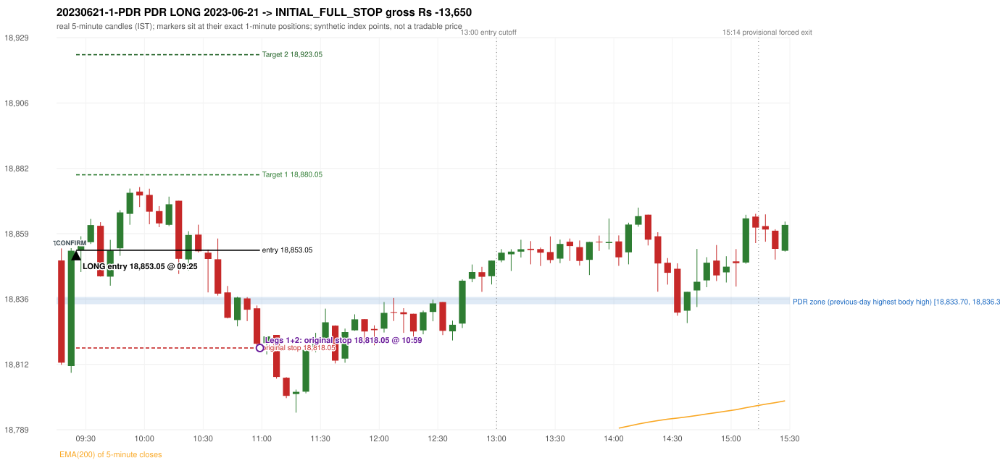
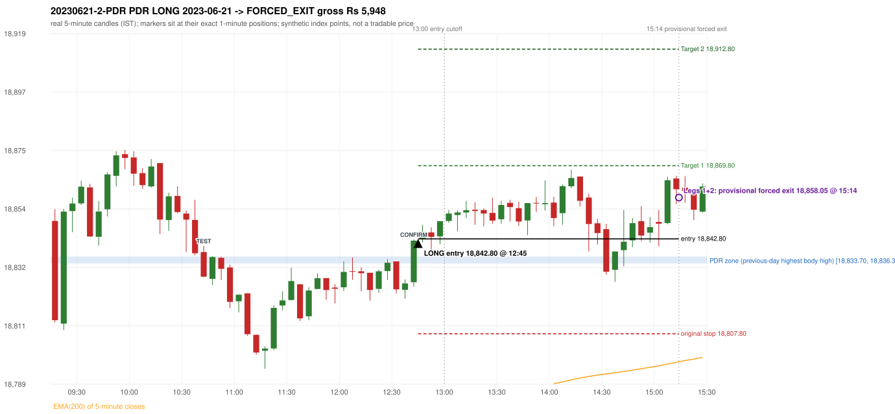

# Trading journal - 2023-06-21 (Wednesday)

> Phase 4 historical validation, window B_TV (Window B 2022-09-01..2025-08-31 (secondary vendor minutes); status VENDOR_SENSITIVITY). The FROZEN Phase 3.6 configuration (IRF, ORB, PDR body-based, PDS, RF; shared controller) on a different data source. HISTORICAL RESEARCH ONLY: the strategy was developed using later data. the same window with the secondary vendor's minute bars (daily series still 5paisa): quantifies sensitivity to the data source; not a second independent result Synthetic NIFTY 50 index-point P&L (the index is not tradable). The owner's review status is intentionally blank.

## A. Trading day overview

| item | value |
|---|---|
| Date / weekday | 2023-06-21 / Wednesday |
| Session type | USABLE_WITH_FLAGS / VALID |
| Original session open (first 1-minute open) | 18,849.40 |
| Previous session | 2023-06-20 |
| Previous-day high / low (wicks included) | 18,838.35 / 18,661.15 |
| Previous-day highest BODY high (the body-based PDR ceiling; wicks ignored) | 18,836.30 |
| Previous-day official close / last 5-minute close | 18,816.70 / 18,833.70 |
| Raw engine records / confirmed signals / fully valid signals | 19 / 15 / 15 |
| Setups that did not complete (invalidated / incomplete) | 4 |
| Executed trades | 2 20230621-1-PDR;20230621-2-PDR |
| Gross P&L (Rs, synthetic) | -7,702.50 |
| Illustrative net P&L (Rs; Rs 500/trade + 0.5 pt/fill) | -9,482.50 |
| Day-end portfolio status | DAY_FINISHED |
| Manual journal trades (matched / unmatched) | 0 (0 / 0) |
| Extra automated trades | 0 |

## B. Daily strategy signal timeline (confirmed signals, chronological)

| time | strategy | method | dir | entry-rule status | valid for execution | <= 13:00 | portfolio state | accepted / ignored | specific reason | competing (same minute) |
|---|---|---|---|---|---|---|---|---|---|---|
| 09:25 | PDR | PDR | LONG | RESEARCH_VARIANT | True | True | FIRST_TRADE_ACTIVE | ACCEPTED -> 20230621-1-PDR | first eligible signal of the day; trade 1: INITIAL_FULL_STOP |  |
| 09:40 | IRF | Method 1 | SHORT | PROPOSAL_DEPENDENT | True | True | FIRST_TRADE_ACTIVE | IGNORED | POSITION_ACTIVE (signal kept for diagnostics only; never reused) [blocked by PDR#1] |  |
| 10:10 | IRF | Method 2B | SHORT | PROPOSAL_DEPENDENT | True | True | FIRST_TRADE_ACTIVE | IGNORED | POSITION_ACTIVE (signal kept for diagnostics only; never reused) [blocked by PDR#1] |  |
| 10:20 | IRF | Method 1 | SHORT | PROPOSAL_DEPENDENT | True | True | FIRST_TRADE_ACTIVE | IGNORED | POSITION_ACTIVE (signal kept for diagnostics only; never reused) [blocked by PDR#1] |  |
| 10:30 | IRF | Method 1 | SHORT | PROPOSAL_DEPENDENT | True | True | FIRST_TRADE_ACTIVE | IGNORED | POSITION_ACTIVE (signal kept for diagnostics only; never reused) [blocked by PDR#1] |  |
| 10:40 | IRF | Method 2A | SHORT | PROPOSAL_DEPENDENT | True | True | FIRST_TRADE_ACTIVE | IGNORED | POSITION_ACTIVE (signal kept for diagnostics only; never reused) [blocked by PDR#1] |  |
| 12:45 | PDR | PDR | LONG | RESEARCH_VARIANT | True | True | SECOND_TRADE_ACTIVE | ACCEPTED -> 20230621-2-PDR | permitted second trade: newly confirmed PDR/PDS after the original full stop; trade 2: FORCED_EXIT |  |
| 13:45 | IRF | Method 1 | SHORT | PROPOSAL_DEPENDENT | True | False | SECOND_TRADE_ACTIVE | IGNORED | POSITION_ACTIVE (signal kept for diagnostics only; never reused) [blocked by PDR#2] |  |
| 13:55 | IRF | Method 2B | SHORT | PROPOSAL_DEPENDENT | True | False | SECOND_TRADE_ACTIVE | IGNORED | POSITION_ACTIVE (signal kept for diagnostics only; never reused) [blocked by PDR#2] |  |
| 14:05 | IRF | Method 1 | SHORT | PROPOSAL_DEPENDENT | True | False | SECOND_TRADE_ACTIVE | IGNORED | POSITION_ACTIVE (signal kept for diagnostics only; never reused) [blocked by PDR#2] |  |
| 14:20 | IRF | Method 2B | SHORT | PROPOSAL_DEPENDENT | True | False | SECOND_TRADE_ACTIVE | IGNORED | POSITION_ACTIVE (signal kept for diagnostics only; never reused) [blocked by PDR#2] |  |
| 14:25 | IRF | Method 1 | SHORT | PROPOSAL_DEPENDENT | True | False | SECOND_TRADE_ACTIVE | IGNORED | POSITION_ACTIVE (signal kept for diagnostics only; never reused) [blocked by PDR#2] |  |
| 14:40 | PDR | PDR | LONG | RESEARCH_VARIANT | True | False | SECOND_TRADE_ACTIVE | IGNORED | POSITION_ACTIVE (signal kept for diagnostics only; never reused) [blocked by PDR#2] |  |
| 15:10 | PDR | PDR | LONG | RESEARCH_VARIANT | True | False | SECOND_TRADE_ACTIVE | IGNORED | POSITION_ACTIVE (signal kept for diagnostics only; never reused) [blocked by PDR#2] |  |
| 15:25 | IRF | Method 1 | SHORT | PROPOSAL_DEPENDENT | True | False | DAY_FINISHED | IGNORED | DAY_FINISHED [blocked by PDR#2] |  |

Engine setups that did not complete (4); the complete list with failed rule ids is in `rejected_signals.csv`:

| candle | strategy | method | dir | status | precise reason | failed rules |
|---|---|---|---|---|---|---|
| 14:50 | IRF | Method 3 | SHORT | INVALIDATED | WICK_SHARE_OUT_OF_BAND | IRF-M3-003 |
| 15:05 | IRF | Method 1/2 | SHORT | INCOMPLETE_AT_EOD | SESSION_ENDED_BEFORE_CONFIRMATION |  |
| 09:15 | ORB | Method 2 | LONG | INVALIDATED | CANDLE_QUALITY | ORB-M2-LONG-003 |
| 11:20 | RF | RF | LONG | INVALIDATED | GAP_UP_OUTSIDE_YESTERDAYS_RANGE | RF-004 |

## C. Detailed trade journals

### 20230621-1-PDR: PDR LONG (FIRST trade)

Chart: 

**Rule configuration:** CFG-phase36_body_based-866f954e55 - signal verification status **RESEARCH_VARIANT** (never VERIFIED while a rule rests on a proposal).

#### 1. Setup identification

PDR LONG (body-based engine, A_HIGHEST_BODY_HIGH): the session opened 32.70 points above the previous close and 13.10 points above the previous-day highest BODY high 18,836.30 (zone [18,833.70, 18,836.30] from the 15:25 candle of 2023-06-20; the highest wick 18,838.35 is ignored). The 09:15 candle (18,812.00 - 18,853.70) tested the zone; the 09:20 candle (green, O 18,811.55 H 18,853.80 L 18,809.15 C 18,852.85) passed GOOD_GREEN_BODY and closed 16.55 points above the zone ceiling, confirming the entry at 09:25. The pattern thresholds and the zone's lower boundary are provisional research assumptions, not approved by the strategy author.

#### 2. Candle and indicator calculations

| role | session | candle | O | H | L | C | range | body % | upper wick % | lower wick % | direction | EMA(200) | strong bull / bear | pin bull / bear | small (body<=30%) | used for |
|---|---|---|---|---|---|---|---|---|---|---|---|---|---|---|---|---|
| zone_source_candle | PREVIOUS | 15:25-15:30 | 18,836.30 | 18,838.35 | 18,830.55 | 18,833.70 | 7.80 | 33.33 | 26.28 | 40.38 | BEARISH | 18,748.80 | False / False | False / False | False | candle of the previous session's highest BODY high (A_HIGHEST_BODY_HIGH) |
| prev_day_wick_high_candle | PREVIOUS | 15:25-15:30 | 18,836.30 | 18,838.35 | 18,830.55 | 18,833.70 | 7.80 | 33.33 | 26.28 | 40.38 | BEARISH | 18,748.80 | False / False | False / False | False | candle of the previous session's highest WICK (ignored by the author's rule; shown for comparison) |
| interaction_candle | TODAY | 09:15-09:20 | 18,849.40 | 18,853.70 | 18,812.00 | 18,812.80 | 41.70 | 87.77 | 10.31 | 1.92 | BEARISH | 18,749.44 | False / True | False / False | False | first candle whose range overlaps the zone (the test) |
| confirmation_candle | TODAY | 09:20-09:25 | 18,811.55 | 18,853.80 | 18,809.15 | 18,852.85 | 44.65 | 92.50 | 2.13 | 5.38 | BULLISH | 18,750.47 | True / False | False / False | False | candle that satisfies one of the three patterns and closes above the zone ceiling |

Every condition, with the rule, the calculation, the observed values and the result:

| # | group | rule | result | status / numeric definition | calculation | observed | required | available at | why it matters |
|---|---|---|---|---|---|---|---|---|---|
| 1 | SELECTION | SEL-FIRST-001 | PASS | USER_APPROVED / USER_APPROVED | earliest CONFIRMED signal of the day across IRF/ORB/PDR/PDS/RF that passed the controller's checks | 0 confirmed signal(s) earlier today; 15 confirmed signals in the day in total, this one at 09:25 | no earlier executable signal | 2023-06-21 09:25 | the shared controller trades only the first valid signal; the five strategies are not independent positions |
| 2 | SELECTION | SEL-TIE-001 | PASS | USER_APPROVED / USER_APPROVED | other CONFIRMED signals with exactly the same confirmation timestamp | none | no different-strategy / opposite-direction signal in the same minute (otherwise an unresolved conflict, no trade) | 2023-06-21 09:25 | an unresolved same-minute collision would have produced no trade at all |
| 3 | SELECTION | ENTRY-CUTOFF-001 | PASS | USER_APPROVED / USER_APPROVED | fill timestamp vs 13:00:00 IST | signal confirmed 09:25; fill 09:25 | fill at or before 13:00:00 IST | 2023-06-21 09:25 | no new position may be entered with a fill after 13:00 IST |
| 4 | SELECTION | EXE-FILL-001 | PASS | PROPOSED_FOR_REVIEW / PROPOSED_FOR_REVIEW | fill = open of the 1-minute bar that starts at the signal candle's end | bar 09:25 O 18,853.05 H 18,858.05 L 18,852.55 C 18,855.55; executable=True; entry 18,853.05 | fill bar exists, starts exactly at the signal end, is fillable; entry = its open | 2023-06-21 09:25 | a 5-minute signal is known only when its candle closes; the first price that can be traded is the next minute's open |
| 5 | SELECTION | DAY-MAX-001 | PASS | USER_APPROVED / USER_APPROVED | number of entries today | trade 1 of at most 2 | <= 2 entries per day | 2023-06-21 09:25 | daily trade cap |
| 6 | SETUP | PDR-004 | PASS | SOURCE_VERIFIED / EXPLICIT_WORDING_DETAIL_PROPOSED_FOR_REVIEW | gap = first 1-minute open of today - previous session's OFFICIAL close | today's open 18,849.40 (first 1-minute bar 09:15) - previous close 18,816.70 (DAILY_VENDOR, 2023-06-20) = +32.70 points -> gap UP | gap UP (more than 0 points) | 2023-06-21 09:15 | approved convention: the original first-minute open, never the vendor daily open |
| 7 | SETUP | PDR-B03 | PASS | AUTHOR_APPROVED / AUTHOR_STATEMENT_NUMERIC_DETAILS_ARE_SEPARATE_PROPOSED_ROWS | the session opens strictly above the previous day's resistance zone (author-approved) | today's first 1-minute open 18,849.40 vs zone ceiling 18,836.30: 13.10 points above (open - ceiling = +13.10) | open > zone ceiling (equal or inside the zone rejects the setup) | 2023-06-21 09:15 | the original first-minute open is used, never a vendor daily open |
| 8 | ZONE | PDR-001 | PASS | SOURCE_VERIFIED / EXPLICIT_IN_SOURCE | direction | LONG (PDR is long only) | long-only | 2023-06-21 09:25 | PDR buys a retest of previous-day resistance after a gap up |
| 9 | ZONE | PDR-B01a | PASS | AUTHOR_APPROVED / AUTHOR_STATEMENT_NUMERIC_DETAILS_ARE_SEPARATE_PROPOSED_ROWS | wicks ignored, bodies considered: body_high = max(open, close) of every completed previous-session 5-minute candle; ceiling = the highest body_high; floor = body low of that candle | previous session 2023-06-20: highest body high 18,836.30 on the 15:25 candle (O 18,836.30 C 18,833.70; wick high of that candle 18,838.35, ignored); four highest body highs: 18,836.30 (15:25); 18,835.30 (15:20); 18,829.15 (15:15); 18,820.40 (15:10). Highest WICK of the session 18,838.35 (15:25 candle) is 2.05 points above the ceiling and plays no part. Zone [18,833.70 (body low), 18,836.30 (body high)]; engine recorded [18,833.70, 18,836.30] | ceiling = highest body high of the previous session (author: wick ignored, body considered) | 2023-06-20 15:30 | a wick-only price never becomes resistance; the zone is drawn from candle bodies |
| 10 | ZONE | PDR-B02 | UNRESOLVED | AUTHOR_APPROVED / AUTHOR_STATEMENT_NUMERIC_DETAILS_ARE_SEPARATE_PROPOSED_ROWS | multiple highs connected into one zone (author principle; candidate B) | candidate A (used): [18,833.70, 18,836.30]. Candidate B (multiple-body-high cluster, tolerance 5 points) would be [18,833.70, 18,836.30] (ISOLATED_BODY_HIGH, 1 touch(es), member body highs 18,836.30); ceiling difference 0.00 points | a zone that connects all relevant highs (numbers not given by the author) | 2023-06-20 15:30 | candidate B has the same ceiling by construction, so this signal is unaffected by the choice; the lower boundary and the cluster numbers are research parameters |
| 11 | ZONE | PDR-003 | PASS | SOURCE_VERIFIED / EXPLICIT_IN_SOURCE | the zone is an area, not a single price | zone height 2.60 points [18,833.70, 18,836.30] | a rectangle with positive height (a zero-height zone is left unresolved by the engine) | 2023-06-20 15:30 | price may touch any part of the area |
| 12 | CONFIRMATION | PDR-B03b | PASS | PRESERVED_FROM_PHASE2 / PRESERVED_FROM_PHASE2 | the first candle whose [low, high] overlaps the zone (+/- proximity) is the test; the confirmation must come strictly after it | 09:15-09:20 O 18,849.40 H 18,853.70 L 18,812.00 C 18,812.80; range 41.70, body 36.60 (87.77%), upper wick 4.30 (10.31%), lower wick 0.80 (1.92%), bearish; low 18,812.00 vs zone ceiling 18,836.30, high 18,853.70 vs zone floor 18,833.70; proximity 0; confirmation candle 09:20 is candle no. 2, the test candle no. 1 | range overlaps the zone; confirmation after the test | 2023-06-21 09:20 | the retest of the previous-day resistance |
| 13 | CONFIRMATION | PDR-B04c | PASS | PROPOSED_FOR_REVIEW / NUMERIC_DEFINITION_PROPOSED_FOR_REVIEW | Pattern 1: good green body on the 09:20-09:25 candle (O 18,811.55 H 18,853.80 L 18,809.15 C 18,852.85); the numeric thresholds are PROVISIONAL (RESEARCH_DEFAULT), not author-approved | colour green; body 92.50%; upper wick 2.13% -> PASSES | green, body >= 60% and upper wick <= 20% of the range | 2023-06-21 09:25 | one of the three patterns is enough (author: one good green body OR lower price rejection OR hammer); fixed thresholds are not required by the author, so the numbers are a research convention; a pattern that does not pass is not an error |
| 14 | CONFIRMATION | PDR-B04c | NOT_APPLICABLE | PROPOSED_FOR_REVIEW / NUMERIC_DEFINITION_PROPOSED_FOR_REVIEW | Pattern 2: lower-price rejection candle on the 09:20-09:25 candle (O 18,811.55 H 18,853.80 L 18,809.15 C 18,852.85); the numeric thresholds are PROVISIONAL (RESEARCH_DEFAULT), not author-approved | lower wick 2.40 = 0.06 x body 41.30; close 2.13% below the high; low 18,809.15; low reached the zone ceiling 18,836.30 -> does not pass | lower wick >= 2 x body, close within the top 30% of the range, low <= zone ceiling (colour not required) | 2023-06-21 09:25 | one of the three patterns is enough (author: one good green body OR lower price rejection OR hammer); fixed thresholds are not required by the author, so the numbers are a research convention; a pattern that does not pass is not an error |
| 15 | CONFIRMATION | PDR-B04c | NOT_APPLICABLE | PROPOSED_FOR_REVIEW / NUMERIC_DEFINITION_PROPOSED_FOR_REVIEW | Pattern 3: hammer candle on the 09:20-09:25 candle (O 18,811.55 H 18,853.80 L 18,809.15 C 18,852.85); the numeric thresholds are PROVISIONAL (RESEARCH_DEFAULT), not author-approved | lower wick 2.40 = 0.06 x body; upper wick 2.13%; body bottom at 5.38% of the range -> does not pass | lower wick >= 2 x body, upper wick <= 10%, body bottom >= 60% of the range (colour not required) | 2023-06-21 09:25 | one of the three patterns is enough (author: one good green body OR lower price rejection OR hammer); fixed thresholds are not required by the author, so the numbers are a research convention; a pattern that does not pass is not an error |
| 16 | CONFIRMATION | PDR-B04 | PASS | AUTHOR_APPROVED / AUTHOR_STATEMENT_NUMERIC_DETAILS_ARE_SEPARATE_PROPOSED_ROWS | at least one of the three patterns passes (OR logic; every passing pattern is recorded) | patterns passed: GOOD_GREEN_BODY (engine recorded: GOOD_GREEN_BODY) | at least one pattern | 2023-06-21 09:25 | the author's entry candle requirement |
| 17 | CONFIRMATION | PDR-B05 | PASS | AUTHOR_APPROVED / AUTHOR_STATEMENT_NUMERIC_DETAILS_ARE_SEPARATE_PROPOSED_ROWS | the confirmation candle must close above the zone | close 18,852.85 vs zone ceiling 18,836.30: +16.55 points (floor 18,833.70; low 18,809.15 dipped into/below the zone) | close > zone ceiling, strictly (lower wick may penetrate the zone) | 2023-06-21 09:25 | no pattern overrides the close rule |
| 18 | CONFIRMATION | PDR-B06 | PASS | USER_APPROVED / USER_APPROVED | no entry at the open and no look-ahead: the order is placed only after the confirmation candle has completed | test candle 09:15 (no. 1) precedes the confirmation candle 09:20-09:25; signal stamped 09:25; fill 09:25 at the open of that 1-minute bar = 18,853.05 | interaction before the confirmation; fill after the confirmation candle's end | 2023-06-21 09:25 | existing causal fill convention (EXE-FILL-001) |
| 19 | EXECUTION | EXE-STOP-001 | PASS | USER_APPROVED / USER_APPROVED | initial stop = entry - 35 points | entry 18,853.05 -> stop 18,818.05 | stop 35 index points (BASELINE) | 2023-06-21 09:25 | defines the loss if the setup fails before Target 1 |
| 20 | EXECUTION | EXE-T1-001 | PASS | SOURCE_VERIFIED / EXPLICIT_IN_SOURCE | Target 1 = entry +/- 27 points | T1 18,880.05 | 27 points | 2023-06-21 09:25 | Leg 1 (3 lots) is booked at Target 1 |
| 21 | EXECUTION | PDR-008 | PASS | SOURCE_VERIFIED / EXPLICIT_IN_SOURCE | Target 2 = entry +/- 70 points | T2 18,923.05 (the guide says 70; the performance report's winners suggest 60 - CONFLICTING, recorded) | 70 points | 2023-06-21 09:25 | Leg 2 (3 lots) is booked at Target 2 |
| 22 | EXECUTION | POST-T1-STOP-006 | PASS | USER_APPROVED / USER_APPROVED | after T1 the Leg-2 stop = entry - 6 (no trailing) | post-T1 stop 18,847.05 | entry -6 (LONG) / +6 (SHORT) | 2023-06-21 09:25 | protects the remaining three lots once the first three are booked |
| 23 | EXECUTION | SIZE-LOT-001 | PASS | USER_APPROVED / USER_APPROVED | 6 lots x 65 = 390, Leg 1 = 3 lots = 195, Leg 2 = 195 | 6 lots, lot size 65, legs 3+3 | 6 lots in two equal legs | 2023-06-21 09:25 | position size for the synthetic P&L |
| 24 | NOTE | PDR-B04x | UNRESOLVED | PROPOSED_FOR_REVIEW / NUMERIC_DEFINITION_PROPOSED_FOR_REVIEW | provisional parameters this signal rests on | pattern thresholds RESEARCH_DEFAULT: {'green_body_min': 0.6, 'green_upper_wick_max': 0.2, 'reject_wick_to_body_min': 2.0, 'reject_close_fraction_max': 0.3, 'hammer_wick_to_body_min': 2.0, 'hammer_upper_wick_max': 0.1, 'hammer_body_position_min': 0.6}; zone lower boundary = hull of the member bodies; zero-height policy UNRESOLVED_NO_SETUP; wait policy WAIT_FOR_QUALIFYING_CANDLE; cluster parameters (candidate B only) tolerance 5, touches 2, separation 2 | n/a (disclosure) | 2023-06-21 09:25 | the strategy author has NOT approved these numbers or conventions; the signal is a RESEARCH_VARIANT, never VERIFIED |
| 25 | NOTE | PDR-012 | NOT_APPLICABLE | PROPOSED_FOR_REVIEW / PROPOSED_FOR_REVIEW | repeated PDR signals today | 4 confirmed PDR signal(s) in the session | n/a (disclosure) | 2023-06-21 09:25 | this engine reports EVERY qualifying signal (the per-session cap is lifted); the controller trades only the first (and a PDR/PDS second trade after an initial full stop) |
| 26 | NOTE | PDR-B07 | UNRESOLVED | PROPOSED_FOR_REVIEW / NUMERIC_DEFINITION_PROPOSED_FOR_REVIEW | state of the zone between the test and the confirmation (the author and the guide are silent on price crossing below the zone) | test candle 09:15 (no. 1), confirmation candle 09:20 (no. 2): 1 candle(s) later; 1 candle(s) in between CLOSED BELOW the zone floor 18,833.70 (lowest close 18,812.80) before price returned above the ceiling | n/a (disclosure; the wait policy is a research parameter) | 2023-06-21 09:25 | the engine keeps a tested setup armed until a candle qualifies; whether a zone that price has closed through should still count is an owner decision |
| 27 | NOTE | PDR-009 | UNRESOLVED | UNRESOLVED / UNRESOLVED | stop 35 or 40 'depending on the situation' | the guide gives no selection rule; baseline fixed 35 points | unresolved in the source | 2023-06-21 09:25 | PDR stop selection is left to the owner |
| 28 | NOTE | NOTE-UNRESOLVED-DEPENDENCIES | UNRESOLVED | NOT_A_RULE / NOT_A_REGISTRY_RULE | rules the signal depends on that the sources leave unresolved | engine-recorded unresolved rule ids: PDR-B01b, PDR-B02a, PDR-B02b, PDR-B02c, PDR-B02d, PDR-B02e, PDR-B02f, PDR-B02g, PDR-B02h, PDR-B04b, PDR-B04c, PDR-B05a, PDR-B07; verification status RESEARCH_VARIANT | n/a (disclosure) | 2023-06-21 09:25 | the entry is only as verified as the rules it rests on |

#### 3. Entry decision and explanation

PDR LONG (body-based engine, A_HIGHEST_BODY_HIGH): the session opened 32.70 points above the previous close and 13.10 points above the previous-day highest BODY high 18,836.30 (zone [18,833.70, 18,836.30] from the 15:25 candle of 2023-06-20; the highest wick 18,838.35 is ignored). The 09:15 candle (18,812.00 - 18,853.70) tested the zone; the 09:20 candle (green, O 18,811.55 H 18,853.80 L 18,809.15 C 18,852.85) passed GOOD_GREEN_BODY and closed 16.55 points above the zone ceiling, confirming the entry at 09:25. The pattern thresholds and the zone's lower boundary are provisional research assumptions, not approved by the strategy author.

**Why this trade ahead of the other strategies:** This PDR signal was the earliest executable signal of the day: 0 confirmed signal(s) earlier, 0 other in the same minute. 14 later confirmed signal(s) (IRF x11, PDR x3) are logged as ignored or rejected. State of the other four engines at that moment: [IRF: no setup record before this time (a base condition was not met, or nothing triggered)] [ORB: Method 2 invalidated at 09:15: CANDLE_QUALITY] [PDS: no setup record before this time (a base condition was not met, or nothing triggered)] [RF: no setup record before this time (a base condition was not met, or nothing triggered)]

#### 4. Actual entry execution

| item | value |
|---|---|
| Signal candle | 09:20-09:25 |
| Signal confirmed | 2023-06-21 09:25 |
| Fill timestamp | 2023-06-21 09:25 |
| Entry price | 18,853.05 |
| Source partition / 1-minute bar | data/phase4/processed/TECHNOVUS_1M/nifty50/year=2023/month=06/candles.parquet / 2023-06-21 09:25 |
| Source bar O / H / L / C | 18,853.05 / 18,858.05 / 18,852.55 / 18,855.55 |
| Fill assumption | open of the 1-minute bar starting at the signal candle's end (EXE-FILL-001, PROPOSED causal convention) |
| Initial stop / T1 / T2 / post-T1 stop | 18,818.05 / 18,880.05 / 18,923.05 / 18,847.05 |
| Position | 6 lots x 65 = 390 units (Leg 1 195, Leg 2 195) |

#### 5-8. Trade progress, Target 1, post-T1 stop and final exit

Between the 09:25 entry bar and the final exit (95 one-minute bars) the best excursion in favour was 22.60 points at 09:58 and the worst against was 35.75 points at 10:59. At 10:59 price reached the original stop 18,818.05 before Target 1 18,880.05, so all six lots exited together at 18,818.05. This is an INITIAL_FULL_STOP: one more trade is allowed that day, only a newly confirmed PDR/PDS signal.

| leg | qty | exit time | exit price | reason | source 1-minute bar | O / H / L / C | gross points | gross Rs | slippage pts | flags |
|---|---|---|---|---|---|---|---|---|---|---|
| 1 | 195 | 10:59 | 18,818.05 | ORIGINAL_STOP_BEFORE_T1 | 10:59 | 18,820.10 / 18,820.70 / 18,817.30 / 18,819.55 | -35.00 | -6,825.00 | 0.00 |  |
| 2 | 195 | 10:59 | 18,818.05 | ORIGINAL_STOP_BEFORE_T1 | 10:59 | 18,820.10 / 18,820.70 / 18,817.30 / 18,819.55 | -35.00 | -6,825.00 | 0.00 |  |

Exit evidence per leg:

* Leg 1: 1-minute bar 10:59 O 18,820.10 H 18,820.70 L 18,817.30 C 18,819.55: low 18,817.30 reached the original stop 18,818.05 before Target 1 18,880.05 was touched; both legs exit at the stop level 18,818.05
* Leg 2: 1-minute bar 10:59 O 18,820.10 H 18,820.70 L 18,817.30 C 18,819.55: low 18,817.30 reached the original stop 18,818.05 before Target 1 18,880.05 was touched; both legs exit at the stop level 18,818.05

#### 9. Gross and illustrative net P&L

| item | value (Rs) |
|---|---|
| Leg 1 gross | -6,825.00 |
| Leg 2 gross | -6,825.00 |
| Trade gross (= Leg 1 + Leg 2) | -13,650.00 |
| Illustrative fixed cost | -500.00 |
| Illustrative slippage (0.5 pt on every fill, entry + exits, all units) | -390.00 |
| Illustrative net | -14,540.00 |

#### 10. Manual journal comparison

No manual journal exists for this period; no comparison.

### 20230621-2-PDR: PDR LONG (SECOND trade)

Chart: 

**Rule configuration:** CFG-phase36_body_based-866f954e55 - signal verification status **RESEARCH_VARIANT** (never VERIFIED while a rule rests on a proposal).

#### 1. Setup identification

PDR LONG (body-based engine, A_HIGHEST_BODY_HIGH): the session opened 32.70 points above the previous close and 13.10 points above the previous-day highest BODY high 18,836.30 (zone [18,833.70, 18,836.30] from the 15:25 candle of 2023-06-20; the highest wick 18,838.35 is ignored). The 10:40 candle (18,828.65 - 18,840.25) tested the zone; the 12:40 candle (green, O 18,826.80 H 18,842.60 L 18,825.20 C 18,842.15) passed GOOD_GREEN_BODY and closed 5.85 points above the zone ceiling, confirming the entry at 12:45. The pattern thresholds and the zone's lower boundary are provisional research assumptions, not approved by the strategy author.

#### 2. Candle and indicator calculations

| role | session | candle | O | H | L | C | range | body % | upper wick % | lower wick % | direction | EMA(200) | strong bull / bear | pin bull / bear | small (body<=30%) | used for |
|---|---|---|---|---|---|---|---|---|---|---|---|---|---|---|---|---|
| zone_source_candle | PREVIOUS | 15:25-15:30 | 18,836.30 | 18,838.35 | 18,830.55 | 18,833.70 | 7.80 | 33.33 | 26.28 | 40.38 | BEARISH | 18,748.80 | False / False | False / False | False | candle of the previous session's highest BODY high (A_HIGHEST_BODY_HIGH) |
| prev_day_wick_high_candle | PREVIOUS | 15:25-15:30 | 18,836.30 | 18,838.35 | 18,830.55 | 18,833.70 | 7.80 | 33.33 | 26.28 | 40.38 | BEARISH | 18,748.80 | False / False | False / False | False | candle of the previous session's highest WICK (ignored by the author's rule; shown for comparison) |
| interaction_candle | TODAY | 10:40-10:45 | 18,837.95 | 18,840.25 | 18,828.65 | 18,828.85 | 11.60 | 78.45 | 19.83 | 1.72 | BEARISH | 18,766.10 | False / True | False / False | False | first candle whose range overlaps the zone (the test) |
| confirmation_candle | TODAY | 12:40-12:45 | 18,826.80 | 18,842.60 | 18,825.20 | 18,842.15 | 17.40 | 88.22 | 2.59 | 9.20 | BULLISH | 18,778.49 | True / False | False / False | False | candle that satisfies one of the three patterns and closes above the zone ceiling |

Every condition, with the rule, the calculation, the observed values and the result:

| # | group | rule | result | status / numeric definition | calculation | observed | required | available at | why it matters |
|---|---|---|---|---|---|---|---|---|---|
| 1 | SELECTION | DAY-SL-001 | PASS | USER_APPROVED / USER_APPROVED | first trade outcome, strategy of this signal, position-close time vs this signal's timestamp | first trade PDR PDR closed as INITIAL_FULL_STOP at 10:59; position free from 11:00; this PDR signal confirmed 12:45 | first trade INITIAL_FULL_STOP before Target 1, and a NEWLY confirmed PDR/PDS signal after the first position closed | 2023-06-21 12:45 | the only way a second trade is allowed |
| 2 | SELECTION | DAY-NOREUSE-001 | PASS | USER_APPROVED / USER_APPROVED | signals confirmed while the first position was open | 6 signal(s) were ignored during the first trade (never reused): PDR PDR LONG @09:25; IRF Method 1 SHORT @09:40 [IGNORED: POSITION_ACTIVE]; IRF Method 2B SHORT @10:10 [IGNORED: POSITION_ACTIVE]; IRF Method 1 SHORT @10:20 [IGNORED: POSITION_ACTIVE]; IRF Method 1 SHORT @10:30 [IGNORED: POSITION_ACTIVE]; IRF Method 2A SHORT @10:40 [IGNORED: POSITION_ACTIVE] | this trade comes from a signal confirmed after the first exit, not from an ignored one | 2023-06-21 12:45 | an ignored signal can never become the second trade |
| 3 | SELECTION | ENTRY-CUTOFF-001 | PASS | USER_APPROVED / USER_APPROVED | fill timestamp vs 13:00:00 IST | signal confirmed 12:45; fill 12:45 | fill at or before 13:00:00 IST | 2023-06-21 12:45 | no new position may be entered with a fill after 13:00 IST |
| 4 | SELECTION | EXE-FILL-001 | PASS | PROPOSED_FOR_REVIEW / PROPOSED_FOR_REVIEW | fill = open of the 1-minute bar that starts at the signal candle's end | bar 12:45 O 18,842.80 H 18,845.20 L 18,842.40 C 18,845.20; executable=True; entry 18,842.80 | fill bar exists, starts exactly at the signal end, is fillable; entry = its open | 2023-06-21 12:45 | a 5-minute signal is known only when its candle closes; the first price that can be traded is the next minute's open |
| 5 | SELECTION | DAY-MAX-001 | PASS | USER_APPROVED / USER_APPROVED | number of entries today | trade 2 of at most 2 | <= 2 entries per day | 2023-06-21 12:45 | daily trade cap |
| 6 | SETUP | PDR-004 | PASS | SOURCE_VERIFIED / EXPLICIT_WORDING_DETAIL_PROPOSED_FOR_REVIEW | gap = first 1-minute open of today - previous session's OFFICIAL close | today's open 18,849.40 (first 1-minute bar 09:15) - previous close 18,816.70 (DAILY_VENDOR, 2023-06-20) = +32.70 points -> gap UP | gap UP (more than 0 points) | 2023-06-21 09:15 | approved convention: the original first-minute open, never the vendor daily open |
| 7 | SETUP | PDR-B03 | PASS | AUTHOR_APPROVED / AUTHOR_STATEMENT_NUMERIC_DETAILS_ARE_SEPARATE_PROPOSED_ROWS | the session opens strictly above the previous day's resistance zone (author-approved) | today's first 1-minute open 18,849.40 vs zone ceiling 18,836.30: 13.10 points above (open - ceiling = +13.10) | open > zone ceiling (equal or inside the zone rejects the setup) | 2023-06-21 09:15 | the original first-minute open is used, never a vendor daily open |
| 8 | ZONE | PDR-001 | PASS | SOURCE_VERIFIED / EXPLICIT_IN_SOURCE | direction | LONG (PDR is long only) | long-only | 2023-06-21 12:45 | PDR buys a retest of previous-day resistance after a gap up |
| 9 | ZONE | PDR-B01a | PASS | AUTHOR_APPROVED / AUTHOR_STATEMENT_NUMERIC_DETAILS_ARE_SEPARATE_PROPOSED_ROWS | wicks ignored, bodies considered: body_high = max(open, close) of every completed previous-session 5-minute candle; ceiling = the highest body_high; floor = body low of that candle | previous session 2023-06-20: highest body high 18,836.30 on the 15:25 candle (O 18,836.30 C 18,833.70; wick high of that candle 18,838.35, ignored); four highest body highs: 18,836.30 (15:25); 18,835.30 (15:20); 18,829.15 (15:15); 18,820.40 (15:10). Highest WICK of the session 18,838.35 (15:25 candle) is 2.05 points above the ceiling and plays no part. Zone [18,833.70 (body low), 18,836.30 (body high)]; engine recorded [18,833.70, 18,836.30] | ceiling = highest body high of the previous session (author: wick ignored, body considered) | 2023-06-20 15:30 | a wick-only price never becomes resistance; the zone is drawn from candle bodies |
| 10 | ZONE | PDR-B02 | UNRESOLVED | AUTHOR_APPROVED / AUTHOR_STATEMENT_NUMERIC_DETAILS_ARE_SEPARATE_PROPOSED_ROWS | multiple highs connected into one zone (author principle; candidate B) | candidate A (used): [18,833.70, 18,836.30]. Candidate B (multiple-body-high cluster, tolerance 5 points) would be [18,833.70, 18,836.30] (ISOLATED_BODY_HIGH, 1 touch(es), member body highs 18,836.30); ceiling difference 0.00 points | a zone that connects all relevant highs (numbers not given by the author) | 2023-06-20 15:30 | candidate B has the same ceiling by construction, so this signal is unaffected by the choice; the lower boundary and the cluster numbers are research parameters |
| 11 | ZONE | PDR-003 | PASS | SOURCE_VERIFIED / EXPLICIT_IN_SOURCE | the zone is an area, not a single price | zone height 2.60 points [18,833.70, 18,836.30] | a rectangle with positive height (a zero-height zone is left unresolved by the engine) | 2023-06-20 15:30 | price may touch any part of the area |
| 12 | CONFIRMATION | PDR-B03b | PASS | PRESERVED_FROM_PHASE2 / PRESERVED_FROM_PHASE2 | the first candle whose [low, high] overlaps the zone (+/- proximity) is the test; the confirmation must come strictly after it | 10:40-10:45 O 18,837.95 H 18,840.25 L 18,828.65 C 18,828.85; range 11.60, body 9.10 (78.45%), upper wick 2.30 (19.83%), lower wick 0.20 (1.72%), bearish; low 18,828.65 vs zone ceiling 18,836.30, high 18,840.25 vs zone floor 18,833.70; proximity 0; confirmation candle 12:40 is candle no. 42, the test candle no. 18 | range overlaps the zone; confirmation after the test | 2023-06-21 10:45 | the retest of the previous-day resistance (re-armed after the earlier signal: scanning restarted after the 09:20 candle) |
| 13 | CONFIRMATION | PDR-B04c | PASS | PROPOSED_FOR_REVIEW / NUMERIC_DEFINITION_PROPOSED_FOR_REVIEW | Pattern 1: good green body on the 12:40-12:45 candle (O 18,826.80 H 18,842.60 L 18,825.20 C 18,842.15); the numeric thresholds are PROVISIONAL (RESEARCH_DEFAULT), not author-approved | colour green; body 88.22%; upper wick 2.59% -> PASSES | green, body >= 60% and upper wick <= 20% of the range | 2023-06-21 12:45 | one of the three patterns is enough (author: one good green body OR lower price rejection OR hammer); fixed thresholds are not required by the author, so the numbers are a research convention; a pattern that does not pass is not an error |
| 14 | CONFIRMATION | PDR-B04c | NOT_APPLICABLE | PROPOSED_FOR_REVIEW / NUMERIC_DEFINITION_PROPOSED_FOR_REVIEW | Pattern 2: lower-price rejection candle on the 12:40-12:45 candle (O 18,826.80 H 18,842.60 L 18,825.20 C 18,842.15); the numeric thresholds are PROVISIONAL (RESEARCH_DEFAULT), not author-approved | lower wick 1.60 = 0.10 x body 15.35; close 2.59% below the high; low 18,825.20; low reached the zone ceiling 18,836.30 -> does not pass | lower wick >= 2 x body, close within the top 30% of the range, low <= zone ceiling (colour not required) | 2023-06-21 12:45 | one of the three patterns is enough (author: one good green body OR lower price rejection OR hammer); fixed thresholds are not required by the author, so the numbers are a research convention; a pattern that does not pass is not an error |
| 15 | CONFIRMATION | PDR-B04c | NOT_APPLICABLE | PROPOSED_FOR_REVIEW / NUMERIC_DEFINITION_PROPOSED_FOR_REVIEW | Pattern 3: hammer candle on the 12:40-12:45 candle (O 18,826.80 H 18,842.60 L 18,825.20 C 18,842.15); the numeric thresholds are PROVISIONAL (RESEARCH_DEFAULT), not author-approved | lower wick 1.60 = 0.10 x body; upper wick 2.59%; body bottom at 9.20% of the range -> does not pass | lower wick >= 2 x body, upper wick <= 10%, body bottom >= 60% of the range (colour not required) | 2023-06-21 12:45 | one of the three patterns is enough (author: one good green body OR lower price rejection OR hammer); fixed thresholds are not required by the author, so the numbers are a research convention; a pattern that does not pass is not an error |
| 16 | CONFIRMATION | PDR-B04 | PASS | AUTHOR_APPROVED / AUTHOR_STATEMENT_NUMERIC_DETAILS_ARE_SEPARATE_PROPOSED_ROWS | at least one of the three patterns passes (OR logic; every passing pattern is recorded) | patterns passed: GOOD_GREEN_BODY (engine recorded: GOOD_GREEN_BODY) | at least one pattern | 2023-06-21 12:45 | the author's entry candle requirement |
| 17 | CONFIRMATION | PDR-B05 | PASS | AUTHOR_APPROVED / AUTHOR_STATEMENT_NUMERIC_DETAILS_ARE_SEPARATE_PROPOSED_ROWS | the confirmation candle must close above the zone | close 18,842.15 vs zone ceiling 18,836.30: +5.85 points (floor 18,833.70; low 18,825.20 dipped into/below the zone) | close > zone ceiling, strictly (lower wick may penetrate the zone) | 2023-06-21 12:45 | no pattern overrides the close rule |
| 18 | CONFIRMATION | PDR-B06 | PASS | USER_APPROVED / USER_APPROVED | no entry at the open and no look-ahead: the order is placed only after the confirmation candle has completed | test candle 10:40 (no. 18) precedes the confirmation candle 12:40-12:45; signal stamped 12:45; fill 12:45 at the open of that 1-minute bar = 18,842.80 | interaction before the confirmation; fill after the confirmation candle's end | 2023-06-21 12:45 | existing causal fill convention (EXE-FILL-001) |
| 19 | EXECUTION | EXE-STOP-001 | PASS | USER_APPROVED / USER_APPROVED | initial stop = entry - 35 points | entry 18,842.80 -> stop 18,807.80 | stop 35 index points (BASELINE) | 2023-06-21 12:45 | defines the loss if the setup fails before Target 1 |
| 20 | EXECUTION | EXE-T1-001 | PASS | SOURCE_VERIFIED / EXPLICIT_IN_SOURCE | Target 1 = entry +/- 27 points | T1 18,869.80 | 27 points | 2023-06-21 12:45 | Leg 1 (3 lots) is booked at Target 1 |
| 21 | EXECUTION | PDR-008 | PASS | SOURCE_VERIFIED / EXPLICIT_IN_SOURCE | Target 2 = entry +/- 70 points | T2 18,912.80 (the guide says 70; the performance report's winners suggest 60 - CONFLICTING, recorded) | 70 points | 2023-06-21 12:45 | Leg 2 (3 lots) is booked at Target 2 |
| 22 | EXECUTION | POST-T1-STOP-006 | PASS | USER_APPROVED / USER_APPROVED | after T1 the Leg-2 stop = entry - 6 (no trailing) | post-T1 stop 18,836.80 | entry -6 (LONG) / +6 (SHORT) | 2023-06-21 12:45 | protects the remaining three lots once the first three are booked |
| 23 | EXECUTION | SIZE-LOT-001 | PASS | USER_APPROVED / USER_APPROVED | 6 lots x 65 = 390, Leg 1 = 3 lots = 195, Leg 2 = 195 | 6 lots, lot size 65, legs 3+3 | 6 lots in two equal legs | 2023-06-21 12:45 | position size for the synthetic P&L |
| 24 | NOTE | PDR-B04x | UNRESOLVED | PROPOSED_FOR_REVIEW / NUMERIC_DEFINITION_PROPOSED_FOR_REVIEW | provisional parameters this signal rests on | pattern thresholds RESEARCH_DEFAULT: {'green_body_min': 0.6, 'green_upper_wick_max': 0.2, 'reject_wick_to_body_min': 2.0, 'reject_close_fraction_max': 0.3, 'hammer_wick_to_body_min': 2.0, 'hammer_upper_wick_max': 0.1, 'hammer_body_position_min': 0.6}; zone lower boundary = hull of the member bodies; zero-height policy UNRESOLVED_NO_SETUP; wait policy WAIT_FOR_QUALIFYING_CANDLE; cluster parameters (candidate B only) tolerance 5, touches 2, separation 2 | n/a (disclosure) | 2023-06-21 12:45 | the strategy author has NOT approved these numbers or conventions; the signal is a RESEARCH_VARIANT, never VERIFIED |
| 25 | NOTE | PDR-012 | NOT_APPLICABLE | PROPOSED_FOR_REVIEW / PROPOSED_FOR_REVIEW | repeated PDR signals today | 4 confirmed PDR signal(s) in the session | n/a (disclosure) | 2023-06-21 12:45 | this engine reports EVERY qualifying signal (the per-session cap is lifted); the controller trades only the first (and a PDR/PDS second trade after an initial full stop) |
| 26 | NOTE | PDR-B07 | UNRESOLVED | PROPOSED_FOR_REVIEW / NUMERIC_DEFINITION_PROPOSED_FOR_REVIEW | state of the zone between the test and the confirmation (the author and the guide are silent on price crossing below the zone) | test candle 10:40 (no. 18), confirmation candle 12:40 (no. 42): 24 candle(s) later; 22 candle(s) in between CLOSED BELOW the zone floor 18,833.70 (lowest close 18,800.90) before price returned above the ceiling | n/a (disclosure; the wait policy is a research parameter) | 2023-06-21 12:45 | the engine keeps a tested setup armed until a candle qualifies; whether a zone that price has closed through should still count is an owner decision |
| 27 | NOTE | PDR-009 | UNRESOLVED | UNRESOLVED / UNRESOLVED | stop 35 or 40 'depending on the situation' | the guide gives no selection rule; baseline fixed 35 points | unresolved in the source | 2023-06-21 12:45 | PDR stop selection is left to the owner |
| 28 | NOTE | NOTE-UNRESOLVED-DEPENDENCIES | UNRESOLVED | NOT_A_RULE / NOT_A_REGISTRY_RULE | rules the signal depends on that the sources leave unresolved | engine-recorded unresolved rule ids: PDR-B01b, PDR-B02a, PDR-B02b, PDR-B02c, PDR-B02d, PDR-B02e, PDR-B02f, PDR-B02g, PDR-B02h, PDR-B04b, PDR-B04c, PDR-B05a, PDR-B07; verification status RESEARCH_VARIANT | n/a (disclosure) | 2023-06-21 12:45 | the entry is only as verified as the rules it rests on |

#### 3. Entry decision and explanation

PDR LONG (body-based engine, A_HIGHEST_BODY_HIGH): the session opened 32.70 points above the previous close and 13.10 points above the previous-day highest BODY high 18,836.30 (zone [18,833.70, 18,836.30] from the 15:25 candle of 2023-06-20; the highest wick 18,838.35 is ignored). The 10:40 candle (18,828.65 - 18,840.25) tested the zone; the 12:40 candle (green, O 18,826.80 H 18,842.60 L 18,825.20 C 18,842.15) passed GOOD_GREEN_BODY and closed 5.85 points above the zone ceiling, confirming the entry at 12:45. The pattern thresholds and the zone's lower boundary are provisional research assumptions, not approved by the strategy author.

**Why this trade ahead of the other strategies:** The first trade (PDR PDR) was stopped out before Target 1 at 10:59; this newly confirmed PDR signal at 12:45 is the first PDR/PDS signal after that exit, so it is the day's permitted second trade. State of the other engines at that moment: [IRF: 5 confirmed signal(s) up to this time (Method 1@09:40, Method 2B@10:10, Method 1@10:20, Method 1@10:30, Method 2A@10:40)] [ORB: Method 2 invalidated at 09:15: CANDLE_QUALITY] [PDS: no setup record before this time (a base condition was not met, or nothing triggered)] [RF: RF invalidated at 11:20: GAP_UP_OUTSIDE_YESTERDAYS_RANGE]

#### 4. Actual entry execution

| item | value |
|---|---|
| Signal candle | 12:40-12:45 |
| Signal confirmed | 2023-06-21 12:45 |
| Fill timestamp | 2023-06-21 12:45 |
| Entry price | 18,842.80 |
| Source partition / 1-minute bar | data/phase4/processed/TECHNOVUS_1M/nifty50/year=2023/month=06/candles.parquet / 2023-06-21 12:45 |
| Source bar O / H / L / C | 18,842.80 / 18,845.20 / 18,842.40 / 18,845.20 |
| Fill assumption | open of the 1-minute bar starting at the signal candle's end (EXE-FILL-001, PROPOSED causal convention) |
| Initial stop / T1 / T2 / post-T1 stop | 18,807.80 / 18,869.80 / 18,912.80 / 18,836.80 |
| Position | 6 lots x 65 = 390 units (Leg 1 195, Leg 2 195) |

#### 5-8. Trade progress, Target 1, post-T1 stop and final exit

Between the 12:45 entry bar and the final exit (150 one-minute bars) the best excursion in favour was 25.50 points at 14:13 and the worst against was 15.85 points at 14:35. Neither the stop, Target 1 nor Target 2 was reached; at 15:14 all six lots were closed by the PROVISIONAL forced exit at the minute open 18,858.05.

| leg | qty | exit time | exit price | reason | source 1-minute bar | O / H / L / C | gross points | gross Rs | slippage pts | flags |
|---|---|---|---|---|---|---|---|---|---|---|
| 1 | 195 | 15:14 | 18,858.05 | FORCED_EXIT_1514_OPEN_PROVISIONAL | 15:14 | 18,858.05 / 18,862.10 / 18,857.15 / 18,861.15 | 15.25 | 2,973.75 | 0.00 | PROVISIONAL_FORCED_EXIT_15_14_OPEN |
| 2 | 195 | 15:14 | 18,858.05 | FORCED_EXIT_1514_OPEN_PROVISIONAL | 15:14 | 18,858.05 / 18,862.10 / 18,857.15 / 18,861.15 | 15.25 | 2,973.75 | 0.00 | PROVISIONAL_FORCED_EXIT_15_14_OPEN |

Exit evidence per leg:

* Leg 1: 1-minute bar 15:14 O 18,858.05 H 18,862.10 L 18,857.15 C 18,861.15: provisional forced exit at the OPEN of the 15:14 minute (18,858.05); neither Target 2 nor the stop was reached; sensitivity close of that minute 18,861.15 (not used)
* Leg 2: 1-minute bar 15:14 O 18,858.05 H 18,862.10 L 18,857.15 C 18,861.15: provisional forced exit at the OPEN of the 15:14 minute (18,858.05); neither Target 2 nor the stop was reached; sensitivity close of that minute 18,861.15 (not used)

#### 9. Gross and illustrative net P&L

| item | value (Rs) |
|---|---|
| Leg 1 gross | 2,973.75 |
| Leg 2 gross | 2,973.75 |
| Trade gross (= Leg 1 + Leg 2) | 5,947.50 |
| Illustrative fixed cost | -500.00 |
| Illustrative slippage (0.5 pt on every fill, entry + exits, all units) | -390.00 |
| Illustrative net | 5,057.50 |

#### 10. Manual journal comparison

No manual journal exists for this period; no comparison.

## D. Manual journal comparison

No manual journal exists for this period (the manual journal covers 2025-09-01 .. 2026-08-31 only); no comparison is made and no automated trade is labelled 'extra'.

## E. Daily conclusion

* **Traded:** 20230621-1-PDR - PDR PDR LONG at 09:25 (entry 18,853.05), outcome INITIAL_FULL_STOP, gross Rs -13,650.00, illustrative net Rs -14,540.00. **Why:** This PDR signal was the earliest executable signal of the day: 0 confirmed signal(s) earlier, 0 other in the same minute. 14 later confirmed signal(s) (IRF x11, PDR x3) are logged as ignored or rejected. State of the other four engines at that moment: [IRF: no setup record before this time (a base condition was not met, or nothing triggered)] [ORB: Method 2 invalidated at 09:15: CANDLE_QUALITY] [PDS: no setup record before this time (a base condition was not met, or nothing triggered)] [RF: no setup record before this time (a base condition was not met, or nothing triggered)] **How it ended:** At 10:59 price reached the original stop 18,818.05 before Target 1 18,880.05, so all six lots exited together at 18,818.05. This is an INITIAL_FULL_STOP: one more trade is allowed that day, only a newly confirmed PDR/PDS signal.
* **Traded:** 20230621-2-PDR - PDR PDR LONG at 12:45 (entry 18,842.80), outcome FORCED_EXIT, gross Rs 5,947.50, illustrative net Rs 5,057.50. **Why:** The first trade (PDR PDR) was stopped out before Target 1 at 10:59; this newly confirmed PDR signal at 12:45 is the first PDR/PDS signal after that exit, so it is the day's permitted second trade. State of the other engines at that moment: [IRF: 5 confirmed signal(s) up to this time (Method 1@09:40, Method 2B@10:10, Method 1@10:20, Method 1@10:30, Method 2A@10:40)] [ORB: Method 2 invalidated at 09:15: CANDLE_QUALITY] [PDS: no setup record before this time (a base condition was not met, or nothing triggered)] [RF: RF invalidated at 11:20: GAP_UP_OUTSIDE_YESTERDAYS_RANGE] **How it ended:** Neither the stop, Target 1 nor Target 2 was reached; at 15:14 all six lots were closed by the PROVISIONAL forced exit at the minute open 18,858.05.
* **Ignored / rejected signals:** IRF IGNORED POSITION_ACTIVE x10; PDR IGNORED POSITION_ACTIVE x2; IRF IGNORED DAY_FINISHED x1
* **Open strategy-definition issues that affected this day:** NOTE-UNRESOLVED-DEPENDENCIES, PDR-009 (Stop-loss 35 or 40 'depending on the situation'; choose before entering, do not move after entry), PDR-B02, PDR-B04x, PDR-B07
* **Automated triage (not an approval; the owner's review status stays blank):** REVIEW: PROVISIONAL_FORCED_EXIT
