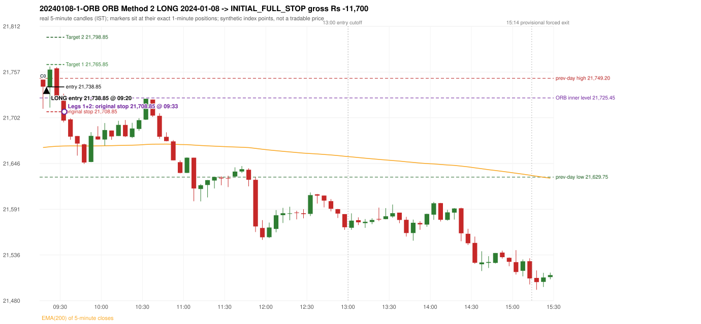

# Trading journal - 2024-01-08 (Monday)

> Phase 4 historical validation, window B_TV (Window B 2022-09-01..2025-08-31 (secondary vendor minutes); status VENDOR_SENSITIVITY). The FROZEN Phase 3.6 configuration (IRF, ORB, PDR body-based, PDS, RF; shared controller) on a different data source. HISTORICAL RESEARCH ONLY: the strategy was developed using later data. the same window with the secondary vendor's minute bars (daily series still 5paisa): quantifies sensitivity to the data source; not a second independent result Synthetic NIFTY 50 index-point P&L (the index is not tradable). The owner's review status is intentionally blank.

## A. Trading day overview

| item | value |
|---|---|
| Date / weekday | 2024-01-08 / Monday |
| Session type | USABLE_WITH_FLAGS / VALID |
| Original session open (first 1-minute open) | 21,747.60 |
| Previous session | 2024-01-05 |
| Previous-day high / low (wicks included) | 21,749.20 / 21,629.75 |
| Previous-day highest BODY high (the body-based PDR ceiling; wicks ignored) | 21,742.55 |
| Previous-day official close / last 5-minute close | 21,710.80 / 21,709.55 |
| Raw engine records / confirmed signals / fully valid signals | 4 / 3 / 3 |
| Setups that did not complete (invalidated / incomplete) | 1 |
| Executed trades | 1 20240108-1-ORB |
| Gross P&L (Rs, synthetic) | -11,700.00 |
| Illustrative net P&L (Rs; Rs 500/trade + 0.5 pt/fill) | -12,590.00 |
| Day-end portfolio status | SECOND_TRADE_ELIGIBLE |
| Manual journal trades (matched / unmatched) | 0 (0 / 0) |
| Extra automated trades | 0 |

## B. Daily strategy signal timeline (confirmed signals, chronological)

| time | strategy | method | dir | entry-rule status | valid for execution | <= 13:00 | portfolio state | accepted / ignored | specific reason | competing (same minute) |
|---|---|---|---|---|---|---|---|---|---|---|
| 09:20 | ORB | Method 2 | LONG | RESEARCH_VARIANT | True | True | FIRST_TRADE_ACTIVE | ACCEPTED -> 20240108-1-ORB | first eligible signal of the day; trade 1: INITIAL_FULL_STOP |  |
| 09:30 | IRF | Method 1 | SHORT | PROPOSAL_DEPENDENT | True | True | FIRST_TRADE_ACTIVE | IGNORED | POSITION_ACTIVE (signal kept for diagnostics only; never reused) [blocked by ORB#1] |  |
| 10:35 | RF | RF | LONG | PROPOSAL_DEPENDENT | True | True | SECOND_TRADE_ELIGIBLE | REJECTED | SECOND_TRADE_RESTRICTED_TO_PDR_PDS [blocked by ORB#1] |  |

Engine setups that did not complete (1); the complete list with failed rule ids is in `rejected_signals.csv`:

| candle | strategy | method | dir | status | precise reason | failed rules |
|---|---|---|---|---|---|---|
| 09:15 | PDR | PDR | LONG | INCOMPLETE_AT_EOD | NO_QUALIFYING_CONFIRMATION_BEFORE_SESSION_END |  |

## C. Detailed trade journals

### 20240108-1-ORB: ORB Method 2 LONG (FIRST trade)

Chart: 

**Rule configuration:** CFG-phase36_body_based-866f954e55 - signal verification status **RESEARCH_VARIANT** (never VERIFIED while a rule rests on a proposal).

#### 1. Setup identification

ORB Method 2 LONG (research variant): the first candle closed at 21,739.10, beyond the inner resistance 21,725.45 built from the previous session's latest fractal (15:05), with a supportive trendline (21,695.87); its body occupied 24.11% of its range and its upper wick 0.00% (thresholds 60% / 20%): the strong-candle test FAILED; the candle was admitted through the conditional PIN-BAR alternative instead (the lower wick 26.75 points is 3.15 x the body, required 2x; the close is 24.11% of the range from the high, allowed 30%). Note: the candle is bearish, i.e. against the trade direction; the pin route accepts it because the level break and close beyond it carry the direction. The source gives no construction for the inner level or the trendline.

#### 2. Candle and indicator calculations

| role | session | candle | O | H | L | C | range | body % | upper wick % | lower wick % | direction | EMA(200) | strong bull / bear | pin bull / bear | small (body<=30%) | used for |
|---|---|---|---|---|---|---|---|---|---|---|---|---|---|---|---|---|
| first_candle | TODAY | 09:15-09:20 | 21,747.60 | 21,747.60 | 21,712.35 | 21,739.10 | 35.25 | 24.11 | 0.00 | 75.89 | BEARISH | 21,665.55 | False / False | True / False | True | the 09:15 first five-minute candle - the ORB decision candle |
| inner_level_candle | PREVIOUS | 15:05-15:10 | 21,716.20 | 21,725.45 | 21,703.15 | 21,709.15 | 22.30 | 31.61 | 41.48 | 26.91 | BEARISH | 21,663.09 | False / False | False / False | False | inner level: latest 5-candle fractal extreme of the previous session inside its range |
| prev_session_last_candle | PREVIOUS | 15:25-15:30 | 21,705.15 | 21,720.40 | 21,704.10 | 21,709.55 | 16.30 | 26.99 | 66.56 | 6.44 | BULLISH | 21,664.82 | False / False | False / False | True | trend: previous session's last 5-minute close vs its EMA(200) |
| trendline_point_1 | PREVIOUS | 14:20-14:25 | 21,637.80 | 21,648.50 | 21,629.75 | 21,643.15 | 18.75 | 28.53 | 28.53 | 42.93 | BULLISH | 21,660.83 | False / False | False / False | True | first fractal point of the trendline |
| trendline_point_2 | PREVIOUS | 15:15-15:20 | 21,715.60 | 21,715.60 | 21,681.70 | 21,698.60 | 33.90 | 50.15 | 0.00 | 49.85 | BEARISH | 21,663.96 | False / False | False / False | False | second fractal point of the trendline |

Every condition, with the rule, the calculation, the observed values and the result:

| # | group | rule | result | status / numeric definition | calculation | observed | required | available at | why it matters |
|---|---|---|---|---|---|---|---|---|---|
| 1 | SELECTION | SEL-FIRST-001 | PASS | USER_APPROVED / USER_APPROVED | earliest CONFIRMED signal of the day across IRF/ORB/PDR/PDS/RF that passed the controller's checks | 0 confirmed signal(s) earlier today; 3 confirmed signals in the day in total, this one at 09:20 | no earlier executable signal | 2024-01-08 09:20 | the shared controller trades only the first valid signal; the five strategies are not independent positions |
| 2 | SELECTION | SEL-TIE-001 | PASS | USER_APPROVED / USER_APPROVED | other CONFIRMED signals with exactly the same confirmation timestamp | none | no different-strategy / opposite-direction signal in the same minute (otherwise an unresolved conflict, no trade) | 2024-01-08 09:20 | an unresolved same-minute collision would have produced no trade at all |
| 3 | SELECTION | ENTRY-CUTOFF-001 | PASS | USER_APPROVED / USER_APPROVED | fill timestamp vs 13:00:00 IST | signal confirmed 09:20; fill 09:20 | fill at or before 13:00:00 IST | 2024-01-08 09:20 | no new position may be entered with a fill after 13:00 IST |
| 4 | SELECTION | EXE-FILL-001 | PASS | PROPOSED_FOR_REVIEW / PROPOSED_FOR_REVIEW | fill = open of the 1-minute bar that starts at the signal candle's end | bar 09:20 O 21,738.85 H 21,748.00 L 21,722.85 C 21,722.85; executable=True; entry 21,738.85 | fill bar exists, starts exactly at the signal end, is fillable; entry = its open | 2024-01-08 09:20 | a 5-minute signal is known only when its candle closes; the first price that can be traded is the next minute's open |
| 5 | SELECTION | DAY-MAX-001 | PASS | USER_APPROVED / USER_APPROVED | number of entries today | trade 1 of at most 2 | <= 2 entries per day | 2024-01-08 09:20 | daily trade cap |
| 6 | SETUP | ORB-GLOBAL-001 | PASS | SOURCE_VERIFIED / EXPLICIT_IN_SOURCE | decision is taken once the first 5-minute candle (09:15-09:20) has closed | candle 09:15-09:20; signal confirmed 09:20 | decision at 09:20, never before the close | 2024-01-08 09:20 | the close of the first candle is unknown before 09:20 |
| 7 | SETUP | ORB-GLOBAL-002 | PASS | SOURCE_VERIFIED / EXPLICIT_IN_SOURCE | direction | LONG | same rules in both directions | 2024-01-08 09:20 | ORB trades the side of the break |
| 8 | SETUP | ORB-GLOBAL-004 | PASS | SOURCE_VERIFIED / QUALITATIVE_SOURCE_NUMERIC_DEFINITION_PROPOSED_FOR_REVIEW | entry at 09:20, after the first-candle close | signal confirmed 09:20; fill 09:20 at the open of that minute | 09:20 entry | 2024-01-08 09:20 | the guide enters at 9:20; the fill price convention (next minute open) is a proposal |
| 9 | SETUP | ORB-M2-LONG-001 | PASS | UNRESOLVED / UNRESOLVED | inner level = latest fractal (k=2) extreme of the previous session below the day's high / above the day's low | inner resistance 21,725.45 from the 15:05 candle of 2024-01-05 (previous range 21,629.75 - 21,749.20; engine recorded 21,725.45) | an inner level inside yesterday's range | 2024-01-05 15:20 | the source gives NO objective construction for the inner level: this is a research variant |
| 10 | SETUP | ORB-M2-LONG-002 | PASS | SOURCE_VERIFIED / EXPLICIT_IN_SOURCE | first candle breaks and closes beyond the inner level | close 21,739.10 vs inner level 21,725.45: 13.65 points beyond | high/low and close beyond the level | 2024-01-08 09:20 | the breakout itself |
| 11 | TREND | ORB-TREND-001 | PASS | SOURCE_VERIFIED / QUALITATIVE_SOURCE_NUMERIC_DEFINITION_PROPOSED_FOR_REVIEW | previous session's final completed 5-minute candle: close vs its EMA(200 of 5-minute closes) | previous session 2024-01-05 last candle 15:25-15:30 close 21,709.55 vs EMA(200) 21,664.82: 44.73 points above the EMA -> trend bullish (EMA_PREV_SESSION_CLOSE; research variant A, EMA-only) | close > EMA(200) | 2024-01-05 15:30 | the opening gap can never create the trend: only information that existed before today's open is used |
| 12 | TREND | ORB-TREND-002 | PASS | SOURCE_VERIFIED / QUALITATIVE_SOURCE_NUMERIC_DEFINITION_PROPOSED_FOR_REVIEW | price location versus the 200 EMA is the basic confirmation; structure is only 'supporting' | 44.73 points above the EMA(200) on the previous session's last 5-minute close; swing structure not used in variant A | price on the trend side of the 200 EMA | 2024-01-05 15:30 | the rulebook calls EMA position 'a basic confirmation, supported by bullish structure'; the structure part has no numeric definition |
| 13 | TREND | TREND-SWING-001 | NOT_APPLICABLE | PROPOSED_FOR_REVIEW / PROPOSED_FOR_REVIEW | confirmed swing structure | not required by the active trend variant (variant A is the EMA price location only) | n/a | 2024-01-05 15:30 | variant B would additionally require higher-high/higher-low swings; it is a separate labelled scenario |
| 14 | CONFIRMATION | ORB-M2-LONG-001 | PASS | UNRESOLVED / UNRESOLVED | trendline through the last two fractal lows (long) / highs (short) of the previous session | points 14:20 21,629.75 and 15:15 21,681.70 (11 candles apart): slope +4.7227 per candle; line value at the 09:15 candle 21,695.87; first-candle close 21,739.10 is on the supportive side (engine recorded 21,695.87) | rising (long) / falling (short) line with price on the trend side | 2024-01-05 15:20 | the guide requires a trendline but defines no construction or 'near' distance: research variant |
| 15 | CONFIRMATION | ORB-M2-LONG-003 | PASS | SOURCE_VERIFIED / QUALITATIVE_SOURCE_NUMERIC_DEFINITION_PROPOSED_FOR_REVIEW | candle quality: strong body and limited opposite wick (or pin bar) | 09:15-09:20 O 21,747.60 H 21,747.60 L 21,712.35 C 21,739.10; range 35.25, body 8.50 (24.11%), upper wick 0.00 (0.00%), lower wick 26.75 (75.89%), bearish. Strong-bullish test: bullish close, body >= 60% (observed 24.11%), upper wick <= 20% (observed 0.00%) -> not met; pin-bar alternative: wick >= 2 x body and close within the favourable 30% -> met | strong candle or pin bar | 2024-01-08 09:20 | same proposed thresholds as Method 1 |
| 16 | CONFIRMATION | ORB-M2-LONG-004 | PASS | SOURCE_VERIFIED / QUALITATIVE_SOURCE_NUMERIC_DEFINITION_PROPOSED_FOR_REVIEW | if the close is near the 5-minute EMA(200) a convincing close beyond it is needed | EMA(200) at the 09:15 candle 21,665.55; close 21,739.10 is 73.55 points above it; 'near' band 15 points -> not near, test not applicable | outside the 15-point band, or beyond the EMA by >= 5 | 2024-01-08 09:20 | ORB p.5: 'if the breakout is near the EMA, wait for a convincing close' |
| 17 | EXECUTION | ORB-GLOBAL-003 | PASS | SOURCE_VERIFIED / EXPLICIT_IN_SOURCE | initial stop = entry - 30 points | entry 21,738.85 -> stop 21,708.85 | stop 30 index points (BASELINE) | 2024-01-08 09:20 | defines the loss if the setup fails before Target 1 |
| 18 | EXECUTION | EXE-T1-001 | PASS | SOURCE_VERIFIED / EXPLICIT_IN_SOURCE | Target 1 = entry +/- 27 points | T1 21,765.85 | 27 points | 2024-01-08 09:20 | Leg 1 (3 lots) is booked at Target 1 |
| 19 | EXECUTION | ORB-GLOBAL-003 | PASS | SOURCE_VERIFIED / EXPLICIT_IN_SOURCE | Target 2 = entry +/- 60 points | T2 21,798.85 | 60 points | 2024-01-08 09:20 | Leg 2 (3 lots) is booked at Target 2 |
| 20 | EXECUTION | POST-T1-STOP-006 | PASS | USER_APPROVED / USER_APPROVED | after T1 the Leg-2 stop = entry - 6 (no trailing) | post-T1 stop 21,732.85 | entry -6 (LONG) / +6 (SHORT) | 2024-01-08 09:20 | protects the remaining three lots once the first three are booked |
| 21 | EXECUTION | SIZE-LOT-001 | PASS | USER_APPROVED / USER_APPROVED | 6 lots x 65 = 390, Leg 1 = 3 lots = 195, Leg 2 = 195 | 6 lots, lot size 65, legs 3+3 | 6 lots in two equal legs | 2024-01-08 09:20 | position size for the synthetic P&L |
| 22 | NOTE | ORB-MA-001 | UNRESOLVED | CONFLICTING / CONFLICTING | which moving average the code uses | EMA(200) of 5-minute closes (the guide says '200 DMA' in some places and '200 EMA' in others); active ma_mode EMA200_5M | the source terminology conflicts | 2024-01-08 09:20 | a daily 200 DMA would give different values |
| 23 | NOTE | NOTE-UNRESOLVED-DEPENDENCIES | UNRESOLVED | NOT_A_RULE / NOT_A_REGISTRY_RULE | rules the signal depends on that the sources leave unresolved | engine-recorded unresolved rule ids: ORB-M2-LONG-001, ORB-MA-001; verification status RESEARCH_VARIANT | n/a (disclosure) | 2024-01-08 09:20 | the entry is only as verified as the rules it rests on |

#### 3. Entry decision and explanation

ORB Method 2 LONG (research variant): the first candle closed at 21,739.10, beyond the inner resistance 21,725.45 built from the previous session's latest fractal (15:05), with a supportive trendline (21,695.87); its body occupied 24.11% of its range and its upper wick 0.00% (thresholds 60% / 20%): the strong-candle test FAILED; the candle was admitted through the conditional PIN-BAR alternative instead (the lower wick 26.75 points is 3.15 x the body, required 2x; the close is 24.11% of the range from the high, allowed 30%). Note: the candle is bearish, i.e. against the trade direction; the pin route accepts it because the level break and close beyond it carry the direction. The source gives no construction for the inner level or the trendline.

**Why this trade ahead of the other strategies:** This ORB Method 2 signal was the earliest executable signal of the day: 0 confirmed signal(s) earlier, 0 other in the same minute. 2 later confirmed signal(s) (IRF x1, RF x1) are logged as ignored or rejected. State of the other four engines at that moment: [IRF: no setup record before this time (a base condition was not met, or nothing triggered)] [PDR: no setup record before this time (a base condition was not met, or nothing triggered)] [PDS: no setup record before this time (a base condition was not met, or nothing triggered)] [RF: no setup record before this time (a base condition was not met, or nothing triggered)]

#### 4. Actual entry execution

| item | value |
|---|---|
| Signal candle | 09:15-09:20 |
| Signal confirmed | 2024-01-08 09:20 |
| Fill timestamp | 2024-01-08 09:20 |
| Entry price | 21,738.85 |
| Source partition / 1-minute bar | data/phase4/processed/TECHNOVUS_1M/nifty50/year=2024/month=01/candles.parquet / 2024-01-08 09:20 |
| Source bar O / H / L / C | 21,738.85 / 21,748.00 / 21,722.85 / 21,722.85 |
| Fill assumption | open of the 1-minute bar starting at the signal candle's end (EXE-FILL-001, PROPOSED causal convention) |
| Initial stop / T1 / T2 / post-T1 stop | 21,708.85 / 21,765.85 / 21,798.85 / 21,732.85 |
| Position | 6 lots x 65 = 390 units (Leg 1 195, Leg 2 195) |

#### 5-8. Trade progress, Target 1, post-T1 stop and final exit

Between the 09:20 entry bar and the final exit (14 one-minute bars) the best excursion in favour was 24.55 points at 09:24 and the worst against was 34.05 points at 09:33. At 09:33 price reached the original stop 21,708.85 before Target 1 21,765.85, so all six lots exited together at 21,708.85. This is an INITIAL_FULL_STOP: one more trade is allowed that day, only a newly confirmed PDR/PDS signal.

| leg | qty | exit time | exit price | reason | source 1-minute bar | O / H / L / C | gross points | gross Rs | slippage pts | flags |
|---|---|---|---|---|---|---|---|---|---|---|
| 1 | 195 | 09:33 | 21,708.85 | ORIGINAL_STOP_BEFORE_T1 | 09:33 | 21,722.75 / 21,722.75 / 21,704.80 / 21,704.85 | -30.00 | -5,850.00 | 0.00 |  |
| 2 | 195 | 09:33 | 21,708.85 | ORIGINAL_STOP_BEFORE_T1 | 09:33 | 21,722.75 / 21,722.75 / 21,704.80 / 21,704.85 | -30.00 | -5,850.00 | 0.00 |  |

Exit evidence per leg:

* Leg 1: 1-minute bar 09:33 O 21,722.75 H 21,722.75 L 21,704.80 C 21,704.85: low 21,704.80 reached the original stop 21,708.85 before Target 1 21,765.85 was touched; both legs exit at the stop level 21,708.85
* Leg 2: 1-minute bar 09:33 O 21,722.75 H 21,722.75 L 21,704.80 C 21,704.85: low 21,704.80 reached the original stop 21,708.85 before Target 1 21,765.85 was touched; both legs exit at the stop level 21,708.85

#### 9. Gross and illustrative net P&L

| item | value (Rs) |
|---|---|
| Leg 1 gross | -5,850.00 |
| Leg 2 gross | -5,850.00 |
| Trade gross (= Leg 1 + Leg 2) | -11,700.00 |
| Illustrative fixed cost | -500.00 |
| Illustrative slippage (0.5 pt on every fill, entry + exits, all units) | -390.00 |
| Illustrative net | -12,590.00 |

#### 10. Manual journal comparison

No manual journal exists for this period; no comparison.

## D. Manual journal comparison

No manual journal exists for this period (the manual journal covers 2025-09-01 .. 2026-08-31 only); no comparison is made and no automated trade is labelled 'extra'.

## E. Daily conclusion

* **Traded:** 20240108-1-ORB - ORB Method 2 LONG at 09:20 (entry 21,738.85), outcome INITIAL_FULL_STOP, gross Rs -11,700.00, illustrative net Rs -12,590.00. **Why:** This ORB Method 2 signal was the earliest executable signal of the day: 0 confirmed signal(s) earlier, 0 other in the same minute. 2 later confirmed signal(s) (IRF x1, RF x1) are logged as ignored or rejected. State of the other four engines at that moment: [IRF: no setup record before this time (a base condition was not met, or nothing triggered)] [PDR: no setup record before this time (a base condition was not met, or nothing triggered)] [PDS: no setup record before this time (a base condition was not met, or nothing triggered)] [RF: no setup record before this time (a base condition was not met, or nothing triggered)] **How it ended:** At 09:33 price reached the original stop 21,708.85 before Target 1 21,765.85, so all six lots exited together at 21,708.85. This is an INITIAL_FULL_STOP: one more trade is allowed that day, only a newly confirmed PDR/PDS signal.
* **Ignored / rejected signals:** IRF IGNORED POSITION_ACTIVE x1; RF REJECTED SECOND_TRADE_RESTRICTED_TO_PDR_PDS x1
* **Open strategy-definition issues that affected this day:** NOTE-UNRESOLVED-DEPENDENCIES, ORB-MA-001 (Terminology conflict: '200 DMA / EMA' (p.2), '200 EMA' (pp.3,5,7), '200 DMA' (pp.1,8,9,12) for what the charts show as one curved line on a 5-minute chart)
* **Automated triage (not an approval; the owner's review status stays blank):** TRADED_NO_FLAGS
