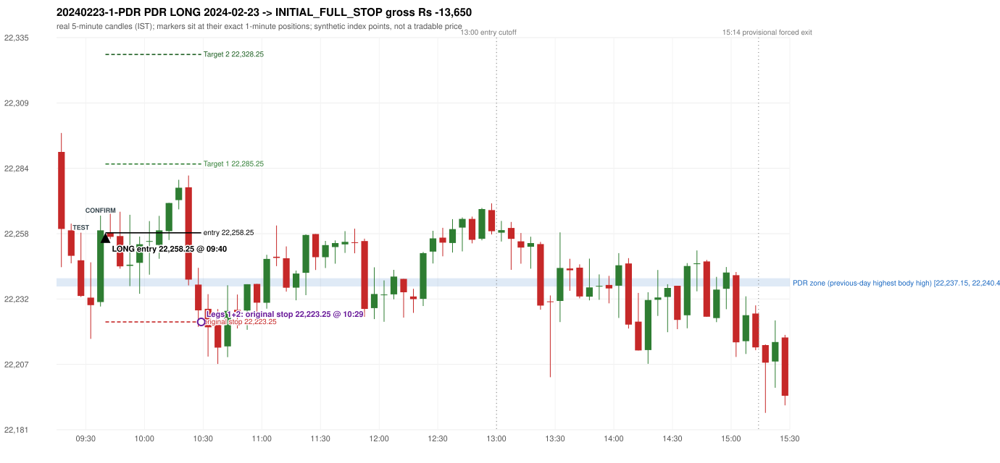
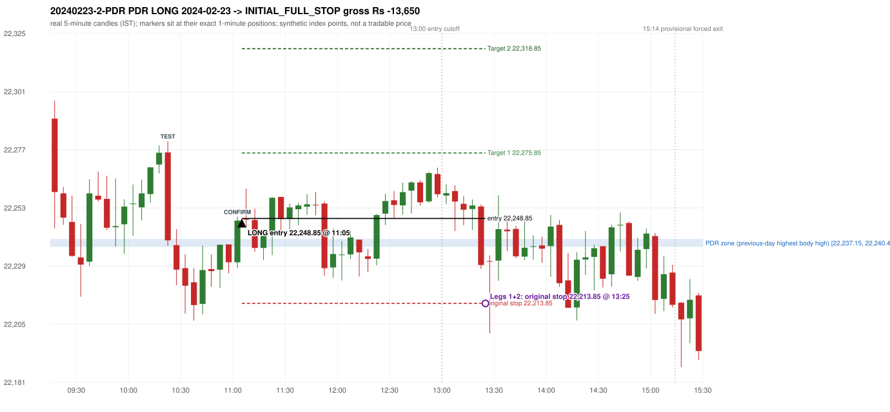

# Trading journal - 2024-02-23 (Friday)

> Phase 4 historical validation, window B_TV (Window B 2022-09-01..2025-08-31 (secondary vendor minutes); status VENDOR_SENSITIVITY). The FROZEN Phase 3.6 configuration (IRF, ORB, PDR body-based, PDS, RF; shared controller) on a different data source. HISTORICAL RESEARCH ONLY: the strategy was developed using later data. the same window with the secondary vendor's minute bars (daily series still 5paisa): quantifies sensitivity to the data source; not a second independent result Synthetic NIFTY 50 index-point P&L (the index is not tradable). The owner's review status is intentionally blank.

## A. Trading day overview

| item | value |
|---|---|
| Date / weekday | 2024-02-23 / Friday |
| Session type | USABLE_WITH_FLAGS / VALID |
| Original session open (first 1-minute open) | 22,290.00 |
| Previous session | 2024-02-22 |
| Previous-day high / low (wicks included) | 22,251.05 / 21,875.25 |
| Previous-day highest BODY high (the body-based PDR ceiling; wicks ignored) | 22,240.40 |
| Previous-day official close / last 5-minute close | 22,217.45 / 22,216.90 |
| Raw engine records / confirmed signals / fully valid signals | 10 / 6 / 6 |
| Setups that did not complete (invalidated / incomplete) | 4 |
| Executed trades | 2 20240223-1-PDR;20240223-2-PDR |
| Gross P&L (Rs, synthetic) | -27,300.00 |
| Illustrative net P&L (Rs; Rs 500/trade + 0.5 pt/fill) | -29,080.00 |
| Day-end portfolio status | DAY_FINISHED |
| Manual journal trades (matched / unmatched) | 0 (0 / 0) |
| Extra automated trades | 0 |

## B. Daily strategy signal timeline (confirmed signals, chronological)

| time | strategy | method | dir | entry-rule status | valid for execution | <= 13:00 | portfolio state | accepted / ignored | specific reason | competing (same minute) |
|---|---|---|---|---|---|---|---|---|---|---|
| 09:40 | PDR | PDR | LONG | RESEARCH_VARIANT | True | True | FIRST_TRADE_ACTIVE | ACCEPTED -> 20240223-1-PDR | first eligible signal of the day; trade 1: INITIAL_FULL_STOP |  |
| 10:15 | PDR | PDR | LONG | RESEARCH_VARIANT | True | True | FIRST_TRADE_ACTIVE | IGNORED | POSITION_ACTIVE (signal kept for diagnostics only; never reused) [blocked by PDR#1] |  |
| 11:05 | PDR | PDR | LONG | RESEARCH_VARIANT | True | True | SECOND_TRADE_ACTIVE | ACCEPTED -> 20240223-2-PDR | permitted second trade: newly confirmed PDR/PDS after the original full stop; trade 2: INITIAL_FULL_STOP |  |
| 11:25 | PDR | PDR | LONG | RESEARCH_VARIANT | True | True | SECOND_TRADE_ACTIVE | IGNORED | POSITION_ACTIVE (signal kept for diagnostics only; never reused) [blocked by PDR#2] |  |
| 12:25 | PDR | PDR | LONG | RESEARCH_VARIANT | True | True | SECOND_TRADE_ACTIVE | IGNORED | POSITION_ACTIVE (signal kept for diagnostics only; never reused) [blocked by PDR#2] |  |
| 14:40 | PDR | PDR | LONG | RESEARCH_VARIANT | True | False | DAY_FINISHED | IGNORED | DAY_FINISHED [blocked by PDR#2] |  |

Engine setups that did not complete (4); the complete list with failed rule ids is in `rejected_signals.csv`:

| candle | strategy | method | dir | status | precise reason | failed rules |
|---|---|---|---|---|---|---|
| 09:15 | ORB | Method 1 | LONG | INVALIDATED | CANDLE_QUALITY(not a strong body / wick too large) | ORB-M1-LONG-003 |
| 09:15 | ORB | Method 2 | LONG | INVALIDATED | CANDLE_QUALITY | ORB-M2-LONG-003 |
| 14:40 | PDR | PDR | LONG | INCOMPLETE_AT_EOD | NO_QUALIFYING_CONFIRMATION_BEFORE_SESSION_END |  |
| 09:35 | RF | RF | LONG | INVALIDATED | GAP_UP_OUTSIDE_YESTERDAYS_RANGE | RF-004 |

## C. Detailed trade journals

### 20240223-1-PDR: PDR LONG (FIRST trade)

Chart: 

**Rule configuration:** CFG-phase36_body_based-866f954e55 - signal verification status **RESEARCH_VARIANT** (never VERIFIED while a rule rests on a proposal).

#### 1. Setup identification

PDR LONG (body-based engine, A_HIGHEST_BODY_HIGH): the session opened 72.55 points above the previous close and 49.60 points above the previous-day highest BODY high 22,240.40 (zone [22,237.15, 22,240.40] from the 15:20 candle of 2024-02-22; the highest wick 22,251.05 is ignored). The 09:25 candle (22,233.05 - 22,258.30) tested the zone; the 09:35 candle (green, O 22,231.05 H 22,265.00 L 22,229.30 C 22,259.20) passed GOOD_GREEN_BODY and closed 18.80 points above the zone ceiling, confirming the entry at 09:40. The pattern thresholds and the zone's lower boundary are provisional research assumptions, not approved by the strategy author.

#### 2. Candle and indicator calculations

| role | session | candle | O | H | L | C | range | body % | upper wick % | lower wick % | direction | EMA(200) | strong bull / bear | pin bull / bear | small (body<=30%) | used for |
|---|---|---|---|---|---|---|---|---|---|---|---|---|---|---|---|---|
| zone_source_candle | PREVIOUS | 15:20-15:25 | 22,240.40 | 22,251.05 | 22,230.05 | 22,237.15 | 21.00 | 15.48 | 50.71 | 33.81 | BEARISH | 22,069.27 | False / False | False / False | True | candle of the previous session's highest BODY high (A_HIGHEST_BODY_HIGH) |
| prev_day_wick_high_candle | PREVIOUS | 15:20-15:25 | 22,240.40 | 22,251.05 | 22,230.05 | 22,237.15 | 21.00 | 15.48 | 50.71 | 33.81 | BEARISH | 22,069.27 | False / False | False / False | True | candle of the previous session's highest WICK (ignored by the author's rule; shown for comparison) |
| interaction_candle | TODAY | 09:25-09:30 | 22,247.45 | 22,258.30 | 22,233.05 | 22,233.45 | 25.25 | 55.45 | 42.97 | 1.58 | BEARISH | 22,075.96 | False / False | False / False | False | first candle whose range overlaps the zone (the test) |
| confirmation_candle | TODAY | 09:35-09:40 | 22,231.05 | 22,265.00 | 22,229.30 | 22,259.20 | 35.70 | 78.85 | 16.25 | 4.90 | BULLISH | 22,079.30 | True / False | False / False | False | candle that satisfies one of the three patterns and closes above the zone ceiling |

Every condition, with the rule, the calculation, the observed values and the result:

| # | group | rule | result | status / numeric definition | calculation | observed | required | available at | why it matters |
|---|---|---|---|---|---|---|---|---|---|
| 1 | SELECTION | SEL-FIRST-001 | PASS | USER_APPROVED / USER_APPROVED | earliest CONFIRMED signal of the day across IRF/ORB/PDR/PDS/RF that passed the controller's checks | 0 confirmed signal(s) earlier today; 6 confirmed signals in the day in total, this one at 09:40 | no earlier executable signal | 2024-02-23 09:40 | the shared controller trades only the first valid signal; the five strategies are not independent positions |
| 2 | SELECTION | SEL-TIE-001 | PASS | USER_APPROVED / USER_APPROVED | other CONFIRMED signals with exactly the same confirmation timestamp | none | no different-strategy / opposite-direction signal in the same minute (otherwise an unresolved conflict, no trade) | 2024-02-23 09:40 | an unresolved same-minute collision would have produced no trade at all |
| 3 | SELECTION | ENTRY-CUTOFF-001 | PASS | USER_APPROVED / USER_APPROVED | fill timestamp vs 13:00:00 IST | signal confirmed 09:40; fill 09:40 | fill at or before 13:00:00 IST | 2024-02-23 09:40 | no new position may be entered with a fill after 13:00 IST |
| 4 | SELECTION | EXE-FILL-001 | PASS | PROPOSED_FOR_REVIEW / PROPOSED_FOR_REVIEW | fill = open of the 1-minute bar that starts at the signal candle's end | bar 09:40 O 22,258.25 H 22,262.40 L 22,255.95 C 22,262.40; executable=True; entry 22,258.25 | fill bar exists, starts exactly at the signal end, is fillable; entry = its open | 2024-02-23 09:40 | a 5-minute signal is known only when its candle closes; the first price that can be traded is the next minute's open |
| 5 | SELECTION | DAY-MAX-001 | PASS | USER_APPROVED / USER_APPROVED | number of entries today | trade 1 of at most 2 | <= 2 entries per day | 2024-02-23 09:40 | daily trade cap |
| 6 | SETUP | PDR-004 | PASS | SOURCE_VERIFIED / EXPLICIT_WORDING_DETAIL_PROPOSED_FOR_REVIEW | gap = first 1-minute open of today - previous session's OFFICIAL close | today's open 22,290.00 (first 1-minute bar 09:15) - previous close 22,217.45 (DAILY_VENDOR, 2024-02-22) = +72.55 points -> gap UP | gap UP (more than 0 points) | 2024-02-23 09:15 | approved convention: the original first-minute open, never the vendor daily open |
| 7 | SETUP | PDR-B03 | PASS | AUTHOR_APPROVED / AUTHOR_STATEMENT_NUMERIC_DETAILS_ARE_SEPARATE_PROPOSED_ROWS | the session opens strictly above the previous day's resistance zone (author-approved) | today's first 1-minute open 22,290.00 vs zone ceiling 22,240.40: 49.60 points above (open - ceiling = +49.60) | open > zone ceiling (equal or inside the zone rejects the setup) | 2024-02-23 09:15 | the original first-minute open is used, never a vendor daily open |
| 8 | ZONE | PDR-001 | PASS | SOURCE_VERIFIED / EXPLICIT_IN_SOURCE | direction | LONG (PDR is long only) | long-only | 2024-02-23 09:40 | PDR buys a retest of previous-day resistance after a gap up |
| 9 | ZONE | PDR-B01a | PASS | AUTHOR_APPROVED / AUTHOR_STATEMENT_NUMERIC_DETAILS_ARE_SEPARATE_PROPOSED_ROWS | wicks ignored, bodies considered: body_high = max(open, close) of every completed previous-session 5-minute candle; ceiling = the highest body_high; floor = body low of that candle | previous session 2024-02-22: highest body high 22,240.40 on the 15:20 candle (O 22,240.40 C 22,237.15; wick high of that candle 22,251.05, ignored); four highest body highs: 22,240.40 (15:20); 22,239.55 (15:15); 22,236.90 (15:25); 22,207.30 (15:05). Highest WICK of the session 22,251.05 (15:20 candle) is 10.65 points above the ceiling and plays no part. Zone [22,237.15 (body low), 22,240.40 (body high)]; engine recorded [22,237.15, 22,240.40] | ceiling = highest body high of the previous session (author: wick ignored, body considered) | 2024-02-22 15:30 | a wick-only price never becomes resistance; the zone is drawn from candle bodies |
| 10 | ZONE | PDR-B02 | UNRESOLVED | AUTHOR_APPROVED / AUTHOR_STATEMENT_NUMERIC_DETAILS_ARE_SEPARATE_PROPOSED_ROWS | multiple highs connected into one zone (author principle; candidate B) | candidate A (used): [22,237.15, 22,240.40]. Candidate B (multiple-body-high cluster, tolerance 5 points) would be [22,237.15, 22,240.40] (ISOLATED_BODY_HIGH, 1 touch(es), member body highs 22,240.40); ceiling difference 0.00 points | a zone that connects all relevant highs (numbers not given by the author) | 2024-02-22 15:30 | candidate B has the same ceiling by construction, so this signal is unaffected by the choice; the lower boundary and the cluster numbers are research parameters |
| 11 | ZONE | PDR-003 | PASS | SOURCE_VERIFIED / EXPLICIT_IN_SOURCE | the zone is an area, not a single price | zone height 3.25 points [22,237.15, 22,240.40] | a rectangle with positive height (a zero-height zone is left unresolved by the engine) | 2024-02-22 15:30 | price may touch any part of the area |
| 12 | CONFIRMATION | PDR-B03b | PASS | PRESERVED_FROM_PHASE2 / PRESERVED_FROM_PHASE2 | the first candle whose [low, high] overlaps the zone (+/- proximity) is the test; the confirmation must come strictly after it | 09:25-09:30 O 22,247.45 H 22,258.30 L 22,233.05 C 22,233.45; range 25.25, body 14.00 (55.45%), upper wick 10.85 (42.97%), lower wick 0.40 (1.58%), bearish; low 22,233.05 vs zone ceiling 22,240.40, high 22,258.30 vs zone floor 22,237.15; proximity 0; confirmation candle 09:35 is candle no. 5, the test candle no. 3 | range overlaps the zone; confirmation after the test | 2024-02-23 09:30 | the retest of the previous-day resistance |
| 13 | CONFIRMATION | PDR-B04c | PASS | PROPOSED_FOR_REVIEW / NUMERIC_DEFINITION_PROPOSED_FOR_REVIEW | Pattern 1: good green body on the 09:35-09:40 candle (O 22,231.05 H 22,265.00 L 22,229.30 C 22,259.20); the numeric thresholds are PROVISIONAL (RESEARCH_DEFAULT), not author-approved | colour green; body 78.85%; upper wick 16.25% -> PASSES | green, body >= 60% and upper wick <= 20% of the range | 2024-02-23 09:40 | one of the three patterns is enough (author: one good green body OR lower price rejection OR hammer); fixed thresholds are not required by the author, so the numbers are a research convention; a pattern that does not pass is not an error |
| 14 | CONFIRMATION | PDR-B04c | NOT_APPLICABLE | PROPOSED_FOR_REVIEW / NUMERIC_DEFINITION_PROPOSED_FOR_REVIEW | Pattern 2: lower-price rejection candle on the 09:35-09:40 candle (O 22,231.05 H 22,265.00 L 22,229.30 C 22,259.20); the numeric thresholds are PROVISIONAL (RESEARCH_DEFAULT), not author-approved | lower wick 1.75 = 0.06 x body 28.15; close 16.25% below the high; low 22,229.30; low reached the zone ceiling 22,240.40 -> does not pass | lower wick >= 2 x body, close within the top 30% of the range, low <= zone ceiling (colour not required) | 2024-02-23 09:40 | one of the three patterns is enough (author: one good green body OR lower price rejection OR hammer); fixed thresholds are not required by the author, so the numbers are a research convention; a pattern that does not pass is not an error |
| 15 | CONFIRMATION | PDR-B04c | NOT_APPLICABLE | PROPOSED_FOR_REVIEW / NUMERIC_DEFINITION_PROPOSED_FOR_REVIEW | Pattern 3: hammer candle on the 09:35-09:40 candle (O 22,231.05 H 22,265.00 L 22,229.30 C 22,259.20); the numeric thresholds are PROVISIONAL (RESEARCH_DEFAULT), not author-approved | lower wick 1.75 = 0.06 x body; upper wick 16.25%; body bottom at 4.90% of the range -> does not pass | lower wick >= 2 x body, upper wick <= 10%, body bottom >= 60% of the range (colour not required) | 2024-02-23 09:40 | one of the three patterns is enough (author: one good green body OR lower price rejection OR hammer); fixed thresholds are not required by the author, so the numbers are a research convention; a pattern that does not pass is not an error |
| 16 | CONFIRMATION | PDR-B04 | PASS | AUTHOR_APPROVED / AUTHOR_STATEMENT_NUMERIC_DETAILS_ARE_SEPARATE_PROPOSED_ROWS | at least one of the three patterns passes (OR logic; every passing pattern is recorded) | patterns passed: GOOD_GREEN_BODY (engine recorded: GOOD_GREEN_BODY) | at least one pattern | 2024-02-23 09:40 | the author's entry candle requirement |
| 17 | CONFIRMATION | PDR-B05 | PASS | AUTHOR_APPROVED / AUTHOR_STATEMENT_NUMERIC_DETAILS_ARE_SEPARATE_PROPOSED_ROWS | the confirmation candle must close above the zone | close 22,259.20 vs zone ceiling 22,240.40: +18.80 points (floor 22,237.15; low 22,229.30 dipped into/below the zone) | close > zone ceiling, strictly (lower wick may penetrate the zone) | 2024-02-23 09:40 | no pattern overrides the close rule |
| 18 | CONFIRMATION | PDR-B06 | PASS | USER_APPROVED / USER_APPROVED | no entry at the open and no look-ahead: the order is placed only after the confirmation candle has completed | test candle 09:25 (no. 3) precedes the confirmation candle 09:35-09:40; signal stamped 09:40; fill 09:40 at the open of that 1-minute bar = 22,258.25 | interaction before the confirmation; fill after the confirmation candle's end | 2024-02-23 09:40 | existing causal fill convention (EXE-FILL-001) |
| 19 | EXECUTION | EXE-STOP-001 | PASS | USER_APPROVED / USER_APPROVED | initial stop = entry - 35 points | entry 22,258.25 -> stop 22,223.25 | stop 35 index points (BASELINE) | 2024-02-23 09:40 | defines the loss if the setup fails before Target 1 |
| 20 | EXECUTION | EXE-T1-001 | PASS | SOURCE_VERIFIED / EXPLICIT_IN_SOURCE | Target 1 = entry +/- 27 points | T1 22,285.25 | 27 points | 2024-02-23 09:40 | Leg 1 (3 lots) is booked at Target 1 |
| 21 | EXECUTION | PDR-008 | PASS | SOURCE_VERIFIED / EXPLICIT_IN_SOURCE | Target 2 = entry +/- 70 points | T2 22,328.25 (the guide says 70; the performance report's winners suggest 60 - CONFLICTING, recorded) | 70 points | 2024-02-23 09:40 | Leg 2 (3 lots) is booked at Target 2 |
| 22 | EXECUTION | POST-T1-STOP-006 | PASS | USER_APPROVED / USER_APPROVED | after T1 the Leg-2 stop = entry - 6 (no trailing) | post-T1 stop 22,252.25 | entry -6 (LONG) / +6 (SHORT) | 2024-02-23 09:40 | protects the remaining three lots once the first three are booked |
| 23 | EXECUTION | SIZE-LOT-001 | PASS | USER_APPROVED / USER_APPROVED | 6 lots x 65 = 390, Leg 1 = 3 lots = 195, Leg 2 = 195 | 6 lots, lot size 65, legs 3+3 | 6 lots in two equal legs | 2024-02-23 09:40 | position size for the synthetic P&L |
| 24 | NOTE | PDR-B04x | UNRESOLVED | PROPOSED_FOR_REVIEW / NUMERIC_DEFINITION_PROPOSED_FOR_REVIEW | provisional parameters this signal rests on | pattern thresholds RESEARCH_DEFAULT: {'green_body_min': 0.6, 'green_upper_wick_max': 0.2, 'reject_wick_to_body_min': 2.0, 'reject_close_fraction_max': 0.3, 'hammer_wick_to_body_min': 2.0, 'hammer_upper_wick_max': 0.1, 'hammer_body_position_min': 0.6}; zone lower boundary = hull of the member bodies; zero-height policy UNRESOLVED_NO_SETUP; wait policy WAIT_FOR_QUALIFYING_CANDLE; cluster parameters (candidate B only) tolerance 5, touches 2, separation 2 | n/a (disclosure) | 2024-02-23 09:40 | the strategy author has NOT approved these numbers or conventions; the signal is a RESEARCH_VARIANT, never VERIFIED |
| 25 | NOTE | PDR-012 | NOT_APPLICABLE | PROPOSED_FOR_REVIEW / PROPOSED_FOR_REVIEW | repeated PDR signals today | 6 confirmed PDR signal(s) in the session | n/a (disclosure) | 2024-02-23 09:40 | this engine reports EVERY qualifying signal (the per-session cap is lifted); the controller trades only the first (and a PDR/PDS second trade after an initial full stop) |
| 26 | NOTE | PDR-B07 | UNRESOLVED | PROPOSED_FOR_REVIEW / NUMERIC_DEFINITION_PROPOSED_FOR_REVIEW | state of the zone between the test and the confirmation (the author and the guide are silent on price crossing below the zone) | test candle 09:25 (no. 3), confirmation candle 09:35 (no. 5): 2 candle(s) later; 2 candle(s) in between CLOSED BELOW the zone floor 22,237.15 (lowest close 22,229.85) before price returned above the ceiling | n/a (disclosure; the wait policy is a research parameter) | 2024-02-23 09:40 | the engine keeps a tested setup armed until a candle qualifies; whether a zone that price has closed through should still count is an owner decision |
| 27 | NOTE | PDR-009 | UNRESOLVED | UNRESOLVED / UNRESOLVED | stop 35 or 40 'depending on the situation' | the guide gives no selection rule; baseline fixed 35 points | unresolved in the source | 2024-02-23 09:40 | PDR stop selection is left to the owner |
| 28 | NOTE | NOTE-UNRESOLVED-DEPENDENCIES | UNRESOLVED | NOT_A_RULE / NOT_A_REGISTRY_RULE | rules the signal depends on that the sources leave unresolved | engine-recorded unresolved rule ids: PDR-B01b, PDR-B02a, PDR-B02b, PDR-B02c, PDR-B02d, PDR-B02e, PDR-B02f, PDR-B02g, PDR-B02h, PDR-B04b, PDR-B04c, PDR-B05a, PDR-B07; verification status RESEARCH_VARIANT | n/a (disclosure) | 2024-02-23 09:40 | the entry is only as verified as the rules it rests on |

#### 3. Entry decision and explanation

PDR LONG (body-based engine, A_HIGHEST_BODY_HIGH): the session opened 72.55 points above the previous close and 49.60 points above the previous-day highest BODY high 22,240.40 (zone [22,237.15, 22,240.40] from the 15:20 candle of 2024-02-22; the highest wick 22,251.05 is ignored). The 09:25 candle (22,233.05 - 22,258.30) tested the zone; the 09:35 candle (green, O 22,231.05 H 22,265.00 L 22,229.30 C 22,259.20) passed GOOD_GREEN_BODY and closed 18.80 points above the zone ceiling, confirming the entry at 09:40. The pattern thresholds and the zone's lower boundary are provisional research assumptions, not approved by the strategy author.

**Why this trade ahead of the other strategies:** This PDR signal was the earliest executable signal of the day: 0 confirmed signal(s) earlier, 0 other in the same minute. 5 later confirmed signal(s) (PDR x5) are logged as ignored or rejected. State of the other four engines at that moment: [IRF: no setup record before this time (a base condition was not met, or nothing triggered)] [ORB: Method 1 invalidated at 09:15: CANDLE_QUALITY(not a strong body / wick too large); Method 2 invalidated at 09:15: CANDLE_QUALITY] [PDS: no setup record before this time (a base condition was not met, or nothing triggered)] [RF: RF invalidated at 09:35: GAP_UP_OUTSIDE_YESTERDAYS_RANGE]

#### 4. Actual entry execution

| item | value |
|---|---|
| Signal candle | 09:35-09:40 |
| Signal confirmed | 2024-02-23 09:40 |
| Fill timestamp | 2024-02-23 09:40 |
| Entry price | 22,258.25 |
| Source partition / 1-minute bar | data/phase4/processed/TECHNOVUS_1M/nifty50/year=2024/month=02/candles.parquet / 2024-02-23 09:40 |
| Source bar O / H / L / C | 22,258.25 / 22,262.40 / 22,255.95 / 22,262.40 |
| Fill assumption | open of the 1-minute bar starting at the signal candle's end (EXE-FILL-001, PROPOSED causal convention) |
| Initial stop / T1 / T2 / post-T1 stop | 22,223.25 / 22,285.25 / 22,328.25 / 22,252.25 |
| Position | 6 lots x 65 = 390 units (Leg 1 195, Leg 2 195) |

#### 5-8. Trade progress, Target 1, post-T1 stop and final exit

Between the 09:40 entry bar and the final exit (50 one-minute bars) the best excursion in favour was 22.50 points at 10:20 and the worst against was 36.95 points at 10:29. At 10:29 price reached the original stop 22,223.25 before Target 1 22,285.25, so all six lots exited together at 22,223.25. This is an INITIAL_FULL_STOP: one more trade is allowed that day, only a newly confirmed PDR/PDS signal.

| leg | qty | exit time | exit price | reason | source 1-minute bar | O / H / L / C | gross points | gross Rs | slippage pts | flags |
|---|---|---|---|---|---|---|---|---|---|---|
| 1 | 195 | 10:29 | 22,223.25 | ORIGINAL_STOP_BEFORE_T1 | 10:29 | 22,223.55 / 22,232.45 / 22,221.30 / 22,227.80 | -35.00 | -6,825.00 | 0.00 |  |
| 2 | 195 | 10:29 | 22,223.25 | ORIGINAL_STOP_BEFORE_T1 | 10:29 | 22,223.55 / 22,232.45 / 22,221.30 / 22,227.80 | -35.00 | -6,825.00 | 0.00 |  |

Exit evidence per leg:

* Leg 1: 1-minute bar 10:29 O 22,223.55 H 22,232.45 L 22,221.30 C 22,227.80: low 22,221.30 reached the original stop 22,223.25 before Target 1 22,285.25 was touched; both legs exit at the stop level 22,223.25
* Leg 2: 1-minute bar 10:29 O 22,223.55 H 22,232.45 L 22,221.30 C 22,227.80: low 22,221.30 reached the original stop 22,223.25 before Target 1 22,285.25 was touched; both legs exit at the stop level 22,223.25

#### 9. Gross and illustrative net P&L

| item | value (Rs) |
|---|---|
| Leg 1 gross | -6,825.00 |
| Leg 2 gross | -6,825.00 |
| Trade gross (= Leg 1 + Leg 2) | -13,650.00 |
| Illustrative fixed cost | -500.00 |
| Illustrative slippage (0.5 pt on every fill, entry + exits, all units) | -390.00 |
| Illustrative net | -14,540.00 |

#### 10. Manual journal comparison

No manual journal exists for this period; no comparison.

### 20240223-2-PDR: PDR LONG (SECOND trade)

Chart: 

**Rule configuration:** CFG-phase36_body_based-866f954e55 - signal verification status **RESEARCH_VARIANT** (never VERIFIED while a rule rests on a proposal).

#### 1. Setup identification

PDR LONG (body-based engine, A_HIGHEST_BODY_HIGH): the session opened 72.55 points above the previous close and 49.60 points above the previous-day highest BODY high 22,240.40 (zone [22,237.15, 22,240.40] from the 15:20 candle of 2024-02-22; the highest wick 22,251.05 is ignored). The 10:20 candle (22,237.60 - 22,280.75) tested the zone; the 11:00 candle (green, O 22,230.80 H 22,249.60 L 22,228.45 C 22,248.00) passed GOOD_GREEN_BODY and closed 7.60 points above the zone ceiling, confirming the entry at 11:05. The pattern thresholds and the zone's lower boundary are provisional research assumptions, not approved by the strategy author.

#### 2. Candle and indicator calculations

| role | session | candle | O | H | L | C | range | body % | upper wick % | lower wick % | direction | EMA(200) | strong bull / bear | pin bull / bear | small (body<=30%) | used for |
|---|---|---|---|---|---|---|---|---|---|---|---|---|---|---|---|---|
| zone_source_candle | PREVIOUS | 15:20-15:25 | 22,240.40 | 22,251.05 | 22,230.05 | 22,237.15 | 21.00 | 15.48 | 50.71 | 33.81 | BEARISH | 22,069.27 | False / False | False / False | True | candle of the previous session's highest BODY high (A_HIGHEST_BODY_HIGH) |
| prev_day_wick_high_candle | PREVIOUS | 15:20-15:25 | 22,240.40 | 22,251.05 | 22,230.05 | 22,237.15 | 21.00 | 15.48 | 50.71 | 33.81 | BEARISH | 22,069.27 | False / False | False / False | True | candle of the previous session's highest WICK (ignored by the author's rule; shown for comparison) |
| interaction_candle | TODAY | 10:20-10:25 | 22,276.10 | 22,280.75 | 22,237.60 | 22,239.85 | 43.15 | 84.01 | 10.78 | 5.21 | BEARISH | 22,094.48 | False / True | False / False | False | first candle whose range overlaps the zone (the test) |
| confirmation_candle | TODAY | 11:00-11:05 | 22,230.80 | 22,249.60 | 22,228.45 | 22,248.00 | 21.15 | 81.32 | 7.57 | 11.11 | BULLISH | 22,104.86 | True / False | False / False | False | candle that satisfies one of the three patterns and closes above the zone ceiling |

Every condition, with the rule, the calculation, the observed values and the result:

| # | group | rule | result | status / numeric definition | calculation | observed | required | available at | why it matters |
|---|---|---|---|---|---|---|---|---|---|
| 1 | SELECTION | DAY-SL-001 | PASS | USER_APPROVED / USER_APPROVED | first trade outcome, strategy of this signal, position-close time vs this signal's timestamp | first trade PDR PDR closed as INITIAL_FULL_STOP at 10:29; position free from 10:30; this PDR signal confirmed 11:05 | first trade INITIAL_FULL_STOP before Target 1, and a NEWLY confirmed PDR/PDS signal after the first position closed | 2024-02-23 11:05 | the only way a second trade is allowed |
| 2 | SELECTION | DAY-NOREUSE-001 | PASS | USER_APPROVED / USER_APPROVED | signals confirmed while the first position was open | 2 signal(s) were ignored during the first trade (never reused): PDR PDR LONG @09:40; PDR PDR LONG @10:15 [IGNORED: POSITION_ACTIVE] | this trade comes from a signal confirmed after the first exit, not from an ignored one | 2024-02-23 11:05 | an ignored signal can never become the second trade |
| 3 | SELECTION | ENTRY-CUTOFF-001 | PASS | USER_APPROVED / USER_APPROVED | fill timestamp vs 13:00:00 IST | signal confirmed 11:05; fill 11:05 | fill at or before 13:00:00 IST | 2024-02-23 11:05 | no new position may be entered with a fill after 13:00 IST |
| 4 | SELECTION | EXE-FILL-001 | PASS | PROPOSED_FOR_REVIEW / PROPOSED_FOR_REVIEW | fill = open of the 1-minute bar that starts at the signal candle's end | bar 11:05 O 22,248.85 H 22,258.05 L 22,248.15 C 22,257.75; executable=True; entry 22,248.85 | fill bar exists, starts exactly at the signal end, is fillable; entry = its open | 2024-02-23 11:05 | a 5-minute signal is known only when its candle closes; the first price that can be traded is the next minute's open |
| 5 | SELECTION | DAY-MAX-001 | PASS | USER_APPROVED / USER_APPROVED | number of entries today | trade 2 of at most 2 | <= 2 entries per day | 2024-02-23 11:05 | daily trade cap |
| 6 | SETUP | PDR-004 | PASS | SOURCE_VERIFIED / EXPLICIT_WORDING_DETAIL_PROPOSED_FOR_REVIEW | gap = first 1-minute open of today - previous session's OFFICIAL close | today's open 22,290.00 (first 1-minute bar 09:15) - previous close 22,217.45 (DAILY_VENDOR, 2024-02-22) = +72.55 points -> gap UP | gap UP (more than 0 points) | 2024-02-23 09:15 | approved convention: the original first-minute open, never the vendor daily open |
| 7 | SETUP | PDR-B03 | PASS | AUTHOR_APPROVED / AUTHOR_STATEMENT_NUMERIC_DETAILS_ARE_SEPARATE_PROPOSED_ROWS | the session opens strictly above the previous day's resistance zone (author-approved) | today's first 1-minute open 22,290.00 vs zone ceiling 22,240.40: 49.60 points above (open - ceiling = +49.60) | open > zone ceiling (equal or inside the zone rejects the setup) | 2024-02-23 09:15 | the original first-minute open is used, never a vendor daily open |
| 8 | ZONE | PDR-001 | PASS | SOURCE_VERIFIED / EXPLICIT_IN_SOURCE | direction | LONG (PDR is long only) | long-only | 2024-02-23 11:05 | PDR buys a retest of previous-day resistance after a gap up |
| 9 | ZONE | PDR-B01a | PASS | AUTHOR_APPROVED / AUTHOR_STATEMENT_NUMERIC_DETAILS_ARE_SEPARATE_PROPOSED_ROWS | wicks ignored, bodies considered: body_high = max(open, close) of every completed previous-session 5-minute candle; ceiling = the highest body_high; floor = body low of that candle | previous session 2024-02-22: highest body high 22,240.40 on the 15:20 candle (O 22,240.40 C 22,237.15; wick high of that candle 22,251.05, ignored); four highest body highs: 22,240.40 (15:20); 22,239.55 (15:15); 22,236.90 (15:25); 22,207.30 (15:05). Highest WICK of the session 22,251.05 (15:20 candle) is 10.65 points above the ceiling and plays no part. Zone [22,237.15 (body low), 22,240.40 (body high)]; engine recorded [22,237.15, 22,240.40] | ceiling = highest body high of the previous session (author: wick ignored, body considered) | 2024-02-22 15:30 | a wick-only price never becomes resistance; the zone is drawn from candle bodies |
| 10 | ZONE | PDR-B02 | UNRESOLVED | AUTHOR_APPROVED / AUTHOR_STATEMENT_NUMERIC_DETAILS_ARE_SEPARATE_PROPOSED_ROWS | multiple highs connected into one zone (author principle; candidate B) | candidate A (used): [22,237.15, 22,240.40]. Candidate B (multiple-body-high cluster, tolerance 5 points) would be [22,237.15, 22,240.40] (ISOLATED_BODY_HIGH, 1 touch(es), member body highs 22,240.40); ceiling difference 0.00 points | a zone that connects all relevant highs (numbers not given by the author) | 2024-02-22 15:30 | candidate B has the same ceiling by construction, so this signal is unaffected by the choice; the lower boundary and the cluster numbers are research parameters |
| 11 | ZONE | PDR-003 | PASS | SOURCE_VERIFIED / EXPLICIT_IN_SOURCE | the zone is an area, not a single price | zone height 3.25 points [22,237.15, 22,240.40] | a rectangle with positive height (a zero-height zone is left unresolved by the engine) | 2024-02-22 15:30 | price may touch any part of the area |
| 12 | CONFIRMATION | PDR-B03b | PASS | PRESERVED_FROM_PHASE2 / PRESERVED_FROM_PHASE2 | the first candle whose [low, high] overlaps the zone (+/- proximity) is the test; the confirmation must come strictly after it | 10:20-10:25 O 22,276.10 H 22,280.75 L 22,237.60 C 22,239.85; range 43.15, body 36.25 (84.01%), upper wick 4.65 (10.78%), lower wick 2.25 (5.21%), bearish; low 22,237.60 vs zone ceiling 22,240.40, high 22,280.75 vs zone floor 22,237.15; proximity 0; confirmation candle 11:00 is candle no. 22, the test candle no. 14 | range overlaps the zone; confirmation after the test | 2024-02-23 10:25 | the retest of the previous-day resistance (re-armed after the earlier signal: scanning restarted after the 10:10 candle) |
| 13 | CONFIRMATION | PDR-B04c | PASS | PROPOSED_FOR_REVIEW / NUMERIC_DEFINITION_PROPOSED_FOR_REVIEW | Pattern 1: good green body on the 11:00-11:05 candle (O 22,230.80 H 22,249.60 L 22,228.45 C 22,248.00); the numeric thresholds are PROVISIONAL (RESEARCH_DEFAULT), not author-approved | colour green; body 81.32%; upper wick 7.57% -> PASSES | green, body >= 60% and upper wick <= 20% of the range | 2024-02-23 11:05 | one of the three patterns is enough (author: one good green body OR lower price rejection OR hammer); fixed thresholds are not required by the author, so the numbers are a research convention; a pattern that does not pass is not an error |
| 14 | CONFIRMATION | PDR-B04c | NOT_APPLICABLE | PROPOSED_FOR_REVIEW / NUMERIC_DEFINITION_PROPOSED_FOR_REVIEW | Pattern 2: lower-price rejection candle on the 11:00-11:05 candle (O 22,230.80 H 22,249.60 L 22,228.45 C 22,248.00); the numeric thresholds are PROVISIONAL (RESEARCH_DEFAULT), not author-approved | lower wick 2.35 = 0.14 x body 17.20; close 7.57% below the high; low 22,228.45; low reached the zone ceiling 22,240.40 -> does not pass | lower wick >= 2 x body, close within the top 30% of the range, low <= zone ceiling (colour not required) | 2024-02-23 11:05 | one of the three patterns is enough (author: one good green body OR lower price rejection OR hammer); fixed thresholds are not required by the author, so the numbers are a research convention; a pattern that does not pass is not an error |
| 15 | CONFIRMATION | PDR-B04c | NOT_APPLICABLE | PROPOSED_FOR_REVIEW / NUMERIC_DEFINITION_PROPOSED_FOR_REVIEW | Pattern 3: hammer candle on the 11:00-11:05 candle (O 22,230.80 H 22,249.60 L 22,228.45 C 22,248.00); the numeric thresholds are PROVISIONAL (RESEARCH_DEFAULT), not author-approved | lower wick 2.35 = 0.14 x body; upper wick 7.57%; body bottom at 11.11% of the range -> does not pass | lower wick >= 2 x body, upper wick <= 10%, body bottom >= 60% of the range (colour not required) | 2024-02-23 11:05 | one of the three patterns is enough (author: one good green body OR lower price rejection OR hammer); fixed thresholds are not required by the author, so the numbers are a research convention; a pattern that does not pass is not an error |
| 16 | CONFIRMATION | PDR-B04 | PASS | AUTHOR_APPROVED / AUTHOR_STATEMENT_NUMERIC_DETAILS_ARE_SEPARATE_PROPOSED_ROWS | at least one of the three patterns passes (OR logic; every passing pattern is recorded) | patterns passed: GOOD_GREEN_BODY (engine recorded: GOOD_GREEN_BODY) | at least one pattern | 2024-02-23 11:05 | the author's entry candle requirement |
| 17 | CONFIRMATION | PDR-B05 | PASS | AUTHOR_APPROVED / AUTHOR_STATEMENT_NUMERIC_DETAILS_ARE_SEPARATE_PROPOSED_ROWS | the confirmation candle must close above the zone | close 22,248.00 vs zone ceiling 22,240.40: +7.60 points (floor 22,237.15; low 22,228.45 dipped into/below the zone) | close > zone ceiling, strictly (lower wick may penetrate the zone) | 2024-02-23 11:05 | no pattern overrides the close rule |
| 18 | CONFIRMATION | PDR-B06 | PASS | USER_APPROVED / USER_APPROVED | no entry at the open and no look-ahead: the order is placed only after the confirmation candle has completed | test candle 10:20 (no. 14) precedes the confirmation candle 11:00-11:05; signal stamped 11:05; fill 11:05 at the open of that 1-minute bar = 22,248.85 | interaction before the confirmation; fill after the confirmation candle's end | 2024-02-23 11:05 | existing causal fill convention (EXE-FILL-001) |
| 19 | EXECUTION | EXE-STOP-001 | PASS | USER_APPROVED / USER_APPROVED | initial stop = entry - 35 points | entry 22,248.85 -> stop 22,213.85 | stop 35 index points (BASELINE) | 2024-02-23 11:05 | defines the loss if the setup fails before Target 1 |
| 20 | EXECUTION | EXE-T1-001 | PASS | SOURCE_VERIFIED / EXPLICIT_IN_SOURCE | Target 1 = entry +/- 27 points | T1 22,275.85 | 27 points | 2024-02-23 11:05 | Leg 1 (3 lots) is booked at Target 1 |
| 21 | EXECUTION | PDR-008 | PASS | SOURCE_VERIFIED / EXPLICIT_IN_SOURCE | Target 2 = entry +/- 70 points | T2 22,318.85 (the guide says 70; the performance report's winners suggest 60 - CONFLICTING, recorded) | 70 points | 2024-02-23 11:05 | Leg 2 (3 lots) is booked at Target 2 |
| 22 | EXECUTION | POST-T1-STOP-006 | PASS | USER_APPROVED / USER_APPROVED | after T1 the Leg-2 stop = entry - 6 (no trailing) | post-T1 stop 22,242.85 | entry -6 (LONG) / +6 (SHORT) | 2024-02-23 11:05 | protects the remaining three lots once the first three are booked |
| 23 | EXECUTION | SIZE-LOT-001 | PASS | USER_APPROVED / USER_APPROVED | 6 lots x 65 = 390, Leg 1 = 3 lots = 195, Leg 2 = 195 | 6 lots, lot size 65, legs 3+3 | 6 lots in two equal legs | 2024-02-23 11:05 | position size for the synthetic P&L |
| 24 | NOTE | PDR-B04x | UNRESOLVED | PROPOSED_FOR_REVIEW / NUMERIC_DEFINITION_PROPOSED_FOR_REVIEW | provisional parameters this signal rests on | pattern thresholds RESEARCH_DEFAULT: {'green_body_min': 0.6, 'green_upper_wick_max': 0.2, 'reject_wick_to_body_min': 2.0, 'reject_close_fraction_max': 0.3, 'hammer_wick_to_body_min': 2.0, 'hammer_upper_wick_max': 0.1, 'hammer_body_position_min': 0.6}; zone lower boundary = hull of the member bodies; zero-height policy UNRESOLVED_NO_SETUP; wait policy WAIT_FOR_QUALIFYING_CANDLE; cluster parameters (candidate B only) tolerance 5, touches 2, separation 2 | n/a (disclosure) | 2024-02-23 11:05 | the strategy author has NOT approved these numbers or conventions; the signal is a RESEARCH_VARIANT, never VERIFIED |
| 25 | NOTE | PDR-012 | NOT_APPLICABLE | PROPOSED_FOR_REVIEW / PROPOSED_FOR_REVIEW | repeated PDR signals today | 6 confirmed PDR signal(s) in the session | n/a (disclosure) | 2024-02-23 11:05 | this engine reports EVERY qualifying signal (the per-session cap is lifted); the controller trades only the first (and a PDR/PDS second trade after an initial full stop) |
| 26 | NOTE | PDR-B07 | UNRESOLVED | PROPOSED_FOR_REVIEW / NUMERIC_DEFINITION_PROPOSED_FOR_REVIEW | state of the zone between the test and the confirmation (the author and the guide are silent on price crossing below the zone) | test candle 10:20 (no. 14), confirmation candle 11:00 (no. 22): 8 candle(s) later; 6 candle(s) in between CLOSED BELOW the zone floor 22,237.15 (lowest close 22,213.15) before price returned above the ceiling | n/a (disclosure; the wait policy is a research parameter) | 2024-02-23 11:05 | the engine keeps a tested setup armed until a candle qualifies; whether a zone that price has closed through should still count is an owner decision |
| 27 | NOTE | PDR-009 | UNRESOLVED | UNRESOLVED / UNRESOLVED | stop 35 or 40 'depending on the situation' | the guide gives no selection rule; baseline fixed 35 points | unresolved in the source | 2024-02-23 11:05 | PDR stop selection is left to the owner |
| 28 | NOTE | NOTE-UNRESOLVED-DEPENDENCIES | UNRESOLVED | NOT_A_RULE / NOT_A_REGISTRY_RULE | rules the signal depends on that the sources leave unresolved | engine-recorded unresolved rule ids: PDR-B01b, PDR-B02a, PDR-B02b, PDR-B02c, PDR-B02d, PDR-B02e, PDR-B02f, PDR-B02g, PDR-B02h, PDR-B04b, PDR-B04c, PDR-B05a, PDR-B07; verification status RESEARCH_VARIANT | n/a (disclosure) | 2024-02-23 11:05 | the entry is only as verified as the rules it rests on |

#### 3. Entry decision and explanation

PDR LONG (body-based engine, A_HIGHEST_BODY_HIGH): the session opened 72.55 points above the previous close and 49.60 points above the previous-day highest BODY high 22,240.40 (zone [22,237.15, 22,240.40] from the 15:20 candle of 2024-02-22; the highest wick 22,251.05 is ignored). The 10:20 candle (22,237.60 - 22,280.75) tested the zone; the 11:00 candle (green, O 22,230.80 H 22,249.60 L 22,228.45 C 22,248.00) passed GOOD_GREEN_BODY and closed 7.60 points above the zone ceiling, confirming the entry at 11:05. The pattern thresholds and the zone's lower boundary are provisional research assumptions, not approved by the strategy author.

**Why this trade ahead of the other strategies:** The first trade (PDR PDR) was stopped out before Target 1 at 10:29; this newly confirmed PDR signal at 11:05 is the first PDR/PDS signal after that exit, so it is the day's permitted second trade. State of the other engines at that moment: [IRF: no setup record before this time (a base condition was not met, or nothing triggered)] [ORB: Method 1 invalidated at 09:15: CANDLE_QUALITY(not a strong body / wick too large); Method 2 invalidated at 09:15: CANDLE_QUALITY] [PDS: no setup record before this time (a base condition was not met, or nothing triggered)] [RF: RF invalidated at 09:35: GAP_UP_OUTSIDE_YESTERDAYS_RANGE]

#### 4. Actual entry execution

| item | value |
|---|---|
| Signal candle | 11:00-11:05 |
| Signal confirmed | 2024-02-23 11:05 |
| Fill timestamp | 2024-02-23 11:05 |
| Entry price | 22,248.85 |
| Source partition / 1-minute bar | data/phase4/processed/TECHNOVUS_1M/nifty50/year=2024/month=02/candles.parquet / 2024-02-23 11:05 |
| Source bar O / H / L / C | 22,248.85 / 22,258.05 / 22,248.15 / 22,257.75 |
| Fill assumption | open of the 1-minute bar starting at the signal candle's end (EXE-FILL-001, PROPOSED causal convention) |
| Initial stop / T1 / T2 / post-T1 stop | 22,213.85 / 22,275.85 / 22,318.85 / 22,242.85 |
| Position | 6 lots x 65 = 390 units (Leg 1 195, Leg 2 195) |

#### 5-8. Trade progress, Target 1, post-T1 stop and final exit

Between the 11:05 entry bar and the final exit (141 one-minute bars) the best excursion in favour was 20.95 points at 12:55 and the worst against was 42.60 points at 13:25. At 13:25 price reached the original stop 22,213.85 before Target 1 22,275.85, so all six lots exited together at 22,213.85. This is an INITIAL_FULL_STOP: one more trade is allowed that day, only a newly confirmed PDR/PDS signal.

| leg | qty | exit time | exit price | reason | source 1-minute bar | O / H / L / C | gross points | gross Rs | slippage pts | flags |
|---|---|---|---|---|---|---|---|---|---|---|
| 1 | 195 | 13:25 | 22,213.85 | ORIGINAL_STOP_BEFORE_T1 | 13:25 | 22,231.30 / 22,231.35 / 22,206.25 / 22,206.25 | -35.00 | -6,825.00 | 0.00 |  |
| 2 | 195 | 13:25 | 22,213.85 | ORIGINAL_STOP_BEFORE_T1 | 13:25 | 22,231.30 / 22,231.35 / 22,206.25 / 22,206.25 | -35.00 | -6,825.00 | 0.00 |  |

Exit evidence per leg:

* Leg 1: 1-minute bar 13:25 O 22,231.30 H 22,231.35 L 22,206.25 C 22,206.25: low 22,206.25 reached the original stop 22,213.85 before Target 1 22,275.85 was touched; both legs exit at the stop level 22,213.85
* Leg 2: 1-minute bar 13:25 O 22,231.30 H 22,231.35 L 22,206.25 C 22,206.25: low 22,206.25 reached the original stop 22,213.85 before Target 1 22,275.85 was touched; both legs exit at the stop level 22,213.85

#### 9. Gross and illustrative net P&L

| item | value (Rs) |
|---|---|
| Leg 1 gross | -6,825.00 |
| Leg 2 gross | -6,825.00 |
| Trade gross (= Leg 1 + Leg 2) | -13,650.00 |
| Illustrative fixed cost | -500.00 |
| Illustrative slippage (0.5 pt on every fill, entry + exits, all units) | -390.00 |
| Illustrative net | -14,540.00 |

#### 10. Manual journal comparison

No manual journal exists for this period; no comparison.

## D. Manual journal comparison

No manual journal exists for this period (the manual journal covers 2025-09-01 .. 2026-08-31 only); no comparison is made and no automated trade is labelled 'extra'.

## E. Daily conclusion

* **Traded:** 20240223-1-PDR - PDR PDR LONG at 09:40 (entry 22,258.25), outcome INITIAL_FULL_STOP, gross Rs -13,650.00, illustrative net Rs -14,540.00. **Why:** This PDR signal was the earliest executable signal of the day: 0 confirmed signal(s) earlier, 0 other in the same minute. 5 later confirmed signal(s) (PDR x5) are logged as ignored or rejected. State of the other four engines at that moment: [IRF: no setup record before this time (a base condition was not met, or nothing triggered)] [ORB: Method 1 invalidated at 09:15: CANDLE_QUALITY(not a strong body / wick too large); Method 2 invalidated at 09:15: CANDLE_QUALITY] [PDS: no setup record before this time (a base condition was not met, or nothing triggered)] [RF: RF invalidated at 09:35: GAP_UP_OUTSIDE_YESTERDAYS_RANGE] **How it ended:** At 10:29 price reached the original stop 22,223.25 before Target 1 22,285.25, so all six lots exited together at 22,223.25. This is an INITIAL_FULL_STOP: one more trade is allowed that day, only a newly confirmed PDR/PDS signal.
* **Traded:** 20240223-2-PDR - PDR PDR LONG at 11:05 (entry 22,248.85), outcome INITIAL_FULL_STOP, gross Rs -13,650.00, illustrative net Rs -14,540.00. **Why:** The first trade (PDR PDR) was stopped out before Target 1 at 10:29; this newly confirmed PDR signal at 11:05 is the first PDR/PDS signal after that exit, so it is the day's permitted second trade. State of the other engines at that moment: [IRF: no setup record before this time (a base condition was not met, or nothing triggered)] [ORB: Method 1 invalidated at 09:15: CANDLE_QUALITY(not a strong body / wick too large); Method 2 invalidated at 09:15: CANDLE_QUALITY] [PDS: no setup record before this time (a base condition was not met, or nothing triggered)] [RF: RF invalidated at 09:35: GAP_UP_OUTSIDE_YESTERDAYS_RANGE] **How it ended:** At 13:25 price reached the original stop 22,213.85 before Target 1 22,275.85, so all six lots exited together at 22,213.85. This is an INITIAL_FULL_STOP: one more trade is allowed that day, only a newly confirmed PDR/PDS signal.
* **Ignored / rejected signals:** PDR IGNORED POSITION_ACTIVE x3; PDR IGNORED DAY_FINISHED x1
* **Open strategy-definition issues that affected this day:** NOTE-UNRESOLVED-DEPENDENCIES, PDR-009 (Stop-loss 35 or 40 'depending on the situation'; choose before entering, do not move after entry), PDR-B02, PDR-B04x, PDR-B07
* **Automated triage (not an approval; the owner's review status stays blank):** TRADED_NO_FLAGS
