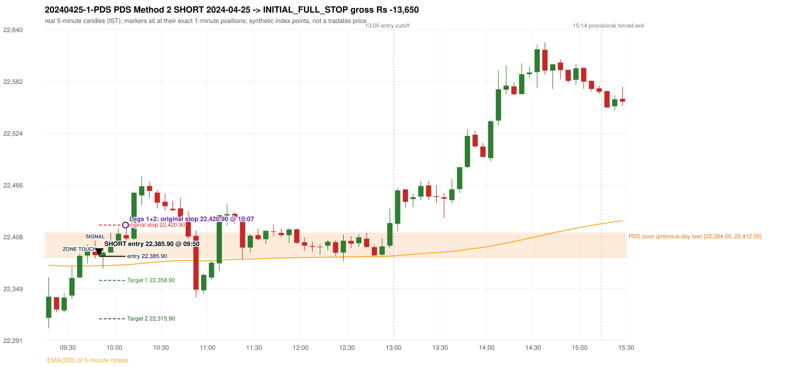
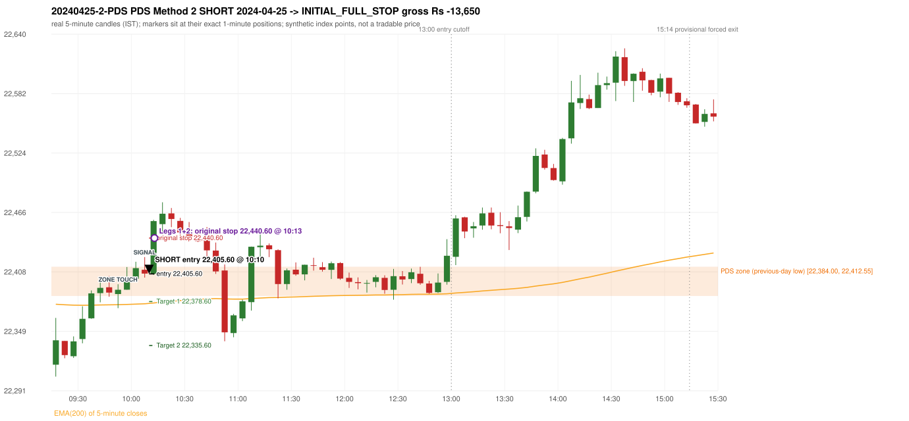

# Trading journal - 2024-04-25 (Thursday)

> Phase 4 historical validation, window B_TV (Window B 2022-09-01..2025-08-31 (secondary vendor minutes); status VENDOR_SENSITIVITY). The FROZEN Phase 3.6 configuration (IRF, ORB, PDR body-based, PDS, RF; shared controller) on a different data source. HISTORICAL RESEARCH ONLY: the strategy was developed using later data. the same window with the secondary vendor's minute bars (daily series still 5paisa): quantifies sensitivity to the data source; not a second independent result Synthetic NIFTY 50 index-point P&L (the index is not tradable). The owner's review status is intentionally blank.

## A. Trading day overview

| item | value |
|---|---|
| Date / weekday | 2024-04-25 / Thursday |
| Session type | USABLE_WITH_FLAGS / VALID |
| Original session open (first 1-minute open) | 22,316.90 |
| Previous session | 2024-04-24 |
| Previous-day high / low (wicks included) | 22,476.45 / 22,384.00 |
| Previous-day highest BODY high (the body-based PDR ceiling; wicks ignored) | 22,473.65 |
| Previous-day official close / last 5-minute close | 22,402.40 / 22,412.20 |
| Raw engine records / confirmed signals / fully valid signals | 16 / 11 / 11 |
| Setups that did not complete (invalidated / incomplete) | 5 |
| Executed trades | 2 20240425-1-PDS;20240425-2-PDS |
| Gross P&L (Rs, synthetic) | -27,300.00 |
| Illustrative net P&L (Rs; Rs 500/trade + 0.5 pt/fill) | -29,080.00 |
| Day-end portfolio status | DAY_FINISHED |
| Manual journal trades (matched / unmatched) | 0 (0 / 0) |
| Extra automated trades | 0 |

## B. Daily strategy signal timeline (confirmed signals, chronological)

| time | strategy | method | dir | entry-rule status | valid for execution | <= 13:00 | portfolio state | accepted / ignored | specific reason | competing (same minute) |
|---|---|---|---|---|---|---|---|---|---|---|
| 09:50 | PDS | Method 2 | SHORT | PROPOSAL_DEPENDENT | True | True | FIRST_TRADE_ACTIVE | ACCEPTED -> 20240425-1-PDS | first eligible signal of the day; trade 1: INITIAL_FULL_STOP |  |
| 10:10 | PDS | Method 2 | SHORT | PROPOSAL_DEPENDENT | True | True | SECOND_TRADE_ACTIVE | ACCEPTED -> 20240425-2-PDS | permitted second trade: newly confirmed PDR/PDS after the original full stop; trade 2: INITIAL_FULL_STOP |  |
| 10:50 | PDS | Method 1 | SHORT | PROPOSAL_DEPENDENT | True | True | DAY_FINISHED | IGNORED | DAY_FINISHED [blocked by PDS#2] |  |
| 10:55 | IRF | Method 1 | SHORT | PROPOSAL_DEPENDENT | True | True | DAY_FINISHED | IGNORED | DAY_FINISHED [blocked by PDS#2] | IRF Method 2A SHORT; IRF Method 2B SHORT; PDS Method 1 SHORT |
| 10:55 | IRF | Method 2A | SHORT | PROPOSAL_DEPENDENT | True | True | DAY_FINISHED | IGNORED | DAY_FINISHED [blocked by PDS#2] | IRF Method 1 SHORT; IRF Method 2B SHORT; PDS Method 1 SHORT |
| 10:55 | IRF | Method 2B | SHORT | PROPOSAL_DEPENDENT | True | True | DAY_FINISHED | IGNORED | DAY_FINISHED [blocked by PDS#2] | IRF Method 1 SHORT; IRF Method 2A SHORT; PDS Method 1 SHORT |
| 10:55 | PDS | Method 1 | SHORT | PROPOSAL_DEPENDENT | True | True | DAY_FINISHED | IGNORED | DAY_FINISHED [blocked by PDS#2] | IRF Method 1 SHORT; IRF Method 2A SHORT; IRF Method 2B SHORT |
| 12:05 | IRF | Method 2A | SHORT | PROPOSAL_DEPENDENT | True | True | DAY_FINISHED | IGNORED | DAY_FINISHED [blocked by PDS#2] | PDS Method 3 SHORT |
| 12:05 | PDS | Method 3 | SHORT | PROPOSAL_DEPENDENT | True | True | DAY_FINISHED | IGNORED | DAY_FINISHED [blocked by PDS#2] | IRF Method 2A SHORT |
| 12:35 | IRF | Method 2B | SHORT | PROPOSAL_DEPENDENT | True | True | DAY_FINISHED | IGNORED | DAY_FINISHED [blocked by PDS#2] |  |
| 15:10 | IRF | Method 2A | SHORT | PROPOSAL_DEPENDENT | True | False | DAY_FINISHED | IGNORED | DAY_FINISHED [blocked by PDS#2] |  |

Engine setups that did not complete (5); the complete list with failed rule ids is in `rejected_signals.csv`:

| candle | strategy | method | dir | status | precise reason | failed rules |
|---|---|---|---|---|---|---|
| 15:05 | IRF | Method 1/2 | SHORT | INCOMPLETE_AT_EOD | SESSION_ENDED_BEFORE_CONFIRMATION |  |
| 09:15 | ORB | Method 1 | SHORT | INVALIDATED | TREND:EMA_PREV_SESSION_CLOSE wrong side | ORB-TREND-001;ORB-TREND-002 |
| 09:15 | ORB | Method 2 | SHORT | INVALIDATED | TREND:EMA_PREV_SESSION_CLOSE wrong side | ORB-TREND-001;ORB-TREND-002 |
| 09:15 | ORB | Gap/200DMA | SHORT | INVALIDATED | CANDLE_QUALITY_OR_REJECTION_WICK | ORB-GAP-SHORT-003 |
| 12:05 | PDS | Method 1/2/3 | SHORT | INCOMPLETE_AT_EOD | NO_QUALIFYING_ENTRY_BEFORE_SESSION_END |  |

## C. Detailed trade journals

### 20240425-1-PDS: PDS Method 2 SHORT (FIRST trade)

Chart: 

**Rule configuration:** CFG-phase36_body_based-866f954e55 - signal verification status **PROPOSAL_DEPENDENT** (never VERIFIED while a rule rests on a proposal).

#### 1. Setup identification

PDS Method 2 SHORT: the session opened 67.10 points below the previous-day-low zone [22,384.00, 22,412.55]; price rose to the zone at 09:35 and the first red candle at the zone (09:45, close 22,387.30) was a higher-price-rejection pin bar; confirmed 09:50.

#### 2. Candle and indicator calculations

| role | session | candle | O | H | L | C | range | body % | upper wick % | lower wick % | direction | EMA(200) | strong bull / bear | pin bull / bear | small (body<=30%) | used for |
|---|---|---|---|---|---|---|---|---|---|---|---|---|---|---|---|---|
| zone_source_candle | PREVIOUS | 15:00-15:05 | 22,412.55 | 22,413.10 | 22,384.00 | 22,395.35 | 29.10 | 59.11 | 1.89 | 39.00 | BEARISH | 22,374.76 | False / False | False / False | False | previous-day low candle that defines the zone (A_LOWEST_LOW) |
| zone_retest_candle | TODAY | 09:35-09:40 | 22,362.20 | 22,389.45 | 22,361.65 | 22,386.55 | 27.80 | 87.59 | 10.43 | 1.98 | BULLISH | 22,375.04 | True / False | False / False | False | first candle whose range reaches the zone from below |
| signal_candle | TODAY | 09:45-09:50 | 22,392.50 | 22,403.50 | 22,383.35 | 22,387.30 | 20.15 | 25.81 | 54.59 | 19.60 | BEARISH | 22,375.33 | False / False | False / True | True | trigger candle |

Every condition, with the rule, the calculation, the observed values and the result:

| # | group | rule | result | status / numeric definition | calculation | observed | required | available at | why it matters |
|---|---|---|---|---|---|---|---|---|---|
| 1 | SELECTION | SEL-FIRST-001 | PASS | USER_APPROVED / USER_APPROVED | earliest CONFIRMED signal of the day across IRF/ORB/PDR/PDS/RF that passed the controller's checks | 0 confirmed signal(s) earlier today; 11 confirmed signals in the day in total, this one at 09:50 | no earlier executable signal | 2024-04-25 09:50 | the shared controller trades only the first valid signal; the five strategies are not independent positions |
| 2 | SELECTION | SEL-TIE-001 | PASS | USER_APPROVED / USER_APPROVED | other CONFIRMED signals with exactly the same confirmation timestamp | none | no different-strategy / opposite-direction signal in the same minute (otherwise an unresolved conflict, no trade) | 2024-04-25 09:50 | an unresolved same-minute collision would have produced no trade at all |
| 3 | SELECTION | ENTRY-CUTOFF-001 | PASS | USER_APPROVED / USER_APPROVED | fill timestamp vs 13:00:00 IST | signal confirmed 09:50; fill 09:50 | fill at or before 13:00:00 IST | 2024-04-25 09:50 | no new position may be entered with a fill after 13:00 IST |
| 4 | SELECTION | EXE-FILL-001 | PASS | PROPOSED_FOR_REVIEW / PROPOSED_FOR_REVIEW | fill = open of the 1-minute bar that starts at the signal candle's end | bar 09:50 O 22,385.90 H 22,387.70 L 22,379.80 C 22,383.90; executable=True; entry 22,385.90 | fill bar exists, starts exactly at the signal end, is fillable; entry = its open | 2024-04-25 09:50 | a 5-minute signal is known only when its candle closes; the first price that can be traded is the next minute's open |
| 5 | SELECTION | DAY-MAX-001 | PASS | USER_APPROVED / USER_APPROVED | number of entries today | trade 1 of at most 2 | <= 2 entries per day | 2024-04-25 09:50 | daily trade cap |
| 6 | SETUP | PDS-003 | PASS | SOURCE_VERIFIED / EXPLICIT_WORDING_DETAIL_PROPOSED_FOR_REVIEW | gap = first 1-minute open of today - previous session's OFFICIAL close | today's open 22,316.90 (first 1-minute bar 09:15) - previous close 22,402.40 (DAILY_VENDOR, 2024-04-24) = -85.50 points -> gap DOWN | gap DOWN (more than 0 points) | 2024-04-25 09:15 | approved convention: the original first-minute open, never the vendor daily open |
| 7 | SETUP | PDS-006 | PASS | SOURCE_VERIFIED / QUALITATIVE_SOURCE_NUMERIC_DEFINITION_PROPOSED_FOR_REVIEW | gap-down open below the zone | today's open 22,316.90 vs zone low 22,384.00: 67.10 points below | open < zone low | 2024-04-25 09:15 | the guide: 'price is trading below the previous day's support zone' after the gap; a PROPOSED strict reading |
| 8 | SETUP | PDS-004 | PASS | SOURCE_VERIFIED / EXPLICIT_IN_SOURCE | PDS is not a breakdown strategy: the zone must be tested from below first | open 22,316.90 below the zone floor 22,384.00; the first candle to reach the zone is 09:35 | price rises to the zone before any short | 2024-04-25 09:15 | a short below the level without a retest is not this strategy |
| 9 | SETUP | PDS-005 | PASS | SOURCE_VERIFIED / QUALITATIVE_SOURCE_NUMERIC_DEFINITION_PROPOSED_FOR_REVIEW | price comes up to the zone: first candle whose [low, high] intersects it (+/- proximity) | 09:35-09:40 O 22,362.20 H 22,389.45 L 22,361.65 C 22,386.55; range 27.80, body 24.35 (87.59%), upper wick 2.90 (10.43%), lower wick 0.55 (1.98%), bullish; high 22,389.45 vs zone low 22,384.00 | range intersects the zone | 2024-04-25 09:40 | PDS is not a breakdown strategy: the zone must be tested from below first |
| 10 | ZONE | PDS-001 | PASS | SOURCE_VERIFIED / EXPLICIT_IN_SOURCE | direction | SHORT (PDS is short only) | short-only | 2024-04-25 09:50 | PDS sells a retest of previous-day support from below |
| 11 | ZONE | PDS-002 | PASS | SOURCE_VERIFIED / QUALITATIVE_SOURCE_NUMERIC_DEFINITION_PROPOSED_FOR_REVIEW | zone = [lowest low, body top] of the previous session's absolute-low candle (method A_LOWEST_LOW; the lower wick is part of the zone) | zone [22,384.00, 22,412.55] from the 15:00 candle of 2024-04-24 (15:00-15:05 O 22,412.55 H 22,413.10 L 22,384.00 C 22,395.35; range 29.10, body 17.20 (59.11%), upper wick 0.55 (1.89%), lower wick 11.35 (39.00%), bearish); engine recorded [22,384.00, 22,412.55] | previous trading day's low where price took support (body + lower wick) | 2024-04-24 15:05 | the reference level of the strategy; the exact candle(s) are a research choice (PDS-ZONE-002) |
| 12 | CONFIRMATION | PDS-M-001 | PASS | SOURCE_VERIFIED / QUALITATIVE_SOURCE_NUMERIC_DEFINITION_PROPOSED_FOR_REVIEW | Methods 1/2 apply to the FIRST red candle at the zone | first red candle at the zone: 09:45; signal candle 09:45 | the trigger is the first red candle at the zone | 2024-04-25 09:50 | a later red candle would only qualify through Method 3 |
| 13 | CONFIRMATION | PDS-M2-001 | PASS | SOURCE_VERIFIED / QUALITATIVE_SOURCE_NUMERIC_DEFINITION_PROPOSED_FOR_REVIEW | red higher-price-rejection pin bar: upper wick >= 2 x body, close within the lowest 30% of the range, high reaches the zone | 09:45-09:50 O 22,392.50 H 22,403.50 L 22,383.35 C 22,387.30; range 20.15, body 5.20 (25.81%), upper wick 11.00 (54.59%), lower wick 3.95 (19.60%), bearish; upper wick / body = 2.12; close position from the low 19.60% of range; high 22,403.50 vs zone low 22,384.00 | bearish pin bar and high >= zone low | 2024-04-25 09:50 | the guide: wick-to-body ratio 'not specified'; these thresholds are an owner recommendation (proposal) |
| 14 | EXECUTION | EXE-STOP-001 | PASS | USER_APPROVED / USER_APPROVED | initial stop = entry + 35 points | entry 22,385.90 -> stop 22,420.90 | stop 35 index points (BASELINE) | 2024-04-25 09:50 | defines the loss if the setup fails before Target 1 |
| 15 | EXECUTION | EXE-T1-001 | PASS | SOURCE_VERIFIED / EXPLICIT_IN_SOURCE | Target 1 = entry +/- 27 points | T1 22,358.90 | 27 points | 2024-04-25 09:50 | Leg 1 (3 lots) is booked at Target 1 |
| 16 | EXECUTION | PDS-TGT-001 | PASS | SOURCE_VERIFIED / EXPLICIT_IN_SOURCE | Target 2 = entry +/- 70 points | T2 22,315.90 (the guide says 70; the report suggests 60 - CONFLICTING) | 70 points | 2024-04-25 09:50 | Leg 2 (3 lots) is booked at Target 2 |
| 17 | EXECUTION | POST-T1-STOP-006 | PASS | USER_APPROVED / USER_APPROVED | after T1 the Leg-2 stop = entry + 6 (no trailing) | post-T1 stop 22,391.90 | entry -6 (LONG) / +6 (SHORT) | 2024-04-25 09:50 | protects the remaining three lots once the first three are booked |
| 18 | EXECUTION | SIZE-LOT-001 | PASS | USER_APPROVED / USER_APPROVED | 6 lots x 65 = 390, Leg 1 = 3 lots = 195, Leg 2 = 195 | 6 lots, lot size 65, legs 3+3 | 6 lots in two equal legs | 2024-04-25 09:50 | position size for the synthetic P&L |
| 19 | NOTE | PDS-007 | NOT_APPLICABLE | PROPOSED_FOR_REVIEW / PROPOSED_FOR_REVIEW | repeated PDS signals today | 5 confirmed PDS signal(s) in the session | n/a (disclosure) | 2024-04-25 09:50 | the per-session cap is lifted for the controller runs; the controller trades only the first (or the permitted second) trade |
| 20 | NOTE | PDS-SL-001 | NOT_APPLICABLE | SOURCE_VERIFIED / QUALITATIVE_SOURCE_NUMERIC_DEFINITION_PROPOSED_FOR_REVIEW | the guide's 35-or-40 rule: 35 if the most recent green candle's high is within 35 points of entry, else 40 | most recent green candle high 22,399.05 is 13.15 points from the entry 22,385.90: the guide's rule would select 35 points; the baseline applies a fixed 35 (USER_APPROVED research baseline; the 35-vs-40 selection and the 40-point variant are separate labelled scenarios) | source selection rule | 2024-04-25 09:50 | the stop distance is a modelling choice and changes losses, not entries |
| 21 | NOTE | NOTE-UNRESOLVED-DEPENDENCIES | NOT_APPLICABLE | NOT_A_RULE / NOT_A_REGISTRY_RULE | rules the signal depends on that the sources leave unresolved | engine-recorded unresolved rule ids: none; verification status PROPOSAL_DEPENDENT | n/a (disclosure) | 2024-04-25 09:50 | the entry is only as verified as the rules it rests on |

#### 3. Entry decision and explanation

PDS Method 2 SHORT: the session opened 67.10 points below the previous-day-low zone [22,384.00, 22,412.55]; price rose to the zone at 09:35 and the first red candle at the zone (09:45, close 22,387.30) was a higher-price-rejection pin bar; confirmed 09:50.

**Why this trade ahead of the other strategies:** This PDS Method 2 signal was the earliest executable signal of the day: 0 confirmed signal(s) earlier, 0 other in the same minute. 10 later confirmed signal(s) (IRF x6, PDS x4) are logged as ignored or rejected. State of the other four engines at that moment: [IRF: no setup record before this time (a base condition was not met, or nothing triggered)] [ORB: Method 1 invalidated at 09:15: TREND:EMA_PREV_SESSION_CLOSE wrong side; Method 2 invalidated at 09:15: TREND:EMA_PREV_SESSION_CLOSE wrong side] [PDR: no setup record before this time (a base condition was not met, or nothing triggered)] [RF: no setup record before this time (a base condition was not met, or nothing triggered)]

#### 4. Actual entry execution

| item | value |
|---|---|
| Signal candle | 09:45-09:50 |
| Signal confirmed | 2024-04-25 09:50 |
| Fill timestamp | 2024-04-25 09:50 |
| Entry price | 22,385.90 |
| Source partition / 1-minute bar | data/phase4/processed/TECHNOVUS_1M/nifty50/year=2024/month=04/candles.parquet / 2024-04-25 09:50 |
| Source bar O / H / L / C | 22,385.90 / 22,387.70 / 22,379.80 / 22,383.90 |
| Fill assumption | open of the 1-minute bar starting at the signal candle's end (EXE-FILL-001, PROPOSED causal convention) |
| Initial stop / T1 / T2 / post-T1 stop | 22,420.90 / 22,358.90 / 22,315.90 / 22,391.90 |
| Position | 6 lots x 65 = 390 units (Leg 1 195, Leg 2 195) |

#### 5-8. Trade progress, Target 1, post-T1 stop and final exit

Between the 09:50 entry bar and the final exit (18 one-minute bars) the best excursion in favour was 13.80 points at 09:52 and the worst against was 36.15 points at 10:07. At 10:07 price reached the original stop 22,420.90 before Target 1 22,358.90, so all six lots exited together at 22,420.90. This is an INITIAL_FULL_STOP: one more trade is allowed that day, only a newly confirmed PDR/PDS signal.

| leg | qty | exit time | exit price | reason | source 1-minute bar | O / H / L / C | gross points | gross Rs | slippage pts | flags |
|---|---|---|---|---|---|---|---|---|---|---|
| 1 | 195 | 10:07 | 22,420.90 | ORIGINAL_STOP_BEFORE_T1 | 10:07 | 22,406.70 / 22,422.05 / 22,404.95 / 22,412.90 | -35.00 | -6,825.00 | 0.00 |  |
| 2 | 195 | 10:07 | 22,420.90 | ORIGINAL_STOP_BEFORE_T1 | 10:07 | 22,406.70 / 22,422.05 / 22,404.95 / 22,412.90 | -35.00 | -6,825.00 | 0.00 |  |

Exit evidence per leg:

* Leg 1: 1-minute bar 10:07 O 22,406.70 H 22,422.05 L 22,404.95 C 22,412.90: high 22,422.05 reached the original stop 22,420.90 before Target 1 22,358.90 was touched; both legs exit at the stop level 22,420.90
* Leg 2: 1-minute bar 10:07 O 22,406.70 H 22,422.05 L 22,404.95 C 22,412.90: high 22,422.05 reached the original stop 22,420.90 before Target 1 22,358.90 was touched; both legs exit at the stop level 22,420.90

#### 9. Gross and illustrative net P&L

| item | value (Rs) |
|---|---|
| Leg 1 gross | -6,825.00 |
| Leg 2 gross | -6,825.00 |
| Trade gross (= Leg 1 + Leg 2) | -13,650.00 |
| Illustrative fixed cost | -500.00 |
| Illustrative slippage (0.5 pt on every fill, entry + exits, all units) | -390.00 |
| Illustrative net | -14,540.00 |

#### 10. Manual journal comparison

No manual journal exists for this period; no comparison.

### 20240425-2-PDS: PDS Method 2 SHORT (SECOND trade)

Chart: 

**Rule configuration:** CFG-phase36_body_based-866f954e55 - signal verification status **PROPOSAL_DEPENDENT** (never VERIFIED while a rule rests on a proposal).

#### 1. Setup identification

PDS Method 2 SHORT: the session opened 67.10 points below the previous-day-low zone [22,384.00, 22,412.55]; price rose to the zone at 09:50 and the first red candle at the zone (10:05, close 22,405.95) was a higher-price-rejection pin bar; confirmed 10:10.

#### 2. Candle and indicator calculations

| role | session | candle | O | H | L | C | range | body % | upper wick % | lower wick % | direction | EMA(200) | strong bull / bear | pin bull / bear | small (body<=30%) | used for |
|---|---|---|---|---|---|---|---|---|---|---|---|---|---|---|---|---|
| zone_source_candle | PREVIOUS | 15:00-15:05 | 22,412.55 | 22,413.10 | 22,384.00 | 22,395.35 | 29.10 | 59.11 | 1.89 | 39.00 | BEARISH | 22,374.76 | False / False | False / False | False | previous-day low candle that defines the zone (A_LOWEST_LOW) |
| zone_retest_candle | TODAY | 09:50-09:55 | 22,385.90 | 22,395.45 | 22,372.10 | 22,390.10 | 23.35 | 17.99 | 22.91 | 59.10 | BULLISH | 22,375.48 | False / False | True / False | True | first candle whose range reaches the zone from below |
| signal_candle | TODAY | 10:05-10:10 | 22,409.65 | 22,422.05 | 22,401.95 | 22,405.95 | 20.10 | 18.41 | 61.69 | 19.90 | BEARISH | 22,376.39 | False / False | False / True | True | trigger candle |

Every condition, with the rule, the calculation, the observed values and the result:

| # | group | rule | result | status / numeric definition | calculation | observed | required | available at | why it matters |
|---|---|---|---|---|---|---|---|---|---|
| 1 | SELECTION | DAY-SL-001 | PASS | USER_APPROVED / USER_APPROVED | first trade outcome, strategy of this signal, position-close time vs this signal's timestamp | first trade PDS Method 2 closed as INITIAL_FULL_STOP at 10:07; position free from 10:08; this PDS signal confirmed 10:10 | first trade INITIAL_FULL_STOP before Target 1, and a NEWLY confirmed PDR/PDS signal after the first position closed | 2024-04-25 10:10 | the only way a second trade is allowed |
| 2 | SELECTION | DAY-NOREUSE-001 | PASS | USER_APPROVED / USER_APPROVED | signals confirmed while the first position was open | 1 signal(s) were ignored during the first trade (never reused): PDS Method 2 SHORT @09:50 | this trade comes from a signal confirmed after the first exit, not from an ignored one | 2024-04-25 10:10 | an ignored signal can never become the second trade |
| 3 | SELECTION | ENTRY-CUTOFF-001 | PASS | USER_APPROVED / USER_APPROVED | fill timestamp vs 13:00:00 IST | signal confirmed 10:10; fill 10:10 | fill at or before 13:00:00 IST | 2024-04-25 10:10 | no new position may be entered with a fill after 13:00 IST |
| 4 | SELECTION | EXE-FILL-001 | PASS | PROPOSED_FOR_REVIEW / PROPOSED_FOR_REVIEW | fill = open of the 1-minute bar that starts at the signal candle's end | bar 10:10 O 22,405.60 H 22,410.55 L 22,404.60 C 22,409.80; executable=True; entry 22,405.60 | fill bar exists, starts exactly at the signal end, is fillable; entry = its open | 2024-04-25 10:10 | a 5-minute signal is known only when its candle closes; the first price that can be traded is the next minute's open |
| 5 | SELECTION | DAY-MAX-001 | PASS | USER_APPROVED / USER_APPROVED | number of entries today | trade 2 of at most 2 | <= 2 entries per day | 2024-04-25 10:10 | daily trade cap |
| 6 | SETUP | PDS-003 | PASS | SOURCE_VERIFIED / EXPLICIT_WORDING_DETAIL_PROPOSED_FOR_REVIEW | gap = first 1-minute open of today - previous session's OFFICIAL close | today's open 22,316.90 (first 1-minute bar 09:15) - previous close 22,402.40 (DAILY_VENDOR, 2024-04-24) = -85.50 points -> gap DOWN | gap DOWN (more than 0 points) | 2024-04-25 09:15 | approved convention: the original first-minute open, never the vendor daily open |
| 7 | SETUP | PDS-006 | PASS | SOURCE_VERIFIED / QUALITATIVE_SOURCE_NUMERIC_DEFINITION_PROPOSED_FOR_REVIEW | gap-down open below the zone | today's open 22,316.90 vs zone low 22,384.00: 67.10 points below | open < zone low | 2024-04-25 09:15 | the guide: 'price is trading below the previous day's support zone' after the gap; a PROPOSED strict reading |
| 8 | SETUP | PDS-004 | PASS | SOURCE_VERIFIED / EXPLICIT_IN_SOURCE | PDS is not a breakdown strategy: the zone must be tested from below first | open 22,316.90 below the zone floor 22,384.00; the first candle to reach the zone is 09:50 | price rises to the zone before any short | 2024-04-25 09:15 | a short below the level without a retest is not this strategy |
| 9 | SETUP | PDS-005 | PASS | SOURCE_VERIFIED / QUALITATIVE_SOURCE_NUMERIC_DEFINITION_PROPOSED_FOR_REVIEW | price comes up to the zone: first candle whose [low, high] intersects it (+/- proximity) | 09:50-09:55 O 22,385.90 H 22,395.45 L 22,372.10 C 22,390.10; range 23.35, body 4.20 (17.99%), upper wick 5.35 (22.91%), lower wick 13.80 (59.10%), bullish; high 22,395.45 vs zone low 22,384.00 | range intersects the zone | 2024-04-25 09:55 | PDS is not a breakdown strategy: the zone must be tested from below first |
| 10 | ZONE | PDS-001 | PASS | SOURCE_VERIFIED / EXPLICIT_IN_SOURCE | direction | SHORT (PDS is short only) | short-only | 2024-04-25 10:10 | PDS sells a retest of previous-day support from below |
| 11 | ZONE | PDS-002 | PASS | SOURCE_VERIFIED / QUALITATIVE_SOURCE_NUMERIC_DEFINITION_PROPOSED_FOR_REVIEW | zone = [lowest low, body top] of the previous session's absolute-low candle (method A_LOWEST_LOW; the lower wick is part of the zone) | zone [22,384.00, 22,412.55] from the 15:00 candle of 2024-04-24 (15:00-15:05 O 22,412.55 H 22,413.10 L 22,384.00 C 22,395.35; range 29.10, body 17.20 (59.11%), upper wick 0.55 (1.89%), lower wick 11.35 (39.00%), bearish); engine recorded [22,384.00, 22,412.55] | previous trading day's low where price took support (body + lower wick) | 2024-04-24 15:05 | the reference level of the strategy; the exact candle(s) are a research choice (PDS-ZONE-002) |
| 12 | CONFIRMATION | PDS-M-001 | PASS | SOURCE_VERIFIED / QUALITATIVE_SOURCE_NUMERIC_DEFINITION_PROPOSED_FOR_REVIEW | Methods 1/2 apply to the FIRST red candle at the zone | first red candle at the zone: 10:05; signal candle 10:05 | the trigger is the first red candle at the zone | 2024-04-25 10:10 | a later red candle would only qualify through Method 3 |
| 13 | CONFIRMATION | PDS-M2-001 | PASS | SOURCE_VERIFIED / QUALITATIVE_SOURCE_NUMERIC_DEFINITION_PROPOSED_FOR_REVIEW | red higher-price-rejection pin bar: upper wick >= 2 x body, close within the lowest 30% of the range, high reaches the zone | 10:05-10:10 O 22,409.65 H 22,422.05 L 22,401.95 C 22,405.95; range 20.10, body 3.70 (18.41%), upper wick 12.40 (61.69%), lower wick 4.00 (19.90%), bearish; upper wick / body = 3.35; close position from the low 19.90% of range; high 22,422.05 vs zone low 22,384.00 | bearish pin bar and high >= zone low | 2024-04-25 10:10 | the guide: wick-to-body ratio 'not specified'; these thresholds are an owner recommendation (proposal) |
| 14 | EXECUTION | EXE-STOP-001 | PASS | USER_APPROVED / USER_APPROVED | initial stop = entry + 35 points | entry 22,405.60 -> stop 22,440.60 | stop 35 index points (BASELINE) | 2024-04-25 10:10 | defines the loss if the setup fails before Target 1 |
| 15 | EXECUTION | EXE-T1-001 | PASS | SOURCE_VERIFIED / EXPLICIT_IN_SOURCE | Target 1 = entry +/- 27 points | T1 22,378.60 | 27 points | 2024-04-25 10:10 | Leg 1 (3 lots) is booked at Target 1 |
| 16 | EXECUTION | PDS-TGT-001 | PASS | SOURCE_VERIFIED / EXPLICIT_IN_SOURCE | Target 2 = entry +/- 70 points | T2 22,335.60 (the guide says 70; the report suggests 60 - CONFLICTING) | 70 points | 2024-04-25 10:10 | Leg 2 (3 lots) is booked at Target 2 |
| 17 | EXECUTION | POST-T1-STOP-006 | PASS | USER_APPROVED / USER_APPROVED | after T1 the Leg-2 stop = entry + 6 (no trailing) | post-T1 stop 22,411.60 | entry -6 (LONG) / +6 (SHORT) | 2024-04-25 10:10 | protects the remaining three lots once the first three are booked |
| 18 | EXECUTION | SIZE-LOT-001 | PASS | USER_APPROVED / USER_APPROVED | 6 lots x 65 = 390, Leg 1 = 3 lots = 195, Leg 2 = 195 | 6 lots, lot size 65, legs 3+3 | 6 lots in two equal legs | 2024-04-25 10:10 | position size for the synthetic P&L |
| 19 | NOTE | PDS-007 | NOT_APPLICABLE | PROPOSED_FOR_REVIEW / PROPOSED_FOR_REVIEW | repeated PDS signals today | 5 confirmed PDS signal(s) in the session | n/a (disclosure) | 2024-04-25 10:10 | the per-session cap is lifted for the controller runs; the controller trades only the first (or the permitted second) trade |
| 20 | NOTE | PDS-SL-001 | NOT_APPLICABLE | SOURCE_VERIFIED / QUALITATIVE_SOURCE_NUMERIC_DEFINITION_PROPOSED_FOR_REVIEW | the guide's 35-or-40 rule: 35 if the most recent green candle's high is within 35 points of entry, else 40 | most recent green candle high 22,417.45 is 11.85 points from the entry 22,405.60: the guide's rule would select 35 points; the baseline applies a fixed 35 (USER_APPROVED research baseline; the 35-vs-40 selection and the 40-point variant are separate labelled scenarios) | source selection rule | 2024-04-25 10:10 | the stop distance is a modelling choice and changes losses, not entries |
| 21 | NOTE | NOTE-UNRESOLVED-DEPENDENCIES | NOT_APPLICABLE | NOT_A_RULE / NOT_A_REGISTRY_RULE | rules the signal depends on that the sources leave unresolved | engine-recorded unresolved rule ids: none; verification status PROPOSAL_DEPENDENT | n/a (disclosure) | 2024-04-25 10:10 | the entry is only as verified as the rules it rests on |

#### 3. Entry decision and explanation

PDS Method 2 SHORT: the session opened 67.10 points below the previous-day-low zone [22,384.00, 22,412.55]; price rose to the zone at 09:50 and the first red candle at the zone (10:05, close 22,405.95) was a higher-price-rejection pin bar; confirmed 10:10.

**Why this trade ahead of the other strategies:** The first trade (PDS Method 2) was stopped out before Target 1 at 10:07; this newly confirmed PDS signal at 10:10 is the first PDR/PDS signal after that exit, so it is the day's permitted second trade. State of the other engines at that moment: [IRF: no setup record before this time (a base condition was not met, or nothing triggered)] [ORB: Method 1 invalidated at 09:15: TREND:EMA_PREV_SESSION_CLOSE wrong side; Method 2 invalidated at 09:15: TREND:EMA_PREV_SESSION_CLOSE wrong side] [PDR: no setup record before this time (a base condition was not met, or nothing triggered)] [RF: no setup record before this time (a base condition was not met, or nothing triggered)]

#### 4. Actual entry execution

| item | value |
|---|---|
| Signal candle | 10:05-10:10 |
| Signal confirmed | 2024-04-25 10:10 |
| Fill timestamp | 2024-04-25 10:10 |
| Entry price | 22,405.60 |
| Source partition / 1-minute bar | data/phase4/processed/TECHNOVUS_1M/nifty50/year=2024/month=04/candles.parquet / 2024-04-25 10:10 |
| Source bar O / H / L / C | 22,405.60 / 22,410.55 / 22,404.60 / 22,409.80 |
| Fill assumption | open of the 1-minute bar starting at the signal candle's end (EXE-FILL-001, PROPOSED causal convention) |
| Initial stop / T1 / T2 / post-T1 stop | 22,440.60 / 22,378.60 / 22,335.60 / 22,411.60 |
| Position | 6 lots x 65 = 390 units (Leg 1 195, Leg 2 195) |

#### 5-8. Trade progress, Target 1, post-T1 stop and final exit

Between the 10:10 entry bar and the final exit (4 one-minute bars) the best excursion in favour was 1.00 points at 10:10 and the worst against was 40.75 points at 10:13. At 10:13 price reached the original stop 22,440.60 before Target 1 22,378.60, so all six lots exited together at 22,440.60. This is an INITIAL_FULL_STOP: one more trade is allowed that day, only a newly confirmed PDR/PDS signal.

| leg | qty | exit time | exit price | reason | source 1-minute bar | O / H / L / C | gross points | gross Rs | slippage pts | flags |
|---|---|---|---|---|---|---|---|---|---|---|
| 1 | 195 | 10:13 | 22,440.60 | ORIGINAL_STOP_BEFORE_T1 | 10:13 | 22,424.30 / 22,446.35 / 22,420.80 / 22,444.40 | -35.00 | -6,825.00 | 0.00 |  |
| 2 | 195 | 10:13 | 22,440.60 | ORIGINAL_STOP_BEFORE_T1 | 10:13 | 22,424.30 / 22,446.35 / 22,420.80 / 22,444.40 | -35.00 | -6,825.00 | 0.00 |  |

Exit evidence per leg:

* Leg 1: 1-minute bar 10:13 O 22,424.30 H 22,446.35 L 22,420.80 C 22,444.40: high 22,446.35 reached the original stop 22,440.60 before Target 1 22,378.60 was touched; both legs exit at the stop level 22,440.60
* Leg 2: 1-minute bar 10:13 O 22,424.30 H 22,446.35 L 22,420.80 C 22,444.40: high 22,446.35 reached the original stop 22,440.60 before Target 1 22,378.60 was touched; both legs exit at the stop level 22,440.60

#### 9. Gross and illustrative net P&L

| item | value (Rs) |
|---|---|
| Leg 1 gross | -6,825.00 |
| Leg 2 gross | -6,825.00 |
| Trade gross (= Leg 1 + Leg 2) | -13,650.00 |
| Illustrative fixed cost | -500.00 |
| Illustrative slippage (0.5 pt on every fill, entry + exits, all units) | -390.00 |
| Illustrative net | -14,540.00 |

#### 10. Manual journal comparison

No manual journal exists for this period; no comparison.

## D. Manual journal comparison

No manual journal exists for this period (the manual journal covers 2025-09-01 .. 2026-08-31 only); no comparison is made and no automated trade is labelled 'extra'.

## E. Daily conclusion

* **Traded:** 20240425-1-PDS - PDS Method 2 SHORT at 09:50 (entry 22,385.90), outcome INITIAL_FULL_STOP, gross Rs -13,650.00, illustrative net Rs -14,540.00. **Why:** This PDS Method 2 signal was the earliest executable signal of the day: 0 confirmed signal(s) earlier, 0 other in the same minute. 10 later confirmed signal(s) (IRF x6, PDS x4) are logged as ignored or rejected. State of the other four engines at that moment: [IRF: no setup record before this time (a base condition was not met, or nothing triggered)] [ORB: Method 1 invalidated at 09:15: TREND:EMA_PREV_SESSION_CLOSE wrong side; Method 2 invalidated at 09:15: TREND:EMA_PREV_SESSION_CLOSE wrong side] [PDR: no setup record before this time (a base condition was not met, or nothing triggered)] [RF: no setup record before this time (a base condition was not met, or nothing triggered)] **How it ended:** At 10:07 price reached the original stop 22,420.90 before Target 1 22,358.90, so all six lots exited together at 22,420.90. This is an INITIAL_FULL_STOP: one more trade is allowed that day, only a newly confirmed PDR/PDS signal.
* **Traded:** 20240425-2-PDS - PDS Method 2 SHORT at 10:10 (entry 22,405.60), outcome INITIAL_FULL_STOP, gross Rs -13,650.00, illustrative net Rs -14,540.00. **Why:** The first trade (PDS Method 2) was stopped out before Target 1 at 10:07; this newly confirmed PDS signal at 10:10 is the first PDR/PDS signal after that exit, so it is the day's permitted second trade. State of the other engines at that moment: [IRF: no setup record before this time (a base condition was not met, or nothing triggered)] [ORB: Method 1 invalidated at 09:15: TREND:EMA_PREV_SESSION_CLOSE wrong side; Method 2 invalidated at 09:15: TREND:EMA_PREV_SESSION_CLOSE wrong side] [PDR: no setup record before this time (a base condition was not met, or nothing triggered)] [RF: no setup record before this time (a base condition was not met, or nothing triggered)] **How it ended:** At 10:13 price reached the original stop 22,440.60 before Target 1 22,378.60, so all six lots exited together at 22,440.60. This is an INITIAL_FULL_STOP: one more trade is allowed that day, only a newly confirmed PDR/PDS signal.
* **Ignored / rejected signals:** IRF IGNORED DAY_FINISHED x6; PDS IGNORED DAY_FINISHED x3
* **Automated triage (not an approval; the owner's review status stays blank):** TRADED_NO_FLAGS
