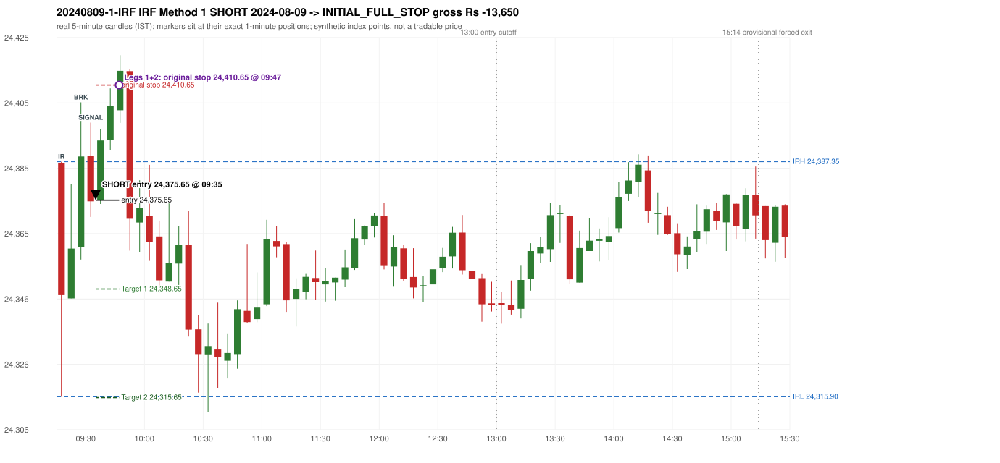
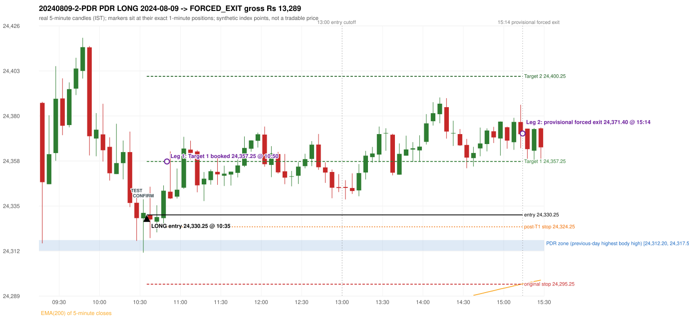

# Trading journal - 2024-08-09 (Friday)

> Phase 4 historical validation, window B_TV (Window B 2022-09-01..2025-08-31 (secondary vendor minutes); status VENDOR_SENSITIVITY). The FROZEN Phase 3.6 configuration (IRF, ORB, PDR body-based, PDS, RF; shared controller) on a different data source. HISTORICAL RESEARCH ONLY: the strategy was developed using later data. the same window with the secondary vendor's minute bars (daily series still 5paisa): quantifies sensitivity to the data source; not a second independent result Synthetic NIFTY 50 index-point P&L (the index is not tradable). The owner's review status is intentionally blank.

## A. Trading day overview

| item | value |
|---|---|
| Date / weekday | 2024-08-09 / Friday |
| Session type | USABLE_WITH_FLAGS / VALID |
| Original session open (first 1-minute open) | 24,386.85 |
| Previous session | 2024-08-08 |
| Previous-day high / low (wicks included) | 24,340.50 / 24,079.70 |
| Previous-day highest BODY high (the body-based PDR ceiling; wicks ignored) | 24,317.55 |
| Previous-day official close / last 5-minute close | 24,117.00 / 24,098.70 |
| Raw engine records / confirmed signals / fully valid signals | 8 / 5 / 5 |
| Setups that did not complete (invalidated / incomplete) | 3 |
| Executed trades | 2 20240809-1-IRF;20240809-2-PDR |
| Gross P&L (Rs, synthetic) | -360.75 |
| Illustrative net P&L (Rs; Rs 500/trade + 0.5 pt/fill) | -2,140.75 |
| Day-end portfolio status | DAY_FINISHED |
| Manual journal trades (matched / unmatched) | 0 (0 / 0) |
| Extra automated trades | 0 |

## B. Daily strategy signal timeline (confirmed signals, chronological)

| time | strategy | method | dir | entry-rule status | valid for execution | <= 13:00 | portfolio state | accepted / ignored | specific reason | competing (same minute) |
|---|---|---|---|---|---|---|---|---|---|---|
| 09:35 | IRF | Method 1 | SHORT | PROPOSAL_DEPENDENT | True | True | FIRST_TRADE_ACTIVE | ACCEPTED -> 20240809-1-IRF | first eligible signal of the day; trade 1: INITIAL_FULL_STOP |  |
| 09:40 | PDR | PDR | LONG | RESEARCH_VARIANT | True | True | FIRST_TRADE_ACTIVE | IGNORED | POSITION_ACTIVE (signal kept for diagnostics only; never reused) [blocked by IRF#1] |  |
| 09:55 | IRF | Method 1 | SHORT | PROPOSAL_DEPENDENT | True | True | SECOND_TRADE_ELIGIBLE | REJECTED | SECOND_TRADE_RESTRICTED_TO_PDR_PDS [blocked by IRF#1] |  |
| 10:25 | IRF | Method 2A | SHORT | PROPOSAL_DEPENDENT | True | True | SECOND_TRADE_ELIGIBLE | REJECTED | SECOND_TRADE_RESTRICTED_TO_PDR_PDS [blocked by IRF#1] |  |
| 10:35 | PDR | PDR | LONG | RESEARCH_VARIANT | True | True | SECOND_TRADE_ACTIVE | ACCEPTED -> 20240809-2-PDR | permitted second trade: newly confirmed PDR/PDS after the original full stop; trade 2: FORCED_EXIT |  |

Engine setups that did not complete (3); the complete list with failed rule ids is in `rejected_signals.csv`:

| candle | strategy | method | dir | status | precise reason | failed rules |
|---|---|---|---|---|---|---|
| 09:15 | ORB | Method 1 | LONG | INVALIDATED | TREND:EMA_PREV_SESSION_CLOSE wrong side | ORB-TREND-001;ORB-TREND-002 |
| 09:15 | ORB | Method 2 | LONG | INVALIDATED | TREND:EMA_PREV_SESSION_CLOSE wrong side | ORB-TREND-001;ORB-TREND-002 |
| 09:15 | ORB | Gap/200DMA | LONG | INVALIDATED | CANDLE_QUALITY_OR_REJECTION_WICK | ORB-GAP-LONG-004 |

## C. Detailed trade journals

### 20240809-1-IRF: IRF Method 1 SHORT (FIRST trade)

Chart: 

**Rule configuration:** CFG-phase36_body_based-866f954e55 - signal verification status **PROPOSAL_DEPENDENT** (never VERIFIED while a rule rests on a proposal).

#### 1. Setup identification

IRF Method 1 SHORT: the completed 09:25 candle closed at 24,388.95, 1.60 points above the initial range high 24,387.35 (range [24,315.90, 24,387.35] from the 09:15 candle); the immediately following completed 09:30 candle closed at 24,375.30, back inside the range. The short signal was confirmed at 09:35 on that close. Entry reference close 24,375.30 is 12.05 points below IRH 24,387.35.

#### 2. Candle and indicator calculations

| role | session | candle | O | H | L | C | range | body % | upper wick % | lower wick % | direction | EMA(200) | strong bull / bear | pin bull / bear | small (body<=30%) | used for |
|---|---|---|---|---|---|---|---|---|---|---|---|---|---|---|---|---|
| initial_range_candle | TODAY | 09:15-09:20 | 24,386.85 | 24,387.35 | 24,315.90 | 24,346.80 | 71.45 | 56.05 | 0.70 | 43.25 | BEARISH | 24,227.04 | False / False | False / False | False | initial range = high/low of the 09:15 candle |
| signal_candle | TODAY | 09:30-09:35 | 24,389.10 | 24,399.25 | 24,370.55 | 24,375.30 | 28.70 | 48.08 | 35.37 | 16.55 | BEARISH | 24,231.42 | False / False | False / False | False | candle whose close completed the trigger |
| breakout_candle | TODAY | 09:25-09:30 | 24,361.50 | 24,405.40 | 24,357.60 | 24,388.95 | 47.80 | 57.43 | 34.41 | 8.16 | BULLISH | 24,229.97 | False / False | False / False | False | breakout candle: a completed candle closing above IRH |

Every condition, with the rule, the calculation, the observed values and the result:

| # | group | rule | result | status / numeric definition | calculation | observed | required | available at | why it matters |
|---|---|---|---|---|---|---|---|---|---|
| 1 | SELECTION | SEL-FIRST-001 | PASS | USER_APPROVED / USER_APPROVED | earliest CONFIRMED signal of the day across IRF/ORB/PDR/PDS/RF that passed the controller's checks | 0 confirmed signal(s) earlier today; 5 confirmed signals in the day in total, this one at 09:35 | no earlier executable signal | 2024-08-09 09:35 | the shared controller trades only the first valid signal; the five strategies are not independent positions |
| 2 | SELECTION | SEL-TIE-001 | PASS | USER_APPROVED / USER_APPROVED | other CONFIRMED signals with exactly the same confirmation timestamp | none | no different-strategy / opposite-direction signal in the same minute (otherwise an unresolved conflict, no trade) | 2024-08-09 09:35 | an unresolved same-minute collision would have produced no trade at all |
| 3 | SELECTION | ENTRY-CUTOFF-001 | PASS | USER_APPROVED / USER_APPROVED | fill timestamp vs 13:00:00 IST | signal confirmed 09:35; fill 09:35 | fill at or before 13:00:00 IST | 2024-08-09 09:35 | no new position may be entered with a fill after 13:00 IST |
| 4 | SELECTION | EXE-FILL-001 | PASS | PROPOSED_FOR_REVIEW / PROPOSED_FOR_REVIEW | fill = open of the 1-minute bar that starts at the signal candle's end | bar 09:35 O 24,375.65 H 24,383.70 L 24,374.50 C 24,378.00; executable=True; entry 24,375.65 | fill bar exists, starts exactly at the signal end, is fillable; entry = its open | 2024-08-09 09:35 | a 5-minute signal is known only when its candle closes; the first price that can be traded is the next minute's open |
| 5 | SELECTION | DAY-MAX-001 | PASS | USER_APPROVED / USER_APPROVED | number of entries today | trade 1 of at most 2 | <= 2 entries per day | 2024-08-09 09:35 | daily trade cap |
| 6 | SETUP | IRF-GLOBAL-001 | PASS | SOURCE_VERIFIED / EXPLICIT_IN_SOURCE | initial range = high and low (wicks included) of the first completed 5-minute candle | 09:15-09:20 IRH 24,387.35, IRL 24,315.90 (range 71.45; engine recorded IRH 24,387.35, IRL 24,315.90) | high/low of the 09:15-09:20 candle | 2024-08-09 09:20 | all three IRF methods measure price against this range |
| 7 | SETUP | IRF-GLOBAL-003 | PASS | SOURCE_VERIFIED / EXPLICIT_IN_SOURCE | closes confirm, wicks do not: every trigger is evaluated on a completed 5-minute candle | trigger candle 09:30-09:35 was complete when the signal was stamped 09:35; decision uses its close 24,375.30 | completed candle close, not an intra-candle wick | 2024-08-09 09:35 | an intra-candle wick can reverse before the candle closes |
| 8 | SETUP | IRF-GLOBAL-002 | PASS | SOURCE_VERIFIED / EXPLICIT_IN_SOURCE | direction | SHORT (IRF trades short only) | short only | 2024-08-09 09:35 | IRF fades failed upside breakouts |
| 9 | SETUP | IRF-M1-001 | PASS | SOURCE_VERIFIED / EXPLICIT_IN_SOURCE | breakout candle close vs IRH | 09:25-09:30 O 24,361.50 H 24,405.40 L 24,357.60 C 24,388.95; range 47.80, body 27.45 (57.43%), upper wick 16.45 (34.41%), lower wick 3.90 (8.16%), bullish; close 24,388.95 is 1.60 points above IRH 24,387.35 | close > IRH (a wick above IRH is not a breakout) | 2024-08-09 09:30 | starts every IRF setup |
| 10 | CONFIRMATION | IRF-M1-002 | PASS | SOURCE_VERIFIED / EXPLICIT_IN_SOURCE | candle after the breakout closes back inside [IRL, IRH) | 09:30-09:35 O 24,389.10 H 24,399.25 L 24,370.55 C 24,375.30; range 28.70, body 13.80 (48.08%), upper wick 10.15 (35.37%), lower wick 4.75 (16.55%), bearish; close 24,375.30 vs range [24,315.90, 24,387.35) | IRL <= close < IRH | 2024-08-09 09:35 | the failed breakout: price could not hold above the opening range |
| 11 | CONFIRMATION | IRF-M1-004 | PASS | SOURCE_VERIFIED / EXPLICIT_IN_SOURCE | failure candle is the candle immediately after the breakout (k = 1) | breakout 09:25, failure candle 09:30: k = 1 | k = 1 (pp.5, 6, 13); the p.14 'next or following' reading (IRF-M1-C001) is CONFLICTING and not used in the baseline | 2024-08-09 09:35 | the guide's worked example enters at the close of the very next candle; no support/resistance break is required |
| 12 | EXECUTION | EXE-STOP-001 | PASS | USER_APPROVED / USER_APPROVED | initial stop = entry + 35 points | entry 24,375.65 -> stop 24,410.65 | stop 35 index points (BASELINE) | 2024-08-09 09:35 | defines the loss if the setup fails before Target 1 |
| 13 | EXECUTION | EXE-T1-001 | PASS | SOURCE_VERIFIED / EXPLICIT_IN_SOURCE | Target 1 = entry +/- 27 points | T1 24,348.65 | 27 points | 2024-08-09 09:35 | Leg 1 (3 lots) is booked at Target 1 |
| 14 | EXECUTION | IRF-TGT-001 | PASS | SOURCE_VERIFIED / EXPLICIT_IN_SOURCE | Target 2 = entry +/- 60 points | T2 24,315.65 | 60 points | 2024-08-09 09:35 | Leg 2 (3 lots) is booked at Target 2 |
| 15 | EXECUTION | POST-T1-STOP-006 | PASS | USER_APPROVED / USER_APPROVED | after T1 the Leg-2 stop = entry + 6 (no trailing) | post-T1 stop 24,381.65 | entry -6 (LONG) / +6 (SHORT) | 2024-08-09 09:35 | protects the remaining three lots once the first three are booked |
| 16 | EXECUTION | SIZE-LOT-001 | PASS | USER_APPROVED / USER_APPROVED | 6 lots x 65 = 390, Leg 1 = 3 lots = 195, Leg 2 = 195 | 6 lots, lot size 65, legs 3+3 | 6 lots in two equal legs | 2024-08-09 09:35 | position size for the synthetic P&L |
| 17 | NOTE | IRF-GLOBAL-004 | UNRESOLVED | UNRESOLVED / UNRESOLVED | which close above IRH of the session produced this attempt; repeat setups | this breakout is upward crossing no. 1 of the session (a close above IRH after a close at/below it) | the source states no first-breakout-only, re-arming, expiry or trades-per-day rule | 2024-08-09 09:35 | IRF re-arms on every later breakout in the code, producing many raw setups; the controller keeps only the first |
| 18 | NOTE | NOTE-IRF-REPEATED-SETUPS | NOT_APPLICABLE | NOT_A_RULE / NOT_A_REGISTRY_RULE | other IRF signals later in the session (not traded) | 2 further confirmed IRF signal(s): Method 1@09:55, Method 2A@10:25 | disclosure of repeated raw setups | 2024-08-09 09:35 | repeated raw IRF setups are not hidden; they are logged as ignored |
| 19 | NOTE | IRF-SL-001 | NOT_APPLICABLE | SOURCE_VERIFIED / QUALITATIVE_SOURCE_NUMERIC_DEFINITION_PROPOSED_FOR_REVIEW | the guide's 35-or-40 rule: 35 if the most recent green candle's high is within 35 points of entry, else 40 | most recent green candle high 24,405.40 is 29.75 points from the entry 24,375.65: the guide's rule would select 35 points; the baseline applies a fixed 35 (USER_APPROVED research baseline; the 35-vs-40 selection and the 40-point variant are separate labelled scenarios) | source selection rule | 2024-08-09 09:35 | the stop distance is a modelling choice and changes losses, not entries |
| 20 | NOTE | NOTE-UNRESOLVED-DEPENDENCIES | UNRESOLVED | NOT_A_RULE / NOT_A_REGISTRY_RULE | rules the signal depends on that the sources leave unresolved | engine-recorded unresolved rule ids: IRF-GLOBAL-004; verification status PROPOSAL_DEPENDENT | n/a (disclosure) | 2024-08-09 09:35 | the entry is only as verified as the rules it rests on |

#### 3. Entry decision and explanation

IRF Method 1 SHORT: the completed 09:25 candle closed at 24,388.95, 1.60 points above the initial range high 24,387.35 (range [24,315.90, 24,387.35] from the 09:15 candle); the immediately following completed 09:30 candle closed at 24,375.30, back inside the range. The short signal was confirmed at 09:35 on that close. Entry reference close 24,375.30 is 12.05 points below IRH 24,387.35.

**Why this trade ahead of the other strategies:** This IRF Method 1 signal was the earliest executable signal of the day: 0 confirmed signal(s) earlier, 0 other in the same minute. 4 later confirmed signal(s) (IRF x2, PDR x2) are logged as ignored or rejected. State of the other four engines at that moment: [ORB: Method 1 invalidated at 09:15: TREND:EMA_PREV_SESSION_CLOSE wrong side; Method 2 invalidated at 09:15: TREND:EMA_PREV_SESSION_CLOSE wrong side] [PDR: no setup record before this time (a base condition was not met, or nothing triggered)] [PDS: no setup record before this time (a base condition was not met, or nothing triggered)] [RF: no setup record before this time (a base condition was not met, or nothing triggered)]

#### 4. Actual entry execution

| item | value |
|---|---|
| Signal candle | 09:30-09:35 |
| Signal confirmed | 2024-08-09 09:35 |
| Fill timestamp | 2024-08-09 09:35 |
| Entry price | 24,375.65 |
| Source partition / 1-minute bar | data/phase4/processed/TECHNOVUS_1M/nifty50/year=2024/month=08/candles.parquet / 2024-08-09 09:35 |
| Source bar O / H / L / C | 24,375.65 / 24,383.70 / 24,374.50 / 24,378.00 |
| Fill assumption | open of the 1-minute bar starting at the signal candle's end (EXE-FILL-001, PROPOSED causal convention) |
| Initial stop / T1 / T2 / post-T1 stop | 24,410.65 / 24,348.65 / 24,315.65 / 24,381.65 |
| Position | 6 lots x 65 = 390 units (Leg 1 195, Leg 2 195) |

#### 5-8. Trade progress, Target 1, post-T1 stop and final exit

Between the 09:35 entry bar and the final exit (13 one-minute bars) the best excursion in favour was 1.15 points at 09:35 and the worst against was 43.95 points at 09:47. At 09:47 price reached the original stop 24,410.65 before Target 1 24,348.65, so all six lots exited together at 24,410.65. This is an INITIAL_FULL_STOP: one more trade is allowed that day, only a newly confirmed PDR/PDS signal.

| leg | qty | exit time | exit price | reason | source 1-minute bar | O / H / L / C | gross points | gross Rs | slippage pts | flags |
|---|---|---|---|---|---|---|---|---|---|---|
| 1 | 195 | 09:47 | 24,410.65 | ORIGINAL_STOP_BEFORE_T1 | 09:47 | 24,409.80 / 24,419.60 / 24,407.25 / 24,414.55 | -35.00 | -6,825.00 | 0.00 |  |
| 2 | 195 | 09:47 | 24,410.65 | ORIGINAL_STOP_BEFORE_T1 | 09:47 | 24,409.80 / 24,419.60 / 24,407.25 / 24,414.55 | -35.00 | -6,825.00 | 0.00 |  |

Exit evidence per leg:

* Leg 1: 1-minute bar 09:47 O 24,409.80 H 24,419.60 L 24,407.25 C 24,414.55: high 24,419.60 reached the original stop 24,410.65 before Target 1 24,348.65 was touched; both legs exit at the stop level 24,410.65
* Leg 2: 1-minute bar 09:47 O 24,409.80 H 24,419.60 L 24,407.25 C 24,414.55: high 24,419.60 reached the original stop 24,410.65 before Target 1 24,348.65 was touched; both legs exit at the stop level 24,410.65

#### 9. Gross and illustrative net P&L

| item | value (Rs) |
|---|---|
| Leg 1 gross | -6,825.00 |
| Leg 2 gross | -6,825.00 |
| Trade gross (= Leg 1 + Leg 2) | -13,650.00 |
| Illustrative fixed cost | -500.00 |
| Illustrative slippage (0.5 pt on every fill, entry + exits, all units) | -390.00 |
| Illustrative net | -14,540.00 |

#### 10. Manual journal comparison

No manual journal exists for this period; no comparison.

### 20240809-2-PDR: PDR LONG (SECOND trade)

Chart: 

**Rule configuration:** CFG-phase36_body_based-866f954e55 - signal verification status **RESEARCH_VARIANT** (never VERIFIED while a rule rests on a proposal).

#### 1. Setup identification

PDR LONG (body-based engine, A_HIGHEST_BODY_HIGH): the session opened 269.85 points above the previous close and 69.30 points above the previous-day highest BODY high 24,317.55 (zone [24,312.20, 24,317.55] from the 12:25 candle of 2024-08-08; the highest wick 24,340.50 is ignored). The 10:25 candle (24,317.15 - 24,340.75) tested the zone; the 10:30 candle (green, O 24,328.55 H 24,338.15 L 24,311.20 C 24,331.30) passed LOWER_PRICE_REJECTION and closed 13.75 points above the zone ceiling, confirming the entry at 10:35. The pattern thresholds and the zone's lower boundary are provisional research assumptions, not approved by the strategy author.

#### 2. Candle and indicator calculations

| role | session | candle | O | H | L | C | range | body % | upper wick % | lower wick % | direction | EMA(200) | strong bull / bear | pin bull / bear | small (body<=30%) | used for |
|---|---|---|---|---|---|---|---|---|---|---|---|---|---|---|---|---|
| zone_source_candle | PREVIOUS | 12:25-12:30 | 24,312.20 | 24,329.05 | 24,308.05 | 24,317.55 | 21.00 | 25.48 | 54.76 | 19.76 | BULLISH | 24,251.58 | False / False | False / False | True | candle of the previous session's highest BODY high (A_HIGHEST_BODY_HIGH) |
| prev_day_wick_high_candle | PREVIOUS | 12:20-12:25 | 24,303.65 | 24,340.50 | 24,300.60 | 24,312.50 | 39.90 | 22.18 | 70.18 | 7.64 | BULLISH | 24,250.92 | False / False | False / True | True | candle of the previous session's highest WICK (ignored by the author's rule; shown for comparison) |
| interaction_candle | TODAY | 10:25-10:30 | 24,336.40 | 24,340.75 | 24,317.15 | 24,328.65 | 23.60 | 32.84 | 18.43 | 48.73 | BEARISH | 24,245.62 | False / False | False / False | False | first candle whose range overlaps the zone (the test) |
| confirmation_candle | TODAY | 10:30-10:35 | 24,328.55 | 24,338.15 | 24,311.20 | 24,331.30 | 26.95 | 10.20 | 25.42 | 64.38 | BULLISH | 24,246.48 | False / False | True / False | True | candle that satisfies one of the three patterns and closes above the zone ceiling |

Every condition, with the rule, the calculation, the observed values and the result:

| # | group | rule | result | status / numeric definition | calculation | observed | required | available at | why it matters |
|---|---|---|---|---|---|---|---|---|---|
| 1 | SELECTION | DAY-SL-001 | PASS | USER_APPROVED / USER_APPROVED | first trade outcome, strategy of this signal, position-close time vs this signal's timestamp | first trade IRF Method 1 closed as INITIAL_FULL_STOP at 09:47; position free from 09:48; this PDR signal confirmed 10:35 | first trade INITIAL_FULL_STOP before Target 1, and a NEWLY confirmed PDR/PDS signal after the first position closed | 2024-08-09 10:35 | the only way a second trade is allowed |
| 2 | SELECTION | DAY-NOREUSE-001 | PASS | USER_APPROVED / USER_APPROVED | signals confirmed while the first position was open | 2 signal(s) were ignored during the first trade (never reused): IRF Method 1 SHORT @09:35; PDR PDR LONG @09:40 [IGNORED: POSITION_ACTIVE] | this trade comes from a signal confirmed after the first exit, not from an ignored one | 2024-08-09 10:35 | an ignored signal can never become the second trade |
| 3 | SELECTION | ENTRY-CUTOFF-001 | PASS | USER_APPROVED / USER_APPROVED | fill timestamp vs 13:00:00 IST | signal confirmed 10:35; fill 10:35 | fill at or before 13:00:00 IST | 2024-08-09 10:35 | no new position may be entered with a fill after 13:00 IST |
| 4 | SELECTION | EXE-FILL-001 | PASS | PROPOSED_FOR_REVIEW / PROPOSED_FOR_REVIEW | fill = open of the 1-minute bar that starts at the signal candle's end | bar 10:35 O 24,330.25 H 24,344.50 L 24,330.25 C 24,332.70; executable=True; entry 24,330.25 | fill bar exists, starts exactly at the signal end, is fillable; entry = its open | 2024-08-09 10:35 | a 5-minute signal is known only when its candle closes; the first price that can be traded is the next minute's open |
| 5 | SELECTION | DAY-MAX-001 | PASS | USER_APPROVED / USER_APPROVED | number of entries today | trade 2 of at most 2 | <= 2 entries per day | 2024-08-09 10:35 | daily trade cap |
| 6 | SETUP | PDR-004 | PASS | SOURCE_VERIFIED / EXPLICIT_WORDING_DETAIL_PROPOSED_FOR_REVIEW | gap = first 1-minute open of today - previous session's OFFICIAL close | today's open 24,386.85 (first 1-minute bar 09:15) - previous close 24,117.00 (DAILY_VENDOR, 2024-08-08) = +269.85 points -> gap UP | gap UP (more than 0 points) | 2024-08-09 09:15 | approved convention: the original first-minute open, never the vendor daily open |
| 7 | SETUP | PDR-B03 | PASS | AUTHOR_APPROVED / AUTHOR_STATEMENT_NUMERIC_DETAILS_ARE_SEPARATE_PROPOSED_ROWS | the session opens strictly above the previous day's resistance zone (author-approved) | today's first 1-minute open 24,386.85 vs zone ceiling 24,317.55: 69.30 points above (open - ceiling = +69.30) | open > zone ceiling (equal or inside the zone rejects the setup) | 2024-08-09 09:15 | the original first-minute open is used, never a vendor daily open |
| 8 | ZONE | PDR-001 | PASS | SOURCE_VERIFIED / EXPLICIT_IN_SOURCE | direction | LONG (PDR is long only) | long-only | 2024-08-09 10:35 | PDR buys a retest of previous-day resistance after a gap up |
| 9 | ZONE | PDR-B01a | PASS | AUTHOR_APPROVED / AUTHOR_STATEMENT_NUMERIC_DETAILS_ARE_SEPARATE_PROPOSED_ROWS | wicks ignored, bodies considered: body_high = max(open, close) of every completed previous-session 5-minute candle; ceiling = the highest body_high; floor = body low of that candle | previous session 2024-08-08: highest body high 24,317.55 on the 12:25 candle (O 24,312.20 C 24,317.55; wick high of that candle 24,329.05, ignored); four highest body highs: 24,317.55 (12:25); 24,317.30 (12:30); 24,313.20 (12:35); 24,312.85 (12:40). Highest WICK of the session 24,340.50 (12:20 candle) is 22.95 points above the ceiling and plays no part. Zone [24,312.20 (body low), 24,317.55 (body high)]; engine recorded [24,312.20, 24,317.55] | ceiling = highest body high of the previous session (author: wick ignored, body considered) | 2024-08-08 15:30 | a wick-only price never becomes resistance; the zone is drawn from candle bodies |
| 10 | ZONE | PDR-B02 | UNRESOLVED | AUTHOR_APPROVED / AUTHOR_STATEMENT_NUMERIC_DETAILS_ARE_SEPARATE_PROPOSED_ROWS | multiple highs connected into one zone (author principle; candidate B) | candidate A (used): [24,312.20, 24,317.55]. Candidate B (multiple-body-high cluster, tolerance 5 points) would be [24,312.20, 24,317.55] (ISOLATED_BODY_HIGH, 1 touch(es), member body highs 24,317.55); ceiling difference 0.00 points | a zone that connects all relevant highs (numbers not given by the author) | 2024-08-08 15:30 | candidate B has the same ceiling by construction, so this signal is unaffected by the choice; the lower boundary and the cluster numbers are research parameters |
| 11 | ZONE | PDR-003 | PASS | SOURCE_VERIFIED / EXPLICIT_IN_SOURCE | the zone is an area, not a single price | zone height 5.35 points [24,312.20, 24,317.55] | a rectangle with positive height (a zero-height zone is left unresolved by the engine) | 2024-08-08 15:30 | price may touch any part of the area |
| 12 | CONFIRMATION | PDR-B03b | PASS | PRESERVED_FROM_PHASE2 / PRESERVED_FROM_PHASE2 | the first candle whose [low, high] overlaps the zone (+/- proximity) is the test; the confirmation must come strictly after it | 10:25-10:30 O 24,336.40 H 24,340.75 L 24,317.15 C 24,328.65; range 23.60, body 7.75 (32.84%), upper wick 4.35 (18.43%), lower wick 11.50 (48.73%), bearish; low 24,317.15 vs zone ceiling 24,317.55, high 24,340.75 vs zone floor 24,312.20; proximity 0; confirmation candle 10:30 is candle no. 16, the test candle no. 15 | range overlaps the zone; confirmation after the test | 2024-08-09 10:30 | the retest of the previous-day resistance (re-armed after the earlier signal: scanning restarted after the 09:35 candle) |
| 13 | CONFIRMATION | PDR-B04c | NOT_APPLICABLE | PROPOSED_FOR_REVIEW / NUMERIC_DEFINITION_PROPOSED_FOR_REVIEW | Pattern 1: good green body on the 10:30-10:35 candle (O 24,328.55 H 24,338.15 L 24,311.20 C 24,331.30); the numeric thresholds are PROVISIONAL (RESEARCH_DEFAULT), not author-approved | colour green; body 10.20%; upper wick 25.42% -> does not pass | green, body >= 60% and upper wick <= 20% of the range | 2024-08-09 10:35 | one of the three patterns is enough (author: one good green body OR lower price rejection OR hammer); fixed thresholds are not required by the author, so the numbers are a research convention; a pattern that does not pass is not an error |
| 14 | CONFIRMATION | PDR-B04c | PASS | PROPOSED_FOR_REVIEW / NUMERIC_DEFINITION_PROPOSED_FOR_REVIEW | Pattern 2: lower-price rejection candle on the 10:30-10:35 candle (O 24,328.55 H 24,338.15 L 24,311.20 C 24,331.30); the numeric thresholds are PROVISIONAL (RESEARCH_DEFAULT), not author-approved | lower wick 17.35 = 6.31 x body 2.75; close 25.42% below the high; low 24,311.20; low reached the zone ceiling 24,317.55 -> PASSES | lower wick >= 2 x body, close within the top 30% of the range, low <= zone ceiling (colour not required) | 2024-08-09 10:35 | one of the three patterns is enough (author: one good green body OR lower price rejection OR hammer); fixed thresholds are not required by the author, so the numbers are a research convention; a pattern that does not pass is not an error |
| 15 | CONFIRMATION | PDR-B04c | NOT_APPLICABLE | PROPOSED_FOR_REVIEW / NUMERIC_DEFINITION_PROPOSED_FOR_REVIEW | Pattern 3: hammer candle on the 10:30-10:35 candle (O 24,328.55 H 24,338.15 L 24,311.20 C 24,331.30); the numeric thresholds are PROVISIONAL (RESEARCH_DEFAULT), not author-approved | lower wick 17.35 = 6.31 x body; upper wick 25.42%; body bottom at 64.38% of the range -> does not pass | lower wick >= 2 x body, upper wick <= 10%, body bottom >= 60% of the range (colour not required) | 2024-08-09 10:35 | one of the three patterns is enough (author: one good green body OR lower price rejection OR hammer); fixed thresholds are not required by the author, so the numbers are a research convention; a pattern that does not pass is not an error |
| 16 | CONFIRMATION | PDR-B04 | PASS | AUTHOR_APPROVED / AUTHOR_STATEMENT_NUMERIC_DETAILS_ARE_SEPARATE_PROPOSED_ROWS | at least one of the three patterns passes (OR logic; every passing pattern is recorded) | patterns passed: LOWER_PRICE_REJECTION (engine recorded: LOWER_PRICE_REJECTION) | at least one pattern | 2024-08-09 10:35 | the author's entry candle requirement |
| 17 | CONFIRMATION | PDR-B05 | PASS | AUTHOR_APPROVED / AUTHOR_STATEMENT_NUMERIC_DETAILS_ARE_SEPARATE_PROPOSED_ROWS | the confirmation candle must close above the zone | close 24,331.30 vs zone ceiling 24,317.55: +13.75 points (floor 24,312.20; low 24,311.20 dipped into/below the zone) | close > zone ceiling, strictly (lower wick may penetrate the zone) | 2024-08-09 10:35 | no pattern overrides the close rule |
| 18 | CONFIRMATION | PDR-B06 | PASS | USER_APPROVED / USER_APPROVED | no entry at the open and no look-ahead: the order is placed only after the confirmation candle has completed | test candle 10:25 (no. 15) precedes the confirmation candle 10:30-10:35; signal stamped 10:35; fill 10:35 at the open of that 1-minute bar = 24,330.25 | interaction before the confirmation; fill after the confirmation candle's end | 2024-08-09 10:35 | existing causal fill convention (EXE-FILL-001) |
| 19 | EXECUTION | EXE-STOP-001 | PASS | USER_APPROVED / USER_APPROVED | initial stop = entry - 35 points | entry 24,330.25 -> stop 24,295.25 | stop 35 index points (BASELINE) | 2024-08-09 10:35 | defines the loss if the setup fails before Target 1 |
| 20 | EXECUTION | EXE-T1-001 | PASS | SOURCE_VERIFIED / EXPLICIT_IN_SOURCE | Target 1 = entry +/- 27 points | T1 24,357.25 | 27 points | 2024-08-09 10:35 | Leg 1 (3 lots) is booked at Target 1 |
| 21 | EXECUTION | PDR-008 | PASS | SOURCE_VERIFIED / EXPLICIT_IN_SOURCE | Target 2 = entry +/- 70 points | T2 24,400.25 (the guide says 70; the performance report's winners suggest 60 - CONFLICTING, recorded) | 70 points | 2024-08-09 10:35 | Leg 2 (3 lots) is booked at Target 2 |
| 22 | EXECUTION | POST-T1-STOP-006 | PASS | USER_APPROVED / USER_APPROVED | after T1 the Leg-2 stop = entry - 6 (no trailing) | post-T1 stop 24,324.25 | entry -6 (LONG) / +6 (SHORT) | 2024-08-09 10:35 | protects the remaining three lots once the first three are booked |
| 23 | EXECUTION | SIZE-LOT-001 | PASS | USER_APPROVED / USER_APPROVED | 6 lots x 65 = 390, Leg 1 = 3 lots = 195, Leg 2 = 195 | 6 lots, lot size 65, legs 3+3 | 6 lots in two equal legs | 2024-08-09 10:35 | position size for the synthetic P&L |
| 24 | NOTE | PDR-B04x | UNRESOLVED | PROPOSED_FOR_REVIEW / NUMERIC_DEFINITION_PROPOSED_FOR_REVIEW | provisional parameters this signal rests on | pattern thresholds RESEARCH_DEFAULT: {'green_body_min': 0.6, 'green_upper_wick_max': 0.2, 'reject_wick_to_body_min': 2.0, 'reject_close_fraction_max': 0.3, 'hammer_wick_to_body_min': 2.0, 'hammer_upper_wick_max': 0.1, 'hammer_body_position_min': 0.6}; zone lower boundary = hull of the member bodies; zero-height policy UNRESOLVED_NO_SETUP; wait policy WAIT_FOR_QUALIFYING_CANDLE; cluster parameters (candidate B only) tolerance 5, touches 2, separation 2 | n/a (disclosure) | 2024-08-09 10:35 | the strategy author has NOT approved these numbers or conventions; the signal is a RESEARCH_VARIANT, never VERIFIED |
| 25 | NOTE | PDR-012 | NOT_APPLICABLE | PROPOSED_FOR_REVIEW / PROPOSED_FOR_REVIEW | repeated PDR signals today | 2 confirmed PDR signal(s) in the session | n/a (disclosure) | 2024-08-09 10:35 | this engine reports EVERY qualifying signal (the per-session cap is lifted); the controller trades only the first (and a PDR/PDS second trade after an initial full stop) |
| 26 | NOTE | PDR-B07 | NOT_APPLICABLE | PROPOSED_FOR_REVIEW / NUMERIC_DEFINITION_PROPOSED_FOR_REVIEW | state of the zone between the test and the confirmation (the author and the guide are silent on price crossing below the zone) | test candle 10:25 (no. 15), confirmation candle 10:30 (no. 16): 1 candle(s) later; no candle in between closed below the zone floor | n/a (disclosure; the wait policy is a research parameter) | 2024-08-09 10:35 | the engine keeps a tested setup armed until a candle qualifies; whether a zone that price has closed through should still count is an owner decision |
| 27 | NOTE | PDR-009 | UNRESOLVED | UNRESOLVED / UNRESOLVED | stop 35 or 40 'depending on the situation' | the guide gives no selection rule; baseline fixed 35 points | unresolved in the source | 2024-08-09 10:35 | PDR stop selection is left to the owner |
| 28 | NOTE | NOTE-UNRESOLVED-DEPENDENCIES | UNRESOLVED | NOT_A_RULE / NOT_A_REGISTRY_RULE | rules the signal depends on that the sources leave unresolved | engine-recorded unresolved rule ids: PDR-B01b, PDR-B02a, PDR-B02b, PDR-B02c, PDR-B02d, PDR-B02e, PDR-B02f, PDR-B02g, PDR-B02h, PDR-B04b, PDR-B04c, PDR-B05a, PDR-B07; verification status RESEARCH_VARIANT | n/a (disclosure) | 2024-08-09 10:35 | the entry is only as verified as the rules it rests on |

#### 3. Entry decision and explanation

PDR LONG (body-based engine, A_HIGHEST_BODY_HIGH): the session opened 269.85 points above the previous close and 69.30 points above the previous-day highest BODY high 24,317.55 (zone [24,312.20, 24,317.55] from the 12:25 candle of 2024-08-08; the highest wick 24,340.50 is ignored). The 10:25 candle (24,317.15 - 24,340.75) tested the zone; the 10:30 candle (green, O 24,328.55 H 24,338.15 L 24,311.20 C 24,331.30) passed LOWER_PRICE_REJECTION and closed 13.75 points above the zone ceiling, confirming the entry at 10:35. The pattern thresholds and the zone's lower boundary are provisional research assumptions, not approved by the strategy author.

**Why this trade ahead of the other strategies:** The first trade (IRF Method 1) was stopped out before Target 1 at 09:47; this newly confirmed PDR signal at 10:35 is the first PDR/PDS signal after that exit, so it is the day's permitted second trade. State of the other engines at that moment: [IRF: 3 confirmed signal(s) up to this time (Method 1@09:35, Method 1@09:55, Method 2A@10:25)] [ORB: Method 1 invalidated at 09:15: TREND:EMA_PREV_SESSION_CLOSE wrong side; Method 2 invalidated at 09:15: TREND:EMA_PREV_SESSION_CLOSE wrong side] [PDS: no setup record before this time (a base condition was not met, or nothing triggered)] [RF: no setup record before this time (a base condition was not met, or nothing triggered)]

#### 4. Actual entry execution

| item | value |
|---|---|
| Signal candle | 10:30-10:35 |
| Signal confirmed | 2024-08-09 10:35 |
| Fill timestamp | 2024-08-09 10:35 |
| Entry price | 24,330.25 |
| Source partition / 1-minute bar | data/phase4/processed/TECHNOVUS_1M/nifty50/year=2024/month=08/candles.parquet / 2024-08-09 10:35 |
| Source bar O / H / L / C | 24,330.25 / 24,344.50 / 24,330.25 / 24,332.70 |
| Fill assumption | open of the 1-minute bar starting at the signal candle's end (EXE-FILL-001, PROPOSED causal convention) |
| Initial stop / T1 / T2 / post-T1 stop | 24,295.25 / 24,357.25 / 24,400.25 / 24,324.25 |
| Position | 6 lots x 65 = 390 units (Leg 1 195, Leg 2 195) |

#### 5-8. Trade progress, Target 1, post-T1 stop and final exit

Between the 10:35 entry bar and the final exit (280 one-minute bars) the best excursion in favour was 59.35 points at 14:14 and the worst against was 11.70 points at 10:36. At 10:50 Target 1 booked three lots. At 10:50 the remaining three lots' protective stop was set to 24,324.25 (entry - 6; no trailing, no further change); the engine applies it from the Target-1 bar onward and tests it within that same bar. Neither the stop nor Target 2 was reached; at 15:14 the remaining lots were closed by the PROVISIONAL forced exit at the minute open 24,371.40.

| leg | qty | exit time | exit price | reason | source 1-minute bar | O / H / L / C | gross points | gross Rs | slippage pts | flags |
|---|---|---|---|---|---|---|---|---|---|---|
| 1 | 195 | 10:50 | 24,357.25 | TARGET_1 | 10:50 | 24,342.00 / 24,362.35 / 24,342.00 / 24,347.60 | 27.00 | 5,265.00 | 0.00 |  |
| 2 | 195 | 15:14 | 24,371.40 | FORCED_EXIT_1514_OPEN_PROVISIONAL | 15:14 | 24,371.40 / 24,377.25 / 24,369.90 / 24,371.05 | 41.15 | 8,024.25 | 0.00 | PROVISIONAL_FORCED_EXIT_15_14_OPEN |

Exit evidence per leg:

* Leg 1: 1-minute bar 10:50 O 24,342.00 H 24,362.35 L 24,342.00 C 24,347.60: high 24,362.35 reached Target 1 24,357.25; Leg 1 booked at the target level
* Leg 2: 1-minute bar 15:14 O 24,371.40 H 24,377.25 L 24,369.90 C 24,371.05: provisional forced exit at the OPEN of the 15:14 minute (24,371.40); neither Target 2 nor the stop was reached; sensitivity close of that minute 24,371.05 (not used)

#### 9. Gross and illustrative net P&L

| item | value (Rs) |
|---|---|
| Leg 1 gross | 5,265.00 |
| Leg 2 gross | 8,024.25 |
| Trade gross (= Leg 1 + Leg 2) | 13,289.25 |
| Illustrative fixed cost | -500.00 |
| Illustrative slippage (0.5 pt on every fill, entry + exits, all units) | -390.00 |
| Illustrative net | 12,399.25 |

#### 10. Manual journal comparison

No manual journal exists for this period; no comparison.

## D. Manual journal comparison

No manual journal exists for this period (the manual journal covers 2025-09-01 .. 2026-08-31 only); no comparison is made and no automated trade is labelled 'extra'.

## E. Daily conclusion

* **Traded:** 20240809-1-IRF - IRF Method 1 SHORT at 09:35 (entry 24,375.65), outcome INITIAL_FULL_STOP, gross Rs -13,650.00, illustrative net Rs -14,540.00. **Why:** This IRF Method 1 signal was the earliest executable signal of the day: 0 confirmed signal(s) earlier, 0 other in the same minute. 4 later confirmed signal(s) (IRF x2, PDR x2) are logged as ignored or rejected. State of the other four engines at that moment: [ORB: Method 1 invalidated at 09:15: TREND:EMA_PREV_SESSION_CLOSE wrong side; Method 2 invalidated at 09:15: TREND:EMA_PREV_SESSION_CLOSE wrong side] [PDR: no setup record before this time (a base condition was not met, or nothing triggered)] [PDS: no setup record before this time (a base condition was not met, or nothing triggered)] [RF: no setup record before this time (a base condition was not met, or nothing triggered)] **How it ended:** At 09:47 price reached the original stop 24,410.65 before Target 1 24,348.65, so all six lots exited together at 24,410.65. This is an INITIAL_FULL_STOP: one more trade is allowed that day, only a newly confirmed PDR/PDS signal.
* **Traded:** 20240809-2-PDR - PDR PDR LONG at 10:35 (entry 24,330.25), outcome FORCED_EXIT, gross Rs 13,289.25, illustrative net Rs 12,399.25. **Why:** The first trade (IRF Method 1) was stopped out before Target 1 at 09:47; this newly confirmed PDR signal at 10:35 is the first PDR/PDS signal after that exit, so it is the day's permitted second trade. State of the other engines at that moment: [IRF: 3 confirmed signal(s) up to this time (Method 1@09:35, Method 1@09:55, Method 2A@10:25)] [ORB: Method 1 invalidated at 09:15: TREND:EMA_PREV_SESSION_CLOSE wrong side; Method 2 invalidated at 09:15: TREND:EMA_PREV_SESSION_CLOSE wrong side] [PDS: no setup record before this time (a base condition was not met, or nothing triggered)] [RF: no setup record before this time (a base condition was not met, or nothing triggered)] **How it ended:** At 10:50 Target 1 booked three lots. At 10:50 the remaining three lots' protective stop was set to 24,324.25 (entry - 6; no trailing, no further change); the engine applies it from the Target-1 bar onward and tests it within that same bar. Neither the stop nor Target 2 was reached; at 15:14 the remaining lots were closed by the PROVISIONAL forced exit at the minute open 24,371.40.
* **Ignored / rejected signals:** IRF REJECTED SECOND_TRADE_RESTRICTED_TO_PDR_PDS x2; PDR IGNORED POSITION_ACTIVE x1
* **Open strategy-definition issues that affected this day:** IRF-GLOBAL-004 (NOT STATED: how many IRF trades per day, a latest entry time, and whether a new breakout may re-arm a setup after a signal), NOTE-UNRESOLVED-DEPENDENCIES, PDR-009 (Stop-loss 35 or 40 'depending on the situation'; choose before entering, do not move after entry), PDR-B02, PDR-B04x
* **Automated triage (not an approval; the owner's review status stays blank):** REVIEW: PROVISIONAL_FORCED_EXIT
