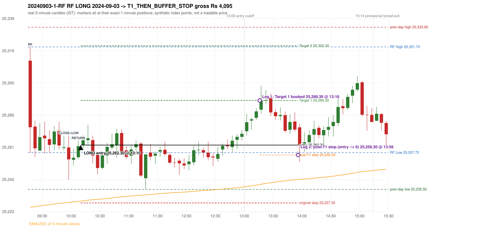

# Trading journal - 2024-09-03 (Tuesday)

> Phase 4 historical validation, window B_TV (Window B 2022-09-01..2025-08-31 (secondary vendor minutes); status VENDOR_SENSITIVITY). The FROZEN Phase 3.6 configuration (IRF, ORB, PDR body-based, PDS, RF; shared controller) on a different data source. HISTORICAL RESEARCH ONLY: the strategy was developed using later data. the same window with the secondary vendor's minute bars (daily series still 5paisa): quantifies sensitivity to the data source; not a second independent result Synthetic NIFTY 50 index-point P&L (the index is not tradable). The owner's review status is intentionally blank.

## A. Trading day overview

| item | value |
|---|---|
| Date / weekday | 2024-09-03 / Tuesday |
| Session type | USABLE_WITH_FLAGS / VALID |
| Original session open (first 1-minute open) | 25,313.40 |
| Previous session | 2024-09-02 |
| Previous-day high / low (wicks included) | 25,333.65 / 25,235.50 |
| Previous-day highest BODY high (the body-based PDR ceiling; wicks ignored) | 25,333.60 |
| Previous-day official close / last 5-minute close | 25,278.70 / 25,273.90 |
| Raw engine records / confirmed signals / fully valid signals | 2 / 1 / 1 |
| Setups that did not complete (invalidated / incomplete) | 1 |
| Executed trades | 1 20240903-1-RF |
| Gross P&L (Rs, synthetic) | 4,095.00 |
| Illustrative net P&L (Rs; Rs 500/trade + 0.5 pt/fill) | 3,205.00 |
| Day-end portfolio status | DAY_FINISHED |
| Manual journal trades (matched / unmatched) | 0 (0 / 0) |
| Extra automated trades | 0 |

## B. Daily strategy signal timeline (confirmed signals, chronological)

| time | strategy | method | dir | entry-rule status | valid for execution | <= 13:00 | portfolio state | accepted / ignored | specific reason | competing (same minute) |
|---|---|---|---|---|---|---|---|---|---|---|
| 10:10 | RF | RF | LONG | PROPOSAL_DEPENDENT | True | True | FIRST_TRADE_ACTIVE | ACCEPTED -> 20240903-1-RF | first eligible signal of the day; trade 1: T1_THEN_BUFFER_STOP |  |

Engine setups that did not complete (1); the complete list with failed rule ids is in `rejected_signals.csv`:

| candle | strategy | method | dir | status | precise reason | failed rules |
|---|---|---|---|---|---|---|
| 09:15 | PDR | PDR | LONG | INVALIDATED | OPEN_NOT_STRICTLY_ABOVE_ZONE |  |

## C. Detailed trade journals

### 20240903-1-RF: RF LONG (FIRST trade)

Chart: 

**Rule configuration:** CFG-phase36_body_based-866f954e55 - signal verification status **PROPOSAL_DEPENDENT** (never VERIFIED while a rule rests on a proposal).

#### 1. Setup identification

RF LONG (research proposal for direction/target): the session gapped +34.70 points up inside yesterday's range [25,235.50, 25,333.65] after an EMA-only uptrend; the 09:55 candle closed at 25,253.65, 4.10 points below RF Low 25,257.75, and the 10:05 candle closed back inside the range at 25,261.65, activating the setup at 10:10.

#### 2. Candle and indicator calculations

| role | session | candle | O | H | L | C | range | body % | upper wick % | lower wick % | direction | EMA(200) | strong bull / bear | pin bull / bear | small (body<=30%) | used for |
|---|---|---|---|---|---|---|---|---|---|---|---|---|---|---|---|---|
| rf_range_candle | TODAY | 09:15-09:20 | 25,313.40 | 25,321.70 | 25,257.75 | 25,273.10 | 63.95 | 63.02 | 12.98 | 24.00 | BEARISH | 25,224.68 | False / False | False / False | False | first 5-minute candle: RF High / RF Low |
| prev_session_last_candle | PREVIOUS | 15:25-15:30 | 25,276.80 | 25,280.30 | 25,258.60 | 25,273.90 | 21.70 | 13.36 | 16.13 | 70.51 | BEARISH | 25,224.20 | False / False | True / False | True | trend: previous session's last 5-minute close vs its EMA(200) |
| close_below_candle | TODAY | 09:55-10:00 | 25,260.85 | 25,268.10 | 25,241.20 | 25,253.65 | 26.90 | 26.77 | 26.95 | 46.28 | BEARISH | 25,227.62 | False / False | False / False | True | first candle closing below RF Low |
| return_inside_candle | TODAY | 10:05-10:10 | 25,254.95 | 25,265.05 | 25,253.85 | 25,261.65 | 11.20 | 59.82 | 30.36 | 9.82 | BULLISH | 25,228.23 | False / False | False / False | False | first later candle closing back inside the first-candle range |

Every condition, with the rule, the calculation, the observed values and the result:

| # | group | rule | result | status / numeric definition | calculation | observed | required | available at | why it matters |
|---|---|---|---|---|---|---|---|---|---|
| 1 | SELECTION | SEL-FIRST-001 | PASS | USER_APPROVED / USER_APPROVED | earliest CONFIRMED signal of the day across IRF/ORB/PDR/PDS/RF that passed the controller's checks | 0 confirmed signal(s) earlier today; 1 confirmed signals in the day in total, this one at 10:10 | no earlier executable signal | 2024-09-03 10:10 | the shared controller trades only the first valid signal; the five strategies are not independent positions |
| 2 | SELECTION | SEL-TIE-001 | PASS | USER_APPROVED / USER_APPROVED | other CONFIRMED signals with exactly the same confirmation timestamp | none | no different-strategy / opposite-direction signal in the same minute (otherwise an unresolved conflict, no trade) | 2024-09-03 10:10 | an unresolved same-minute collision would have produced no trade at all |
| 3 | SELECTION | ENTRY-CUTOFF-001 | PASS | USER_APPROVED / USER_APPROVED | fill timestamp vs 13:00:00 IST | signal confirmed 10:10; fill 10:10 | fill at or before 13:00:00 IST | 2024-09-03 10:10 | no new position may be entered with a fill after 13:00 IST |
| 4 | SELECTION | EXE-FILL-001 | PASS | PROPOSED_FOR_REVIEW / PROPOSED_FOR_REVIEW | fill = open of the 1-minute bar that starts at the signal candle's end | bar 10:10 O 25,262.30 H 25,266.65 L 25,260.55 C 25,263.40; executable=True; entry 25,262.30 | fill bar exists, starts exactly at the signal end, is fillable; entry = its open | 2024-09-03 10:10 | a 5-minute signal is known only when its candle closes; the first price that can be traded is the next minute's open |
| 5 | SELECTION | DAY-MAX-001 | PASS | USER_APPROVED / USER_APPROVED | number of entries today | trade 1 of at most 2 | <= 2 entries per day | 2024-09-03 10:10 | daily trade cap |
| 6 | SETUP | RF-002 | PASS | SOURCE_VERIFIED / EXPLICIT_IN_SOURCE | RF High / Low = high / low (wicks included) of the first 5-minute candle | 09:15-09:20 RF High 25,321.70, RF Low 25,257.75 (engine recorded 25,321.70 / 25,257.75) | first-candle range | 2024-09-03 09:20 | the zone price must dip below and return into |
| 7 | SETUP | RF-003 | PASS | SOURCE_VERIFIED / EXPLICIT_WORDING_DETAIL_PROPOSED_FOR_REVIEW | gap = first 1-minute open of today - previous session's OFFICIAL close | today's open 25,313.40 (first 1-minute bar 09:15) - previous close 25,278.70 (DAILY_VENDOR, 2024-09-02) = +34.70 points -> gap UP | gap UP (more than 0 points) | 2024-09-03 09:15 | approved convention: the original first-minute open, never the vendor daily open |
| 8 | SETUP | RF-004 | PASS | SOURCE_VERIFIED / EXPLICIT_IN_SOURCE | gap-up open inside yesterday's trading range | open 25,313.40 vs previous session 2024-09-02 range [25,235.50, 25,333.65]: inside (previous close 25,278.70, gap +34.70) | previous low <= open <= previous high | 2024-09-03 09:15 | a huge gap beyond yesterday's range is rejected; the source gives no number, the test is the previous session's high/low |
| 9 | TREND | RF-001 | PASS | SOURCE_VERIFIED / QUALITATIVE_SOURCE_NUMERIC_DEFINITION_PROPOSED_FOR_REVIEW | previous session's final completed 5-minute candle: close vs its EMA(200 of 5-minute closes) | previous session 2024-09-02 last candle 15:25-15:30 close 25,273.90 vs EMA(200) 25,224.20: 49.70 points above the EMA -> trend bullish (EMA_PREV_SESSION_CLOSE; research variant A, EMA-only) | close > EMA(200) | 2024-09-02 15:30 | the opening gap can never create the trend: only information that existed before today's open is used |
| 10 | TREND | RF-008 | PASS | SOURCE_VERIFIED / QUALITATIVE_SOURCE_NUMERIC_DEFINITION_PROPOSED_FOR_REVIEW | the uptrend must exist BEFORE the gap (a gap cannot create it) | trend measured on the previous session only (2024-09-02); today's gap is not used | established uptrend, not a sudden gap above the EMA | 2024-09-02 15:30 | RF rejects a previous downtrend followed by a sudden large gap above the EMA |
| 11 | TREND | TREND-SWING-001 | NOT_APPLICABLE | PROPOSED_FOR_REVIEW / PROPOSED_FOR_REVIEW | confirmed swing structure | not required by the active trend variant (variant A is the EMA price location only) | n/a | 2024-09-02 15:30 | variant B would additionally require higher-high/higher-low swings; it is a separate labelled scenario |
| 12 | CONFIRMATION | RF-005 | PASS | SOURCE_VERIFIED / EXPLICIT_IN_SOURCE | a candle CLOSES below RF Low (a wick is not enough) | 09:55-10:00 O 25,260.85 H 25,268.10 L 25,241.20 C 25,253.65; range 26.90, body 7.20 (26.77%), upper wick 7.25 (26.95%), lower wick 12.45 (46.28%), bearish; close 25,253.65 vs RF Low 25,257.75: 4.10 points below | close < RF Low | 2024-09-03 10:00 | the failed-breakdown leg of the setup |
| 13 | CONFIRMATION | RF-006 | PASS | SOURCE_VERIFIED / QUALITATIVE_SOURCE_NUMERIC_DEFINITION_PROPOSED_FOR_REVIEW | price returns inside the first-candle range - definition R1 (first later candle whose CLOSE is within [RF Low, RF High]) | 10:05-10:10 O 25,254.95 H 25,265.05 L 25,253.85 C 25,261.65; range 11.20, body 6.70 (59.82%), upper wick 3.40 (30.36%), lower wick 1.10 (9.82%), bullish; close 25,261.65 within [25,257.75, 25,321.70]; 2 candle(s) after the close-below candle (09:55) | RF Low <= close <= RF High | 2024-09-03 10:10 | completes the activation; the source does not say 'close' vs 'touch' nor any time limit |
| 14 | CONFIRMATION | RF-007 | PASS | SOURCE_VERIFIED / EXPLICIT_IN_SOURCE | order of the four steps | trend (previous session) -> gap 09:15 open -> close below 09:55 -> return 10:05 | uptrend, gap up in range, close below, return | 2024-09-03 10:10 | the source requires this order |
| 15 | CONFIRMATION | RF-013 | PASS | SOURCE_VERIFIED / EXPLICIT_IN_SOURCE | gap up without the break-and-return sequence gives no RF activation | sequence complete: close below 09:55, return inside 10:05 | both steps present | 2024-09-03 10:10 | the gap alone never activates RF |
| 16 | EXECUTION | EXE-STOP-001 | PASS | USER_APPROVED / USER_APPROVED | initial stop = entry - 35 points | entry 25,262.30 -> stop 25,227.30 | stop 35 index points (BASELINE) | 2024-09-03 10:10 | defines the loss if the setup fails before Target 1 |
| 17 | EXECUTION | EXE-T1-001 | PASS | SOURCE_VERIFIED / EXPLICIT_IN_SOURCE | Target 1 = entry +/- 27 points | T1 25,289.30 | 27 points | 2024-09-03 10:10 | Leg 1 (3 lots) is booked at Target 1 |
| 18 | EXECUTION | RF-011 | UNRESOLVED | UNRESOLVED / UNRESOLVED | Target 2 = entry +/- 60 points | T2 25,322.30 (the RF guide leaves the target OPEN: 60 is a research proposal) | 60 points | 2024-09-03 10:10 | Leg 2 (3 lots) is booked at Target 2 |
| 19 | EXECUTION | POST-T1-STOP-006 | PASS | USER_APPROVED / USER_APPROVED | after T1 the Leg-2 stop = entry - 6 (no trailing) | post-T1 stop 25,256.30 | entry -6 (LONG) / +6 (SHORT) | 2024-09-03 10:10 | protects the remaining three lots once the first three are booked |
| 20 | EXECUTION | SIZE-LOT-001 | PASS | USER_APPROVED / USER_APPROVED | 6 lots x 65 = 390, Leg 1 = 3 lots = 195, Leg 2 = 195 | 6 lots, lot size 65, legs 3+3 | 6 lots in two equal legs | 2024-09-03 10:10 | position size for the synthetic P&L |
| 21 | NOTE | RF-014 | NOT_APPLICABLE | PROPOSED_FOR_REVIEW / PROPOSED_FOR_REVIEW | first activation per session | only the first completed sequence of the session is reported | n/a (engineering proposal) | 2024-09-03 10:10 | the source is silent on re-activation |
| 22 | NOTE | RF-009 | UNRESOLVED | UNRESOLVED / UNRESOLVED | stop selection | baseline stop 35 points (USER_APPROVED research baseline) | the guide: 35-40 'depending on what is logical', fixed vs candle-extreme not stated | 2024-09-03 10:10 | the source does not define the RF stop rule |
| 23 | NOTE | RF-012 | UNRESOLVED | PROPOSED_FOR_REVIEW / PROPOSED_FOR_REVIEW | trade direction | LONG (implied: 'opposite of IRF', 'uptrend only' and the long-position reference screenshots; the word long never appears) | the guide does not state the direction | 2024-09-03 10:10 | the direction is a labelled research proposal, not source-verified |
| 24 | NOTE | RF-010 | UNRESOLVED | UNRESOLVED / UNRESOLVED | entry price | signal reference = close of the return candle 25,261.65; fill = next minute open 25,262.30 | the guide's rule-readiness table lists the exact entry price as OPEN, i.e. unspecified | 2024-09-03 10:10 | causal convention applied to every strategy |
| 25 | NOTE | NOTE-UNRESOLVED-DEPENDENCIES | UNRESOLVED | NOT_A_RULE / NOT_A_REGISTRY_RULE | rules the signal depends on that the sources leave unresolved | engine-recorded unresolved rule ids: RF-009, RF-011; verification status PROPOSAL_DEPENDENT | n/a (disclosure) | 2024-09-03 10:10 | the entry is only as verified as the rules it rests on |

#### 3. Entry decision and explanation

RF LONG (research proposal for direction/target): the session gapped +34.70 points up inside yesterday's range [25,235.50, 25,333.65] after an EMA-only uptrend; the 09:55 candle closed at 25,253.65, 4.10 points below RF Low 25,257.75, and the 10:05 candle closed back inside the range at 25,261.65, activating the setup at 10:10.

**Why this trade ahead of the other strategies:** This RF signal was the earliest executable signal of the day: 0 confirmed signal(s) earlier, 0 other in the same minute. No later signal was generated. State of the other four engines at that moment: [IRF: no setup record before this time (a base condition was not met, or nothing triggered)] [ORB: no setup record before this time (a base condition was not met, or nothing triggered)] [PDR: PDR invalidated at 09:15: OPEN_NOT_STRICTLY_ABOVE_ZONE] [PDS: no setup record before this time (a base condition was not met, or nothing triggered)]

#### 4. Actual entry execution

| item | value |
|---|---|
| Signal candle | 10:05-10:10 |
| Signal confirmed | 2024-09-03 10:10 |
| Fill timestamp | 2024-09-03 10:10 |
| Entry price | 25,262.30 |
| Source partition / 1-minute bar | data/phase4/processed/TECHNOVUS_1M/nifty50/year=2024/month=09/candles.parquet / 2024-09-03 10:10 |
| Source bar O / H / L / C | 25,262.30 / 25,266.65 / 25,260.55 / 25,263.40 |
| Fill assumption | open of the 1-minute bar starting at the signal candle's end (EXE-FILL-001, PROPOSED causal convention) |
| Initial stop / T1 / T2 / post-T1 stop | 25,227.30 / 25,289.30 / 25,322.30 / 25,256.30 |
| Position | 6 lots x 65 = 390 units (Leg 1 195, Leg 2 195) |

#### 5-8. Trade progress, Target 1, post-T1 stop and final exit

Between the 10:10 entry bar and the final exit (227 one-minute bars) the best excursion in favour was 36.00 points at 13:18 and the worst against was 26.50 points at 11:15. At 13:16 price reached Target 1 25,289.30 and three lots exited. At 13:16 the remaining three lots' protective stop was set to 25,256.30 (entry - 6; no trailing, no further change); the engine applies it from the Target-1 bar onward and tests it within that same bar. At 13:56 the remaining three lots stopped out at 25,256.30. T1_THEN_BUFFER_STOP: no second trade that day (DAY-BUF-001).

| leg | qty | exit time | exit price | reason | source 1-minute bar | O / H / L / C | gross points | gross Rs | slippage pts | flags |
|---|---|---|---|---|---|---|---|---|---|---|
| 1 | 195 | 13:16 | 25,289.30 | TARGET_1 | 13:16 | 25,286.15 / 25,297.85 / 25,285.30 / 25,294.80 | 27.00 | 5,265.00 | 0.00 |  |
| 2 | 195 | 13:56 | 25,256.30 | POST_T1_STOP_ENTRY_MINUS_PLUS_6 | 13:56 | 25,271.15 / 25,272.05 / 25,254.75 / 25,256.15 | -6.00 | -1,170.00 | 0.00 |  |

Exit evidence per leg:

* Leg 1: 1-minute bar 13:16 O 25,286.15 H 25,297.85 L 25,285.30 C 25,294.80: high 25,297.85 reached Target 1 25,289.30; Leg 1 booked at the target level
* Leg 2: 1-minute bar 13:56 O 25,271.15 H 25,272.05 L 25,254.75 C 25,256.15: low 25,254.75 reached the post-T1 stop 25,256.30; Leg 2 exits at 25,256.30 at the stop level

#### 9. Gross and illustrative net P&L

| item | value (Rs) |
|---|---|
| Leg 1 gross | 5,265.00 |
| Leg 2 gross | -1,170.00 |
| Trade gross (= Leg 1 + Leg 2) | 4,095.00 |
| Illustrative fixed cost | -500.00 |
| Illustrative slippage (0.5 pt on every fill, entry + exits, all units) | -390.00 |
| Illustrative net | 3,205.00 |

#### 10. Manual journal comparison

No manual journal exists for this period; no comparison.

## D. Manual journal comparison

No manual journal exists for this period (the manual journal covers 2025-09-01 .. 2026-08-31 only); no comparison is made and no automated trade is labelled 'extra'.

## E. Daily conclusion

* **Traded:** 20240903-1-RF - RF RF LONG at 10:10 (entry 25,262.30), outcome T1_THEN_BUFFER_STOP, gross Rs 4,095.00, illustrative net Rs 3,205.00. **Why:** This RF signal was the earliest executable signal of the day: 0 confirmed signal(s) earlier, 0 other in the same minute. No later signal was generated. State of the other four engines at that moment: [IRF: no setup record before this time (a base condition was not met, or nothing triggered)] [ORB: no setup record before this time (a base condition was not met, or nothing triggered)] [PDR: PDR invalidated at 09:15: OPEN_NOT_STRICTLY_ABOVE_ZONE] [PDS: no setup record before this time (a base condition was not met, or nothing triggered)] **How it ended:** At 13:16 price reached Target 1 25,289.30 and three lots exited. At 13:16 the remaining three lots' protective stop was set to 25,256.30 (entry - 6; no trailing, no further change); the engine applies it from the Target-1 bar onward and tests it within that same bar. At 13:56 the remaining three lots stopped out at 25,256.30. T1_THEN_BUFFER_STOP: no second trade that day (DAY-BUF-001).
* **Open strategy-definition issues that affected this day:** NOTE-UNRESOLVED-DEPENDENCIES, RF-009 (Stop-loss 35-40 'depending on what is logical'; fixed vs candle-extreme not stated (PARTIAL)), RF-010 (Exact entry price is OPEN (not specified)), RF-011 (Target is OPEN (not specified)), RF-012 (Trade direction is never stated)
* **Automated triage (not an approval; the owner's review status stays blank):** TRADED_NO_FLAGS
