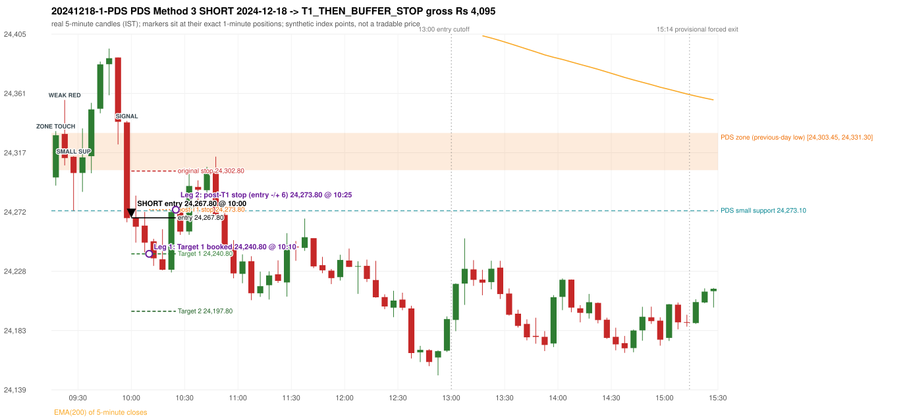

# Trading journal - 2024-12-18 (Wednesday)

> Phase 4 historical validation, window B_TV (Window B 2022-09-01..2025-08-31 (secondary vendor minutes); status VENDOR_SENSITIVITY). The FROZEN Phase 3.6 configuration (IRF, ORB, PDR body-based, PDS, RF; shared controller) on a different data source. HISTORICAL RESEARCH ONLY: the strategy was developed using later data. the same window with the secondary vendor's minute bars (daily series still 5paisa): quantifies sensitivity to the data source; not a second independent result Synthetic NIFTY 50 index-point P&L (the index is not tradable). The owner's review status is intentionally blank.

## A. Trading day overview

| item | value |
|---|---|
| Date / weekday | 2024-12-18 / Wednesday |
| Session type | USABLE_WITH_FLAGS / VALID |
| Original session open (first 1-minute open) | 24,297.95 |
| Previous session | 2024-12-17 |
| Previous-day high / low (wicks included) | 24,624.10 / 24,303.45 |
| Previous-day highest BODY high (the body-based PDR ceiling; wicks ignored) | 24,616.35 |
| Previous-day official close / last 5-minute close | 24,336.00 / 24,319.35 |
| Raw engine records / confirmed signals / fully valid signals | 4 / 3 / 3 |
| Setups that did not complete (invalidated / incomplete) | 1 |
| Executed trades | 1 20241218-1-PDS |
| Gross P&L (Rs, synthetic) | 4,095.00 |
| Illustrative net P&L (Rs; Rs 500/trade + 0.5 pt/fill) | 3,205.00 |
| Day-end portfolio status | DAY_FINISHED |
| Manual journal trades (matched / unmatched) | 0 (0 / 0) |
| Extra automated trades | 0 |

## B. Daily strategy signal timeline (confirmed signals, chronological)

| time | strategy | method | dir | entry-rule status | valid for execution | <= 13:00 | portfolio state | accepted / ignored | specific reason | competing (same minute) |
|---|---|---|---|---|---|---|---|---|---|---|
| 10:00 | PDS | Method 3 | SHORT | PROPOSAL_DEPENDENT | True | True | FIRST_TRADE_ACTIVE | ACCEPTED -> 20241218-1-PDS | first eligible signal of the day; trade 1: T1_THEN_BUFFER_STOP |  |
| 10:50 | PDS | Method 1 | SHORT | PROPOSAL_DEPENDENT | True | True | DAY_FINISHED | IGNORED | DAY_FINISHED [blocked by PDS#1] |  |
| 11:00 | IRF | Method 2A | SHORT | PROPOSAL_DEPENDENT | True | True | DAY_FINISHED | IGNORED | DAY_FINISHED [blocked by PDS#1] |  |

Engine setups that did not complete (1); the complete list with failed rule ids is in `rejected_signals.csv`:

| candle | strategy | method | dir | status | precise reason | failed rules |
|---|---|---|---|---|---|---|
| 10:40 | RF | RF | LONG | INVALIDATED | TREND:EMA_PREV_SESSION_CLOSE wrong side | RF-001;RF-008 |

## C. Detailed trade journals

### 20241218-1-PDS: PDS Method 3 SHORT (FIRST trade)

Chart: 

**Rule configuration:** CFG-phase36_body_based-866f954e55 - signal verification status **PROPOSAL_DEPENDENT** (never VERIFIED while a rule rests on a proposal).

#### 1. Setup identification

PDS Method 3 SHORT: the session opened 5.50 points below the previous-day-low zone [24,303.45, 24,331.30]; the first red candle at the zone (09:20) was weak (body 36.70%), so the engine waited for a small support; the 09:25 candle's low 24,273.10 (30.35 points below the zone floor) was broken by the close of the 09:55 candle (24,267.55); confirmed 10:00.

#### 2. Candle and indicator calculations

| role | session | candle | O | H | L | C | range | body % | upper wick % | lower wick % | direction | EMA(200) | strong bull / bear | pin bull / bear | small (body<=30%) | used for |
|---|---|---|---|---|---|---|---|---|---|---|---|---|---|---|---|---|
| zone_source_candle | PREVIOUS | 14:55-15:00 | 24,314.00 | 24,333.75 | 24,303.45 | 24,331.30 | 30.30 | 57.10 | 8.09 | 34.82 | BULLISH | 24,517.15 | False / False | False / False | False | previous-day low candle that defines the zone (A_LOWEST_LOW) |
| zone_retest_candle | TODAY | 09:15-09:20 | 24,297.95 | 24,332.70 | 24,291.90 | 24,329.55 | 40.80 | 77.45 | 7.72 | 14.83 | BULLISH | 24,504.80 | True / False | False / False | False | first candle whose range reaches the zone from below |
| signal_candle | TODAY | 09:55-10:00 | 24,339.20 | 24,340.25 | 24,264.45 | 24,267.55 | 75.80 | 94.53 | 1.39 | 4.09 | BEARISH | 24,491.49 | False / True | False / False | False | trigger candle |
| weak_first_red_candle | TODAY | 09:20-09:25 | 24,330.55 | 24,356.00 | 24,306.95 | 24,312.55 | 49.05 | 36.70 | 51.89 | 11.42 | BEARISH | 24,502.89 | False / False | False / False | False | first red candle at the zone that failed the quality rule |
| small_support_pivot | TODAY | 09:25-09:30 | 24,313.45 | 24,313.90 | 24,273.10 | 24,301.30 | 40.80 | 29.78 | 1.10 | 69.12 | BEARISH | 24,500.88 | False / False | False / False | True | small support: latest 3-candle fractal low after the weak candle |

Every condition, with the rule, the calculation, the observed values and the result:

| # | group | rule | result | status / numeric definition | calculation | observed | required | available at | why it matters |
|---|---|---|---|---|---|---|---|---|---|
| 1 | SELECTION | SEL-FIRST-001 | PASS | USER_APPROVED / USER_APPROVED | earliest CONFIRMED signal of the day across IRF/ORB/PDR/PDS/RF that passed the controller's checks | 0 confirmed signal(s) earlier today; 3 confirmed signals in the day in total, this one at 10:00 | no earlier executable signal | 2024-12-18 10:00 | the shared controller trades only the first valid signal; the five strategies are not independent positions |
| 2 | SELECTION | SEL-TIE-001 | PASS | USER_APPROVED / USER_APPROVED | other CONFIRMED signals with exactly the same confirmation timestamp | none | no different-strategy / opposite-direction signal in the same minute (otherwise an unresolved conflict, no trade) | 2024-12-18 10:00 | an unresolved same-minute collision would have produced no trade at all |
| 3 | SELECTION | ENTRY-CUTOFF-001 | PASS | USER_APPROVED / USER_APPROVED | fill timestamp vs 13:00:00 IST | signal confirmed 10:00; fill 10:00 | fill at or before 13:00:00 IST | 2024-12-18 10:00 | no new position may be entered with a fill after 13:00 IST |
| 4 | SELECTION | EXE-FILL-001 | PASS | PROPOSED_FOR_REVIEW / PROPOSED_FOR_REVIEW | fill = open of the 1-minute bar that starts at the signal candle's end | bar 10:00 O 24,267.80 H 24,278.80 L 24,251.85 C 24,252.25; executable=True; entry 24,267.80 | fill bar exists, starts exactly at the signal end, is fillable; entry = its open | 2024-12-18 10:00 | a 5-minute signal is known only when its candle closes; the first price that can be traded is the next minute's open |
| 5 | SELECTION | DAY-MAX-001 | PASS | USER_APPROVED / USER_APPROVED | number of entries today | trade 1 of at most 2 | <= 2 entries per day | 2024-12-18 10:00 | daily trade cap |
| 6 | SETUP | PDS-003 | PASS | SOURCE_VERIFIED / EXPLICIT_WORDING_DETAIL_PROPOSED_FOR_REVIEW | gap = first 1-minute open of today - previous session's OFFICIAL close | today's open 24,297.95 (first 1-minute bar 09:15) - previous close 24,336.00 (DAILY_VENDOR, 2024-12-17) = -38.05 points -> gap DOWN | gap DOWN (more than 0 points) | 2024-12-18 09:15 | approved convention: the original first-minute open, never the vendor daily open |
| 7 | SETUP | PDS-006 | PASS | SOURCE_VERIFIED / QUALITATIVE_SOURCE_NUMERIC_DEFINITION_PROPOSED_FOR_REVIEW | gap-down open below the zone | today's open 24,297.95 vs zone low 24,303.45: 5.50 points below | open < zone low | 2024-12-18 09:15 | the guide: 'price is trading below the previous day's support zone' after the gap; a PROPOSED strict reading |
| 8 | SETUP | PDS-004 | PASS | SOURCE_VERIFIED / EXPLICIT_IN_SOURCE | PDS is not a breakdown strategy: the zone must be tested from below first | open 24,297.95 below the zone floor 24,303.45; the first candle to reach the zone is 09:15 | price rises to the zone before any short | 2024-12-18 09:15 | a short below the level without a retest is not this strategy |
| 9 | SETUP | PDS-005 | PASS | SOURCE_VERIFIED / QUALITATIVE_SOURCE_NUMERIC_DEFINITION_PROPOSED_FOR_REVIEW | price comes up to the zone: first candle whose [low, high] intersects it (+/- proximity) | 09:15-09:20 O 24,297.95 H 24,332.70 L 24,291.90 C 24,329.55; range 40.80, body 31.60 (77.45%), upper wick 3.15 (7.72%), lower wick 6.05 (14.83%), bullish; high 24,332.70 vs zone low 24,303.45 | range intersects the zone | 2024-12-18 09:20 | PDS is not a breakdown strategy: the zone must be tested from below first |
| 10 | ZONE | PDS-001 | PASS | SOURCE_VERIFIED / EXPLICIT_IN_SOURCE | direction | SHORT (PDS is short only) | short-only | 2024-12-18 10:00 | PDS sells a retest of previous-day support from below |
| 11 | ZONE | PDS-002 | PASS | SOURCE_VERIFIED / QUALITATIVE_SOURCE_NUMERIC_DEFINITION_PROPOSED_FOR_REVIEW | zone = [lowest low, body top] of the previous session's absolute-low candle (method A_LOWEST_LOW; the lower wick is part of the zone) | zone [24,303.45, 24,331.30] from the 14:55 candle of 2024-12-17 (14:55-15:00 O 24,314.00 H 24,333.75 L 24,303.45 C 24,331.30; range 30.30, body 17.30 (57.10%), upper wick 2.45 (8.09%), lower wick 10.55 (34.82%), bullish); engine recorded [24,303.45, 24,331.30] | previous trading day's low where price took support (body + lower wick) | 2024-12-17 15:00 | the reference level of the strategy; the exact candle(s) are a research choice (PDS-ZONE-002) |
| 12 | CONFIRMATION | PDS-M-001 | PASS | SOURCE_VERIFIED / QUALITATIVE_SOURCE_NUMERIC_DEFINITION_PROPOSED_FOR_REVIEW | Method 3 is used when the first red candle at the zone is not satisfying | first red candle at the zone: 09:20-09:25 O 24,330.55 H 24,356.00 L 24,306.95 C 24,312.55; range 49.05, body 18.00 (36.70%), upper wick 25.45 (51.89%), lower wick 5.60 (11.42%), bearish; strong-bearish test body >= 60%, lower wick <= 20% -> not met; pin bar -> not met | first red candle is neither strong nor a pin bar | 2024-12-18 09:25 | the quality rule keeps weak candles out; Method 3 waits for a support break instead |
| 13 | CONFIRMATION | PDS-M3-001 | PASS | SOURCE_VERIFIED / QUALITATIVE_SOURCE_NUMERIC_DEFINITION_PROPOSED_FOR_REVIEW | small support = latest 3-candle fractal low (k=1) formed at/after the weak candle with low <= zone high (24,331.30); definition SWING_K1_NEAR_ZONE | support 24,273.10 from the 09:25 candle; engine recorded 24,273.10; distance below the zone floor 30.35 points (zone floor 24,303.45); the guide says 'near the zone' but defines no distance - the code has no lower bound | a small support near the zone | 2024-12-18 09:35 | 'near' and the size of the small support are undefined in the guide |
| 14 | CONFIRMATION | PDS-M3-001 | PASS | SOURCE_VERIFIED / QUALITATIVE_SOURCE_NUMERIC_DEFINITION_PROPOSED_FOR_REVIEW | trigger: candle closes below the small support (break basis CLOSE) | 09:55 close 24,267.55 vs support 24,273.10: 5.55 points below | close < support | 2024-12-18 10:00 | the guide does not say close or touch; the close is used |
| 15 | EXECUTION | EXE-STOP-001 | PASS | USER_APPROVED / USER_APPROVED | initial stop = entry + 35 points | entry 24,267.80 -> stop 24,302.80 | stop 35 index points (BASELINE) | 2024-12-18 10:00 | defines the loss if the setup fails before Target 1 |
| 16 | EXECUTION | EXE-T1-001 | PASS | SOURCE_VERIFIED / EXPLICIT_IN_SOURCE | Target 1 = entry +/- 27 points | T1 24,240.80 | 27 points | 2024-12-18 10:00 | Leg 1 (3 lots) is booked at Target 1 |
| 17 | EXECUTION | PDS-TGT-001 | PASS | SOURCE_VERIFIED / EXPLICIT_IN_SOURCE | Target 2 = entry +/- 70 points | T2 24,197.80 (the guide says 70; the report suggests 60 - CONFLICTING) | 70 points | 2024-12-18 10:00 | Leg 2 (3 lots) is booked at Target 2 |
| 18 | EXECUTION | POST-T1-STOP-006 | PASS | USER_APPROVED / USER_APPROVED | after T1 the Leg-2 stop = entry + 6 (no trailing) | post-T1 stop 24,273.80 | entry -6 (LONG) / +6 (SHORT) | 2024-12-18 10:00 | protects the remaining three lots once the first three are booked |
| 19 | EXECUTION | SIZE-LOT-001 | PASS | USER_APPROVED / USER_APPROVED | 6 lots x 65 = 390, Leg 1 = 3 lots = 195, Leg 2 = 195 | 6 lots, lot size 65, legs 3+3 | 6 lots in two equal legs | 2024-12-18 10:00 | position size for the synthetic P&L |
| 20 | NOTE | PDS-007 | NOT_APPLICABLE | PROPOSED_FOR_REVIEW / PROPOSED_FOR_REVIEW | repeated PDS signals today | 2 confirmed PDS signal(s) in the session | n/a (disclosure) | 2024-12-18 10:00 | the per-session cap is lifted for the controller runs; the controller trades only the first (or the permitted second) trade |
| 21 | NOTE | PDS-MISSING-001 | UNRESOLVED | UNRESOLVED / UNRESOLVED | entry timing | signal on the candle close; fill at the next minute's open | the guide does not say whether entry is intra-candle or after the close | 2024-12-18 10:00 | causal convention: nothing is entered before the trigger candle has closed |
| 22 | NOTE | PDS-SL-001 | NOT_APPLICABLE | SOURCE_VERIFIED / QUALITATIVE_SOURCE_NUMERIC_DEFINITION_PROPOSED_FOR_REVIEW | the guide's 35-or-40 rule: 35 if the most recent green candle's high is within 35 points of entry, else 40 | most recent green candle high 24,394.45 is 126.65 points from the entry 24,267.80: the guide's rule would select 40 points; the baseline applies a fixed 35 (USER_APPROVED research baseline; the 35-vs-40 selection and the 40-point variant are separate labelled scenarios) | source selection rule | 2024-12-18 10:00 | the stop distance is a modelling choice and changes losses, not entries |
| 23 | NOTE | NOTE-UNRESOLVED-DEPENDENCIES | NOT_APPLICABLE | NOT_A_RULE / NOT_A_REGISTRY_RULE | rules the signal depends on that the sources leave unresolved | engine-recorded unresolved rule ids: none; verification status PROPOSAL_DEPENDENT | n/a (disclosure) | 2024-12-18 10:00 | the entry is only as verified as the rules it rests on |

#### 3. Entry decision and explanation

PDS Method 3 SHORT: the session opened 5.50 points below the previous-day-low zone [24,303.45, 24,331.30]; the first red candle at the zone (09:20) was weak (body 36.70%), so the engine waited for a small support; the 09:25 candle's low 24,273.10 (30.35 points below the zone floor) was broken by the close of the 09:55 candle (24,267.55); confirmed 10:00.

**Why this trade ahead of the other strategies:** This PDS Method 3 signal was the earliest executable signal of the day: 0 confirmed signal(s) earlier, 0 other in the same minute. 2 later confirmed signal(s) (IRF x1, PDS x1) are logged as ignored or rejected. State of the other four engines at that moment: [IRF: no setup record before this time (a base condition was not met, or nothing triggered)] [ORB: no setup record before this time (a base condition was not met, or nothing triggered)] [PDR: no setup record before this time (a base condition was not met, or nothing triggered)] [RF: no setup record before this time (a base condition was not met, or nothing triggered)]

#### 4. Actual entry execution

| item | value |
|---|---|
| Signal candle | 09:55-10:00 |
| Signal confirmed | 2024-12-18 10:00 |
| Fill timestamp | 2024-12-18 10:00 |
| Entry price | 24,267.80 |
| Source partition / 1-minute bar | data/phase4/processed/TECHNOVUS_1M/nifty50/year=2024/month=12/candles.parquet / 2024-12-18 10:00 |
| Source bar O / H / L / C | 24,267.80 / 24,278.80 / 24,251.85 / 24,252.25 |
| Fill assumption | open of the 1-minute bar starting at the signal candle's end (EXE-FILL-001, PROPOSED causal convention) |
| Initial stop / T1 / T2 / post-T1 stop | 24,302.80 / 24,240.80 / 24,197.80 / 24,273.80 |
| Position | 6 lots x 65 = 390 units (Leg 1 195, Leg 2 195) |

#### 5-8. Trade progress, Target 1, post-T1 stop and final exit

Between the 10:00 entry bar and the final exit (26 one-minute bars) the best excursion in favour was 40.95 points at 10:20 and the worst against was 16.60 points at 10:02. At 10:10 price reached Target 1 24,240.80 and three lots exited. At 10:10 the remaining three lots' protective stop was set to 24,273.80 (entry + 6; no trailing, no further change); the engine applies it from the Target-1 bar onward and tests it within that same bar. At 10:25 the remaining three lots stopped out at 24,273.80. T1_THEN_BUFFER_STOP: no second trade that day (DAY-BUF-001).

| leg | qty | exit time | exit price | reason | source 1-minute bar | O / H / L / C | gross points | gross Rs | slippage pts | flags |
|---|---|---|---|---|---|---|---|---|---|---|
| 1 | 195 | 10:10 | 24,240.80 | TARGET_1 | 10:10 | 24,250.20 / 24,251.85 / 24,240.75 / 24,244.70 | 27.00 | 5,265.00 | 0.00 |  |
| 2 | 195 | 10:25 | 24,273.80 | POST_T1_STOP_ENTRY_MINUS_PLUS_6 | 10:25 | 24,272.00 / 24,274.25 / 24,267.35 / 24,269.65 | -6.00 | -1,170.00 | 0.00 |  |

Exit evidence per leg:

* Leg 1: 1-minute bar 10:10 O 24,250.20 H 24,251.85 L 24,240.75 C 24,244.70: low 24,240.75 reached Target 1 24,240.80; Leg 1 booked at the target level
* Leg 2: 1-minute bar 10:25 O 24,272.00 H 24,274.25 L 24,267.35 C 24,269.65: high 24,274.25 reached the post-T1 stop 24,273.80; Leg 2 exits at 24,273.80 at the stop level

#### 9. Gross and illustrative net P&L

| item | value (Rs) |
|---|---|
| Leg 1 gross | 5,265.00 |
| Leg 2 gross | -1,170.00 |
| Trade gross (= Leg 1 + Leg 2) | 4,095.00 |
| Illustrative fixed cost | -500.00 |
| Illustrative slippage (0.5 pt on every fill, entry + exits, all units) | -390.00 |
| Illustrative net | 3,205.00 |

#### 10. Manual journal comparison

No manual journal exists for this period; no comparison.

## D. Manual journal comparison

No manual journal exists for this period (the manual journal covers 2025-09-01 .. 2026-08-31 only); no comparison is made and no automated trade is labelled 'extra'.

## E. Daily conclusion

* **Traded:** 20241218-1-PDS - PDS Method 3 SHORT at 10:00 (entry 24,267.80), outcome T1_THEN_BUFFER_STOP, gross Rs 4,095.00, illustrative net Rs 3,205.00. **Why:** This PDS Method 3 signal was the earliest executable signal of the day: 0 confirmed signal(s) earlier, 0 other in the same minute. 2 later confirmed signal(s) (IRF x1, PDS x1) are logged as ignored or rejected. State of the other four engines at that moment: [IRF: no setup record before this time (a base condition was not met, or nothing triggered)] [ORB: no setup record before this time (a base condition was not met, or nothing triggered)] [PDR: no setup record before this time (a base condition was not met, or nothing triggered)] [RF: no setup record before this time (a base condition was not met, or nothing triggered)] **How it ended:** At 10:10 price reached Target 1 24,240.80 and three lots exited. At 10:10 the remaining three lots' protective stop was set to 24,273.80 (entry + 6; no trailing, no further change); the engine applies it from the Target-1 bar onward and tests it within that same bar. At 10:25 the remaining three lots stopped out at 24,273.80. T1_THEN_BUFFER_STOP: no second trade that day (DAY-BUF-001).
* **Ignored / rejected signals:** PDS IGNORED DAY_FINISHED x1; IRF IGNORED DAY_FINISHED x1
* **Open strategy-definition issues that affected this day:** PDS-MISSING-001 (Entry timing (during the candle or after it closes) is not specified)
* **Automated triage (not an approval; the owner's review status stays blank):** TRADED_NO_FLAGS
