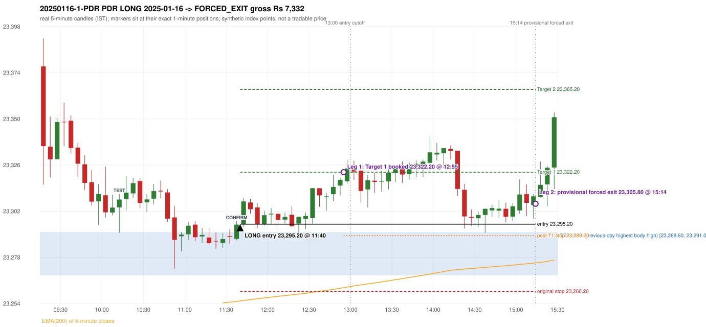

# Trading journal - 2025-01-16 (Thursday)

> Phase 4 historical validation, window B_TV (Window B 2022-09-01..2025-08-31 (secondary vendor minutes); status VENDOR_SENSITIVITY). The FROZEN Phase 3.6 configuration (IRF, ORB, PDR body-based, PDS, RF; shared controller) on a different data source. HISTORICAL RESEARCH ONLY: the strategy was developed using later data. the same window with the secondary vendor's minute bars (daily series still 5paisa): quantifies sensitivity to the data source; not a second independent result Synthetic NIFTY 50 index-point P&L (the index is not tradable). The owner's review status is intentionally blank.

## A. Trading day overview

| item | value |
|---|---|
| Date / weekday | 2025-01-16 / Thursday |
| Session type | USABLE_WITH_FLAGS / VALID |
| Original session open (first 1-minute open) | 23,377.25 |
| Previous session | 2025-01-15 |
| Previous-day high / low (wicks included) | 23,293.65 / 23,146.45 |
| Previous-day highest BODY high (the body-based PDR ceiling; wicks ignored) | 23,291.05 |
| Previous-day official close / last 5-minute close | 23,213.20 / 23,228.10 |
| Raw engine records / confirmed signals / fully valid signals | 7 / 3 / 2 |
| Setups that did not complete (invalidated / incomplete) | 4 |
| Executed trades | 1 20250116-1-PDR |
| Gross P&L (Rs, synthetic) | 7,332.00 |
| Illustrative net P&L (Rs; Rs 500/trade + 0.5 pt/fill) | 6,442.00 |
| Day-end portfolio status | DAY_FINISHED |
| Manual journal trades (matched / unmatched) | 0 (0 / 0) |
| Extra automated trades | 0 |

## B. Daily strategy signal timeline (confirmed signals, chronological)

| time | strategy | method | dir | entry-rule status | valid for execution | <= 13:00 | portfolio state | accepted / ignored | specific reason | competing (same minute) |
|---|---|---|---|---|---|---|---|---|---|---|
| 11:40 | PDR | PDR | LONG | RESEARCH_VARIANT | True | True | FIRST_TRADE_ACTIVE | ACCEPTED -> 20250116-1-PDR | first eligible signal of the day; trade 1: FORCED_EXIT |  |
| 12:35 | PDR | PDR | LONG | RESEARCH_VARIANT | True | True | FIRST_TRADE_ACTIVE | IGNORED | POSITION_ACTIVE (signal kept for diagnostics only; never reused) [blocked by PDR#1] |  |
| 15:30 | PDR | PDR | LONG | RESEARCH_VARIANT | False | False | DAY_FINISHED | IGNORED | DAY_FINISHED [blocked by PDR#1] |  |

Engine setups that did not complete (4); the complete list with failed rule ids is in `rejected_signals.csv`:

| candle | strategy | method | dir | status | precise reason | failed rules |
|---|---|---|---|---|---|---|
| 09:15 | ORB | Method 1 | LONG | INVALIDATED | TREND:EMA_PREV_SESSION_CLOSE wrong side | ORB-TREND-001;ORB-TREND-002 |
| 09:15 | ORB | Method 2 | LONG | INVALIDATED | TREND:EMA_PREV_SESSION_CLOSE wrong side | ORB-TREND-001;ORB-TREND-002 |
| 09:15 | ORB | Gap/200DMA | LONG | INVALIDATED | CANDLE_QUALITY_OR_REJECTION_WICK | ORB-GAP-LONG-004 |
| 10:20 | RF | RF | LONG | INVALIDATED | TREND:EMA_PREV_SESSION_CLOSE wrong side | RF-001;RF-008 |

## C. Detailed trade journals

### 20250116-1-PDR: PDR LONG (FIRST trade)

Chart: 

**Rule configuration:** CFG-phase36_body_based-866f954e55 - signal verification status **RESEARCH_VARIANT** (never VERIFIED while a rule rests on a proposal).

#### 1. Setup identification

PDR LONG (body-based engine, A_HIGHEST_BODY_HIGH): the session opened 164.05 points above the previous close and 86.20 points above the previous-day highest BODY high 23,291.05 (zone [23,268.60, 23,291.05] from the 10:45 candle of 2025-01-15; the highest wick 23,293.65 is ignored). The 10:10 candle (23,290.70 - 23,310.85) tested the zone; the 11:35 candle (green, O 23,287.55 H 23,296.70 L 23,286.80 C 23,294.95) passed GOOD_GREEN_BODY and closed 3.90 points above the zone ceiling, confirming the entry at 11:40. The pattern thresholds and the zone's lower boundary are provisional research assumptions, not approved by the strategy author.

#### 2. Candle and indicator calculations

| role | session | candle | O | H | L | C | range | body % | upper wick % | lower wick % | direction | EMA(200) | strong bull / bear | pin bull / bear | small (body<=30%) | used for |
|---|---|---|---|---|---|---|---|---|---|---|---|---|---|---|---|---|
| zone_source_candle | PREVIOUS | 10:45-10:50 | 23,268.60 | 23,293.65 | 23,268.60 | 23,291.05 | 25.05 | 89.62 | 10.38 | 0.00 | BULLISH | 23,256.31 | True / False | False / False | False | candle of the previous session's highest BODY high (A_HIGHEST_BODY_HIGH) |
| prev_day_wick_high_candle | PREVIOUS | 10:45-10:50 | 23,268.60 | 23,293.65 | 23,268.60 | 23,291.05 | 25.05 | 89.62 | 10.38 | 0.00 | BULLISH | 23,256.31 | True / False | False / False | False | candle of the previous session's highest WICK (ignored by the author's rule; shown for comparison) |
| interaction_candle | TODAY | 10:10-10:15 | 23,303.90 | 23,310.85 | 23,290.70 | 23,308.00 | 20.15 | 20.35 | 14.14 | 65.51 | BULLISH | 23,247.22 | False / False | True / False | True | first candle whose range overlaps the zone (the test) |
| confirmation_candle | TODAY | 11:35-11:40 | 23,287.55 | 23,296.70 | 23,286.80 | 23,294.95 | 9.90 | 74.75 | 17.68 | 7.58 | BULLISH | 23,255.01 | True / False | False / False | False | candle that satisfies one of the three patterns and closes above the zone ceiling |

Every condition, with the rule, the calculation, the observed values and the result:

| # | group | rule | result | status / numeric definition | calculation | observed | required | available at | why it matters |
|---|---|---|---|---|---|---|---|---|---|
| 1 | SELECTION | SEL-FIRST-001 | PASS | USER_APPROVED / USER_APPROVED | earliest CONFIRMED signal of the day across IRF/ORB/PDR/PDS/RF that passed the controller's checks | 0 confirmed signal(s) earlier today; 3 confirmed signals in the day in total, this one at 11:40 | no earlier executable signal | 2025-01-16 11:40 | the shared controller trades only the first valid signal; the five strategies are not independent positions |
| 2 | SELECTION | SEL-TIE-001 | PASS | USER_APPROVED / USER_APPROVED | other CONFIRMED signals with exactly the same confirmation timestamp | none | no different-strategy / opposite-direction signal in the same minute (otherwise an unresolved conflict, no trade) | 2025-01-16 11:40 | an unresolved same-minute collision would have produced no trade at all |
| 3 | SELECTION | ENTRY-CUTOFF-001 | PASS | USER_APPROVED / USER_APPROVED | fill timestamp vs 13:00:00 IST | signal confirmed 11:40; fill 11:40 | fill at or before 13:00:00 IST | 2025-01-16 11:40 | no new position may be entered with a fill after 13:00 IST |
| 4 | SELECTION | EXE-FILL-001 | PASS | PROPOSED_FOR_REVIEW / PROPOSED_FOR_REVIEW | fill = open of the 1-minute bar that starts at the signal candle's end | bar 11:40 O 23,295.20 H 23,300.80 L 23,293.80 C 23,298.65; executable=True; entry 23,295.20 | fill bar exists, starts exactly at the signal end, is fillable; entry = its open | 2025-01-16 11:40 | a 5-minute signal is known only when its candle closes; the first price that can be traded is the next minute's open |
| 5 | SELECTION | DAY-MAX-001 | PASS | USER_APPROVED / USER_APPROVED | number of entries today | trade 1 of at most 2 | <= 2 entries per day | 2025-01-16 11:40 | daily trade cap |
| 6 | SETUP | PDR-004 | PASS | SOURCE_VERIFIED / EXPLICIT_WORDING_DETAIL_PROPOSED_FOR_REVIEW | gap = first 1-minute open of today - previous session's OFFICIAL close | today's open 23,377.25 (first 1-minute bar 09:15) - previous close 23,213.20 (DAILY_VENDOR, 2025-01-15) = +164.05 points -> gap UP | gap UP (more than 0 points) | 2025-01-16 09:15 | approved convention: the original first-minute open, never the vendor daily open |
| 7 | SETUP | PDR-B03 | PASS | AUTHOR_APPROVED / AUTHOR_STATEMENT_NUMERIC_DETAILS_ARE_SEPARATE_PROPOSED_ROWS | the session opens strictly above the previous day's resistance zone (author-approved) | today's first 1-minute open 23,377.25 vs zone ceiling 23,291.05: 86.20 points above (open - ceiling = +86.20) | open > zone ceiling (equal or inside the zone rejects the setup) | 2025-01-16 09:15 | the original first-minute open is used, never a vendor daily open |
| 8 | ZONE | PDR-001 | PASS | SOURCE_VERIFIED / EXPLICIT_IN_SOURCE | direction | LONG (PDR is long only) | long-only | 2025-01-16 11:40 | PDR buys a retest of previous-day resistance after a gap up |
| 9 | ZONE | PDR-B01a | PASS | AUTHOR_APPROVED / AUTHOR_STATEMENT_NUMERIC_DETAILS_ARE_SEPARATE_PROPOSED_ROWS | wicks ignored, bodies considered: body_high = max(open, close) of every completed previous-session 5-minute candle; ceiling = the highest body_high; floor = body low of that candle | previous session 2025-01-15: highest body high 23,291.05 on the 10:45 candle (O 23,268.60 C 23,291.05; wick high of that candle 23,293.65, ignored); four highest body highs: 23,291.05 (10:45); 23,290.90 (10:50); 23,286.80 (10:55); 23,278.65 (11:00). Highest WICK of the session 23,293.65 (10:45 candle) is 2.60 points above the ceiling and plays no part. Zone [23,268.60 (body low), 23,291.05 (body high)]; engine recorded [23,268.60, 23,291.05] | ceiling = highest body high of the previous session (author: wick ignored, body considered) | 2025-01-15 15:30 | a wick-only price never becomes resistance; the zone is drawn from candle bodies |
| 10 | ZONE | PDR-B02 | UNRESOLVED | AUTHOR_APPROVED / AUTHOR_STATEMENT_NUMERIC_DETAILS_ARE_SEPARATE_PROPOSED_ROWS | multiple highs connected into one zone (author principle; candidate B) | candidate A (used): [23,268.60, 23,291.05]. Candidate B (multiple-body-high cluster, tolerance 5 points) would be [23,268.60, 23,291.05] (ISOLATED_BODY_HIGH, 1 touch(es), member body highs 23,291.05); ceiling difference 0.00 points | a zone that connects all relevant highs (numbers not given by the author) | 2025-01-15 15:30 | candidate B has the same ceiling by construction, so this signal is unaffected by the choice; the lower boundary and the cluster numbers are research parameters |
| 11 | ZONE | PDR-003 | PASS | SOURCE_VERIFIED / EXPLICIT_IN_SOURCE | the zone is an area, not a single price | zone height 22.45 points [23,268.60, 23,291.05] | a rectangle with positive height (a zero-height zone is left unresolved by the engine) | 2025-01-15 15:30 | price may touch any part of the area |
| 12 | CONFIRMATION | PDR-B03b | PASS | PRESERVED_FROM_PHASE2 / PRESERVED_FROM_PHASE2 | the first candle whose [low, high] overlaps the zone (+/- proximity) is the test; the confirmation must come strictly after it | 10:10-10:15 O 23,303.90 H 23,310.85 L 23,290.70 C 23,308.00; range 20.15, body 4.10 (20.35%), upper wick 2.85 (14.14%), lower wick 13.20 (65.51%), bullish; low 23,290.70 vs zone ceiling 23,291.05, high 23,310.85 vs zone floor 23,268.60; proximity 0; confirmation candle 11:35 is candle no. 29, the test candle no. 12 | range overlaps the zone; confirmation after the test | 2025-01-16 10:15 | the retest of the previous-day resistance |
| 13 | CONFIRMATION | PDR-B04c | PASS | PROPOSED_FOR_REVIEW / NUMERIC_DEFINITION_PROPOSED_FOR_REVIEW | Pattern 1: good green body on the 11:35-11:40 candle (O 23,287.55 H 23,296.70 L 23,286.80 C 23,294.95); the numeric thresholds are PROVISIONAL (RESEARCH_DEFAULT), not author-approved | colour green; body 74.75%; upper wick 17.68% -> PASSES | green, body >= 60% and upper wick <= 20% of the range | 2025-01-16 11:40 | one of the three patterns is enough (author: one good green body OR lower price rejection OR hammer); fixed thresholds are not required by the author, so the numbers are a research convention; a pattern that does not pass is not an error |
| 14 | CONFIRMATION | PDR-B04c | NOT_APPLICABLE | PROPOSED_FOR_REVIEW / NUMERIC_DEFINITION_PROPOSED_FOR_REVIEW | Pattern 2: lower-price rejection candle on the 11:35-11:40 candle (O 23,287.55 H 23,296.70 L 23,286.80 C 23,294.95); the numeric thresholds are PROVISIONAL (RESEARCH_DEFAULT), not author-approved | lower wick 0.75 = 0.10 x body 7.40; close 17.68% below the high; low 23,286.80; low reached the zone ceiling 23,291.05 -> does not pass | lower wick >= 2 x body, close within the top 30% of the range, low <= zone ceiling (colour not required) | 2025-01-16 11:40 | one of the three patterns is enough (author: one good green body OR lower price rejection OR hammer); fixed thresholds are not required by the author, so the numbers are a research convention; a pattern that does not pass is not an error |
| 15 | CONFIRMATION | PDR-B04c | NOT_APPLICABLE | PROPOSED_FOR_REVIEW / NUMERIC_DEFINITION_PROPOSED_FOR_REVIEW | Pattern 3: hammer candle on the 11:35-11:40 candle (O 23,287.55 H 23,296.70 L 23,286.80 C 23,294.95); the numeric thresholds are PROVISIONAL (RESEARCH_DEFAULT), not author-approved | lower wick 0.75 = 0.10 x body; upper wick 17.68%; body bottom at 7.58% of the range -> does not pass | lower wick >= 2 x body, upper wick <= 10%, body bottom >= 60% of the range (colour not required) | 2025-01-16 11:40 | one of the three patterns is enough (author: one good green body OR lower price rejection OR hammer); fixed thresholds are not required by the author, so the numbers are a research convention; a pattern that does not pass is not an error |
| 16 | CONFIRMATION | PDR-B04 | PASS | AUTHOR_APPROVED / AUTHOR_STATEMENT_NUMERIC_DETAILS_ARE_SEPARATE_PROPOSED_ROWS | at least one of the three patterns passes (OR logic; every passing pattern is recorded) | patterns passed: GOOD_GREEN_BODY (engine recorded: GOOD_GREEN_BODY) | at least one pattern | 2025-01-16 11:40 | the author's entry candle requirement |
| 17 | CONFIRMATION | PDR-B05 | PASS | AUTHOR_APPROVED / AUTHOR_STATEMENT_NUMERIC_DETAILS_ARE_SEPARATE_PROPOSED_ROWS | the confirmation candle must close above the zone | close 23,294.95 vs zone ceiling 23,291.05: +3.90 points (floor 23,268.60; low 23,286.80 dipped into/below the zone) | close > zone ceiling, strictly (lower wick may penetrate the zone) | 2025-01-16 11:40 | no pattern overrides the close rule |
| 18 | CONFIRMATION | PDR-B06 | PASS | USER_APPROVED / USER_APPROVED | no entry at the open and no look-ahead: the order is placed only after the confirmation candle has completed | test candle 10:10 (no. 12) precedes the confirmation candle 11:35-11:40; signal stamped 11:40; fill 11:40 at the open of that 1-minute bar = 23,295.20 | interaction before the confirmation; fill after the confirmation candle's end | 2025-01-16 11:40 | existing causal fill convention (EXE-FILL-001) |
| 19 | EXECUTION | EXE-STOP-001 | PASS | USER_APPROVED / USER_APPROVED | initial stop = entry - 35 points | entry 23,295.20 -> stop 23,260.20 | stop 35 index points (BASELINE) | 2025-01-16 11:40 | defines the loss if the setup fails before Target 1 |
| 20 | EXECUTION | EXE-T1-001 | PASS | SOURCE_VERIFIED / EXPLICIT_IN_SOURCE | Target 1 = entry +/- 27 points | T1 23,322.20 | 27 points | 2025-01-16 11:40 | Leg 1 (3 lots) is booked at Target 1 |
| 21 | EXECUTION | PDR-008 | PASS | SOURCE_VERIFIED / EXPLICIT_IN_SOURCE | Target 2 = entry +/- 70 points | T2 23,365.20 (the guide says 70; the performance report's winners suggest 60 - CONFLICTING, recorded) | 70 points | 2025-01-16 11:40 | Leg 2 (3 lots) is booked at Target 2 |
| 22 | EXECUTION | POST-T1-STOP-006 | PASS | USER_APPROVED / USER_APPROVED | after T1 the Leg-2 stop = entry - 6 (no trailing) | post-T1 stop 23,289.20 | entry -6 (LONG) / +6 (SHORT) | 2025-01-16 11:40 | protects the remaining three lots once the first three are booked |
| 23 | EXECUTION | SIZE-LOT-001 | PASS | USER_APPROVED / USER_APPROVED | 6 lots x 65 = 390, Leg 1 = 3 lots = 195, Leg 2 = 195 | 6 lots, lot size 65, legs 3+3 | 6 lots in two equal legs | 2025-01-16 11:40 | position size for the synthetic P&L |
| 24 | NOTE | PDR-B04x | UNRESOLVED | PROPOSED_FOR_REVIEW / NUMERIC_DEFINITION_PROPOSED_FOR_REVIEW | provisional parameters this signal rests on | pattern thresholds RESEARCH_DEFAULT: {'green_body_min': 0.6, 'green_upper_wick_max': 0.2, 'reject_wick_to_body_min': 2.0, 'reject_close_fraction_max': 0.3, 'hammer_wick_to_body_min': 2.0, 'hammer_upper_wick_max': 0.1, 'hammer_body_position_min': 0.6}; zone lower boundary = hull of the member bodies; zero-height policy UNRESOLVED_NO_SETUP; wait policy WAIT_FOR_QUALIFYING_CANDLE; cluster parameters (candidate B only) tolerance 5, touches 2, separation 2 | n/a (disclosure) | 2025-01-16 11:40 | the strategy author has NOT approved these numbers or conventions; the signal is a RESEARCH_VARIANT, never VERIFIED |
| 25 | NOTE | PDR-012 | NOT_APPLICABLE | PROPOSED_FOR_REVIEW / PROPOSED_FOR_REVIEW | repeated PDR signals today | 3 confirmed PDR signal(s) in the session | n/a (disclosure) | 2025-01-16 11:40 | this engine reports EVERY qualifying signal (the per-session cap is lifted); the controller trades only the first (and a PDR/PDS second trade after an initial full stop) |
| 26 | NOTE | PDR-B07 | NOT_APPLICABLE | PROPOSED_FOR_REVIEW / NUMERIC_DEFINITION_PROPOSED_FOR_REVIEW | state of the zone between the test and the confirmation (the author and the guide are silent on price crossing below the zone) | test candle 10:10 (no. 12), confirmation candle 11:35 (no. 29): 17 candle(s) later; no candle in between closed below the zone floor | n/a (disclosure; the wait policy is a research parameter) | 2025-01-16 11:40 | the engine keeps a tested setup armed until a candle qualifies; whether a zone that price has closed through should still count is an owner decision |
| 27 | NOTE | PDR-009 | UNRESOLVED | UNRESOLVED / UNRESOLVED | stop 35 or 40 'depending on the situation' | the guide gives no selection rule; baseline fixed 35 points | unresolved in the source | 2025-01-16 11:40 | PDR stop selection is left to the owner |
| 28 | NOTE | NOTE-UNRESOLVED-DEPENDENCIES | UNRESOLVED | NOT_A_RULE / NOT_A_REGISTRY_RULE | rules the signal depends on that the sources leave unresolved | engine-recorded unresolved rule ids: PDR-B01b, PDR-B02a, PDR-B02b, PDR-B02c, PDR-B02d, PDR-B02e, PDR-B02f, PDR-B02g, PDR-B02h, PDR-B04b, PDR-B04c, PDR-B05a, PDR-B07; verification status RESEARCH_VARIANT | n/a (disclosure) | 2025-01-16 11:40 | the entry is only as verified as the rules it rests on |

#### 3. Entry decision and explanation

PDR LONG (body-based engine, A_HIGHEST_BODY_HIGH): the session opened 164.05 points above the previous close and 86.20 points above the previous-day highest BODY high 23,291.05 (zone [23,268.60, 23,291.05] from the 10:45 candle of 2025-01-15; the highest wick 23,293.65 is ignored). The 10:10 candle (23,290.70 - 23,310.85) tested the zone; the 11:35 candle (green, O 23,287.55 H 23,296.70 L 23,286.80 C 23,294.95) passed GOOD_GREEN_BODY and closed 3.90 points above the zone ceiling, confirming the entry at 11:40. The pattern thresholds and the zone's lower boundary are provisional research assumptions, not approved by the strategy author.

**Why this trade ahead of the other strategies:** This PDR signal was the earliest executable signal of the day: 0 confirmed signal(s) earlier, 0 other in the same minute. 2 later confirmed signal(s) (PDR x2) are logged as ignored or rejected. State of the other four engines at that moment: [IRF: no setup record before this time (a base condition was not met, or nothing triggered)] [ORB: Method 1 invalidated at 09:15: TREND:EMA_PREV_SESSION_CLOSE wrong side; Method 2 invalidated at 09:15: TREND:EMA_PREV_SESSION_CLOSE wrong side] [PDS: no setup record before this time (a base condition was not met, or nothing triggered)] [RF: RF invalidated at 10:20: TREND:EMA_PREV_SESSION_CLOSE wrong side]

#### 4. Actual entry execution

| item | value |
|---|---|
| Signal candle | 11:35-11:40 |
| Signal confirmed | 2025-01-16 11:40 |
| Fill timestamp | 2025-01-16 11:40 |
| Entry price | 23,295.20 |
| Source partition / 1-minute bar | data/phase4/processed/TECHNOVUS_1M/nifty50/year=2025/month=01/candles.parquet / 2025-01-16 11:40 |
| Source bar O / H / L / C | 23,295.20 / 23,300.80 / 23,293.80 / 23,298.65 |
| Fill assumption | open of the 1-minute bar starting at the signal candle's end (EXE-FILL-001, PROPOSED causal convention) |
| Initial stop / T1 / T2 / post-T1 stop | 23,260.20 / 23,322.20 / 23,365.20 / 23,289.20 |
| Position | 6 lots x 65 = 390 units (Leg 1 195, Leg 2 195) |

#### 5-8. Trade progress, Target 1, post-T1 stop and final exit

Between the 11:40 entry bar and the final exit (215 one-minute bars) the best excursion in favour was 45.70 points at 13:56 and the worst against was 4.90 points at 12:20. At 12:55 Target 1 booked three lots. At 12:55 the remaining three lots' protective stop was set to 23,289.20 (entry - 6; no trailing, no further change); the engine applies it from the Target-1 bar onward and tests it within that same bar. Neither the stop nor Target 2 was reached; at 15:14 the remaining lots were closed by the PROVISIONAL forced exit at the minute open 23,305.80.

| leg | qty | exit time | exit price | reason | source 1-minute bar | O / H / L / C | gross points | gross Rs | slippage pts | flags |
|---|---|---|---|---|---|---|---|---|---|---|
| 1 | 195 | 12:55 | 23,322.20 | TARGET_1 | 12:55 | 23,317.45 / 23,328.80 / 23,316.15 / 23,325.80 | 27.00 | 5,265.00 | 0.00 |  |
| 2 | 195 | 15:14 | 23,305.80 | FORCED_EXIT_1514_OPEN_PROVISIONAL | 15:14 | 23,305.80 / 23,310.85 / 23,303.20 / 23,309.65 | 10.60 | 2,067.00 | 0.00 | PROVISIONAL_FORCED_EXIT_15_14_OPEN |

Exit evidence per leg:

* Leg 1: 1-minute bar 12:55 O 23,317.45 H 23,328.80 L 23,316.15 C 23,325.80: high 23,328.80 reached Target 1 23,322.20; Leg 1 booked at the target level
* Leg 2: 1-minute bar 15:14 O 23,305.80 H 23,310.85 L 23,303.20 C 23,309.65: provisional forced exit at the OPEN of the 15:14 minute (23,305.80); neither Target 2 nor the stop was reached; sensitivity close of that minute 23,309.65 (not used)

#### 9. Gross and illustrative net P&L

| item | value (Rs) |
|---|---|
| Leg 1 gross | 5,265.00 |
| Leg 2 gross | 2,067.00 |
| Trade gross (= Leg 1 + Leg 2) | 7,332.00 |
| Illustrative fixed cost | -500.00 |
| Illustrative slippage (0.5 pt on every fill, entry + exits, all units) | -390.00 |
| Illustrative net | 6,442.00 |

#### 10. Manual journal comparison

No manual journal exists for this period; no comparison.

## D. Manual journal comparison

No manual journal exists for this period (the manual journal covers 2025-09-01 .. 2026-08-31 only); no comparison is made and no automated trade is labelled 'extra'.

## E. Daily conclusion

* **Traded:** 20250116-1-PDR - PDR PDR LONG at 11:40 (entry 23,295.20), outcome FORCED_EXIT, gross Rs 7,332.00, illustrative net Rs 6,442.00. **Why:** This PDR signal was the earliest executable signal of the day: 0 confirmed signal(s) earlier, 0 other in the same minute. 2 later confirmed signal(s) (PDR x2) are logged as ignored or rejected. State of the other four engines at that moment: [IRF: no setup record before this time (a base condition was not met, or nothing triggered)] [ORB: Method 1 invalidated at 09:15: TREND:EMA_PREV_SESSION_CLOSE wrong side; Method 2 invalidated at 09:15: TREND:EMA_PREV_SESSION_CLOSE wrong side] [PDS: no setup record before this time (a base condition was not met, or nothing triggered)] [RF: RF invalidated at 10:20: TREND:EMA_PREV_SESSION_CLOSE wrong side] **How it ended:** At 12:55 Target 1 booked three lots. At 12:55 the remaining three lots' protective stop was set to 23,289.20 (entry - 6; no trailing, no further change); the engine applies it from the Target-1 bar onward and tests it within that same bar. Neither the stop nor Target 2 was reached; at 15:14 the remaining lots were closed by the PROVISIONAL forced exit at the minute open 23,305.80.
* **Ignored / rejected signals:** PDR IGNORED POSITION_ACTIVE x1; PDR IGNORED DAY_FINISHED x1
* **Open strategy-definition issues that affected this day:** NOTE-UNRESOLVED-DEPENDENCIES, PDR-009 (Stop-loss 35 or 40 'depending on the situation'; choose before entering, do not move after entry), PDR-B02, PDR-B04x
* **Automated triage (not an approval; the owner's review status stays blank):** REVIEW: PROVISIONAL_FORCED_EXIT
