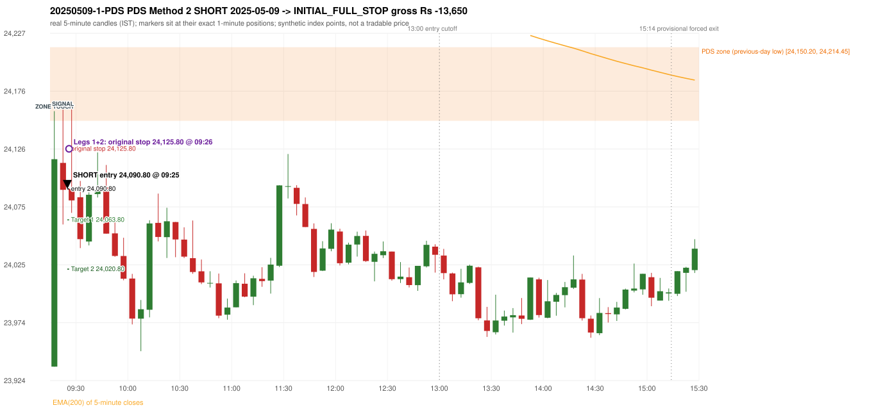
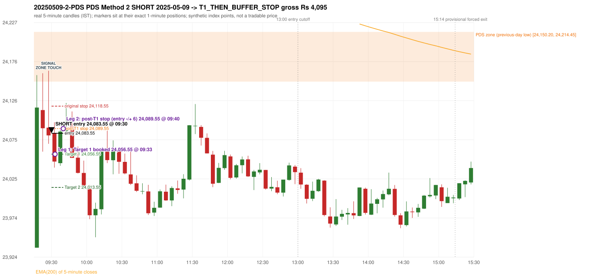

# Trading journal - 2025-05-09 (Friday)

> Phase 4 historical validation, window B_TV (Window B 2022-09-01..2025-08-31 (secondary vendor minutes); status VENDOR_SENSITIVITY). The FROZEN Phase 3.6 configuration (IRF, ORB, PDR body-based, PDS, RF; shared controller) on a different data source. HISTORICAL RESEARCH ONLY: the strategy was developed using later data. the same window with the secondary vendor's minute bars (daily series still 5paisa): quantifies sensitivity to the data source; not a second independent result Synthetic NIFTY 50 index-point P&L (the index is not tradable). The owner's review status is intentionally blank.

## A. Trading day overview

| item | value |
|---|---|
| Date / weekday | 2025-05-09 / Friday |
| Session type | USABLE_WITH_FLAGS / VALID |
| Original session open (first 1-minute open) | 23,935.75 |
| Previous session | 2025-05-08 |
| Previous-day high / low (wicks included) | 24,447.25 / 24,150.20 |
| Previous-day highest BODY high (the body-based PDR ceiling; wicks ignored) | 24,431.50 |
| Previous-day official close / last 5-minute close | 24,273.80 / 24,154.10 |
| Raw engine records / confirmed signals / fully valid signals | 4 / 2 / 2 |
| Setups that did not complete (invalidated / incomplete) | 2 |
| Executed trades | 2 20250509-1-PDS;20250509-2-PDS |
| Gross P&L (Rs, synthetic) | -9,555.00 |
| Illustrative net P&L (Rs; Rs 500/trade + 0.5 pt/fill) | -11,335.00 |
| Day-end portfolio status | DAY_FINISHED |
| Manual journal trades (matched / unmatched) | 0 (0 / 0) |
| Extra automated trades | 0 |

## B. Daily strategy signal timeline (confirmed signals, chronological)

| time | strategy | method | dir | entry-rule status | valid for execution | <= 13:00 | portfolio state | accepted / ignored | specific reason | competing (same minute) |
|---|---|---|---|---|---|---|---|---|---|---|
| 09:25 | PDS | Method 2 | SHORT | PROPOSAL_DEPENDENT | True | True | FIRST_TRADE_ACTIVE | ACCEPTED -> 20250509-1-PDS | first eligible signal of the day; trade 1: INITIAL_FULL_STOP |  |
| 09:30 | PDS | Method 2 | SHORT | PROPOSAL_DEPENDENT | True | True | SECOND_TRADE_ACTIVE | ACCEPTED -> 20250509-2-PDS | permitted second trade: newly confirmed PDR/PDS after the original full stop; trade 2: T1_THEN_BUFFER_STOP |  |

Engine setups that did not complete (2); the complete list with failed rule ids is in `rejected_signals.csv`:

| candle | strategy | method | dir | status | precise reason | failed rules |
|---|---|---|---|---|---|---|
| 09:15 | ORB | Method 1 | SHORT | INVALIDATED | CANDLE_QUALITY(not a strong body / wick too large) | ORB-M1-SHORT-003 |
| 09:15 | ORB | Method 2 | SHORT | INVALIDATED | CANDLE_QUALITY | ORB-M2-SHORT-003 |

## C. Detailed trade journals

### 20250509-1-PDS: PDS Method 2 SHORT (FIRST trade)

Chart: 

**Rule configuration:** CFG-phase36_body_based-866f954e55 - signal verification status **PROPOSAL_DEPENDENT** (never VERIFIED while a rule rests on a proposal).

#### 1. Setup identification

PDS Method 2 SHORT: the session opened 214.45 points below the previous-day-low zone [24,150.20, 24,214.45]; price rose to the zone at 09:15 and the first red candle at the zone (09:20, close 24,090.00) was a higher-price-rejection pin bar; confirmed 09:25.

#### 2. Candle and indicator calculations

| role | session | candle | O | H | L | C | range | body % | upper wick % | lower wick % | direction | EMA(200) | strong bull / bear | pin bull / bear | small (body<=30%) | used for |
|---|---|---|---|---|---|---|---|---|---|---|---|---|---|---|---|---|
| zone_source_candle | PREVIOUS | 15:25-15:30 | 24,214.45 | 24,223.50 | 24,150.20 | 24,154.10 | 73.30 | 82.33 | 12.35 | 5.32 | BEARISH | 24,374.37 | False / True | False / False | False | previous-day low candle that defines the zone (A_LOWEST_LOW) |
| zone_retest_candle | TODAY | 09:15-09:20 | 23,935.75 | 24,158.70 | 23,935.75 | 24,116.75 | 222.95 | 81.18 | 18.82 | 0.00 | BULLISH | 24,371.81 | True / False | False / False | False | first candle whose range reaches the zone from below |
| signal_candle | TODAY | 09:20-09:25 | 24,113.50 | 24,161.10 | 24,059.80 | 24,090.00 | 101.30 | 23.20 | 46.99 | 29.81 | BEARISH | 24,369.00 | False / False | False / True | True | trigger candle |

Every condition, with the rule, the calculation, the observed values and the result:

| # | group | rule | result | status / numeric definition | calculation | observed | required | available at | why it matters |
|---|---|---|---|---|---|---|---|---|---|
| 1 | SELECTION | SEL-FIRST-001 | PASS | USER_APPROVED / USER_APPROVED | earliest CONFIRMED signal of the day across IRF/ORB/PDR/PDS/RF that passed the controller's checks | 0 confirmed signal(s) earlier today; 2 confirmed signals in the day in total, this one at 09:25 | no earlier executable signal | 2025-05-09 09:25 | the shared controller trades only the first valid signal; the five strategies are not independent positions |
| 2 | SELECTION | SEL-TIE-001 | PASS | USER_APPROVED / USER_APPROVED | other CONFIRMED signals with exactly the same confirmation timestamp | none | no different-strategy / opposite-direction signal in the same minute (otherwise an unresolved conflict, no trade) | 2025-05-09 09:25 | an unresolved same-minute collision would have produced no trade at all |
| 3 | SELECTION | ENTRY-CUTOFF-001 | PASS | USER_APPROVED / USER_APPROVED | fill timestamp vs 13:00:00 IST | signal confirmed 09:25; fill 09:25 | fill at or before 13:00:00 IST | 2025-05-09 09:25 | no new position may be entered with a fill after 13:00 IST |
| 4 | SELECTION | EXE-FILL-001 | PASS | PROPOSED_FOR_REVIEW / PROPOSED_FOR_REVIEW | fill = open of the 1-minute bar that starts at the signal candle's end | bar 09:25 O 24,090.80 H 24,118.10 L 24,090.80 C 24,118.10; executable=True; entry 24,090.80 | fill bar exists, starts exactly at the signal end, is fillable; entry = its open | 2025-05-09 09:25 | a 5-minute signal is known only when its candle closes; the first price that can be traded is the next minute's open |
| 5 | SELECTION | DAY-MAX-001 | PASS | USER_APPROVED / USER_APPROVED | number of entries today | trade 1 of at most 2 | <= 2 entries per day | 2025-05-09 09:25 | daily trade cap |
| 6 | SETUP | PDS-003 | PASS | SOURCE_VERIFIED / EXPLICIT_WORDING_DETAIL_PROPOSED_FOR_REVIEW | gap = first 1-minute open of today - previous session's OFFICIAL close | today's open 23,935.75 (first 1-minute bar 09:15) - previous close 24,273.80 (DAILY_VENDOR, 2025-05-08) = -338.05 points -> gap DOWN | gap DOWN (more than 0 points) | 2025-05-09 09:15 | approved convention: the original first-minute open, never the vendor daily open |
| 7 | SETUP | PDS-006 | PASS | SOURCE_VERIFIED / QUALITATIVE_SOURCE_NUMERIC_DEFINITION_PROPOSED_FOR_REVIEW | gap-down open below the zone | today's open 23,935.75 vs zone low 24,150.20: 214.45 points below | open < zone low | 2025-05-09 09:15 | the guide: 'price is trading below the previous day's support zone' after the gap; a PROPOSED strict reading |
| 8 | SETUP | PDS-004 | PASS | SOURCE_VERIFIED / EXPLICIT_IN_SOURCE | PDS is not a breakdown strategy: the zone must be tested from below first | open 23,935.75 below the zone floor 24,150.20; the first candle to reach the zone is 09:15 | price rises to the zone before any short | 2025-05-09 09:15 | a short below the level without a retest is not this strategy |
| 9 | SETUP | PDS-005 | PASS | SOURCE_VERIFIED / QUALITATIVE_SOURCE_NUMERIC_DEFINITION_PROPOSED_FOR_REVIEW | price comes up to the zone: first candle whose [low, high] intersects it (+/- proximity) | 09:15-09:20 O 23,935.75 H 24,158.70 L 23,935.75 C 24,116.75; range 222.95, body 181.00 (81.18%), upper wick 41.95 (18.82%), lower wick 0.00 (0.00%), bullish; high 24,158.70 vs zone low 24,150.20 | range intersects the zone | 2025-05-09 09:20 | PDS is not a breakdown strategy: the zone must be tested from below first |
| 10 | ZONE | PDS-001 | PASS | SOURCE_VERIFIED / EXPLICIT_IN_SOURCE | direction | SHORT (PDS is short only) | short-only | 2025-05-09 09:25 | PDS sells a retest of previous-day support from below |
| 11 | ZONE | PDS-002 | PASS | SOURCE_VERIFIED / QUALITATIVE_SOURCE_NUMERIC_DEFINITION_PROPOSED_FOR_REVIEW | zone = [lowest low, body top] of the previous session's absolute-low candle (method A_LOWEST_LOW; the lower wick is part of the zone) | zone [24,150.20, 24,214.45] from the 15:25 candle of 2025-05-08 (15:25-15:30 O 24,214.45 H 24,223.50 L 24,150.20 C 24,154.10; range 73.30, body 60.35 (82.33%), upper wick 9.05 (12.35%), lower wick 3.90 (5.32%), bearish); engine recorded [24,150.20, 24,214.45] | previous trading day's low where price took support (body + lower wick) | 2025-05-08 15:30 | the reference level of the strategy; the exact candle(s) are a research choice (PDS-ZONE-002) |
| 12 | CONFIRMATION | PDS-M-001 | PASS | SOURCE_VERIFIED / QUALITATIVE_SOURCE_NUMERIC_DEFINITION_PROPOSED_FOR_REVIEW | Methods 1/2 apply to the FIRST red candle at the zone | first red candle at the zone: 09:20; signal candle 09:20 | the trigger is the first red candle at the zone | 2025-05-09 09:25 | a later red candle would only qualify through Method 3 |
| 13 | CONFIRMATION | PDS-M2-001 | PASS | SOURCE_VERIFIED / QUALITATIVE_SOURCE_NUMERIC_DEFINITION_PROPOSED_FOR_REVIEW | red higher-price-rejection pin bar: upper wick >= 2 x body, close within the lowest 30% of the range, high reaches the zone | 09:20-09:25 O 24,113.50 H 24,161.10 L 24,059.80 C 24,090.00; range 101.30, body 23.50 (23.20%), upper wick 47.60 (46.99%), lower wick 30.20 (29.81%), bearish; upper wick / body = 2.03; close position from the low 29.81% of range; high 24,161.10 vs zone low 24,150.20 | bearish pin bar and high >= zone low | 2025-05-09 09:25 | the guide: wick-to-body ratio 'not specified'; these thresholds are an owner recommendation (proposal) |
| 14 | EXECUTION | EXE-STOP-001 | PASS | USER_APPROVED / USER_APPROVED | initial stop = entry + 35 points | entry 24,090.80 -> stop 24,125.80 | stop 35 index points (BASELINE) | 2025-05-09 09:25 | defines the loss if the setup fails before Target 1 |
| 15 | EXECUTION | EXE-T1-001 | PASS | SOURCE_VERIFIED / EXPLICIT_IN_SOURCE | Target 1 = entry +/- 27 points | T1 24,063.80 | 27 points | 2025-05-09 09:25 | Leg 1 (3 lots) is booked at Target 1 |
| 16 | EXECUTION | PDS-TGT-001 | PASS | SOURCE_VERIFIED / EXPLICIT_IN_SOURCE | Target 2 = entry +/- 70 points | T2 24,020.80 (the guide says 70; the report suggests 60 - CONFLICTING) | 70 points | 2025-05-09 09:25 | Leg 2 (3 lots) is booked at Target 2 |
| 17 | EXECUTION | POST-T1-STOP-006 | PASS | USER_APPROVED / USER_APPROVED | after T1 the Leg-2 stop = entry + 6 (no trailing) | post-T1 stop 24,096.80 | entry -6 (LONG) / +6 (SHORT) | 2025-05-09 09:25 | protects the remaining three lots once the first three are booked |
| 18 | EXECUTION | SIZE-LOT-001 | PASS | USER_APPROVED / USER_APPROVED | 6 lots x 65 = 390, Leg 1 = 3 lots = 195, Leg 2 = 195 | 6 lots, lot size 65, legs 3+3 | 6 lots in two equal legs | 2025-05-09 09:25 | position size for the synthetic P&L |
| 19 | NOTE | PDS-007 | NOT_APPLICABLE | PROPOSED_FOR_REVIEW / PROPOSED_FOR_REVIEW | repeated PDS signals today | 2 confirmed PDS signal(s) in the session | n/a (disclosure) | 2025-05-09 09:25 | the per-session cap is lifted for the controller runs; the controller trades only the first (or the permitted second) trade |
| 20 | NOTE | PDS-SL-001 | NOT_APPLICABLE | SOURCE_VERIFIED / QUALITATIVE_SOURCE_NUMERIC_DEFINITION_PROPOSED_FOR_REVIEW | the guide's 35-or-40 rule: 35 if the most recent green candle's high is within 35 points of entry, else 40 | most recent green candle high 24,158.70 is 67.90 points from the entry 24,090.80: the guide's rule would select 40 points; the baseline applies a fixed 35 (USER_APPROVED research baseline; the 35-vs-40 selection and the 40-point variant are separate labelled scenarios) | source selection rule | 2025-05-09 09:25 | the stop distance is a modelling choice and changes losses, not entries |
| 21 | NOTE | NOTE-UNRESOLVED-DEPENDENCIES | NOT_APPLICABLE | NOT_A_RULE / NOT_A_REGISTRY_RULE | rules the signal depends on that the sources leave unresolved | engine-recorded unresolved rule ids: none; verification status PROPOSAL_DEPENDENT | n/a (disclosure) | 2025-05-09 09:25 | the entry is only as verified as the rules it rests on |

#### 3. Entry decision and explanation

PDS Method 2 SHORT: the session opened 214.45 points below the previous-day-low zone [24,150.20, 24,214.45]; price rose to the zone at 09:15 and the first red candle at the zone (09:20, close 24,090.00) was a higher-price-rejection pin bar; confirmed 09:25.

**Why this trade ahead of the other strategies:** This PDS Method 2 signal was the earliest executable signal of the day: 0 confirmed signal(s) earlier, 0 other in the same minute. 1 later confirmed signal(s) (PDS x1) are logged as ignored or rejected. State of the other four engines at that moment: [IRF: no setup record before this time (a base condition was not met, or nothing triggered)] [ORB: Method 1 invalidated at 09:15: CANDLE_QUALITY(not a strong body / wick too large); Method 2 invalidated at 09:15: CANDLE_QUALITY] [PDR: no setup record before this time (a base condition was not met, or nothing triggered)] [RF: no setup record before this time (a base condition was not met, or nothing triggered)]

#### 4. Actual entry execution

| item | value |
|---|---|
| Signal candle | 09:20-09:25 |
| Signal confirmed | 2025-05-09 09:25 |
| Fill timestamp | 2025-05-09 09:25 |
| Entry price | 24,090.80 |
| Source partition / 1-minute bar | data/phase4/processed/TECHNOVUS_1M/nifty50/year=2025/month=05/candles.parquet / 2025-05-09 09:25 |
| Source bar O / H / L / C | 24,090.80 / 24,118.10 / 24,090.80 / 24,118.10 |
| Fill assumption | open of the 1-minute bar starting at the signal candle's end (EXE-FILL-001, PROPOSED causal convention) |
| Initial stop / T1 / T2 / post-T1 stop | 24,125.80 / 24,063.80 / 24,020.80 / 24,096.80 |
| Position | 6 lots x 65 = 390 units (Leg 1 195, Leg 2 195) |

#### 5-8. Trade progress, Target 1, post-T1 stop and final exit

Between the 09:25 entry bar and the final exit (2 one-minute bars) the best excursion in favour was 0.00 points at 09:25 and the worst against was 47.65 points at 09:26. At 09:26 price reached the original stop 24,125.80 before Target 1 24,063.80, so all six lots exited together at 24,125.80. This is an INITIAL_FULL_STOP: one more trade is allowed that day, only a newly confirmed PDR/PDS signal.

| leg | qty | exit time | exit price | reason | source 1-minute bar | O / H / L / C | gross points | gross Rs | slippage pts | flags |
|---|---|---|---|---|---|---|---|---|---|---|
| 1 | 195 | 09:26 | 24,125.80 | ORIGINAL_STOP_BEFORE_T1 | 09:26 | 24,119.20 / 24,138.45 / 24,109.15 / 24,131.85 | -35.00 | -6,825.00 | 0.00 |  |
| 2 | 195 | 09:26 | 24,125.80 | ORIGINAL_STOP_BEFORE_T1 | 09:26 | 24,119.20 / 24,138.45 / 24,109.15 / 24,131.85 | -35.00 | -6,825.00 | 0.00 |  |

Exit evidence per leg:

* Leg 1: 1-minute bar 09:26 O 24,119.20 H 24,138.45 L 24,109.15 C 24,131.85: high 24,138.45 reached the original stop 24,125.80 before Target 1 24,063.80 was touched; both legs exit at the stop level 24,125.80
* Leg 2: 1-minute bar 09:26 O 24,119.20 H 24,138.45 L 24,109.15 C 24,131.85: high 24,138.45 reached the original stop 24,125.80 before Target 1 24,063.80 was touched; both legs exit at the stop level 24,125.80

#### 9. Gross and illustrative net P&L

| item | value (Rs) |
|---|---|
| Leg 1 gross | -6,825.00 |
| Leg 2 gross | -6,825.00 |
| Trade gross (= Leg 1 + Leg 2) | -13,650.00 |
| Illustrative fixed cost | -500.00 |
| Illustrative slippage (0.5 pt on every fill, entry + exits, all units) | -390.00 |
| Illustrative net | -14,540.00 |

#### 10. Manual journal comparison

No manual journal exists for this period; no comparison.

### 20250509-2-PDS: PDS Method 2 SHORT (SECOND trade)

Chart: 

**Rule configuration:** CFG-phase36_body_based-866f954e55 - signal verification status **PROPOSAL_DEPENDENT** (never VERIFIED while a rule rests on a proposal).

#### 1. Setup identification

PDS Method 2 SHORT: the session opened 214.45 points below the previous-day-low zone [24,150.20, 24,214.45]; price rose to the zone at 09:25 and the first red candle at the zone (09:25, close 24,080.80) was a higher-price-rejection pin bar; confirmed 09:30.

#### 2. Candle and indicator calculations

| role | session | candle | O | H | L | C | range | body % | upper wick % | lower wick % | direction | EMA(200) | strong bull / bear | pin bull / bear | small (body<=30%) | used for |
|---|---|---|---|---|---|---|---|---|---|---|---|---|---|---|---|---|
| zone_source_candle | PREVIOUS | 15:25-15:30 | 24,214.45 | 24,223.50 | 24,150.20 | 24,154.10 | 73.30 | 82.33 | 12.35 | 5.32 | BEARISH | 24,374.37 | False / True | False / False | False | previous-day low candle that defines the zone (A_LOWEST_LOW) |
| zone_retest_candle | TODAY | 09:25-09:30 | 24,090.80 | 24,164.25 | 24,069.90 | 24,080.80 | 94.35 | 10.60 | 77.85 | 11.55 | BEARISH | 24,366.13 | False / False | False / True | True | first candle whose range reaches the zone from below |
| signal_candle | TODAY | 09:25-09:30 | 24,090.80 | 24,164.25 | 24,069.90 | 24,080.80 | 94.35 | 10.60 | 77.85 | 11.55 | BEARISH | 24,366.13 | False / False | False / True | True | trigger candle |

Every condition, with the rule, the calculation, the observed values and the result:

| # | group | rule | result | status / numeric definition | calculation | observed | required | available at | why it matters |
|---|---|---|---|---|---|---|---|---|---|
| 1 | SELECTION | DAY-SL-001 | PASS | USER_APPROVED / USER_APPROVED | first trade outcome, strategy of this signal, position-close time vs this signal's timestamp | first trade PDS Method 2 closed as INITIAL_FULL_STOP at 09:26; position free from 09:27; this PDS signal confirmed 09:30 | first trade INITIAL_FULL_STOP before Target 1, and a NEWLY confirmed PDR/PDS signal after the first position closed | 2025-05-09 09:30 | the only way a second trade is allowed |
| 2 | SELECTION | DAY-NOREUSE-001 | PASS | USER_APPROVED / USER_APPROVED | signals confirmed while the first position was open | 1 signal(s) were ignored during the first trade (never reused): PDS Method 2 SHORT @09:25 | this trade comes from a signal confirmed after the first exit, not from an ignored one | 2025-05-09 09:30 | an ignored signal can never become the second trade |
| 3 | SELECTION | ENTRY-CUTOFF-001 | PASS | USER_APPROVED / USER_APPROVED | fill timestamp vs 13:00:00 IST | signal confirmed 09:30; fill 09:30 | fill at or before 13:00:00 IST | 2025-05-09 09:30 | no new position may be entered with a fill after 13:00 IST |
| 4 | SELECTION | EXE-FILL-001 | PASS | PROPOSED_FOR_REVIEW / PROPOSED_FOR_REVIEW | fill = open of the 1-minute bar that starts at the signal candle's end | bar 09:30 O 24,083.55 H 24,087.00 L 24,060.00 C 24,082.45; executable=True; entry 24,083.55 | fill bar exists, starts exactly at the signal end, is fillable; entry = its open | 2025-05-09 09:30 | a 5-minute signal is known only when its candle closes; the first price that can be traded is the next minute's open |
| 5 | SELECTION | DAY-MAX-001 | PASS | USER_APPROVED / USER_APPROVED | number of entries today | trade 2 of at most 2 | <= 2 entries per day | 2025-05-09 09:30 | daily trade cap |
| 6 | SETUP | PDS-003 | PASS | SOURCE_VERIFIED / EXPLICIT_WORDING_DETAIL_PROPOSED_FOR_REVIEW | gap = first 1-minute open of today - previous session's OFFICIAL close | today's open 23,935.75 (first 1-minute bar 09:15) - previous close 24,273.80 (DAILY_VENDOR, 2025-05-08) = -338.05 points -> gap DOWN | gap DOWN (more than 0 points) | 2025-05-09 09:15 | approved convention: the original first-minute open, never the vendor daily open |
| 7 | SETUP | PDS-006 | PASS | SOURCE_VERIFIED / QUALITATIVE_SOURCE_NUMERIC_DEFINITION_PROPOSED_FOR_REVIEW | gap-down open below the zone | today's open 23,935.75 vs zone low 24,150.20: 214.45 points below | open < zone low | 2025-05-09 09:15 | the guide: 'price is trading below the previous day's support zone' after the gap; a PROPOSED strict reading |
| 8 | SETUP | PDS-004 | PASS | SOURCE_VERIFIED / EXPLICIT_IN_SOURCE | PDS is not a breakdown strategy: the zone must be tested from below first | open 23,935.75 below the zone floor 24,150.20; the first candle to reach the zone is 09:25 | price rises to the zone before any short | 2025-05-09 09:15 | a short below the level without a retest is not this strategy |
| 9 | SETUP | PDS-005 | PASS | SOURCE_VERIFIED / QUALITATIVE_SOURCE_NUMERIC_DEFINITION_PROPOSED_FOR_REVIEW | price comes up to the zone: first candle whose [low, high] intersects it (+/- proximity) | 09:25-09:30 O 24,090.80 H 24,164.25 L 24,069.90 C 24,080.80; range 94.35, body 10.00 (10.60%), upper wick 73.45 (77.85%), lower wick 10.90 (11.55%), bearish; high 24,164.25 vs zone low 24,150.20 | range intersects the zone | 2025-05-09 09:30 | PDS is not a breakdown strategy: the zone must be tested from below first |
| 10 | ZONE | PDS-001 | PASS | SOURCE_VERIFIED / EXPLICIT_IN_SOURCE | direction | SHORT (PDS is short only) | short-only | 2025-05-09 09:30 | PDS sells a retest of previous-day support from below |
| 11 | ZONE | PDS-002 | PASS | SOURCE_VERIFIED / QUALITATIVE_SOURCE_NUMERIC_DEFINITION_PROPOSED_FOR_REVIEW | zone = [lowest low, body top] of the previous session's absolute-low candle (method A_LOWEST_LOW; the lower wick is part of the zone) | zone [24,150.20, 24,214.45] from the 15:25 candle of 2025-05-08 (15:25-15:30 O 24,214.45 H 24,223.50 L 24,150.20 C 24,154.10; range 73.30, body 60.35 (82.33%), upper wick 9.05 (12.35%), lower wick 3.90 (5.32%), bearish); engine recorded [24,150.20, 24,214.45] | previous trading day's low where price took support (body + lower wick) | 2025-05-08 15:30 | the reference level of the strategy; the exact candle(s) are a research choice (PDS-ZONE-002) |
| 12 | CONFIRMATION | PDS-M-001 | PASS | SOURCE_VERIFIED / QUALITATIVE_SOURCE_NUMERIC_DEFINITION_PROPOSED_FOR_REVIEW | Methods 1/2 apply to the FIRST red candle at the zone | first red candle at the zone: 09:25; signal candle 09:25 | the trigger is the first red candle at the zone | 2025-05-09 09:30 | a later red candle would only qualify through Method 3 |
| 13 | CONFIRMATION | PDS-M2-001 | PASS | SOURCE_VERIFIED / QUALITATIVE_SOURCE_NUMERIC_DEFINITION_PROPOSED_FOR_REVIEW | red higher-price-rejection pin bar: upper wick >= 2 x body, close within the lowest 30% of the range, high reaches the zone | 09:25-09:30 O 24,090.80 H 24,164.25 L 24,069.90 C 24,080.80; range 94.35, body 10.00 (10.60%), upper wick 73.45 (77.85%), lower wick 10.90 (11.55%), bearish; upper wick / body = 7.35; close position from the low 11.55% of range; high 24,164.25 vs zone low 24,150.20 | bearish pin bar and high >= zone low | 2025-05-09 09:30 | the guide: wick-to-body ratio 'not specified'; these thresholds are an owner recommendation (proposal) |
| 14 | EXECUTION | EXE-STOP-001 | PASS | USER_APPROVED / USER_APPROVED | initial stop = entry + 35 points | entry 24,083.55 -> stop 24,118.55 | stop 35 index points (BASELINE) | 2025-05-09 09:30 | defines the loss if the setup fails before Target 1 |
| 15 | EXECUTION | EXE-T1-001 | PASS | SOURCE_VERIFIED / EXPLICIT_IN_SOURCE | Target 1 = entry +/- 27 points | T1 24,056.55 | 27 points | 2025-05-09 09:30 | Leg 1 (3 lots) is booked at Target 1 |
| 16 | EXECUTION | PDS-TGT-001 | PASS | SOURCE_VERIFIED / EXPLICIT_IN_SOURCE | Target 2 = entry +/- 70 points | T2 24,013.55 (the guide says 70; the report suggests 60 - CONFLICTING) | 70 points | 2025-05-09 09:30 | Leg 2 (3 lots) is booked at Target 2 |
| 17 | EXECUTION | POST-T1-STOP-006 | PASS | USER_APPROVED / USER_APPROVED | after T1 the Leg-2 stop = entry + 6 (no trailing) | post-T1 stop 24,089.55 | entry -6 (LONG) / +6 (SHORT) | 2025-05-09 09:30 | protects the remaining three lots once the first three are booked |
| 18 | EXECUTION | SIZE-LOT-001 | PASS | USER_APPROVED / USER_APPROVED | 6 lots x 65 = 390, Leg 1 = 3 lots = 195, Leg 2 = 195 | 6 lots, lot size 65, legs 3+3 | 6 lots in two equal legs | 2025-05-09 09:30 | position size for the synthetic P&L |
| 19 | NOTE | PDS-007 | NOT_APPLICABLE | PROPOSED_FOR_REVIEW / PROPOSED_FOR_REVIEW | repeated PDS signals today | 2 confirmed PDS signal(s) in the session | n/a (disclosure) | 2025-05-09 09:30 | the per-session cap is lifted for the controller runs; the controller trades only the first (or the permitted second) trade |
| 20 | NOTE | PDS-SL-001 | NOT_APPLICABLE | SOURCE_VERIFIED / QUALITATIVE_SOURCE_NUMERIC_DEFINITION_PROPOSED_FOR_REVIEW | the guide's 35-or-40 rule: 35 if the most recent green candle's high is within 35 points of entry, else 40 | most recent green candle high 24,158.70 is 75.15 points from the entry 24,083.55: the guide's rule would select 40 points; the baseline applies a fixed 35 (USER_APPROVED research baseline; the 35-vs-40 selection and the 40-point variant are separate labelled scenarios) | source selection rule | 2025-05-09 09:30 | the stop distance is a modelling choice and changes losses, not entries |
| 21 | NOTE | NOTE-UNRESOLVED-DEPENDENCIES | NOT_APPLICABLE | NOT_A_RULE / NOT_A_REGISTRY_RULE | rules the signal depends on that the sources leave unresolved | engine-recorded unresolved rule ids: none; verification status PROPOSAL_DEPENDENT | n/a (disclosure) | 2025-05-09 09:30 | the entry is only as verified as the rules it rests on |

#### 3. Entry decision and explanation

PDS Method 2 SHORT: the session opened 214.45 points below the previous-day-low zone [24,150.20, 24,214.45]; price rose to the zone at 09:25 and the first red candle at the zone (09:25, close 24,080.80) was a higher-price-rejection pin bar; confirmed 09:30.

**Why this trade ahead of the other strategies:** The first trade (PDS Method 2) was stopped out before Target 1 at 09:26; this newly confirmed PDS signal at 09:30 is the first PDR/PDS signal after that exit, so it is the day's permitted second trade. State of the other engines at that moment: [IRF: no setup record before this time (a base condition was not met, or nothing triggered)] [ORB: Method 1 invalidated at 09:15: CANDLE_QUALITY(not a strong body / wick too large); Method 2 invalidated at 09:15: CANDLE_QUALITY] [PDR: no setup record before this time (a base condition was not met, or nothing triggered)] [RF: no setup record before this time (a base condition was not met, or nothing triggered)]

#### 4. Actual entry execution

| item | value |
|---|---|
| Signal candle | 09:25-09:30 |
| Signal confirmed | 2025-05-09 09:30 |
| Fill timestamp | 2025-05-09 09:30 |
| Entry price | 24,083.55 |
| Source partition / 1-minute bar | data/phase4/processed/TECHNOVUS_1M/nifty50/year=2025/month=05/candles.parquet / 2025-05-09 09:30 |
| Source bar O / H / L / C | 24,083.55 / 24,087.00 / 24,060.00 / 24,082.45 |
| Fill assumption | open of the 1-minute bar starting at the signal candle's end (EXE-FILL-001, PROPOSED causal convention) |
| Initial stop / T1 / T2 / post-T1 stop | 24,118.55 / 24,056.55 / 24,013.55 / 24,089.55 |
| Position | 6 lots x 65 = 390 units (Leg 1 195, Leg 2 195) |

#### 5-8. Trade progress, Target 1, post-T1 stop and final exit

Between the 09:30 entry bar and the final exit (11 one-minute bars) the best excursion in favour was 44.40 points at 09:33 and the worst against was 24.95 points at 09:40. At 09:33 price reached Target 1 24,056.55 and three lots exited. At 09:33 the remaining three lots' protective stop was set to 24,089.55 (entry + 6; no trailing, no further change); the engine applies it from the Target-1 bar onward and tests it within that same bar. At 09:40 the remaining three lots stopped out at 24,089.55. T1_THEN_BUFFER_STOP: no second trade that day (DAY-BUF-001).

| leg | qty | exit time | exit price | reason | source 1-minute bar | O / H / L / C | gross points | gross Rs | slippage pts | flags |
|---|---|---|---|---|---|---|---|---|---|---|
| 1 | 195 | 09:33 | 24,056.55 | TARGET_1 | 09:33 | 24,067.50 / 24,067.50 / 24,039.15 / 24,047.20 | 27.00 | 5,265.00 | 0.00 |  |
| 2 | 195 | 09:40 | 24,089.55 | POST_T1_STOP_ENTRY_MINUS_PLUS_6 | 09:40 | 24,086.35 / 24,108.50 / 24,085.70 / 24,095.45 | -6.00 | -1,170.00 | 0.00 |  |

Exit evidence per leg:

* Leg 1: 1-minute bar 09:33 O 24,067.50 H 24,067.50 L 24,039.15 C 24,047.20: low 24,039.15 reached Target 1 24,056.55; Leg 1 booked at the target level
* Leg 2: 1-minute bar 09:40 O 24,086.35 H 24,108.50 L 24,085.70 C 24,095.45: high 24,108.50 reached the post-T1 stop 24,089.55; Leg 2 exits at 24,089.55 at the stop level

#### 9. Gross and illustrative net P&L

| item | value (Rs) |
|---|---|
| Leg 1 gross | 5,265.00 |
| Leg 2 gross | -1,170.00 |
| Trade gross (= Leg 1 + Leg 2) | 4,095.00 |
| Illustrative fixed cost | -500.00 |
| Illustrative slippage (0.5 pt on every fill, entry + exits, all units) | -390.00 |
| Illustrative net | 3,205.00 |

#### 10. Manual journal comparison

No manual journal exists for this period; no comparison.

## D. Manual journal comparison

No manual journal exists for this period (the manual journal covers 2025-09-01 .. 2026-08-31 only); no comparison is made and no automated trade is labelled 'extra'.

## E. Daily conclusion

* **Traded:** 20250509-1-PDS - PDS Method 2 SHORT at 09:25 (entry 24,090.80), outcome INITIAL_FULL_STOP, gross Rs -13,650.00, illustrative net Rs -14,540.00. **Why:** This PDS Method 2 signal was the earliest executable signal of the day: 0 confirmed signal(s) earlier, 0 other in the same minute. 1 later confirmed signal(s) (PDS x1) are logged as ignored or rejected. State of the other four engines at that moment: [IRF: no setup record before this time (a base condition was not met, or nothing triggered)] [ORB: Method 1 invalidated at 09:15: CANDLE_QUALITY(not a strong body / wick too large); Method 2 invalidated at 09:15: CANDLE_QUALITY] [PDR: no setup record before this time (a base condition was not met, or nothing triggered)] [RF: no setup record before this time (a base condition was not met, or nothing triggered)] **How it ended:** At 09:26 price reached the original stop 24,125.80 before Target 1 24,063.80, so all six lots exited together at 24,125.80. This is an INITIAL_FULL_STOP: one more trade is allowed that day, only a newly confirmed PDR/PDS signal.
* **Traded:** 20250509-2-PDS - PDS Method 2 SHORT at 09:30 (entry 24,083.55), outcome T1_THEN_BUFFER_STOP, gross Rs 4,095.00, illustrative net Rs 3,205.00. **Why:** The first trade (PDS Method 2) was stopped out before Target 1 at 09:26; this newly confirmed PDS signal at 09:30 is the first PDR/PDS signal after that exit, so it is the day's permitted second trade. State of the other engines at that moment: [IRF: no setup record before this time (a base condition was not met, or nothing triggered)] [ORB: Method 1 invalidated at 09:15: CANDLE_QUALITY(not a strong body / wick too large); Method 2 invalidated at 09:15: CANDLE_QUALITY] [PDR: no setup record before this time (a base condition was not met, or nothing triggered)] [RF: no setup record before this time (a base condition was not met, or nothing triggered)] **How it ended:** At 09:33 price reached Target 1 24,056.55 and three lots exited. At 09:33 the remaining three lots' protective stop was set to 24,089.55 (entry + 6; no trailing, no further change); the engine applies it from the Target-1 bar onward and tests it within that same bar. At 09:40 the remaining three lots stopped out at 24,089.55. T1_THEN_BUFFER_STOP: no second trade that day (DAY-BUF-001).
* **Automated triage (not an approval; the owner's review status stays blank):** TRADED_NO_FLAGS
