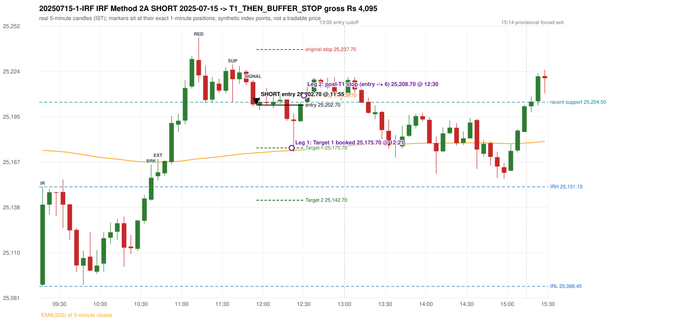

# Trading journal - 2025-07-15 (Tuesday)

> Phase 4 historical validation, window B_TV (Window B 2022-09-01..2025-08-31 (secondary vendor minutes); status VENDOR_SENSITIVITY). The FROZEN Phase 3.6 configuration (IRF, ORB, PDR body-based, PDS, RF; shared controller) on a different data source. HISTORICAL RESEARCH ONLY: the strategy was developed using later data. the same window with the secondary vendor's minute bars (daily series still 5paisa): quantifies sensitivity to the data source; not a second independent result Synthetic NIFTY 50 index-point P&L (the index is not tradable). The owner's review status is intentionally blank.

## A. Trading day overview

| item | value |
|---|---|
| Date / weekday | 2025-07-15 / Tuesday |
| Session type | USABLE_WITH_FLAGS / VALID |
| Original session open (first 1-minute open) | 25,089.50 |
| Previous session | 2025-07-14 |
| Previous-day high / low (wicks included) | 25,151.10 / 25,001.95 |
| Previous-day highest BODY high (the body-based PDR ceiling; wicks ignored) | 25,149.50 |
| Previous-day official close / last 5-minute close | 25,082.30 / 25,087.10 |
| Raw engine records / confirmed signals / fully valid signals | 7 / 3 / 2 |
| Setups that did not complete (invalidated / incomplete) | 4 |
| Executed trades | 1 20250715-1-IRF |
| Gross P&L (Rs, synthetic) | 4,095.00 |
| Illustrative net P&L (Rs; Rs 500/trade + 0.5 pt/fill) | 3,205.00 |
| Day-end portfolio status | DAY_FINISHED |
| Manual journal trades (matched / unmatched) | 0 (0 / 0) |
| Extra automated trades | 0 |

## B. Daily strategy signal timeline (confirmed signals, chronological)

| time | strategy | method | dir | entry-rule status | valid for execution | <= 13:00 | portfolio state | accepted / ignored | specific reason | competing (same minute) |
|---|---|---|---|---|---|---|---|---|---|---|
| 11:55 | IRF | Method 2A | SHORT | PROPOSAL_DEPENDENT | True | True | FIRST_TRADE_ACTIVE | ACCEPTED -> 20250715-1-IRF | first eligible signal of the day; trade 1: T1_THEN_BUFFER_STOP |  |
| 12:55 | IRF | Method 2B | SHORT | PROPOSAL_DEPENDENT | True | True | DAY_FINISHED | IGNORED | DAY_FINISHED [blocked by IRF#1] |  |
| 15:30 | IRF | Method 2B | SHORT | PROPOSAL_DEPENDENT | False | False | DAY_FINISHED | IGNORED | DAY_FINISHED [blocked by IRF#1] |  |

Engine setups that did not complete (4); the complete list with failed rule ids is in `rejected_signals.csv`:

| candle | strategy | method | dir | status | precise reason | failed rules |
|---|---|---|---|---|---|---|
| 09:30 | IRF | Method 3 | SHORT | INVALIDATED | WICK_SHARE_OUT_OF_BAND | IRF-M3-003 |
| 15:25 | IRF | Method 1/2 | SHORT | INCOMPLETE_AT_EOD | SESSION_ENDED_BEFORE_CONFIRMATION |  |
| 09:15 | ORB | Method 2 | LONG | INVALIDATED | TREND:EMA_PREV_SESSION_CLOSE wrong side | ORB-TREND-001;ORB-TREND-002 |
| 09:15 | PDR | PDR | LONG | INVALIDATED | OPEN_NOT_STRICTLY_ABOVE_ZONE |  |

## C. Detailed trade journals

### 20250715-1-IRF: IRF Method 2A SHORT (FIRST trade)

Chart: 

**Rule configuration:** CFG-phase36_body_based-866f954e55 - signal verification status **PROPOSAL_DEPENDENT** (never VERIFIED while a rule rests on a proposal).

#### 1. Setup identification

IRF Method 2A SHORT: the 10:35-10:40 candle closed at 25,156.90, above IRH 25,151.15, and the next candle did not close back inside the range, so the setup is Method 2 and price stayed above it until the trigger. Extension candle 10:40-10:45, red candle 11:10-11:15. The trigger came 15 candles after the breakout candle: a completed candle closed below the recent pullback-low support (11:50-11:55); confirmed at 11:55 with close 25,203.10. Entry reference close 25,203.10 is 51.95 points above IRH 25,151.15.

#### 2. Candle and indicator calculations

| role | session | candle | O | H | L | C | range | body % | upper wick % | lower wick % | direction | EMA(200) | strong bull / bear | pin bull / bear | small (body<=30%) | used for |
|---|---|---|---|---|---|---|---|---|---|---|---|---|---|---|---|---|
| initial_range_candle | TODAY | 09:15-09:20 | 25,089.50 | 25,151.15 | 25,088.45 | 25,139.95 | 62.70 | 80.46 | 17.86 | 1.67 | BULLISH | 25,174.14 | True / False | False / False | False | initial range = high/low of the 09:15 candle |
| signal_candle | TODAY | 11:50-11:55 | 25,217.25 | 25,218.55 | 25,201.75 | 25,203.10 | 16.80 | 84.23 | 7.74 | 8.04 | BEARISH | 25,172.45 | False / True | False / False | False | candle whose close completed the trigger |
| breakout_candle | TODAY | 10:35-10:40 | 25,143.10 | 25,165.15 | 25,142.50 | 25,156.90 | 22.65 | 60.93 | 36.42 | 2.65 | BULLISH | 25,166.82 | False / False | False / False | False | breakout candle: a completed candle closing above IRH |
| extension_candle | TODAY | 10:40-10:45 | 25,157.90 | 25,168.75 | 25,155.15 | 25,160.35 | 13.60 | 18.01 | 61.76 | 20.22 | BULLISH | 25,166.75 | False / False | False / False | True | extension: first later candle trading above the breakout candle's high |
| red_candle | TODAY | 11:10-11:15 | 25,231.10 | 25,245.20 | 25,216.95 | 25,221.40 | 28.25 | 34.34 | 49.91 | 15.75 | BEARISH | 25,168.89 | False / False | False / False | False | first red candle during the extension |
| support_pivot | TODAY | 11:35-11:40 | 25,225.00 | 25,228.30 | 25,204.50 | 25,219.00 | 23.80 | 25.21 | 13.87 | 60.92 | BEARISH | 25,171.17 | False / False | False / False | True | recent support: latest 3-candle fractal low formed after the breakout |

Every condition, with the rule, the calculation, the observed values and the result:

| # | group | rule | result | status / numeric definition | calculation | observed | required | available at | why it matters |
|---|---|---|---|---|---|---|---|---|---|
| 1 | SELECTION | SEL-FIRST-001 | PASS | USER_APPROVED / USER_APPROVED | earliest CONFIRMED signal of the day across IRF/ORB/PDR/PDS/RF that passed the controller's checks | 0 confirmed signal(s) earlier today; 3 confirmed signals in the day in total, this one at 11:55 | no earlier executable signal | 2025-07-15 11:55 | the shared controller trades only the first valid signal; the five strategies are not independent positions |
| 2 | SELECTION | SEL-TIE-001 | PASS | USER_APPROVED / USER_APPROVED | other CONFIRMED signals with exactly the same confirmation timestamp | none | no different-strategy / opposite-direction signal in the same minute (otherwise an unresolved conflict, no trade) | 2025-07-15 11:55 | an unresolved same-minute collision would have produced no trade at all |
| 3 | SELECTION | ENTRY-CUTOFF-001 | PASS | USER_APPROVED / USER_APPROVED | fill timestamp vs 13:00:00 IST | signal confirmed 11:55; fill 11:55 | fill at or before 13:00:00 IST | 2025-07-15 11:55 | no new position may be entered with a fill after 13:00 IST |
| 4 | SELECTION | EXE-FILL-001 | PASS | PROPOSED_FOR_REVIEW / PROPOSED_FOR_REVIEW | fill = open of the 1-minute bar that starts at the signal candle's end | bar 11:55 O 25,202.70 H 25,207.30 L 25,202.25 C 25,203.50; executable=True; entry 25,202.70 | fill bar exists, starts exactly at the signal end, is fillable; entry = its open | 2025-07-15 11:55 | a 5-minute signal is known only when its candle closes; the first price that can be traded is the next minute's open |
| 5 | SELECTION | DAY-MAX-001 | PASS | USER_APPROVED / USER_APPROVED | number of entries today | trade 1 of at most 2 | <= 2 entries per day | 2025-07-15 11:55 | daily trade cap |
| 6 | SETUP | IRF-GLOBAL-001 | PASS | SOURCE_VERIFIED / EXPLICIT_IN_SOURCE | initial range = high and low (wicks included) of the first completed 5-minute candle | 09:15-09:20 IRH 25,151.15, IRL 25,088.45 (range 62.70; engine recorded IRH 25,151.15, IRL 25,088.45) | high/low of the 09:15-09:20 candle | 2025-07-15 09:20 | all three IRF methods measure price against this range |
| 7 | SETUP | IRF-GLOBAL-003 | PASS | SOURCE_VERIFIED / EXPLICIT_IN_SOURCE | closes confirm, wicks do not: every trigger is evaluated on a completed 5-minute candle | trigger candle 11:50-11:55 was complete when the signal was stamped 11:55; decision uses its close 25,203.10 | completed candle close, not an intra-candle wick | 2025-07-15 11:55 | an intra-candle wick can reverse before the candle closes |
| 8 | SETUP | IRF-GLOBAL-002 | PASS | SOURCE_VERIFIED / EXPLICIT_IN_SOURCE | direction | SHORT (IRF trades short only) | short only | 2025-07-15 11:55 | IRF fades failed upside breakouts |
| 9 | SETUP | IRF-M2-001 | PASS | SOURCE_VERIFIED / EXPLICIT_IN_SOURCE | breakout candle close vs IRH | 10:35-10:40 O 25,143.10 H 25,165.15 L 25,142.50 C 25,156.90; range 22.65, body 13.80 (60.93%), upper wick 8.25 (36.42%), lower wick 0.60 (2.65%), bullish; close 25,156.90 is 5.75 points above IRH 25,151.15 | close > IRH (a wick above IRH is not a breakout) | 2025-07-15 10:40 | starts every IRF setup |
| 10 | SETUP | IRF-M2-004 | PASS | SOURCE_VERIFIED / EXPLICIT_IN_SOURCE | the candle after the breakout must NOT close back inside the range (else the setup is Method 1) | 10:40 close 25,160.35 vs [25,088.45, 25,151.15) | not (IRL <= close < IRH) | 2025-07-15 10:45 | separates Method 2 (price holds above) from Method 1 (immediate failure) |
| 11 | SETUP | IRF-M2-002 | PASS | SOURCE_VERIFIED / QUALITATIVE_SOURCE_NUMERIC_DEFINITION_PROPOSED_FOR_REVIEW | extension = a later candle whose high exceeds the breakout candle's high (research definition E1) | 10:40 high 25,168.75 vs breakout candle high 25,165.15 (+3.60) | high > breakout candle high | 2025-07-15 10:45 | the guide says price 'extends further upward'; the numeric test is a proposal |
| 12 | SETUP | IRF-M2-003 | PASS | SOURCE_VERIFIED / QUALITATIVE_SOURCE_NUMERIC_DEFINITION_PROPOSED_FOR_REVIEW | a red candle (close < open) forms after the extension | 11:10-11:15 O 25,231.10 H 25,245.20 L 25,216.95 C 25,221.40; range 28.25, body 9.70 (34.34%), upper wick 14.10 (49.91%), lower wick 4.45 (15.75%), bearish | close < open, at or after the candle following the extension | 2025-07-15 11:15 | the red candle shows the first pause/reversal inside the extension |
| 13 | CONFIRMATION | IRF-M2A-001 | PASS | SOURCE_VERIFIED / QUALITATIVE_SOURCE_NUMERIC_DEFINITION_PROPOSED_FOR_REVIEW | recent support = latest 3-candle fractal low (k=1) among candles b+1 ... i-2 | 11:35 low 25,204.50; neighbours' lows 25,210.25 (11:30) and 25,215.85 (11:40) are not lower; engine recorded support 25,204.50 | pivot low known before the trigger candle | 2025-07-15 11:45 | the support is the level whose break completes Method 2A (the exact 'pullback low' definition is a proposal) |
| 14 | CONFIRMATION | IRF-M2A-002 | PASS | SOURCE_VERIFIED / EXPLICIT_WORDING_DETAIL_PROPOSED_FOR_REVIEW | trigger candle closes below recent support | 11:50 close 25,203.10 vs support 25,204.50: 1.40 points below | close < support (close, not wick) | 2025-07-15 11:55 | completes Method 2A |
| 15 | CONFIRMATION | IRF-M2-005 | PASS | SOURCE_VERIFIED / EXPLICIT_IN_SOURCE | chronology: the red candle precedes the break candle | red candle 11:10, break candle 11:50 | red candle index < break candle index (m2a_break_may_be_red_candle = False) | 2025-07-15 11:55 | a red candle alone is not confirmation; a level break is required |
| 16 | EXECUTION | EXE-STOP-001 | PASS | USER_APPROVED / USER_APPROVED | initial stop = entry + 35 points | entry 25,202.70 -> stop 25,237.70 | stop 35 index points (BASELINE) | 2025-07-15 11:55 | defines the loss if the setup fails before Target 1 |
| 17 | EXECUTION | EXE-T1-001 | PASS | SOURCE_VERIFIED / EXPLICIT_IN_SOURCE | Target 1 = entry +/- 27 points | T1 25,175.70 | 27 points | 2025-07-15 11:55 | Leg 1 (3 lots) is booked at Target 1 |
| 18 | EXECUTION | IRF-TGT-001 | PASS | SOURCE_VERIFIED / EXPLICIT_IN_SOURCE | Target 2 = entry +/- 60 points | T2 25,142.70 | 60 points | 2025-07-15 11:55 | Leg 2 (3 lots) is booked at Target 2 |
| 19 | EXECUTION | POST-T1-STOP-006 | PASS | USER_APPROVED / USER_APPROVED | after T1 the Leg-2 stop = entry + 6 (no trailing) | post-T1 stop 25,208.70 | entry -6 (LONG) / +6 (SHORT) | 2025-07-15 11:55 | protects the remaining three lots once the first three are booked |
| 20 | EXECUTION | SIZE-LOT-001 | PASS | USER_APPROVED / USER_APPROVED | 6 lots x 65 = 390, Leg 1 = 3 lots = 195, Leg 2 = 195 | 6 lots, lot size 65, legs 3+3 | 6 lots in two equal legs | 2025-07-15 11:55 | position size for the synthetic P&L |
| 21 | NOTE | IRF-M2-006 | UNRESOLVED | UNRESOLVED / UNRESOLVED | delay between the breakout candle and this trigger; expiry rule | 15 candles after the breakout; expiry none configured | the source states no expiry | 2025-07-15 11:55 | an old breakout can still trigger hours later |
| 22 | NOTE | IRF-M2-006 | UNRESOLVED | UNRESOLVED / UNRESOLVED | did price stay above IRH between the breakout and the trigger? | 0 closes at or below IRH between 10:40 and 11:50; trigger close 25,203.10 above IRH 25,151.15 | the engine does not require price to stay above IRH | 2025-07-15 11:55 | the guide describes price 'holding above IRH and keeping rising'; the code only needs the level break |
| 23 | NOTE | IRF-GLOBAL-004 | UNRESOLVED | UNRESOLVED / UNRESOLVED | which close above IRH of the session produced this attempt; repeat setups | this breakout is upward crossing no. 1 of the session (a close above IRH after a close at/below it) | the source states no first-breakout-only, re-arming, expiry or trades-per-day rule | 2025-07-15 11:55 | IRF re-arms on every later breakout in the code, producing many raw setups; the controller keeps only the first |
| 24 | NOTE | NOTE-IRF-REPEATED-SETUPS | NOT_APPLICABLE | NOT_A_RULE / NOT_A_REGISTRY_RULE | other IRF signals later in the session (not traded) | 2 further confirmed IRF signal(s): Method 2B@12:55, Method 2B@15:30 | disclosure of repeated raw setups | 2025-07-15 11:55 | repeated raw IRF setups are not hidden; they are logged as ignored |
| 25 | NOTE | IRF-SL-001 | NOT_APPLICABLE | SOURCE_VERIFIED / QUALITATIVE_SOURCE_NUMERIC_DEFINITION_PROPOSED_FOR_REVIEW | the guide's 35-or-40 rule: 35 if the most recent green candle's high is within 35 points of entry, else 40 | most recent green candle high 25,227.30 is 24.60 points from the entry 25,202.70: the guide's rule would select 35 points; the baseline applies a fixed 35 (USER_APPROVED research baseline; the 35-vs-40 selection and the 40-point variant are separate labelled scenarios) | source selection rule | 2025-07-15 11:55 | the stop distance is a modelling choice and changes losses, not entries |
| 26 | NOTE | NOTE-UNRESOLVED-DEPENDENCIES | UNRESOLVED | NOT_A_RULE / NOT_A_REGISTRY_RULE | rules the signal depends on that the sources leave unresolved | engine-recorded unresolved rule ids: IRF-GLOBAL-004; verification status PROPOSAL_DEPENDENT | n/a (disclosure) | 2025-07-15 11:55 | the entry is only as verified as the rules it rests on |

#### 3. Entry decision and explanation

IRF Method 2A SHORT: the 10:35-10:40 candle closed at 25,156.90, above IRH 25,151.15, and the next candle did not close back inside the range, so the setup is Method 2 and price stayed above it until the trigger. Extension candle 10:40-10:45, red candle 11:10-11:15. The trigger came 15 candles after the breakout candle: a completed candle closed below the recent pullback-low support (11:50-11:55); confirmed at 11:55 with close 25,203.10. Entry reference close 25,203.10 is 51.95 points above IRH 25,151.15.

**Why this trade ahead of the other strategies:** This IRF Method 2A signal was the earliest executable signal of the day: 0 confirmed signal(s) earlier, 0 other in the same minute. 2 later confirmed signal(s) (IRF x2) are logged as ignored or rejected. State of the other four engines at that moment: [ORB: Method 2 invalidated at 09:15: TREND:EMA_PREV_SESSION_CLOSE wrong side] [PDR: PDR invalidated at 09:15: OPEN_NOT_STRICTLY_ABOVE_ZONE] [PDS: no setup record before this time (a base condition was not met, or nothing triggered)] [RF: no setup record before this time (a base condition was not met, or nothing triggered)]

#### 4. Actual entry execution

| item | value |
|---|---|
| Signal candle | 11:50-11:55 |
| Signal confirmed | 2025-07-15 11:55 |
| Fill timestamp | 2025-07-15 11:55 |
| Entry price | 25,202.70 |
| Source partition / 1-minute bar | data/phase4/processed/TECHNOVUS_1M/nifty50/year=2025/month=07/candles.parquet / 2025-07-15 11:55 |
| Source bar O / H / L / C | 25,202.70 / 25,207.30 / 25,202.25 / 25,203.50 |
| Fill assumption | open of the 1-minute bar starting at the signal candle's end (EXE-FILL-001, PROPOSED causal convention) |
| Initial stop / T1 / T2 / post-T1 stop | 25,237.70 / 25,175.70 / 25,142.70 / 25,208.70 |
| Position | 6 lots x 65 = 390 units (Leg 1 195, Leg 2 195) |

#### 5-8. Trade progress, Target 1, post-T1 stop and final exit

Between the 11:55 entry bar and the final exit (36 one-minute bars) the best excursion in favour was 29.60 points at 12:21 and the worst against was 10.95 points at 12:01. At 12:21 price reached Target 1 25,175.70 and three lots exited. At 12:21 the remaining three lots' protective stop was set to 25,208.70 (entry + 6; no trailing, no further change); the engine applies it from the Target-1 bar onward and tests it within that same bar. At 12:30 the remaining three lots stopped out at 25,208.70. T1_THEN_BUFFER_STOP: no second trade that day (DAY-BUF-001).

| leg | qty | exit time | exit price | reason | source 1-minute bar | O / H / L / C | gross points | gross Rs | slippage pts | flags |
|---|---|---|---|---|---|---|---|---|---|---|
| 1 | 195 | 12:21 | 25,175.70 | TARGET_1 | 12:21 | 25,195.45 / 25,195.45 / 25,173.10 / 25,175.25 | 27.00 | 5,265.00 | 0.00 |  |
| 2 | 195 | 12:30 | 25,208.70 | POST_T1_STOP_ENTRY_MINUS_PLUS_6 | 12:30 | 25,204.70 / 25,212.50 / 25,203.70 / 25,210.80 | -6.00 | -1,170.00 | 0.00 |  |

Exit evidence per leg:

* Leg 1: 1-minute bar 12:21 O 25,195.45 H 25,195.45 L 25,173.10 C 25,175.25: low 25,173.10 reached Target 1 25,175.70; Leg 1 booked at the target level
* Leg 2: 1-minute bar 12:30 O 25,204.70 H 25,212.50 L 25,203.70 C 25,210.80: high 25,212.50 reached the post-T1 stop 25,208.70; Leg 2 exits at 25,208.70 at the stop level

#### 9. Gross and illustrative net P&L

| item | value (Rs) |
|---|---|
| Leg 1 gross | 5,265.00 |
| Leg 2 gross | -1,170.00 |
| Trade gross (= Leg 1 + Leg 2) | 4,095.00 |
| Illustrative fixed cost | -500.00 |
| Illustrative slippage (0.5 pt on every fill, entry + exits, all units) | -390.00 |
| Illustrative net | 3,205.00 |

#### 10. Manual journal comparison

No manual journal exists for this period; no comparison.

## D. Manual journal comparison

No manual journal exists for this period (the manual journal covers 2025-09-01 .. 2026-08-31 only); no comparison is made and no automated trade is labelled 'extra'.

## E. Daily conclusion

* **Traded:** 20250715-1-IRF - IRF Method 2A SHORT at 11:55 (entry 25,202.70), outcome T1_THEN_BUFFER_STOP, gross Rs 4,095.00, illustrative net Rs 3,205.00. **Why:** This IRF Method 2A signal was the earliest executable signal of the day: 0 confirmed signal(s) earlier, 0 other in the same minute. 2 later confirmed signal(s) (IRF x2) are logged as ignored or rejected. State of the other four engines at that moment: [ORB: Method 2 invalidated at 09:15: TREND:EMA_PREV_SESSION_CLOSE wrong side] [PDR: PDR invalidated at 09:15: OPEN_NOT_STRICTLY_ABOVE_ZONE] [PDS: no setup record before this time (a base condition was not met, or nothing triggered)] [RF: no setup record before this time (a base condition was not met, or nothing triggered)] **How it ended:** At 12:21 price reached Target 1 25,175.70 and three lots exited. At 12:21 the remaining three lots' protective stop was set to 25,208.70 (entry + 6; no trailing, no further change); the engine applies it from the Target-1 bar onward and tests it within that same bar. At 12:30 the remaining three lots stopped out at 25,208.70. T1_THEN_BUFFER_STOP: no second trade that day (DAY-BUF-001).
* **Ignored / rejected signals:** IRF IGNORED DAY_FINISHED x2
* **Open strategy-definition issues that affected this day:** IRF-GLOBAL-004 (NOT STATED: how many IRF trades per day, a latest entry time, and whether a new breakout may re-arm a setup after a signal), IRF-M2-006 (How long a Method 2 setup stays valid (expiry / invalidation before a level breaks) is not stated), NOTE-UNRESOLVED-DEPENDENCIES
* **Automated triage (not an approval; the owner's review status stays blank):** TRADED_NO_FLAGS
