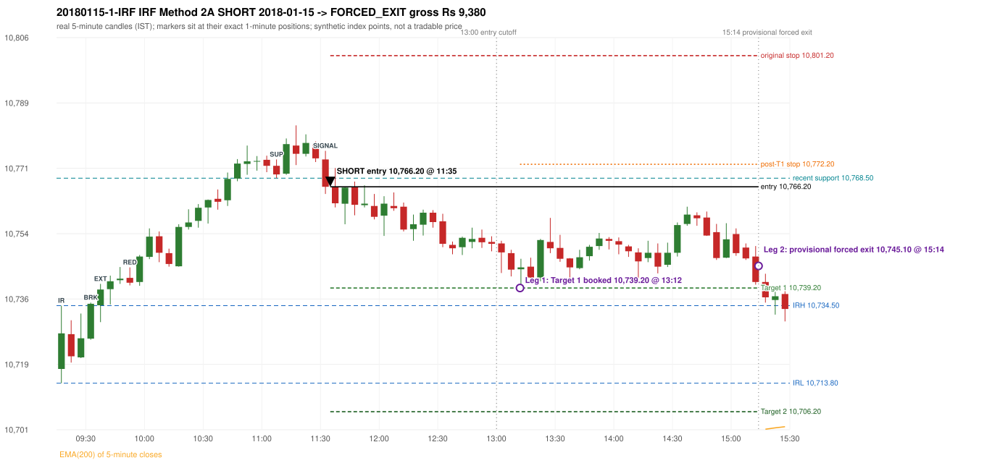

# Trading journal - 2018-01-15 (Monday)

> Phase 4 historical validation, window C (Window C 2018-01-01..2018-12-31 (secondary vendor minutes); status EXPLORATORY). The FROZEN Phase 3.6 configuration (IRF, ORB, PDR body-based, PDS, RF; shared controller) on a different data source. HISTORICAL RESEARCH ONLY: the strategy was developed using later data. the only minute source for 2018 is the secondary vendor; 5paisa returns no minute data before 2019-03-01, so there is NO overlap with another vendor to check it against Synthetic NIFTY 50 index-point P&L (the index is not tradable). The owner's review status is intentionally blank.

## A. Trading day overview

| item | value |
|---|---|
| Date / weekday | 2018-01-15 / Monday |
| Session type | USABLE_WITH_FLAGS / VALID |
| Original session open (first 1-minute open) | 10,717.60 |
| Previous session | 2018-01-12 |
| Previous-day high / low (wicks included) | 10,690.40 / 10,597.10 |
| Previous-day highest BODY high (the body-based PDR ceiling; wicks ignored) | 10,687.80 |
| Previous-day official close / last 5-minute close | 10,681.25 / 10,668.20 |
| Raw engine records / confirmed signals / fully valid signals | 5 / 2 / 1 |
| Setups that did not complete (invalidated / incomplete) | 3 |
| Executed trades | 1 20180115-1-IRF |
| Gross P&L (Rs, synthetic) | 9,379.50 |
| Illustrative net P&L (Rs; Rs 500/trade + 0.5 pt/fill) | 8,489.50 |
| Day-end portfolio status | DAY_FINISHED |
| Manual journal trades (matched / unmatched) | 0 (0 / 0) |
| Extra automated trades | 0 |

## B. Daily strategy signal timeline (confirmed signals, chronological)

| time | strategy | method | dir | entry-rule status | valid for execution | <= 13:00 | portfolio state | accepted / ignored | specific reason | competing (same minute) |
|---|---|---|---|---|---|---|---|---|---|---|
| 11:35 | IRF | Method 2A | SHORT | PROPOSAL_DEPENDENT | True | True | FIRST_TRADE_ACTIVE | ACCEPTED -> 20180115-1-IRF | first eligible signal of the day; trade 1: FORCED_EXIT |  |
| 15:30 | IRF | Method 1 | SHORT | PROPOSAL_DEPENDENT | False | False | DAY_FINISHED | IGNORED | DAY_FINISHED [blocked by IRF#1] |  |

Engine setups that did not complete (3); the complete list with failed rule ids is in `rejected_signals.csv`:

| candle | strategy | method | dir | status | precise reason | failed rules |
|---|---|---|---|---|---|---|
| 11:30 | IRF | Method 1/2 | SHORT | INCOMPLETE_AT_EOD | SESSION_ENDED_BEFORE_CONFIRMATION |  |
| 09:15 | ORB | Method 1 | LONG | INVALIDATED | CANDLE_QUALITY(not a strong body / wick too large) | ORB-M1-LONG-003 |
| 09:15 | ORB | Method 2 | LONG | INVALIDATED | CANDLE_QUALITY | ORB-M2-LONG-003 |

## C. Detailed trade journals

### 20180115-1-IRF: IRF Method 2A SHORT (FIRST trade)

Chart: 

**Rule configuration:** CFG-phase36_body_based-866f954e55 - signal verification status **PROPOSAL_DEPENDENT** (never VERIFIED while a rule rests on a proposal).

#### 1. Setup identification

IRF Method 2A SHORT: the 09:30-09:35 candle closed at 10,735.00, above IRH 10,734.50, and the next candle did not close back inside the range, so the setup is Method 2 and price stayed above it until the trigger. Extension candle 09:35-09:40, red candle 09:50-09:55. The trigger came 24 candles after the breakout candle: a completed candle closed below the recent pullback-low support (11:30-11:35); confirmed at 11:35 with close 10,766.20. Entry reference close 10,766.20 is 31.70 points above IRH 10,734.50.

#### 2. Candle and indicator calculations

| role | session | candle | O | H | L | C | range | body % | upper wick % | lower wick % | direction | EMA(200) | strong bull / bear | pin bull / bear | small (body<=30%) | used for |
|---|---|---|---|---|---|---|---|---|---|---|---|---|---|---|---|---|
| initial_range_candle | TODAY | 09:15-09:20 | 10,717.60 | 10,734.50 | 10,713.80 | 10,727.10 | 20.70 | 45.89 | 35.75 | 18.36 | BULLISH | 10,647.03 | False / False | False / False | False | initial range = high/low of the 09:15 candle |
| signal_candle | TODAY | 11:30-11:35 | 10,773.50 | 10,775.80 | 10,764.30 | 10,766.20 | 11.50 | 63.48 | 20.00 | 16.52 | BEARISH | 10,673.29 | False / True | False / False | False | candle whose close completed the trigger |
| breakout_candle | TODAY | 09:30-09:35 | 10,725.70 | 10,735.30 | 10,725.40 | 10,735.00 | 9.90 | 93.94 | 3.03 | 3.03 | BULLISH | 10,649.40 | True / False | False / False | False | breakout candle: a completed candle closing above IRH |
| extension_candle | TODAY | 09:35-09:40 | 10,734.60 | 10,740.30 | 10,730.10 | 10,738.80 | 10.20 | 41.18 | 14.71 | 44.12 | BULLISH | 10,650.29 | False / False | False / False | False | extension: first later candle trading above the breakout candle's high |
| red_candle | TODAY | 09:50-09:55 | 10,741.90 | 10,744.70 | 10,739.90 | 10,740.60 | 4.80 | 27.08 | 58.33 | 14.58 | BEARISH | 10,652.97 | False / False | False / True | True | first red candle during the extension |
| support_pivot | TODAY | 11:05-11:10 | 10,771.80 | 10,773.50 | 10,768.50 | 10,769.50 | 5.00 | 46.00 | 34.00 | 20.00 | BEARISH | 10,668.13 | False / False | False / False | False | recent support: latest 3-candle fractal low formed after the breakout |

Every condition, with the rule, the calculation, the observed values and the result:

| # | group | rule | result | status / numeric definition | calculation | observed | required | available at | why it matters |
|---|---|---|---|---|---|---|---|---|---|
| 1 | SELECTION | SEL-FIRST-001 | PASS | USER_APPROVED / USER_APPROVED | earliest CONFIRMED signal of the day across IRF/ORB/PDR/PDS/RF that passed the controller's checks | 0 confirmed signal(s) earlier today; 2 confirmed signals in the day in total, this one at 11:35 | no earlier executable signal | 2018-01-15 11:35 | the shared controller trades only the first valid signal; the five strategies are not independent positions |
| 2 | SELECTION | SEL-TIE-001 | PASS | USER_APPROVED / USER_APPROVED | other CONFIRMED signals with exactly the same confirmation timestamp | none | no different-strategy / opposite-direction signal in the same minute (otherwise an unresolved conflict, no trade) | 2018-01-15 11:35 | an unresolved same-minute collision would have produced no trade at all |
| 3 | SELECTION | ENTRY-CUTOFF-001 | PASS | USER_APPROVED / USER_APPROVED | fill timestamp vs 13:00:00 IST | signal confirmed 11:35; fill 11:35 | fill at or before 13:00:00 IST | 2018-01-15 11:35 | no new position may be entered with a fill after 13:00 IST |
| 4 | SELECTION | EXE-FILL-001 | PASS | PROPOSED_FOR_REVIEW / PROPOSED_FOR_REVIEW | fill = open of the 1-minute bar that starts at the signal candle's end | bar 11:35 O 10,766.20 H 10,771.20 L 10,765.60 C 10,769.80; executable=True; entry 10,766.20 | fill bar exists, starts exactly at the signal end, is fillable; entry = its open | 2018-01-15 11:35 | a 5-minute signal is known only when its candle closes; the first price that can be traded is the next minute's open |
| 5 | SELECTION | DAY-MAX-001 | PASS | USER_APPROVED / USER_APPROVED | number of entries today | trade 1 of at most 2 | <= 2 entries per day | 2018-01-15 11:35 | daily trade cap |
| 6 | SETUP | IRF-GLOBAL-001 | PASS | SOURCE_VERIFIED / EXPLICIT_IN_SOURCE | initial range = high and low (wicks included) of the first completed 5-minute candle | 09:15-09:20 IRH 10,734.50, IRL 10,713.80 (range 20.70; engine recorded IRH 10,734.50, IRL 10,713.80) | high/low of the 09:15-09:20 candle | 2018-01-15 09:20 | all three IRF methods measure price against this range |
| 7 | SETUP | IRF-GLOBAL-003 | PASS | SOURCE_VERIFIED / EXPLICIT_IN_SOURCE | closes confirm, wicks do not: every trigger is evaluated on a completed 5-minute candle | trigger candle 11:30-11:35 was complete when the signal was stamped 11:35; decision uses its close 10,766.20 | completed candle close, not an intra-candle wick | 2018-01-15 11:35 | an intra-candle wick can reverse before the candle closes |
| 8 | SETUP | IRF-GLOBAL-002 | PASS | SOURCE_VERIFIED / EXPLICIT_IN_SOURCE | direction | SHORT (IRF trades short only) | short only | 2018-01-15 11:35 | IRF fades failed upside breakouts |
| 9 | SETUP | IRF-M2-001 | PASS | SOURCE_VERIFIED / EXPLICIT_IN_SOURCE | breakout candle close vs IRH | 09:30-09:35 O 10,725.70 H 10,735.30 L 10,725.40 C 10,735.00; range 9.90, body 9.30 (93.94%), upper wick 0.30 (3.03%), lower wick 0.30 (3.03%), bullish; close 10,735.00 is 0.50 points above IRH 10,734.50 | close > IRH (a wick above IRH is not a breakout) | 2018-01-15 09:35 | starts every IRF setup |
| 10 | SETUP | IRF-M2-004 | PASS | SOURCE_VERIFIED / EXPLICIT_IN_SOURCE | the candle after the breakout must NOT close back inside the range (else the setup is Method 1) | 09:35 close 10,738.80 vs [10,713.80, 10,734.50) | not (IRL <= close < IRH) | 2018-01-15 09:40 | separates Method 2 (price holds above) from Method 1 (immediate failure) |
| 11 | SETUP | IRF-M2-002 | PASS | SOURCE_VERIFIED / QUALITATIVE_SOURCE_NUMERIC_DEFINITION_PROPOSED_FOR_REVIEW | extension = a later candle whose high exceeds the breakout candle's high (research definition E1) | 09:35 high 10,740.30 vs breakout candle high 10,735.30 (+5.00) | high > breakout candle high | 2018-01-15 09:40 | the guide says price 'extends further upward'; the numeric test is a proposal |
| 12 | SETUP | IRF-M2-003 | PASS | SOURCE_VERIFIED / QUALITATIVE_SOURCE_NUMERIC_DEFINITION_PROPOSED_FOR_REVIEW | a red candle (close < open) forms after the extension | 09:50-09:55 O 10,741.90 H 10,744.70 L 10,739.90 C 10,740.60; range 4.80, body 1.30 (27.08%), upper wick 2.80 (58.33%), lower wick 0.70 (14.58%), bearish | close < open, at or after the candle following the extension | 2018-01-15 09:55 | the red candle shows the first pause/reversal inside the extension |
| 13 | CONFIRMATION | IRF-M2A-001 | PASS | SOURCE_VERIFIED / QUALITATIVE_SOURCE_NUMERIC_DEFINITION_PROPOSED_FOR_REVIEW | recent support = latest 3-candle fractal low (k=1) among candles b+1 ... i-2 | 11:05 low 10,768.50; neighbours' lows 10,770.10 (11:00) and 10,769.40 (11:10) are not lower; engine recorded support 10,768.50 | pivot low known before the trigger candle | 2018-01-15 11:15 | the support is the level whose break completes Method 2A (the exact 'pullback low' definition is a proposal) |
| 14 | CONFIRMATION | IRF-M2A-002 | PASS | SOURCE_VERIFIED / EXPLICIT_WORDING_DETAIL_PROPOSED_FOR_REVIEW | trigger candle closes below recent support | 11:30 close 10,766.20 vs support 10,768.50: 2.30 points below | close < support (close, not wick) | 2018-01-15 11:35 | completes Method 2A |
| 15 | CONFIRMATION | IRF-M2-005 | PASS | SOURCE_VERIFIED / EXPLICIT_IN_SOURCE | chronology: the red candle precedes the break candle | red candle 09:50, break candle 11:30 | red candle index < break candle index (m2a_break_may_be_red_candle = False) | 2018-01-15 11:35 | a red candle alone is not confirmation; a level break is required |
| 16 | EXECUTION | EXE-STOP-001 | PASS | USER_APPROVED / USER_APPROVED | initial stop = entry + 35 points | entry 10,766.20 -> stop 10,801.20 | stop 35 index points (BASELINE) | 2018-01-15 11:35 | defines the loss if the setup fails before Target 1 |
| 17 | EXECUTION | EXE-T1-001 | PASS | SOURCE_VERIFIED / EXPLICIT_IN_SOURCE | Target 1 = entry +/- 27 points | T1 10,739.20 | 27 points | 2018-01-15 11:35 | Leg 1 (3 lots) is booked at Target 1 |
| 18 | EXECUTION | IRF-TGT-001 | PASS | SOURCE_VERIFIED / EXPLICIT_IN_SOURCE | Target 2 = entry +/- 60 points | T2 10,706.20 | 60 points | 2018-01-15 11:35 | Leg 2 (3 lots) is booked at Target 2 |
| 19 | EXECUTION | POST-T1-STOP-006 | PASS | USER_APPROVED / USER_APPROVED | after T1 the Leg-2 stop = entry + 6 (no trailing) | post-T1 stop 10,772.20 | entry -6 (LONG) / +6 (SHORT) | 2018-01-15 11:35 | protects the remaining three lots once the first three are booked |
| 20 | EXECUTION | SIZE-LOT-001 | PASS | USER_APPROVED / USER_APPROVED | 6 lots x 65 = 390, Leg 1 = 3 lots = 195, Leg 2 = 195 | 6 lots, lot size 65, legs 3+3 | 6 lots in two equal legs | 2018-01-15 11:35 | position size for the synthetic P&L |
| 21 | NOTE | IRF-M2-006 | UNRESOLVED | UNRESOLVED / UNRESOLVED | delay between the breakout candle and this trigger; expiry rule | 24 candles after the breakout; expiry none configured | the source states no expiry | 2018-01-15 11:35 | an old breakout can still trigger hours later |
| 22 | NOTE | IRF-M2-006 | UNRESOLVED | UNRESOLVED / UNRESOLVED | did price stay above IRH between the breakout and the trigger? | 0 closes at or below IRH between 09:35 and 11:30; trigger close 10,766.20 above IRH 10,734.50 | the engine does not require price to stay above IRH | 2018-01-15 11:35 | the guide describes price 'holding above IRH and keeping rising'; the code only needs the level break |
| 23 | NOTE | IRF-GLOBAL-004 | UNRESOLVED | UNRESOLVED / UNRESOLVED | which close above IRH of the session produced this attempt; repeat setups | this breakout is upward crossing no. 1 of the session (a close above IRH after a close at/below it) | the source states no first-breakout-only, re-arming, expiry or trades-per-day rule | 2018-01-15 11:35 | IRF re-arms on every later breakout in the code, producing many raw setups; the controller keeps only the first |
| 24 | NOTE | NOTE-IRF-REPEATED-SETUPS | NOT_APPLICABLE | NOT_A_RULE / NOT_A_REGISTRY_RULE | other IRF signals later in the session (not traded) | 1 further confirmed IRF signal(s): Method 1@15:30 | disclosure of repeated raw setups | 2018-01-15 11:35 | repeated raw IRF setups are not hidden; they are logged as ignored |
| 25 | NOTE | IRF-SL-001 | NOT_APPLICABLE | SOURCE_VERIFIED / QUALITATIVE_SOURCE_NUMERIC_DEFINITION_PROPOSED_FOR_REVIEW | the guide's 35-or-40 rule: 35 if the most recent green candle's high is within 35 points of entry, else 40 | most recent green candle high 10,780.20 is 14.00 points from the entry 10,766.20: the guide's rule would select 35 points; the baseline applies a fixed 35 (USER_APPROVED research baseline; the 35-vs-40 selection and the 40-point variant are separate labelled scenarios) | source selection rule | 2018-01-15 11:35 | the stop distance is a modelling choice and changes losses, not entries |
| 26 | NOTE | NOTE-UNRESOLVED-DEPENDENCIES | UNRESOLVED | NOT_A_RULE / NOT_A_REGISTRY_RULE | rules the signal depends on that the sources leave unresolved | engine-recorded unresolved rule ids: IRF-GLOBAL-004; verification status PROPOSAL_DEPENDENT | n/a (disclosure) | 2018-01-15 11:35 | the entry is only as verified as the rules it rests on |

#### 3. Entry decision and explanation

IRF Method 2A SHORT: the 09:30-09:35 candle closed at 10,735.00, above IRH 10,734.50, and the next candle did not close back inside the range, so the setup is Method 2 and price stayed above it until the trigger. Extension candle 09:35-09:40, red candle 09:50-09:55. The trigger came 24 candles after the breakout candle: a completed candle closed below the recent pullback-low support (11:30-11:35); confirmed at 11:35 with close 10,766.20. Entry reference close 10,766.20 is 31.70 points above IRH 10,734.50.

**Why this trade ahead of the other strategies:** This IRF Method 2A signal was the earliest executable signal of the day: 0 confirmed signal(s) earlier, 0 other in the same minute. 1 later confirmed signal(s) (IRF x1) are logged as ignored or rejected. State of the other four engines at that moment: [ORB: Method 1 invalidated at 09:15: CANDLE_QUALITY(not a strong body / wick too large); Method 2 invalidated at 09:15: CANDLE_QUALITY] [PDR: no setup record before this time (a base condition was not met, or nothing triggered)] [PDS: no setup record before this time (a base condition was not met, or nothing triggered)] [RF: no setup record before this time (a base condition was not met, or nothing triggered)]

#### 4. Actual entry execution

| item | value |
|---|---|
| Signal candle | 11:30-11:35 |
| Signal confirmed | 2018-01-15 11:35 |
| Fill timestamp | 2018-01-15 11:35 |
| Entry price | 10,766.20 |
| Source partition / 1-minute bar | data/phase4/processed/TECHNOVUS_1M/nifty50/year=2018/month=01/candles.parquet / 2018-01-15 11:35 |
| Source bar O / H / L / C | 10,766.20 / 10,771.20 / 10,765.60 / 10,769.80 |
| Fill assumption | open of the 1-minute bar starting at the signal candle's end (EXE-FILL-001, PROPOSED causal convention) |
| Initial stop / T1 / T2 / post-T1 stop | 10,801.20 / 10,739.20 / 10,706.20 / 10,772.20 |
| Position | 6 lots x 65 = 390 units (Leg 1 195, Leg 2 195) |

#### 5-8. Trade progress, Target 1, post-T1 stop and final exit

Between the 11:35 entry bar and the final exit (220 one-minute bars) the best excursion in favour was 27.10 points at 13:12 and the worst against was 5.00 points at 11:35. At 13:12 Target 1 booked three lots. At 13:12 the remaining three lots' protective stop was set to 10,772.20 (entry + 6; no trailing, no further change); the engine applies it from the Target-1 bar onward and tests it within that same bar. Neither the stop nor Target 2 was reached; at 15:14 the remaining lots were closed by the PROVISIONAL forced exit at the minute open 10,745.10.

| leg | qty | exit time | exit price | reason | source 1-minute bar | O / H / L / C | gross points | gross Rs | slippage pts | flags |
|---|---|---|---|---|---|---|---|---|---|---|
| 1 | 195 | 13:12 | 10,739.20 | TARGET_1 | 13:12 | 10,741.10 / 10,743.30 / 10,739.10 / 10,741.50 | 27.00 | 5,265.00 | 0.00 |  |
| 2 | 195 | 15:14 | 10,745.10 | FORCED_EXIT_1514_OPEN_PROVISIONAL | 15:14 | 10,745.10 / 10,745.20 / 10,740.10 / 10,740.80 | 21.10 | 4,114.50 | 0.00 | PROVISIONAL_FORCED_EXIT_15_14_OPEN |

Exit evidence per leg:

* Leg 1: 1-minute bar 13:12 O 10,741.10 H 10,743.30 L 10,739.10 C 10,741.50: low 10,739.10 reached Target 1 10,739.20; Leg 1 booked at the target level
* Leg 2: 1-minute bar 15:14 O 10,745.10 H 10,745.20 L 10,740.10 C 10,740.80: provisional forced exit at the OPEN of the 15:14 minute (10,745.10); neither Target 2 nor the stop was reached; sensitivity close of that minute 10,740.80 (not used)

#### 9. Gross and illustrative net P&L

| item | value (Rs) |
|---|---|
| Leg 1 gross | 5,265.00 |
| Leg 2 gross | 4,114.50 |
| Trade gross (= Leg 1 + Leg 2) | 9,379.50 |
| Illustrative fixed cost | -500.00 |
| Illustrative slippage (0.5 pt on every fill, entry + exits, all units) | -390.00 |
| Illustrative net | 8,489.50 |

#### 10. Manual journal comparison

No manual journal exists for this period; no comparison.

## D. Manual journal comparison

No manual journal exists for this period (the manual journal covers 2025-09-01 .. 2026-08-31 only); no comparison is made and no automated trade is labelled 'extra'.

## E. Daily conclusion

* **Traded:** 20180115-1-IRF - IRF Method 2A SHORT at 11:35 (entry 10,766.20), outcome FORCED_EXIT, gross Rs 9,379.50, illustrative net Rs 8,489.50. **Why:** This IRF Method 2A signal was the earliest executable signal of the day: 0 confirmed signal(s) earlier, 0 other in the same minute. 1 later confirmed signal(s) (IRF x1) are logged as ignored or rejected. State of the other four engines at that moment: [ORB: Method 1 invalidated at 09:15: CANDLE_QUALITY(not a strong body / wick too large); Method 2 invalidated at 09:15: CANDLE_QUALITY] [PDR: no setup record before this time (a base condition was not met, or nothing triggered)] [PDS: no setup record before this time (a base condition was not met, or nothing triggered)] [RF: no setup record before this time (a base condition was not met, or nothing triggered)] **How it ended:** At 13:12 Target 1 booked three lots. At 13:12 the remaining three lots' protective stop was set to 10,772.20 (entry + 6; no trailing, no further change); the engine applies it from the Target-1 bar onward and tests it within that same bar. Neither the stop nor Target 2 was reached; at 15:14 the remaining lots were closed by the PROVISIONAL forced exit at the minute open 10,745.10.
* **Ignored / rejected signals:** IRF IGNORED DAY_FINISHED x1
* **Open strategy-definition issues that affected this day:** IRF-GLOBAL-004 (NOT STATED: how many IRF trades per day, a latest entry time, and whether a new breakout may re-arm a setup after a signal), IRF-M2-006 (How long a Method 2 setup stays valid (expiry / invalidation before a level breaks) is not stated), NOTE-UNRESOLVED-DEPENDENCIES
* **Automated triage (not an approval; the owner's review status stays blank):** REVIEW: PROVISIONAL_FORCED_EXIT
