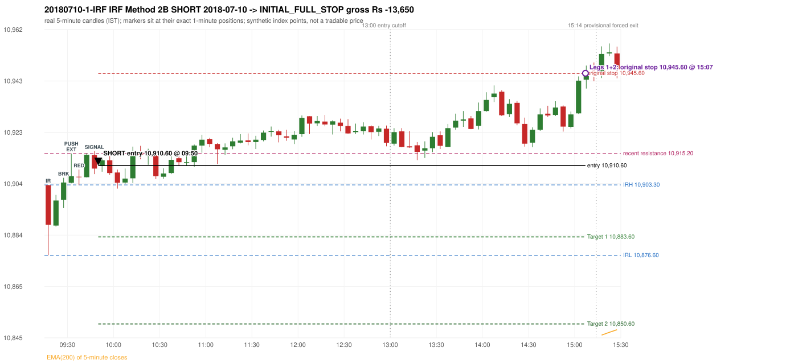

# Trading journal - 2018-07-10 (Tuesday)

> Phase 4 historical validation, window C (Window C 2018-01-01..2018-12-31 (secondary vendor minutes); status EXPLORATORY). The FROZEN Phase 3.6 configuration (IRF, ORB, PDR body-based, PDS, RF; shared controller) on a different data source. HISTORICAL RESEARCH ONLY: the strategy was developed using later data. the only minute source for 2018 is the secondary vendor; 5paisa returns no minute data before 2019-03-01, so there is NO overlap with another vendor to check it against Synthetic NIFTY 50 index-point P&L (the index is not tradable). The owner's review status is intentionally blank.

## A. Trading day overview

| item | value |
|---|---|
| Date / weekday | 2018-07-10 / Tuesday |
| Session type | USABLE_WITH_FLAGS / VALID |
| Original session open (first 1-minute open) | 10,903.20 |
| Previous session | 2018-07-06 |
| Previous-day high / low (wicks included) | 10,816.30 / 10,735.00 |
| Previous-day highest BODY high (the body-based PDR ceiling; wicks ignored) | 10,811.60 |
| Previous-day official close / last 5-minute close | 10,772.65 / 10,767.10 |
| Raw engine records / confirmed signals / fully valid signals | 12 / 7 / 7 |
| Setups that did not complete (invalidated / incomplete) | 1 |
| Executed trades | 1 20180710-1-IRF |
| Gross P&L (Rs, synthetic) | -13,650.00 |
| Illustrative net P&L (Rs; Rs 500/trade + 0.5 pt/fill) | -14,540.00 |
| Day-end portfolio status | SECOND_TRADE_ELIGIBLE |
| Manual journal trades (matched / unmatched) | 0 (0 / 0) |
| Extra automated trades | 0 |

## B. Daily strategy signal timeline (confirmed signals, chronological)

| time | strategy | method | dir | entry-rule status | valid for execution | <= 13:00 | portfolio state | accepted / ignored | specific reason | competing (same minute) |
|---|---|---|---|---|---|---|---|---|---|---|
| 09:50 | IRF | Method 2B | SHORT | PROPOSAL_DEPENDENT | True | True | FIRST_TRADE_ACTIVE | ACCEPTED -> 20180710-1-IRF | first eligible signal of the day; trade 1: INITIAL_FULL_STOP |  |
| 10:20 | IRF | Method 2B | SHORT | PROPOSAL_DEPENDENT | True | True | FIRST_TRADE_ACTIVE | IGNORED | POSITION_ACTIVE (signal kept for diagnostics only; never reused) [blocked by IRF#1] |  |
| 11:10 | IRF | Method 2B | SHORT | PROPOSAL_DEPENDENT | True | True | FIRST_TRADE_ACTIVE | IGNORED | POSITION_ACTIVE (signal kept for diagnostics only; never reused) [blocked by IRF#1] |  |
| 11:50 | IRF | Method 2B | SHORT | PROPOSAL_DEPENDENT | True | True | FIRST_TRADE_ACTIVE | IGNORED | POSITION_ACTIVE (signal kept for diagnostics only; never reused) [blocked by IRF#1] |  |
| 12:35 | IRF | Method 2B | SHORT | PROPOSAL_DEPENDENT | True | True | FIRST_TRADE_ACTIVE | IGNORED | POSITION_ACTIVE (signal kept for diagnostics only; never reused) [blocked by IRF#1] |  |
| 13:55 | IRF | Method 2B | SHORT | PROPOSAL_DEPENDENT | True | False | FIRST_TRADE_ACTIVE | IGNORED | POSITION_ACTIVE (signal kept for diagnostics only; never reused) [blocked by IRF#1] |  |
| 14:30 | IRF | Method 2A | SHORT | PROPOSAL_DEPENDENT | True | False | FIRST_TRADE_ACTIVE | IGNORED | POSITION_ACTIVE (signal kept for diagnostics only; never reused) [blocked by IRF#1] |  |

Engine setups that did not complete (5); the complete list with failed rule ids is in `rejected_signals.csv`:

| candle | strategy | method | dir | status | precise reason | failed rules |
|---|---|---|---|---|---|---|
| 14:25 | IRF | Method 1/2 | SHORT | INCOMPLETE_AT_EOD | SESSION_ENDED_BEFORE_CONFIRMATION |  |
|  | ORB | ALL | BOTH | NOT_EVALUATED | PREV_SESSION_UNVERIFIED(PREV_SESSION_SKIPS_EXCLUDED_SESSION:2018-07-09; PREV_CLOSE_DAY_DIFFERS_FROM_PREV_SESSION(2018-07-06)) |  |
|  | PDR | ALL | LONG | NOT_EVALUATED | PREV_SESSION_UNVERIFIED(PREV_SESSION_SKIPS_EXCLUDED_SESSION:2018-07-09; PREV_CLOSE_DAY_DIFFERS_FROM_PREV_SESSION(2018-07-06)) |  |
|  | PDS | ALL | SHORT | NOT_EVALUATED | PREV_SESSION_UNVERIFIED(PREV_SESSION_SKIPS_EXCLUDED_SESSION:2018-07-09; PREV_CLOSE_DAY_DIFFERS_FROM_PREV_SESSION(2018-07-06)) |  |
|  | RF | ALL | LONG | NOT_EVALUATED | PREV_SESSION_UNVERIFIED(PREV_SESSION_SKIPS_EXCLUDED_SESSION:2018-07-09; PREV_CLOSE_DAY_DIFFERS_FROM_PREV_SESSION(2018-07-06)) |  |

## C. Detailed trade journals

### 20180710-1-IRF: IRF Method 2B SHORT (FIRST trade)

Chart: 

**Rule configuration:** CFG-phase36_body_based-866f954e55 - signal verification status **PROPOSAL_DEPENDENT** (never VERIFIED while a rule rests on a proposal).

#### 1. Setup identification

IRF Method 2B SHORT: the 09:25-09:30 candle closed at 10,904.20, above IRH 10,903.30, and the next candle did not close back inside the range, so the setup is Method 2 and price stayed above it until the trigger. Extension candle 09:30-09:35, red candle 09:35-09:40. The trigger came 4 candles after the breakout candle: a red candle closed back below the first-push resistance after price had traded above it (09:45-09:50); confirmed at 09:50 with close 10,909.50. Entry reference close 10,909.50 is 6.20 points above IRH 10,903.30.

#### 2. Candle and indicator calculations

| role | session | candle | O | H | L | C | range | body % | upper wick % | lower wick % | direction | EMA(200) | strong bull / bear | pin bull / bear | small (body<=30%) | used for |
|---|---|---|---|---|---|---|---|---|---|---|---|---|---|---|---|---|
| initial_range_candle | TODAY | 09:15-09:20 | 10,903.20 | 10,903.30 | 10,876.60 | 10,888.20 | 26.70 | 56.18 | 0.37 | 43.45 | BEARISH | 10,765.17 | False / False | False / False | False | initial range = high/low of the 09:15 candle |
| signal_candle | TODAY | 09:45-09:50 | 10,914.60 | 10,916.10 | 10,907.40 | 10,909.50 | 8.70 | 58.62 | 17.24 | 24.14 | BEARISH | 10,773.41 | False / False | False / False | False | candle whose close completed the trigger |
| breakout_candle | TODAY | 09:25-09:30 | 10,897.60 | 10,906.00 | 10,894.50 | 10,904.20 | 11.50 | 57.39 | 15.65 | 26.96 | BULLISH | 10,767.86 | False / False | False / False | False | breakout candle: a completed candle closing above IRH |
| extension_candle | TODAY | 09:30-09:35 | 10,904.10 | 10,915.20 | 10,903.90 | 10,906.60 | 11.30 | 22.12 | 76.11 | 1.77 | BULLISH | 10,769.24 | False / False | False / True | True | extension: first later candle trading above the breakout candle's high |
| red_candle | TODAY | 09:35-09:40 | 10,906.40 | 10,909.10 | 10,903.20 | 10,906.20 | 5.90 | 3.39 | 45.76 | 50.85 | BEARISH | 10,770.60 | False / False | False / False | True | first red candle during the extension |
| first_push_top | TODAY | 09:30-09:35 | 10,904.10 | 10,915.20 | 10,903.90 | 10,906.60 | 11.30 | 22.12 | 76.11 | 1.77 | BULLISH | 10,769.24 | False / False | False / True | True | recent resistance = top of the first push after the breakout |

Every condition, with the rule, the calculation, the observed values and the result:

| # | group | rule | result | status / numeric definition | calculation | observed | required | available at | why it matters |
|---|---|---|---|---|---|---|---|---|---|
| 1 | SELECTION | SEL-FIRST-001 | PASS | USER_APPROVED / USER_APPROVED | earliest CONFIRMED signal of the day across IRF/ORB/PDR/PDS/RF that passed the controller's checks | 0 confirmed signal(s) earlier today; 7 confirmed signals in the day in total, this one at 09:50 | no earlier executable signal | 2018-07-10 09:50 | the shared controller trades only the first valid signal; the five strategies are not independent positions |
| 2 | SELECTION | SEL-TIE-001 | PASS | USER_APPROVED / USER_APPROVED | other CONFIRMED signals with exactly the same confirmation timestamp | none | no different-strategy / opposite-direction signal in the same minute (otherwise an unresolved conflict, no trade) | 2018-07-10 09:50 | an unresolved same-minute collision would have produced no trade at all |
| 3 | SELECTION | ENTRY-CUTOFF-001 | PASS | USER_APPROVED / USER_APPROVED | fill timestamp vs 13:00:00 IST | signal confirmed 09:50; fill 09:50 | fill at or before 13:00:00 IST | 2018-07-10 09:50 | no new position may be entered with a fill after 13:00 IST |
| 4 | SELECTION | EXE-FILL-001 | PASS | PROPOSED_FOR_REVIEW / PROPOSED_FOR_REVIEW | fill = open of the 1-minute bar that starts at the signal candle's end | bar 09:50 O 10,910.60 H 10,912.80 L 10,909.20 C 10,912.20; executable=True; entry 10,910.60 | fill bar exists, starts exactly at the signal end, is fillable; entry = its open | 2018-07-10 09:50 | a 5-minute signal is known only when its candle closes; the first price that can be traded is the next minute's open |
| 5 | SELECTION | DAY-MAX-001 | PASS | USER_APPROVED / USER_APPROVED | number of entries today | trade 1 of at most 2 | <= 2 entries per day | 2018-07-10 09:50 | daily trade cap |
| 6 | SETUP | IRF-GLOBAL-001 | PASS | SOURCE_VERIFIED / EXPLICIT_IN_SOURCE | initial range = high and low (wicks included) of the first completed 5-minute candle | 09:15-09:20 IRH 10,903.30, IRL 10,876.60 (range 26.70; engine recorded IRH 10,903.30, IRL 10,876.60) | high/low of the 09:15-09:20 candle | 2018-07-10 09:20 | all three IRF methods measure price against this range |
| 7 | SETUP | IRF-GLOBAL-003 | PASS | SOURCE_VERIFIED / EXPLICIT_IN_SOURCE | closes confirm, wicks do not: every trigger is evaluated on a completed 5-minute candle | trigger candle 09:45-09:50 was complete when the signal was stamped 09:50; decision uses its close 10,909.50 | completed candle close, not an intra-candle wick | 2018-07-10 09:50 | an intra-candle wick can reverse before the candle closes |
| 8 | SETUP | IRF-GLOBAL-002 | PASS | SOURCE_VERIFIED / EXPLICIT_IN_SOURCE | direction | SHORT (IRF trades short only) | short only | 2018-07-10 09:50 | IRF fades failed upside breakouts |
| 9 | SETUP | IRF-M2-001 | PASS | SOURCE_VERIFIED / EXPLICIT_IN_SOURCE | breakout candle close vs IRH | 09:25-09:30 O 10,897.60 H 10,906.00 L 10,894.50 C 10,904.20; range 11.50, body 6.60 (57.39%), upper wick 1.80 (15.65%), lower wick 3.10 (26.96%), bullish; close 10,904.20 is 0.90 points above IRH 10,903.30 | close > IRH (a wick above IRH is not a breakout) | 2018-07-10 09:30 | starts every IRF setup |
| 10 | SETUP | IRF-M2-004 | PASS | SOURCE_VERIFIED / EXPLICIT_IN_SOURCE | the candle after the breakout must NOT close back inside the range (else the setup is Method 1) | 09:30 close 10,906.60 vs [10,876.60, 10,903.30) | not (IRL <= close < IRH) | 2018-07-10 09:35 | separates Method 2 (price holds above) from Method 1 (immediate failure) |
| 11 | SETUP | IRF-M2-002 | PASS | SOURCE_VERIFIED / QUALITATIVE_SOURCE_NUMERIC_DEFINITION_PROPOSED_FOR_REVIEW | extension = a later candle whose high exceeds the breakout candle's high (research definition E1) | 09:30 high 10,915.20 vs breakout candle high 10,906.00 (+9.20) | high > breakout candle high | 2018-07-10 09:35 | the guide says price 'extends further upward'; the numeric test is a proposal |
| 12 | SETUP | IRF-M2-003 | PASS | SOURCE_VERIFIED / QUALITATIVE_SOURCE_NUMERIC_DEFINITION_PROPOSED_FOR_REVIEW | a red candle (close < open) forms after the extension | 09:35-09:40 O 10,906.40 H 10,909.10 L 10,903.20 C 10,906.20; range 5.90, body 0.20 (3.39%), upper wick 2.70 (45.76%), lower wick 3.00 (50.85%), bearish | close < open, at or after the candle following the extension | 2018-07-10 09:40 | the red candle shows the first pause/reversal inside the extension |
| 13 | CONFIRMATION | IRF-M2-005 | PASS | SOURCE_VERIFIED / EXPLICIT_IN_SOURCE | a red candle alone is not confirmation: a level break is required | red trigger candle 09:45 also closes below the resistance (see IRF-M2B-003) | a red candle plus a closing break of the level | 2018-07-10 09:50 | a red candle with no level break does not qualify |
| 14 | CONFIRMATION | IRF-M2B-001 | PASS | SOURCE_VERIFIED / QUALITATIVE_SOURCE_NUMERIC_DEFINITION_PROPOSED_FOR_REVIEW | recent resistance = first 3-candle fractal high (k=1) at/after the breakout candle (FIRST_PUSH_TOP) | 09:30 high 10,915.20; engine recorded 10,915.20 | first push top | 2018-07-10 09:40 | the level whose retake-and-fail completes Method 2B (definition is a proposal) |
| 15 | CONFIRMATION | IRF-M2B-002 | PASS | SOURCE_VERIFIED / QUALITATIVE_SOURCE_NUMERIC_DEFINITION_PROPOSED_FOR_REVIEW | price trades back above the resistance after the first push | first candle with high above 10,915.20: 09:40 high 10,915.30 | some candle after the first push has high > resistance (the push may be the trigger candle: m2b_push_must_precede_red_candle = False) | 2018-07-10 09:50 | the guide's figure shows three separate candles; the engine also accepts a single candle |
| 16 | CONFIRMATION | IRF-M2B-003 | PASS | SOURCE_VERIFIED / EXPLICIT_IN_SOURCE | trigger = a red candle closing back below the resistance | 09:45-09:50 O 10,914.60 H 10,916.10 L 10,907.40 C 10,909.50; range 8.70, body 5.10 (58.62%), upper wick 1.50 (17.24%), lower wick 2.10 (24.14%), bearish; close 10,909.50 vs resistance 10,915.20 | red candle and close < resistance | 2018-07-10 09:50 | completes Method 2B |
| 17 | EXECUTION | EXE-STOP-001 | PASS | USER_APPROVED / USER_APPROVED | initial stop = entry + 35 points | entry 10,910.60 -> stop 10,945.60 | stop 35 index points (BASELINE) | 2018-07-10 09:50 | defines the loss if the setup fails before Target 1 |
| 18 | EXECUTION | EXE-T1-001 | PASS | SOURCE_VERIFIED / EXPLICIT_IN_SOURCE | Target 1 = entry +/- 27 points | T1 10,883.60 | 27 points | 2018-07-10 09:50 | Leg 1 (3 lots) is booked at Target 1 |
| 19 | EXECUTION | IRF-TGT-001 | PASS | SOURCE_VERIFIED / EXPLICIT_IN_SOURCE | Target 2 = entry +/- 60 points | T2 10,850.60 | 60 points | 2018-07-10 09:50 | Leg 2 (3 lots) is booked at Target 2 |
| 20 | EXECUTION | POST-T1-STOP-006 | PASS | USER_APPROVED / USER_APPROVED | after T1 the Leg-2 stop = entry + 6 (no trailing) | post-T1 stop 10,916.60 | entry -6 (LONG) / +6 (SHORT) | 2018-07-10 09:50 | protects the remaining three lots once the first three are booked |
| 21 | EXECUTION | SIZE-LOT-001 | PASS | USER_APPROVED / USER_APPROVED | 6 lots x 65 = 390, Leg 1 = 3 lots = 195, Leg 2 = 195 | 6 lots, lot size 65, legs 3+3 | 6 lots in two equal legs | 2018-07-10 09:50 | position size for the synthetic P&L |
| 22 | NOTE | IRF-M2-006 | UNRESOLVED | UNRESOLVED / UNRESOLVED | delay between the breakout candle and this trigger; expiry rule | 4 candles after the breakout; expiry none configured | the source states no expiry | 2018-07-10 09:50 | an old breakout can still trigger hours later |
| 23 | NOTE | IRF-M2-006 | UNRESOLVED | UNRESOLVED / UNRESOLVED | did price stay above IRH between the breakout and the trigger? | 0 closes at or below IRH between 09:30 and 09:45; trigger close 10,909.50 above IRH 10,903.30 | the engine does not require price to stay above IRH | 2018-07-10 09:50 | the guide describes price 'holding above IRH and keeping rising'; the code only needs the level break |
| 24 | NOTE | IRF-GLOBAL-004 | UNRESOLVED | UNRESOLVED / UNRESOLVED | which close above IRH of the session produced this attempt; repeat setups | this breakout is upward crossing no. 1 of the session (a close above IRH after a close at/below it) | the source states no first-breakout-only, re-arming, expiry or trades-per-day rule | 2018-07-10 09:50 | IRF re-arms on every later breakout in the code, producing many raw setups; the controller keeps only the first |
| 25 | NOTE | NOTE-IRF-REPEATED-SETUPS | NOT_APPLICABLE | NOT_A_RULE / NOT_A_REGISTRY_RULE | other IRF signals later in the session (not traded) | 6 further confirmed IRF signal(s): Method 2B@10:20, Method 2B@11:10, Method 2B@11:50, Method 2B@12:35, Method 2B@13:55, Method 2A@14:30 | disclosure of repeated raw setups | 2018-07-10 09:50 | repeated raw IRF setups are not hidden; they are logged as ignored |
| 26 | NOTE | IRF-SL-001 | NOT_APPLICABLE | SOURCE_VERIFIED / QUALITATIVE_SOURCE_NUMERIC_DEFINITION_PROPOSED_FOR_REVIEW | the guide's 35-or-40 rule: 35 if the most recent green candle's high is within 35 points of entry, else 40 | most recent green candle high 10,915.30 is 4.70 points from the entry 10,910.60: the guide's rule would select 35 points; the baseline applies a fixed 35 (USER_APPROVED research baseline; the 35-vs-40 selection and the 40-point variant are separate labelled scenarios) | source selection rule | 2018-07-10 09:50 | the stop distance is a modelling choice and changes losses, not entries |
| 27 | NOTE | NOTE-UNRESOLVED-DEPENDENCIES | UNRESOLVED | NOT_A_RULE / NOT_A_REGISTRY_RULE | rules the signal depends on that the sources leave unresolved | engine-recorded unresolved rule ids: IRF-GLOBAL-004; verification status PROPOSAL_DEPENDENT | n/a (disclosure) | 2018-07-10 09:50 | the entry is only as verified as the rules it rests on |

#### 3. Entry decision and explanation

IRF Method 2B SHORT: the 09:25-09:30 candle closed at 10,904.20, above IRH 10,903.30, and the next candle did not close back inside the range, so the setup is Method 2 and price stayed above it until the trigger. Extension candle 09:30-09:35, red candle 09:35-09:40. The trigger came 4 candles after the breakout candle: a red candle closed back below the first-push resistance after price had traded above it (09:45-09:50); confirmed at 09:50 with close 10,909.50. Entry reference close 10,909.50 is 6.20 points above IRH 10,903.30.

**Why this trade ahead of the other strategies:** This IRF Method 2B signal was the earliest executable signal of the day: 0 confirmed signal(s) earlier, 0 other in the same minute. 6 later confirmed signal(s) (IRF x6) are logged as ignored or rejected. State of the other four engines at that moment: [ORB: no setup record before this time (a base condition was not met, or nothing triggered)] [PDR: no setup record before this time (a base condition was not met, or nothing triggered)] [PDS: no setup record before this time (a base condition was not met, or nothing triggered)] [RF: no setup record before this time (a base condition was not met, or nothing triggered)]

#### 4. Actual entry execution

| item | value |
|---|---|
| Signal candle | 09:45-09:50 |
| Signal confirmed | 2018-07-10 09:50 |
| Fill timestamp | 2018-07-10 09:50 |
| Entry price | 10,910.60 |
| Source partition / 1-minute bar | data/phase4/processed/TECHNOVUS_1M/nifty50/year=2018/month=07/candles.parquet / 2018-07-10 09:50 |
| Source bar O / H / L / C | 10,910.60 / 10,912.80 / 10,909.20 / 10,912.20 |
| Fill assumption | open of the 1-minute bar starting at the signal candle's end (EXE-FILL-001, PROPOSED causal convention) |
| Initial stop / T1 / T2 / post-T1 stop | 10,945.60 / 10,883.60 / 10,850.60 / 10,916.60 |
| Position | 6 lots x 65 = 390 units (Leg 1 195, Leg 2 195) |

#### 5-8. Trade progress, Target 1, post-T1 stop and final exit

Between the 09:50 entry bar and the final exit (318 one-minute bars) the best excursion in favour was 8.70 points at 10:01 and the worst against was 36.30 points at 15:07. At 15:07 price reached the original stop 10,945.60 before Target 1 10,883.60, so all six lots exited together at 10,945.60. This is an INITIAL_FULL_STOP: one more trade is allowed that day, only a newly confirmed PDR/PDS signal.

| leg | qty | exit time | exit price | reason | source 1-minute bar | O / H / L / C | gross points | gross Rs | slippage pts | flags |
|---|---|---|---|---|---|---|---|---|---|---|
| 1 | 195 | 15:07 | 10,945.60 | ORIGINAL_STOP_BEFORE_T1 | 15:07 | 10,941.50 / 10,946.90 / 10,941.40 / 10,946.40 | -35.00 | -6,825.00 | 0.00 |  |
| 2 | 195 | 15:07 | 10,945.60 | ORIGINAL_STOP_BEFORE_T1 | 15:07 | 10,941.50 / 10,946.90 / 10,941.40 / 10,946.40 | -35.00 | -6,825.00 | 0.00 |  |

Exit evidence per leg:

* Leg 1: 1-minute bar 15:07 O 10,941.50 H 10,946.90 L 10,941.40 C 10,946.40: high 10,946.90 reached the original stop 10,945.60 before Target 1 10,883.60 was touched; both legs exit at the stop level 10,945.60
* Leg 2: 1-minute bar 15:07 O 10,941.50 H 10,946.90 L 10,941.40 C 10,946.40: high 10,946.90 reached the original stop 10,945.60 before Target 1 10,883.60 was touched; both legs exit at the stop level 10,945.60

#### 9. Gross and illustrative net P&L

| item | value (Rs) |
|---|---|
| Leg 1 gross | -6,825.00 |
| Leg 2 gross | -6,825.00 |
| Trade gross (= Leg 1 + Leg 2) | -13,650.00 |
| Illustrative fixed cost | -500.00 |
| Illustrative slippage (0.5 pt on every fill, entry + exits, all units) | -390.00 |
| Illustrative net | -14,540.00 |

#### 10. Manual journal comparison

No manual journal exists for this period; no comparison.

## D. Manual journal comparison

No manual journal exists for this period (the manual journal covers 2025-09-01 .. 2026-08-31 only); no comparison is made and no automated trade is labelled 'extra'.

## E. Daily conclusion

* **Traded:** 20180710-1-IRF - IRF Method 2B SHORT at 09:50 (entry 10,910.60), outcome INITIAL_FULL_STOP, gross Rs -13,650.00, illustrative net Rs -14,540.00. **Why:** This IRF Method 2B signal was the earliest executable signal of the day: 0 confirmed signal(s) earlier, 0 other in the same minute. 6 later confirmed signal(s) (IRF x6) are logged as ignored or rejected. State of the other four engines at that moment: [ORB: no setup record before this time (a base condition was not met, or nothing triggered)] [PDR: no setup record before this time (a base condition was not met, or nothing triggered)] [PDS: no setup record before this time (a base condition was not met, or nothing triggered)] [RF: no setup record before this time (a base condition was not met, or nothing triggered)] **How it ended:** At 15:07 price reached the original stop 10,945.60 before Target 1 10,883.60, so all six lots exited together at 10,945.60. This is an INITIAL_FULL_STOP: one more trade is allowed that day, only a newly confirmed PDR/PDS signal.
* **Ignored / rejected signals:** IRF IGNORED POSITION_ACTIVE x6
* **Partial strategy coverage:** some engines could not be evaluated on this day (ORB: PREV_SESSION_UNVERIFIED(PREV_SESSION_SKIPS_EXCLUDED_SESSION:2018-07-09; PREV_CLOSE_DAY_DIFFERS_FROM_PREV_SESSION(2018-07-06)) | PDR: PREV_SESSION_UNVERIFIED(PREV_SESSION_SKIPS_EXCLUDED_SESSION:2018-07-09; PREV_CLOSE_DAY_DIFFERS_FROM_PREV_SESSION(2018-07-06)) | PDS: PREV_SESSION_UNVERIFIED(PREV_SESSION_SKIPS_EXCLUDED_SESSION:2018-07-09; PREV_CLOSE_DAY_DIFFERS_FROM_PREV_SESSION(2018-07-06)) | RF: PREV_SESSION_UNVERIFIED(PREV_SESSION_SKIPS_EXCLUDED_SESSION:2018-07-09; PREV_CLOSE_DAY_DIFFERS_FROM_PREV_SESSION(2018-07-06))); no signal from them can exist, so a missing signal is not evidence of a non-setup. The previous session is separated from this one by the excluded 2025-10-21 Diwali Muhurat session (a one-hour special session), so the previous-day levels of ORB/PDR/PDS/RF cannot be verified.
* **Open strategy-definition issues that affected this day:** IRF-GLOBAL-004 (NOT STATED: how many IRF trades per day, a latest entry time, and whether a new breakout may re-arm a setup after a signal), IRF-M2-006 (How long a Method 2 setup stays valid (expiry / invalidation before a level breaks) is not stated), NOTE-UNRESOLVED-DEPENDENCIES
* **Automated triage (not an approval; the owner's review status stays blank):** REVIEW: PARTIAL_STRATEGY_COVERAGE
