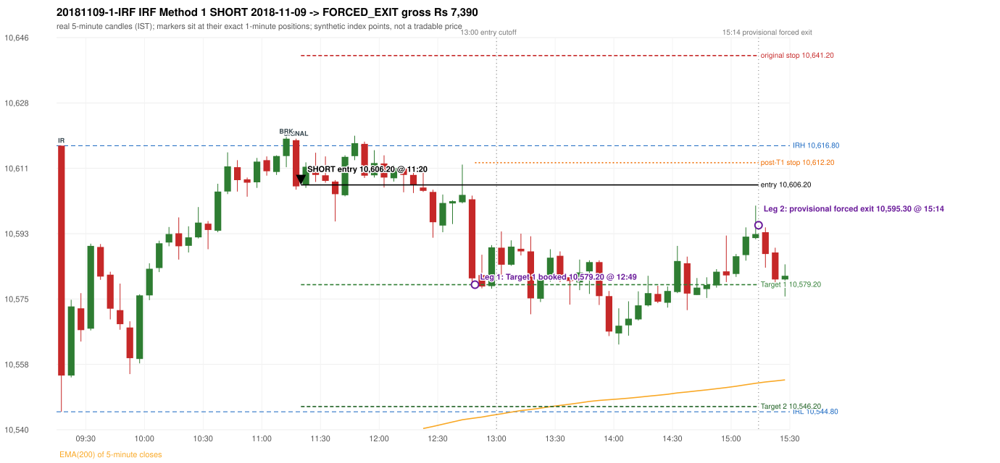

# Trading journal - 2018-11-09 (Friday)

> Phase 4 historical validation, window C (Window C 2018-01-01..2018-12-31 (secondary vendor minutes); status EXPLORATORY). The FROZEN Phase 3.6 configuration (IRF, ORB, PDR body-based, PDS, RF; shared controller) on a different data source. HISTORICAL RESEARCH ONLY: the strategy was developed using later data. the only minute source for 2018 is the secondary vendor; 5paisa returns no minute data before 2019-03-01, so there is NO overlap with another vendor to check it against Synthetic NIFTY 50 index-point P&L (the index is not tradable). The owner's review status is intentionally blank.

## A. Trading day overview

| item | value |
|---|---|
| Date / weekday | 2018-11-09 / Friday |
| Session type | USABLE_WITH_FLAGS / VALID |
| Original session open (first 1-minute open) | 10,616.80 |
| Previous session | 2018-11-06 |
| Previous-day high / low (wicks included) | 10,600.20 / 10,491.40 |
| Previous-day highest BODY high (the body-based PDR ceiling; wicks ignored) | 10,593.60 |
| Previous-day official close / last 5-minute close | 10,530.00 / 10,520.80 |
| Raw engine records / confirmed signals / fully valid signals | 6 / 2 / 2 |
| Setups that did not complete (invalidated / incomplete) | 0 |
| Executed trades | 1 20181109-1-IRF |
| Gross P&L (Rs, synthetic) | 7,390.50 |
| Illustrative net P&L (Rs; Rs 500/trade + 0.5 pt/fill) | 6,500.50 |
| Day-end portfolio status | DAY_FINISHED |
| Manual journal trades (matched / unmatched) | 0 (0 / 0) |
| Extra automated trades | 0 |

## B. Daily strategy signal timeline (confirmed signals, chronological)

| time | strategy | method | dir | entry-rule status | valid for execution | <= 13:00 | portfolio state | accepted / ignored | specific reason | competing (same minute) |
|---|---|---|---|---|---|---|---|---|---|---|
| 11:20 | IRF | Method 1 | SHORT | PROPOSAL_DEPENDENT | True | True | FIRST_TRADE_ACTIVE | ACCEPTED -> 20181109-1-IRF | first eligible signal of the day; trade 1: FORCED_EXIT |  |
| 11:55 | IRF | Method 1 | SHORT | PROPOSAL_DEPENDENT | True | True | FIRST_TRADE_ACTIVE | IGNORED | POSITION_ACTIVE (signal kept for diagnostics only; never reused) [blocked by IRF#1] |  |

Engine setups that did not complete (4); the complete list with failed rule ids is in `rejected_signals.csv`:

| candle | strategy | method | dir | status | precise reason | failed rules |
|---|---|---|---|---|---|---|
|  | ORB | ALL | BOTH | NOT_EVALUATED | PREV_SESSION_UNVERIFIED(PREV_SESSION_GAP_UNVERIFIED:2018-11-07; PREV_CLOSE_DAY_DIFFERS_FROM_PREV_SESSION(2018-11-06)) |  |
|  | PDR | ALL | LONG | NOT_EVALUATED | PREV_SESSION_UNVERIFIED(PREV_SESSION_GAP_UNVERIFIED:2018-11-07; PREV_CLOSE_DAY_DIFFERS_FROM_PREV_SESSION(2018-11-06)) |  |
|  | PDS | ALL | SHORT | NOT_EVALUATED | PREV_SESSION_UNVERIFIED(PREV_SESSION_GAP_UNVERIFIED:2018-11-07; PREV_CLOSE_DAY_DIFFERS_FROM_PREV_SESSION(2018-11-06)) |  |
|  | RF | ALL | LONG | NOT_EVALUATED | PREV_SESSION_UNVERIFIED(PREV_SESSION_GAP_UNVERIFIED:2018-11-07; PREV_CLOSE_DAY_DIFFERS_FROM_PREV_SESSION(2018-11-06)) |  |

## C. Detailed trade journals

### 20181109-1-IRF: IRF Method 1 SHORT (FIRST trade)

Chart: 

**Rule configuration:** CFG-phase36_body_based-866f954e55 - signal verification status **PROPOSAL_DEPENDENT** (never VERIFIED while a rule rests on a proposal).

#### 1. Setup identification

IRF Method 1 SHORT: the completed 11:10 candle closed at 10,618.70, 1.90 points above the initial range high 10,616.80 (range [10,544.80, 10,616.80] from the 09:15 candle); the immediately following completed 11:15 candle closed at 10,605.80, back inside the range. The short signal was confirmed at 11:20 on that close. Entry reference close 10,605.80 is 11.00 points below IRH 10,616.80.

#### 2. Candle and indicator calculations

| role | session | candle | O | H | L | C | range | body % | upper wick % | lower wick % | direction | EMA(200) | strong bull / bear | pin bull / bear | small (body<=30%) | used for |
|---|---|---|---|---|---|---|---|---|---|---|---|---|---|---|---|---|
| initial_range_candle | TODAY | 09:15-09:20 | 10,616.80 | 10,616.80 | 10,544.80 | 10,554.60 | 72.00 | 86.39 | 0.00 | 13.61 | BEARISH | 10,513.67 | False / True | False / False | False | initial range = high/low of the 09:15 candle |
| signal_candle | TODAY | 11:15-11:20 | 10,618.30 | 10,618.70 | 10,604.90 | 10,605.80 | 13.80 | 90.58 | 2.90 | 6.52 | BEARISH | 10,530.69 | False / True | False / False | False | candle whose close completed the trigger |
| breakout_candle | TODAY | 11:10-11:15 | 10,614.00 | 10,619.30 | 10,611.00 | 10,618.70 | 8.30 | 56.63 | 7.23 | 36.14 | BULLISH | 10,529.93 | False / False | False / False | False | breakout candle: a completed candle closing above IRH |

Every condition, with the rule, the calculation, the observed values and the result:

| # | group | rule | result | status / numeric definition | calculation | observed | required | available at | why it matters |
|---|---|---|---|---|---|---|---|---|---|
| 1 | SELECTION | SEL-FIRST-001 | PASS | USER_APPROVED / USER_APPROVED | earliest CONFIRMED signal of the day across IRF/ORB/PDR/PDS/RF that passed the controller's checks | 0 confirmed signal(s) earlier today; 2 confirmed signals in the day in total, this one at 11:20 | no earlier executable signal | 2018-11-09 11:20 | the shared controller trades only the first valid signal; the five strategies are not independent positions |
| 2 | SELECTION | SEL-TIE-001 | PASS | USER_APPROVED / USER_APPROVED | other CONFIRMED signals with exactly the same confirmation timestamp | none | no different-strategy / opposite-direction signal in the same minute (otherwise an unresolved conflict, no trade) | 2018-11-09 11:20 | an unresolved same-minute collision would have produced no trade at all |
| 3 | SELECTION | ENTRY-CUTOFF-001 | PASS | USER_APPROVED / USER_APPROVED | fill timestamp vs 13:00:00 IST | signal confirmed 11:20; fill 11:20 | fill at or before 13:00:00 IST | 2018-11-09 11:20 | no new position may be entered with a fill after 13:00 IST |
| 4 | SELECTION | EXE-FILL-001 | PASS | PROPOSED_FOR_REVIEW / PROPOSED_FOR_REVIEW | fill = open of the 1-minute bar that starts at the signal candle's end | bar 11:20 O 10,606.20 H 10,607.90 L 10,605.40 C 10,606.80; executable=True; entry 10,606.20 | fill bar exists, starts exactly at the signal end, is fillable; entry = its open | 2018-11-09 11:20 | a 5-minute signal is known only when its candle closes; the first price that can be traded is the next minute's open |
| 5 | SELECTION | DAY-MAX-001 | PASS | USER_APPROVED / USER_APPROVED | number of entries today | trade 1 of at most 2 | <= 2 entries per day | 2018-11-09 11:20 | daily trade cap |
| 6 | SETUP | IRF-GLOBAL-001 | PASS | SOURCE_VERIFIED / EXPLICIT_IN_SOURCE | initial range = high and low (wicks included) of the first completed 5-minute candle | 09:15-09:20 IRH 10,616.80, IRL 10,544.80 (range 72.00; engine recorded IRH 10,616.80, IRL 10,544.80) | high/low of the 09:15-09:20 candle | 2018-11-09 09:20 | all three IRF methods measure price against this range |
| 7 | SETUP | IRF-GLOBAL-003 | PASS | SOURCE_VERIFIED / EXPLICIT_IN_SOURCE | closes confirm, wicks do not: every trigger is evaluated on a completed 5-minute candle | trigger candle 11:15-11:20 was complete when the signal was stamped 11:20; decision uses its close 10,605.80 | completed candle close, not an intra-candle wick | 2018-11-09 11:20 | an intra-candle wick can reverse before the candle closes |
| 8 | SETUP | IRF-GLOBAL-002 | PASS | SOURCE_VERIFIED / EXPLICIT_IN_SOURCE | direction | SHORT (IRF trades short only) | short only | 2018-11-09 11:20 | IRF fades failed upside breakouts |
| 9 | SETUP | IRF-M1-001 | PASS | SOURCE_VERIFIED / EXPLICIT_IN_SOURCE | breakout candle close vs IRH | 11:10-11:15 O 10,614.00 H 10,619.30 L 10,611.00 C 10,618.70; range 8.30, body 4.70 (56.63%), upper wick 0.60 (7.23%), lower wick 3.00 (36.14%), bullish; close 10,618.70 is 1.90 points above IRH 10,616.80 | close > IRH (a wick above IRH is not a breakout) | 2018-11-09 11:15 | starts every IRF setup |
| 10 | CONFIRMATION | IRF-M1-002 | PASS | SOURCE_VERIFIED / EXPLICIT_IN_SOURCE | candle after the breakout closes back inside [IRL, IRH) | 11:15-11:20 O 10,618.30 H 10,618.70 L 10,604.90 C 10,605.80; range 13.80, body 12.50 (90.58%), upper wick 0.40 (2.90%), lower wick 0.90 (6.52%), bearish; close 10,605.80 vs range [10,544.80, 10,616.80) | IRL <= close < IRH | 2018-11-09 11:20 | the failed breakout: price could not hold above the opening range |
| 11 | CONFIRMATION | IRF-M1-004 | PASS | SOURCE_VERIFIED / EXPLICIT_IN_SOURCE | failure candle is the candle immediately after the breakout (k = 1) | breakout 11:10, failure candle 11:15: k = 1 | k = 1 (pp.5, 6, 13); the p.14 'next or following' reading (IRF-M1-C001) is CONFLICTING and not used in the baseline | 2018-11-09 11:20 | the guide's worked example enters at the close of the very next candle; no support/resistance break is required |
| 12 | EXECUTION | EXE-STOP-001 | PASS | USER_APPROVED / USER_APPROVED | initial stop = entry + 35 points | entry 10,606.20 -> stop 10,641.20 | stop 35 index points (BASELINE) | 2018-11-09 11:20 | defines the loss if the setup fails before Target 1 |
| 13 | EXECUTION | EXE-T1-001 | PASS | SOURCE_VERIFIED / EXPLICIT_IN_SOURCE | Target 1 = entry +/- 27 points | T1 10,579.20 | 27 points | 2018-11-09 11:20 | Leg 1 (3 lots) is booked at Target 1 |
| 14 | EXECUTION | IRF-TGT-001 | PASS | SOURCE_VERIFIED / EXPLICIT_IN_SOURCE | Target 2 = entry +/- 60 points | T2 10,546.20 | 60 points | 2018-11-09 11:20 | Leg 2 (3 lots) is booked at Target 2 |
| 15 | EXECUTION | POST-T1-STOP-006 | PASS | USER_APPROVED / USER_APPROVED | after T1 the Leg-2 stop = entry + 6 (no trailing) | post-T1 stop 10,612.20 | entry -6 (LONG) / +6 (SHORT) | 2018-11-09 11:20 | protects the remaining three lots once the first three are booked |
| 16 | EXECUTION | SIZE-LOT-001 | PASS | USER_APPROVED / USER_APPROVED | 6 lots x 65 = 390, Leg 1 = 3 lots = 195, Leg 2 = 195 | 6 lots, lot size 65, legs 3+3 | 6 lots in two equal legs | 2018-11-09 11:20 | position size for the synthetic P&L |
| 17 | NOTE | IRF-GLOBAL-004 | UNRESOLVED | UNRESOLVED / UNRESOLVED | which close above IRH of the session produced this attempt; repeat setups | this breakout is upward crossing no. 1 of the session (a close above IRH after a close at/below it) | the source states no first-breakout-only, re-arming, expiry or trades-per-day rule | 2018-11-09 11:20 | IRF re-arms on every later breakout in the code, producing many raw setups; the controller keeps only the first |
| 18 | NOTE | NOTE-IRF-REPEATED-SETUPS | NOT_APPLICABLE | NOT_A_RULE / NOT_A_REGISTRY_RULE | other IRF signals later in the session (not traded) | 1 further confirmed IRF signal(s): Method 1@11:55 | disclosure of repeated raw setups | 2018-11-09 11:20 | repeated raw IRF setups are not hidden; they are logged as ignored |
| 19 | NOTE | IRF-SL-001 | NOT_APPLICABLE | SOURCE_VERIFIED / QUALITATIVE_SOURCE_NUMERIC_DEFINITION_PROPOSED_FOR_REVIEW | the guide's 35-or-40 rule: 35 if the most recent green candle's high is within 35 points of entry, else 40 | most recent green candle high 10,619.30 is 13.10 points from the entry 10,606.20: the guide's rule would select 35 points; the baseline applies a fixed 35 (USER_APPROVED research baseline; the 35-vs-40 selection and the 40-point variant are separate labelled scenarios) | source selection rule | 2018-11-09 11:20 | the stop distance is a modelling choice and changes losses, not entries |
| 20 | NOTE | NOTE-UNRESOLVED-DEPENDENCIES | UNRESOLVED | NOT_A_RULE / NOT_A_REGISTRY_RULE | rules the signal depends on that the sources leave unresolved | engine-recorded unresolved rule ids: IRF-GLOBAL-004; verification status PROPOSAL_DEPENDENT | n/a (disclosure) | 2018-11-09 11:20 | the entry is only as verified as the rules it rests on |

#### 3. Entry decision and explanation

IRF Method 1 SHORT: the completed 11:10 candle closed at 10,618.70, 1.90 points above the initial range high 10,616.80 (range [10,544.80, 10,616.80] from the 09:15 candle); the immediately following completed 11:15 candle closed at 10,605.80, back inside the range. The short signal was confirmed at 11:20 on that close. Entry reference close 10,605.80 is 11.00 points below IRH 10,616.80.

**Why this trade ahead of the other strategies:** This IRF Method 1 signal was the earliest executable signal of the day: 0 confirmed signal(s) earlier, 0 other in the same minute. 1 later confirmed signal(s) (IRF x1) are logged as ignored or rejected. State of the other four engines at that moment: [ORB: no setup record before this time (a base condition was not met, or nothing triggered)] [PDR: no setup record before this time (a base condition was not met, or nothing triggered)] [PDS: no setup record before this time (a base condition was not met, or nothing triggered)] [RF: no setup record before this time (a base condition was not met, or nothing triggered)]

#### 4. Actual entry execution

| item | value |
|---|---|
| Signal candle | 11:15-11:20 |
| Signal confirmed | 2018-11-09 11:20 |
| Fill timestamp | 2018-11-09 11:20 |
| Entry price | 10,606.20 |
| Source partition / 1-minute bar | data/phase4/processed/TECHNOVUS_1M/nifty50/year=2018/month=11/candles.parquet / 2018-11-09 11:20 |
| Source bar O / H / L / C | 10,606.20 / 10,607.90 / 10,605.40 / 10,606.80 |
| Fill assumption | open of the 1-minute bar starting at the signal candle's end (EXE-FILL-001, PROPOSED causal convention) |
| Initial stop / T1 / T2 / post-T1 stop | 10,641.20 / 10,579.20 / 10,546.20 / 10,612.20 |
| Position | 6 lots x 65 = 390 units (Leg 1 195, Leg 2 195) |

#### 5-8. Trade progress, Target 1, post-T1 stop and final exit

Between the 11:20 entry bar and the final exit (235 one-minute bars) the best excursion in favour was 43.20 points at 14:00 and the worst against was 13.30 points at 11:49. At 12:49 Target 1 booked three lots. At 12:49 the remaining three lots' protective stop was set to 10,612.20 (entry + 6; no trailing, no further change); the engine applies it from the Target-1 bar onward and tests it within that same bar. Neither the stop nor Target 2 was reached; at 15:14 the remaining lots were closed by the PROVISIONAL forced exit at the minute open 10,595.30.

| leg | qty | exit time | exit price | reason | source 1-minute bar | O / H / L / C | gross points | gross Rs | slippage pts | flags |
|---|---|---|---|---|---|---|---|---|---|---|
| 1 | 195 | 12:49 | 10,579.20 | TARGET_1 | 12:49 | 10,593.50 / 10,594.90 / 10,578.90 / 10,580.90 | 27.00 | 5,265.00 | 0.00 |  |
| 2 | 195 | 15:14 | 10,595.30 | FORCED_EXIT_1514_OPEN_PROVISIONAL | 15:14 | 10,595.30 / 10,596.40 / 10,591.70 / 10,592.90 | 10.90 | 2,125.50 | 0.00 | PROVISIONAL_FORCED_EXIT_15_14_OPEN |

Exit evidence per leg:

* Leg 1: 1-minute bar 12:49 O 10,593.50 H 10,594.90 L 10,578.90 C 10,580.90: low 10,578.90 reached Target 1 10,579.20; Leg 1 booked at the target level
* Leg 2: 1-minute bar 15:14 O 10,595.30 H 10,596.40 L 10,591.70 C 10,592.90: provisional forced exit at the OPEN of the 15:14 minute (10,595.30); neither Target 2 nor the stop was reached; sensitivity close of that minute 10,592.90 (not used)

#### 9. Gross and illustrative net P&L

| item | value (Rs) |
|---|---|
| Leg 1 gross | 5,265.00 |
| Leg 2 gross | 2,125.50 |
| Trade gross (= Leg 1 + Leg 2) | 7,390.50 |
| Illustrative fixed cost | -500.00 |
| Illustrative slippage (0.5 pt on every fill, entry + exits, all units) | -390.00 |
| Illustrative net | 6,500.50 |

#### 10. Manual journal comparison

No manual journal exists for this period; no comparison.

## D. Manual journal comparison

No manual journal exists for this period (the manual journal covers 2025-09-01 .. 2026-08-31 only); no comparison is made and no automated trade is labelled 'extra'.

## E. Daily conclusion

* **Traded:** 20181109-1-IRF - IRF Method 1 SHORT at 11:20 (entry 10,606.20), outcome FORCED_EXIT, gross Rs 7,390.50, illustrative net Rs 6,500.50. **Why:** This IRF Method 1 signal was the earliest executable signal of the day: 0 confirmed signal(s) earlier, 0 other in the same minute. 1 later confirmed signal(s) (IRF x1) are logged as ignored or rejected. State of the other four engines at that moment: [ORB: no setup record before this time (a base condition was not met, or nothing triggered)] [PDR: no setup record before this time (a base condition was not met, or nothing triggered)] [PDS: no setup record before this time (a base condition was not met, or nothing triggered)] [RF: no setup record before this time (a base condition was not met, or nothing triggered)] **How it ended:** At 12:49 Target 1 booked three lots. At 12:49 the remaining three lots' protective stop was set to 10,612.20 (entry + 6; no trailing, no further change); the engine applies it from the Target-1 bar onward and tests it within that same bar. Neither the stop nor Target 2 was reached; at 15:14 the remaining lots were closed by the PROVISIONAL forced exit at the minute open 10,595.30.
* **Ignored / rejected signals:** IRF IGNORED POSITION_ACTIVE x1
* **Partial strategy coverage:** some engines could not be evaluated on this day (ORB: PREV_SESSION_UNVERIFIED(PREV_SESSION_GAP_UNVERIFIED:2018-11-07; PREV_CLOSE_DAY_DIFFERS_FROM_PREV_SESSION(2018-11-06)) | PDR: PREV_SESSION_UNVERIFIED(PREV_SESSION_GAP_UNVERIFIED:2018-11-07; PREV_CLOSE_DAY_DIFFERS_FROM_PREV_SESSION(2018-11-06)) | PDS: PREV_SESSION_UNVERIFIED(PREV_SESSION_GAP_UNVERIFIED:2018-11-07; PREV_CLOSE_DAY_DIFFERS_FROM_PREV_SESSION(2018-11-06)) | RF: PREV_SESSION_UNVERIFIED(PREV_SESSION_GAP_UNVERIFIED:2018-11-07; PREV_CLOSE_DAY_DIFFERS_FROM_PREV_SESSION(2018-11-06))); no signal from them can exist, so a missing signal is not evidence of a non-setup.
* **Open strategy-definition issues that affected this day:** IRF-GLOBAL-004 (NOT STATED: how many IRF trades per day, a latest entry time, and whether a new breakout may re-arm a setup after a signal), NOTE-UNRESOLVED-DEPENDENCIES
* **Automated triage (not an approval; the owner's review status stays blank):** REVIEW: PROVISIONAL_FORCED_EXIT+PARTIAL_STRATEGY_COVERAGE
