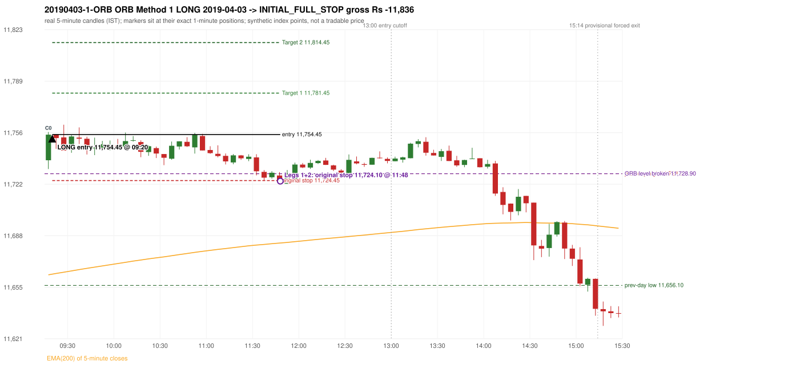
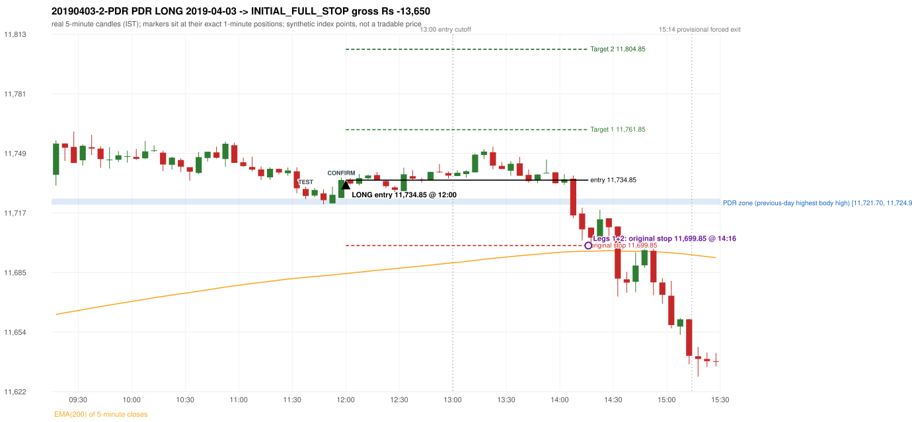

# Trading journal - 2019-04-03 (Wednesday)

> Phase 4 historical validation, window D_5P (Window D 2019-03-01..2019-12-31 (5paisa minutes, PARTIAL YEAR); status PARTIAL_YEAR). The FROZEN Phase 3.6 configuration (IRF, ORB, PDR body-based, PDS, RF; shared controller) on a different data source. HISTORICAL RESEARCH ONLY: the strategy was developed using later data. 5paisa minute coverage starts 2019-03-01 and lacks five sessions (2019-06-27, 06-28, 07-01, 07-02, 07-03); no minute warm-up exists before the first session Synthetic NIFTY 50 index-point P&L (the index is not tradable). The owner's review status is intentionally blank.

## A. Trading day overview

| item | value |
|---|---|
| Date / weekday | 2019-04-03 / Wednesday |
| Session type | USABLE_WITH_FLAGS / VALID |
| Original session open (first 1-minute open) | 11,737.70 |
| Previous session | 2019-04-02 |
| Previous-day high / low (wicks included) | 11,728.90 / 11,656.10 |
| Previous-day highest BODY high (the body-based PDR ceiling; wicks ignored) | 11,724.95 |
| Previous-day official close / last 5-minute close | 11,713.20 / 11,724.95 |
| Raw engine records / confirmed signals / fully valid signals | 5 / 2 / 2 |
| Setups that did not complete (invalidated / incomplete) | 3 |
| Executed trades | 2 20190403-1-ORB;20190403-2-PDR |
| Gross P&L (Rs, synthetic) | -25,486.50 |
| Illustrative net P&L (Rs; Rs 500/trade + 0.5 pt/fill) | -27,266.50 |
| Day-end portfolio status | DAY_FINISHED |
| Manual journal trades (matched / unmatched) | 0 (0 / 0) |
| Extra automated trades | 0 |

## B. Daily strategy signal timeline (confirmed signals, chronological)

| time | strategy | method | dir | entry-rule status | valid for execution | <= 13:00 | portfolio state | accepted / ignored | specific reason | competing (same minute) |
|---|---|---|---|---|---|---|---|---|---|---|
| 09:20 | ORB | Method 1 | LONG | PROPOSAL_DEPENDENT | True | True | FIRST_TRADE_ACTIVE | ACCEPTED -> 20190403-1-ORB | first eligible signal of the day; trade 1: INITIAL_FULL_STOP |  |
| 12:00 | PDR | PDR | LONG | RESEARCH_VARIANT | True | True | SECOND_TRADE_ACTIVE | ACCEPTED -> 20190403-2-PDR | permitted second trade: newly confirmed PDR/PDS after the original full stop; trade 2: INITIAL_FULL_STOP |  |

Engine setups that did not complete (3); the complete list with failed rule ids is in `rejected_signals.csv`:

| candle | strategy | method | dir | status | precise reason | failed rules |
|---|---|---|---|---|---|---|
| 09:15 | ORB | Method 2 | LONG | INVALIDATED | TRENDLINE_NOT_SUPPORTIVE | ORB-M2-LONG-001 |
| 14:05 | PDR | PDR | LONG | INCOMPLETE_AT_EOD | NO_QUALIFYING_CONFIRMATION_BEFORE_SESSION_END |  |
| 11:55 | RF | RF | LONG | INVALIDATED | GAP_UP_OUTSIDE_YESTERDAYS_RANGE | RF-004 |

## C. Detailed trade journals

### 20190403-1-ORB: ORB Method 1 LONG (FIRST trade)

Chart: 

**Rule configuration:** CFG-phase36_body_based-866f954e55 - signal verification status **PROPOSAL_DEPENDENT** (never VERIFIED while a rule rests on a proposal).

#### 1. Setup identification

ORB Method 1 LONG: the first completed 5-minute candle (09:15-09:20) closed at 11,754.40, 25.50 points above the previous-day high 11,728.90; its body occupied 69.15% of its range and its upper wick 7.04% (thresholds 60% / 20%): the strong-bullish candle test passed; the EMA-only trend filter passed. Entry decision at 09:20.

#### 2. Candle and indicator calculations

| role | session | candle | O | H | L | C | range | body % | upper wick % | lower wick % | direction | EMA(200) | strong bull / bear | pin bull / bear | small (body<=30%) | used for |
|---|---|---|---|---|---|---|---|---|---|---|---|---|---|---|---|---|
| first_candle | TODAY | 09:15-09:20 | 11,737.70 | 11,756.10 | 11,731.95 | 11,754.40 | 24.15 | 69.15 | 7.04 | 23.81 | BULLISH | 11,663.01 | True / False | False / False | False | the 09:15 first five-minute candle - the ORB decision candle |
| prev_day_extreme_candle | PREVIOUS | 15:20-15:25 | 11,723.35 | 11,728.90 | 11,719.15 | 11,721.25 | 9.75 | 21.54 | 56.92 | 21.54 | BEARISH | 11,661.46 | False / False | False / True | True | candle that made the previous session's high/low used as the level |
| prev_session_last_candle | PREVIOUS | 15:25-15:30 | 11,721.70 | 11,724.95 | 11,716.40 | 11,724.95 | 8.55 | 38.01 | 0.00 | 61.99 | BULLISH | 11,662.09 | False / False | False / False | False | trend: previous session's last 5-minute close vs its EMA(200) |

Every condition, with the rule, the calculation, the observed values and the result:

| # | group | rule | result | status / numeric definition | calculation | observed | required | available at | why it matters |
|---|---|---|---|---|---|---|---|---|---|
| 1 | SELECTION | SEL-FIRST-001 | PASS | USER_APPROVED / USER_APPROVED | earliest CONFIRMED signal of the day across IRF/ORB/PDR/PDS/RF that passed the controller's checks | 0 confirmed signal(s) earlier today; 2 confirmed signals in the day in total, this one at 09:20 | no earlier executable signal | 2019-04-03 09:20 | the shared controller trades only the first valid signal; the five strategies are not independent positions |
| 2 | SELECTION | SEL-TIE-001 | PASS | USER_APPROVED / USER_APPROVED | other CONFIRMED signals with exactly the same confirmation timestamp | none | no different-strategy / opposite-direction signal in the same minute (otherwise an unresolved conflict, no trade) | 2019-04-03 09:20 | an unresolved same-minute collision would have produced no trade at all |
| 3 | SELECTION | ENTRY-CUTOFF-001 | PASS | USER_APPROVED / USER_APPROVED | fill timestamp vs 13:00:00 IST | signal confirmed 09:20; fill 09:20 | fill at or before 13:00:00 IST | 2019-04-03 09:20 | no new position may be entered with a fill after 13:00 IST |
| 4 | SELECTION | EXE-FILL-001 | PASS | PROPOSED_FOR_REVIEW / PROPOSED_FOR_REVIEW | fill = open of the 1-minute bar that starts at the signal candle's end | bar 09:20 O 11,754.45 H 11,754.45 L 11,749.75 C 11,753.25; executable=True; entry 11,754.45 | fill bar exists, starts exactly at the signal end, is fillable; entry = its open | 2019-04-03 09:20 | a 5-minute signal is known only when its candle closes; the first price that can be traded is the next minute's open |
| 5 | SELECTION | DAY-MAX-001 | PASS | USER_APPROVED / USER_APPROVED | number of entries today | trade 1 of at most 2 | <= 2 entries per day | 2019-04-03 09:20 | daily trade cap |
| 6 | SETUP | ORB-GLOBAL-001 | PASS | SOURCE_VERIFIED / EXPLICIT_IN_SOURCE | decision is taken once the first 5-minute candle (09:15-09:20) has closed | candle 09:15-09:20; signal confirmed 09:20 | decision at 09:20, never before the close | 2019-04-03 09:20 | the close of the first candle is unknown before 09:20 |
| 7 | SETUP | ORB-GLOBAL-002 | PASS | SOURCE_VERIFIED / EXPLICIT_IN_SOURCE | direction | LONG | same rules in both directions | 2019-04-03 09:20 | ORB trades the side of the break |
| 8 | SETUP | ORB-GLOBAL-004 | PASS | SOURCE_VERIFIED / QUALITATIVE_SOURCE_NUMERIC_DEFINITION_PROPOSED_FOR_REVIEW | entry at 09:20, after the first-candle close | signal confirmed 09:20; fill 09:20 at the open of that minute | 09:20 entry | 2019-04-03 09:20 | the guide enters at 9:20; the fill price convention (next minute open) is a proposal |
| 9 | SETUP | ORB-M1-LONG-001 | PASS | SOURCE_VERIFIED / QUALITATIVE_SOURCE_NUMERIC_DEFINITION_PROPOSED_FOR_REVIEW | prev_day_high = the highest high of all 5-minute candles of the previous session 2019-04-02 | previous-day high 11,728.90 (set by the 15:20 candle; previous session range 11,656.10 - 11,728.90; engine recorded 11,728.90) | previous-day resistance (long) / support (short) | 2019-04-02 15:25 | a mechanical proxy for the guide's hand-drawn previous-day level; the source charts show multi-session boxes (documented difference) |
| 10 | SETUP | ORB-M1-LONG-002 | PASS | SOURCE_VERIFIED / EXPLICIT_IN_SOURCE | the first candle breaks and closes beyond the level | high 11,756.10 / low 11,731.95, close 11,754.40: 25.50 points beyond 11,728.90 | high and close > level | 2019-04-03 09:20 | a wick alone is not a breakout; the close decides |
| 11 | TREND | ORB-TREND-001 | PASS | SOURCE_VERIFIED / QUALITATIVE_SOURCE_NUMERIC_DEFINITION_PROPOSED_FOR_REVIEW | previous session's final completed 5-minute candle: close vs its EMA(200 of 5-minute closes) | previous session 2019-04-02 last candle 15:25-15:30 close 11,724.95 vs EMA(200) 11,662.09: 62.86 points above the EMA -> trend bullish (EMA_PREV_SESSION_CLOSE; research variant A, EMA-only) | close > EMA(200) | 2019-04-02 15:30 | the opening gap can never create the trend: only information that existed before today's open is used |
| 12 | TREND | ORB-TREND-002 | PASS | SOURCE_VERIFIED / QUALITATIVE_SOURCE_NUMERIC_DEFINITION_PROPOSED_FOR_REVIEW | price location versus the 200 EMA is the basic confirmation; structure is only 'supporting' | 62.86 points above the EMA(200) on the previous session's last 5-minute close; swing structure not used in variant A | price on the trend side of the 200 EMA | 2019-04-02 15:30 | the rulebook calls EMA position 'a basic confirmation, supported by bullish structure'; the structure part has no numeric definition |
| 13 | TREND | TREND-SWING-001 | NOT_APPLICABLE | PROPOSED_FOR_REVIEW / PROPOSED_FOR_REVIEW | confirmed swing structure | not required by the active trend variant (variant A is the EMA price location only) | n/a | 2019-04-02 15:30 | variant B would additionally require higher-high/higher-low swings; it is a separate labelled scenario |
| 14 | CONFIRMATION | ORB-M1-LONG-003 | PASS | SOURCE_VERIFIED / QUALITATIVE_SOURCE_NUMERIC_DEFINITION_PROPOSED_FOR_REVIEW | candle quality: strong body and limited opposite wick (or the conditional pin bar) | 09:15-09:20 O 11,737.70 H 11,756.10 L 11,731.95 C 11,754.40; range 24.15, body 16.70 (69.15%), upper wick 1.70 (7.04%), lower wick 5.75 (23.81%), bullish. Strong-bullish test: bullish close, body >= 60% (observed 69.15%), upper wick <= 20% (observed 7.04%) -> PASS | strong candle (research thresholds) or pin bar | 2019-04-03 09:20 | the guide asks for a 'strong body, small wick' but gives no numbers; the thresholds are proposals |
| 15 | EXECUTION | ORB-GLOBAL-003 | PASS | SOURCE_VERIFIED / EXPLICIT_IN_SOURCE | initial stop = entry - 30 points | entry 11,754.45 -> stop 11,724.45 | stop 30 index points (BASELINE) | 2019-04-03 09:20 | defines the loss if the setup fails before Target 1 |
| 16 | EXECUTION | EXE-T1-001 | PASS | SOURCE_VERIFIED / EXPLICIT_IN_SOURCE | Target 1 = entry +/- 27 points | T1 11,781.45 | 27 points | 2019-04-03 09:20 | Leg 1 (3 lots) is booked at Target 1 |
| 17 | EXECUTION | ORB-GLOBAL-003 | PASS | SOURCE_VERIFIED / EXPLICIT_IN_SOURCE | Target 2 = entry +/- 60 points | T2 11,814.45 | 60 points | 2019-04-03 09:20 | Leg 2 (3 lots) is booked at Target 2 |
| 18 | EXECUTION | POST-T1-STOP-006 | PASS | USER_APPROVED / USER_APPROVED | after T1 the Leg-2 stop = entry - 6 (no trailing) | post-T1 stop 11,748.45 | entry -6 (LONG) / +6 (SHORT) | 2019-04-03 09:20 | protects the remaining three lots once the first three are booked |
| 19 | EXECUTION | SIZE-LOT-001 | PASS | USER_APPROVED / USER_APPROVED | 6 lots x 65 = 390, Leg 1 = 3 lots = 195, Leg 2 = 195 | 6 lots, lot size 65, legs 3+3 | 6 lots in two equal legs | 2019-04-03 09:20 | position size for the synthetic P&L |
| 20 | NOTE | ORB-MA-001 | UNRESOLVED | CONFLICTING / CONFLICTING | which moving average the code uses | EMA(200) of 5-minute closes (the guide says '200 DMA' in some places and '200 EMA' in others); active ma_mode EMA200_5M | the source terminology conflicts | 2019-04-03 09:20 | a daily 200 DMA would give different values |
| 21 | NOTE | NOTE-UNRESOLVED-DEPENDENCIES | UNRESOLVED | NOT_A_RULE / NOT_A_REGISTRY_RULE | rules the signal depends on that the sources leave unresolved | engine-recorded unresolved rule ids: ORB-MA-001; verification status PROPOSAL_DEPENDENT | n/a (disclosure) | 2019-04-03 09:20 | the entry is only as verified as the rules it rests on |

#### 3. Entry decision and explanation

ORB Method 1 LONG: the first completed 5-minute candle (09:15-09:20) closed at 11,754.40, 25.50 points above the previous-day high 11,728.90; its body occupied 69.15% of its range and its upper wick 7.04% (thresholds 60% / 20%): the strong-bullish candle test passed; the EMA-only trend filter passed. Entry decision at 09:20.

**Why this trade ahead of the other strategies:** This ORB Method 1 signal was the earliest executable signal of the day: 0 confirmed signal(s) earlier, 0 other in the same minute. 1 later confirmed signal(s) (PDR x1) are logged as ignored or rejected. State of the other four engines at that moment: [IRF: no setup record before this time (a base condition was not met, or nothing triggered)] [PDR: no setup record before this time (a base condition was not met, or nothing triggered)] [PDS: no setup record before this time (a base condition was not met, or nothing triggered)] [RF: no setup record before this time (a base condition was not met, or nothing triggered)]

#### 4. Actual entry execution

| item | value |
|---|---|
| Signal candle | 09:15-09:20 |
| Signal confirmed | 2019-04-03 09:20 |
| Fill timestamp | 2019-04-03 09:20 |
| Entry price | 11,754.45 |
| Source partition / 1-minute bar | data/phase4/processed/FIVEPAISA_1M_PHASE4/nifty50/year=2019/month=04/candles.parquet / 2019-04-03 09:20 |
| Source bar O / H / L / C | 11,754.45 / 11,754.45 / 11,749.75 / 11,753.25 |
| Fill assumption | open of the 1-minute bar starting at the signal candle's end (EXE-FILL-001, PROPOSED causal convention) |
| Initial stop / T1 / T2 / post-T1 stop | 11,724.45 / 11,781.45 / 11,814.45 / 11,748.45 |
| Position | 6 lots x 65 = 390 units (Leg 1 195, Leg 2 195) |

#### 5-8. Trade progress, Target 1, post-T1 stop and final exit

Between the 09:20 entry bar and the final exit (149 one-minute bars) the best excursion in favour was 6.40 points at 09:27 and the worst against was 32.35 points at 11:48. At 11:48 price reached the original stop 11,724.45 before Target 1 11,781.45, so all six lots exited together at 11,724.10 (gap through the stop, slippage 0.35 points). This is an INITIAL_FULL_STOP: one more trade is allowed that day, only a newly confirmed PDR/PDS signal.

| leg | qty | exit time | exit price | reason | source 1-minute bar | O / H / L / C | gross points | gross Rs | slippage pts | flags |
|---|---|---|---|---|---|---|---|---|---|---|
| 1 | 195 | 11:48 | 11,724.10 | ORIGINAL_STOP_BEFORE_T1 | 11:48 | 11,724.10 / 11,724.95 / 11,722.10 / 11,723.40 | -30.35 | -5,918.25 | 0.35 |  |
| 2 | 195 | 11:48 | 11,724.10 | ORIGINAL_STOP_BEFORE_T1 | 11:48 | 11,724.10 / 11,724.95 / 11,722.10 / 11,723.40 | -30.35 | -5,918.25 | 0.35 |  |

Exit evidence per leg:

* Leg 1: 1-minute bar 11:48 O 11,724.10 H 11,724.95 L 11,722.10 C 11,723.40: low 11,722.10 reached the original stop 11,724.45 before Target 1 11,781.45 was touched; both legs exit at 11,724.10 (gap through the stop: bar open 11,724.10 is worse than the stop; adverse slippage 0.35 points)
* Leg 2: 1-minute bar 11:48 O 11,724.10 H 11,724.95 L 11,722.10 C 11,723.40: low 11,722.10 reached the original stop 11,724.45 before Target 1 11,781.45 was touched; both legs exit at 11,724.10 (gap through the stop: bar open 11,724.10 is worse than the stop; adverse slippage 0.35 points)

#### 9. Gross and illustrative net P&L

| item | value (Rs) |
|---|---|
| Leg 1 gross | -5,918.25 |
| Leg 2 gross | -5,918.25 |
| Trade gross (= Leg 1 + Leg 2) | -11,836.50 |
| Illustrative fixed cost | -500.00 |
| Illustrative slippage (0.5 pt on every fill, entry + exits, all units) | -390.00 |
| Illustrative net | -12,726.50 |

#### 10. Manual journal comparison

No manual journal exists for this period; no comparison.

### 20190403-2-PDR: PDR LONG (SECOND trade)

Chart: 

**Rule configuration:** CFG-phase36_body_based-866f954e55 - signal verification status **RESEARCH_VARIANT** (never VERIFIED while a rule rests on a proposal).

#### 1. Setup identification

PDR LONG (body-based engine, A_HIGHEST_BODY_HIGH): the session opened 24.50 points above the previous close and 12.75 points above the previous-day highest BODY high 11,724.95 (zone [11,721.70, 11,724.95] from the 15:25 candle of 2019-04-02; the highest wick 11,728.90 is ignored). The 11:35 candle (11,724.65 - 11,731.30) tested the zone; the 11:55 candle (green, O 11,725.30 H 11,736.15 L 11,725.30 C 11,734.90) passed GOOD_GREEN_BODY and closed 9.95 points above the zone ceiling, confirming the entry at 12:00. The pattern thresholds and the zone's lower boundary are provisional research assumptions, not approved by the strategy author.

#### 2. Candle and indicator calculations

| role | session | candle | O | H | L | C | range | body % | upper wick % | lower wick % | direction | EMA(200) | strong bull / bear | pin bull / bear | small (body<=30%) | used for |
|---|---|---|---|---|---|---|---|---|---|---|---|---|---|---|---|---|
| zone_source_candle | PREVIOUS | 15:25-15:30 | 11,721.70 | 11,724.95 | 11,716.40 | 11,724.95 | 8.55 | 38.01 | 0.00 | 61.99 | BULLISH | 11,662.09 | False / False | False / False | False | candle of the previous session's highest BODY high (A_HIGHEST_BODY_HIGH) |
| prev_day_wick_high_candle | PREVIOUS | 15:20-15:25 | 11,723.35 | 11,728.90 | 11,719.15 | 11,721.25 | 9.75 | 21.54 | 56.92 | 21.54 | BEARISH | 11,661.46 | False / False | False / True | True | candle of the previous session's highest WICK (ignored by the author's rule; shown for comparison) |
| interaction_candle | TODAY | 11:35-11:40 | 11,730.10 | 11,731.30 | 11,724.65 | 11,726.35 | 6.65 | 56.39 | 18.05 | 25.56 | BEARISH | 11,682.82 | False / False | False / False | False | first candle whose range overlaps the zone (the test) |
| confirmation_candle | TODAY | 11:55-12:00 | 11,725.30 | 11,736.15 | 11,725.30 | 11,734.90 | 10.85 | 88.48 | 11.52 | 0.00 | BULLISH | 11,684.63 | True / False | False / False | False | candle that satisfies one of the three patterns and closes above the zone ceiling |

Every condition, with the rule, the calculation, the observed values and the result:

| # | group | rule | result | status / numeric definition | calculation | observed | required | available at | why it matters |
|---|---|---|---|---|---|---|---|---|---|
| 1 | SELECTION | DAY-SL-001 | PASS | USER_APPROVED / USER_APPROVED | first trade outcome, strategy of this signal, position-close time vs this signal's timestamp | first trade ORB Method 1 closed as INITIAL_FULL_STOP at 11:48; position free from 11:49; this PDR signal confirmed 12:00 | first trade INITIAL_FULL_STOP before Target 1, and a NEWLY confirmed PDR/PDS signal after the first position closed | 2019-04-03 12:00 | the only way a second trade is allowed |
| 2 | SELECTION | DAY-NOREUSE-001 | PASS | USER_APPROVED / USER_APPROVED | signals confirmed while the first position was open | 1 signal(s) were ignored during the first trade (never reused): ORB Method 1 LONG @09:20 | this trade comes from a signal confirmed after the first exit, not from an ignored one | 2019-04-03 12:00 | an ignored signal can never become the second trade |
| 3 | SELECTION | ENTRY-CUTOFF-001 | PASS | USER_APPROVED / USER_APPROVED | fill timestamp vs 13:00:00 IST | signal confirmed 12:00; fill 12:00 | fill at or before 13:00:00 IST | 2019-04-03 12:00 | no new position may be entered with a fill after 13:00 IST |
| 4 | SELECTION | EXE-FILL-001 | PASS | PROPOSED_FOR_REVIEW / PROPOSED_FOR_REVIEW | fill = open of the 1-minute bar that starts at the signal candle's end | bar 12:00 O 11,734.85 H 11,735.90 L 11,733.15 C 11,734.90; executable=True; entry 11,734.85 | fill bar exists, starts exactly at the signal end, is fillable; entry = its open | 2019-04-03 12:00 | a 5-minute signal is known only when its candle closes; the first price that can be traded is the next minute's open |
| 5 | SELECTION | DAY-MAX-001 | PASS | USER_APPROVED / USER_APPROVED | number of entries today | trade 2 of at most 2 | <= 2 entries per day | 2019-04-03 12:00 | daily trade cap |
| 6 | SETUP | PDR-004 | PASS | SOURCE_VERIFIED / EXPLICIT_WORDING_DETAIL_PROPOSED_FOR_REVIEW | gap = first 1-minute open of today - previous session's OFFICIAL close | today's open 11,737.70 (first 1-minute bar 09:15) - previous close 11,713.20 (DAILY_VENDOR, 2019-04-02) = +24.50 points -> gap UP | gap UP (more than 0 points) | 2019-04-03 09:15 | approved convention: the original first-minute open, never the vendor daily open |
| 7 | SETUP | PDR-B03 | PASS | AUTHOR_APPROVED / AUTHOR_STATEMENT_NUMERIC_DETAILS_ARE_SEPARATE_PROPOSED_ROWS | the session opens strictly above the previous day's resistance zone (author-approved) | today's first 1-minute open 11,737.70 vs zone ceiling 11,724.95: 12.75 points above (open - ceiling = +12.75) | open > zone ceiling (equal or inside the zone rejects the setup) | 2019-04-03 09:15 | the original first-minute open is used, never a vendor daily open |
| 8 | ZONE | PDR-001 | PASS | SOURCE_VERIFIED / EXPLICIT_IN_SOURCE | direction | LONG (PDR is long only) | long-only | 2019-04-03 12:00 | PDR buys a retest of previous-day resistance after a gap up |
| 9 | ZONE | PDR-B01a | PASS | AUTHOR_APPROVED / AUTHOR_STATEMENT_NUMERIC_DETAILS_ARE_SEPARATE_PROPOSED_ROWS | wicks ignored, bodies considered: body_high = max(open, close) of every completed previous-session 5-minute candle; ceiling = the highest body_high; floor = body low of that candle | previous session 2019-04-02: highest body high 11,724.95 on the 15:25 candle (O 11,721.70 C 11,724.95; wick high of that candle 11,724.95, ignored); four highest body highs: 11,724.95 (15:25); 11,723.35 (15:20); 11,722.90 (15:15); 11,712.00 (12:45). Highest WICK of the session 11,728.90 (15:20 candle) is 3.95 points above the ceiling and plays no part. Zone [11,721.70 (body low), 11,724.95 (body high)]; engine recorded [11,721.70, 11,724.95] | ceiling = highest body high of the previous session (author: wick ignored, body considered) | 2019-04-02 15:30 | a wick-only price never becomes resistance; the zone is drawn from candle bodies |
| 10 | ZONE | PDR-B02 | UNRESOLVED | AUTHOR_APPROVED / AUTHOR_STATEMENT_NUMERIC_DETAILS_ARE_SEPARATE_PROPOSED_ROWS | multiple highs connected into one zone (author principle; candidate B) | candidate A (used): [11,721.70, 11,724.95]. Candidate B (multiple-body-high cluster, tolerance 5 points) would be [11,721.70, 11,724.95] (ISOLATED_BODY_HIGH, 1 touch(es), member body highs 11,724.95); ceiling difference 0.00 points | a zone that connects all relevant highs (numbers not given by the author) | 2019-04-02 15:30 | candidate B has the same ceiling by construction, so this signal is unaffected by the choice; the lower boundary and the cluster numbers are research parameters |
| 11 | ZONE | PDR-003 | PASS | SOURCE_VERIFIED / EXPLICIT_IN_SOURCE | the zone is an area, not a single price | zone height 3.25 points [11,721.70, 11,724.95] | a rectangle with positive height (a zero-height zone is left unresolved by the engine) | 2019-04-02 15:30 | price may touch any part of the area |
| 12 | CONFIRMATION | PDR-B03b | PASS | PRESERVED_FROM_PHASE2 / PRESERVED_FROM_PHASE2 | the first candle whose [low, high] overlaps the zone (+/- proximity) is the test; the confirmation must come strictly after it | 11:35-11:40 O 11,730.10 H 11,731.30 L 11,724.65 C 11,726.35; range 6.65, body 3.75 (56.39%), upper wick 1.20 (18.05%), lower wick 1.70 (25.56%), bearish; low 11,724.65 vs zone ceiling 11,724.95, high 11,731.30 vs zone floor 11,721.70; proximity 0; confirmation candle 11:55 is candle no. 33, the test candle no. 29 | range overlaps the zone; confirmation after the test | 2019-04-03 11:40 | the retest of the previous-day resistance |
| 13 | CONFIRMATION | PDR-B04c | PASS | PROPOSED_FOR_REVIEW / NUMERIC_DEFINITION_PROPOSED_FOR_REVIEW | Pattern 1: good green body on the 11:55-12:00 candle (O 11,725.30 H 11,736.15 L 11,725.30 C 11,734.90); the numeric thresholds are PROVISIONAL (RESEARCH_DEFAULT), not author-approved | colour green; body 88.48%; upper wick 11.52% -> PASSES | green, body >= 60% and upper wick <= 20% of the range | 2019-04-03 12:00 | one of the three patterns is enough (author: one good green body OR lower price rejection OR hammer); fixed thresholds are not required by the author, so the numbers are a research convention; a pattern that does not pass is not an error |
| 14 | CONFIRMATION | PDR-B04c | NOT_APPLICABLE | PROPOSED_FOR_REVIEW / NUMERIC_DEFINITION_PROPOSED_FOR_REVIEW | Pattern 2: lower-price rejection candle on the 11:55-12:00 candle (O 11,725.30 H 11,736.15 L 11,725.30 C 11,734.90); the numeric thresholds are PROVISIONAL (RESEARCH_DEFAULT), not author-approved | lower wick 0.00 = 0.00 x body 9.60; close 11.52% below the high; low 11,725.30; low did NOT reach the zone ceiling 11,724.95 -> does not pass | lower wick >= 2 x body, close within the top 30% of the range, low <= zone ceiling (colour not required) | 2019-04-03 12:00 | one of the three patterns is enough (author: one good green body OR lower price rejection OR hammer); fixed thresholds are not required by the author, so the numbers are a research convention; a pattern that does not pass is not an error |
| 15 | CONFIRMATION | PDR-B04c | NOT_APPLICABLE | PROPOSED_FOR_REVIEW / NUMERIC_DEFINITION_PROPOSED_FOR_REVIEW | Pattern 3: hammer candle on the 11:55-12:00 candle (O 11,725.30 H 11,736.15 L 11,725.30 C 11,734.90); the numeric thresholds are PROVISIONAL (RESEARCH_DEFAULT), not author-approved | lower wick 0.00 = 0.00 x body; upper wick 11.52%; body bottom at 0.00% of the range -> does not pass | lower wick >= 2 x body, upper wick <= 10%, body bottom >= 60% of the range (colour not required) | 2019-04-03 12:00 | one of the three patterns is enough (author: one good green body OR lower price rejection OR hammer); fixed thresholds are not required by the author, so the numbers are a research convention; a pattern that does not pass is not an error |
| 16 | CONFIRMATION | PDR-B04 | PASS | AUTHOR_APPROVED / AUTHOR_STATEMENT_NUMERIC_DETAILS_ARE_SEPARATE_PROPOSED_ROWS | at least one of the three patterns passes (OR logic; every passing pattern is recorded) | patterns passed: GOOD_GREEN_BODY (engine recorded: GOOD_GREEN_BODY) | at least one pattern | 2019-04-03 12:00 | the author's entry candle requirement |
| 17 | CONFIRMATION | PDR-B05 | PASS | AUTHOR_APPROVED / AUTHOR_STATEMENT_NUMERIC_DETAILS_ARE_SEPARATE_PROPOSED_ROWS | the confirmation candle must close above the zone | close 11,734.90 vs zone ceiling 11,724.95: +9.95 points (floor 11,721.70; low 11,725.30 stayed above the zone) | close > zone ceiling, strictly (lower wick may penetrate the zone) | 2019-04-03 12:00 | no pattern overrides the close rule |
| 18 | CONFIRMATION | PDR-B06 | PASS | USER_APPROVED / USER_APPROVED | no entry at the open and no look-ahead: the order is placed only after the confirmation candle has completed | test candle 11:35 (no. 29) precedes the confirmation candle 11:55-12:00; signal stamped 12:00; fill 12:00 at the open of that 1-minute bar = 11,734.85 | interaction before the confirmation; fill after the confirmation candle's end | 2019-04-03 12:00 | existing causal fill convention (EXE-FILL-001) |
| 19 | EXECUTION | EXE-STOP-001 | PASS | USER_APPROVED / USER_APPROVED | initial stop = entry - 35 points | entry 11,734.85 -> stop 11,699.85 | stop 35 index points (BASELINE) | 2019-04-03 12:00 | defines the loss if the setup fails before Target 1 |
| 20 | EXECUTION | EXE-T1-001 | PASS | SOURCE_VERIFIED / EXPLICIT_IN_SOURCE | Target 1 = entry +/- 27 points | T1 11,761.85 | 27 points | 2019-04-03 12:00 | Leg 1 (3 lots) is booked at Target 1 |
| 21 | EXECUTION | PDR-008 | PASS | SOURCE_VERIFIED / EXPLICIT_IN_SOURCE | Target 2 = entry +/- 70 points | T2 11,804.85 (the guide says 70; the performance report's winners suggest 60 - CONFLICTING, recorded) | 70 points | 2019-04-03 12:00 | Leg 2 (3 lots) is booked at Target 2 |
| 22 | EXECUTION | POST-T1-STOP-006 | PASS | USER_APPROVED / USER_APPROVED | after T1 the Leg-2 stop = entry - 6 (no trailing) | post-T1 stop 11,728.85 | entry -6 (LONG) / +6 (SHORT) | 2019-04-03 12:00 | protects the remaining three lots once the first three are booked |
| 23 | EXECUTION | SIZE-LOT-001 | PASS | USER_APPROVED / USER_APPROVED | 6 lots x 65 = 390, Leg 1 = 3 lots = 195, Leg 2 = 195 | 6 lots, lot size 65, legs 3+3 | 6 lots in two equal legs | 2019-04-03 12:00 | position size for the synthetic P&L |
| 24 | NOTE | PDR-B04x | UNRESOLVED | PROPOSED_FOR_REVIEW / NUMERIC_DEFINITION_PROPOSED_FOR_REVIEW | provisional parameters this signal rests on | pattern thresholds RESEARCH_DEFAULT: {'green_body_min': 0.6, 'green_upper_wick_max': 0.2, 'reject_wick_to_body_min': 2.0, 'reject_close_fraction_max': 0.3, 'hammer_wick_to_body_min': 2.0, 'hammer_upper_wick_max': 0.1, 'hammer_body_position_min': 0.6}; zone lower boundary = hull of the member bodies; zero-height policy UNRESOLVED_NO_SETUP; wait policy WAIT_FOR_QUALIFYING_CANDLE; cluster parameters (candidate B only) tolerance 5, touches 2, separation 2 | n/a (disclosure) | 2019-04-03 12:00 | the strategy author has NOT approved these numbers or conventions; the signal is a RESEARCH_VARIANT, never VERIFIED |
| 25 | NOTE | PDR-012 | NOT_APPLICABLE | PROPOSED_FOR_REVIEW / PROPOSED_FOR_REVIEW | repeated PDR signals today | 1 confirmed PDR signal(s) in the session | n/a (disclosure) | 2019-04-03 12:00 | this engine reports EVERY qualifying signal (the per-session cap is lifted); the controller trades only the first (and a PDR/PDS second trade after an initial full stop) |
| 26 | NOTE | PDR-B07 | NOT_APPLICABLE | PROPOSED_FOR_REVIEW / NUMERIC_DEFINITION_PROPOSED_FOR_REVIEW | state of the zone between the test and the confirmation (the author and the guide are silent on price crossing below the zone) | test candle 11:35 (no. 29), confirmation candle 11:55 (no. 33): 4 candle(s) later; no candle in between closed below the zone floor | n/a (disclosure; the wait policy is a research parameter) | 2019-04-03 12:00 | the engine keeps a tested setup armed until a candle qualifies; whether a zone that price has closed through should still count is an owner decision |
| 27 | NOTE | PDR-009 | UNRESOLVED | UNRESOLVED / UNRESOLVED | stop 35 or 40 'depending on the situation' | the guide gives no selection rule; baseline fixed 35 points | unresolved in the source | 2019-04-03 12:00 | PDR stop selection is left to the owner |
| 28 | NOTE | NOTE-UNRESOLVED-DEPENDENCIES | UNRESOLVED | NOT_A_RULE / NOT_A_REGISTRY_RULE | rules the signal depends on that the sources leave unresolved | engine-recorded unresolved rule ids: PDR-B01b, PDR-B02a, PDR-B02b, PDR-B02c, PDR-B02d, PDR-B02e, PDR-B02f, PDR-B02g, PDR-B02h, PDR-B04b, PDR-B04c, PDR-B05a, PDR-B07; verification status RESEARCH_VARIANT | n/a (disclosure) | 2019-04-03 12:00 | the entry is only as verified as the rules it rests on |

#### 3. Entry decision and explanation

PDR LONG (body-based engine, A_HIGHEST_BODY_HIGH): the session opened 24.50 points above the previous close and 12.75 points above the previous-day highest BODY high 11,724.95 (zone [11,721.70, 11,724.95] from the 15:25 candle of 2019-04-02; the highest wick 11,728.90 is ignored). The 11:35 candle (11,724.65 - 11,731.30) tested the zone; the 11:55 candle (green, O 11,725.30 H 11,736.15 L 11,725.30 C 11,734.90) passed GOOD_GREEN_BODY and closed 9.95 points above the zone ceiling, confirming the entry at 12:00. The pattern thresholds and the zone's lower boundary are provisional research assumptions, not approved by the strategy author.

**Why this trade ahead of the other strategies:** The first trade (ORB Method 1) was stopped out before Target 1 at 11:48; this newly confirmed PDR signal at 12:00 is the first PDR/PDS signal after that exit, so it is the day's permitted second trade. State of the other engines at that moment: [IRF: no setup record before this time (a base condition was not met, or nothing triggered)] [ORB: 1 confirmed signal(s) up to this time (Method 1@09:20)] [PDS: no setup record before this time (a base condition was not met, or nothing triggered)] [RF: RF invalidated at 11:55: GAP_UP_OUTSIDE_YESTERDAYS_RANGE]

#### 4. Actual entry execution

| item | value |
|---|---|
| Signal candle | 11:55-12:00 |
| Signal confirmed | 2019-04-03 12:00 |
| Fill timestamp | 2019-04-03 12:00 |
| Entry price | 11,734.85 |
| Source partition / 1-minute bar | data/phase4/processed/FIVEPAISA_1M_PHASE4/nifty50/year=2019/month=04/candles.parquet / 2019-04-03 12:00 |
| Source bar O / H / L / C | 11,734.85 / 11,735.90 / 11,733.15 / 11,734.90 |
| Fill assumption | open of the 1-minute bar starting at the signal candle's end (EXE-FILL-001, PROPOSED causal convention) |
| Initial stop / T1 / T2 / post-T1 stop | 11,699.85 / 11,761.85 / 11,804.85 / 11,728.85 |
| Position | 6 lots x 65 = 390 units (Leg 1 195, Leg 2 195) |

#### 5-8. Trade progress, Target 1, post-T1 stop and final exit

Between the 12:00 entry bar and the final exit (137 one-minute bars) the best excursion in favour was 17.85 points at 13:20 and the worst against was 36.40 points at 14:16. At 14:16 price reached the original stop 11,699.85 before Target 1 11,761.85, so all six lots exited together at 11,699.85. This is an INITIAL_FULL_STOP: one more trade is allowed that day, only a newly confirmed PDR/PDS signal.

| leg | qty | exit time | exit price | reason | source 1-minute bar | O / H / L / C | gross points | gross Rs | slippage pts | flags |
|---|---|---|---|---|---|---|---|---|---|---|
| 1 | 195 | 14:16 | 11,699.85 | ORIGINAL_STOP_BEFORE_T1 | 14:16 | 11,707.30 / 11,707.45 / 11,698.45 / 11,701.25 | -35.00 | -6,825.00 | 0.00 |  |
| 2 | 195 | 14:16 | 11,699.85 | ORIGINAL_STOP_BEFORE_T1 | 14:16 | 11,707.30 / 11,707.45 / 11,698.45 / 11,701.25 | -35.00 | -6,825.00 | 0.00 |  |

Exit evidence per leg:

* Leg 1: 1-minute bar 14:16 O 11,707.30 H 11,707.45 L 11,698.45 C 11,701.25: low 11,698.45 reached the original stop 11,699.85 before Target 1 11,761.85 was touched; both legs exit at the stop level 11,699.85
* Leg 2: 1-minute bar 14:16 O 11,707.30 H 11,707.45 L 11,698.45 C 11,701.25: low 11,698.45 reached the original stop 11,699.85 before Target 1 11,761.85 was touched; both legs exit at the stop level 11,699.85

#### 9. Gross and illustrative net P&L

| item | value (Rs) |
|---|---|
| Leg 1 gross | -6,825.00 |
| Leg 2 gross | -6,825.00 |
| Trade gross (= Leg 1 + Leg 2) | -13,650.00 |
| Illustrative fixed cost | -500.00 |
| Illustrative slippage (0.5 pt on every fill, entry + exits, all units) | -390.00 |
| Illustrative net | -14,540.00 |

#### 10. Manual journal comparison

No manual journal exists for this period; no comparison.

## D. Manual journal comparison

No manual journal exists for this period (the manual journal covers 2025-09-01 .. 2026-08-31 only); no comparison is made and no automated trade is labelled 'extra'.

## E. Daily conclusion

* **Traded:** 20190403-1-ORB - ORB Method 1 LONG at 09:20 (entry 11,754.45), outcome INITIAL_FULL_STOP, gross Rs -11,836.50, illustrative net Rs -12,726.50. **Why:** This ORB Method 1 signal was the earliest executable signal of the day: 0 confirmed signal(s) earlier, 0 other in the same minute. 1 later confirmed signal(s) (PDR x1) are logged as ignored or rejected. State of the other four engines at that moment: [IRF: no setup record before this time (a base condition was not met, or nothing triggered)] [PDR: no setup record before this time (a base condition was not met, or nothing triggered)] [PDS: no setup record before this time (a base condition was not met, or nothing triggered)] [RF: no setup record before this time (a base condition was not met, or nothing triggered)] **How it ended:** At 11:48 price reached the original stop 11,724.45 before Target 1 11,781.45, so all six lots exited together at 11,724.10 (gap through the stop, slippage 0.35 points). This is an INITIAL_FULL_STOP: one more trade is allowed that day, only a newly confirmed PDR/PDS signal.
* **Traded:** 20190403-2-PDR - PDR PDR LONG at 12:00 (entry 11,734.85), outcome INITIAL_FULL_STOP, gross Rs -13,650.00, illustrative net Rs -14,540.00. **Why:** The first trade (ORB Method 1) was stopped out before Target 1 at 11:48; this newly confirmed PDR signal at 12:00 is the first PDR/PDS signal after that exit, so it is the day's permitted second trade. State of the other engines at that moment: [IRF: no setup record before this time (a base condition was not met, or nothing triggered)] [ORB: 1 confirmed signal(s) up to this time (Method 1@09:20)] [PDS: no setup record before this time (a base condition was not met, or nothing triggered)] [RF: RF invalidated at 11:55: GAP_UP_OUTSIDE_YESTERDAYS_RANGE] **How it ended:** At 14:16 price reached the original stop 11,699.85 before Target 1 11,761.85, so all six lots exited together at 11,699.85. This is an INITIAL_FULL_STOP: one more trade is allowed that day, only a newly confirmed PDR/PDS signal.
* **Open strategy-definition issues that affected this day:** NOTE-UNRESOLVED-DEPENDENCIES, ORB-MA-001 (Terminology conflict: '200 DMA / EMA' (p.2), '200 EMA' (pp.3,5,7), '200 DMA' (pp.1,8,9,12) for what the charts show as one curved line on a 5-minute chart), PDR-009 (Stop-loss 35 or 40 'depending on the situation'; choose before entering, do not move after entry), PDR-B02, PDR-B04x
* **Automated triage (not an approval; the owner's review status stays blank):** TRADED_NO_FLAGS
