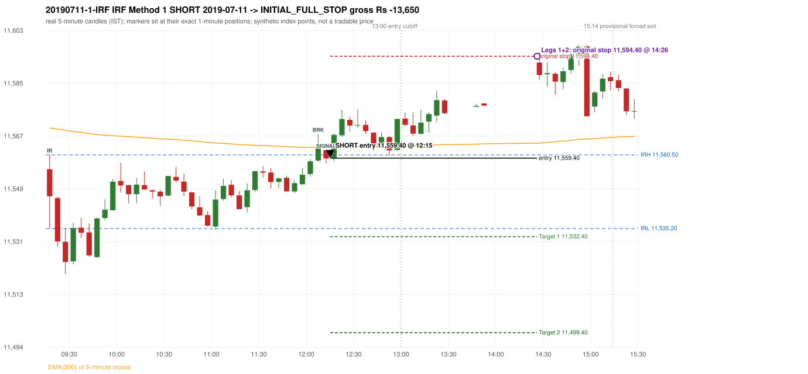

# Trading journal - 2019-07-11 (Thursday)

> Phase 4 historical validation, window D_5P (Window D 2019-03-01..2019-12-31 (5paisa minutes, PARTIAL YEAR); status PARTIAL_YEAR). The FROZEN Phase 3.6 configuration (IRF, ORB, PDR body-based, PDS, RF; shared controller) on a different data source. HISTORICAL RESEARCH ONLY: the strategy was developed using later data. 5paisa minute coverage starts 2019-03-01 and lacks five sessions (2019-06-27, 06-28, 07-01, 07-02, 07-03); no minute warm-up exists before the first session Synthetic NIFTY 50 index-point P&L (the index is not tradable). The owner's review status is intentionally blank.

## A. Trading day overview

| item | value |
|---|---|
| Date / weekday | 2019-07-11 / Thursday |
| Session type | USABLE_WITH_FLAGS / PARTIAL |
| Original session open (first 1-minute open) | 11,555.60 |
| Previous session | 2019-07-10 |
| Previous-day high / low (wicks included) | 11,593.50 / 11,475.90 |
| Previous-day highest BODY high (the body-based PDR ceiling; wicks ignored) | 11,589.75 |
| Previous-day official close / last 5-minute close | 11,498.90 / 11,494.00 |
| Raw engine records / confirmed signals / fully valid signals | 10 / 4 / 4 |
| Setups that did not complete (invalidated / incomplete) | 6 |
| Executed trades | 1 20190711-1-IRF |
| Gross P&L (Rs, synthetic) | -13,650.00 |
| Illustrative net P&L (Rs; Rs 500/trade + 0.5 pt/fill) | -14,540.00 |
| Day-end portfolio status | SECOND_TRADE_ELIGIBLE |
| Manual journal trades (matched / unmatched) | 0 (0 / 0) |
| Extra automated trades | 0 |

## B. Daily strategy signal timeline (confirmed signals, chronological)

| time | strategy | method | dir | entry-rule status | valid for execution | <= 13:00 | portfolio state | accepted / ignored | specific reason | competing (same minute) |
|---|---|---|---|---|---|---|---|---|---|---|
| 12:15 | IRF | Method 1 | SHORT | PROPOSAL_DEPENDENT | True | True | FIRST_TRADE_ACTIVE | ACCEPTED -> 20190711-1-IRF | first eligible signal of the day; trade 1: INITIAL_FULL_STOP |  |
| 12:40 | IRF | Method 2B | SHORT | PROPOSAL_DEPENDENT | True | True | FIRST_TRADE_ACTIVE | IGNORED | POSITION_ACTIVE (signal kept for diagnostics only; never reused) [blocked by IRF#1] |  |
| 13:10 | IRF | Method 2B | SHORT | PROPOSAL_DEPENDENT | True | False | FIRST_TRADE_ACTIVE | IGNORED | POSITION_ACTIVE (signal kept for diagnostics only; never reused) [blocked by IRF#1] |  |
| 13:30 | IRF | Method 2B | SHORT | PROPOSAL_DEPENDENT | True | False | FIRST_TRADE_ACTIVE | IGNORED | POSITION_ACTIVE (signal kept for diagnostics only; never reused) [blocked by IRF#1] |  |

Engine setups that did not complete (6); the complete list with failed rule ids is in `rejected_signals.csv`:

| candle | strategy | method | dir | status | precise reason | failed rules |
|---|---|---|---|---|---|---|
| 13:25 | IRF | Method 1/2 | SHORT | INVALIDATED | DATA_GAP |  |
| 13:50 | IRF | Method 1/2 | SHORT | INVALIDATED | DATA_GAP |  |
| 14:30 | IRF | Method 1/2 | SHORT | INCOMPLETE_AT_EOD | SESSION_ENDED_BEFORE_CONFIRMATION |  |
| 09:15 | ORB | Method 2 | LONG | INVALIDATED | TREND:EMA_PREV_SESSION_CLOSE wrong side | ORB-TREND-001;ORB-TREND-002 |
| 09:15 | PDR | PDR | LONG | INVALIDATED | OPEN_NOT_STRICTLY_ABOVE_ZONE |  |
| 09:30 | RF | RF | LONG | INVALIDATED | TREND:EMA_PREV_SESSION_CLOSE wrong side | RF-001;RF-008 |

## C. Detailed trade journals

### 20190711-1-IRF: IRF Method 1 SHORT (FIRST trade)

Chart: 

**Rule configuration:** CFG-phase36_body_based-866f954e55 - signal verification status **PROPOSAL_DEPENDENT** (never VERIFIED while a rule rests on a proposal).

#### 1. Setup identification

IRF Method 1 SHORT: the completed 12:05 candle closed at 11,562.75, 2.25 points above the initial range high 11,560.50 (range [11,535.20, 11,560.50] from the 09:15 candle); the immediately following completed 12:10 candle closed at 11,559.25, back inside the range. The short signal was confirmed at 12:15 on that close. Entry reference close 11,559.25 is 1.25 points below IRH 11,560.50.

#### 2. Candle and indicator calculations

| role | session | candle | O | H | L | C | range | body % | upper wick % | lower wick % | direction | EMA(200) | strong bull / bear | pin bull / bear | small (body<=30%) | used for |
|---|---|---|---|---|---|---|---|---|---|---|---|---|---|---|---|---|
| initial_range_candle | TODAY | 09:15-09:20 | 11,555.60 | 11,560.50 | 11,535.20 | 11,546.30 | 25.30 | 36.76 | 19.37 | 43.87 | BEARISH | 11,569.77 | False / False | False / False | False | initial range = high/low of the 09:15 candle |
| signal_candle | TODAY | 12:10-12:15 | 11,562.15 | 11,562.15 | 11,557.65 | 11,559.25 | 4.50 | 64.44 | 0.00 | 35.56 | BEARISH | 11,563.03 | False / False | False / False | False | candle whose close completed the trigger |
| breakout_candle | TODAY | 12:05-12:10 | 11,558.55 | 11,567.65 | 11,558.25 | 11,562.75 | 9.40 | 44.68 | 52.13 | 3.19 | BULLISH | 11,563.07 | False / False | False / False | False | breakout candle: a completed candle closing above IRH |

Every condition, with the rule, the calculation, the observed values and the result:

| # | group | rule | result | status / numeric definition | calculation | observed | required | available at | why it matters |
|---|---|---|---|---|---|---|---|---|---|
| 1 | SELECTION | SEL-FIRST-001 | PASS | USER_APPROVED / USER_APPROVED | earliest CONFIRMED signal of the day across IRF/ORB/PDR/PDS/RF that passed the controller's checks | 0 confirmed signal(s) earlier today; 4 confirmed signals in the day in total, this one at 12:15 | no earlier executable signal | 2019-07-11 12:15 | the shared controller trades only the first valid signal; the five strategies are not independent positions |
| 2 | SELECTION | SEL-TIE-001 | PASS | USER_APPROVED / USER_APPROVED | other CONFIRMED signals with exactly the same confirmation timestamp | none | no different-strategy / opposite-direction signal in the same minute (otherwise an unresolved conflict, no trade) | 2019-07-11 12:15 | an unresolved same-minute collision would have produced no trade at all |
| 3 | SELECTION | ENTRY-CUTOFF-001 | PASS | USER_APPROVED / USER_APPROVED | fill timestamp vs 13:00:00 IST | signal confirmed 12:15; fill 12:15 | fill at or before 13:00:00 IST | 2019-07-11 12:15 | no new position may be entered with a fill after 13:00 IST |
| 4 | SELECTION | EXE-FILL-001 | PASS | PROPOSED_FOR_REVIEW / PROPOSED_FOR_REVIEW | fill = open of the 1-minute bar that starts at the signal candle's end | bar 12:15 O 11,559.40 H 11,562.30 L 11,558.40 C 11,561.70; executable=True; entry 11,559.40 | fill bar exists, starts exactly at the signal end, is fillable; entry = its open | 2019-07-11 12:15 | a 5-minute signal is known only when its candle closes; the first price that can be traded is the next minute's open |
| 5 | SELECTION | DAY-MAX-001 | PASS | USER_APPROVED / USER_APPROVED | number of entries today | trade 1 of at most 2 | <= 2 entries per day | 2019-07-11 12:15 | daily trade cap |
| 6 | SETUP | IRF-GLOBAL-001 | PASS | SOURCE_VERIFIED / EXPLICIT_IN_SOURCE | initial range = high and low (wicks included) of the first completed 5-minute candle | 09:15-09:20 IRH 11,560.50, IRL 11,535.20 (range 25.30; engine recorded IRH 11,560.50, IRL 11,535.20) | high/low of the 09:15-09:20 candle | 2019-07-11 09:20 | all three IRF methods measure price against this range |
| 7 | SETUP | IRF-GLOBAL-003 | PASS | SOURCE_VERIFIED / EXPLICIT_IN_SOURCE | closes confirm, wicks do not: every trigger is evaluated on a completed 5-minute candle | trigger candle 12:10-12:15 was complete when the signal was stamped 12:15; decision uses its close 11,559.25 | completed candle close, not an intra-candle wick | 2019-07-11 12:15 | an intra-candle wick can reverse before the candle closes |
| 8 | SETUP | IRF-GLOBAL-002 | PASS | SOURCE_VERIFIED / EXPLICIT_IN_SOURCE | direction | SHORT (IRF trades short only) | short only | 2019-07-11 12:15 | IRF fades failed upside breakouts |
| 9 | SETUP | IRF-M1-001 | PASS | SOURCE_VERIFIED / EXPLICIT_IN_SOURCE | breakout candle close vs IRH | 12:05-12:10 O 11,558.55 H 11,567.65 L 11,558.25 C 11,562.75; range 9.40, body 4.20 (44.68%), upper wick 4.90 (52.13%), lower wick 0.30 (3.19%), bullish; close 11,562.75 is 2.25 points above IRH 11,560.50 | close > IRH (a wick above IRH is not a breakout) | 2019-07-11 12:10 | starts every IRF setup |
| 10 | CONFIRMATION | IRF-M1-002 | PASS | SOURCE_VERIFIED / EXPLICIT_IN_SOURCE | candle after the breakout closes back inside [IRL, IRH) | 12:10-12:15 O 11,562.15 H 11,562.15 L 11,557.65 C 11,559.25; range 4.50, body 2.90 (64.44%), upper wick 0.00 (0.00%), lower wick 1.60 (35.56%), bearish; close 11,559.25 vs range [11,535.20, 11,560.50) | IRL <= close < IRH | 2019-07-11 12:15 | the failed breakout: price could not hold above the opening range |
| 11 | CONFIRMATION | IRF-M1-004 | PASS | SOURCE_VERIFIED / EXPLICIT_IN_SOURCE | failure candle is the candle immediately after the breakout (k = 1) | breakout 12:05, failure candle 12:10: k = 1 | k = 1 (pp.5, 6, 13); the p.14 'next or following' reading (IRF-M1-C001) is CONFLICTING and not used in the baseline | 2019-07-11 12:15 | the guide's worked example enters at the close of the very next candle; no support/resistance break is required |
| 12 | EXECUTION | EXE-STOP-001 | PASS | USER_APPROVED / USER_APPROVED | initial stop = entry + 35 points | entry 11,559.40 -> stop 11,594.40 | stop 35 index points (BASELINE) | 2019-07-11 12:15 | defines the loss if the setup fails before Target 1 |
| 13 | EXECUTION | EXE-T1-001 | PASS | SOURCE_VERIFIED / EXPLICIT_IN_SOURCE | Target 1 = entry +/- 27 points | T1 11,532.40 | 27 points | 2019-07-11 12:15 | Leg 1 (3 lots) is booked at Target 1 |
| 14 | EXECUTION | IRF-TGT-001 | PASS | SOURCE_VERIFIED / EXPLICIT_IN_SOURCE | Target 2 = entry +/- 60 points | T2 11,499.40 | 60 points | 2019-07-11 12:15 | Leg 2 (3 lots) is booked at Target 2 |
| 15 | EXECUTION | POST-T1-STOP-006 | PASS | USER_APPROVED / USER_APPROVED | after T1 the Leg-2 stop = entry + 6 (no trailing) | post-T1 stop 11,565.40 | entry -6 (LONG) / +6 (SHORT) | 2019-07-11 12:15 | protects the remaining three lots once the first three are booked |
| 16 | EXECUTION | SIZE-LOT-001 | PASS | USER_APPROVED / USER_APPROVED | 6 lots x 65 = 390, Leg 1 = 3 lots = 195, Leg 2 = 195 | 6 lots, lot size 65, legs 3+3 | 6 lots in two equal legs | 2019-07-11 12:15 | position size for the synthetic P&L |
| 17 | NOTE | IRF-GLOBAL-004 | UNRESOLVED | UNRESOLVED / UNRESOLVED | which close above IRH of the session produced this attempt; repeat setups | this breakout is upward crossing no. 1 of the session (a close above IRH after a close at/below it) | the source states no first-breakout-only, re-arming, expiry or trades-per-day rule | 2019-07-11 12:15 | IRF re-arms on every later breakout in the code, producing many raw setups; the controller keeps only the first |
| 18 | NOTE | NOTE-IRF-REPEATED-SETUPS | NOT_APPLICABLE | NOT_A_RULE / NOT_A_REGISTRY_RULE | other IRF signals later in the session (not traded) | 3 further confirmed IRF signal(s): Method 2B@12:40, Method 2B@13:10, Method 2B@13:30 | disclosure of repeated raw setups | 2019-07-11 12:15 | repeated raw IRF setups are not hidden; they are logged as ignored |
| 19 | NOTE | IRF-SL-001 | NOT_APPLICABLE | SOURCE_VERIFIED / QUALITATIVE_SOURCE_NUMERIC_DEFINITION_PROPOSED_FOR_REVIEW | the guide's 35-or-40 rule: 35 if the most recent green candle's high is within 35 points of entry, else 40 | most recent green candle high 11,567.65 is 8.25 points from the entry 11,559.40: the guide's rule would select 35 points; the baseline applies a fixed 35 (USER_APPROVED research baseline; the 35-vs-40 selection and the 40-point variant are separate labelled scenarios) | source selection rule | 2019-07-11 12:15 | the stop distance is a modelling choice and changes losses, not entries |
| 20 | NOTE | NOTE-UNRESOLVED-DEPENDENCIES | UNRESOLVED | NOT_A_RULE / NOT_A_REGISTRY_RULE | rules the signal depends on that the sources leave unresolved | engine-recorded unresolved rule ids: IRF-GLOBAL-004; verification status PROPOSAL_DEPENDENT | n/a (disclosure) | 2019-07-11 12:15 | the entry is only as verified as the rules it rests on |

#### 3. Entry decision and explanation

IRF Method 1 SHORT: the completed 12:05 candle closed at 11,562.75, 2.25 points above the initial range high 11,560.50 (range [11,535.20, 11,560.50] from the 09:15 candle); the immediately following completed 12:10 candle closed at 11,559.25, back inside the range. The short signal was confirmed at 12:15 on that close. Entry reference close 11,559.25 is 1.25 points below IRH 11,560.50.

**Why this trade ahead of the other strategies:** This IRF Method 1 signal was the earliest executable signal of the day: 0 confirmed signal(s) earlier, 0 other in the same minute. 3 later confirmed signal(s) (IRF x3) are logged as ignored or rejected. State of the other four engines at that moment: [ORB: Method 2 invalidated at 09:15: TREND:EMA_PREV_SESSION_CLOSE wrong side] [PDR: PDR invalidated at 09:15: OPEN_NOT_STRICTLY_ABOVE_ZONE] [PDS: no setup record before this time (a base condition was not met, or nothing triggered)] [RF: RF invalidated at 09:30: TREND:EMA_PREV_SESSION_CLOSE wrong side]

#### 4. Actual entry execution

| item | value |
|---|---|
| Signal candle | 12:10-12:15 |
| Signal confirmed | 2019-07-11 12:15 |
| Fill timestamp | 2019-07-11 12:15 |
| Entry price | 11,559.40 |
| Source partition / 1-minute bar | data/phase4/processed/FIVEPAISA_1M_PHASE4/nifty50/year=2019/month=07/candles.parquet / 2019-07-11 12:15 |
| Source bar O / H / L / C | 11,559.40 / 11,562.30 / 11,558.40 / 11,561.70 |
| Fill assumption | open of the 1-minute bar starting at the signal candle's end (EXE-FILL-001, PROPOSED causal convention) |
| Initial stop / T1 / T2 / post-T1 stop | 11,594.40 / 11,532.40 / 11,499.40 / 11,565.40 |
| Position | 6 lots x 65 = 390 units (Leg 1 195, Leg 2 195) |

#### 5-8. Trade progress, Target 1, post-T1 stop and final exit

Between the 12:15 entry bar and the final exit (104 one-minute bars) the best excursion in favour was 1.00 points at 12:15 and the worst against was 35.55 points at 14:26. At 14:26 price reached the original stop 11,594.40 before Target 1 11,532.40, so all six lots exited together at 11,594.40. This is an INITIAL_FULL_STOP: one more trade is allowed that day, only a newly confirmed PDR/PDS signal.

| leg | qty | exit time | exit price | reason | source 1-minute bar | O / H / L / C | gross points | gross Rs | slippage pts | flags |
|---|---|---|---|---|---|---|---|---|---|---|
| 1 | 195 | 14:26 | 11,594.40 | ORIGINAL_STOP_BEFORE_T1 | 14:26 | 11,592.95 / 11,594.95 / 11,591.10 / 11,594.25 | -35.00 | -6,825.00 | 0.00 |  |
| 2 | 195 | 14:26 | 11,594.40 | ORIGINAL_STOP_BEFORE_T1 | 14:26 | 11,592.95 / 11,594.95 / 11,591.10 / 11,594.25 | -35.00 | -6,825.00 | 0.00 |  |

Exit evidence per leg:

* Leg 1: 1-minute bar 14:26 O 11,592.95 H 11,594.95 L 11,591.10 C 11,594.25: high 11,594.95 reached the original stop 11,594.40 before Target 1 11,532.40 was touched; both legs exit at the stop level 11,594.40
* Leg 2: 1-minute bar 14:26 O 11,592.95 H 11,594.95 L 11,591.10 C 11,594.25: high 11,594.95 reached the original stop 11,594.40 before Target 1 11,532.40 was touched; both legs exit at the stop level 11,594.40

#### 9. Gross and illustrative net P&L

| item | value (Rs) |
|---|---|
| Leg 1 gross | -6,825.00 |
| Leg 2 gross | -6,825.00 |
| Trade gross (= Leg 1 + Leg 2) | -13,650.00 |
| Illustrative fixed cost | -500.00 |
| Illustrative slippage (0.5 pt on every fill, entry + exits, all units) | -390.00 |
| Illustrative net | -14,540.00 |

#### 10. Manual journal comparison

No manual journal exists for this period; no comparison.

## D. Manual journal comparison

No manual journal exists for this period (the manual journal covers 2025-09-01 .. 2026-08-31 only); no comparison is made and no automated trade is labelled 'extra'.

## E. Daily conclusion

* **Traded:** 20190711-1-IRF - IRF Method 1 SHORT at 12:15 (entry 11,559.40), outcome INITIAL_FULL_STOP, gross Rs -13,650.00, illustrative net Rs -14,540.00. **Why:** This IRF Method 1 signal was the earliest executable signal of the day: 0 confirmed signal(s) earlier, 0 other in the same minute. 3 later confirmed signal(s) (IRF x3) are logged as ignored or rejected. State of the other four engines at that moment: [ORB: Method 2 invalidated at 09:15: TREND:EMA_PREV_SESSION_CLOSE wrong side] [PDR: PDR invalidated at 09:15: OPEN_NOT_STRICTLY_ABOVE_ZONE] [PDS: no setup record before this time (a base condition was not met, or nothing triggered)] [RF: RF invalidated at 09:30: TREND:EMA_PREV_SESSION_CLOSE wrong side] **How it ended:** At 14:26 price reached the original stop 11,594.40 before Target 1 11,532.40, so all six lots exited together at 11,594.40. This is an INITIAL_FULL_STOP: one more trade is allowed that day, only a newly confirmed PDR/PDS signal.
* **Ignored / rejected signals:** IRF IGNORED POSITION_ACTIVE x3
* **Open strategy-definition issues that affected this day:** IRF-GLOBAL-004 (NOT STATED: how many IRF trades per day, a latest entry time, and whether a new breakout may re-arm a setup after a signal), NOTE-UNRESOLVED-DEPENDENCIES
* **Automated triage (not an approval; the owner's review status stays blank):** TRADED_NO_FLAGS
