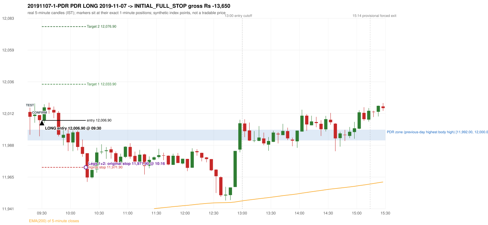
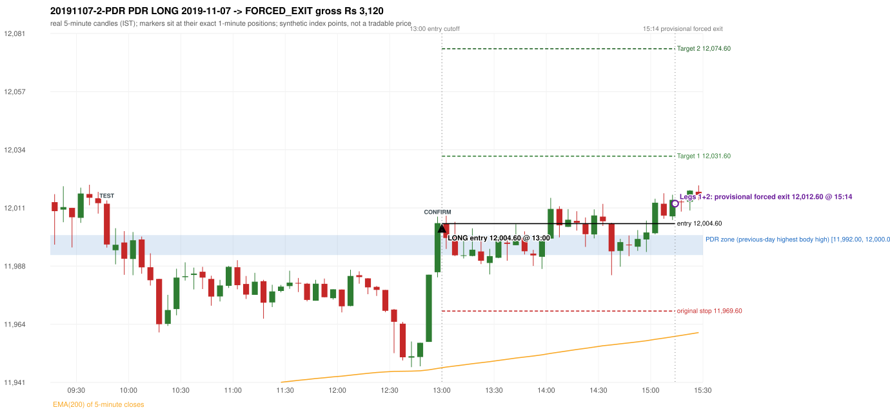

# Trading journal - 2019-11-07 (Thursday)

> Phase 4 historical validation, window D_5P (Window D 2019-03-01..2019-12-31 (5paisa minutes, PARTIAL YEAR); status PARTIAL_YEAR). The FROZEN Phase 3.6 configuration (IRF, ORB, PDR body-based, PDS, RF; shared controller) on a different data source. HISTORICAL RESEARCH ONLY: the strategy was developed using later data. 5paisa minute coverage starts 2019-03-01 and lacks five sessions (2019-06-27, 06-28, 07-01, 07-02, 07-03); no minute warm-up exists before the first session Synthetic NIFTY 50 index-point P&L (the index is not tradable). The owner's review status is intentionally blank.

## A. Trading day overview

| item | value |
|---|---|
| Date / weekday | 2019-11-07 / Thursday |
| Session type | USABLE_WITH_FLAGS / VALID |
| Original session open (first 1-minute open) | 12,013.20 |
| Previous session | 2019-11-06 |
| Previous-day high / low (wicks included) | 12,002.75 / 11,850.40 |
| Previous-day highest BODY high (the body-based PDR ceiling; wicks ignored) | 12,000.00 |
| Previous-day official close / last 5-minute close | 11,966.05 / 11,960.25 |
| Raw engine records / confirmed signals / fully valid signals | 8 / 5 / 4 |
| Setups that did not complete (invalidated / incomplete) | 3 |
| Executed trades | 2 20191107-1-PDR;20191107-2-PDR |
| Gross P&L (Rs, synthetic) | -10,530.00 |
| Illustrative net P&L (Rs; Rs 500/trade + 0.5 pt/fill) | -12,310.00 |
| Day-end portfolio status | DAY_FINISHED |
| Manual journal trades (matched / unmatched) | 0 (0 / 0) |
| Extra automated trades | 0 |

## B. Daily strategy signal timeline (confirmed signals, chronological)

| time | strategy | method | dir | entry-rule status | valid for execution | <= 13:00 | portfolio state | accepted / ignored | specific reason | competing (same minute) |
|---|---|---|---|---|---|---|---|---|---|---|
| 09:30 | PDR | PDR | LONG | RESEARCH_VARIANT | True | True | FIRST_TRADE_ACTIVE | ACCEPTED -> 20191107-1-PDR | first eligible signal of the day; trade 1: INITIAL_FULL_STOP |  |
| 09:40 | IRF | Method 1 | SHORT | PROPOSAL_DEPENDENT | True | True | FIRST_TRADE_ACTIVE | IGNORED | POSITION_ACTIVE (signal kept for diagnostics only; never reused) [blocked by PDR#1] |  |
| 13:00 | PDR | PDR | LONG | RESEARCH_VARIANT | True | True | SECOND_TRADE_ACTIVE | ACCEPTED -> 20191107-2-PDR | permitted second trade: newly confirmed PDR/PDS after the original full stop; trade 2: FORCED_EXIT |  |
| 15:05 | PDR | PDR | LONG | RESEARCH_VARIANT | True | False | SECOND_TRADE_ACTIVE | IGNORED | POSITION_ACTIVE (signal kept for diagnostics only; never reused) [blocked by PDR#2] |  |
| 15:30 | IRF | Method 1 | SHORT | PROPOSAL_DEPENDENT | False | False | DAY_FINISHED | IGNORED | DAY_FINISHED [blocked by PDR#2] |  |

Engine setups that did not complete (3); the complete list with failed rule ids is in `rejected_signals.csv`:

| candle | strategy | method | dir | status | precise reason | failed rules |
|---|---|---|---|---|---|---|
| 09:15 | ORB | Method 1 | LONG | INVALIDATED | CANDLE_QUALITY(not a strong body / wick too large) | ORB-M1-LONG-003 |
| 09:15 | ORB | Method 2 | LONG | INVALIDATED | TRENDLINE_NOT_SUPPORTIVE | ORB-M2-LONG-001 |
| 10:00 | RF | RF | LONG | INVALIDATED | GAP_UP_OUTSIDE_YESTERDAYS_RANGE | RF-004 |

## C. Detailed trade journals

### 20191107-1-PDR: PDR LONG (FIRST trade)

Chart: 

**Rule configuration:** CFG-phase36_body_based-866f954e55 - signal verification status **RESEARCH_VARIANT** (never VERIFIED while a rule rests on a proposal).

#### 1. Setup identification

PDR LONG (body-based engine, A_HIGHEST_BODY_HIGH): the session opened 47.15 points above the previous close and 13.20 points above the previous-day highest BODY high 12,000.00 (zone [11,992.00, 12,000.00] from the 14:30 candle of 2019-11-06; the highest wick 12,002.75 is ignored). The 09:15 candle (11,996.20 - 12,016.40) tested the zone; the 09:25 candle (not green, O 12,010.90 H 12,010.90 L 11,995.05 C 12,007.15) passed LOWER_PRICE_REJECTION, HAMMER and closed 7.15 points above the zone ceiling, confirming the entry at 09:30. The pattern thresholds and the zone's lower boundary are provisional research assumptions, not approved by the strategy author.

#### 2. Candle and indicator calculations

| role | session | candle | O | H | L | C | range | body % | upper wick % | lower wick % | direction | EMA(200) | strong bull / bear | pin bull / bear | small (body<=30%) | used for |
|---|---|---|---|---|---|---|---|---|---|---|---|---|---|---|---|---|
| zone_source_candle | PREVIOUS | 14:30-14:35 | 11,992.00 | 12,000.20 | 11,990.10 | 12,000.00 | 10.10 | 79.21 | 1.98 | 18.81 | BULLISH | 11,920.83 | True / False | False / False | False | candle of the previous session's highest BODY high (A_HIGHEST_BODY_HIGH) |
| prev_day_wick_high_candle | PREVIOUS | 14:25-14:30 | 11,998.85 | 12,002.75 | 11,989.45 | 11,992.30 | 13.30 | 49.25 | 29.32 | 21.43 | BEARISH | 11,920.04 | False / False | False / False | False | candle of the previous session's highest WICK (ignored by the author's rule; shown for comparison) |
| interaction_candle | TODAY | 09:15-09:20 | 12,013.20 | 12,016.40 | 11,996.20 | 12,009.60 | 20.20 | 17.82 | 15.84 | 66.34 | BEARISH | 11,927.38 | False / False | False / False | True | first candle whose range overlaps the zone (the test) |
| confirmation_candle | TODAY | 09:25-09:30 | 12,010.90 | 12,010.90 | 11,995.05 | 12,007.15 | 15.85 | 23.66 | 0.00 | 76.34 | BEARISH | 11,929.00 | False / False | True / False | True | candle that satisfies one of the three patterns and closes above the zone ceiling |

Every condition, with the rule, the calculation, the observed values and the result:

| # | group | rule | result | status / numeric definition | calculation | observed | required | available at | why it matters |
|---|---|---|---|---|---|---|---|---|---|
| 1 | SELECTION | SEL-FIRST-001 | PASS | USER_APPROVED / USER_APPROVED | earliest CONFIRMED signal of the day across IRF/ORB/PDR/PDS/RF that passed the controller's checks | 0 confirmed signal(s) earlier today; 5 confirmed signals in the day in total, this one at 09:30 | no earlier executable signal | 2019-11-07 09:30 | the shared controller trades only the first valid signal; the five strategies are not independent positions |
| 2 | SELECTION | SEL-TIE-001 | PASS | USER_APPROVED / USER_APPROVED | other CONFIRMED signals with exactly the same confirmation timestamp | none | no different-strategy / opposite-direction signal in the same minute (otherwise an unresolved conflict, no trade) | 2019-11-07 09:30 | an unresolved same-minute collision would have produced no trade at all |
| 3 | SELECTION | ENTRY-CUTOFF-001 | PASS | USER_APPROVED / USER_APPROVED | fill timestamp vs 13:00:00 IST | signal confirmed 09:30; fill 09:30 | fill at or before 13:00:00 IST | 2019-11-07 09:30 | no new position may be entered with a fill after 13:00 IST |
| 4 | SELECTION | EXE-FILL-001 | PASS | PROPOSED_FOR_REVIEW / PROPOSED_FOR_REVIEW | fill = open of the 1-minute bar that starts at the signal candle's end | bar 09:30 O 12,006.90 H 12,008.25 L 12,005.45 C 12,006.25; executable=True; entry 12,006.90 | fill bar exists, starts exactly at the signal end, is fillable; entry = its open | 2019-11-07 09:30 | a 5-minute signal is known only when its candle closes; the first price that can be traded is the next minute's open |
| 5 | SELECTION | DAY-MAX-001 | PASS | USER_APPROVED / USER_APPROVED | number of entries today | trade 1 of at most 2 | <= 2 entries per day | 2019-11-07 09:30 | daily trade cap |
| 6 | SETUP | PDR-004 | PASS | SOURCE_VERIFIED / EXPLICIT_WORDING_DETAIL_PROPOSED_FOR_REVIEW | gap = first 1-minute open of today - previous session's OFFICIAL close | today's open 12,013.20 (first 1-minute bar 09:15) - previous close 11,966.05 (DAILY_VENDOR, 2019-11-06) = +47.15 points -> gap UP | gap UP (more than 0 points) | 2019-11-07 09:15 | approved convention: the original first-minute open, never the vendor daily open |
| 7 | SETUP | PDR-B03 | PASS | AUTHOR_APPROVED / AUTHOR_STATEMENT_NUMERIC_DETAILS_ARE_SEPARATE_PROPOSED_ROWS | the session opens strictly above the previous day's resistance zone (author-approved) | today's first 1-minute open 12,013.20 vs zone ceiling 12,000.00: 13.20 points above (open - ceiling = +13.20) | open > zone ceiling (equal or inside the zone rejects the setup) | 2019-11-07 09:15 | the original first-minute open is used, never a vendor daily open |
| 8 | ZONE | PDR-001 | PASS | SOURCE_VERIFIED / EXPLICIT_IN_SOURCE | direction | LONG (PDR is long only) | long-only | 2019-11-07 09:30 | PDR buys a retest of previous-day resistance after a gap up |
| 9 | ZONE | PDR-B01a | PASS | AUTHOR_APPROVED / AUTHOR_STATEMENT_NUMERIC_DETAILS_ARE_SEPARATE_PROPOSED_ROWS | wicks ignored, bodies considered: body_high = max(open, close) of every completed previous-session 5-minute candle; ceiling = the highest body_high; floor = body low of that candle | previous session 2019-11-06: highest body high 12,000.00 on the 14:30 candle (O 11,992.00 C 12,000.00; wick high of that candle 12,000.20, ignored); four highest body highs: 12,000.00 (14:30); 11,999.45 (14:35); 11,998.85 (14:25); 11,998.65 (14:05). Highest WICK of the session 12,002.75 (14:25 candle) is 2.75 points above the ceiling and plays no part. Zone [11,992.00 (body low), 12,000.00 (body high)]; engine recorded [11,992.00, 12,000.00] | ceiling = highest body high of the previous session (author: wick ignored, body considered) | 2019-11-06 15:30 | a wick-only price never becomes resistance; the zone is drawn from candle bodies |
| 10 | ZONE | PDR-B02 | UNRESOLVED | AUTHOR_APPROVED / AUTHOR_STATEMENT_NUMERIC_DETAILS_ARE_SEPARATE_PROPOSED_ROWS | multiple highs connected into one zone (author principle; candidate B) | candidate A (used): [11,992.00, 12,000.00]. Candidate B (multiple-body-high cluster, tolerance 5 points) would be [11,992.00, 12,000.00] (MULTIPLE_BODY_HIGH_CLUSTER, 2 touch(es), member body highs 11,998.65, 12,000.00); ceiling difference 0.00 points | a zone that connects all relevant highs (numbers not given by the author) | 2019-11-06 15:30 | candidate B has the same ceiling by construction, so this signal is unaffected by the choice; the lower boundary and the cluster numbers are research parameters |
| 11 | ZONE | PDR-003 | PASS | SOURCE_VERIFIED / EXPLICIT_IN_SOURCE | the zone is an area, not a single price | zone height 8.00 points [11,992.00, 12,000.00] | a rectangle with positive height (a zero-height zone is left unresolved by the engine) | 2019-11-06 15:30 | price may touch any part of the area |
| 12 | CONFIRMATION | PDR-B03b | PASS | PRESERVED_FROM_PHASE2 / PRESERVED_FROM_PHASE2 | the first candle whose [low, high] overlaps the zone (+/- proximity) is the test; the confirmation must come strictly after it | 09:15-09:20 O 12,013.20 H 12,016.40 L 11,996.20 C 12,009.60; range 20.20, body 3.60 (17.82%), upper wick 3.20 (15.84%), lower wick 13.40 (66.34%), bearish; low 11,996.20 vs zone ceiling 12,000.00, high 12,016.40 vs zone floor 11,992.00; proximity 0; confirmation candle 09:25 is candle no. 3, the test candle no. 1 | range overlaps the zone; confirmation after the test | 2019-11-07 09:20 | the retest of the previous-day resistance |
| 13 | CONFIRMATION | PDR-B04c | NOT_APPLICABLE | PROPOSED_FOR_REVIEW / NUMERIC_DEFINITION_PROPOSED_FOR_REVIEW | Pattern 1: good green body on the 09:25-09:30 candle (O 12,010.90 H 12,010.90 L 11,995.05 C 12,007.15); the numeric thresholds are PROVISIONAL (RESEARCH_DEFAULT), not author-approved | colour NOT green; body 23.66%; upper wick 0.00% -> does not pass | green, body >= 60% and upper wick <= 20% of the range | 2019-11-07 09:30 | one of the three patterns is enough (author: one good green body OR lower price rejection OR hammer); fixed thresholds are not required by the author, so the numbers are a research convention; a pattern that does not pass is not an error |
| 14 | CONFIRMATION | PDR-B04c | PASS | PROPOSED_FOR_REVIEW / NUMERIC_DEFINITION_PROPOSED_FOR_REVIEW | Pattern 2: lower-price rejection candle on the 09:25-09:30 candle (O 12,010.90 H 12,010.90 L 11,995.05 C 12,007.15); the numeric thresholds are PROVISIONAL (RESEARCH_DEFAULT), not author-approved | lower wick 12.10 = 3.23 x body 3.75; close 23.66% below the high; low 11,995.05; low reached the zone ceiling 12,000.00 -> PASSES | lower wick >= 2 x body, close within the top 30% of the range, low <= zone ceiling (colour not required) | 2019-11-07 09:30 | one of the three patterns is enough (author: one good green body OR lower price rejection OR hammer); fixed thresholds are not required by the author, so the numbers are a research convention; a pattern that does not pass is not an error |
| 15 | CONFIRMATION | PDR-B04c | PASS | PROPOSED_FOR_REVIEW / NUMERIC_DEFINITION_PROPOSED_FOR_REVIEW | Pattern 3: hammer candle on the 09:25-09:30 candle (O 12,010.90 H 12,010.90 L 11,995.05 C 12,007.15); the numeric thresholds are PROVISIONAL (RESEARCH_DEFAULT), not author-approved | lower wick 12.10 = 3.23 x body; upper wick 0.00%; body bottom at 76.34% of the range -> PASSES | lower wick >= 2 x body, upper wick <= 10%, body bottom >= 60% of the range (colour not required) | 2019-11-07 09:30 | one of the three patterns is enough (author: one good green body OR lower price rejection OR hammer); fixed thresholds are not required by the author, so the numbers are a research convention; a pattern that does not pass is not an error |
| 16 | CONFIRMATION | PDR-B04 | PASS | AUTHOR_APPROVED / AUTHOR_STATEMENT_NUMERIC_DETAILS_ARE_SEPARATE_PROPOSED_ROWS | at least one of the three patterns passes (OR logic; every passing pattern is recorded) | patterns passed: LOWER_PRICE_REJECTION, HAMMER (engine recorded: LOWER_PRICE_REJECTION, HAMMER) | at least one pattern | 2019-11-07 09:30 | the author's entry candle requirement |
| 17 | CONFIRMATION | PDR-B05 | PASS | AUTHOR_APPROVED / AUTHOR_STATEMENT_NUMERIC_DETAILS_ARE_SEPARATE_PROPOSED_ROWS | the confirmation candle must close above the zone | close 12,007.15 vs zone ceiling 12,000.00: +7.15 points (floor 11,992.00; low 11,995.05 dipped into/below the zone) | close > zone ceiling, strictly (lower wick may penetrate the zone) | 2019-11-07 09:30 | no pattern overrides the close rule |
| 18 | CONFIRMATION | PDR-B06 | PASS | USER_APPROVED / USER_APPROVED | no entry at the open and no look-ahead: the order is placed only after the confirmation candle has completed | test candle 09:15 (no. 1) precedes the confirmation candle 09:25-09:30; signal stamped 09:30; fill 09:30 at the open of that 1-minute bar = 12,006.90 | interaction before the confirmation; fill after the confirmation candle's end | 2019-11-07 09:30 | existing causal fill convention (EXE-FILL-001) |
| 19 | EXECUTION | EXE-STOP-001 | PASS | USER_APPROVED / USER_APPROVED | initial stop = entry - 35 points | entry 12,006.90 -> stop 11,971.90 | stop 35 index points (BASELINE) | 2019-11-07 09:30 | defines the loss if the setup fails before Target 1 |
| 20 | EXECUTION | EXE-T1-001 | PASS | SOURCE_VERIFIED / EXPLICIT_IN_SOURCE | Target 1 = entry +/- 27 points | T1 12,033.90 | 27 points | 2019-11-07 09:30 | Leg 1 (3 lots) is booked at Target 1 |
| 21 | EXECUTION | PDR-008 | PASS | SOURCE_VERIFIED / EXPLICIT_IN_SOURCE | Target 2 = entry +/- 70 points | T2 12,076.90 (the guide says 70; the performance report's winners suggest 60 - CONFLICTING, recorded) | 70 points | 2019-11-07 09:30 | Leg 2 (3 lots) is booked at Target 2 |
| 22 | EXECUTION | POST-T1-STOP-006 | PASS | USER_APPROVED / USER_APPROVED | after T1 the Leg-2 stop = entry - 6 (no trailing) | post-T1 stop 12,000.90 | entry -6 (LONG) / +6 (SHORT) | 2019-11-07 09:30 | protects the remaining three lots once the first three are booked |
| 23 | EXECUTION | SIZE-LOT-001 | PASS | USER_APPROVED / USER_APPROVED | 6 lots x 65 = 390, Leg 1 = 3 lots = 195, Leg 2 = 195 | 6 lots, lot size 65, legs 3+3 | 6 lots in two equal legs | 2019-11-07 09:30 | position size for the synthetic P&L |
| 24 | NOTE | PDR-B04x | UNRESOLVED | PROPOSED_FOR_REVIEW / NUMERIC_DEFINITION_PROPOSED_FOR_REVIEW | provisional parameters this signal rests on | pattern thresholds RESEARCH_DEFAULT: {'green_body_min': 0.6, 'green_upper_wick_max': 0.2, 'reject_wick_to_body_min': 2.0, 'reject_close_fraction_max': 0.3, 'hammer_wick_to_body_min': 2.0, 'hammer_upper_wick_max': 0.1, 'hammer_body_position_min': 0.6}; zone lower boundary = hull of the member bodies; zero-height policy UNRESOLVED_NO_SETUP; wait policy WAIT_FOR_QUALIFYING_CANDLE; cluster parameters (candidate B only) tolerance 5, touches 2, separation 2 | n/a (disclosure) | 2019-11-07 09:30 | the strategy author has NOT approved these numbers or conventions; the signal is a RESEARCH_VARIANT, never VERIFIED |
| 25 | NOTE | PDR-012 | NOT_APPLICABLE | PROPOSED_FOR_REVIEW / PROPOSED_FOR_REVIEW | repeated PDR signals today | 3 confirmed PDR signal(s) in the session | n/a (disclosure) | 2019-11-07 09:30 | this engine reports EVERY qualifying signal (the per-session cap is lifted); the controller trades only the first (and a PDR/PDS second trade after an initial full stop) |
| 26 | NOTE | PDR-B07 | NOT_APPLICABLE | PROPOSED_FOR_REVIEW / NUMERIC_DEFINITION_PROPOSED_FOR_REVIEW | state of the zone between the test and the confirmation (the author and the guide are silent on price crossing below the zone) | test candle 09:15 (no. 1), confirmation candle 09:25 (no. 3): 2 candle(s) later; no candle in between closed below the zone floor | n/a (disclosure; the wait policy is a research parameter) | 2019-11-07 09:30 | the engine keeps a tested setup armed until a candle qualifies; whether a zone that price has closed through should still count is an owner decision |
| 27 | NOTE | PDR-009 | UNRESOLVED | UNRESOLVED / UNRESOLVED | stop 35 or 40 'depending on the situation' | the guide gives no selection rule; baseline fixed 35 points | unresolved in the source | 2019-11-07 09:30 | PDR stop selection is left to the owner |
| 28 | NOTE | NOTE-UNRESOLVED-DEPENDENCIES | UNRESOLVED | NOT_A_RULE / NOT_A_REGISTRY_RULE | rules the signal depends on that the sources leave unresolved | engine-recorded unresolved rule ids: PDR-B01b, PDR-B02a, PDR-B02b, PDR-B02c, PDR-B02d, PDR-B02e, PDR-B02f, PDR-B02g, PDR-B02h, PDR-B04b, PDR-B04c, PDR-B05a, PDR-B07; verification status RESEARCH_VARIANT | n/a (disclosure) | 2019-11-07 09:30 | the entry is only as verified as the rules it rests on |

#### 3. Entry decision and explanation

PDR LONG (body-based engine, A_HIGHEST_BODY_HIGH): the session opened 47.15 points above the previous close and 13.20 points above the previous-day highest BODY high 12,000.00 (zone [11,992.00, 12,000.00] from the 14:30 candle of 2019-11-06; the highest wick 12,002.75 is ignored). The 09:15 candle (11,996.20 - 12,016.40) tested the zone; the 09:25 candle (not green, O 12,010.90 H 12,010.90 L 11,995.05 C 12,007.15) passed LOWER_PRICE_REJECTION, HAMMER and closed 7.15 points above the zone ceiling, confirming the entry at 09:30. The pattern thresholds and the zone's lower boundary are provisional research assumptions, not approved by the strategy author.

**Why this trade ahead of the other strategies:** This PDR signal was the earliest executable signal of the day: 0 confirmed signal(s) earlier, 0 other in the same minute. 4 later confirmed signal(s) (IRF x2, PDR x2) are logged as ignored or rejected. State of the other four engines at that moment: [IRF: no setup record before this time (a base condition was not met, or nothing triggered)] [ORB: Method 1 invalidated at 09:15: CANDLE_QUALITY(not a strong body / wick too large); Method 2 invalidated at 09:15: TRENDLINE_NOT_SUPPORTIVE] [PDS: no setup record before this time (a base condition was not met, or nothing triggered)] [RF: no setup record before this time (a base condition was not met, or nothing triggered)]

#### 4. Actual entry execution

| item | value |
|---|---|
| Signal candle | 09:25-09:30 |
| Signal confirmed | 2019-11-07 09:30 |
| Fill timestamp | 2019-11-07 09:30 |
| Entry price | 12,006.90 |
| Source partition / 1-minute bar | data/phase4/processed/FIVEPAISA_1M_PHASE4/nifty50/year=2019/month=11/candles.parquet / 2019-11-07 09:30 |
| Source bar O / H / L / C | 12,006.90 / 12,008.25 / 12,005.45 / 12,006.25 |
| Fill assumption | open of the 1-minute bar starting at the signal candle's end (EXE-FILL-001, PROPOSED causal convention) |
| Initial stop / T1 / T2 / post-T1 stop | 11,971.90 / 12,033.90 / 12,076.90 / 12,000.90 |
| Position | 6 lots x 65 = 390 units (Leg 1 195, Leg 2 195) |

#### 5-8. Trade progress, Target 1, post-T1 stop and final exit

Between the 09:30 entry bar and the final exit (47 one-minute bars) the best excursion in favour was 13.25 points at 09:35 and the worst against was 45.45 points at 10:16. At 10:16 price reached the original stop 11,971.90 before Target 1 12,033.90, so all six lots exited together at 11,971.90. This is an INITIAL_FULL_STOP: one more trade is allowed that day, only a newly confirmed PDR/PDS signal.

| leg | qty | exit time | exit price | reason | source 1-minute bar | O / H / L / C | gross points | gross Rs | slippage pts | flags |
|---|---|---|---|---|---|---|---|---|---|---|
| 1 | 195 | 10:16 | 11,971.90 | ORIGINAL_STOP_BEFORE_T1 | 10:16 | 11,973.10 / 11,973.10 / 11,961.45 / 11,963.35 | -35.00 | -6,825.00 | 0.00 |  |
| 2 | 195 | 10:16 | 11,971.90 | ORIGINAL_STOP_BEFORE_T1 | 10:16 | 11,973.10 / 11,973.10 / 11,961.45 / 11,963.35 | -35.00 | -6,825.00 | 0.00 |  |

Exit evidence per leg:

* Leg 1: 1-minute bar 10:16 O 11,973.10 H 11,973.10 L 11,961.45 C 11,963.35: low 11,961.45 reached the original stop 11,971.90 before Target 1 12,033.90 was touched; both legs exit at the stop level 11,971.90
* Leg 2: 1-minute bar 10:16 O 11,973.10 H 11,973.10 L 11,961.45 C 11,963.35: low 11,961.45 reached the original stop 11,971.90 before Target 1 12,033.90 was touched; both legs exit at the stop level 11,971.90

#### 9. Gross and illustrative net P&L

| item | value (Rs) |
|---|---|
| Leg 1 gross | -6,825.00 |
| Leg 2 gross | -6,825.00 |
| Trade gross (= Leg 1 + Leg 2) | -13,650.00 |
| Illustrative fixed cost | -500.00 |
| Illustrative slippage (0.5 pt on every fill, entry + exits, all units) | -390.00 |
| Illustrative net | -14,540.00 |

#### 10. Manual journal comparison

No manual journal exists for this period; no comparison.

### 20191107-2-PDR: PDR LONG (SECOND trade)

Chart: 

**Rule configuration:** CFG-phase36_body_based-866f954e55 - signal verification status **RESEARCH_VARIANT** (never VERIFIED while a rule rests on a proposal).

#### 1. Setup identification

PDR LONG (body-based engine, A_HIGHEST_BODY_HIGH): the session opened 47.15 points above the previous close and 13.20 points above the previous-day highest BODY high 12,000.00 (zone [11,992.00, 12,000.00] from the 14:30 candle of 2019-11-06; the highest wick 12,002.75 is ignored). The 09:45 candle (11,995.00 - 12,013.90) tested the zone; the 12:55 candle (green, O 11,985.15 H 12,007.40 L 11,983.10 C 12,004.80) passed GOOD_GREEN_BODY and closed 4.80 points above the zone ceiling, confirming the entry at 13:00. The pattern thresholds and the zone's lower boundary are provisional research assumptions, not approved by the strategy author.

#### 2. Candle and indicator calculations

| role | session | candle | O | H | L | C | range | body % | upper wick % | lower wick % | direction | EMA(200) | strong bull / bear | pin bull / bear | small (body<=30%) | used for |
|---|---|---|---|---|---|---|---|---|---|---|---|---|---|---|---|---|
| zone_source_candle | PREVIOUS | 14:30-14:35 | 11,992.00 | 12,000.20 | 11,990.10 | 12,000.00 | 10.10 | 79.21 | 1.98 | 18.81 | BULLISH | 11,920.83 | True / False | False / False | False | candle of the previous session's highest BODY high (A_HIGHEST_BODY_HIGH) |
| prev_day_wick_high_candle | PREVIOUS | 14:25-14:30 | 11,998.85 | 12,002.75 | 11,989.45 | 11,992.30 | 13.30 | 49.25 | 29.32 | 21.43 | BEARISH | 11,920.04 | False / False | False / False | False | candle of the previous session's highest WICK (ignored by the author's rule; shown for comparison) |
| interaction_candle | TODAY | 09:45-09:50 | 12,012.55 | 12,013.90 | 11,995.00 | 11,996.25 | 18.90 | 86.24 | 7.14 | 6.61 | BEARISH | 11,932.18 | False / True | False / False | False | first candle whose range overlaps the zone (the test) |
| confirmation_candle | TODAY | 12:55-13:00 | 11,985.15 | 12,007.40 | 11,983.10 | 12,004.80 | 24.30 | 80.86 | 10.70 | 8.44 | BULLISH | 11,946.65 | True / False | False / False | False | candle that satisfies one of the three patterns and closes above the zone ceiling |

Every condition, with the rule, the calculation, the observed values and the result:

| # | group | rule | result | status / numeric definition | calculation | observed | required | available at | why it matters |
|---|---|---|---|---|---|---|---|---|---|
| 1 | SELECTION | DAY-SL-001 | PASS | USER_APPROVED / USER_APPROVED | first trade outcome, strategy of this signal, position-close time vs this signal's timestamp | first trade PDR PDR closed as INITIAL_FULL_STOP at 10:16; position free from 10:17; this PDR signal confirmed 13:00 | first trade INITIAL_FULL_STOP before Target 1, and a NEWLY confirmed PDR/PDS signal after the first position closed | 2019-11-07 13:00 | the only way a second trade is allowed |
| 2 | SELECTION | DAY-NOREUSE-001 | PASS | USER_APPROVED / USER_APPROVED | signals confirmed while the first position was open | 2 signal(s) were ignored during the first trade (never reused): PDR PDR LONG @09:30; IRF Method 1 SHORT @09:40 [IGNORED: POSITION_ACTIVE] | this trade comes from a signal confirmed after the first exit, not from an ignored one | 2019-11-07 13:00 | an ignored signal can never become the second trade |
| 3 | SELECTION | ENTRY-CUTOFF-001 | PASS | USER_APPROVED / USER_APPROVED | fill timestamp vs 13:00:00 IST | signal confirmed 13:00; fill 13:00 | fill at or before 13:00:00 IST | 2019-11-07 13:00 | no new position may be entered with a fill after 13:00 IST |
| 4 | SELECTION | EXE-FILL-001 | PASS | PROPOSED_FOR_REVIEW / PROPOSED_FOR_REVIEW | fill = open of the 1-minute bar that starts at the signal candle's end | bar 13:00 O 12,004.60 H 12,007.75 L 12,004.00 C 12,004.20; executable=True; entry 12,004.60 | fill bar exists, starts exactly at the signal end, is fillable; entry = its open | 2019-11-07 13:00 | a 5-minute signal is known only when its candle closes; the first price that can be traded is the next minute's open |
| 5 | SELECTION | DAY-MAX-001 | PASS | USER_APPROVED / USER_APPROVED | number of entries today | trade 2 of at most 2 | <= 2 entries per day | 2019-11-07 13:00 | daily trade cap |
| 6 | SETUP | PDR-004 | PASS | SOURCE_VERIFIED / EXPLICIT_WORDING_DETAIL_PROPOSED_FOR_REVIEW | gap = first 1-minute open of today - previous session's OFFICIAL close | today's open 12,013.20 (first 1-minute bar 09:15) - previous close 11,966.05 (DAILY_VENDOR, 2019-11-06) = +47.15 points -> gap UP | gap UP (more than 0 points) | 2019-11-07 09:15 | approved convention: the original first-minute open, never the vendor daily open |
| 7 | SETUP | PDR-B03 | PASS | AUTHOR_APPROVED / AUTHOR_STATEMENT_NUMERIC_DETAILS_ARE_SEPARATE_PROPOSED_ROWS | the session opens strictly above the previous day's resistance zone (author-approved) | today's first 1-minute open 12,013.20 vs zone ceiling 12,000.00: 13.20 points above (open - ceiling = +13.20) | open > zone ceiling (equal or inside the zone rejects the setup) | 2019-11-07 09:15 | the original first-minute open is used, never a vendor daily open |
| 8 | ZONE | PDR-001 | PASS | SOURCE_VERIFIED / EXPLICIT_IN_SOURCE | direction | LONG (PDR is long only) | long-only | 2019-11-07 13:00 | PDR buys a retest of previous-day resistance after a gap up |
| 9 | ZONE | PDR-B01a | PASS | AUTHOR_APPROVED / AUTHOR_STATEMENT_NUMERIC_DETAILS_ARE_SEPARATE_PROPOSED_ROWS | wicks ignored, bodies considered: body_high = max(open, close) of every completed previous-session 5-minute candle; ceiling = the highest body_high; floor = body low of that candle | previous session 2019-11-06: highest body high 12,000.00 on the 14:30 candle (O 11,992.00 C 12,000.00; wick high of that candle 12,000.20, ignored); four highest body highs: 12,000.00 (14:30); 11,999.45 (14:35); 11,998.85 (14:25); 11,998.65 (14:05). Highest WICK of the session 12,002.75 (14:25 candle) is 2.75 points above the ceiling and plays no part. Zone [11,992.00 (body low), 12,000.00 (body high)]; engine recorded [11,992.00, 12,000.00] | ceiling = highest body high of the previous session (author: wick ignored, body considered) | 2019-11-06 15:30 | a wick-only price never becomes resistance; the zone is drawn from candle bodies |
| 10 | ZONE | PDR-B02 | UNRESOLVED | AUTHOR_APPROVED / AUTHOR_STATEMENT_NUMERIC_DETAILS_ARE_SEPARATE_PROPOSED_ROWS | multiple highs connected into one zone (author principle; candidate B) | candidate A (used): [11,992.00, 12,000.00]. Candidate B (multiple-body-high cluster, tolerance 5 points) would be [11,992.00, 12,000.00] (MULTIPLE_BODY_HIGH_CLUSTER, 2 touch(es), member body highs 11,998.65, 12,000.00); ceiling difference 0.00 points | a zone that connects all relevant highs (numbers not given by the author) | 2019-11-06 15:30 | candidate B has the same ceiling by construction, so this signal is unaffected by the choice; the lower boundary and the cluster numbers are research parameters |
| 11 | ZONE | PDR-003 | PASS | SOURCE_VERIFIED / EXPLICIT_IN_SOURCE | the zone is an area, not a single price | zone height 8.00 points [11,992.00, 12,000.00] | a rectangle with positive height (a zero-height zone is left unresolved by the engine) | 2019-11-06 15:30 | price may touch any part of the area |
| 12 | CONFIRMATION | PDR-B03b | PASS | PRESERVED_FROM_PHASE2 / PRESERVED_FROM_PHASE2 | the first candle whose [low, high] overlaps the zone (+/- proximity) is the test; the confirmation must come strictly after it | 09:45-09:50 O 12,012.55 H 12,013.90 L 11,995.00 C 11,996.25; range 18.90, body 16.30 (86.24%), upper wick 1.35 (7.14%), lower wick 1.25 (6.61%), bearish; low 11,995.00 vs zone ceiling 12,000.00, high 12,013.90 vs zone floor 11,992.00; proximity 0; confirmation candle 12:55 is candle no. 45, the test candle no. 7 | range overlaps the zone; confirmation after the test | 2019-11-07 09:50 | the retest of the previous-day resistance (re-armed after the earlier signal: scanning restarted after the 09:25 candle) |
| 13 | CONFIRMATION | PDR-B04c | PASS | PROPOSED_FOR_REVIEW / NUMERIC_DEFINITION_PROPOSED_FOR_REVIEW | Pattern 1: good green body on the 12:55-13:00 candle (O 11,985.15 H 12,007.40 L 11,983.10 C 12,004.80); the numeric thresholds are PROVISIONAL (RESEARCH_DEFAULT), not author-approved | colour green; body 80.86%; upper wick 10.70% -> PASSES | green, body >= 60% and upper wick <= 20% of the range | 2019-11-07 13:00 | one of the three patterns is enough (author: one good green body OR lower price rejection OR hammer); fixed thresholds are not required by the author, so the numbers are a research convention; a pattern that does not pass is not an error |
| 14 | CONFIRMATION | PDR-B04c | NOT_APPLICABLE | PROPOSED_FOR_REVIEW / NUMERIC_DEFINITION_PROPOSED_FOR_REVIEW | Pattern 2: lower-price rejection candle on the 12:55-13:00 candle (O 11,985.15 H 12,007.40 L 11,983.10 C 12,004.80); the numeric thresholds are PROVISIONAL (RESEARCH_DEFAULT), not author-approved | lower wick 2.05 = 0.10 x body 19.65; close 10.70% below the high; low 11,983.10; low reached the zone ceiling 12,000.00 -> does not pass | lower wick >= 2 x body, close within the top 30% of the range, low <= zone ceiling (colour not required) | 2019-11-07 13:00 | one of the three patterns is enough (author: one good green body OR lower price rejection OR hammer); fixed thresholds are not required by the author, so the numbers are a research convention; a pattern that does not pass is not an error |
| 15 | CONFIRMATION | PDR-B04c | NOT_APPLICABLE | PROPOSED_FOR_REVIEW / NUMERIC_DEFINITION_PROPOSED_FOR_REVIEW | Pattern 3: hammer candle on the 12:55-13:00 candle (O 11,985.15 H 12,007.40 L 11,983.10 C 12,004.80); the numeric thresholds are PROVISIONAL (RESEARCH_DEFAULT), not author-approved | lower wick 2.05 = 0.10 x body; upper wick 10.70%; body bottom at 8.44% of the range -> does not pass | lower wick >= 2 x body, upper wick <= 10%, body bottom >= 60% of the range (colour not required) | 2019-11-07 13:00 | one of the three patterns is enough (author: one good green body OR lower price rejection OR hammer); fixed thresholds are not required by the author, so the numbers are a research convention; a pattern that does not pass is not an error |
| 16 | CONFIRMATION | PDR-B04 | PASS | AUTHOR_APPROVED / AUTHOR_STATEMENT_NUMERIC_DETAILS_ARE_SEPARATE_PROPOSED_ROWS | at least one of the three patterns passes (OR logic; every passing pattern is recorded) | patterns passed: GOOD_GREEN_BODY (engine recorded: GOOD_GREEN_BODY) | at least one pattern | 2019-11-07 13:00 | the author's entry candle requirement |
| 17 | CONFIRMATION | PDR-B05 | PASS | AUTHOR_APPROVED / AUTHOR_STATEMENT_NUMERIC_DETAILS_ARE_SEPARATE_PROPOSED_ROWS | the confirmation candle must close above the zone | close 12,004.80 vs zone ceiling 12,000.00: +4.80 points (floor 11,992.00; low 11,983.10 dipped into/below the zone) | close > zone ceiling, strictly (lower wick may penetrate the zone) | 2019-11-07 13:00 | no pattern overrides the close rule |
| 18 | CONFIRMATION | PDR-B06 | PASS | USER_APPROVED / USER_APPROVED | no entry at the open and no look-ahead: the order is placed only after the confirmation candle has completed | test candle 09:45 (no. 7) precedes the confirmation candle 12:55-13:00; signal stamped 13:00; fill 13:00 at the open of that 1-minute bar = 12,004.60 | interaction before the confirmation; fill after the confirmation candle's end | 2019-11-07 13:00 | existing causal fill convention (EXE-FILL-001) |
| 19 | EXECUTION | EXE-STOP-001 | PASS | USER_APPROVED / USER_APPROVED | initial stop = entry - 35 points | entry 12,004.60 -> stop 11,969.60 | stop 35 index points (BASELINE) | 2019-11-07 13:00 | defines the loss if the setup fails before Target 1 |
| 20 | EXECUTION | EXE-T1-001 | PASS | SOURCE_VERIFIED / EXPLICIT_IN_SOURCE | Target 1 = entry +/- 27 points | T1 12,031.60 | 27 points | 2019-11-07 13:00 | Leg 1 (3 lots) is booked at Target 1 |
| 21 | EXECUTION | PDR-008 | PASS | SOURCE_VERIFIED / EXPLICIT_IN_SOURCE | Target 2 = entry +/- 70 points | T2 12,074.60 (the guide says 70; the performance report's winners suggest 60 - CONFLICTING, recorded) | 70 points | 2019-11-07 13:00 | Leg 2 (3 lots) is booked at Target 2 |
| 22 | EXECUTION | POST-T1-STOP-006 | PASS | USER_APPROVED / USER_APPROVED | after T1 the Leg-2 stop = entry - 6 (no trailing) | post-T1 stop 11,998.60 | entry -6 (LONG) / +6 (SHORT) | 2019-11-07 13:00 | protects the remaining three lots once the first three are booked |
| 23 | EXECUTION | SIZE-LOT-001 | PASS | USER_APPROVED / USER_APPROVED | 6 lots x 65 = 390, Leg 1 = 3 lots = 195, Leg 2 = 195 | 6 lots, lot size 65, legs 3+3 | 6 lots in two equal legs | 2019-11-07 13:00 | position size for the synthetic P&L |
| 24 | NOTE | PDR-B04x | UNRESOLVED | PROPOSED_FOR_REVIEW / NUMERIC_DEFINITION_PROPOSED_FOR_REVIEW | provisional parameters this signal rests on | pattern thresholds RESEARCH_DEFAULT: {'green_body_min': 0.6, 'green_upper_wick_max': 0.2, 'reject_wick_to_body_min': 2.0, 'reject_close_fraction_max': 0.3, 'hammer_wick_to_body_min': 2.0, 'hammer_upper_wick_max': 0.1, 'hammer_body_position_min': 0.6}; zone lower boundary = hull of the member bodies; zero-height policy UNRESOLVED_NO_SETUP; wait policy WAIT_FOR_QUALIFYING_CANDLE; cluster parameters (candidate B only) tolerance 5, touches 2, separation 2 | n/a (disclosure) | 2019-11-07 13:00 | the strategy author has NOT approved these numbers or conventions; the signal is a RESEARCH_VARIANT, never VERIFIED |
| 25 | NOTE | PDR-012 | NOT_APPLICABLE | PROPOSED_FOR_REVIEW / PROPOSED_FOR_REVIEW | repeated PDR signals today | 3 confirmed PDR signal(s) in the session | n/a (disclosure) | 2019-11-07 13:00 | this engine reports EVERY qualifying signal (the per-session cap is lifted); the controller trades only the first (and a PDR/PDS second trade after an initial full stop) |
| 26 | NOTE | PDR-B07 | UNRESOLVED | PROPOSED_FOR_REVIEW / NUMERIC_DEFINITION_PROPOSED_FOR_REVIEW | state of the zone between the test and the confirmation (the author and the guide are silent on price crossing below the zone) | test candle 09:45 (no. 7), confirmation candle 12:55 (no. 45): 38 candle(s) later; 35 candle(s) in between CLOSED BELOW the zone floor 11,992.00 (lowest close 11,951.10) before price returned above the ceiling | n/a (disclosure; the wait policy is a research parameter) | 2019-11-07 13:00 | the engine keeps a tested setup armed until a candle qualifies; whether a zone that price has closed through should still count is an owner decision |
| 27 | NOTE | PDR-009 | UNRESOLVED | UNRESOLVED / UNRESOLVED | stop 35 or 40 'depending on the situation' | the guide gives no selection rule; baseline fixed 35 points | unresolved in the source | 2019-11-07 13:00 | PDR stop selection is left to the owner |
| 28 | NOTE | NOTE-UNRESOLVED-DEPENDENCIES | UNRESOLVED | NOT_A_RULE / NOT_A_REGISTRY_RULE | rules the signal depends on that the sources leave unresolved | engine-recorded unresolved rule ids: PDR-B01b, PDR-B02a, PDR-B02b, PDR-B02c, PDR-B02d, PDR-B02e, PDR-B02f, PDR-B02g, PDR-B02h, PDR-B04b, PDR-B04c, PDR-B05a, PDR-B07; verification status RESEARCH_VARIANT | n/a (disclosure) | 2019-11-07 13:00 | the entry is only as verified as the rules it rests on |

#### 3. Entry decision and explanation

PDR LONG (body-based engine, A_HIGHEST_BODY_HIGH): the session opened 47.15 points above the previous close and 13.20 points above the previous-day highest BODY high 12,000.00 (zone [11,992.00, 12,000.00] from the 14:30 candle of 2019-11-06; the highest wick 12,002.75 is ignored). The 09:45 candle (11,995.00 - 12,013.90) tested the zone; the 12:55 candle (green, O 11,985.15 H 12,007.40 L 11,983.10 C 12,004.80) passed GOOD_GREEN_BODY and closed 4.80 points above the zone ceiling, confirming the entry at 13:00. The pattern thresholds and the zone's lower boundary are provisional research assumptions, not approved by the strategy author.

**Why this trade ahead of the other strategies:** The first trade (PDR PDR) was stopped out before Target 1 at 10:16; this newly confirmed PDR signal at 13:00 is the first PDR/PDS signal after that exit, so it is the day's permitted second trade. State of the other engines at that moment: [IRF: 1 confirmed signal(s) up to this time (Method 1@09:40)] [ORB: Method 1 invalidated at 09:15: CANDLE_QUALITY(not a strong body / wick too large); Method 2 invalidated at 09:15: TRENDLINE_NOT_SUPPORTIVE] [PDS: no setup record before this time (a base condition was not met, or nothing triggered)] [RF: RF invalidated at 10:00: GAP_UP_OUTSIDE_YESTERDAYS_RANGE]

#### 4. Actual entry execution

| item | value |
|---|---|
| Signal candle | 12:55-13:00 |
| Signal confirmed | 2019-11-07 13:00 |
| Fill timestamp | 2019-11-07 13:00 |
| Entry price | 12,004.60 |
| Source partition / 1-minute bar | data/phase4/processed/FIVEPAISA_1M_PHASE4/nifty50/year=2019/month=11/candles.parquet / 2019-11-07 13:00 |
| Source bar O / H / L / C | 12,004.60 / 12,007.75 / 12,004.00 / 12,004.20 |
| Fill assumption | open of the 1-minute bar starting at the signal candle's end (EXE-FILL-001, PROPOSED causal convention) |
| Initial stop / T1 / T2 / post-T1 stop | 11,969.60 / 12,031.60 / 12,074.60 / 11,998.60 |
| Position | 6 lots x 65 = 390 units (Leg 1 195, Leg 2 195) |

#### 5-8. Trade progress, Target 1, post-T1 stop and final exit

Between the 13:00 entry bar and the final exit (135 one-minute bars) the best excursion in favour was 12.15 points at 15:06 and the worst against was 20.65 points at 14:37. Neither the stop, Target 1 nor Target 2 was reached; at 15:14 all six lots were closed by the PROVISIONAL forced exit at the minute open 12,012.60.

| leg | qty | exit time | exit price | reason | source 1-minute bar | O / H / L / C | gross points | gross Rs | slippage pts | flags |
|---|---|---|---|---|---|---|---|---|---|---|
| 1 | 195 | 15:14 | 12,012.60 | FORCED_EXIT_1514_OPEN_PROVISIONAL | 15:14 | 12,012.60 / 12,014.90 / 12,012.60 / 12,014.10 | 8.00 | 1,560.00 | 0.00 | PROVISIONAL_FORCED_EXIT_15_14_OPEN |
| 2 | 195 | 15:14 | 12,012.60 | FORCED_EXIT_1514_OPEN_PROVISIONAL | 15:14 | 12,012.60 / 12,014.90 / 12,012.60 / 12,014.10 | 8.00 | 1,560.00 | 0.00 | PROVISIONAL_FORCED_EXIT_15_14_OPEN |

Exit evidence per leg:

* Leg 1: 1-minute bar 15:14 O 12,012.60 H 12,014.90 L 12,012.60 C 12,014.10: provisional forced exit at the OPEN of the 15:14 minute (12,012.60); neither Target 2 nor the stop was reached; sensitivity close of that minute 12,014.10 (not used)
* Leg 2: 1-minute bar 15:14 O 12,012.60 H 12,014.90 L 12,012.60 C 12,014.10: provisional forced exit at the OPEN of the 15:14 minute (12,012.60); neither Target 2 nor the stop was reached; sensitivity close of that minute 12,014.10 (not used)

#### 9. Gross and illustrative net P&L

| item | value (Rs) |
|---|---|
| Leg 1 gross | 1,560.00 |
| Leg 2 gross | 1,560.00 |
| Trade gross (= Leg 1 + Leg 2) | 3,120.00 |
| Illustrative fixed cost | -500.00 |
| Illustrative slippage (0.5 pt on every fill, entry + exits, all units) | -390.00 |
| Illustrative net | 2,230.00 |

#### 10. Manual journal comparison

No manual journal exists for this period; no comparison.

## D. Manual journal comparison

No manual journal exists for this period (the manual journal covers 2025-09-01 .. 2026-08-31 only); no comparison is made and no automated trade is labelled 'extra'.

## E. Daily conclusion

* **Traded:** 20191107-1-PDR - PDR PDR LONG at 09:30 (entry 12,006.90), outcome INITIAL_FULL_STOP, gross Rs -13,650.00, illustrative net Rs -14,540.00. **Why:** This PDR signal was the earliest executable signal of the day: 0 confirmed signal(s) earlier, 0 other in the same minute. 4 later confirmed signal(s) (IRF x2, PDR x2) are logged as ignored or rejected. State of the other four engines at that moment: [IRF: no setup record before this time (a base condition was not met, or nothing triggered)] [ORB: Method 1 invalidated at 09:15: CANDLE_QUALITY(not a strong body / wick too large); Method 2 invalidated at 09:15: TRENDLINE_NOT_SUPPORTIVE] [PDS: no setup record before this time (a base condition was not met, or nothing triggered)] [RF: no setup record before this time (a base condition was not met, or nothing triggered)] **How it ended:** At 10:16 price reached the original stop 11,971.90 before Target 1 12,033.90, so all six lots exited together at 11,971.90. This is an INITIAL_FULL_STOP: one more trade is allowed that day, only a newly confirmed PDR/PDS signal.
* **Traded:** 20191107-2-PDR - PDR PDR LONG at 13:00 (entry 12,004.60), outcome FORCED_EXIT, gross Rs 3,120.00, illustrative net Rs 2,230.00. **Why:** The first trade (PDR PDR) was stopped out before Target 1 at 10:16; this newly confirmed PDR signal at 13:00 is the first PDR/PDS signal after that exit, so it is the day's permitted second trade. State of the other engines at that moment: [IRF: 1 confirmed signal(s) up to this time (Method 1@09:40)] [ORB: Method 1 invalidated at 09:15: CANDLE_QUALITY(not a strong body / wick too large); Method 2 invalidated at 09:15: TRENDLINE_NOT_SUPPORTIVE] [PDS: no setup record before this time (a base condition was not met, or nothing triggered)] [RF: RF invalidated at 10:00: GAP_UP_OUTSIDE_YESTERDAYS_RANGE] **How it ended:** Neither the stop, Target 1 nor Target 2 was reached; at 15:14 all six lots were closed by the PROVISIONAL forced exit at the minute open 12,012.60.
* **Ignored / rejected signals:** IRF IGNORED POSITION_ACTIVE x1; PDR IGNORED POSITION_ACTIVE x1; IRF IGNORED DAY_FINISHED x1
* **Open strategy-definition issues that affected this day:** NOTE-UNRESOLVED-DEPENDENCIES, PDR-009 (Stop-loss 35 or 40 'depending on the situation'; choose before entering, do not move after entry), PDR-B02, PDR-B04x, PDR-B07
* **Automated triage (not an approval; the owner's review status stays blank):** REVIEW: PROVISIONAL_FORCED_EXIT
