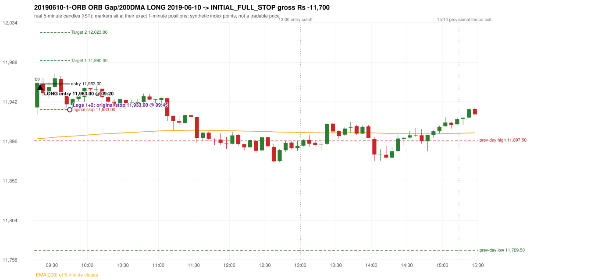
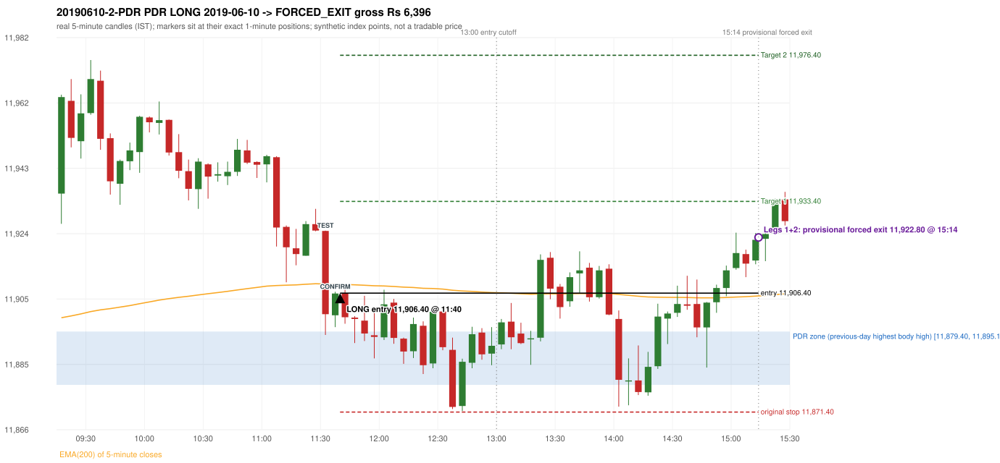

# Trading journal - 2019-06-10 (Monday)

> Phase 4 historical validation, window D_TV (Window D 2019-01-01..2019-12-31 (secondary vendor minutes); status EXPLORATORY). The FROZEN Phase 3.6 configuration (IRF, ORB, PDR body-based, PDS, RF; shared controller) on a different data source. HISTORICAL RESEARCH ONLY: the strategy was developed using later data. full calendar year from the secondary vendor only; overlap with 5paisa (2019-03..12) shows systematically different bars Synthetic NIFTY 50 index-point P&L (the index is not tradable). The owner's review status is intentionally blank.

## A. Trading day overview

| item | value |
|---|---|
| Date / weekday | 2019-06-10 / Monday |
| Session type | USABLE_WITH_FLAGS / VALID |
| Original session open (first 1-minute open) | 11,935.70 |
| Previous session | 2019-06-07 |
| Previous-day high / low (wicks included) | 11,897.50 / 11,769.50 |
| Previous-day highest BODY high (the body-based PDR ceiling; wicks ignored) | 11,895.10 |
| Previous-day official close / last 5-minute close | 11,870.65 / 11,864.80 |
| Raw engine records / confirmed signals / fully valid signals | 12 / 9 / 9 |
| Setups that did not complete (invalidated / incomplete) | 3 |
| Executed trades | 2 20190610-1-ORB;20190610-2-PDR |
| Gross P&L (Rs, synthetic) | -5,304.00 |
| Illustrative net P&L (Rs; Rs 500/trade + 0.5 pt/fill) | -7,084.00 |
| Day-end portfolio status | DAY_FINISHED |
| Manual journal trades (matched / unmatched) | 0 (0 / 0) |
| Extra automated trades | 0 |

## B. Daily strategy signal timeline (confirmed signals, chronological)

| time | strategy | method | dir | entry-rule status | valid for execution | <= 13:00 | portfolio state | accepted / ignored | specific reason | competing (same minute) |
|---|---|---|---|---|---|---|---|---|---|---|
| 09:20 | ORB | Gap/200DMA | LONG | RESEARCH_VARIANT | True | True | FIRST_TRADE_ACTIVE | ACCEPTED -> 20190610-1-ORB | first eligible signal of the day; trade 1: INITIAL_FULL_STOP |  |
| 09:40 | IRF | Method 1 | SHORT | PROPOSAL_DEPENDENT | True | True | FIRST_TRADE_ACTIVE | IGNORED | POSITION_ACTIVE (signal kept for diagnostics only; never reused) [blocked by ORB#1] |  |
| 11:40 | PDR | PDR | LONG | RESEARCH_VARIANT | True | True | SECOND_TRADE_ACTIVE | ACCEPTED -> 20190610-2-PDR | permitted second trade: newly confirmed PDR/PDS after the original full stop; trade 2: FORCED_EXIT |  |
| 12:20 | PDR | PDR | LONG | RESEARCH_VARIANT | True | True | SECOND_TRADE_ACTIVE | IGNORED | POSITION_ACTIVE (signal kept for diagnostics only; never reused) [blocked by PDR#2] |  |
| 12:30 | PDR | PDR | LONG | RESEARCH_VARIANT | True | True | SECOND_TRADE_ACTIVE | IGNORED | POSITION_ACTIVE (signal kept for diagnostics only; never reused) [blocked by PDR#2] |  |
| 13:05 | PDR | PDR | LONG | RESEARCH_VARIANT | True | False | SECOND_TRADE_ACTIVE | IGNORED | POSITION_ACTIVE (signal kept for diagnostics only; never reused) [blocked by PDR#2] |  |
| 13:25 | PDR | PDR | LONG | RESEARCH_VARIANT | True | False | SECOND_TRADE_ACTIVE | IGNORED | POSITION_ACTIVE (signal kept for diagnostics only; never reused) [blocked by PDR#2] |  |
| 14:25 | PDR | PDR | LONG | RESEARCH_VARIANT | True | False | SECOND_TRADE_ACTIVE | IGNORED | POSITION_ACTIVE (signal kept for diagnostics only; never reused) [blocked by PDR#2] |  |
| 15:20 | PDR | PDR | LONG | RESEARCH_VARIANT | True | False | DAY_FINISHED | IGNORED | DAY_FINISHED [blocked by PDR#2] |  |

Engine setups that did not complete (3); the complete list with failed rule ids is in `rejected_signals.csv`:

| candle | strategy | method | dir | status | precise reason | failed rules |
|---|---|---|---|---|---|---|
| 09:15 | ORB | Method 1 | LONG | INVALIDATED | TREND:EMA_PREV_SESSION_CLOSE wrong side | ORB-TREND-001;ORB-TREND-002 |
| 09:15 | ORB | Method 2 | LONG | INVALIDATED | TREND:EMA_PREV_SESSION_CLOSE wrong side | ORB-TREND-001;ORB-TREND-002 |
| 15:20 | RF | RF | LONG | INVALIDATED | TREND:EMA_PREV_SESSION_CLOSE wrong side | RF-001;RF-008 |

## C. Detailed trade journals

### 20190610-1-ORB: ORB Gap/200DMA LONG (FIRST trade)

Chart: 

**Rule configuration:** CFG-phase36_body_based-866f954e55 - signal verification status **RESEARCH_VARIANT** (never VERIFIED while a rule rests on a proposal).

#### 1. Setup identification

ORB Gap/200 DMA LONG: the open 11,935.70 gapped +65.05 points from the previous close 11,870.65, through the EMA(200) (11,898.51 -> 11,899.16); the first candle closed at 11,964.10, beyond the average; its body occupied 74.74% of its range and its upper wick 1.84% (thresholds 60% / 20%): the strong-bullish candle test passed. The 'excessively extended' filter has no numeric definition and was not applied.

#### 2. Candle and indicator calculations

| role | session | candle | O | H | L | C | range | body % | upper wick % | lower wick % | direction | EMA(200) | strong bull / bear | pin bull / bear | small (body<=30%) | used for |
|---|---|---|---|---|---|---|---|---|---|---|---|---|---|---|---|---|
| first_candle | TODAY | 09:15-09:20 | 11,935.70 | 11,964.80 | 11,926.80 | 11,964.10 | 38.00 | 74.74 | 1.84 | 23.42 | BULLISH | 11,899.16 | True / False | False / False | False | the 09:15 first five-minute candle - the ORB decision candle |
| prev_session_last_candle | PREVIOUS | 15:25-15:30 | 11,860.00 | 11,865.00 | 11,855.90 | 11,864.80 | 9.10 | 52.75 | 2.20 | 45.05 | BULLISH | 11,898.51 | False / False | False / False | False | previous session's last candle: the EMA(200) before the gap |

Every condition, with the rule, the calculation, the observed values and the result:

| # | group | rule | result | status / numeric definition | calculation | observed | required | available at | why it matters |
|---|---|---|---|---|---|---|---|---|---|
| 1 | SELECTION | SEL-FIRST-001 | PASS | USER_APPROVED / USER_APPROVED | earliest CONFIRMED signal of the day across IRF/ORB/PDR/PDS/RF that passed the controller's checks | 0 confirmed signal(s) earlier today; 9 confirmed signals in the day in total, this one at 09:20 | no earlier executable signal | 2019-06-10 09:20 | the shared controller trades only the first valid signal; the five strategies are not independent positions |
| 2 | SELECTION | SEL-TIE-001 | PASS | USER_APPROVED / USER_APPROVED | other CONFIRMED signals with exactly the same confirmation timestamp | none | no different-strategy / opposite-direction signal in the same minute (otherwise an unresolved conflict, no trade) | 2019-06-10 09:20 | an unresolved same-minute collision would have produced no trade at all |
| 3 | SELECTION | ENTRY-CUTOFF-001 | PASS | USER_APPROVED / USER_APPROVED | fill timestamp vs 13:00:00 IST | signal confirmed 09:20; fill 09:20 | fill at or before 13:00:00 IST | 2019-06-10 09:20 | no new position may be entered with a fill after 13:00 IST |
| 4 | SELECTION | EXE-FILL-001 | PASS | PROPOSED_FOR_REVIEW / PROPOSED_FOR_REVIEW | fill = open of the 1-minute bar that starts at the signal candle's end | bar 09:20 O 11,963.00 H 11,969.40 L 11,961.90 C 11,966.10; executable=True; entry 11,963.00 | fill bar exists, starts exactly at the signal end, is fillable; entry = its open | 2019-06-10 09:20 | a 5-minute signal is known only when its candle closes; the first price that can be traded is the next minute's open |
| 5 | SELECTION | DAY-MAX-001 | PASS | USER_APPROVED / USER_APPROVED | number of entries today | trade 1 of at most 2 | <= 2 entries per day | 2019-06-10 09:20 | daily trade cap |
| 6 | SETUP | ORB-GLOBAL-001 | PASS | SOURCE_VERIFIED / EXPLICIT_IN_SOURCE | decision is taken once the first 5-minute candle (09:15-09:20) has closed | candle 09:15-09:20; signal confirmed 09:20 | decision at 09:20, never before the close | 2019-06-10 09:20 | the close of the first candle is unknown before 09:20 |
| 7 | SETUP | ORB-GLOBAL-002 | PASS | SOURCE_VERIFIED / EXPLICIT_IN_SOURCE | direction | LONG | same rules in both directions | 2019-06-10 09:20 | ORB trades the side of the break |
| 8 | SETUP | ORB-GLOBAL-004 | PASS | SOURCE_VERIFIED / QUALITATIVE_SOURCE_NUMERIC_DEFINITION_PROPOSED_FOR_REVIEW | entry at 09:20, after the first-candle close | signal confirmed 09:20; fill 09:20 at the open of that minute | 09:20 entry | 2019-06-10 09:20 | the guide enters at 9:20; the fill price convention (next minute open) is a proposal |
| 9 | SETUP | ORB-GAP-LONG-001 | PASS | SOURCE_VERIFIED / EXPLICIT_WORDING_DETAIL_PROPOSED_FOR_REVIEW | gap = first 1-minute open of today - previous session's OFFICIAL close | today's open 11,935.70 (first 1-minute bar 09:15) - previous close 11,870.65 (DAILY_VENDOR, 2019-06-07) = +65.05 points -> gap UP | gap UP (more than 0 points) | 2019-06-10 09:15 | approved convention: the original first-minute open, never the vendor daily open |
| 10 | SETUP | ORB-GAP-LONG-002 | PASS | SOURCE_VERIFIED / QUALITATIVE_SOURCE_NUMERIC_DEFINITION_PROPOSED_FOR_REVIEW | the gap carries the open through the moving average (EMA200_5M: EMA(200) of 5-minute closes) | previous close 11,870.65 < previous-session EMA 11,898.51; today's open 11,935.70 > today's first-candle EMA 11,899.16 (engine recorded 11,899.16 / 11,898.51) | previous close on one side, open on the other | 2019-06-10 09:20 | the Gap/200 DMA setup needs the gap to push price through the MA (the source text vs figures is a documented conflict: ORB-MA-001) |
| 11 | CONFIRMATION | ORB-GAP-LONG-003 | PASS | SOURCE_VERIFIED / EXPLICIT_IN_SOURCE | first candle closes beyond the moving average | close 11,964.10 vs EMA 11,899.16: 64.94 points above | close above (long) / below (short) the MA | 2019-06-10 09:20 | a candle that only crosses the line does not qualify |
| 12 | CONFIRMATION | ORB-GAP-LONG-004 | PASS | SOURCE_VERIFIED / QUALITATIVE_SOURCE_NUMERIC_DEFINITION_PROPOSED_FOR_REVIEW | candle quality (strong body or pin bar) and no strong rejection wick | 09:15-09:20 O 11,935.70 H 11,964.80 L 11,926.80 C 11,964.10; range 38.00, body 28.40 (74.74%), upper wick 0.70 (1.84%), lower wick 8.90 (23.42%), bullish. Strong-bullish test: bullish close, body >= 60% (observed 74.74%), upper wick <= 20% (observed 1.84%) -> PASS; rejection wick 1.84% vs limit 33% | strong body or pin bar, and the rejection wick below the limit | 2019-06-10 09:20 | the thresholds are proposals |
| 13 | EXECUTION | ORB-GLOBAL-003 | PASS | SOURCE_VERIFIED / EXPLICIT_IN_SOURCE | initial stop = entry - 30 points | entry 11,963.00 -> stop 11,933.00 | stop 30 index points (BASELINE) | 2019-06-10 09:20 | defines the loss if the setup fails before Target 1 |
| 14 | EXECUTION | EXE-T1-001 | PASS | SOURCE_VERIFIED / EXPLICIT_IN_SOURCE | Target 1 = entry +/- 27 points | T1 11,990.00 | 27 points | 2019-06-10 09:20 | Leg 1 (3 lots) is booked at Target 1 |
| 15 | EXECUTION | ORB-GLOBAL-003 | PASS | SOURCE_VERIFIED / EXPLICIT_IN_SOURCE | Target 2 = entry +/- 60 points | T2 12,023.00 | 60 points | 2019-06-10 09:20 | Leg 2 (3 lots) is booked at Target 2 |
| 16 | EXECUTION | POST-T1-STOP-006 | PASS | USER_APPROVED / USER_APPROVED | after T1 the Leg-2 stop = entry - 6 (no trailing) | post-T1 stop 11,957.00 | entry -6 (LONG) / +6 (SHORT) | 2019-06-10 09:20 | protects the remaining three lots once the first three are booked |
| 17 | EXECUTION | SIZE-LOT-001 | PASS | USER_APPROVED / USER_APPROVED | 6 lots x 65 = 390, Leg 1 = 3 lots = 195, Leg 2 = 195 | 6 lots, lot size 65, legs 3+3 | 6 lots in two equal legs | 2019-06-10 09:20 | position size for the synthetic P&L |
| 18 | NOTE | ORB-MA-001 | UNRESOLVED | CONFLICTING / CONFLICTING | which moving average the code uses | EMA(200) of 5-minute closes (the guide says '200 DMA' in some places and '200 EMA' in others); active ma_mode EMA200_5M | the source terminology conflicts | 2019-06-10 09:20 | a daily 200 DMA would give different values |
| 19 | NOTE | ORB-GAP-LONG-005 | UNRESOLVED | UNRESOLVED / UNRESOLVED | 'excessively extended' opening move | gap +65.05 points; maximum gap configured: None | the source gives no number, so no limit is applied | 2019-06-10 09:20 | a very large gap would be rejected by a human; the engine has no defined limit |
| 20 | NOTE | NOTE-UNRESOLVED-DEPENDENCIES | UNRESOLVED | NOT_A_RULE / NOT_A_REGISTRY_RULE | rules the signal depends on that the sources leave unresolved | engine-recorded unresolved rule ids: ORB-MA-001, ORB-GAP-LONG-005; verification status RESEARCH_VARIANT | n/a (disclosure) | 2019-06-10 09:20 | the entry is only as verified as the rules it rests on |

#### 3. Entry decision and explanation

ORB Gap/200 DMA LONG: the open 11,935.70 gapped +65.05 points from the previous close 11,870.65, through the EMA(200) (11,898.51 -> 11,899.16); the first candle closed at 11,964.10, beyond the average; its body occupied 74.74% of its range and its upper wick 1.84% (thresholds 60% / 20%): the strong-bullish candle test passed. The 'excessively extended' filter has no numeric definition and was not applied.

**Why this trade ahead of the other strategies:** This ORB Gap/200DMA signal was the earliest executable signal of the day: 0 confirmed signal(s) earlier, 0 other in the same minute. 8 later confirmed signal(s) (IRF x1, PDR x7) are logged as ignored or rejected. State of the other four engines at that moment: [IRF: no setup record before this time (a base condition was not met, or nothing triggered)] [PDR: no setup record before this time (a base condition was not met, or nothing triggered)] [PDS: no setup record before this time (a base condition was not met, or nothing triggered)] [RF: no setup record before this time (a base condition was not met, or nothing triggered)]

#### 4. Actual entry execution

| item | value |
|---|---|
| Signal candle | 09:15-09:20 |
| Signal confirmed | 2019-06-10 09:20 |
| Fill timestamp | 2019-06-10 09:20 |
| Entry price | 11,963.00 |
| Source partition / 1-minute bar | data/phase4/processed/TECHNOVUS_1M/nifty50/year=2019/month=06/candles.parquet / 2019-06-10 09:20 |
| Source bar O / H / L / C | 11,963.00 / 11,969.40 / 11,961.90 / 11,966.10 |
| Fill assumption | open of the 1-minute bar starting at the signal candle's end (EXE-FILL-001, PROPOSED causal convention) |
| Initial stop / T1 / T2 / post-T1 stop | 11,933.00 / 11,990.00 / 12,023.00 / 11,957.00 |
| Position | 6 lots x 65 = 390 units (Leg 1 195, Leg 2 195) |

#### 5-8. Trade progress, Target 1, post-T1 stop and final exit

Between the 09:20 entry bar and the final exit (26 one-minute bars) the best excursion in favour was 12.00 points at 09:34 and the worst against was 30.60 points at 09:45. At 09:45 price reached the original stop 11,933.00 before Target 1 11,990.00, so all six lots exited together at 11,933.00. This is an INITIAL_FULL_STOP: one more trade is allowed that day, only a newly confirmed PDR/PDS signal.

| leg | qty | exit time | exit price | reason | source 1-minute bar | O / H / L / C | gross points | gross Rs | slippage pts | flags |
|---|---|---|---|---|---|---|---|---|---|---|
| 1 | 195 | 09:45 | 11,933.00 | ORIGINAL_STOP_BEFORE_T1 | 09:45 | 11,938.60 / 11,939.00 / 11,932.40 / 11,936.20 | -30.00 | -5,850.00 | 0.00 |  |
| 2 | 195 | 09:45 | 11,933.00 | ORIGINAL_STOP_BEFORE_T1 | 09:45 | 11,938.60 / 11,939.00 / 11,932.40 / 11,936.20 | -30.00 | -5,850.00 | 0.00 |  |

Exit evidence per leg:

* Leg 1: 1-minute bar 09:45 O 11,938.60 H 11,939.00 L 11,932.40 C 11,936.20: low 11,932.40 reached the original stop 11,933.00 before Target 1 11,990.00 was touched; both legs exit at the stop level 11,933.00
* Leg 2: 1-minute bar 09:45 O 11,938.60 H 11,939.00 L 11,932.40 C 11,936.20: low 11,932.40 reached the original stop 11,933.00 before Target 1 11,990.00 was touched; both legs exit at the stop level 11,933.00

#### 9. Gross and illustrative net P&L

| item | value (Rs) |
|---|---|
| Leg 1 gross | -5,850.00 |
| Leg 2 gross | -5,850.00 |
| Trade gross (= Leg 1 + Leg 2) | -11,700.00 |
| Illustrative fixed cost | -500.00 |
| Illustrative slippage (0.5 pt on every fill, entry + exits, all units) | -390.00 |
| Illustrative net | -12,590.00 |

#### 10. Manual journal comparison

No manual journal exists for this period; no comparison.

### 20190610-2-PDR: PDR LONG (SECOND trade)

Chart: 

**Rule configuration:** CFG-phase36_body_based-866f954e55 - signal verification status **RESEARCH_VARIANT** (never VERIFIED while a rule rests on a proposal).

#### 1. Setup identification

PDR LONG (body-based engine, A_HIGHEST_BODY_HIGH): the session opened 65.05 points above the previous close and 40.60 points above the previous-day highest BODY high 11,895.10 (zone [11,879.40, 11,895.10] from the 15:05 candle of 2019-06-07; the highest wick 11,897.50 is ignored). The 11:30 candle (11,894.10 - 11,924.80) tested the zone; the 11:35 candle (green, O 11,899.90 H 11,906.80 L 11,896.40 C 11,906.30) passed GOOD_GREEN_BODY and closed 11.20 points above the zone ceiling, confirming the entry at 11:40. The pattern thresholds and the zone's lower boundary are provisional research assumptions, not approved by the strategy author.

#### 2. Candle and indicator calculations

| role | session | candle | O | H | L | C | range | body % | upper wick % | lower wick % | direction | EMA(200) | strong bull / bear | pin bull / bear | small (body<=30%) | used for |
|---|---|---|---|---|---|---|---|---|---|---|---|---|---|---|---|---|
| zone_source_candle | PREVIOUS | 15:05-15:10 | 11,895.10 | 11,897.50 | 11,874.70 | 11,879.40 | 22.80 | 68.86 | 10.53 | 20.61 | BEARISH | 11,900.00 | False / False | False / False | False | candle of the previous session's highest BODY high (A_HIGHEST_BODY_HIGH) |
| prev_day_wick_high_candle | PREVIOUS | 15:05-15:10 | 11,895.10 | 11,897.50 | 11,874.70 | 11,879.40 | 22.80 | 68.86 | 10.53 | 20.61 | BEARISH | 11,900.00 | False / False | False / False | False | candle of the previous session's highest WICK (ignored by the author's rule; shown for comparison) |
| interaction_candle | TODAY | 11:30-11:35 | 11,924.70 | 11,924.80 | 11,894.10 | 11,900.20 | 30.70 | 79.80 | 0.33 | 19.87 | BEARISH | 11,909.08 | False / True | False / False | False | first candle whose range overlaps the zone (the test) |
| confirmation_candle | TODAY | 11:35-11:40 | 11,899.90 | 11,906.80 | 11,896.40 | 11,906.30 | 10.40 | 61.54 | 4.81 | 33.65 | BULLISH | 11,909.05 | True / False | False / False | False | candle that satisfies one of the three patterns and closes above the zone ceiling |

Every condition, with the rule, the calculation, the observed values and the result:

| # | group | rule | result | status / numeric definition | calculation | observed | required | available at | why it matters |
|---|---|---|---|---|---|---|---|---|---|
| 1 | SELECTION | DAY-SL-001 | PASS | USER_APPROVED / USER_APPROVED | first trade outcome, strategy of this signal, position-close time vs this signal's timestamp | first trade ORB Gap/200DMA closed as INITIAL_FULL_STOP at 09:45; position free from 09:46; this PDR signal confirmed 11:40 | first trade INITIAL_FULL_STOP before Target 1, and a NEWLY confirmed PDR/PDS signal after the first position closed | 2019-06-10 11:40 | the only way a second trade is allowed |
| 2 | SELECTION | DAY-NOREUSE-001 | PASS | USER_APPROVED / USER_APPROVED | signals confirmed while the first position was open | 2 signal(s) were ignored during the first trade (never reused): ORB Gap/200DMA LONG @09:20; IRF Method 1 SHORT @09:40 [IGNORED: POSITION_ACTIVE] | this trade comes from a signal confirmed after the first exit, not from an ignored one | 2019-06-10 11:40 | an ignored signal can never become the second trade |
| 3 | SELECTION | ENTRY-CUTOFF-001 | PASS | USER_APPROVED / USER_APPROVED | fill timestamp vs 13:00:00 IST | signal confirmed 11:40; fill 11:40 | fill at or before 13:00:00 IST | 2019-06-10 11:40 | no new position may be entered with a fill after 13:00 IST |
| 4 | SELECTION | EXE-FILL-001 | PASS | PROPOSED_FOR_REVIEW / PROPOSED_FOR_REVIEW | fill = open of the 1-minute bar that starts at the signal candle's end | bar 11:40 O 11,906.40 H 11,907.70 L 11,903.80 C 11,904.40; executable=True; entry 11,906.40 | fill bar exists, starts exactly at the signal end, is fillable; entry = its open | 2019-06-10 11:40 | a 5-minute signal is known only when its candle closes; the first price that can be traded is the next minute's open |
| 5 | SELECTION | DAY-MAX-001 | PASS | USER_APPROVED / USER_APPROVED | number of entries today | trade 2 of at most 2 | <= 2 entries per day | 2019-06-10 11:40 | daily trade cap |
| 6 | SETUP | PDR-004 | PASS | SOURCE_VERIFIED / EXPLICIT_WORDING_DETAIL_PROPOSED_FOR_REVIEW | gap = first 1-minute open of today - previous session's OFFICIAL close | today's open 11,935.70 (first 1-minute bar 09:15) - previous close 11,870.65 (DAILY_VENDOR, 2019-06-07) = +65.05 points -> gap UP | gap UP (more than 0 points) | 2019-06-10 09:15 | approved convention: the original first-minute open, never the vendor daily open |
| 7 | SETUP | PDR-B03 | PASS | AUTHOR_APPROVED / AUTHOR_STATEMENT_NUMERIC_DETAILS_ARE_SEPARATE_PROPOSED_ROWS | the session opens strictly above the previous day's resistance zone (author-approved) | today's first 1-minute open 11,935.70 vs zone ceiling 11,895.10: 40.60 points above (open - ceiling = +40.60) | open > zone ceiling (equal or inside the zone rejects the setup) | 2019-06-10 09:15 | the original first-minute open is used, never a vendor daily open |
| 8 | ZONE | PDR-001 | PASS | SOURCE_VERIFIED / EXPLICIT_IN_SOURCE | direction | LONG (PDR is long only) | long-only | 2019-06-10 11:40 | PDR buys a retest of previous-day resistance after a gap up |
| 9 | ZONE | PDR-B01a | PASS | AUTHOR_APPROVED / AUTHOR_STATEMENT_NUMERIC_DETAILS_ARE_SEPARATE_PROPOSED_ROWS | wicks ignored, bodies considered: body_high = max(open, close) of every completed previous-session 5-minute candle; ceiling = the highest body_high; floor = body low of that candle | previous session 2019-06-07: highest body high 11,895.10 on the 15:05 candle (O 11,895.10 C 11,879.40; wick high of that candle 11,897.50, ignored); four highest body highs: 11,895.10 (15:05); 11,894.50 (15:00); 11,885.80 (14:30); 11,883.20 (14:35). Highest WICK of the session 11,897.50 (15:05 candle) is 2.40 points above the ceiling and plays no part. Zone [11,879.40 (body low), 11,895.10 (body high)]; engine recorded [11,879.40, 11,895.10] | ceiling = highest body high of the previous session (author: wick ignored, body considered) | 2019-06-07 15:30 | a wick-only price never becomes resistance; the zone is drawn from candle bodies |
| 10 | ZONE | PDR-B02 | UNRESOLVED | AUTHOR_APPROVED / AUTHOR_STATEMENT_NUMERIC_DETAILS_ARE_SEPARATE_PROPOSED_ROWS | multiple highs connected into one zone (author principle; candidate B) | candidate A (used): [11,879.40, 11,895.10]. Candidate B (multiple-body-high cluster, tolerance 5 points) would be [11,879.40, 11,895.10] (ISOLATED_BODY_HIGH, 1 touch(es), member body highs 11,895.10); ceiling difference 0.00 points | a zone that connects all relevant highs (numbers not given by the author) | 2019-06-07 15:30 | candidate B has the same ceiling by construction, so this signal is unaffected by the choice; the lower boundary and the cluster numbers are research parameters |
| 11 | ZONE | PDR-003 | PASS | SOURCE_VERIFIED / EXPLICIT_IN_SOURCE | the zone is an area, not a single price | zone height 15.70 points [11,879.40, 11,895.10] | a rectangle with positive height (a zero-height zone is left unresolved by the engine) | 2019-06-07 15:30 | price may touch any part of the area |
| 12 | CONFIRMATION | PDR-B03b | PASS | PRESERVED_FROM_PHASE2 / PRESERVED_FROM_PHASE2 | the first candle whose [low, high] overlaps the zone (+/- proximity) is the test; the confirmation must come strictly after it | 11:30-11:35 O 11,924.70 H 11,924.80 L 11,894.10 C 11,900.20; range 30.70, body 24.50 (79.80%), upper wick 0.10 (0.33%), lower wick 6.10 (19.87%), bearish; low 11,894.10 vs zone ceiling 11,895.10, high 11,924.80 vs zone floor 11,879.40; proximity 0; confirmation candle 11:35 is candle no. 29, the test candle no. 28 | range overlaps the zone; confirmation after the test | 2019-06-10 11:35 | the retest of the previous-day resistance |
| 13 | CONFIRMATION | PDR-B04c | PASS | PROPOSED_FOR_REVIEW / NUMERIC_DEFINITION_PROPOSED_FOR_REVIEW | Pattern 1: good green body on the 11:35-11:40 candle (O 11,899.90 H 11,906.80 L 11,896.40 C 11,906.30); the numeric thresholds are PROVISIONAL (RESEARCH_DEFAULT), not author-approved | colour green; body 61.54%; upper wick 4.81% -> PASSES | green, body >= 60% and upper wick <= 20% of the range | 2019-06-10 11:40 | one of the three patterns is enough (author: one good green body OR lower price rejection OR hammer); fixed thresholds are not required by the author, so the numbers are a research convention; a pattern that does not pass is not an error |
| 14 | CONFIRMATION | PDR-B04c | NOT_APPLICABLE | PROPOSED_FOR_REVIEW / NUMERIC_DEFINITION_PROPOSED_FOR_REVIEW | Pattern 2: lower-price rejection candle on the 11:35-11:40 candle (O 11,899.90 H 11,906.80 L 11,896.40 C 11,906.30); the numeric thresholds are PROVISIONAL (RESEARCH_DEFAULT), not author-approved | lower wick 3.50 = 0.55 x body 6.40; close 4.81% below the high; low 11,896.40; low did NOT reach the zone ceiling 11,895.10 -> does not pass | lower wick >= 2 x body, close within the top 30% of the range, low <= zone ceiling (colour not required) | 2019-06-10 11:40 | one of the three patterns is enough (author: one good green body OR lower price rejection OR hammer); fixed thresholds are not required by the author, so the numbers are a research convention; a pattern that does not pass is not an error |
| 15 | CONFIRMATION | PDR-B04c | NOT_APPLICABLE | PROPOSED_FOR_REVIEW / NUMERIC_DEFINITION_PROPOSED_FOR_REVIEW | Pattern 3: hammer candle on the 11:35-11:40 candle (O 11,899.90 H 11,906.80 L 11,896.40 C 11,906.30); the numeric thresholds are PROVISIONAL (RESEARCH_DEFAULT), not author-approved | lower wick 3.50 = 0.55 x body; upper wick 4.81%; body bottom at 33.65% of the range -> does not pass | lower wick >= 2 x body, upper wick <= 10%, body bottom >= 60% of the range (colour not required) | 2019-06-10 11:40 | one of the three patterns is enough (author: one good green body OR lower price rejection OR hammer); fixed thresholds are not required by the author, so the numbers are a research convention; a pattern that does not pass is not an error |
| 16 | CONFIRMATION | PDR-B04 | PASS | AUTHOR_APPROVED / AUTHOR_STATEMENT_NUMERIC_DETAILS_ARE_SEPARATE_PROPOSED_ROWS | at least one of the three patterns passes (OR logic; every passing pattern is recorded) | patterns passed: GOOD_GREEN_BODY (engine recorded: GOOD_GREEN_BODY) | at least one pattern | 2019-06-10 11:40 | the author's entry candle requirement |
| 17 | CONFIRMATION | PDR-B05 | PASS | AUTHOR_APPROVED / AUTHOR_STATEMENT_NUMERIC_DETAILS_ARE_SEPARATE_PROPOSED_ROWS | the confirmation candle must close above the zone | close 11,906.30 vs zone ceiling 11,895.10: +11.20 points (floor 11,879.40; low 11,896.40 stayed above the zone) | close > zone ceiling, strictly (lower wick may penetrate the zone) | 2019-06-10 11:40 | no pattern overrides the close rule |
| 18 | CONFIRMATION | PDR-B06 | PASS | USER_APPROVED / USER_APPROVED | no entry at the open and no look-ahead: the order is placed only after the confirmation candle has completed | test candle 11:30 (no. 28) precedes the confirmation candle 11:35-11:40; signal stamped 11:40; fill 11:40 at the open of that 1-minute bar = 11,906.40 | interaction before the confirmation; fill after the confirmation candle's end | 2019-06-10 11:40 | existing causal fill convention (EXE-FILL-001) |
| 19 | EXECUTION | EXE-STOP-001 | PASS | USER_APPROVED / USER_APPROVED | initial stop = entry - 35 points | entry 11,906.40 -> stop 11,871.40 | stop 35 index points (BASELINE) | 2019-06-10 11:40 | defines the loss if the setup fails before Target 1 |
| 20 | EXECUTION | EXE-T1-001 | PASS | SOURCE_VERIFIED / EXPLICIT_IN_SOURCE | Target 1 = entry +/- 27 points | T1 11,933.40 | 27 points | 2019-06-10 11:40 | Leg 1 (3 lots) is booked at Target 1 |
| 21 | EXECUTION | PDR-008 | PASS | SOURCE_VERIFIED / EXPLICIT_IN_SOURCE | Target 2 = entry +/- 70 points | T2 11,976.40 (the guide says 70; the performance report's winners suggest 60 - CONFLICTING, recorded) | 70 points | 2019-06-10 11:40 | Leg 2 (3 lots) is booked at Target 2 |
| 22 | EXECUTION | POST-T1-STOP-006 | PASS | USER_APPROVED / USER_APPROVED | after T1 the Leg-2 stop = entry - 6 (no trailing) | post-T1 stop 11,900.40 | entry -6 (LONG) / +6 (SHORT) | 2019-06-10 11:40 | protects the remaining three lots once the first three are booked |
| 23 | EXECUTION | SIZE-LOT-001 | PASS | USER_APPROVED / USER_APPROVED | 6 lots x 65 = 390, Leg 1 = 3 lots = 195, Leg 2 = 195 | 6 lots, lot size 65, legs 3+3 | 6 lots in two equal legs | 2019-06-10 11:40 | position size for the synthetic P&L |
| 24 | NOTE | PDR-B04x | UNRESOLVED | PROPOSED_FOR_REVIEW / NUMERIC_DEFINITION_PROPOSED_FOR_REVIEW | provisional parameters this signal rests on | pattern thresholds RESEARCH_DEFAULT: {'green_body_min': 0.6, 'green_upper_wick_max': 0.2, 'reject_wick_to_body_min': 2.0, 'reject_close_fraction_max': 0.3, 'hammer_wick_to_body_min': 2.0, 'hammer_upper_wick_max': 0.1, 'hammer_body_position_min': 0.6}; zone lower boundary = hull of the member bodies; zero-height policy UNRESOLVED_NO_SETUP; wait policy WAIT_FOR_QUALIFYING_CANDLE; cluster parameters (candidate B only) tolerance 5, touches 2, separation 2 | n/a (disclosure) | 2019-06-10 11:40 | the strategy author has NOT approved these numbers or conventions; the signal is a RESEARCH_VARIANT, never VERIFIED |
| 25 | NOTE | PDR-012 | NOT_APPLICABLE | PROPOSED_FOR_REVIEW / PROPOSED_FOR_REVIEW | repeated PDR signals today | 7 confirmed PDR signal(s) in the session | n/a (disclosure) | 2019-06-10 11:40 | this engine reports EVERY qualifying signal (the per-session cap is lifted); the controller trades only the first (and a PDR/PDS second trade after an initial full stop) |
| 26 | NOTE | PDR-B07 | NOT_APPLICABLE | PROPOSED_FOR_REVIEW / NUMERIC_DEFINITION_PROPOSED_FOR_REVIEW | state of the zone between the test and the confirmation (the author and the guide are silent on price crossing below the zone) | test candle 11:30 (no. 28), confirmation candle 11:35 (no. 29): 1 candle(s) later; no candle in between closed below the zone floor | n/a (disclosure; the wait policy is a research parameter) | 2019-06-10 11:40 | the engine keeps a tested setup armed until a candle qualifies; whether a zone that price has closed through should still count is an owner decision |
| 27 | NOTE | PDR-009 | UNRESOLVED | UNRESOLVED / UNRESOLVED | stop 35 or 40 'depending on the situation' | the guide gives no selection rule; baseline fixed 35 points | unresolved in the source | 2019-06-10 11:40 | PDR stop selection is left to the owner |
| 28 | NOTE | NOTE-UNRESOLVED-DEPENDENCIES | UNRESOLVED | NOT_A_RULE / NOT_A_REGISTRY_RULE | rules the signal depends on that the sources leave unresolved | engine-recorded unresolved rule ids: PDR-B01b, PDR-B02a, PDR-B02b, PDR-B02c, PDR-B02d, PDR-B02e, PDR-B02f, PDR-B02g, PDR-B02h, PDR-B04b, PDR-B04c, PDR-B05a, PDR-B07; verification status RESEARCH_VARIANT | n/a (disclosure) | 2019-06-10 11:40 | the entry is only as verified as the rules it rests on |

#### 3. Entry decision and explanation

PDR LONG (body-based engine, A_HIGHEST_BODY_HIGH): the session opened 65.05 points above the previous close and 40.60 points above the previous-day highest BODY high 11,895.10 (zone [11,879.40, 11,895.10] from the 15:05 candle of 2019-06-07; the highest wick 11,897.50 is ignored). The 11:30 candle (11,894.10 - 11,924.80) tested the zone; the 11:35 candle (green, O 11,899.90 H 11,906.80 L 11,896.40 C 11,906.30) passed GOOD_GREEN_BODY and closed 11.20 points above the zone ceiling, confirming the entry at 11:40. The pattern thresholds and the zone's lower boundary are provisional research assumptions, not approved by the strategy author.

**Why this trade ahead of the other strategies:** The first trade (ORB Gap/200DMA) was stopped out before Target 1 at 09:45; this newly confirmed PDR signal at 11:40 is the first PDR/PDS signal after that exit, so it is the day's permitted second trade. State of the other engines at that moment: [IRF: 1 confirmed signal(s) up to this time (Method 1@09:40)] [ORB: 1 confirmed signal(s) up to this time (Gap/200DMA@09:20)] [PDS: no setup record before this time (a base condition was not met, or nothing triggered)] [RF: no setup record before this time (a base condition was not met, or nothing triggered)]

#### 4. Actual entry execution

| item | value |
|---|---|
| Signal candle | 11:35-11:40 |
| Signal confirmed | 2019-06-10 11:40 |
| Fill timestamp | 2019-06-10 11:40 |
| Entry price | 11,906.40 |
| Source partition / 1-minute bar | data/phase4/processed/TECHNOVUS_1M/nifty50/year=2019/month=06/candles.parquet / 2019-06-10 11:40 |
| Source bar O / H / L / C | 11,906.40 / 11,907.70 / 11,903.80 / 11,904.40 |
| Fill assumption | open of the 1-minute bar starting at the signal candle's end (EXE-FILL-001, PROPOSED causal convention) |
| Initial stop / T1 / T2 / post-T1 stop | 11,871.40 / 11,933.40 / 11,976.40 / 11,900.40 |
| Position | 6 lots x 65 = 390 units (Leg 1 195, Leg 2 195) |

#### 5-8. Trade progress, Target 1, post-T1 stop and final exit

Between the 11:40 entry bar and the final exit (215 one-minute bars) the best excursion in favour was 17.80 points at 15:03 and the worst against was 34.70 points at 12:40. Neither the stop, Target 1 nor Target 2 was reached; at 15:14 all six lots were closed by the PROVISIONAL forced exit at the minute open 11,922.80.

| leg | qty | exit time | exit price | reason | source 1-minute bar | O / H / L / C | gross points | gross Rs | slippage pts | flags |
|---|---|---|---|---|---|---|---|---|---|---|
| 1 | 195 | 15:14 | 11,922.80 | FORCED_EXIT_1514_OPEN_PROVISIONAL | 15:14 | 11,922.80 / 11,924.10 / 11,921.40 / 11,922.10 | 16.40 | 3,198.00 | 0.00 | PROVISIONAL_FORCED_EXIT_15_14_OPEN |
| 2 | 195 | 15:14 | 11,922.80 | FORCED_EXIT_1514_OPEN_PROVISIONAL | 15:14 | 11,922.80 / 11,924.10 / 11,921.40 / 11,922.10 | 16.40 | 3,198.00 | 0.00 | PROVISIONAL_FORCED_EXIT_15_14_OPEN |

Exit evidence per leg:

* Leg 1: 1-minute bar 15:14 O 11,922.80 H 11,924.10 L 11,921.40 C 11,922.10: provisional forced exit at the OPEN of the 15:14 minute (11,922.80); neither Target 2 nor the stop was reached; sensitivity close of that minute 11,922.10 (not used)
* Leg 2: 1-minute bar 15:14 O 11,922.80 H 11,924.10 L 11,921.40 C 11,922.10: provisional forced exit at the OPEN of the 15:14 minute (11,922.80); neither Target 2 nor the stop was reached; sensitivity close of that minute 11,922.10 (not used)

#### 9. Gross and illustrative net P&L

| item | value (Rs) |
|---|---|
| Leg 1 gross | 3,198.00 |
| Leg 2 gross | 3,198.00 |
| Trade gross (= Leg 1 + Leg 2) | 6,396.00 |
| Illustrative fixed cost | -500.00 |
| Illustrative slippage (0.5 pt on every fill, entry + exits, all units) | -390.00 |
| Illustrative net | 5,506.00 |

#### 10. Manual journal comparison

No manual journal exists for this period; no comparison.

## D. Manual journal comparison

No manual journal exists for this period (the manual journal covers 2025-09-01 .. 2026-08-31 only); no comparison is made and no automated trade is labelled 'extra'.

## E. Daily conclusion

* **Traded:** 20190610-1-ORB - ORB Gap/200DMA LONG at 09:20 (entry 11,963.00), outcome INITIAL_FULL_STOP, gross Rs -11,700.00, illustrative net Rs -12,590.00. **Why:** This ORB Gap/200DMA signal was the earliest executable signal of the day: 0 confirmed signal(s) earlier, 0 other in the same minute. 8 later confirmed signal(s) (IRF x1, PDR x7) are logged as ignored or rejected. State of the other four engines at that moment: [IRF: no setup record before this time (a base condition was not met, or nothing triggered)] [PDR: no setup record before this time (a base condition was not met, or nothing triggered)] [PDS: no setup record before this time (a base condition was not met, or nothing triggered)] [RF: no setup record before this time (a base condition was not met, or nothing triggered)] **How it ended:** At 09:45 price reached the original stop 11,933.00 before Target 1 11,990.00, so all six lots exited together at 11,933.00. This is an INITIAL_FULL_STOP: one more trade is allowed that day, only a newly confirmed PDR/PDS signal.
* **Traded:** 20190610-2-PDR - PDR PDR LONG at 11:40 (entry 11,906.40), outcome FORCED_EXIT, gross Rs 6,396.00, illustrative net Rs 5,506.00. **Why:** The first trade (ORB Gap/200DMA) was stopped out before Target 1 at 09:45; this newly confirmed PDR signal at 11:40 is the first PDR/PDS signal after that exit, so it is the day's permitted second trade. State of the other engines at that moment: [IRF: 1 confirmed signal(s) up to this time (Method 1@09:40)] [ORB: 1 confirmed signal(s) up to this time (Gap/200DMA@09:20)] [PDS: no setup record before this time (a base condition was not met, or nothing triggered)] [RF: no setup record before this time (a base condition was not met, or nothing triggered)] **How it ended:** Neither the stop, Target 1 nor Target 2 was reached; at 15:14 all six lots were closed by the PROVISIONAL forced exit at the minute open 11,922.80.
* **Ignored / rejected signals:** PDR IGNORED POSITION_ACTIVE x5; IRF IGNORED POSITION_ACTIVE x1; PDR IGNORED DAY_FINISHED x1
* **Open strategy-definition issues that affected this day:** NOTE-UNRESOLVED-DEPENDENCIES, ORB-GAP-LONG-005 (Reject if the opening move is excessively extended or the candle shows strong rejection wicks), ORB-MA-001 (Terminology conflict: '200 DMA / EMA' (p.2), '200 EMA' (pp.3,5,7), '200 DMA' (pp.1,8,9,12) for what the charts show as one curved line on a 5-minute chart), PDR-009 (Stop-loss 35 or 40 'depending on the situation'; choose before entering, do not move after entry), PDR-B02, PDR-B04x
* **Automated triage (not an approval; the owner's review status stays blank):** REVIEW: PROVISIONAL_FORCED_EXIT
