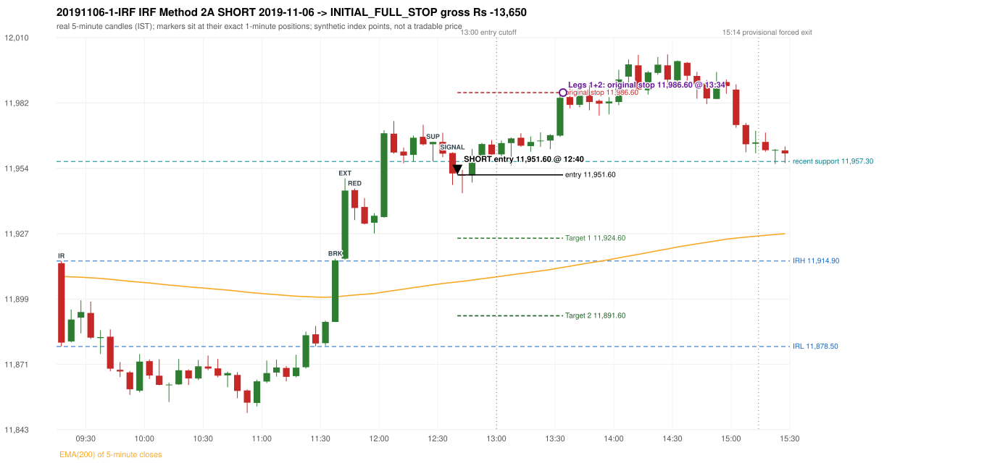

# Trading journal - 2019-11-06 (Wednesday)

> Phase 4 historical validation, window D_TV (Window D 2019-01-01..2019-12-31 (secondary vendor minutes); status EXPLORATORY). The FROZEN Phase 3.6 configuration (IRF, ORB, PDR body-based, PDS, RF; shared controller) on a different data source. HISTORICAL RESEARCH ONLY: the strategy was developed using later data. full calendar year from the secondary vendor only; overlap with 5paisa (2019-03..12) shows systematically different bars Synthetic NIFTY 50 index-point P&L (the index is not tradable). The owner's review status is intentionally blank.

## A. Trading day overview

| item | value |
|---|---|
| Date / weekday | 2019-11-06 / Wednesday |
| Session type | USABLE_WITH_FLAGS / VALID |
| Original session open (first 1-minute open) | 11,914.00 |
| Previous session | 2019-11-05 |
| Previous-day high / low (wicks included) | 11,978.90 / 11,861.90 |
| Previous-day highest BODY high (the body-based PDR ceiling; wicks ignored) | 11,974.10 |
| Previous-day official close / last 5-minute close | 11,917.20 / 11,917.70 |
| Raw engine records / confirmed signals / fully valid signals | 8 / 4 / 3 |
| Setups that did not complete (invalidated / incomplete) | 4 |
| Executed trades | 1 20191106-1-IRF |
| Gross P&L (Rs, synthetic) | -13,650.00 |
| Illustrative net P&L (Rs; Rs 500/trade + 0.5 pt/fill) | -14,540.00 |
| Day-end portfolio status | SECOND_TRADE_ELIGIBLE |
| Manual journal trades (matched / unmatched) | 0 (0 / 0) |
| Extra automated trades | 0 |

## B. Daily strategy signal timeline (confirmed signals, chronological)

| time | strategy | method | dir | entry-rule status | valid for execution | <= 13:00 | portfolio state | accepted / ignored | specific reason | competing (same minute) |
|---|---|---|---|---|---|---|---|---|---|---|
| 12:40 | IRF | Method 2A | SHORT | PROPOSAL_DEPENDENT | True | True | FIRST_TRADE_ACTIVE | ACCEPTED -> 20191106-1-IRF | first eligible signal of the day; trade 1: INITIAL_FULL_STOP |  |
| 13:15 | IRF | Method 2B | SHORT | PROPOSAL_DEPENDENT | True | False | FIRST_TRADE_ACTIVE | IGNORED | POSITION_ACTIVE (signal kept for diagnostics only; never reused) [blocked by IRF#1] |  |
| 14:50 | IRF | Method 2A | SHORT | PROPOSAL_DEPENDENT | True | False | SECOND_TRADE_ELIGIBLE | REJECTED | SECOND_TRADE_RESTRICTED_TO_PDR_PDS [blocked by IRF#1] |  |
| 15:30 | IRF | Method 2A | SHORT | PROPOSAL_DEPENDENT | False | False | SECOND_TRADE_ELIGIBLE | REJECTED | SECOND_TRADE_RESTRICTED_TO_PDR_PDS [blocked by IRF#1] |  |

Engine setups that did not complete (4); the complete list with failed rule ids is in `rejected_signals.csv`:

| candle | strategy | method | dir | status | precise reason | failed rules |
|---|---|---|---|---|---|---|
| 15:25 | IRF | Method 1/2 | SHORT | INCOMPLETE_AT_EOD | SESSION_ENDED_BEFORE_CONFIRMATION |  |
| 09:15 | ORB | Method 2 | SHORT | INVALIDATED | TREND:EMA_PREV_SESSION_CLOSE wrong side | ORB-TREND-001;ORB-TREND-002 |
| 09:15 | PDS | Method 1/2/3 | SHORT | INVALIDATED | GAP_DOWN_OPEN_NOT_BELOW_ZONE | PDS-006 |
| 11:20 | RF | RF | LONG | INVALIDATED | GAP_NOT_UP(DOWN) | RF-003 |

## C. Detailed trade journals

### 20191106-1-IRF: IRF Method 2A SHORT (FIRST trade)

Chart: 

**Rule configuration:** CFG-phase36_body_based-866f954e55 - signal verification status **PROPOSAL_DEPENDENT** (never VERIFIED while a rule rests on a proposal).

#### 1. Setup identification

IRF Method 2A SHORT: the 11:35-11:40 candle closed at 11,915.20, above IRH 11,914.90, and the next candle did not close back inside the range, so the setup is Method 2 and price stayed above it until the trigger. Extension candle 11:40-11:45, red candle 11:45-11:50. The trigger came 12 candles after the breakout candle: a completed candle closed below the recent pullback-low support (12:35-12:40); confirmed at 12:40 with close 11,952.20. Entry reference close 11,952.20 is 37.30 points above IRH 11,914.90.

#### 2. Candle and indicator calculations

| role | session | candle | O | H | L | C | range | body % | upper wick % | lower wick % | direction | EMA(200) | strong bull / bear | pin bull / bear | small (body<=30%) | used for |
|---|---|---|---|---|---|---|---|---|---|---|---|---|---|---|---|---|
| initial_range_candle | TODAY | 09:15-09:20 | 11,914.00 | 11,914.90 | 11,878.50 | 11,880.20 | 36.40 | 92.86 | 2.47 | 4.67 | BEARISH | 11,908.34 | False / True | False / False | False | initial range = high/low of the 09:15 candle |
| signal_candle | TODAY | 12:35-12:40 | 11,960.90 | 11,961.20 | 11,947.30 | 11,952.20 | 13.90 | 62.59 | 2.16 | 35.25 | BEARISH | 11,905.81 | False / False | False / False | False | candle whose close completed the trigger |
| breakout_candle | TODAY | 11:35-11:40 | 11,889.00 | 11,915.90 | 11,888.90 | 11,915.20 | 27.00 | 97.04 | 2.59 | 0.37 | BULLISH | 11,899.63 | True / False | False / False | False | breakout candle: a completed candle closing above IRH |
| extension_candle | TODAY | 11:40-11:45 | 11,915.90 | 11,950.10 | 11,915.40 | 11,944.90 | 34.70 | 83.57 | 14.99 | 1.44 | BULLISH | 11,900.08 | True / False | False / False | False | extension: first later candle trading above the breakout candle's high |
| red_candle | TODAY | 11:45-11:50 | 11,945.10 | 11,945.80 | 11,932.30 | 11,937.50 | 13.50 | 56.30 | 5.19 | 38.52 | BEARISH | 11,900.45 | False / False | False / False | False | first red candle during the extension |
| support_pivot | TODAY | 12:25-12:30 | 11,964.60 | 11,965.70 | 11,957.30 | 11,965.60 | 8.40 | 11.90 | 1.19 | 86.90 | BULLISH | 11,904.78 | False / False | True / False | True | recent support: latest 3-candle fractal low formed after the breakout |

Every condition, with the rule, the calculation, the observed values and the result:

| # | group | rule | result | status / numeric definition | calculation | observed | required | available at | why it matters |
|---|---|---|---|---|---|---|---|---|---|
| 1 | SELECTION | SEL-FIRST-001 | PASS | USER_APPROVED / USER_APPROVED | earliest CONFIRMED signal of the day across IRF/ORB/PDR/PDS/RF that passed the controller's checks | 0 confirmed signal(s) earlier today; 4 confirmed signals in the day in total, this one at 12:40 | no earlier executable signal | 2019-11-06 12:40 | the shared controller trades only the first valid signal; the five strategies are not independent positions |
| 2 | SELECTION | SEL-TIE-001 | PASS | USER_APPROVED / USER_APPROVED | other CONFIRMED signals with exactly the same confirmation timestamp | none | no different-strategy / opposite-direction signal in the same minute (otherwise an unresolved conflict, no trade) | 2019-11-06 12:40 | an unresolved same-minute collision would have produced no trade at all |
| 3 | SELECTION | ENTRY-CUTOFF-001 | PASS | USER_APPROVED / USER_APPROVED | fill timestamp vs 13:00:00 IST | signal confirmed 12:40; fill 12:40 | fill at or before 13:00:00 IST | 2019-11-06 12:40 | no new position may be entered with a fill after 13:00 IST |
| 4 | SELECTION | EXE-FILL-001 | PASS | PROPOSED_FOR_REVIEW / PROPOSED_FOR_REVIEW | fill = open of the 1-minute bar that starts at the signal candle's end | bar 12:40 O 11,951.60 H 11,953.70 L 11,949.70 C 11,951.50; executable=True; entry 11,951.60 | fill bar exists, starts exactly at the signal end, is fillable; entry = its open | 2019-11-06 12:40 | a 5-minute signal is known only when its candle closes; the first price that can be traded is the next minute's open |
| 5 | SELECTION | DAY-MAX-001 | PASS | USER_APPROVED / USER_APPROVED | number of entries today | trade 1 of at most 2 | <= 2 entries per day | 2019-11-06 12:40 | daily trade cap |
| 6 | SETUP | IRF-GLOBAL-001 | PASS | SOURCE_VERIFIED / EXPLICIT_IN_SOURCE | initial range = high and low (wicks included) of the first completed 5-minute candle | 09:15-09:20 IRH 11,914.90, IRL 11,878.50 (range 36.40; engine recorded IRH 11,914.90, IRL 11,878.50) | high/low of the 09:15-09:20 candle | 2019-11-06 09:20 | all three IRF methods measure price against this range |
| 7 | SETUP | IRF-GLOBAL-003 | PASS | SOURCE_VERIFIED / EXPLICIT_IN_SOURCE | closes confirm, wicks do not: every trigger is evaluated on a completed 5-minute candle | trigger candle 12:35-12:40 was complete when the signal was stamped 12:40; decision uses its close 11,952.20 | completed candle close, not an intra-candle wick | 2019-11-06 12:40 | an intra-candle wick can reverse before the candle closes |
| 8 | SETUP | IRF-GLOBAL-002 | PASS | SOURCE_VERIFIED / EXPLICIT_IN_SOURCE | direction | SHORT (IRF trades short only) | short only | 2019-11-06 12:40 | IRF fades failed upside breakouts |
| 9 | SETUP | IRF-M2-001 | PASS | SOURCE_VERIFIED / EXPLICIT_IN_SOURCE | breakout candle close vs IRH | 11:35-11:40 O 11,889.00 H 11,915.90 L 11,888.90 C 11,915.20; range 27.00, body 26.20 (97.04%), upper wick 0.70 (2.59%), lower wick 0.10 (0.37%), bullish; close 11,915.20 is 0.30 points above IRH 11,914.90 | close > IRH (a wick above IRH is not a breakout) | 2019-11-06 11:40 | starts every IRF setup |
| 10 | SETUP | IRF-M2-004 | PASS | SOURCE_VERIFIED / EXPLICIT_IN_SOURCE | the candle after the breakout must NOT close back inside the range (else the setup is Method 1) | 11:40 close 11,944.90 vs [11,878.50, 11,914.90) | not (IRL <= close < IRH) | 2019-11-06 11:45 | separates Method 2 (price holds above) from Method 1 (immediate failure) |
| 11 | SETUP | IRF-M2-002 | PASS | SOURCE_VERIFIED / QUALITATIVE_SOURCE_NUMERIC_DEFINITION_PROPOSED_FOR_REVIEW | extension = a later candle whose high exceeds the breakout candle's high (research definition E1) | 11:40 high 11,950.10 vs breakout candle high 11,915.90 (+34.20) | high > breakout candle high | 2019-11-06 11:45 | the guide says price 'extends further upward'; the numeric test is a proposal |
| 12 | SETUP | IRF-M2-003 | PASS | SOURCE_VERIFIED / QUALITATIVE_SOURCE_NUMERIC_DEFINITION_PROPOSED_FOR_REVIEW | a red candle (close < open) forms after the extension | 11:45-11:50 O 11,945.10 H 11,945.80 L 11,932.30 C 11,937.50; range 13.50, body 7.60 (56.30%), upper wick 0.70 (5.19%), lower wick 5.20 (38.52%), bearish | close < open, at or after the candle following the extension | 2019-11-06 11:50 | the red candle shows the first pause/reversal inside the extension |
| 13 | CONFIRMATION | IRF-M2A-001 | PASS | SOURCE_VERIFIED / QUALITATIVE_SOURCE_NUMERIC_DEFINITION_PROPOSED_FOR_REVIEW | recent support = latest 3-candle fractal low (k=1) among candles b+1 ... i-2 | 12:25 low 11,957.30; neighbours' lows 11,964.10 (12:20) and 11,959.10 (12:30) are not lower; engine recorded support 11,957.30 | pivot low known before the trigger candle | 2019-11-06 12:35 | the support is the level whose break completes Method 2A (the exact 'pullback low' definition is a proposal) |
| 14 | CONFIRMATION | IRF-M2A-002 | PASS | SOURCE_VERIFIED / EXPLICIT_WORDING_DETAIL_PROPOSED_FOR_REVIEW | trigger candle closes below recent support | 12:35 close 11,952.20 vs support 11,957.30: 5.10 points below | close < support (close, not wick) | 2019-11-06 12:40 | completes Method 2A |
| 15 | CONFIRMATION | IRF-M2-005 | PASS | SOURCE_VERIFIED / EXPLICIT_IN_SOURCE | chronology: the red candle precedes the break candle | red candle 11:45, break candle 12:35 | red candle index < break candle index (m2a_break_may_be_red_candle = False) | 2019-11-06 12:40 | a red candle alone is not confirmation; a level break is required |
| 16 | EXECUTION | EXE-STOP-001 | PASS | USER_APPROVED / USER_APPROVED | initial stop = entry + 35 points | entry 11,951.60 -> stop 11,986.60 | stop 35 index points (BASELINE) | 2019-11-06 12:40 | defines the loss if the setup fails before Target 1 |
| 17 | EXECUTION | EXE-T1-001 | PASS | SOURCE_VERIFIED / EXPLICIT_IN_SOURCE | Target 1 = entry +/- 27 points | T1 11,924.60 | 27 points | 2019-11-06 12:40 | Leg 1 (3 lots) is booked at Target 1 |
| 18 | EXECUTION | IRF-TGT-001 | PASS | SOURCE_VERIFIED / EXPLICIT_IN_SOURCE | Target 2 = entry +/- 60 points | T2 11,891.60 | 60 points | 2019-11-06 12:40 | Leg 2 (3 lots) is booked at Target 2 |
| 19 | EXECUTION | POST-T1-STOP-006 | PASS | USER_APPROVED / USER_APPROVED | after T1 the Leg-2 stop = entry + 6 (no trailing) | post-T1 stop 11,957.60 | entry -6 (LONG) / +6 (SHORT) | 2019-11-06 12:40 | protects the remaining three lots once the first three are booked |
| 20 | EXECUTION | SIZE-LOT-001 | PASS | USER_APPROVED / USER_APPROVED | 6 lots x 65 = 390, Leg 1 = 3 lots = 195, Leg 2 = 195 | 6 lots, lot size 65, legs 3+3 | 6 lots in two equal legs | 2019-11-06 12:40 | position size for the synthetic P&L |
| 21 | NOTE | IRF-M2-006 | UNRESOLVED | UNRESOLVED / UNRESOLVED | delay between the breakout candle and this trigger; expiry rule | 12 candles after the breakout; expiry none configured | the source states no expiry | 2019-11-06 12:40 | an old breakout can still trigger hours later |
| 22 | NOTE | IRF-M2-006 | UNRESOLVED | UNRESOLVED / UNRESOLVED | did price stay above IRH between the breakout and the trigger? | 0 closes at or below IRH between 11:40 and 12:35; trigger close 11,952.20 above IRH 11,914.90 | the engine does not require price to stay above IRH | 2019-11-06 12:40 | the guide describes price 'holding above IRH and keeping rising'; the code only needs the level break |
| 23 | NOTE | IRF-GLOBAL-004 | UNRESOLVED | UNRESOLVED / UNRESOLVED | which close above IRH of the session produced this attempt; repeat setups | this breakout is upward crossing no. 1 of the session (a close above IRH after a close at/below it) | the source states no first-breakout-only, re-arming, expiry or trades-per-day rule | 2019-11-06 12:40 | IRF re-arms on every later breakout in the code, producing many raw setups; the controller keeps only the first |
| 24 | NOTE | NOTE-IRF-REPEATED-SETUPS | NOT_APPLICABLE | NOT_A_RULE / NOT_A_REGISTRY_RULE | other IRF signals later in the session (not traded) | 3 further confirmed IRF signal(s): Method 2B@13:15, Method 2A@14:50, Method 2A@15:30 | disclosure of repeated raw setups | 2019-11-06 12:40 | repeated raw IRF setups are not hidden; they are logged as ignored |
| 25 | NOTE | IRF-SL-001 | NOT_APPLICABLE | SOURCE_VERIFIED / QUALITATIVE_SOURCE_NUMERIC_DEFINITION_PROPOSED_FOR_REVIEW | the guide's 35-or-40 rule: 35 if the most recent green candle's high is within 35 points of entry, else 40 | most recent green candle high 11,965.70 is 14.10 points from the entry 11,951.60: the guide's rule would select 35 points; the baseline applies a fixed 35 (USER_APPROVED research baseline; the 35-vs-40 selection and the 40-point variant are separate labelled scenarios) | source selection rule | 2019-11-06 12:40 | the stop distance is a modelling choice and changes losses, not entries |
| 26 | NOTE | NOTE-UNRESOLVED-DEPENDENCIES | UNRESOLVED | NOT_A_RULE / NOT_A_REGISTRY_RULE | rules the signal depends on that the sources leave unresolved | engine-recorded unresolved rule ids: IRF-GLOBAL-004; verification status PROPOSAL_DEPENDENT | n/a (disclosure) | 2019-11-06 12:40 | the entry is only as verified as the rules it rests on |

#### 3. Entry decision and explanation

IRF Method 2A SHORT: the 11:35-11:40 candle closed at 11,915.20, above IRH 11,914.90, and the next candle did not close back inside the range, so the setup is Method 2 and price stayed above it until the trigger. Extension candle 11:40-11:45, red candle 11:45-11:50. The trigger came 12 candles after the breakout candle: a completed candle closed below the recent pullback-low support (12:35-12:40); confirmed at 12:40 with close 11,952.20. Entry reference close 11,952.20 is 37.30 points above IRH 11,914.90.

**Why this trade ahead of the other strategies:** This IRF Method 2A signal was the earliest executable signal of the day: 0 confirmed signal(s) earlier, 0 other in the same minute. 3 later confirmed signal(s) (IRF x3) are logged as ignored or rejected. State of the other four engines at that moment: [ORB: Method 2 invalidated at 09:15: TREND:EMA_PREV_SESSION_CLOSE wrong side] [PDR: no setup record before this time (a base condition was not met, or nothing triggered)] [PDS: Method 1/2/3 invalidated at 09:15: GAP_DOWN_OPEN_NOT_BELOW_ZONE] [RF: RF invalidated at 11:20: GAP_NOT_UP(DOWN)]

#### 4. Actual entry execution

| item | value |
|---|---|
| Signal candle | 12:35-12:40 |
| Signal confirmed | 2019-11-06 12:40 |
| Fill timestamp | 2019-11-06 12:40 |
| Entry price | 11,951.60 |
| Source partition / 1-minute bar | data/phase4/processed/TECHNOVUS_1M/nifty50/year=2019/month=11/candles.parquet / 2019-11-06 12:40 |
| Source bar O / H / L / C | 11,951.60 / 11,953.70 / 11,949.70 / 11,951.50 |
| Fill assumption | open of the 1-minute bar starting at the signal candle's end (EXE-FILL-001, PROPOSED causal convention) |
| Initial stop / T1 / T2 / post-T1 stop | 11,986.60 / 11,924.60 / 11,891.60 / 11,957.60 |
| Position | 6 lots x 65 = 390 units (Leg 1 195, Leg 2 195) |

#### 5-8. Trade progress, Target 1, post-T1 stop and final exit

Between the 12:40 entry bar and the final exit (55 one-minute bars) the best excursion in favour was 7.80 points at 12:41 and the worst against was 35.30 points at 13:34. At 13:34 price reached the original stop 11,986.60 before Target 1 11,924.60, so all six lots exited together at 11,986.60. This is an INITIAL_FULL_STOP: one more trade is allowed that day, only a newly confirmed PDR/PDS signal.

| leg | qty | exit time | exit price | reason | source 1-minute bar | O / H / L / C | gross points | gross Rs | slippage pts | flags |
|---|---|---|---|---|---|---|---|---|---|---|
| 1 | 195 | 13:34 | 11,986.60 | ORIGINAL_STOP_BEFORE_T1 | 13:34 | 11,969.10 / 11,986.90 / 11,968.80 / 11,984.40 | -35.00 | -6,825.00 | 0.00 |  |
| 2 | 195 | 13:34 | 11,986.60 | ORIGINAL_STOP_BEFORE_T1 | 13:34 | 11,969.10 / 11,986.90 / 11,968.80 / 11,984.40 | -35.00 | -6,825.00 | 0.00 |  |

Exit evidence per leg:

* Leg 1: 1-minute bar 13:34 O 11,969.10 H 11,986.90 L 11,968.80 C 11,984.40: high 11,986.90 reached the original stop 11,986.60 before Target 1 11,924.60 was touched; both legs exit at the stop level 11,986.60
* Leg 2: 1-minute bar 13:34 O 11,969.10 H 11,986.90 L 11,968.80 C 11,984.40: high 11,986.90 reached the original stop 11,986.60 before Target 1 11,924.60 was touched; both legs exit at the stop level 11,986.60

#### 9. Gross and illustrative net P&L

| item | value (Rs) |
|---|---|
| Leg 1 gross | -6,825.00 |
| Leg 2 gross | -6,825.00 |
| Trade gross (= Leg 1 + Leg 2) | -13,650.00 |
| Illustrative fixed cost | -500.00 |
| Illustrative slippage (0.5 pt on every fill, entry + exits, all units) | -390.00 |
| Illustrative net | -14,540.00 |

#### 10. Manual journal comparison

No manual journal exists for this period; no comparison.

## D. Manual journal comparison

No manual journal exists for this period (the manual journal covers 2025-09-01 .. 2026-08-31 only); no comparison is made and no automated trade is labelled 'extra'.

## E. Daily conclusion

* **Traded:** 20191106-1-IRF - IRF Method 2A SHORT at 12:40 (entry 11,951.60), outcome INITIAL_FULL_STOP, gross Rs -13,650.00, illustrative net Rs -14,540.00. **Why:** This IRF Method 2A signal was the earliest executable signal of the day: 0 confirmed signal(s) earlier, 0 other in the same minute. 3 later confirmed signal(s) (IRF x3) are logged as ignored or rejected. State of the other four engines at that moment: [ORB: Method 2 invalidated at 09:15: TREND:EMA_PREV_SESSION_CLOSE wrong side] [PDR: no setup record before this time (a base condition was not met, or nothing triggered)] [PDS: Method 1/2/3 invalidated at 09:15: GAP_DOWN_OPEN_NOT_BELOW_ZONE] [RF: RF invalidated at 11:20: GAP_NOT_UP(DOWN)] **How it ended:** At 13:34 price reached the original stop 11,986.60 before Target 1 11,924.60, so all six lots exited together at 11,986.60. This is an INITIAL_FULL_STOP: one more trade is allowed that day, only a newly confirmed PDR/PDS signal.
* **Ignored / rejected signals:** IRF REJECTED SECOND_TRADE_RESTRICTED_TO_PDR_PDS x2; IRF IGNORED POSITION_ACTIVE x1
* **Open strategy-definition issues that affected this day:** IRF-GLOBAL-004 (NOT STATED: how many IRF trades per day, a latest entry time, and whether a new breakout may re-arm a setup after a signal), IRF-M2-006 (How long a Method 2 setup stays valid (expiry / invalidation before a level breaks) is not stated), NOTE-UNRESOLVED-DEPENDENCIES
* **Automated triage (not an approval; the owner's review status stays blank):** TRADED_NO_FLAGS
