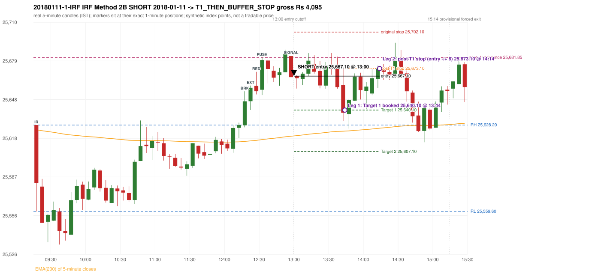

# Trading journal - 2018-01-11 (Thursday)

> Phase 5 cross-index test, BANKNIFTY window C (Window C 2018-01-01..2018-12-31 (secondary-source minutes); status EXPLORATORY). The FROZEN Phase 3.6 configuration (IRF, ORB, PDR body-based, PDS, RF; shared controller) with the NIFTY index-point stops and targets UNCHANGED on the BANKNIFTY index price. INDEX-POINT RESULTS ONLY: no option premium is used or estimated. HISTORICAL RESEARCH ONLY: the strategy was developed using later NIFTY data. 5paisa returns no minute data before 2019-03-01, so this year rests on one unattributed vendor with nothing to check it against Synthetic BANKNIFTY index-point P&L (the index is not tradable). The owner's review status is intentionally blank.

## A. Trading day overview

| item | value |
|---|---|
| Date / weekday | 2018-01-11 / Thursday |
| Session type | USABLE_WITH_FLAGS / VALID |
| Original session open (first 1-minute open) | 25,628.20 |
| Previous session | 2018-01-10 |
| Previous-day high / low (wicks included) | 25,715.70 / 25,527.95 |
| Previous-day highest BODY high (the body-based PDR ceiling; wicks ignored) | 25,709.90 |
| Previous-day official close / last 5-minute close | 25,617.30 / 25,590.15 |
| Raw engine records / confirmed signals / fully valid signals | 10 / 5 / 5 |
| Setups that did not complete (invalidated / incomplete) | 5 |
| Executed trades | 1 20180111-1-IRF |
| Gross P&L (Rs, synthetic) | 4,095.00 |
| Illustrative net P&L (Rs; Rs 500/trade + 0.5 pt/fill) | 3,205.00 |
| Day-end portfolio status | DAY_FINISHED |
| Manual journal trades (matched / unmatched) | 0 (0 / 0) |
| Extra automated trades | 0 |

## B. Daily strategy signal timeline (confirmed signals, chronological)

| time | strategy | method | dir | entry-rule status | valid for execution | <= 13:00 | portfolio state | accepted / ignored | specific reason | competing (same minute) |
|---|---|---|---|---|---|---|---|---|---|---|
| 13:00 | IRF | Method 2B | SHORT | PROPOSAL_DEPENDENT | True | True | FIRST_TRADE_ACTIVE | ACCEPTED -> 20180111-1-IRF | first eligible signal of the day; trade 1: T1_THEN_BUFFER_STOP |  |
| 13:35 | IRF | Method 2B | SHORT | PROPOSAL_DEPENDENT | True | False | FIRST_TRADE_ACTIVE | IGNORED | POSITION_ACTIVE (signal kept for diagnostics only; never reused) [blocked by IRF#1] |  |
| 14:35 | IRF | Method 2B | SHORT | PROPOSAL_DEPENDENT | True | False | DAY_FINISHED | IGNORED | DAY_FINISHED [blocked by IRF#1] |  |
| 14:50 | IRF | Method 1 | SHORT | PROPOSAL_DEPENDENT | True | False | DAY_FINISHED | IGNORED | DAY_FINISHED [blocked by IRF#1] |  |
| 15:00 | IRF | Method 1 | SHORT | PROPOSAL_DEPENDENT | True | False | DAY_FINISHED | IGNORED | DAY_FINISHED [blocked by IRF#1] |  |

Engine setups that did not complete (5); the complete list with failed rule ids is in `rejected_signals.csv`:

| candle | strategy | method | dir | status | precise reason | failed rules |
|---|---|---|---|---|---|---|
| 14:30 | IRF | Method 1/2 | SHORT | INCOMPLETE_AT_EOD | SESSION_ENDED_BEFORE_CONFIRMATION |  |
| 09:15 | ORB | Gap/200DMA | LONG | INVALIDATED | CLOSE_NOT_BEYOND_MA | ORB-GAP-LONG-003 |
| 09:15 | ORB | Method 2 | SHORT | INVALIDATED | TRENDLINE_NOT_SUPPORTIVE | ORB-M2-SHORT-001 |
| 09:15 | PDR | PDR | LONG | INVALIDATED | OPEN_NOT_STRICTLY_ABOVE_ZONE |  |
| 09:30 | RF | RF | LONG | INVALIDATED | TREND:EMA_PREV_SESSION_CLOSE wrong side | RF-001;RF-008 |

## C. Detailed trade journals

### 20180111-1-IRF: IRF Method 2B SHORT (FIRST trade)

Chart: 

**Rule configuration:** CFG-phase36_body_based-866f954e55 - signal verification status **PROPOSAL_DEPENDENT** (never VERIFIED while a rule rests on a proposal).

#### 1. Setup identification

IRF Method 2B SHORT: the 12:15-12:20 candle closed at 25,647.05, above IRH 25,628.20, and the next candle did not close back inside the range, so the setup is Method 2 and price stayed above it until the trigger. Extension candle 12:20-12:25, red candle 12:25-12:30. The trigger came 8 candles after the breakout candle: a red candle closed back below the first-push resistance after price had traded above it (12:55-13:00); confirmed at 13:00 with close 25,666.25. Entry reference close 25,666.25 is 38.05 points above IRH 25,628.20.

#### 2. Candle and indicator calculations

| role | session | candle | O | H | L | C | range | body % | upper wick % | lower wick % | direction | EMA(200) | strong bull / bear | pin bull / bear | small (body<=30%) | used for |
|---|---|---|---|---|---|---|---|---|---|---|---|---|---|---|---|---|
| initial_range_candle | TODAY | 09:15-09:20 | 25,628.20 | 25,628.20 | 25,559.60 | 25,582.15 | 68.60 | 67.13 | 0.00 | 32.87 | BEARISH | 25,624.44 | False / False | False / False | False | initial range = high/low of the 09:15 candle |
| signal_candle | TODAY | 12:55-13:00 | 25,682.95 | 25,683.40 | 25,661.75 | 25,666.25 | 21.65 | 77.14 | 2.08 | 20.79 | BEARISH | 25,619.36 | False / False | False / False | False | candle whose close completed the trigger |
| breakout_candle | TODAY | 12:15-12:20 | 25,628.00 | 25,655.05 | 25,626.40 | 25,647.05 | 28.65 | 66.49 | 27.92 | 5.58 | BULLISH | 25,615.21 | False / False | False / False | False | breakout candle: a completed candle closing above IRH |
| extension_candle | TODAY | 12:20-12:25 | 25,647.15 | 25,659.60 | 25,640.15 | 25,657.85 | 19.45 | 55.01 | 9.00 | 35.99 | BULLISH | 25,615.64 | False / False | False / False | False | extension: first later candle trading above the breakout candle's high |
| red_candle | TODAY | 12:25-12:30 | 25,659.30 | 25,670.50 | 25,652.55 | 25,655.10 | 17.95 | 23.40 | 62.40 | 14.21 | BEARISH | 25,616.03 | False / False | False / True | True | first red candle during the extension |
| first_push_top | TODAY | 12:30-12:35 | 25,656.25 | 25,681.85 | 25,652.00 | 25,679.85 | 29.85 | 79.06 | 6.70 | 14.24 | BULLISH | 25,616.67 | True / False | False / False | False | recent resistance = top of the first push after the breakout |

Every condition, with the rule, the calculation, the observed values and the result:

| # | group | rule | result | status / numeric definition | calculation | observed | required | available at | why it matters |
|---|---|---|---|---|---|---|---|---|---|
| 1 | SELECTION | SEL-FIRST-001 | PASS | USER_APPROVED / USER_APPROVED | earliest CONFIRMED signal of the day across IRF/ORB/PDR/PDS/RF that passed the controller's checks | 0 confirmed signal(s) earlier today; 5 confirmed signals in the day in total, this one at 13:00 | no earlier executable signal | 2018-01-11 13:00 | the shared controller trades only the first valid signal; the five strategies are not independent positions |
| 2 | SELECTION | SEL-TIE-001 | PASS | USER_APPROVED / USER_APPROVED | other CONFIRMED signals with exactly the same confirmation timestamp | none | no different-strategy / opposite-direction signal in the same minute (otherwise an unresolved conflict, no trade) | 2018-01-11 13:00 | an unresolved same-minute collision would have produced no trade at all |
| 3 | SELECTION | ENTRY-CUTOFF-001 | PASS | USER_APPROVED / USER_APPROVED | fill timestamp vs 13:00:00 IST | signal confirmed 13:00; fill 13:00 | fill at or before 13:00:00 IST | 2018-01-11 13:00 | no new position may be entered with a fill after 13:00 IST |
| 4 | SELECTION | EXE-FILL-001 | PASS | PROPOSED_FOR_REVIEW / PROPOSED_FOR_REVIEW | fill = open of the 1-minute bar that starts at the signal candle's end | bar 13:00 O 25,667.10 H 25,667.95 L 25,661.00 C 25,664.75; executable=True; entry 25,667.10 | fill bar exists, starts exactly at the signal end, is fillable; entry = its open | 2018-01-11 13:00 | a 5-minute signal is known only when its candle closes; the first price that can be traded is the next minute's open |
| 5 | SELECTION | DAY-MAX-001 | PASS | USER_APPROVED / USER_APPROVED | number of entries today | trade 1 of at most 2 | <= 2 entries per day | 2018-01-11 13:00 | daily trade cap |
| 6 | SETUP | IRF-GLOBAL-001 | PASS | SOURCE_VERIFIED / EXPLICIT_IN_SOURCE | initial range = high and low (wicks included) of the first completed 5-minute candle | 09:15-09:20 IRH 25,628.20, IRL 25,559.60 (range 68.60; engine recorded IRH 25,628.20, IRL 25,559.60) | high/low of the 09:15-09:20 candle | 2018-01-11 09:20 | all three IRF methods measure price against this range |
| 7 | SETUP | IRF-GLOBAL-003 | PASS | SOURCE_VERIFIED / EXPLICIT_IN_SOURCE | closes confirm, wicks do not: every trigger is evaluated on a completed 5-minute candle | trigger candle 12:55-13:00 was complete when the signal was stamped 13:00; decision uses its close 25,666.25 | completed candle close, not an intra-candle wick | 2018-01-11 13:00 | an intra-candle wick can reverse before the candle closes |
| 8 | SETUP | IRF-GLOBAL-002 | PASS | SOURCE_VERIFIED / EXPLICIT_IN_SOURCE | direction | SHORT (IRF trades short only) | short only | 2018-01-11 13:00 | IRF fades failed upside breakouts |
| 9 | SETUP | IRF-M2-001 | PASS | SOURCE_VERIFIED / EXPLICIT_IN_SOURCE | breakout candle close vs IRH | 12:15-12:20 O 25,628.00 H 25,655.05 L 25,626.40 C 25,647.05; range 28.65, body 19.05 (66.49%), upper wick 8.00 (27.92%), lower wick 1.60 (5.58%), bullish; close 25,647.05 is 18.85 points above IRH 25,628.20 | close > IRH (a wick above IRH is not a breakout) | 2018-01-11 12:20 | starts every IRF setup |
| 10 | SETUP | IRF-M2-004 | PASS | SOURCE_VERIFIED / EXPLICIT_IN_SOURCE | the candle after the breakout must NOT close back inside the range (else the setup is Method 1) | 12:20 close 25,657.85 vs [25,559.60, 25,628.20) | not (IRL <= close < IRH) | 2018-01-11 12:25 | separates Method 2 (price holds above) from Method 1 (immediate failure) |
| 11 | SETUP | IRF-M2-002 | PASS | SOURCE_VERIFIED / QUALITATIVE_SOURCE_NUMERIC_DEFINITION_PROPOSED_FOR_REVIEW | extension = a later candle whose high exceeds the breakout candle's high (research definition E1) | 12:20 high 25,659.60 vs breakout candle high 25,655.05 (+4.55) | high > breakout candle high | 2018-01-11 12:25 | the guide says price 'extends further upward'; the numeric test is a proposal |
| 12 | SETUP | IRF-M2-003 | PASS | SOURCE_VERIFIED / QUALITATIVE_SOURCE_NUMERIC_DEFINITION_PROPOSED_FOR_REVIEW | a red candle (close < open) forms after the extension | 12:25-12:30 O 25,659.30 H 25,670.50 L 25,652.55 C 25,655.10; range 17.95, body 4.20 (23.40%), upper wick 11.20 (62.40%), lower wick 2.55 (14.21%), bearish | close < open, at or after the candle following the extension | 2018-01-11 12:30 | the red candle shows the first pause/reversal inside the extension |
| 13 | CONFIRMATION | IRF-M2-005 | PASS | SOURCE_VERIFIED / EXPLICIT_IN_SOURCE | a red candle alone is not confirmation: a level break is required | red trigger candle 12:55 also closes below the resistance (see IRF-M2B-003) | a red candle plus a closing break of the level | 2018-01-11 13:00 | a red candle with no level break does not qualify |
| 14 | CONFIRMATION | IRF-M2B-001 | PASS | SOURCE_VERIFIED / QUALITATIVE_SOURCE_NUMERIC_DEFINITION_PROPOSED_FOR_REVIEW | recent resistance = first 3-candle fractal high (k=1) at/after the breakout candle (FIRST_PUSH_TOP) | 12:30 high 25,681.85; engine recorded 25,681.85 | first push top | 2018-01-11 12:40 | the level whose retake-and-fail completes Method 2B (definition is a proposal) |
| 15 | CONFIRMATION | IRF-M2B-002 | PASS | SOURCE_VERIFIED / QUALITATIVE_SOURCE_NUMERIC_DEFINITION_PROPOSED_FOR_REVIEW | price trades back above the resistance after the first push | first candle with high above 25,681.85: 12:50 high 25,688.00 | some candle after the first push has high > resistance (the push may be the trigger candle: m2b_push_must_precede_red_candle = False) | 2018-01-11 13:00 | the guide's figure shows three separate candles; the engine also accepts a single candle |
| 16 | CONFIRMATION | IRF-M2B-003 | PASS | SOURCE_VERIFIED / EXPLICIT_IN_SOURCE | trigger = a red candle closing back below the resistance | 12:55-13:00 O 25,682.95 H 25,683.40 L 25,661.75 C 25,666.25; range 21.65, body 16.70 (77.14%), upper wick 0.45 (2.08%), lower wick 4.50 (20.79%), bearish; close 25,666.25 vs resistance 25,681.85 | red candle and close < resistance | 2018-01-11 13:00 | completes Method 2B |
| 17 | EXECUTION | EXE-STOP-001 | PASS | USER_APPROVED / USER_APPROVED | initial stop = entry + 35 points | entry 25,667.10 -> stop 25,702.10 | stop 35 index points (BASELINE) | 2018-01-11 13:00 | defines the loss if the setup fails before Target 1 |
| 18 | EXECUTION | EXE-T1-001 | PASS | SOURCE_VERIFIED / EXPLICIT_IN_SOURCE | Target 1 = entry +/- 27 points | T1 25,640.10 | 27 points | 2018-01-11 13:00 | Leg 1 (3 lots) is booked at Target 1 |
| 19 | EXECUTION | IRF-TGT-001 | PASS | SOURCE_VERIFIED / EXPLICIT_IN_SOURCE | Target 2 = entry +/- 60 points | T2 25,607.10 | 60 points | 2018-01-11 13:00 | Leg 2 (3 lots) is booked at Target 2 |
| 20 | EXECUTION | POST-T1-STOP-006 | PASS | USER_APPROVED / USER_APPROVED | after T1 the Leg-2 stop = entry + 6 (no trailing) | post-T1 stop 25,673.10 | entry -6 (LONG) / +6 (SHORT) | 2018-01-11 13:00 | protects the remaining three lots once the first three are booked |
| 21 | EXECUTION | SIZE-LOT-001 | PASS | USER_APPROVED / USER_APPROVED | 6 lots x 65 = 390, Leg 1 = 3 lots = 195, Leg 2 = 195 | 6 lots, lot size 65, legs 3+3 | 6 lots in two equal legs | 2018-01-11 13:00 | position size for the synthetic P&L |
| 22 | NOTE | IRF-M2-006 | UNRESOLVED | UNRESOLVED / UNRESOLVED | delay between the breakout candle and this trigger; expiry rule | 8 candles after the breakout; expiry none configured | the source states no expiry | 2018-01-11 13:00 | an old breakout can still trigger hours later |
| 23 | NOTE | IRF-M2-006 | UNRESOLVED | UNRESOLVED / UNRESOLVED | did price stay above IRH between the breakout and the trigger? | 0 closes at or below IRH between 12:20 and 12:55; trigger close 25,666.25 above IRH 25,628.20 | the engine does not require price to stay above IRH | 2018-01-11 13:00 | the guide describes price 'holding above IRH and keeping rising'; the code only needs the level break |
| 24 | NOTE | IRF-GLOBAL-004 | UNRESOLVED | UNRESOLVED / UNRESOLVED | which close above IRH of the session produced this attempt; repeat setups | this breakout is upward crossing no. 1 of the session (a close above IRH after a close at/below it) | the source states no first-breakout-only, re-arming, expiry or trades-per-day rule | 2018-01-11 13:00 | IRF re-arms on every later breakout in the code, producing many raw setups; the controller keeps only the first |
| 25 | NOTE | NOTE-IRF-REPEATED-SETUPS | NOT_APPLICABLE | NOT_A_RULE / NOT_A_REGISTRY_RULE | other IRF signals later in the session (not traded) | 4 further confirmed IRF signal(s): Method 2B@13:35, Method 2B@14:35, Method 1@14:50, Method 1@15:00 | disclosure of repeated raw setups | 2018-01-11 13:00 | repeated raw IRF setups are not hidden; they are logged as ignored |
| 26 | NOTE | IRF-SL-001 | NOT_APPLICABLE | SOURCE_VERIFIED / QUALITATIVE_SOURCE_NUMERIC_DEFINITION_PROPOSED_FOR_REVIEW | the guide's 35-or-40 rule: 35 if the most recent green candle's high is within 35 points of entry, else 40 | most recent green candle high 25,688.00 is 20.90 points from the entry 25,667.10: the guide's rule would select 35 points; the baseline applies a fixed 35 (USER_APPROVED research baseline; the 35-vs-40 selection and the 40-point variant are separate labelled scenarios) | source selection rule | 2018-01-11 13:00 | the stop distance is a modelling choice and changes losses, not entries |
| 27 | NOTE | NOTE-UNRESOLVED-DEPENDENCIES | UNRESOLVED | NOT_A_RULE / NOT_A_REGISTRY_RULE | rules the signal depends on that the sources leave unresolved | engine-recorded unresolved rule ids: IRF-GLOBAL-004; verification status PROPOSAL_DEPENDENT | n/a (disclosure) | 2018-01-11 13:00 | the entry is only as verified as the rules it rests on |

#### 3. Entry decision and explanation

IRF Method 2B SHORT: the 12:15-12:20 candle closed at 25,647.05, above IRH 25,628.20, and the next candle did not close back inside the range, so the setup is Method 2 and price stayed above it until the trigger. Extension candle 12:20-12:25, red candle 12:25-12:30. The trigger came 8 candles after the breakout candle: a red candle closed back below the first-push resistance after price had traded above it (12:55-13:00); confirmed at 13:00 with close 25,666.25. Entry reference close 25,666.25 is 38.05 points above IRH 25,628.20.

**Why this trade ahead of the other strategies:** This IRF Method 2B signal was the earliest executable signal of the day: 0 confirmed signal(s) earlier, 0 other in the same minute. 4 later confirmed signal(s) (IRF x4) are logged as ignored or rejected. State of the other four engines at that moment: [ORB: Gap/200DMA invalidated at 09:15: CLOSE_NOT_BEYOND_MA; Method 2 invalidated at 09:15: TRENDLINE_NOT_SUPPORTIVE] [PDR: PDR invalidated at 09:15: OPEN_NOT_STRICTLY_ABOVE_ZONE] [PDS: no setup record before this time (a base condition was not met, or nothing triggered)] [RF: RF invalidated at 09:30: TREND:EMA_PREV_SESSION_CLOSE wrong side]

#### 4. Actual entry execution

| item | value |
|---|---|
| Signal candle | 12:55-13:00 |
| Signal confirmed | 2018-01-11 13:00 |
| Fill timestamp | 2018-01-11 13:00 |
| Entry price | 25,667.10 |
| Source partition / 1-minute bar | data/processed/banknifty/KAPRI_1M_BANKNIFTY/minutes/year=2018/month=01/candles.parquet / 2018-01-11 13:00 |
| Source bar O / H / L / C | 25,667.10 / 25,667.95 / 25,661.00 / 25,664.75 |
| Fill assumption | open of the 1-minute bar starting at the signal candle's end (EXE-FILL-001, PROPOSED causal convention) |
| Initial stop / T1 / T2 / post-T1 stop | 25,702.10 / 25,640.10 / 25,607.10 / 25,673.10 |
| Position | 6 lots x 65 = 390 units (Leg 1 195, Leg 2 195) |

#### 5-8. Trade progress, Target 1, post-T1 stop and final exit

Between the 13:00 entry bar and the final exit (75 one-minute bars) the best excursion in favour was 41.70 points at 13:45 and the worst against was 18.30 points at 13:31. At 13:44 price reached Target 1 25,640.10 and three lots exited. At 13:44 the remaining three lots' protective stop was set to 25,673.10 (entry + 6; no trailing, no further change); the engine applies it from the Target-1 bar onward and tests it within that same bar. At 14:14 the remaining three lots stopped out at 25,673.10. T1_THEN_BUFFER_STOP: no second trade that day (DAY-BUF-001).

| leg | qty | exit time | exit price | reason | source 1-minute bar | O / H / L / C | gross points | gross Rs | slippage pts | flags |
|---|---|---|---|---|---|---|---|---|---|---|
| 1 | 195 | 13:44 | 25,640.10 | TARGET_1 | 13:44 | 25,663.15 / 25,664.50 / 25,631.50 / 25,638.00 | 27.00 | 5,265.00 | 0.00 |  |
| 2 | 195 | 14:14 | 25,673.10 | POST_T1_STOP_ENTRY_MINUS_PLUS_6 | 14:14 | 25,664.30 / 25,675.40 / 25,663.80 / 25,672.95 | -6.00 | -1,170.00 | 0.00 |  |

Exit evidence per leg:

* Leg 1: 1-minute bar 13:44 O 25,663.15 H 25,664.50 L 25,631.50 C 25,638.00: low 25,631.50 reached Target 1 25,640.10; Leg 1 booked at the target level
* Leg 2: 1-minute bar 14:14 O 25,664.30 H 25,675.40 L 25,663.80 C 25,672.95: high 25,675.40 reached the post-T1 stop 25,673.10; Leg 2 exits at 25,673.10 at the stop level

#### 9. Gross and illustrative net P&L

| item | value (Rs) |
|---|---|
| Leg 1 gross | 5,265.00 |
| Leg 2 gross | -1,170.00 |
| Trade gross (= Leg 1 + Leg 2) | 4,095.00 |
| Illustrative fixed cost | -500.00 |
| Illustrative slippage (0.5 pt on every fill, entry + exits, all units) | -390.00 |
| Illustrative net | 3,205.00 |

#### 10. Manual journal comparison

No manual journal exists for this period; no comparison.

## D. Manual journal comparison

No manual journal exists for this period (the manual journal covers 2025-09-01 .. 2026-08-31 only); no comparison is made and no automated trade is labelled 'extra'.

## E. Daily conclusion

* **Traded:** 20180111-1-IRF - IRF Method 2B SHORT at 13:00 (entry 25,667.10), outcome T1_THEN_BUFFER_STOP, gross Rs 4,095.00, illustrative net Rs 3,205.00. **Why:** This IRF Method 2B signal was the earliest executable signal of the day: 0 confirmed signal(s) earlier, 0 other in the same minute. 4 later confirmed signal(s) (IRF x4) are logged as ignored or rejected. State of the other four engines at that moment: [ORB: Gap/200DMA invalidated at 09:15: CLOSE_NOT_BEYOND_MA; Method 2 invalidated at 09:15: TRENDLINE_NOT_SUPPORTIVE] [PDR: PDR invalidated at 09:15: OPEN_NOT_STRICTLY_ABOVE_ZONE] [PDS: no setup record before this time (a base condition was not met, or nothing triggered)] [RF: RF invalidated at 09:30: TREND:EMA_PREV_SESSION_CLOSE wrong side] **How it ended:** At 13:44 price reached Target 1 25,640.10 and three lots exited. At 13:44 the remaining three lots' protective stop was set to 25,673.10 (entry + 6; no trailing, no further change); the engine applies it from the Target-1 bar onward and tests it within that same bar. At 14:14 the remaining three lots stopped out at 25,673.10. T1_THEN_BUFFER_STOP: no second trade that day (DAY-BUF-001).
* **Ignored / rejected signals:** IRF IGNORED DAY_FINISHED x3; IRF IGNORED POSITION_ACTIVE x1
* **Open strategy-definition issues that affected this day:** IRF-GLOBAL-004 (NOT STATED: how many IRF trades per day, a latest entry time, and whether a new breakout may re-arm a setup after a signal), IRF-M2-006 (How long a Method 2 setup stays valid (expiry / invalidation before a level breaks) is not stated), NOTE-UNRESOLVED-DEPENDENCIES
* **Automated triage (not an approval; the owner's review status stays blank):** TRADED_NO_FLAGS

## Option-execution feasibility (information only; no option trade is simulated)

The index result above is an INDEX-POINT result on BANKNIFTY. It is not an option result: a move of N index points is not a move of N premium points (delta, gamma, theta, vega, spread and liquidity decide the premium).

| trade | strategy | index direction | long option it maps to | historical contract identified? | premium data available? | premium fill supportable? |
|---|---|---|---|---|---|---|
| 20180111-1-IRF | IRF | SHORT | BUY PUT (PE) | no | no | no |

Why: (1) the broker's instrument master lists only contracts that are live today, so the scrip code of a contract that existed on this date is not available; (2) historical candles can only be requested by scrip code; (3) the strike and expiry selection policy is an owner decision that has not been made (`options_feasibility/option_contract_selection_decisions.md`). No option entry, exit, premium or option P&L is shown, and none may be inferred from the index points.
