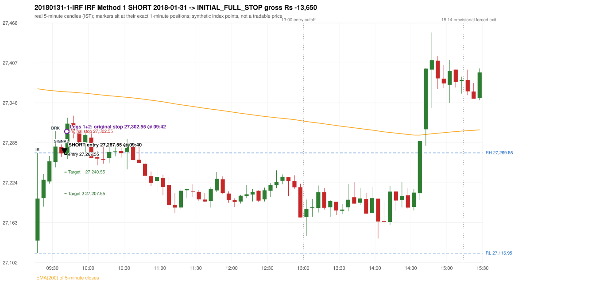
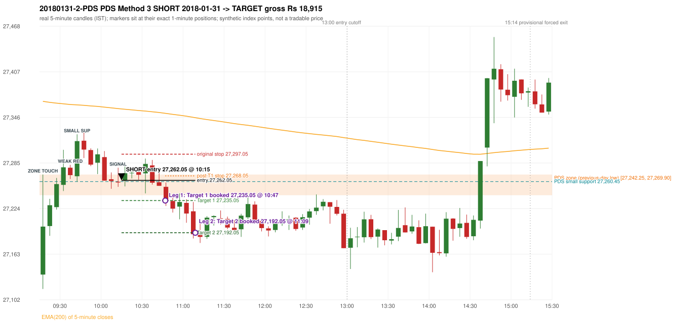

# Trading journal - 2018-01-31 (Wednesday)

> Phase 5 cross-index test, BANKNIFTY window C (Window C 2018-01-01..2018-12-31 (secondary-source minutes); status EXPLORATORY). The FROZEN Phase 3.6 configuration (IRF, ORB, PDR body-based, PDS, RF; shared controller) with the NIFTY index-point stops and targets UNCHANGED on the BANKNIFTY index price. INDEX-POINT RESULTS ONLY: no option premium is used or estimated. HISTORICAL RESEARCH ONLY: the strategy was developed using later NIFTY data. 5paisa returns no minute data before 2019-03-01, so this year rests on one unattributed vendor with nothing to check it against Synthetic BANKNIFTY index-point P&L (the index is not tradable). The owner's review status is intentionally blank.

## A. Trading day overview

| item | value |
|---|---|
| Date / weekday | 2018-01-31 / Wednesday |
| Session type | USABLE_WITH_FLAGS / VALID |
| Original session open (first 1-minute open) | 27,136.25 |
| Previous session | 2018-01-30 |
| Previous-day high / low (wicks included) | 27,466.85 / 27,242.25 |
| Previous-day highest BODY high (the body-based PDR ceiling; wicks ignored) | 27,466.85 |
| Previous-day official close / last 5-minute close | 27,269.05 / 27,268.50 |
| Raw engine records / confirmed signals / fully valid signals | 11 / 7 / 7 |
| Setups that did not complete (invalidated / incomplete) | 4 |
| Executed trades | 2 20180131-1-IRF;20180131-2-PDS |
| Gross P&L (Rs, synthetic) | 5,265.00 |
| Illustrative net P&L (Rs; Rs 500/trade + 0.5 pt/fill) | 3,485.00 |
| Day-end portfolio status | DAY_FINISHED |
| Manual journal trades (matched / unmatched) | 0 (0 / 0) |
| Extra automated trades | 0 |

## B. Daily strategy signal timeline (confirmed signals, chronological)

| time | strategy | method | dir | entry-rule status | valid for execution | <= 13:00 | portfolio state | accepted / ignored | specific reason | competing (same minute) |
|---|---|---|---|---|---|---|---|---|---|---|
| 09:40 | IRF | Method 1 | SHORT | PROPOSAL_DEPENDENT | True | True | FIRST_TRADE_ACTIVE | ACCEPTED -> 20180131-1-IRF | first eligible signal of the day; trade 1: INITIAL_FULL_STOP |  |
| 10:05 | IRF | Method 1 | SHORT | PROPOSAL_DEPENDENT | True | True | SECOND_TRADE_ELIGIBLE | REJECTED | SECOND_TRADE_RESTRICTED_TO_PDR_PDS [blocked by IRF#1] |  |
| 10:15 | PDS | Method 3 | SHORT | PROPOSAL_DEPENDENT | True | True | SECOND_TRADE_ACTIVE | ACCEPTED -> 20180131-2-PDS | permitted second trade: newly confirmed PDR/PDS after the original full stop; trade 2: TARGET |  |
| 10:30 | IRF | Method 1 | SHORT | PROPOSAL_DEPENDENT | True | True | SECOND_TRADE_ACTIVE | IGNORED | POSITION_ACTIVE (signal kept for diagnostics only; never reused) [blocked by PDS#2] |  |
| 10:40 | IRF | Method 1 | SHORT | PROPOSAL_DEPENDENT | True | True | SECOND_TRADE_ACTIVE | IGNORED | POSITION_ACTIVE (signal kept for diagnostics only; never reused) [blocked by PDS#2] |  |
| 10:50 | IRF | Method 2A | SHORT | PROPOSAL_DEPENDENT | True | True | SECOND_TRADE_ACTIVE | IGNORED | POSITION_ACTIVE (signal kept for diagnostics only; never reused) [blocked by PDS#2] | PDS Method 3 SHORT |
| 10:50 | PDS | Method 3 | SHORT | PROPOSAL_DEPENDENT | True | True | SECOND_TRADE_ACTIVE | IGNORED | POSITION_ACTIVE (signal kept for diagnostics only; never reused) [blocked by PDS#2] | IRF Method 2A SHORT |

Engine setups that did not complete (4); the complete list with failed rule ids is in `rejected_signals.csv`:

| candle | strategy | method | dir | status | precise reason | failed rules |
|---|---|---|---|---|---|---|
| 14:35 | IRF | Method 1/2 | SHORT | INCOMPLETE_AT_EOD | SESSION_ENDED_BEFORE_CONFIRMATION |  |
| 09:15 | ORB | Method 1 | SHORT | INVALIDATED | CANDLE_QUALITY(not a strong body / wick too large) | ORB-M1-SHORT-003 |
| 09:15 | ORB | Method 2 | SHORT | INVALIDATED | CANDLE_QUALITY | ORB-M2-SHORT-003 |
| 10:55 | PDS | Method 1/2/3 | SHORT | INCOMPLETE_AT_EOD | NO_QUALIFYING_ENTRY_BEFORE_SESSION_END |  |

## C. Detailed trade journals

### 20180131-1-IRF: IRF Method 1 SHORT (FIRST trade)

Chart: 

**Rule configuration:** CFG-phase36_body_based-866f954e55 - signal verification status **PROPOSAL_DEPENDENT** (never VERIFIED while a rule rests on a proposal).

#### 1. Setup identification

IRF Method 1 SHORT: the completed 09:30 candle closed at 27,279.50, 9.65 points above the initial range high 27,269.85 (range [27,116.95, 27,269.85] from the 09:15 candle); the immediately following completed 09:35 candle closed at 27,269.05, back inside the range. The short signal was confirmed at 09:40 on that close. Entry reference close 27,269.05 is 0.80 points below IRH 27,269.85.

#### 2. Candle and indicator calculations

| role | session | candle | O | H | L | C | range | body % | upper wick % | lower wick % | direction | EMA(200) | strong bull / bear | pin bull / bear | small (body<=30%) | used for |
|---|---|---|---|---|---|---|---|---|---|---|---|---|---|---|---|---|
| initial_range_candle | TODAY | 09:15-09:20 | 27,136.25 | 27,269.85 | 27,116.95 | 27,200.30 | 152.90 | 41.89 | 45.49 | 12.62 | BULLISH | 27,367.69 | False / False | False / False | False | initial range = high/low of the 09:15 candle |
| signal_candle | TODAY | 09:35-09:40 | 27,278.95 | 27,282.85 | 27,263.85 | 27,269.05 | 19.00 | 52.11 | 20.53 | 27.37 | BEARISH | 27,363.42 | False / False | False / False | False | candle whose close completed the trigger |
| breakout_candle | TODAY | 09:30-09:35 | 27,256.00 | 27,302.90 | 27,247.80 | 27,279.50 | 55.10 | 42.65 | 42.47 | 14.88 | BULLISH | 27,364.37 | False / False | False / False | False | breakout candle: a completed candle closing above IRH |

Every condition, with the rule, the calculation, the observed values and the result:

| # | group | rule | result | status / numeric definition | calculation | observed | required | available at | why it matters |
|---|---|---|---|---|---|---|---|---|---|
| 1 | SELECTION | SEL-FIRST-001 | PASS | USER_APPROVED / USER_APPROVED | earliest CONFIRMED signal of the day across IRF/ORB/PDR/PDS/RF that passed the controller's checks | 0 confirmed signal(s) earlier today; 7 confirmed signals in the day in total, this one at 09:40 | no earlier executable signal | 2018-01-31 09:40 | the shared controller trades only the first valid signal; the five strategies are not independent positions |
| 2 | SELECTION | SEL-TIE-001 | PASS | USER_APPROVED / USER_APPROVED | other CONFIRMED signals with exactly the same confirmation timestamp | none | no different-strategy / opposite-direction signal in the same minute (otherwise an unresolved conflict, no trade) | 2018-01-31 09:40 | an unresolved same-minute collision would have produced no trade at all |
| 3 | SELECTION | ENTRY-CUTOFF-001 | PASS | USER_APPROVED / USER_APPROVED | fill timestamp vs 13:00:00 IST | signal confirmed 09:40; fill 09:40 | fill at or before 13:00:00 IST | 2018-01-31 09:40 | no new position may be entered with a fill after 13:00 IST |
| 4 | SELECTION | EXE-FILL-001 | PASS | PROPOSED_FOR_REVIEW / PROPOSED_FOR_REVIEW | fill = open of the 1-minute bar that starts at the signal candle's end | bar 09:40 O 27,267.55 H 27,281.75 L 27,260.45 C 27,278.45; executable=True; entry 27,267.55 | fill bar exists, starts exactly at the signal end, is fillable; entry = its open | 2018-01-31 09:40 | a 5-minute signal is known only when its candle closes; the first price that can be traded is the next minute's open |
| 5 | SELECTION | DAY-MAX-001 | PASS | USER_APPROVED / USER_APPROVED | number of entries today | trade 1 of at most 2 | <= 2 entries per day | 2018-01-31 09:40 | daily trade cap |
| 6 | SETUP | IRF-GLOBAL-001 | PASS | SOURCE_VERIFIED / EXPLICIT_IN_SOURCE | initial range = high and low (wicks included) of the first completed 5-minute candle | 09:15-09:20 IRH 27,269.85, IRL 27,116.95 (range 152.90; engine recorded IRH 27,269.85, IRL 27,116.95) | high/low of the 09:15-09:20 candle | 2018-01-31 09:20 | all three IRF methods measure price against this range |
| 7 | SETUP | IRF-GLOBAL-003 | PASS | SOURCE_VERIFIED / EXPLICIT_IN_SOURCE | closes confirm, wicks do not: every trigger is evaluated on a completed 5-minute candle | trigger candle 09:35-09:40 was complete when the signal was stamped 09:40; decision uses its close 27,269.05 | completed candle close, not an intra-candle wick | 2018-01-31 09:40 | an intra-candle wick can reverse before the candle closes |
| 8 | SETUP | IRF-GLOBAL-002 | PASS | SOURCE_VERIFIED / EXPLICIT_IN_SOURCE | direction | SHORT (IRF trades short only) | short only | 2018-01-31 09:40 | IRF fades failed upside breakouts |
| 9 | SETUP | IRF-M1-001 | PASS | SOURCE_VERIFIED / EXPLICIT_IN_SOURCE | breakout candle close vs IRH | 09:30-09:35 O 27,256.00 H 27,302.90 L 27,247.80 C 27,279.50; range 55.10, body 23.50 (42.65%), upper wick 23.40 (42.47%), lower wick 8.20 (14.88%), bullish; close 27,279.50 is 9.65 points above IRH 27,269.85 | close > IRH (a wick above IRH is not a breakout) | 2018-01-31 09:35 | starts every IRF setup |
| 10 | CONFIRMATION | IRF-M1-002 | PASS | SOURCE_VERIFIED / EXPLICIT_IN_SOURCE | candle after the breakout closes back inside [IRL, IRH) | 09:35-09:40 O 27,278.95 H 27,282.85 L 27,263.85 C 27,269.05; range 19.00, body 9.90 (52.11%), upper wick 3.90 (20.53%), lower wick 5.20 (27.37%), bearish; close 27,269.05 vs range [27,116.95, 27,269.85) | IRL <= close < IRH | 2018-01-31 09:40 | the failed breakout: price could not hold above the opening range |
| 11 | CONFIRMATION | IRF-M1-004 | PASS | SOURCE_VERIFIED / EXPLICIT_IN_SOURCE | failure candle is the candle immediately after the breakout (k = 1) | breakout 09:30, failure candle 09:35: k = 1 | k = 1 (pp.5, 6, 13); the p.14 'next or following' reading (IRF-M1-C001) is CONFLICTING and not used in the baseline | 2018-01-31 09:40 | the guide's worked example enters at the close of the very next candle; no support/resistance break is required |
| 12 | EXECUTION | EXE-STOP-001 | PASS | USER_APPROVED / USER_APPROVED | initial stop = entry + 35 points | entry 27,267.55 -> stop 27,302.55 | stop 35 index points (BASELINE) | 2018-01-31 09:40 | defines the loss if the setup fails before Target 1 |
| 13 | EXECUTION | EXE-T1-001 | PASS | SOURCE_VERIFIED / EXPLICIT_IN_SOURCE | Target 1 = entry +/- 27 points | T1 27,240.55 | 27 points | 2018-01-31 09:40 | Leg 1 (3 lots) is booked at Target 1 |
| 14 | EXECUTION | IRF-TGT-001 | PASS | SOURCE_VERIFIED / EXPLICIT_IN_SOURCE | Target 2 = entry +/- 60 points | T2 27,207.55 | 60 points | 2018-01-31 09:40 | Leg 2 (3 lots) is booked at Target 2 |
| 15 | EXECUTION | POST-T1-STOP-006 | PASS | USER_APPROVED / USER_APPROVED | after T1 the Leg-2 stop = entry + 6 (no trailing) | post-T1 stop 27,273.55 | entry -6 (LONG) / +6 (SHORT) | 2018-01-31 09:40 | protects the remaining three lots once the first three are booked |
| 16 | EXECUTION | SIZE-LOT-001 | PASS | USER_APPROVED / USER_APPROVED | 6 lots x 65 = 390, Leg 1 = 3 lots = 195, Leg 2 = 195 | 6 lots, lot size 65, legs 3+3 | 6 lots in two equal legs | 2018-01-31 09:40 | position size for the synthetic P&L |
| 17 | NOTE | IRF-GLOBAL-004 | UNRESOLVED | UNRESOLVED / UNRESOLVED | which close above IRH of the session produced this attempt; repeat setups | this breakout is upward crossing no. 1 of the session (a close above IRH after a close at/below it) | the source states no first-breakout-only, re-arming, expiry or trades-per-day rule | 2018-01-31 09:40 | IRF re-arms on every later breakout in the code, producing many raw setups; the controller keeps only the first |
| 18 | NOTE | NOTE-IRF-REPEATED-SETUPS | NOT_APPLICABLE | NOT_A_RULE / NOT_A_REGISTRY_RULE | other IRF signals later in the session (not traded) | 4 further confirmed IRF signal(s): Method 1@10:05, Method 1@10:30, Method 1@10:40, Method 2A@10:50 | disclosure of repeated raw setups | 2018-01-31 09:40 | repeated raw IRF setups are not hidden; they are logged as ignored |
| 19 | NOTE | IRF-SL-001 | NOT_APPLICABLE | SOURCE_VERIFIED / QUALITATIVE_SOURCE_NUMERIC_DEFINITION_PROPOSED_FOR_REVIEW | the guide's 35-or-40 rule: 35 if the most recent green candle's high is within 35 points of entry, else 40 | most recent green candle high 27,302.90 is 35.35 points from the entry 27,267.55: the guide's rule would select 40 points; the baseline applies a fixed 35 (USER_APPROVED research baseline; the 35-vs-40 selection and the 40-point variant are separate labelled scenarios) | source selection rule | 2018-01-31 09:40 | the stop distance is a modelling choice and changes losses, not entries |
| 20 | NOTE | NOTE-UNRESOLVED-DEPENDENCIES | UNRESOLVED | NOT_A_RULE / NOT_A_REGISTRY_RULE | rules the signal depends on that the sources leave unresolved | engine-recorded unresolved rule ids: IRF-GLOBAL-004; verification status PROPOSAL_DEPENDENT | n/a (disclosure) | 2018-01-31 09:40 | the entry is only as verified as the rules it rests on |

#### 3. Entry decision and explanation

IRF Method 1 SHORT: the completed 09:30 candle closed at 27,279.50, 9.65 points above the initial range high 27,269.85 (range [27,116.95, 27,269.85] from the 09:15 candle); the immediately following completed 09:35 candle closed at 27,269.05, back inside the range. The short signal was confirmed at 09:40 on that close. Entry reference close 27,269.05 is 0.80 points below IRH 27,269.85.

**Why this trade ahead of the other strategies:** This IRF Method 1 signal was the earliest executable signal of the day: 0 confirmed signal(s) earlier, 0 other in the same minute. 6 later confirmed signal(s) (IRF x4, PDS x2) are logged as ignored or rejected. State of the other four engines at that moment: [ORB: Method 1 invalidated at 09:15: CANDLE_QUALITY(not a strong body / wick too large); Method 2 invalidated at 09:15: CANDLE_QUALITY] [PDR: no setup record before this time (a base condition was not met, or nothing triggered)] [PDS: no setup record before this time (a base condition was not met, or nothing triggered)] [RF: no setup record before this time (a base condition was not met, or nothing triggered)]

#### 4. Actual entry execution

| item | value |
|---|---|
| Signal candle | 09:35-09:40 |
| Signal confirmed | 2018-01-31 09:40 |
| Fill timestamp | 2018-01-31 09:40 |
| Entry price | 27,267.55 |
| Source partition / 1-minute bar | data/processed/banknifty/KAPRI_1M_BANKNIFTY/minutes/year=2018/month=01/candles.parquet / 2018-01-31 09:40 |
| Source bar O / H / L / C | 27,267.55 / 27,281.75 / 27,260.45 / 27,278.45 |
| Fill assumption | open of the 1-minute bar starting at the signal candle's end (EXE-FILL-001, PROPOSED causal convention) |
| Initial stop / T1 / T2 / post-T1 stop | 27,302.55 / 27,240.55 / 27,207.55 / 27,273.55 |
| Position | 6 lots x 65 = 390 units (Leg 1 195, Leg 2 195) |

#### 5-8. Trade progress, Target 1, post-T1 stop and final exit

Between the 09:40 entry bar and the final exit (3 one-minute bars) the best excursion in favour was 7.10 points at 09:40 and the worst against was 54.30 points at 09:42. At 09:42 price reached the original stop 27,302.55 before Target 1 27,240.55, so all six lots exited together at 27,302.55. This is an INITIAL_FULL_STOP: one more trade is allowed that day, only a newly confirmed PDR/PDS signal.

| leg | qty | exit time | exit price | reason | source 1-minute bar | O / H / L / C | gross points | gross Rs | slippage pts | flags |
|---|---|---|---|---|---|---|---|---|---|---|
| 1 | 195 | 09:42 | 27,302.55 | ORIGINAL_STOP_BEFORE_T1 | 09:42 | 27,286.65 / 27,321.85 / 27,283.65 / 27,320.00 | -35.00 | -6,825.00 | 0.00 |  |
| 2 | 195 | 09:42 | 27,302.55 | ORIGINAL_STOP_BEFORE_T1 | 09:42 | 27,286.65 / 27,321.85 / 27,283.65 / 27,320.00 | -35.00 | -6,825.00 | 0.00 |  |

Exit evidence per leg:

* Leg 1: 1-minute bar 09:42 O 27,286.65 H 27,321.85 L 27,283.65 C 27,320.00: high 27,321.85 reached the original stop 27,302.55 before Target 1 27,240.55 was touched; both legs exit at the stop level 27,302.55
* Leg 2: 1-minute bar 09:42 O 27,286.65 H 27,321.85 L 27,283.65 C 27,320.00: high 27,321.85 reached the original stop 27,302.55 before Target 1 27,240.55 was touched; both legs exit at the stop level 27,302.55

#### 9. Gross and illustrative net P&L

| item | value (Rs) |
|---|---|
| Leg 1 gross | -6,825.00 |
| Leg 2 gross | -6,825.00 |
| Trade gross (= Leg 1 + Leg 2) | -13,650.00 |
| Illustrative fixed cost | -500.00 |
| Illustrative slippage (0.5 pt on every fill, entry + exits, all units) | -390.00 |
| Illustrative net | -14,540.00 |

#### 10. Manual journal comparison

No manual journal exists for this period; no comparison.

### 20180131-2-PDS: PDS Method 3 SHORT (SECOND trade)

Chart: 

**Rule configuration:** CFG-phase36_body_based-866f954e55 - signal verification status **PROPOSAL_DEPENDENT** (never VERIFIED while a rule rests on a proposal).

#### 1. Setup identification

PDS Method 3 SHORT: the session opened 106.00 points below the previous-day-low zone [27,242.25, 27,269.90]; the first red candle at the zone (09:35) was weak (body 52.11%), so the engine waited for a small support; the 09:40 candle's low 27,260.45 (-18.20 points below the zone floor) was broken by the close of the 10:10 candle (27,259.30); confirmed 10:15.

#### 2. Candle and indicator calculations

| role | session | candle | O | H | L | C | range | body % | upper wick % | lower wick % | direction | EMA(200) | strong bull / bear | pin bull / bear | small (body<=30%) | used for |
|---|---|---|---|---|---|---|---|---|---|---|---|---|---|---|---|---|
| zone_source_candle | PREVIOUS | 15:05-15:10 | 27,245.65 | 27,274.65 | 27,242.25 | 27,269.90 | 32.40 | 74.85 | 14.66 | 10.49 | BULLISH | 27,373.16 | True / False | False / False | False | previous-day low candle that defines the zone (A_LOWEST_LOW) |
| zone_retest_candle | TODAY | 09:15-09:20 | 27,136.25 | 27,269.85 | 27,116.95 | 27,200.30 | 152.90 | 41.89 | 45.49 | 12.62 | BULLISH | 27,367.69 | False / False | False / False | False | first candle whose range reaches the zone from below |
| signal_candle | TODAY | 10:10-10:15 | 27,260.25 | 27,278.95 | 27,253.40 | 27,259.30 | 25.55 | 3.72 | 73.19 | 23.09 | BEARISH | 27,357.95 | False / False | False / True | True | trigger candle |
| weak_first_red_candle | TODAY | 09:35-09:40 | 27,278.95 | 27,282.85 | 27,263.85 | 27,269.05 | 19.00 | 52.11 | 20.53 | 27.37 | BEARISH | 27,363.42 | False / False | False / False | False | first red candle at the zone that failed the quality rule |
| small_support_pivot | TODAY | 09:40-09:45 | 27,267.55 | 27,323.60 | 27,260.45 | 27,314.50 | 63.15 | 74.35 | 14.41 | 11.24 | BULLISH | 27,362.94 | True / False | False / False | False | small support: latest 3-candle fractal low after the weak candle |

Every condition, with the rule, the calculation, the observed values and the result:

| # | group | rule | result | status / numeric definition | calculation | observed | required | available at | why it matters |
|---|---|---|---|---|---|---|---|---|---|
| 1 | SELECTION | DAY-SL-001 | PASS | USER_APPROVED / USER_APPROVED | first trade outcome, strategy of this signal, position-close time vs this signal's timestamp | first trade IRF Method 1 closed as INITIAL_FULL_STOP at 09:42; position free from 09:43; this PDS signal confirmed 10:15 | first trade INITIAL_FULL_STOP before Target 1, and a NEWLY confirmed PDR/PDS signal after the first position closed | 2018-01-31 10:15 | the only way a second trade is allowed |
| 2 | SELECTION | DAY-NOREUSE-001 | PASS | USER_APPROVED / USER_APPROVED | signals confirmed while the first position was open | 1 signal(s) were ignored during the first trade (never reused): IRF Method 1 SHORT @09:40 | this trade comes from a signal confirmed after the first exit, not from an ignored one | 2018-01-31 10:15 | an ignored signal can never become the second trade |
| 3 | SELECTION | ENTRY-CUTOFF-001 | PASS | USER_APPROVED / USER_APPROVED | fill timestamp vs 13:00:00 IST | signal confirmed 10:15; fill 10:15 | fill at or before 13:00:00 IST | 2018-01-31 10:15 | no new position may be entered with a fill after 13:00 IST |
| 4 | SELECTION | EXE-FILL-001 | PASS | PROPOSED_FOR_REVIEW / PROPOSED_FOR_REVIEW | fill = open of the 1-minute bar that starts at the signal candle's end | bar 10:15 O 27,262.05 H 27,262.50 L 27,254.00 C 27,260.25; executable=True; entry 27,262.05 | fill bar exists, starts exactly at the signal end, is fillable; entry = its open | 2018-01-31 10:15 | a 5-minute signal is known only when its candle closes; the first price that can be traded is the next minute's open |
| 5 | SELECTION | DAY-MAX-001 | PASS | USER_APPROVED / USER_APPROVED | number of entries today | trade 2 of at most 2 | <= 2 entries per day | 2018-01-31 10:15 | daily trade cap |
| 6 | SETUP | PDS-003 | PASS | SOURCE_VERIFIED / EXPLICIT_WORDING_DETAIL_PROPOSED_FOR_REVIEW | gap = first 1-minute open of today - previous session's OFFICIAL close | today's open 27,136.25 (first 1-minute bar 09:15) - previous close 27,269.05 (DAILY_VENDOR, 2018-01-30) = -132.80 points -> gap DOWN | gap DOWN (more than 0 points) | 2018-01-31 09:15 | approved convention: the original first-minute open, never the vendor daily open |
| 7 | SETUP | PDS-006 | PASS | SOURCE_VERIFIED / QUALITATIVE_SOURCE_NUMERIC_DEFINITION_PROPOSED_FOR_REVIEW | gap-down open below the zone | today's open 27,136.25 vs zone low 27,242.25: 106.00 points below | open < zone low | 2018-01-31 09:15 | the guide: 'price is trading below the previous day's support zone' after the gap; a PROPOSED strict reading |
| 8 | SETUP | PDS-004 | PASS | SOURCE_VERIFIED / EXPLICIT_IN_SOURCE | PDS is not a breakdown strategy: the zone must be tested from below first | open 27,136.25 below the zone floor 27,242.25; the first candle to reach the zone is 09:15 | price rises to the zone before any short | 2018-01-31 09:15 | a short below the level without a retest is not this strategy |
| 9 | SETUP | PDS-005 | PASS | SOURCE_VERIFIED / QUALITATIVE_SOURCE_NUMERIC_DEFINITION_PROPOSED_FOR_REVIEW | price comes up to the zone: first candle whose [low, high] intersects it (+/- proximity) | 09:15-09:20 O 27,136.25 H 27,269.85 L 27,116.95 C 27,200.30; range 152.90, body 64.05 (41.89%), upper wick 69.55 (45.49%), lower wick 19.30 (12.62%), bullish; high 27,269.85 vs zone low 27,242.25 | range intersects the zone | 2018-01-31 09:20 | PDS is not a breakdown strategy: the zone must be tested from below first |
| 10 | ZONE | PDS-001 | PASS | SOURCE_VERIFIED / EXPLICIT_IN_SOURCE | direction | SHORT (PDS is short only) | short-only | 2018-01-31 10:15 | PDS sells a retest of previous-day support from below |
| 11 | ZONE | PDS-002 | PASS | SOURCE_VERIFIED / QUALITATIVE_SOURCE_NUMERIC_DEFINITION_PROPOSED_FOR_REVIEW | zone = [lowest low, body top] of the previous session's absolute-low candle (method A_LOWEST_LOW; the lower wick is part of the zone) | zone [27,242.25, 27,269.90] from the 15:05 candle of 2018-01-30 (15:05-15:10 O 27,245.65 H 27,274.65 L 27,242.25 C 27,269.90; range 32.40, body 24.25 (74.85%), upper wick 4.75 (14.66%), lower wick 3.40 (10.49%), bullish); engine recorded [27,242.25, 27,269.90] | previous trading day's low where price took support (body + lower wick) | 2018-01-30 15:10 | the reference level of the strategy; the exact candle(s) are a research choice (PDS-ZONE-002) |
| 12 | CONFIRMATION | PDS-M-001 | PASS | SOURCE_VERIFIED / QUALITATIVE_SOURCE_NUMERIC_DEFINITION_PROPOSED_FOR_REVIEW | Method 3 is used when the first red candle at the zone is not satisfying | first red candle at the zone: 09:35-09:40 O 27,278.95 H 27,282.85 L 27,263.85 C 27,269.05; range 19.00, body 9.90 (52.11%), upper wick 3.90 (20.53%), lower wick 5.20 (27.37%), bearish; strong-bearish test body >= 60%, lower wick <= 20% -> not met; pin bar -> not met | first red candle is neither strong nor a pin bar | 2018-01-31 09:40 | the quality rule keeps weak candles out; Method 3 waits for a support break instead |
| 13 | CONFIRMATION | PDS-M3-001 | PASS | SOURCE_VERIFIED / QUALITATIVE_SOURCE_NUMERIC_DEFINITION_PROPOSED_FOR_REVIEW | small support = latest 3-candle fractal low (k=1) formed at/after the weak candle with low <= zone high (27,269.90); definition SWING_K1_NEAR_ZONE | support 27,260.45 from the 09:40 candle; engine recorded 27,260.45; distance below the zone floor -18.20 points (negative: the support lies ABOVE the floor) (zone floor 27,242.25); the guide says 'near the zone' but defines no distance - the code has no lower bound | a small support near the zone | 2018-01-31 09:50 | 'near' and the size of the small support are undefined in the guide |
| 14 | CONFIRMATION | PDS-M3-001 | PASS | SOURCE_VERIFIED / QUALITATIVE_SOURCE_NUMERIC_DEFINITION_PROPOSED_FOR_REVIEW | trigger: candle closes below the small support (break basis CLOSE) | 10:10 close 27,259.30 vs support 27,260.45: 1.15 points below | close < support | 2018-01-31 10:15 | the guide does not say close or touch; the close is used |
| 15 | EXECUTION | EXE-STOP-001 | PASS | USER_APPROVED / USER_APPROVED | initial stop = entry + 35 points | entry 27,262.05 -> stop 27,297.05 | stop 35 index points (BASELINE) | 2018-01-31 10:15 | defines the loss if the setup fails before Target 1 |
| 16 | EXECUTION | EXE-T1-001 | PASS | SOURCE_VERIFIED / EXPLICIT_IN_SOURCE | Target 1 = entry +/- 27 points | T1 27,235.05 | 27 points | 2018-01-31 10:15 | Leg 1 (3 lots) is booked at Target 1 |
| 17 | EXECUTION | PDS-TGT-001 | PASS | SOURCE_VERIFIED / EXPLICIT_IN_SOURCE | Target 2 = entry +/- 70 points | T2 27,192.05 (the guide says 70; the report suggests 60 - CONFLICTING) | 70 points | 2018-01-31 10:15 | Leg 2 (3 lots) is booked at Target 2 |
| 18 | EXECUTION | POST-T1-STOP-006 | PASS | USER_APPROVED / USER_APPROVED | after T1 the Leg-2 stop = entry + 6 (no trailing) | post-T1 stop 27,268.05 | entry -6 (LONG) / +6 (SHORT) | 2018-01-31 10:15 | protects the remaining three lots once the first three are booked |
| 19 | EXECUTION | SIZE-LOT-001 | PASS | USER_APPROVED / USER_APPROVED | 6 lots x 65 = 390, Leg 1 = 3 lots = 195, Leg 2 = 195 | 6 lots, lot size 65, legs 3+3 | 6 lots in two equal legs | 2018-01-31 10:15 | position size for the synthetic P&L |
| 20 | NOTE | PDS-007 | NOT_APPLICABLE | PROPOSED_FOR_REVIEW / PROPOSED_FOR_REVIEW | repeated PDS signals today | 2 confirmed PDS signal(s) in the session | n/a (disclosure) | 2018-01-31 10:15 | the per-session cap is lifted for the controller runs; the controller trades only the first (or the permitted second) trade |
| 21 | NOTE | PDS-MISSING-001 | UNRESOLVED | UNRESOLVED / UNRESOLVED | entry timing | signal on the candle close; fill at the next minute's open | the guide does not say whether entry is intra-candle or after the close | 2018-01-31 10:15 | causal convention: nothing is entered before the trigger candle has closed |
| 22 | NOTE | PDS-SL-001 | NOT_APPLICABLE | SOURCE_VERIFIED / QUALITATIVE_SOURCE_NUMERIC_DEFINITION_PROPOSED_FOR_REVIEW | the guide's 35-or-40 rule: 35 if the most recent green candle's high is within 35 points of entry, else 40 | most recent green candle high 27,304.65 is 42.60 points from the entry 27,262.05: the guide's rule would select 40 points; the baseline applies a fixed 35 (USER_APPROVED research baseline; the 35-vs-40 selection and the 40-point variant are separate labelled scenarios) | source selection rule | 2018-01-31 10:15 | the stop distance is a modelling choice and changes losses, not entries |
| 23 | NOTE | NOTE-UNRESOLVED-DEPENDENCIES | NOT_APPLICABLE | NOT_A_RULE / NOT_A_REGISTRY_RULE | rules the signal depends on that the sources leave unresolved | engine-recorded unresolved rule ids: none; verification status PROPOSAL_DEPENDENT | n/a (disclosure) | 2018-01-31 10:15 | the entry is only as verified as the rules it rests on |

#### 3. Entry decision and explanation

PDS Method 3 SHORT: the session opened 106.00 points below the previous-day-low zone [27,242.25, 27,269.90]; the first red candle at the zone (09:35) was weak (body 52.11%), so the engine waited for a small support; the 09:40 candle's low 27,260.45 (-18.20 points below the zone floor) was broken by the close of the 10:10 candle (27,259.30); confirmed 10:15.

**Why this trade ahead of the other strategies:** The first trade (IRF Method 1) was stopped out before Target 1 at 09:42; this newly confirmed PDS signal at 10:15 is the first PDR/PDS signal after that exit, so it is the day's permitted second trade. State of the other engines at that moment: [IRF: 2 confirmed signal(s) up to this time (Method 1@09:40, Method 1@10:05)] [ORB: Method 1 invalidated at 09:15: CANDLE_QUALITY(not a strong body / wick too large); Method 2 invalidated at 09:15: CANDLE_QUALITY] [PDR: no setup record before this time (a base condition was not met, or nothing triggered)] [RF: no setup record before this time (a base condition was not met, or nothing triggered)]

#### 4. Actual entry execution

| item | value |
|---|---|
| Signal candle | 10:10-10:15 |
| Signal confirmed | 2018-01-31 10:15 |
| Fill timestamp | 2018-01-31 10:15 |
| Entry price | 27,262.05 |
| Source partition / 1-minute bar | data/processed/banknifty/KAPRI_1M_BANKNIFTY/minutes/year=2018/month=01/candles.parquet / 2018-01-31 10:15 |
| Source bar O / H / L / C | 27,262.05 / 27,262.50 / 27,254.00 / 27,260.25 |
| Fill assumption | open of the 1-minute bar starting at the signal candle's end (EXE-FILL-001, PROPOSED causal convention) |
| Initial stop / T1 / T2 / post-T1 stop | 27,297.05 / 27,235.05 / 27,192.05 / 27,268.05 |
| Position | 6 lots x 65 = 390 units (Leg 1 195, Leg 2 195) |

#### 5-8. Trade progress, Target 1, post-T1 stop and final exit

Between the 10:15 entry bar and the final exit (55 one-minute bars) the best excursion in favour was 77.60 points at 11:09 and the worst against was 29.15 points at 10:34. At 10:47 price reached Target 1 27,235.05 and three lots exited. At 10:47 the remaining three lots' protective stop was set to 27,268.05 (entry + 6; no trailing, no further change); the engine applies it from the Target-1 bar onward and tests it within that same bar. At 11:09 price reached Target 2 27,192.05 and the remaining three lots exited. No further trade that day (DAY-T2-001).

| leg | qty | exit time | exit price | reason | source 1-minute bar | O / H / L / C | gross points | gross Rs | slippage pts | flags |
|---|---|---|---|---|---|---|---|---|---|---|
| 1 | 195 | 10:47 | 27,235.05 | TARGET_1 | 10:47 | 27,241.25 / 27,245.10 / 27,232.35 / 27,245.10 | 27.00 | 5,265.00 | 0.00 |  |
| 2 | 195 | 11:09 | 27,192.05 | TARGET_2 | 11:09 | 27,195.90 / 27,202.05 / 27,184.45 / 27,190.10 | 70.00 | 13,650.00 | 0.00 |  |

Exit evidence per leg:

* Leg 1: 1-minute bar 10:47 O 27,241.25 H 27,245.10 L 27,232.35 C 27,245.10: low 27,232.35 reached Target 1 27,235.05; Leg 1 booked at the target level
* Leg 2: 1-minute bar 11:09 O 27,195.90 H 27,202.05 L 27,184.45 C 27,190.10: low 27,184.45 reached Target 2 27,192.05; Leg 2 booked at the target level

#### 9. Gross and illustrative net P&L

| item | value (Rs) |
|---|---|
| Leg 1 gross | 5,265.00 |
| Leg 2 gross | 13,650.00 |
| Trade gross (= Leg 1 + Leg 2) | 18,915.00 |
| Illustrative fixed cost | -500.00 |
| Illustrative slippage (0.5 pt on every fill, entry + exits, all units) | -390.00 |
| Illustrative net | 18,025.00 |

#### 10. Manual journal comparison

No manual journal exists for this period; no comparison.

## D. Manual journal comparison

No manual journal exists for this period (the manual journal covers 2025-09-01 .. 2026-08-31 only); no comparison is made and no automated trade is labelled 'extra'.

## E. Daily conclusion

* **Traded:** 20180131-1-IRF - IRF Method 1 SHORT at 09:40 (entry 27,267.55), outcome INITIAL_FULL_STOP, gross Rs -13,650.00, illustrative net Rs -14,540.00. **Why:** This IRF Method 1 signal was the earliest executable signal of the day: 0 confirmed signal(s) earlier, 0 other in the same minute. 6 later confirmed signal(s) (IRF x4, PDS x2) are logged as ignored or rejected. State of the other four engines at that moment: [ORB: Method 1 invalidated at 09:15: CANDLE_QUALITY(not a strong body / wick too large); Method 2 invalidated at 09:15: CANDLE_QUALITY] [PDR: no setup record before this time (a base condition was not met, or nothing triggered)] [PDS: no setup record before this time (a base condition was not met, or nothing triggered)] [RF: no setup record before this time (a base condition was not met, or nothing triggered)] **How it ended:** At 09:42 price reached the original stop 27,302.55 before Target 1 27,240.55, so all six lots exited together at 27,302.55. This is an INITIAL_FULL_STOP: one more trade is allowed that day, only a newly confirmed PDR/PDS signal.
* **Traded:** 20180131-2-PDS - PDS Method 3 SHORT at 10:15 (entry 27,262.05), outcome TARGET, gross Rs 18,915.00, illustrative net Rs 18,025.00. **Why:** The first trade (IRF Method 1) was stopped out before Target 1 at 09:42; this newly confirmed PDS signal at 10:15 is the first PDR/PDS signal after that exit, so it is the day's permitted second trade. State of the other engines at that moment: [IRF: 2 confirmed signal(s) up to this time (Method 1@09:40, Method 1@10:05)] [ORB: Method 1 invalidated at 09:15: CANDLE_QUALITY(not a strong body / wick too large); Method 2 invalidated at 09:15: CANDLE_QUALITY] [PDR: no setup record before this time (a base condition was not met, or nothing triggered)] [RF: no setup record before this time (a base condition was not met, or nothing triggered)] **How it ended:** At 10:47 price reached Target 1 27,235.05 and three lots exited. At 10:47 the remaining three lots' protective stop was set to 27,268.05 (entry + 6; no trailing, no further change); the engine applies it from the Target-1 bar onward and tests it within that same bar. At 11:09 price reached Target 2 27,192.05 and the remaining three lots exited. No further trade that day (DAY-T2-001).
* **Ignored / rejected signals:** IRF IGNORED POSITION_ACTIVE x3; IRF REJECTED SECOND_TRADE_RESTRICTED_TO_PDR_PDS x1; PDS IGNORED POSITION_ACTIVE x1
* **Open strategy-definition issues that affected this day:** IRF-GLOBAL-004 (NOT STATED: how many IRF trades per day, a latest entry time, and whether a new breakout may re-arm a setup after a signal), NOTE-UNRESOLVED-DEPENDENCIES, PDS-MISSING-001 (Entry timing (during the candle or after it closes) is not specified)
* **Automated triage (not an approval; the owner's review status stays blank):** TRADED_NO_FLAGS

## Option-execution feasibility (information only; no option trade is simulated)

The index result above is an INDEX-POINT result on BANKNIFTY. It is not an option result: a move of N index points is not a move of N premium points (delta, gamma, theta, vega, spread and liquidity decide the premium).

| trade | strategy | index direction | long option it maps to | historical contract identified? | premium data available? | premium fill supportable? |
|---|---|---|---|---|---|---|
| 20180131-1-IRF | IRF | SHORT | BUY PUT (PE) | no | no | no |
| 20180131-2-PDS | PDS | SHORT | BUY PUT (PE) | no | no | no |

Why: (1) the broker's instrument master lists only contracts that are live today, so the scrip code of a contract that existed on this date is not available; (2) historical candles can only be requested by scrip code; (3) the strike and expiry selection policy is an owner decision that has not been made (`options_feasibility/option_contract_selection_decisions.md`). No option entry, exit, premium or option P&L is shown, and none may be inferred from the index points.
