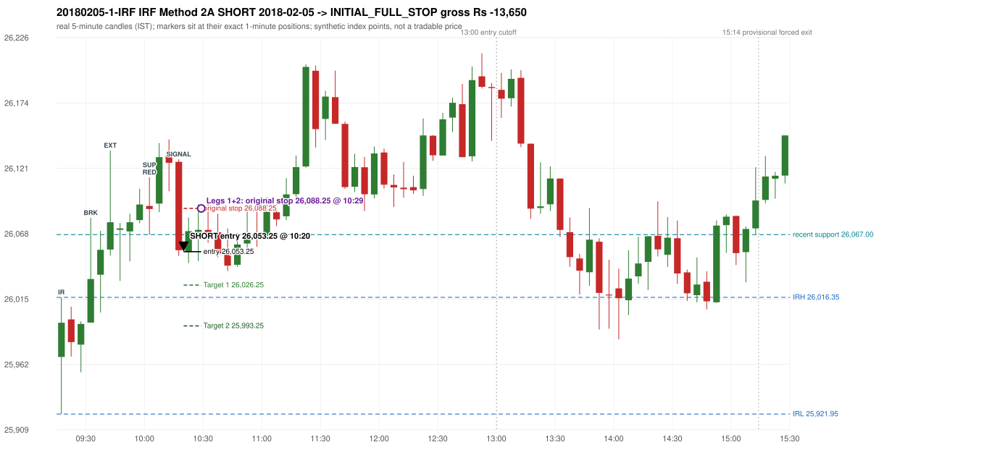

# Trading journal - 2018-02-05 (Monday)

> Phase 5 cross-index test, BANKNIFTY window C (Window C 2018-01-01..2018-12-31 (secondary-source minutes); status EXPLORATORY). The FROZEN Phase 3.6 configuration (IRF, ORB, PDR body-based, PDS, RF; shared controller) with the NIFTY index-point stops and targets UNCHANGED on the BANKNIFTY index price. INDEX-POINT RESULTS ONLY: no option premium is used or estimated. HISTORICAL RESEARCH ONLY: the strategy was developed using later NIFTY data. 5paisa returns no minute data before 2019-03-01, so this year rests on one unattributed vendor with nothing to check it against Synthetic BANKNIFTY index-point P&L (the index is not tradable). The owner's review status is intentionally blank.

## A. Trading day overview

| item | value |
|---|---|
| Date / weekday | 2018-02-05 / Monday |
| Session type | USABLE_WITH_FLAGS / VALID |
| Original session open (first 1-minute open) | 25,968.15 |
| Previous session | 2018-02-02 |
| Previous-day high / low (wicks included) | 27,017.40 / 26,364.75 |
| Previous-day highest BODY high (the body-based PDR ceiling; wicks ignored) | 27,017.40 |
| Previous-day official close / last 5-minute close | 26,451.15 / 26,368.10 |
| Raw engine records / confirmed signals / fully valid signals | 9 / 6 / 6 |
| Setups that did not complete (invalidated / incomplete) | 3 |
| Executed trades | 1 20180205-1-IRF |
| Gross P&L (Rs, synthetic) | -13,650.00 |
| Illustrative net P&L (Rs; Rs 500/trade + 0.5 pt/fill) | -14,540.00 |
| Day-end portfolio status | SECOND_TRADE_ELIGIBLE |
| Manual journal trades (matched / unmatched) | 0 (0 / 0) |
| Extra automated trades | 0 |

## B. Daily strategy signal timeline (confirmed signals, chronological)

| time | strategy | method | dir | entry-rule status | valid for execution | <= 13:00 | portfolio state | accepted / ignored | specific reason | competing (same minute) |
|---|---|---|---|---|---|---|---|---|---|---|
| 10:20 | IRF | Method 2A | SHORT | PROPOSAL_DEPENDENT | True | True | FIRST_TRADE_ACTIVE | ACCEPTED -> 20180205-1-IRF | first eligible signal of the day; trade 1: INITIAL_FULL_STOP | IRF Method 2B SHORT |
| 10:20 | IRF | Method 2B | SHORT | PROPOSAL_DEPENDENT | True | True | FIRST_TRADE_ACTIVE | MERGED_SAME_STRATEGY_METHOD | traded as another method of the same strategy/direction in the same minute | IRF Method 2A SHORT |
| 11:10 | IRF | Method 2B | SHORT | PROPOSAL_DEPENDENT | True | True | SECOND_TRADE_ELIGIBLE | REJECTED | SECOND_TRADE_RESTRICTED_TO_PDR_PDS [blocked by IRF#1] |  |
| 12:55 | IRF | Method 2B | SHORT | PROPOSAL_DEPENDENT | True | True | SECOND_TRADE_ELIGIBLE | REJECTED | SECOND_TRADE_RESTRICTED_TO_PDR_PDS [blocked by IRF#1] |  |
| 14:05 | IRF | Method 1 | SHORT | PROPOSAL_DEPENDENT | True | False | SECOND_TRADE_ELIGIBLE | REJECTED | SECOND_TRADE_RESTRICTED_TO_PDR_PDS [blocked by IRF#1] |  |
| 14:50 | IRF | Method 1 | SHORT | PROPOSAL_DEPENDENT | True | False | SECOND_TRADE_ELIGIBLE | REJECTED | SECOND_TRADE_RESTRICTED_TO_PDR_PDS [blocked by IRF#1] |  |

Engine setups that did not complete (3); the complete list with failed rule ids is in `rejected_signals.csv`:

| candle | strategy | method | dir | status | precise reason | failed rules |
|---|---|---|---|---|---|---|
| 12:50 | IRF | Method 1/2 | SHORT | INCOMPLETE_AT_EOD | SESSION_ENDED_BEFORE_CONFIRMATION |  |
| 09:15 | ORB | Method 1 | SHORT | INVALIDATED | CANDLE_QUALITY(not a strong body / wick too large) | ORB-M1-SHORT-003 |
| 09:15 | ORB | Method 2 | SHORT | INVALIDATED | CANDLE_QUALITY | ORB-M2-SHORT-003 |

## C. Detailed trade journals

### 20180205-1-IRF: IRF Method 2A SHORT (FIRST trade)

Chart: 

**Rule configuration:** CFG-phase36_body_based-866f954e55 - signal verification status **PROPOSAL_DEPENDENT** (never VERIFIED while a rule rests on a proposal).

#### 1. Setup identification

IRF Method 2A SHORT: the 09:30-09:35 candle closed at 26,031.15, above IRH 26,016.35, and the next candle did not close back inside the range, so the setup is Method 2 and price stayed above it until the trigger. Extension candle 09:40-09:45, red candle 10:00-10:05. The trigger came 9 candles after the breakout candle: a completed candle closed below the recent pullback-low support (10:15-10:20); confirmed at 10:20 with close 26,054.40. Entry reference close 26,054.40 is 38.05 points above IRH 26,016.35.

#### 2. Candle and indicator calculations

| role | session | candle | O | H | L | C | range | body % | upper wick % | lower wick % | direction | EMA(200) | strong bull / bear | pin bull / bear | small (body<=30%) | used for |
|---|---|---|---|---|---|---|---|---|---|---|---|---|---|---|---|---|
| initial_range_candle | TODAY | 09:15-09:20 | 25,968.15 | 26,016.35 | 25,921.95 | 25,995.80 | 94.40 | 29.29 | 21.77 | 48.94 | BULLISH | 26,984.31 | False / False | False / False | True | initial range = high/low of the 09:15 candle |
| signal_candle | TODAY | 10:15-10:20 | 26,125.90 | 26,127.95 | 26,049.80 | 26,054.40 | 78.15 | 91.49 | 2.62 | 5.89 | BEARISH | 26,880.44 | False / True | False / False | False | candle whose close completed the trigger |
| breakout_candle | TODAY | 09:30-09:35 | 25,995.95 | 26,080.60 | 25,995.95 | 26,031.15 | 84.65 | 41.58 | 58.42 | 0.00 | BULLISH | 26,955.28 | False / False | False / False | False | breakout candle: a completed candle closing above IRH |
| extension_candle | TODAY | 09:40-09:45 | 26,055.00 | 26,135.05 | 26,050.05 | 26,077.05 | 85.00 | 25.94 | 68.24 | 5.82 | BULLISH | 26,937.67 | False / False | False / False | True | extension: first later candle trading above the breakout candle's high |
| red_candle | TODAY | 10:00-10:05 | 26,090.25 | 26,113.40 | 26,067.00 | 26,087.80 | 46.40 | 5.28 | 49.89 | 44.83 | BEARISH | 26,904.13 | False / False | False / False | True | first red candle during the extension |
| support_pivot | TODAY | 10:00-10:05 | 26,090.25 | 26,113.40 | 26,067.00 | 26,087.80 | 46.40 | 5.28 | 49.89 | 44.83 | BEARISH | 26,904.13 | False / False | False / False | True | recent support: latest 3-candle fractal low formed after the breakout |

Every condition, with the rule, the calculation, the observed values and the result:

| # | group | rule | result | status / numeric definition | calculation | observed | required | available at | why it matters |
|---|---|---|---|---|---|---|---|---|---|
| 1 | SELECTION | SEL-FIRST-001 | PASS | USER_APPROVED / USER_APPROVED | earliest CONFIRMED signal of the day across IRF/ORB/PDR/PDS/RF that passed the controller's checks | 0 confirmed signal(s) earlier today; 6 confirmed signals in the day in total, this one at 10:20 | no earlier executable signal | 2018-02-05 10:20 | the shared controller trades only the first valid signal; the five strategies are not independent positions |
| 2 | SELECTION | SEL-TIE-001 | PASS | USER_APPROVED / USER_APPROVED | other CONFIRMED signals with exactly the same confirmation timestamp | IRF Method 2B SHORT @10:20 [NOTE: SAME_STRATEGY_CONCURRENT_METHOD]; merged same-strategy methods: Method 2B | no different-strategy / opposite-direction signal in the same minute (otherwise an unresolved conflict, no trade) | 2018-02-05 10:20 | an unresolved same-minute collision would have produced no trade at all |
| 3 | SELECTION | ENTRY-CUTOFF-001 | PASS | USER_APPROVED / USER_APPROVED | fill timestamp vs 13:00:00 IST | signal confirmed 10:20; fill 10:20 | fill at or before 13:00:00 IST | 2018-02-05 10:20 | no new position may be entered with a fill after 13:00 IST |
| 4 | SELECTION | EXE-FILL-001 | PASS | PROPOSED_FOR_REVIEW / PROPOSED_FOR_REVIEW | fill = open of the 1-minute bar that starts at the signal candle's end | bar 10:20 O 26,053.25 H 26,060.55 L 26,044.10 C 26,047.40; executable=True; entry 26,053.25 | fill bar exists, starts exactly at the signal end, is fillable; entry = its open | 2018-02-05 10:20 | a 5-minute signal is known only when its candle closes; the first price that can be traded is the next minute's open |
| 5 | SELECTION | DAY-MAX-001 | PASS | USER_APPROVED / USER_APPROVED | number of entries today | trade 1 of at most 2 | <= 2 entries per day | 2018-02-05 10:20 | daily trade cap |
| 6 | SETUP | IRF-GLOBAL-001 | PASS | SOURCE_VERIFIED / EXPLICIT_IN_SOURCE | initial range = high and low (wicks included) of the first completed 5-minute candle | 09:15-09:20 IRH 26,016.35, IRL 25,921.95 (range 94.40; engine recorded IRH 26,016.35, IRL 25,921.95) | high/low of the 09:15-09:20 candle | 2018-02-05 09:20 | all three IRF methods measure price against this range |
| 7 | SETUP | IRF-GLOBAL-003 | PASS | SOURCE_VERIFIED / EXPLICIT_IN_SOURCE | closes confirm, wicks do not: every trigger is evaluated on a completed 5-minute candle | trigger candle 10:15-10:20 was complete when the signal was stamped 10:20; decision uses its close 26,054.40 | completed candle close, not an intra-candle wick | 2018-02-05 10:20 | an intra-candle wick can reverse before the candle closes |
| 8 | SETUP | IRF-GLOBAL-002 | PASS | SOURCE_VERIFIED / EXPLICIT_IN_SOURCE | direction | SHORT (IRF trades short only) | short only | 2018-02-05 10:20 | IRF fades failed upside breakouts |
| 9 | SETUP | IRF-M2-001 | PASS | SOURCE_VERIFIED / EXPLICIT_IN_SOURCE | breakout candle close vs IRH | 09:30-09:35 O 25,995.95 H 26,080.60 L 25,995.95 C 26,031.15; range 84.65, body 35.20 (41.58%), upper wick 49.45 (58.42%), lower wick 0.00 (0.00%), bullish; close 26,031.15 is 14.80 points above IRH 26,016.35 | close > IRH (a wick above IRH is not a breakout) | 2018-02-05 09:35 | starts every IRF setup |
| 10 | SETUP | IRF-M2-004 | PASS | SOURCE_VERIFIED / EXPLICIT_IN_SOURCE | the candle after the breakout must NOT close back inside the range (else the setup is Method 1) | 09:35 close 26,054.75 vs [25,921.95, 26,016.35) | not (IRL <= close < IRH) | 2018-02-05 09:40 | separates Method 2 (price holds above) from Method 1 (immediate failure) |
| 11 | SETUP | IRF-M2-002 | PASS | SOURCE_VERIFIED / QUALITATIVE_SOURCE_NUMERIC_DEFINITION_PROPOSED_FOR_REVIEW | extension = a later candle whose high exceeds the breakout candle's high (research definition E1) | 09:40 high 26,135.05 vs breakout candle high 26,080.60 (+54.45) | high > breakout candle high | 2018-02-05 09:45 | the guide says price 'extends further upward'; the numeric test is a proposal |
| 12 | SETUP | IRF-M2-003 | PASS | SOURCE_VERIFIED / QUALITATIVE_SOURCE_NUMERIC_DEFINITION_PROPOSED_FOR_REVIEW | a red candle (close < open) forms after the extension | 10:00-10:05 O 26,090.25 H 26,113.40 L 26,067.00 C 26,087.80; range 46.40, body 2.45 (5.28%), upper wick 23.15 (49.89%), lower wick 20.80 (44.83%), bearish | close < open, at or after the candle following the extension | 2018-02-05 10:05 | the red candle shows the first pause/reversal inside the extension |
| 13 | CONFIRMATION | IRF-M2A-001 | PASS | SOURCE_VERIFIED / QUALITATIVE_SOURCE_NUMERIC_DEFINITION_PROPOSED_FOR_REVIEW | recent support = latest 3-candle fractal low (k=1) among candles b+1 ... i-2 | 10:00 low 26,067.00; neighbours' lows 26,076.30 (09:55) and 26,085.25 (10:05) are not lower; engine recorded support 26,067.00 | pivot low known before the trigger candle | 2018-02-05 10:10 | the support is the level whose break completes Method 2A (the exact 'pullback low' definition is a proposal) |
| 14 | CONFIRMATION | IRF-M2A-002 | PASS | SOURCE_VERIFIED / EXPLICIT_WORDING_DETAIL_PROPOSED_FOR_REVIEW | trigger candle closes below recent support | 10:15 close 26,054.40 vs support 26,067.00: 12.60 points below | close < support (close, not wick) | 2018-02-05 10:20 | completes Method 2A |
| 15 | CONFIRMATION | IRF-M2-005 | PASS | SOURCE_VERIFIED / EXPLICIT_IN_SOURCE | chronology: the red candle precedes the break candle | red candle 10:00, break candle 10:15 | red candle index < break candle index (m2a_break_may_be_red_candle = False) | 2018-02-05 10:20 | a red candle alone is not confirmation; a level break is required |
| 16 | EXECUTION | EXE-STOP-001 | PASS | USER_APPROVED / USER_APPROVED | initial stop = entry + 35 points | entry 26,053.25 -> stop 26,088.25 | stop 35 index points (BASELINE) | 2018-02-05 10:20 | defines the loss if the setup fails before Target 1 |
| 17 | EXECUTION | EXE-T1-001 | PASS | SOURCE_VERIFIED / EXPLICIT_IN_SOURCE | Target 1 = entry +/- 27 points | T1 26,026.25 | 27 points | 2018-02-05 10:20 | Leg 1 (3 lots) is booked at Target 1 |
| 18 | EXECUTION | IRF-TGT-001 | PASS | SOURCE_VERIFIED / EXPLICIT_IN_SOURCE | Target 2 = entry +/- 60 points | T2 25,993.25 | 60 points | 2018-02-05 10:20 | Leg 2 (3 lots) is booked at Target 2 |
| 19 | EXECUTION | POST-T1-STOP-006 | PASS | USER_APPROVED / USER_APPROVED | after T1 the Leg-2 stop = entry + 6 (no trailing) | post-T1 stop 26,059.25 | entry -6 (LONG) / +6 (SHORT) | 2018-02-05 10:20 | protects the remaining three lots once the first three are booked |
| 20 | EXECUTION | SIZE-LOT-001 | PASS | USER_APPROVED / USER_APPROVED | 6 lots x 65 = 390, Leg 1 = 3 lots = 195, Leg 2 = 195 | 6 lots, lot size 65, legs 3+3 | 6 lots in two equal legs | 2018-02-05 10:20 | position size for the synthetic P&L |
| 21 | NOTE | IRF-M2-006 | UNRESOLVED | UNRESOLVED / UNRESOLVED | delay between the breakout candle and this trigger; expiry rule | 9 candles after the breakout; expiry none configured | the source states no expiry | 2018-02-05 10:20 | an old breakout can still trigger hours later |
| 22 | NOTE | IRF-M2-006 | UNRESOLVED | UNRESOLVED / UNRESOLVED | did price stay above IRH between the breakout and the trigger? | 0 closes at or below IRH between 09:35 and 10:15; trigger close 26,054.40 above IRH 26,016.35 | the engine does not require price to stay above IRH | 2018-02-05 10:20 | the guide describes price 'holding above IRH and keeping rising'; the code only needs the level break |
| 23 | NOTE | IRF-GLOBAL-004 | UNRESOLVED | UNRESOLVED / UNRESOLVED | which close above IRH of the session produced this attempt; repeat setups | this breakout is upward crossing no. 1 of the session (a close above IRH after a close at/below it) | the source states no first-breakout-only, re-arming, expiry or trades-per-day rule | 2018-02-05 10:20 | IRF re-arms on every later breakout in the code, producing many raw setups; the controller keeps only the first |
| 24 | NOTE | NOTE-IRF-REPEATED-SETUPS | NOT_APPLICABLE | NOT_A_RULE / NOT_A_REGISTRY_RULE | other IRF signals later in the session (not traded) | 4 further confirmed IRF signal(s): Method 2B@11:10, Method 2B@12:55, Method 1@14:05, Method 1@14:50; concurrent methods merged in this minute: Method 2B | disclosure of repeated raw setups | 2018-02-05 10:20 | repeated raw IRF setups are not hidden; they are logged as ignored |
| 25 | NOTE | IRF-SL-001 | NOT_APPLICABLE | SOURCE_VERIFIED / QUALITATIVE_SOURCE_NUMERIC_DEFINITION_PROPOSED_FOR_REVIEW | the guide's 35-or-40 rule: 35 if the most recent green candle's high is within 35 points of entry, else 40 | most recent green candle high 26,141.05 is 87.80 points from the entry 26,053.25: the guide's rule would select 40 points; the baseline applies a fixed 35 (USER_APPROVED research baseline; the 35-vs-40 selection and the 40-point variant are separate labelled scenarios) | source selection rule | 2018-02-05 10:20 | the stop distance is a modelling choice and changes losses, not entries |
| 26 | NOTE | NOTE-UNRESOLVED-DEPENDENCIES | UNRESOLVED | NOT_A_RULE / NOT_A_REGISTRY_RULE | rules the signal depends on that the sources leave unresolved | engine-recorded unresolved rule ids: IRF-GLOBAL-004; verification status PROPOSAL_DEPENDENT | n/a (disclosure) | 2018-02-05 10:20 | the entry is only as verified as the rules it rests on |

#### 3. Entry decision and explanation

IRF Method 2A SHORT: the 09:30-09:35 candle closed at 26,031.15, above IRH 26,016.35, and the next candle did not close back inside the range, so the setup is Method 2 and price stayed above it until the trigger. Extension candle 09:40-09:45, red candle 10:00-10:05. The trigger came 9 candles after the breakout candle: a completed candle closed below the recent pullback-low support (10:15-10:20); confirmed at 10:20 with close 26,054.40. Entry reference close 26,054.40 is 38.05 points above IRH 26,016.35.

**Why this trade ahead of the other strategies:** This IRF Method 2A signal was the earliest executable signal of the day: 0 confirmed signal(s) earlier, 1 other in the same minute. 4 later confirmed signal(s) (IRF x4) are logged as ignored or rejected. State of the other four engines at that moment: [ORB: Method 1 invalidated at 09:15: CANDLE_QUALITY(not a strong body / wick too large); Method 2 invalidated at 09:15: CANDLE_QUALITY] [PDR: no setup record before this time (a base condition was not met, or nothing triggered)] [PDS: no setup record before this time (a base condition was not met, or nothing triggered)] [RF: no setup record before this time (a base condition was not met, or nothing triggered)]

#### 4. Actual entry execution

| item | value |
|---|---|
| Signal candle | 10:15-10:20 |
| Signal confirmed | 2018-02-05 10:20 |
| Fill timestamp | 2018-02-05 10:20 |
| Entry price | 26,053.25 |
| Source partition / 1-minute bar | data/processed/banknifty/KAPRI_1M_BANKNIFTY/minutes/year=2018/month=02/candles.parquet / 2018-02-05 10:20 |
| Source bar O / H / L / C | 26,053.25 / 26,060.55 / 26,044.10 / 26,047.40 |
| Fill assumption | open of the 1-minute bar starting at the signal candle's end (EXE-FILL-001, PROPOSED causal convention) |
| Initial stop / T1 / T2 / post-T1 stop | 26,088.25 / 26,026.25 / 25,993.25 / 26,059.25 |
| Position | 6 lots x 65 = 390 units (Leg 1 195, Leg 2 195) |

#### 5-8. Trade progress, Target 1, post-T1 stop and final exit

Between the 10:20 entry bar and the final exit (10 one-minute bars) the best excursion in favour was 9.15 points at 10:20 and the worst against was 38.35 points at 10:29. At 10:29 price reached the original stop 26,088.25 before Target 1 26,026.25, so all six lots exited together at 26,088.25. This is an INITIAL_FULL_STOP: one more trade is allowed that day, only a newly confirmed PDR/PDS signal.

| leg | qty | exit time | exit price | reason | source 1-minute bar | O / H / L / C | gross points | gross Rs | slippage pts | flags |
|---|---|---|---|---|---|---|---|---|---|---|
| 1 | 195 | 10:29 | 26,088.25 | ORIGINAL_STOP_BEFORE_T1 | 10:29 | 26,082.75 / 26,091.60 / 26,070.20 / 26,070.95 | -35.00 | -6,825.00 | 0.00 |  |
| 2 | 195 | 10:29 | 26,088.25 | ORIGINAL_STOP_BEFORE_T1 | 10:29 | 26,082.75 / 26,091.60 / 26,070.20 / 26,070.95 | -35.00 | -6,825.00 | 0.00 |  |

Exit evidence per leg:

* Leg 1: 1-minute bar 10:29 O 26,082.75 H 26,091.60 L 26,070.20 C 26,070.95: high 26,091.60 reached the original stop 26,088.25 before Target 1 26,026.25 was touched; both legs exit at the stop level 26,088.25
* Leg 2: 1-minute bar 10:29 O 26,082.75 H 26,091.60 L 26,070.20 C 26,070.95: high 26,091.60 reached the original stop 26,088.25 before Target 1 26,026.25 was touched; both legs exit at the stop level 26,088.25

#### 9. Gross and illustrative net P&L

| item | value (Rs) |
|---|---|
| Leg 1 gross | -6,825.00 |
| Leg 2 gross | -6,825.00 |
| Trade gross (= Leg 1 + Leg 2) | -13,650.00 |
| Illustrative fixed cost | -500.00 |
| Illustrative slippage (0.5 pt on every fill, entry + exits, all units) | -390.00 |
| Illustrative net | -14,540.00 |

#### 10. Manual journal comparison

No manual journal exists for this period; no comparison.

## D. Manual journal comparison

No manual journal exists for this period (the manual journal covers 2025-09-01 .. 2026-08-31 only); no comparison is made and no automated trade is labelled 'extra'.

## E. Daily conclusion

* **Traded:** 20180205-1-IRF - IRF Method 2A SHORT at 10:20 (entry 26,053.25), outcome INITIAL_FULL_STOP, gross Rs -13,650.00, illustrative net Rs -14,540.00. **Why:** This IRF Method 2A signal was the earliest executable signal of the day: 0 confirmed signal(s) earlier, 1 other in the same minute. 4 later confirmed signal(s) (IRF x4) are logged as ignored or rejected. State of the other four engines at that moment: [ORB: Method 1 invalidated at 09:15: CANDLE_QUALITY(not a strong body / wick too large); Method 2 invalidated at 09:15: CANDLE_QUALITY] [PDR: no setup record before this time (a base condition was not met, or nothing triggered)] [PDS: no setup record before this time (a base condition was not met, or nothing triggered)] [RF: no setup record before this time (a base condition was not met, or nothing triggered)] **How it ended:** At 10:29 price reached the original stop 26,088.25 before Target 1 26,026.25, so all six lots exited together at 26,088.25. This is an INITIAL_FULL_STOP: one more trade is allowed that day, only a newly confirmed PDR/PDS signal.
* **Ignored / rejected signals:** IRF REJECTED SECOND_TRADE_RESTRICTED_TO_PDR_PDS x4; IRF MERGED_SAME_STRATEGY_METHOD traded as another method of the same strategy/direction in the same minute x1
* **Open strategy-definition issues that affected this day:** IRF-GLOBAL-004 (NOT STATED: how many IRF trades per day, a latest entry time, and whether a new breakout may re-arm a setup after a signal), IRF-M2-006 (How long a Method 2 setup stays valid (expiry / invalidation before a level breaks) is not stated), NOTE-UNRESOLVED-DEPENDENCIES
* **Automated triage (not an approval; the owner's review status stays blank):** TRADED_NO_FLAGS

## Option-execution feasibility (information only; no option trade is simulated)

The index result above is an INDEX-POINT result on BANKNIFTY. It is not an option result: a move of N index points is not a move of N premium points (delta, gamma, theta, vega, spread and liquidity decide the premium).

| trade | strategy | index direction | long option it maps to | historical contract identified? | premium data available? | premium fill supportable? |
|---|---|---|---|---|---|---|
| 20180205-1-IRF | IRF | SHORT | BUY PUT (PE) | no | no | no |

Why: (1) the broker's instrument master lists only contracts that are live today, so the scrip code of a contract that existed on this date is not available; (2) historical candles can only be requested by scrip code; (3) the strike and expiry selection policy is an owner decision that has not been made (`options_feasibility/option_contract_selection_decisions.md`). No option entry, exit, premium or option P&L is shown, and none may be inferred from the index points.
