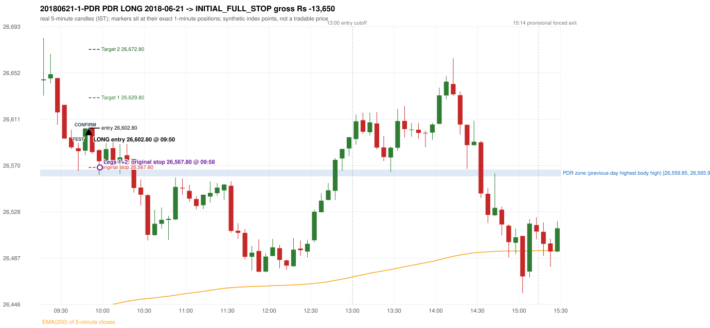
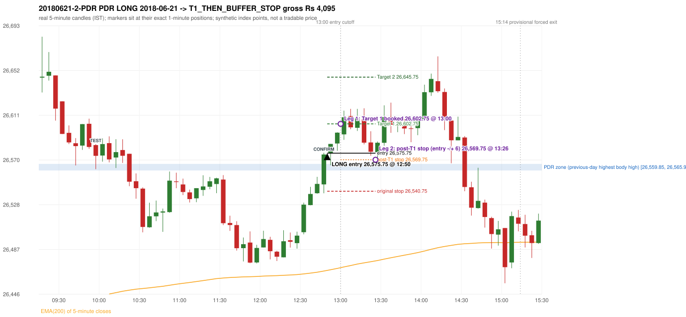

# Trading journal - 2018-06-21 (Thursday)

> Phase 5 cross-index test, BANKNIFTY window C (Window C 2018-01-01..2018-12-31 (secondary-source minutes); status EXPLORATORY). The FROZEN Phase 3.6 configuration (IRF, ORB, PDR body-based, PDS, RF; shared controller) with the NIFTY index-point stops and targets UNCHANGED on the BANKNIFTY index price. INDEX-POINT RESULTS ONLY: no option premium is used or estimated. HISTORICAL RESEARCH ONLY: the strategy was developed using later NIFTY data. 5paisa returns no minute data before 2019-03-01, so this year rests on one unattributed vendor with nothing to check it against Synthetic BANKNIFTY index-point P&L (the index is not tradable). The owner's review status is intentionally blank.

## A. Trading day overview

| item | value |
|---|---|
| Date / weekday | 2018-06-21 / Thursday |
| Session type | USABLE_WITH_FLAGS / VALID |
| Original session open (first 1-minute open) | 26,645.30 |
| Previous session | 2018-06-20 |
| Previous-day high / low (wicks included) | 26,573.95 / 26,320.45 |
| Previous-day highest BODY high (the body-based PDR ceiling; wicks ignored) | 26,565.90 |
| Previous-day official close / last 5-minute close | 26,557.70 / 26,565.90 |
| Raw engine records / confirmed signals / fully valid signals | 6 / 2 / 2 |
| Setups that did not complete (invalidated / incomplete) | 4 |
| Executed trades | 2 20180621-1-PDR;20180621-2-PDR |
| Gross P&L (Rs, synthetic) | -9,555.00 |
| Illustrative net P&L (Rs; Rs 500/trade + 0.5 pt/fill) | -11,335.00 |
| Day-end portfolio status | DAY_FINISHED |
| Manual journal trades (matched / unmatched) | 0 (0 / 0) |
| Extra automated trades | 0 |

## B. Daily strategy signal timeline (confirmed signals, chronological)

| time | strategy | method | dir | entry-rule status | valid for execution | <= 13:00 | portfolio state | accepted / ignored | specific reason | competing (same minute) |
|---|---|---|---|---|---|---|---|---|---|---|
| 09:50 | PDR | PDR | LONG | RESEARCH_VARIANT | True | True | FIRST_TRADE_ACTIVE | ACCEPTED -> 20180621-1-PDR | first eligible signal of the day; trade 1: INITIAL_FULL_STOP |  |
| 12:50 | PDR | PDR | LONG | RESEARCH_VARIANT | True | True | SECOND_TRADE_ACTIVE | ACCEPTED -> 20180621-2-PDR | permitted second trade: newly confirmed PDR/PDS after the original full stop; trade 2: T1_THEN_BUFFER_STOP |  |

Engine setups that did not complete (4); the complete list with failed rule ids is in `rejected_signals.csv`:

| candle | strategy | method | dir | status | precise reason | failed rules |
|---|---|---|---|---|---|---|
| 09:15 | ORB | Method 1 | LONG | INVALIDATED | CANDLE_QUALITY(not a strong body / wick too large) | ORB-M1-LONG-003 |
| 09:15 | ORB | Method 2 | LONG | INVALIDATED | CANDLE_QUALITY | ORB-M2-LONG-003 |
| 12:50 | PDR | PDR | LONG | INCOMPLETE_AT_EOD | NO_QUALIFYING_CONFIRMATION_BEFORE_SESSION_END |  |
| 14:00 | RF | RF | LONG | INVALIDATED | GAP_UP_OUTSIDE_YESTERDAYS_RANGE | RF-004 |

## C. Detailed trade journals

### 20180621-1-PDR: PDR LONG (FIRST trade)

Chart: 

**Rule configuration:** CFG-phase36_body_based-866f954e55 - signal verification status **RESEARCH_VARIANT** (never VERIFIED while a rule rests on a proposal).

#### 1. Setup identification

PDR LONG (body-based engine, A_HIGHEST_BODY_HIGH): the session opened 87.60 points above the previous close and 79.40 points above the previous-day highest BODY high 26,565.90 (zone [26,559.85, 26,565.90] from the 15:25 candle of 2018-06-20; the highest wick 26,573.95 is ignored). The 09:40 candle (26,564.50 - 26,589.65) tested the zone; the 09:45 candle (green, O 26,582.75 H 26,602.55 L 26,578.80 C 26,602.50) passed GOOD_GREEN_BODY and closed 36.60 points above the zone ceiling, confirming the entry at 09:50. The pattern thresholds and the zone's lower boundary are provisional research assumptions, not approved by the strategy author.

#### 2. Candle and indicator calculations

| role | session | candle | O | H | L | C | range | body % | upper wick % | lower wick % | direction | EMA(200) | strong bull / bear | pin bull / bear | small (body<=30%) | used for |
|---|---|---|---|---|---|---|---|---|---|---|---|---|---|---|---|---|
| zone_source_candle | PREVIOUS | 15:25-15:30 | 26,559.85 | 26,573.10 | 26,558.70 | 26,565.90 | 14.40 | 42.01 | 50.00 | 7.99 | BULLISH | 26,428.49 | False / False | False / False | False | candle of the previous session's highest BODY high (A_HIGHEST_BODY_HIGH) |
| prev_day_wick_high_candle | PREVIOUS | 15:00-15:05 | 26,548.95 | 26,573.95 | 26,548.15 | 26,559.85 | 25.80 | 42.25 | 54.65 | 3.10 | BULLISH | 26,421.85 | False / False | False / False | False | candle of the previous session's highest WICK (ignored by the author's rule; shown for comparison) |
| interaction_candle | TODAY | 09:40-09:45 | 26,584.90 | 26,589.65 | 26,564.50 | 26,582.25 | 25.15 | 10.54 | 18.89 | 70.58 | BEARISH | 26,439.18 | False / False | True / False | True | first candle whose range overlaps the zone (the test) |
| confirmation_candle | TODAY | 09:45-09:50 | 26,582.75 | 26,602.55 | 26,578.80 | 26,602.50 | 23.75 | 83.16 | 0.21 | 16.63 | BULLISH | 26,440.80 | True / False | False / False | False | candle that satisfies one of the three patterns and closes above the zone ceiling |

Every condition, with the rule, the calculation, the observed values and the result:

| # | group | rule | result | status / numeric definition | calculation | observed | required | available at | why it matters |
|---|---|---|---|---|---|---|---|---|---|
| 1 | SELECTION | SEL-FIRST-001 | PASS | USER_APPROVED / USER_APPROVED | earliest CONFIRMED signal of the day across IRF/ORB/PDR/PDS/RF that passed the controller's checks | 0 confirmed signal(s) earlier today; 2 confirmed signals in the day in total, this one at 09:50 | no earlier executable signal | 2018-06-21 09:50 | the shared controller trades only the first valid signal; the five strategies are not independent positions |
| 2 | SELECTION | SEL-TIE-001 | PASS | USER_APPROVED / USER_APPROVED | other CONFIRMED signals with exactly the same confirmation timestamp | none | no different-strategy / opposite-direction signal in the same minute (otherwise an unresolved conflict, no trade) | 2018-06-21 09:50 | an unresolved same-minute collision would have produced no trade at all |
| 3 | SELECTION | ENTRY-CUTOFF-001 | PASS | USER_APPROVED / USER_APPROVED | fill timestamp vs 13:00:00 IST | signal confirmed 09:50; fill 09:50 | fill at or before 13:00:00 IST | 2018-06-21 09:50 | no new position may be entered with a fill after 13:00 IST |
| 4 | SELECTION | EXE-FILL-001 | PASS | PROPOSED_FOR_REVIEW / PROPOSED_FOR_REVIEW | fill = open of the 1-minute bar that starts at the signal candle's end | bar 09:50 O 26,602.80 H 26,607.50 L 26,599.90 C 26,604.70; executable=True; entry 26,602.80 | fill bar exists, starts exactly at the signal end, is fillable; entry = its open | 2018-06-21 09:50 | a 5-minute signal is known only when its candle closes; the first price that can be traded is the next minute's open |
| 5 | SELECTION | DAY-MAX-001 | PASS | USER_APPROVED / USER_APPROVED | number of entries today | trade 1 of at most 2 | <= 2 entries per day | 2018-06-21 09:50 | daily trade cap |
| 6 | SETUP | PDR-004 | PASS | SOURCE_VERIFIED / EXPLICIT_WORDING_DETAIL_PROPOSED_FOR_REVIEW | gap = first 1-minute open of today - previous session's OFFICIAL close | today's open 26,645.30 (first 1-minute bar 09:15) - previous close 26,557.70 (DAILY_VENDOR, 2018-06-20) = +87.60 points -> gap UP | gap UP (more than 0 points) | 2018-06-21 09:15 | approved convention: the original first-minute open, never the vendor daily open |
| 7 | SETUP | PDR-B03 | PASS | AUTHOR_APPROVED / AUTHOR_STATEMENT_NUMERIC_DETAILS_ARE_SEPARATE_PROPOSED_ROWS | the session opens strictly above the previous day's resistance zone (author-approved) | today's first 1-minute open 26,645.30 vs zone ceiling 26,565.90: 79.40 points above (open - ceiling = +79.40) | open > zone ceiling (equal or inside the zone rejects the setup) | 2018-06-21 09:15 | the original first-minute open is used, never a vendor daily open |
| 8 | ZONE | PDR-001 | PASS | SOURCE_VERIFIED / EXPLICIT_IN_SOURCE | direction | LONG (PDR is long only) | long-only | 2018-06-21 09:50 | PDR buys a retest of previous-day resistance after a gap up |
| 9 | ZONE | PDR-B01a | PASS | AUTHOR_APPROVED / AUTHOR_STATEMENT_NUMERIC_DETAILS_ARE_SEPARATE_PROPOSED_ROWS | wicks ignored, bodies considered: body_high = max(open, close) of every completed previous-session 5-minute candle; ceiling = the highest body_high; floor = body low of that candle | previous session 2018-06-20: highest body high 26,565.90 on the 15:25 candle (O 26,559.85 C 26,565.90; wick high of that candle 26,573.10, ignored); four highest body highs: 26,565.90 (15:25); 26,559.90 (15:20); 26,559.85 (15:00); 26,559.55 (15:15). Highest WICK of the session 26,573.95 (15:00 candle) is 8.05 points above the ceiling and plays no part. Zone [26,559.85 (body low), 26,565.90 (body high)]; engine recorded [26,559.85, 26,565.90] | ceiling = highest body high of the previous session (author: wick ignored, body considered) | 2018-06-20 15:30 | a wick-only price never becomes resistance; the zone is drawn from candle bodies |
| 10 | ZONE | PDR-B02 | UNRESOLVED | AUTHOR_APPROVED / AUTHOR_STATEMENT_NUMERIC_DETAILS_ARE_SEPARATE_PROPOSED_ROWS | multiple highs connected into one zone (author principle; candidate B) | candidate A (used): [26,559.85, 26,565.90]. Candidate B (multiple-body-high cluster, tolerance 5 points) would be [26,559.85, 26,565.90] (ISOLATED_BODY_HIGH, 1 touch(es), member body highs 26,565.90); ceiling difference 0.00 points | a zone that connects all relevant highs (numbers not given by the author) | 2018-06-20 15:30 | candidate B has the same ceiling by construction, so this signal is unaffected by the choice; the lower boundary and the cluster numbers are research parameters |
| 11 | ZONE | PDR-003 | PASS | SOURCE_VERIFIED / EXPLICIT_IN_SOURCE | the zone is an area, not a single price | zone height 6.05 points [26,559.85, 26,565.90] | a rectangle with positive height (a zero-height zone is left unresolved by the engine) | 2018-06-20 15:30 | price may touch any part of the area |
| 12 | CONFIRMATION | PDR-B03b | PASS | PRESERVED_FROM_PHASE2 / PRESERVED_FROM_PHASE2 | the first candle whose [low, high] overlaps the zone (+/- proximity) is the test; the confirmation must come strictly after it | 09:40-09:45 O 26,584.90 H 26,589.65 L 26,564.50 C 26,582.25; range 25.15, body 2.65 (10.54%), upper wick 4.75 (18.89%), lower wick 17.75 (70.58%), bearish; low 26,564.50 vs zone ceiling 26,565.90, high 26,589.65 vs zone floor 26,559.85; proximity 0; confirmation candle 09:45 is candle no. 7, the test candle no. 6 | range overlaps the zone; confirmation after the test | 2018-06-21 09:45 | the retest of the previous-day resistance |
| 13 | CONFIRMATION | PDR-B04c | PASS | PROPOSED_FOR_REVIEW / NUMERIC_DEFINITION_PROPOSED_FOR_REVIEW | Pattern 1: good green body on the 09:45-09:50 candle (O 26,582.75 H 26,602.55 L 26,578.80 C 26,602.50); the numeric thresholds are PROVISIONAL (RESEARCH_DEFAULT), not author-approved | colour green; body 83.16%; upper wick 0.21% -> PASSES | green, body >= 60% and upper wick <= 20% of the range | 2018-06-21 09:50 | one of the three patterns is enough (author: one good green body OR lower price rejection OR hammer); fixed thresholds are not required by the author, so the numbers are a research convention; a pattern that does not pass is not an error |
| 14 | CONFIRMATION | PDR-B04c | NOT_APPLICABLE | PROPOSED_FOR_REVIEW / NUMERIC_DEFINITION_PROPOSED_FOR_REVIEW | Pattern 2: lower-price rejection candle on the 09:45-09:50 candle (O 26,582.75 H 26,602.55 L 26,578.80 C 26,602.50); the numeric thresholds are PROVISIONAL (RESEARCH_DEFAULT), not author-approved | lower wick 3.95 = 0.20 x body 19.75; close 0.21% below the high; low 26,578.80; low did NOT reach the zone ceiling 26,565.90 -> does not pass | lower wick >= 2 x body, close within the top 30% of the range, low <= zone ceiling (colour not required) | 2018-06-21 09:50 | one of the three patterns is enough (author: one good green body OR lower price rejection OR hammer); fixed thresholds are not required by the author, so the numbers are a research convention; a pattern that does not pass is not an error |
| 15 | CONFIRMATION | PDR-B04c | NOT_APPLICABLE | PROPOSED_FOR_REVIEW / NUMERIC_DEFINITION_PROPOSED_FOR_REVIEW | Pattern 3: hammer candle on the 09:45-09:50 candle (O 26,582.75 H 26,602.55 L 26,578.80 C 26,602.50); the numeric thresholds are PROVISIONAL (RESEARCH_DEFAULT), not author-approved | lower wick 3.95 = 0.20 x body; upper wick 0.21%; body bottom at 16.63% of the range -> does not pass | lower wick >= 2 x body, upper wick <= 10%, body bottom >= 60% of the range (colour not required) | 2018-06-21 09:50 | one of the three patterns is enough (author: one good green body OR lower price rejection OR hammer); fixed thresholds are not required by the author, so the numbers are a research convention; a pattern that does not pass is not an error |
| 16 | CONFIRMATION | PDR-B04 | PASS | AUTHOR_APPROVED / AUTHOR_STATEMENT_NUMERIC_DETAILS_ARE_SEPARATE_PROPOSED_ROWS | at least one of the three patterns passes (OR logic; every passing pattern is recorded) | patterns passed: GOOD_GREEN_BODY (engine recorded: GOOD_GREEN_BODY) | at least one pattern | 2018-06-21 09:50 | the author's entry candle requirement |
| 17 | CONFIRMATION | PDR-B05 | PASS | AUTHOR_APPROVED / AUTHOR_STATEMENT_NUMERIC_DETAILS_ARE_SEPARATE_PROPOSED_ROWS | the confirmation candle must close above the zone | close 26,602.50 vs zone ceiling 26,565.90: +36.60 points (floor 26,559.85; low 26,578.80 stayed above the zone) | close > zone ceiling, strictly (lower wick may penetrate the zone) | 2018-06-21 09:50 | no pattern overrides the close rule |
| 18 | CONFIRMATION | PDR-B06 | PASS | USER_APPROVED / USER_APPROVED | no entry at the open and no look-ahead: the order is placed only after the confirmation candle has completed | test candle 09:40 (no. 6) precedes the confirmation candle 09:45-09:50; signal stamped 09:50; fill 09:50 at the open of that 1-minute bar = 26,602.80 | interaction before the confirmation; fill after the confirmation candle's end | 2018-06-21 09:50 | existing causal fill convention (EXE-FILL-001) |
| 19 | EXECUTION | EXE-STOP-001 | PASS | USER_APPROVED / USER_APPROVED | initial stop = entry - 35 points | entry 26,602.80 -> stop 26,567.80 | stop 35 index points (BASELINE) | 2018-06-21 09:50 | defines the loss if the setup fails before Target 1 |
| 20 | EXECUTION | EXE-T1-001 | PASS | SOURCE_VERIFIED / EXPLICIT_IN_SOURCE | Target 1 = entry +/- 27 points | T1 26,629.80 | 27 points | 2018-06-21 09:50 | Leg 1 (3 lots) is booked at Target 1 |
| 21 | EXECUTION | PDR-008 | PASS | SOURCE_VERIFIED / EXPLICIT_IN_SOURCE | Target 2 = entry +/- 70 points | T2 26,672.80 (the guide says 70; the performance report's winners suggest 60 - CONFLICTING, recorded) | 70 points | 2018-06-21 09:50 | Leg 2 (3 lots) is booked at Target 2 |
| 22 | EXECUTION | POST-T1-STOP-006 | PASS | USER_APPROVED / USER_APPROVED | after T1 the Leg-2 stop = entry - 6 (no trailing) | post-T1 stop 26,596.80 | entry -6 (LONG) / +6 (SHORT) | 2018-06-21 09:50 | protects the remaining three lots once the first three are booked |
| 23 | EXECUTION | SIZE-LOT-001 | PASS | USER_APPROVED / USER_APPROVED | 6 lots x 65 = 390, Leg 1 = 3 lots = 195, Leg 2 = 195 | 6 lots, lot size 65, legs 3+3 | 6 lots in two equal legs | 2018-06-21 09:50 | position size for the synthetic P&L |
| 24 | NOTE | PDR-B04x | UNRESOLVED | PROPOSED_FOR_REVIEW / NUMERIC_DEFINITION_PROPOSED_FOR_REVIEW | provisional parameters this signal rests on | pattern thresholds RESEARCH_DEFAULT: {'green_body_min': 0.6, 'green_upper_wick_max': 0.2, 'reject_wick_to_body_min': 2.0, 'reject_close_fraction_max': 0.3, 'hammer_wick_to_body_min': 2.0, 'hammer_upper_wick_max': 0.1, 'hammer_body_position_min': 0.6}; zone lower boundary = hull of the member bodies; zero-height policy UNRESOLVED_NO_SETUP; wait policy WAIT_FOR_QUALIFYING_CANDLE; cluster parameters (candidate B only) tolerance 5, touches 2, separation 2 | n/a (disclosure) | 2018-06-21 09:50 | the strategy author has NOT approved these numbers or conventions; the signal is a RESEARCH_VARIANT, never VERIFIED |
| 25 | NOTE | PDR-012 | NOT_APPLICABLE | PROPOSED_FOR_REVIEW / PROPOSED_FOR_REVIEW | repeated PDR signals today | 2 confirmed PDR signal(s) in the session | n/a (disclosure) | 2018-06-21 09:50 | this engine reports EVERY qualifying signal (the per-session cap is lifted); the controller trades only the first (and a PDR/PDS second trade after an initial full stop) |
| 26 | NOTE | PDR-B07 | NOT_APPLICABLE | PROPOSED_FOR_REVIEW / NUMERIC_DEFINITION_PROPOSED_FOR_REVIEW | state of the zone between the test and the confirmation (the author and the guide are silent on price crossing below the zone) | test candle 09:40 (no. 6), confirmation candle 09:45 (no. 7): 1 candle(s) later; no candle in between closed below the zone floor | n/a (disclosure; the wait policy is a research parameter) | 2018-06-21 09:50 | the engine keeps a tested setup armed until a candle qualifies; whether a zone that price has closed through should still count is an owner decision |
| 27 | NOTE | PDR-009 | UNRESOLVED | UNRESOLVED / UNRESOLVED | stop 35 or 40 'depending on the situation' | the guide gives no selection rule; baseline fixed 35 points | unresolved in the source | 2018-06-21 09:50 | PDR stop selection is left to the owner |
| 28 | NOTE | NOTE-UNRESOLVED-DEPENDENCIES | UNRESOLVED | NOT_A_RULE / NOT_A_REGISTRY_RULE | rules the signal depends on that the sources leave unresolved | engine-recorded unresolved rule ids: PDR-B01b, PDR-B02a, PDR-B02b, PDR-B02c, PDR-B02d, PDR-B02e, PDR-B02f, PDR-B02g, PDR-B02h, PDR-B04b, PDR-B04c, PDR-B05a, PDR-B07; verification status RESEARCH_VARIANT | n/a (disclosure) | 2018-06-21 09:50 | the entry is only as verified as the rules it rests on |

#### 3. Entry decision and explanation

PDR LONG (body-based engine, A_HIGHEST_BODY_HIGH): the session opened 87.60 points above the previous close and 79.40 points above the previous-day highest BODY high 26,565.90 (zone [26,559.85, 26,565.90] from the 15:25 candle of 2018-06-20; the highest wick 26,573.95 is ignored). The 09:40 candle (26,564.50 - 26,589.65) tested the zone; the 09:45 candle (green, O 26,582.75 H 26,602.55 L 26,578.80 C 26,602.50) passed GOOD_GREEN_BODY and closed 36.60 points above the zone ceiling, confirming the entry at 09:50. The pattern thresholds and the zone's lower boundary are provisional research assumptions, not approved by the strategy author.

**Why this trade ahead of the other strategies:** This PDR signal was the earliest executable signal of the day: 0 confirmed signal(s) earlier, 0 other in the same minute. 1 later confirmed signal(s) (PDR x1) are logged as ignored or rejected. State of the other four engines at that moment: [IRF: no setup record before this time (a base condition was not met, or nothing triggered)] [ORB: Method 1 invalidated at 09:15: CANDLE_QUALITY(not a strong body / wick too large); Method 2 invalidated at 09:15: CANDLE_QUALITY] [PDS: no setup record before this time (a base condition was not met, or nothing triggered)] [RF: no setup record before this time (a base condition was not met, or nothing triggered)]

#### 4. Actual entry execution

| item | value |
|---|---|
| Signal candle | 09:45-09:50 |
| Signal confirmed | 2018-06-21 09:50 |
| Fill timestamp | 2018-06-21 09:50 |
| Entry price | 26,602.80 |
| Source partition / 1-minute bar | data/processed/banknifty/KAPRI_1M_BANKNIFTY/minutes/year=2018/month=06/candles.parquet / 2018-06-21 09:50 |
| Source bar O / H / L / C | 26,602.80 / 26,607.50 / 26,599.90 / 26,604.70 |
| Fill assumption | open of the 1-minute bar starting at the signal candle's end (EXE-FILL-001, PROPOSED causal convention) |
| Initial stop / T1 / T2 / post-T1 stop | 26,567.80 / 26,629.80 / 26,672.80 / 26,596.80 |
| Position | 6 lots x 65 = 390 units (Leg 1 195, Leg 2 195) |

#### 5-8. Trade progress, Target 1, post-T1 stop and final exit

Between the 09:50 entry bar and the final exit (9 one-minute bars) the best excursion in favour was 4.70 points at 09:50 and the worst against was 41.75 points at 09:58. At 09:58 price reached the original stop 26,567.80 before Target 1 26,629.80, so all six lots exited together at 26,567.80. This is an INITIAL_FULL_STOP: one more trade is allowed that day, only a newly confirmed PDR/PDS signal.

| leg | qty | exit time | exit price | reason | source 1-minute bar | O / H / L / C | gross points | gross Rs | slippage pts | flags |
|---|---|---|---|---|---|---|---|---|---|---|
| 1 | 195 | 09:58 | 26,567.80 | ORIGINAL_STOP_BEFORE_T1 | 09:58 | 26,575.45 / 26,575.95 / 26,561.05 / 26,565.80 | -35.00 | -6,825.00 | 0.00 |  |
| 2 | 195 | 09:58 | 26,567.80 | ORIGINAL_STOP_BEFORE_T1 | 09:58 | 26,575.45 / 26,575.95 / 26,561.05 / 26,565.80 | -35.00 | -6,825.00 | 0.00 |  |

Exit evidence per leg:

* Leg 1: 1-minute bar 09:58 O 26,575.45 H 26,575.95 L 26,561.05 C 26,565.80: low 26,561.05 reached the original stop 26,567.80 before Target 1 26,629.80 was touched; both legs exit at the stop level 26,567.80
* Leg 2: 1-minute bar 09:58 O 26,575.45 H 26,575.95 L 26,561.05 C 26,565.80: low 26,561.05 reached the original stop 26,567.80 before Target 1 26,629.80 was touched; both legs exit at the stop level 26,567.80

#### 9. Gross and illustrative net P&L

| item | value (Rs) |
|---|---|
| Leg 1 gross | -6,825.00 |
| Leg 2 gross | -6,825.00 |
| Trade gross (= Leg 1 + Leg 2) | -13,650.00 |
| Illustrative fixed cost | -500.00 |
| Illustrative slippage (0.5 pt on every fill, entry + exits, all units) | -390.00 |
| Illustrative net | -14,540.00 |

#### 10. Manual journal comparison

No manual journal exists for this period; no comparison.

### 20180621-2-PDR: PDR LONG (SECOND trade)

Chart: 

**Rule configuration:** CFG-phase36_body_based-866f954e55 - signal verification status **RESEARCH_VARIANT** (never VERIFIED while a rule rests on a proposal).

#### 1. Setup identification

PDR LONG (body-based engine, A_HIGHEST_BODY_HIGH): the session opened 87.60 points above the previous close and 79.40 points above the previous-day highest BODY high 26,565.90 (zone [26,559.85, 26,565.90] from the 15:25 candle of 2018-06-20; the highest wick 26,573.95 is ignored). The 09:55 candle (26,561.05 - 26,584.10) tested the zone; the 12:45 candle (green, O 26,547.00 H 26,576.15 L 26,538.85 C 26,574.55) passed GOOD_GREEN_BODY and closed 8.65 points above the zone ceiling, confirming the entry at 12:50. The pattern thresholds and the zone's lower boundary are provisional research assumptions, not approved by the strategy author.

#### 2. Candle and indicator calculations

| role | session | candle | O | H | L | C | range | body % | upper wick % | lower wick % | direction | EMA(200) | strong bull / bear | pin bull / bear | small (body<=30%) | used for |
|---|---|---|---|---|---|---|---|---|---|---|---|---|---|---|---|---|
| zone_source_candle | PREVIOUS | 15:25-15:30 | 26,559.85 | 26,573.10 | 26,558.70 | 26,565.90 | 14.40 | 42.01 | 50.00 | 7.99 | BULLISH | 26,428.49 | False / False | False / False | False | candle of the previous session's highest BODY high (A_HIGHEST_BODY_HIGH) |
| prev_day_wick_high_candle | PREVIOUS | 15:00-15:05 | 26,548.95 | 26,573.95 | 26,548.15 | 26,559.85 | 25.80 | 42.25 | 54.65 | 3.10 | BULLISH | 26,421.85 | False / False | False / False | False | candle of the previous session's highest WICK (ignored by the author's rule; shown for comparison) |
| interaction_candle | TODAY | 09:55-10:00 | 26,583.20 | 26,584.10 | 26,561.05 | 26,573.30 | 23.05 | 42.95 | 3.90 | 53.15 | BEARISH | 26,443.51 | False / False | False / False | False | first candle whose range overlaps the zone (the test) |
| confirmation_candle | TODAY | 12:45-12:50 | 26,547.00 | 26,576.15 | 26,538.85 | 26,574.55 | 37.30 | 73.86 | 4.29 | 21.85 | BULLISH | 26,467.31 | True / False | False / False | False | candle that satisfies one of the three patterns and closes above the zone ceiling |

Every condition, with the rule, the calculation, the observed values and the result:

| # | group | rule | result | status / numeric definition | calculation | observed | required | available at | why it matters |
|---|---|---|---|---|---|---|---|---|---|
| 1 | SELECTION | DAY-SL-001 | PASS | USER_APPROVED / USER_APPROVED | first trade outcome, strategy of this signal, position-close time vs this signal's timestamp | first trade PDR PDR closed as INITIAL_FULL_STOP at 09:58; position free from 09:59; this PDR signal confirmed 12:50 | first trade INITIAL_FULL_STOP before Target 1, and a NEWLY confirmed PDR/PDS signal after the first position closed | 2018-06-21 12:50 | the only way a second trade is allowed |
| 2 | SELECTION | DAY-NOREUSE-001 | PASS | USER_APPROVED / USER_APPROVED | signals confirmed while the first position was open | 1 signal(s) were ignored during the first trade (never reused): PDR PDR LONG @09:50 | this trade comes from a signal confirmed after the first exit, not from an ignored one | 2018-06-21 12:50 | an ignored signal can never become the second trade |
| 3 | SELECTION | ENTRY-CUTOFF-001 | PASS | USER_APPROVED / USER_APPROVED | fill timestamp vs 13:00:00 IST | signal confirmed 12:50; fill 12:50 | fill at or before 13:00:00 IST | 2018-06-21 12:50 | no new position may be entered with a fill after 13:00 IST |
| 4 | SELECTION | EXE-FILL-001 | PASS | PROPOSED_FOR_REVIEW / PROPOSED_FOR_REVIEW | fill = open of the 1-minute bar that starts at the signal candle's end | bar 12:50 O 26,575.75 H 26,577.90 L 26,566.60 C 26,566.60; executable=True; entry 26,575.75 | fill bar exists, starts exactly at the signal end, is fillable; entry = its open | 2018-06-21 12:50 | a 5-minute signal is known only when its candle closes; the first price that can be traded is the next minute's open |
| 5 | SELECTION | DAY-MAX-001 | PASS | USER_APPROVED / USER_APPROVED | number of entries today | trade 2 of at most 2 | <= 2 entries per day | 2018-06-21 12:50 | daily trade cap |
| 6 | SETUP | PDR-004 | PASS | SOURCE_VERIFIED / EXPLICIT_WORDING_DETAIL_PROPOSED_FOR_REVIEW | gap = first 1-minute open of today - previous session's OFFICIAL close | today's open 26,645.30 (first 1-minute bar 09:15) - previous close 26,557.70 (DAILY_VENDOR, 2018-06-20) = +87.60 points -> gap UP | gap UP (more than 0 points) | 2018-06-21 09:15 | approved convention: the original first-minute open, never the vendor daily open |
| 7 | SETUP | PDR-B03 | PASS | AUTHOR_APPROVED / AUTHOR_STATEMENT_NUMERIC_DETAILS_ARE_SEPARATE_PROPOSED_ROWS | the session opens strictly above the previous day's resistance zone (author-approved) | today's first 1-minute open 26,645.30 vs zone ceiling 26,565.90: 79.40 points above (open - ceiling = +79.40) | open > zone ceiling (equal or inside the zone rejects the setup) | 2018-06-21 09:15 | the original first-minute open is used, never a vendor daily open |
| 8 | ZONE | PDR-001 | PASS | SOURCE_VERIFIED / EXPLICIT_IN_SOURCE | direction | LONG (PDR is long only) | long-only | 2018-06-21 12:50 | PDR buys a retest of previous-day resistance after a gap up |
| 9 | ZONE | PDR-B01a | PASS | AUTHOR_APPROVED / AUTHOR_STATEMENT_NUMERIC_DETAILS_ARE_SEPARATE_PROPOSED_ROWS | wicks ignored, bodies considered: body_high = max(open, close) of every completed previous-session 5-minute candle; ceiling = the highest body_high; floor = body low of that candle | previous session 2018-06-20: highest body high 26,565.90 on the 15:25 candle (O 26,559.85 C 26,565.90; wick high of that candle 26,573.10, ignored); four highest body highs: 26,565.90 (15:25); 26,559.90 (15:20); 26,559.85 (15:00); 26,559.55 (15:15). Highest WICK of the session 26,573.95 (15:00 candle) is 8.05 points above the ceiling and plays no part. Zone [26,559.85 (body low), 26,565.90 (body high)]; engine recorded [26,559.85, 26,565.90] | ceiling = highest body high of the previous session (author: wick ignored, body considered) | 2018-06-20 15:30 | a wick-only price never becomes resistance; the zone is drawn from candle bodies |
| 10 | ZONE | PDR-B02 | UNRESOLVED | AUTHOR_APPROVED / AUTHOR_STATEMENT_NUMERIC_DETAILS_ARE_SEPARATE_PROPOSED_ROWS | multiple highs connected into one zone (author principle; candidate B) | candidate A (used): [26,559.85, 26,565.90]. Candidate B (multiple-body-high cluster, tolerance 5 points) would be [26,559.85, 26,565.90] (ISOLATED_BODY_HIGH, 1 touch(es), member body highs 26,565.90); ceiling difference 0.00 points | a zone that connects all relevant highs (numbers not given by the author) | 2018-06-20 15:30 | candidate B has the same ceiling by construction, so this signal is unaffected by the choice; the lower boundary and the cluster numbers are research parameters |
| 11 | ZONE | PDR-003 | PASS | SOURCE_VERIFIED / EXPLICIT_IN_SOURCE | the zone is an area, not a single price | zone height 6.05 points [26,559.85, 26,565.90] | a rectangle with positive height (a zero-height zone is left unresolved by the engine) | 2018-06-20 15:30 | price may touch any part of the area |
| 12 | CONFIRMATION | PDR-B03b | PASS | PRESERVED_FROM_PHASE2 / PRESERVED_FROM_PHASE2 | the first candle whose [low, high] overlaps the zone (+/- proximity) is the test; the confirmation must come strictly after it | 09:55-10:00 O 26,583.20 H 26,584.10 L 26,561.05 C 26,573.30; range 23.05, body 9.90 (42.95%), upper wick 0.90 (3.90%), lower wick 12.25 (53.15%), bearish; low 26,561.05 vs zone ceiling 26,565.90, high 26,584.10 vs zone floor 26,559.85; proximity 0; confirmation candle 12:45 is candle no. 43, the test candle no. 9 | range overlaps the zone; confirmation after the test | 2018-06-21 10:00 | the retest of the previous-day resistance (re-armed after the earlier signal: scanning restarted after the 09:45 candle) |
| 13 | CONFIRMATION | PDR-B04c | PASS | PROPOSED_FOR_REVIEW / NUMERIC_DEFINITION_PROPOSED_FOR_REVIEW | Pattern 1: good green body on the 12:45-12:50 candle (O 26,547.00 H 26,576.15 L 26,538.85 C 26,574.55); the numeric thresholds are PROVISIONAL (RESEARCH_DEFAULT), not author-approved | colour green; body 73.86%; upper wick 4.29% -> PASSES | green, body >= 60% and upper wick <= 20% of the range | 2018-06-21 12:50 | one of the three patterns is enough (author: one good green body OR lower price rejection OR hammer); fixed thresholds are not required by the author, so the numbers are a research convention; a pattern that does not pass is not an error |
| 14 | CONFIRMATION | PDR-B04c | NOT_APPLICABLE | PROPOSED_FOR_REVIEW / NUMERIC_DEFINITION_PROPOSED_FOR_REVIEW | Pattern 2: lower-price rejection candle on the 12:45-12:50 candle (O 26,547.00 H 26,576.15 L 26,538.85 C 26,574.55); the numeric thresholds are PROVISIONAL (RESEARCH_DEFAULT), not author-approved | lower wick 8.15 = 0.30 x body 27.55; close 4.29% below the high; low 26,538.85; low reached the zone ceiling 26,565.90 -> does not pass | lower wick >= 2 x body, close within the top 30% of the range, low <= zone ceiling (colour not required) | 2018-06-21 12:50 | one of the three patterns is enough (author: one good green body OR lower price rejection OR hammer); fixed thresholds are not required by the author, so the numbers are a research convention; a pattern that does not pass is not an error |
| 15 | CONFIRMATION | PDR-B04c | NOT_APPLICABLE | PROPOSED_FOR_REVIEW / NUMERIC_DEFINITION_PROPOSED_FOR_REVIEW | Pattern 3: hammer candle on the 12:45-12:50 candle (O 26,547.00 H 26,576.15 L 26,538.85 C 26,574.55); the numeric thresholds are PROVISIONAL (RESEARCH_DEFAULT), not author-approved | lower wick 8.15 = 0.30 x body; upper wick 4.29%; body bottom at 21.85% of the range -> does not pass | lower wick >= 2 x body, upper wick <= 10%, body bottom >= 60% of the range (colour not required) | 2018-06-21 12:50 | one of the three patterns is enough (author: one good green body OR lower price rejection OR hammer); fixed thresholds are not required by the author, so the numbers are a research convention; a pattern that does not pass is not an error |
| 16 | CONFIRMATION | PDR-B04 | PASS | AUTHOR_APPROVED / AUTHOR_STATEMENT_NUMERIC_DETAILS_ARE_SEPARATE_PROPOSED_ROWS | at least one of the three patterns passes (OR logic; every passing pattern is recorded) | patterns passed: GOOD_GREEN_BODY (engine recorded: GOOD_GREEN_BODY) | at least one pattern | 2018-06-21 12:50 | the author's entry candle requirement |
| 17 | CONFIRMATION | PDR-B05 | PASS | AUTHOR_APPROVED / AUTHOR_STATEMENT_NUMERIC_DETAILS_ARE_SEPARATE_PROPOSED_ROWS | the confirmation candle must close above the zone | close 26,574.55 vs zone ceiling 26,565.90: +8.65 points (floor 26,559.85; low 26,538.85 dipped into/below the zone) | close > zone ceiling, strictly (lower wick may penetrate the zone) | 2018-06-21 12:50 | no pattern overrides the close rule |
| 18 | CONFIRMATION | PDR-B06 | PASS | USER_APPROVED / USER_APPROVED | no entry at the open and no look-ahead: the order is placed only after the confirmation candle has completed | test candle 09:55 (no. 9) precedes the confirmation candle 12:45-12:50; signal stamped 12:50; fill 12:50 at the open of that 1-minute bar = 26,575.75 | interaction before the confirmation; fill after the confirmation candle's end | 2018-06-21 12:50 | existing causal fill convention (EXE-FILL-001) |
| 19 | EXECUTION | EXE-STOP-001 | PASS | USER_APPROVED / USER_APPROVED | initial stop = entry - 35 points | entry 26,575.75 -> stop 26,540.75 | stop 35 index points (BASELINE) | 2018-06-21 12:50 | defines the loss if the setup fails before Target 1 |
| 20 | EXECUTION | EXE-T1-001 | PASS | SOURCE_VERIFIED / EXPLICIT_IN_SOURCE | Target 1 = entry +/- 27 points | T1 26,602.75 | 27 points | 2018-06-21 12:50 | Leg 1 (3 lots) is booked at Target 1 |
| 21 | EXECUTION | PDR-008 | PASS | SOURCE_VERIFIED / EXPLICIT_IN_SOURCE | Target 2 = entry +/- 70 points | T2 26,645.75 (the guide says 70; the performance report's winners suggest 60 - CONFLICTING, recorded) | 70 points | 2018-06-21 12:50 | Leg 2 (3 lots) is booked at Target 2 |
| 22 | EXECUTION | POST-T1-STOP-006 | PASS | USER_APPROVED / USER_APPROVED | after T1 the Leg-2 stop = entry - 6 (no trailing) | post-T1 stop 26,569.75 | entry -6 (LONG) / +6 (SHORT) | 2018-06-21 12:50 | protects the remaining three lots once the first three are booked |
| 23 | EXECUTION | SIZE-LOT-001 | PASS | USER_APPROVED / USER_APPROVED | 6 lots x 65 = 390, Leg 1 = 3 lots = 195, Leg 2 = 195 | 6 lots, lot size 65, legs 3+3 | 6 lots in two equal legs | 2018-06-21 12:50 | position size for the synthetic P&L |
| 24 | NOTE | PDR-B04x | UNRESOLVED | PROPOSED_FOR_REVIEW / NUMERIC_DEFINITION_PROPOSED_FOR_REVIEW | provisional parameters this signal rests on | pattern thresholds RESEARCH_DEFAULT: {'green_body_min': 0.6, 'green_upper_wick_max': 0.2, 'reject_wick_to_body_min': 2.0, 'reject_close_fraction_max': 0.3, 'hammer_wick_to_body_min': 2.0, 'hammer_upper_wick_max': 0.1, 'hammer_body_position_min': 0.6}; zone lower boundary = hull of the member bodies; zero-height policy UNRESOLVED_NO_SETUP; wait policy WAIT_FOR_QUALIFYING_CANDLE; cluster parameters (candidate B only) tolerance 5, touches 2, separation 2 | n/a (disclosure) | 2018-06-21 12:50 | the strategy author has NOT approved these numbers or conventions; the signal is a RESEARCH_VARIANT, never VERIFIED |
| 25 | NOTE | PDR-012 | NOT_APPLICABLE | PROPOSED_FOR_REVIEW / PROPOSED_FOR_REVIEW | repeated PDR signals today | 2 confirmed PDR signal(s) in the session | n/a (disclosure) | 2018-06-21 12:50 | this engine reports EVERY qualifying signal (the per-session cap is lifted); the controller trades only the first (and a PDR/PDS second trade after an initial full stop) |
| 26 | NOTE | PDR-B07 | UNRESOLVED | PROPOSED_FOR_REVIEW / NUMERIC_DEFINITION_PROPOSED_FOR_REVIEW | state of the zone between the test and the confirmation (the author and the guide are silent on price crossing below the zone) | test candle 09:55 (no. 9), confirmation candle 12:45 (no. 43): 34 candle(s) later; 29 candle(s) in between CLOSED BELOW the zone floor 26,559.85 (lowest close 26,475.05) before price returned above the ceiling | n/a (disclosure; the wait policy is a research parameter) | 2018-06-21 12:50 | the engine keeps a tested setup armed until a candle qualifies; whether a zone that price has closed through should still count is an owner decision |
| 27 | NOTE | PDR-009 | UNRESOLVED | UNRESOLVED / UNRESOLVED | stop 35 or 40 'depending on the situation' | the guide gives no selection rule; baseline fixed 35 points | unresolved in the source | 2018-06-21 12:50 | PDR stop selection is left to the owner |
| 28 | NOTE | NOTE-UNRESOLVED-DEPENDENCIES | UNRESOLVED | NOT_A_RULE / NOT_A_REGISTRY_RULE | rules the signal depends on that the sources leave unresolved | engine-recorded unresolved rule ids: PDR-B01b, PDR-B02a, PDR-B02b, PDR-B02c, PDR-B02d, PDR-B02e, PDR-B02f, PDR-B02g, PDR-B02h, PDR-B04b, PDR-B04c, PDR-B05a, PDR-B07; verification status RESEARCH_VARIANT | n/a (disclosure) | 2018-06-21 12:50 | the entry is only as verified as the rules it rests on |

#### 3. Entry decision and explanation

PDR LONG (body-based engine, A_HIGHEST_BODY_HIGH): the session opened 87.60 points above the previous close and 79.40 points above the previous-day highest BODY high 26,565.90 (zone [26,559.85, 26,565.90] from the 15:25 candle of 2018-06-20; the highest wick 26,573.95 is ignored). The 09:55 candle (26,561.05 - 26,584.10) tested the zone; the 12:45 candle (green, O 26,547.00 H 26,576.15 L 26,538.85 C 26,574.55) passed GOOD_GREEN_BODY and closed 8.65 points above the zone ceiling, confirming the entry at 12:50. The pattern thresholds and the zone's lower boundary are provisional research assumptions, not approved by the strategy author.

**Why this trade ahead of the other strategies:** The first trade (PDR PDR) was stopped out before Target 1 at 09:58; this newly confirmed PDR signal at 12:50 is the first PDR/PDS signal after that exit, so it is the day's permitted second trade. State of the other engines at that moment: [IRF: no setup record before this time (a base condition was not met, or nothing triggered)] [ORB: Method 1 invalidated at 09:15: CANDLE_QUALITY(not a strong body / wick too large); Method 2 invalidated at 09:15: CANDLE_QUALITY] [PDS: no setup record before this time (a base condition was not met, or nothing triggered)] [RF: no setup record before this time (a base condition was not met, or nothing triggered)]

#### 4. Actual entry execution

| item | value |
|---|---|
| Signal candle | 12:45-12:50 |
| Signal confirmed | 2018-06-21 12:50 |
| Fill timestamp | 2018-06-21 12:50 |
| Entry price | 26,575.75 |
| Source partition / 1-minute bar | data/processed/banknifty/KAPRI_1M_BANKNIFTY/minutes/year=2018/month=06/candles.parquet / 2018-06-21 12:50 |
| Source bar O / H / L / C | 26,575.75 / 26,577.90 / 26,566.60 / 26,566.60 |
| Fill assumption | open of the 1-minute bar starting at the signal candle's end (EXE-FILL-001, PROPOSED causal convention) |
| Initial stop / T1 / T2 / post-T1 stop | 26,540.75 / 26,602.75 / 26,645.75 / 26,569.75 |
| Position | 6 lots x 65 = 390 units (Leg 1 195, Leg 2 195) |

#### 5-8. Trade progress, Target 1, post-T1 stop and final exit

Between the 12:50 entry bar and the final exit (37 one-minute bars) the best excursion in favour was 41.35 points at 13:16 and the worst against was 12.00 points at 13:26. At 13:00 price reached Target 1 26,602.75 and three lots exited. At 13:00 the remaining three lots' protective stop was set to 26,569.75 (entry - 6; no trailing, no further change); the engine applies it from the Target-1 bar onward and tests it within that same bar. At 13:26 the remaining three lots stopped out at 26,569.75. T1_THEN_BUFFER_STOP: no second trade that day (DAY-BUF-001).

| leg | qty | exit time | exit price | reason | source 1-minute bar | O / H / L / C | gross points | gross Rs | slippage pts | flags |
|---|---|---|---|---|---|---|---|---|---|---|
| 1 | 195 | 13:00 | 26,602.75 | TARGET_1 | 13:00 | 26,593.10 / 26,605.00 / 26,588.05 / 26,602.50 | 27.00 | 5,265.00 | 0.00 |  |
| 2 | 195 | 13:26 | 26,569.75 | POST_T1_STOP_ENTRY_MINUS_PLUS_6 | 13:26 | 26,572.80 / 26,572.80 / 26,563.75 / 26,569.80 | -6.00 | -1,170.00 | 0.00 |  |

Exit evidence per leg:

* Leg 1: 1-minute bar 13:00 O 26,593.10 H 26,605.00 L 26,588.05 C 26,602.50: high 26,605.00 reached Target 1 26,602.75; Leg 1 booked at the target level
* Leg 2: 1-minute bar 13:26 O 26,572.80 H 26,572.80 L 26,563.75 C 26,569.80: low 26,563.75 reached the post-T1 stop 26,569.75; Leg 2 exits at 26,569.75 at the stop level

#### 9. Gross and illustrative net P&L

| item | value (Rs) |
|---|---|
| Leg 1 gross | 5,265.00 |
| Leg 2 gross | -1,170.00 |
| Trade gross (= Leg 1 + Leg 2) | 4,095.00 |
| Illustrative fixed cost | -500.00 |
| Illustrative slippage (0.5 pt on every fill, entry + exits, all units) | -390.00 |
| Illustrative net | 3,205.00 |

#### 10. Manual journal comparison

No manual journal exists for this period; no comparison.

## D. Manual journal comparison

No manual journal exists for this period (the manual journal covers 2025-09-01 .. 2026-08-31 only); no comparison is made and no automated trade is labelled 'extra'.

## E. Daily conclusion

* **Traded:** 20180621-1-PDR - PDR PDR LONG at 09:50 (entry 26,602.80), outcome INITIAL_FULL_STOP, gross Rs -13,650.00, illustrative net Rs -14,540.00. **Why:** This PDR signal was the earliest executable signal of the day: 0 confirmed signal(s) earlier, 0 other in the same minute. 1 later confirmed signal(s) (PDR x1) are logged as ignored or rejected. State of the other four engines at that moment: [IRF: no setup record before this time (a base condition was not met, or nothing triggered)] [ORB: Method 1 invalidated at 09:15: CANDLE_QUALITY(not a strong body / wick too large); Method 2 invalidated at 09:15: CANDLE_QUALITY] [PDS: no setup record before this time (a base condition was not met, or nothing triggered)] [RF: no setup record before this time (a base condition was not met, or nothing triggered)] **How it ended:** At 09:58 price reached the original stop 26,567.80 before Target 1 26,629.80, so all six lots exited together at 26,567.80. This is an INITIAL_FULL_STOP: one more trade is allowed that day, only a newly confirmed PDR/PDS signal.
* **Traded:** 20180621-2-PDR - PDR PDR LONG at 12:50 (entry 26,575.75), outcome T1_THEN_BUFFER_STOP, gross Rs 4,095.00, illustrative net Rs 3,205.00. **Why:** The first trade (PDR PDR) was stopped out before Target 1 at 09:58; this newly confirmed PDR signal at 12:50 is the first PDR/PDS signal after that exit, so it is the day's permitted second trade. State of the other engines at that moment: [IRF: no setup record before this time (a base condition was not met, or nothing triggered)] [ORB: Method 1 invalidated at 09:15: CANDLE_QUALITY(not a strong body / wick too large); Method 2 invalidated at 09:15: CANDLE_QUALITY] [PDS: no setup record before this time (a base condition was not met, or nothing triggered)] [RF: no setup record before this time (a base condition was not met, or nothing triggered)] **How it ended:** At 13:00 price reached Target 1 26,602.75 and three lots exited. At 13:00 the remaining three lots' protective stop was set to 26,569.75 (entry - 6; no trailing, no further change); the engine applies it from the Target-1 bar onward and tests it within that same bar. At 13:26 the remaining three lots stopped out at 26,569.75. T1_THEN_BUFFER_STOP: no second trade that day (DAY-BUF-001).
* **Open strategy-definition issues that affected this day:** NOTE-UNRESOLVED-DEPENDENCIES, PDR-009 (Stop-loss 35 or 40 'depending on the situation'; choose before entering, do not move after entry), PDR-B02, PDR-B04x, PDR-B07
* **Automated triage (not an approval; the owner's review status stays blank):** TRADED_NO_FLAGS

## Option-execution feasibility (information only; no option trade is simulated)

The index result above is an INDEX-POINT result on BANKNIFTY. It is not an option result: a move of N index points is not a move of N premium points (delta, gamma, theta, vega, spread and liquidity decide the premium).

| trade | strategy | index direction | long option it maps to | historical contract identified? | premium data available? | premium fill supportable? |
|---|---|---|---|---|---|---|
| 20180621-1-PDR | PDR | LONG | BUY CALL (CE) | no | no | no |
| 20180621-2-PDR | PDR | LONG | BUY CALL (CE) | no | no | no |

Why: (1) the broker's instrument master lists only contracts that are live today, so the scrip code of a contract that existed on this date is not available; (2) historical candles can only be requested by scrip code; (3) the strike and expiry selection policy is an owner decision that has not been made (`options_feasibility/option_contract_selection_decisions.md`). No option entry, exit, premium or option P&L is shown, and none may be inferred from the index points.
